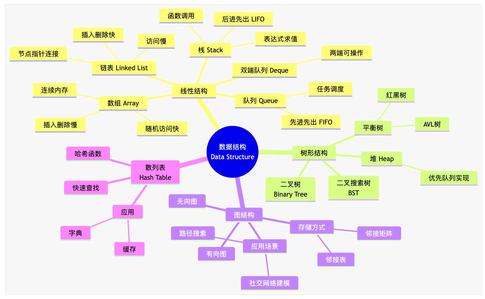
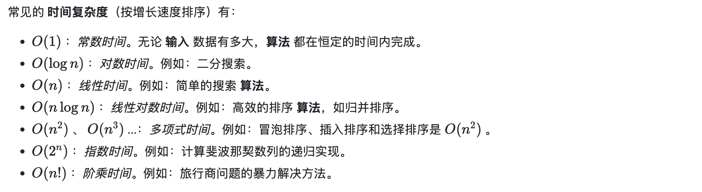
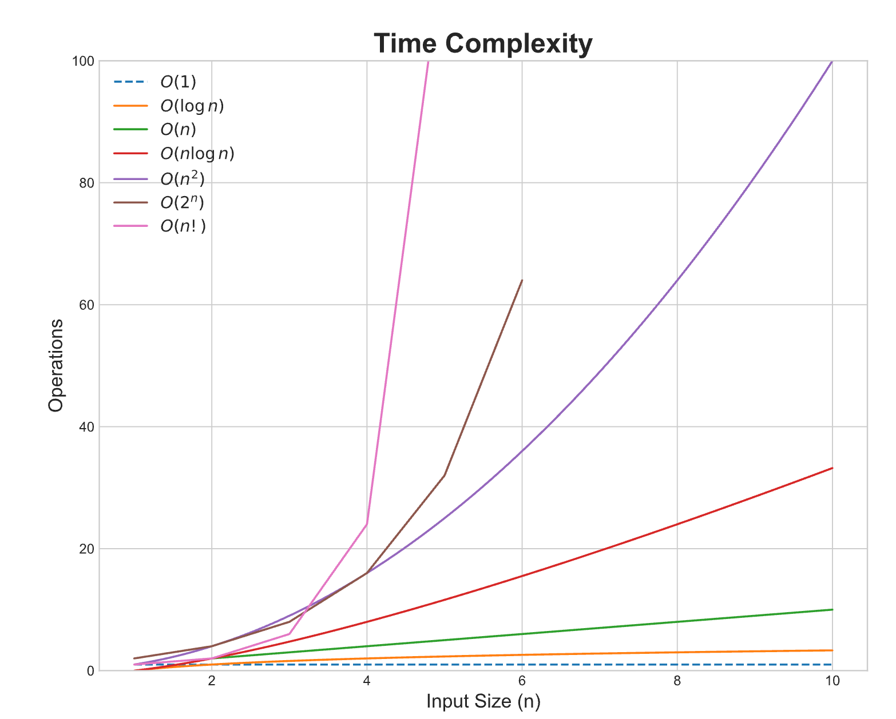

# 绪论

## 数据结构基本概念

### 一、数据结构

数据结构（Data Structure）是 **存储、组织和管理数据的方式**，它不仅决定了数据的存储形式，也影响数据访问和操作的效率。

#### 1.1 分类 

考试中涉及的数据结构可以分为以下几种：

1. 线性结构

   （元素之间有顺序关系）

   - **数组（Array）**：连续内存，随机访问快，插入删除慢
   - **链表（Linked List）**：节点通过指针连接，插入删除快，访问慢
   - **栈（Stack）**：后进先出（LIFO），用于函数调用、表达式求值
   - **队列（Queue）**：先进先出（FIFO），用于任务调度
   - **双端队列（Deque）**：两端都可以操作

2. 树形结构

   （元素之间有层级关系）

   - **二叉树（Binary Tree）**
   - **二叉搜索树（BST）**
   - **堆（Heap）**：优先队列实现
   - **平衡树（AVL、红黑树）**

3. 图结构

   （元素之间有网络关系）

   - 有向图 / 无向图
   - 邻接矩阵 / 邻接表存储
   - 常用于路径搜索、社交网络建模

4. 散列表（Hash Table）

   - 通过哈希函数实现快速查找
   - 常用于字典、缓存

### 二、算法

算法（Algorithm）是 **解决问题的一系列步骤或方法**，用来操作数据结构，实现具体功能。

**数据结构和算法的关系**

- **数据结构提供“容器”**
- **算法提供“操作方法”**
- 好的数据结构可以让算法更高效
- 算法的设计也依赖数据结构特性

> 💡 举例：
>
> - 用数组实现栈 → 可以快速访问栈顶
> - 用链表实现队列 → 插入删除都很快
> - 用堆实现优先队列 → 可以快速找最大/最小值
> - 用图 + BFS → 可以找最短路径

---

## 算法基本概念

### 一、什么是算法

**算法** (Algorithm) 是一个明确规定了操作步骤的有限指令集，用于计算函数、处理数据、解决一个特定问题或执行某个任务。

**算法** 的基本属性：

1. **明确性**：每一步骤必须有明确且不含糊的定义。
2. **有输入和输出**：**算法** 应有 0 个或更多的 **输入** 和 1 个或更多的 **输出**。**输入** 是在 **算法** 开始之前提供的，而 **输出** 是在 **算法** 结束时产生的。
3. **有限性**：如果 **算法** 在执行完有限步骤后终止，那么它就是 **有限的**。换句话说，一个 **算法** 必须总是在执行有限次操作后结束。
4. **可行性**：**算法** 中的每一步都应该是简单且基本的，这样它们可以在有限的时间内完成并由计算机执行。
5. **独立性**：**算法** 的指令应该有普适性，也就是说，它们不应依赖于任何特定的编程语言或模型。相反，**算法** 应该足够通用，可以在任何编程环境中实现。

### 二、效率度量

#### 2.1 时间复杂度

时间复杂度（Time Complexity）是计算机科学中衡量一个 **算法运行效率** 的重要指标。它主要描述了当输入规模（通常记为 *n* ）不断增大时，算法执行所需的 **基本操作次数** 的增长趋势。

在算法的时间复杂度分析中，**基本操作次数**指的是一个算法中执行时间固定的 **最小操作单元**。你可以把它理解为计算机执行一次最基础、最原始的指令所花费的时间。

这些基本操作通常包括：

- **算术运算**：例如，加、减、乘、除、取模等。
- **比较运算**：例如，小于、大于、等于等。
- **赋值操作**：将一个值赋给一个变量。
- **逻辑运算**：例如，与、或、非等。

##### 计算方法

设输入规模为 *n* ，算法执行所需的 **基本操作次数** 记为 *T*(*n*) 。 为了衡量算法效率，我们关心 *T*(*n*) 随 *n* 增大的增长趋势，而不是精确的操作次数。

时间复杂度就是 *T*(*n*) 的 **渐近上界**，常用 **大 \*O\* 符号** 表示为：*T*(*n*)=*O*(*f*(*n*))

其中 *f*(*n*) 是能反映 *T*(*n*) 增长速度的函数。 换句话说，时间复杂度刻画的是 **当 \*n\* 趋于无穷大时，算法执行时间随输入规模增长的量级**。

#### 2.2 空间复杂度

**空间复杂度**（Space Complexity）是衡量 **算法执行过程中所需存储空间** 随输入数据量增长而变化的指标。它不仅包括算法中用来存放 **输入数据** 的空间，还包括 **辅助变量、递归调用栈** 等临时空间。与时间复杂度类似，我们关注的是 **增长趋势**，通常只关注最高阶的量级，用大 *O* 符号表示。

##### 组成

1. 固定部分
   - 包括常量、程序代码本身、简单变量、常量数组等。
   - 这一部分的空间大小与输入数据规模无关，通常记为 *O*(1) 。
2. 可变部分
   - 随着输入数据量的变化而变化的空间，主要包括：
     - **输入数据本身**（如数组、链表）
     - **辅助空间**（如临时数组、栈、队列等）
     - **递归调用栈**（递归深度对空间占用有直接影响）

##### 常见空间复杂度

常见的 **空间复杂度**（按增长速度排序）有：

| 空间复杂度  | 描述                               | 示例                                 |
| ----------- | ---------------------------------- | ------------------------------------ |
| *O*(1)      | 使用常量额外空间                   | 交换两个变量、求最大值/最小值        |
| *O*(*n*)    | 需要与输入规模成线性关系的额外空间 | 复制数组、链表逆序                   |
| *O*(*n*2)   | 二维数组或矩阵存储                 | Floyd-Warshall 算法的距离矩阵        |
| *O*(log*n*) | 递归调用栈空间                     | 二分查找的递归实现、平衡二叉树的遍历 |

