# 线性表

## 定义和基本操作

### 一、线性表定义

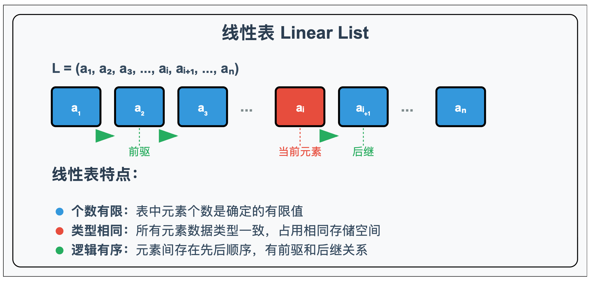

**线性表**（Linear List）是 **L 数据结构** 中的一种基本结构。它是 **零个或多个数据元素的有限序列**。通常，**线性表** 中的 **数据元素** 之间是 **有序的**，它们之间存在着 **前驱和后继的关系**。

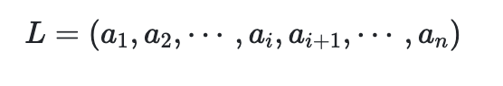

特点：

- **个数有限**
- **表中元素数据类型都相同**，每个元素占有 **相同大小的存储空间**
- 仅讨论 **元素间的逻辑关系**，表中元素有 **先后顺序**

#### 1.1 顺序表和链表

线性表分为顺序存储结构（又称 **顺序表**）和链式存储结构（又称为 **链表**）。

顺序表中的元素存储地址是 **连续的**（存储在栈中），而链表的元素存储地址是 **非连续的**（存储在堆中），元素节点中除了存储数据元素之外还存储相邻元素的地址信息。顺序表中数据之间的 **逻辑关系** 和 **物理关系** 是一致的，链表中数据元素的逻辑关系和物理关系并不一定一致。

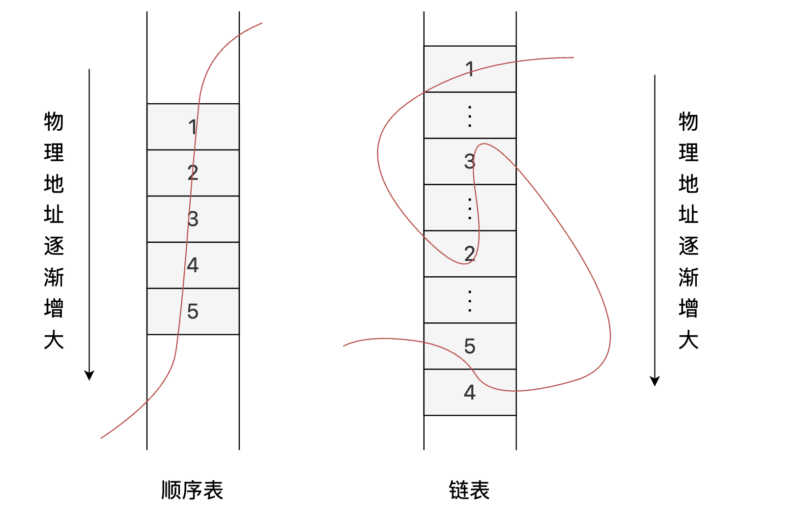

上图中左边为顺序表，右边为链表。顺序表在内存中的地址是连续的，各个元素的下标之间是有规律可循的，通过一个已知下标的元素可以找到顺序表中任意一个其它元素。但是链式表中的元素在内存中的地址是不连续的，所以链式表中的每个元素除了要保存数据信息外，还要保存下一个元素的内存地址，以便形成线性关系。

### 二、操作

线性表中的操作包含以下类型，顺序表 和 链表 会各自使用不同的方案实现这些操作：

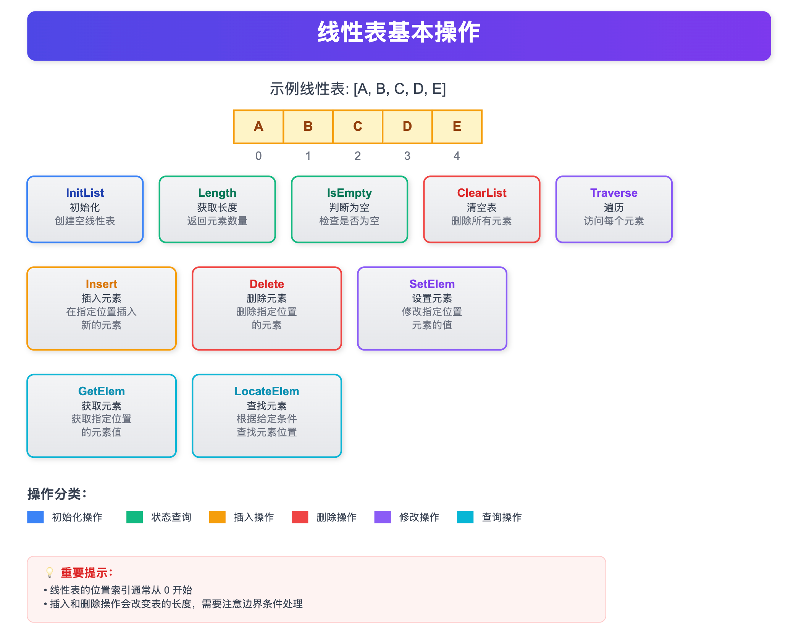

- **初始化** (`InitList`): 创建一个 **空的线性表**。
- **插入** (`Insert`): 在线性表的 **指定位置** 插入一个 **新的元素**。
- **删除** (`Delete`): 删除线性表中的 **指定位置的元素**。
- **查找** (`LocateElem`): 根据 **给定的条件** 查找线性表中的 **元素**。
- **获取元素** (`GetElem`): 获取线性表中 **指定位置的元素**。
- **设置元素** (`SetElem`): 修改线性表中 **指定位置的元素** 的 **值**。
- **长度** (`Length`): 返回线性表中的 **元素数量**。
- **判空** (`IsEmpty`): 判断线性表是否 **为空**。
- **清空** (`ClearList`): **清除**线性表中的 **所有元素**。
- **遍历** (`Traverse`): 对线性表中的 **每个元素** 执行 **某种操作**。

---

## 顺序表示

### 一、顺序表定义

**顺序表（Sequential List）** 是一种常见的数据结构，用于存储一组元素，并按照它们在内存中的物理顺序来排列和访问这些元素。顺序表通常由一个 **数组** 或 **列表** 构成，其中每个元素都占据一个连续的内存位置，并且可以通过索引值来访问。

假设线性表 A 存储的其实位置为 `LOC(A)`，每个元素占用的存储空间的大小为 `sizeof(Elem)`，则 A 所对应的顺序存储结构为：

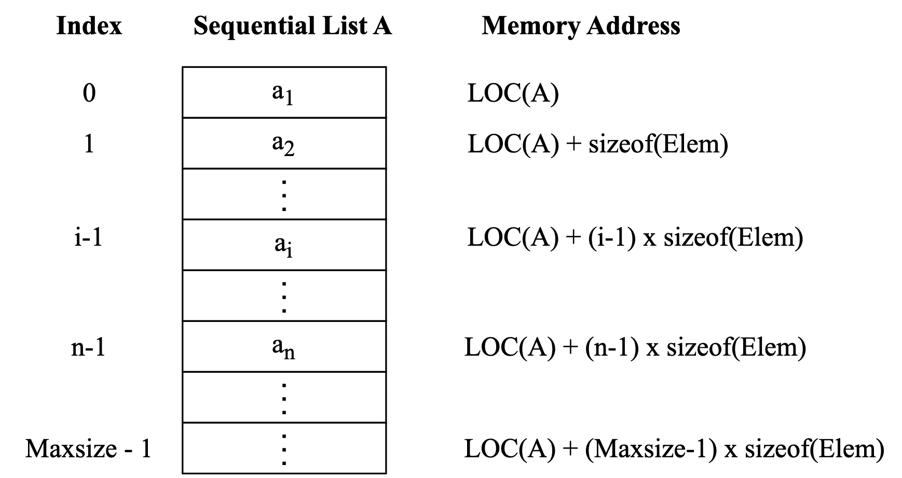

- 顺序表优点：
  - **随机访问性强**：顺序表支持通过索引直接访问元素，访问速度快，时间复杂度为 **O(1)**。
  - **空间使用连续**：顺序表中的元素存储在连续的内存块中，这有助于提高缓存的局部性，从而提高访问速度。
  - **操作简单**：无需处理复杂的指针操作。
- 顺序表缺点：
  - **固定大小或调整大小的开销**：对于静态数组，大小是固定的，如果预分配的空间不足或过大，会导致内存浪费或数组溢出。动态数组可以重新分配大小，但这会增加时间和空间开销。
  - **插入和删除的时间开销**：如果要在顺序表的中间插入或删除元素，可能需要移动大量的元素，时间复杂度为 **O(n)**。

### 二、操作

#### 2.1 数据结构定义

以下代码定义了一个顺序表 `SeqList`，它使用 **固定大小的数组** `data` 来存储元素，`length` 记录当前表的长度。`InitList` 函数初始化顺序表，设置 *长度为 0*，表示空表。

```c
#define MAXSIZE 100
typedef struct {
    ElementType data[MAXSIZE];
    int length;
} SeqList;

void InitList(SeqList *L) {
    L->length = 0;
}
```

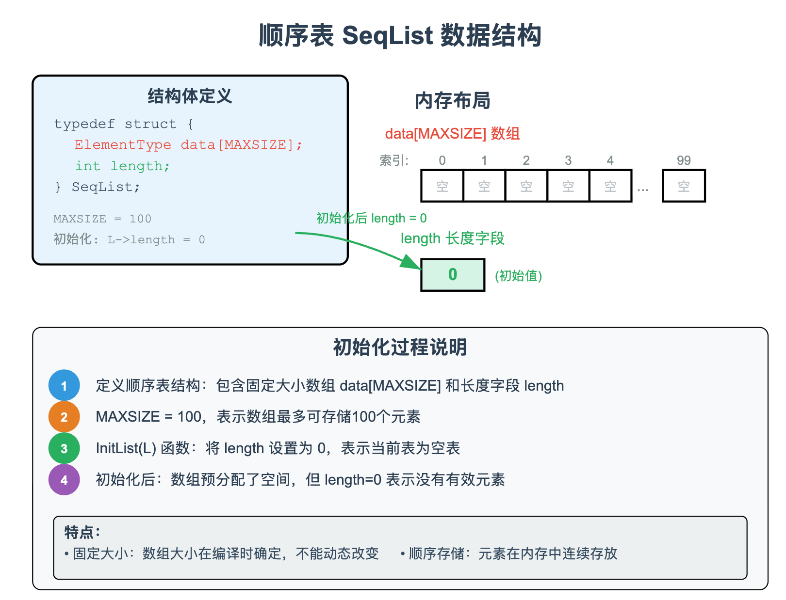

#### 2.2 插入

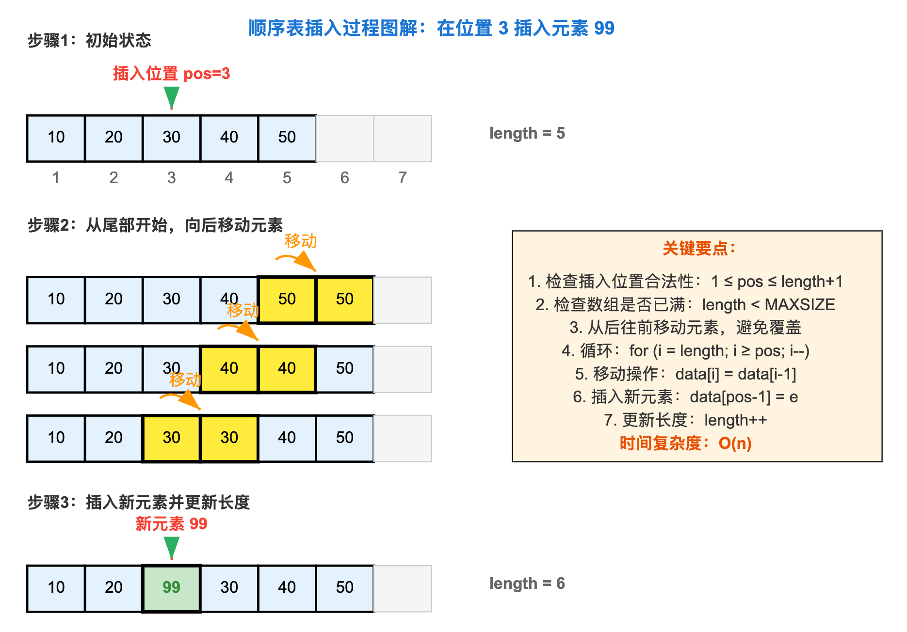

在第 `pos` 个位置 **插入新元素** `e`。首先检查 **插入位置合法性** 和 **空间是否已满**，然后从尾部向后移动元素，为插入留出位置，最后将元素插入并更新长度。

```c
bool Insert(SeqList *L, int pos, ElementType e) {
    if (L->length == MAXSIZE || pos < 1 || pos > L->length + 1) {
        return false;
    }
    for (int i = L->length; i >= pos; i--) {
        L->data[i] = L->data[i - 1];
    }
    L->data[pos - 1] = e;
    L->length++;
    return true;
}
```

#### 2.3 删除

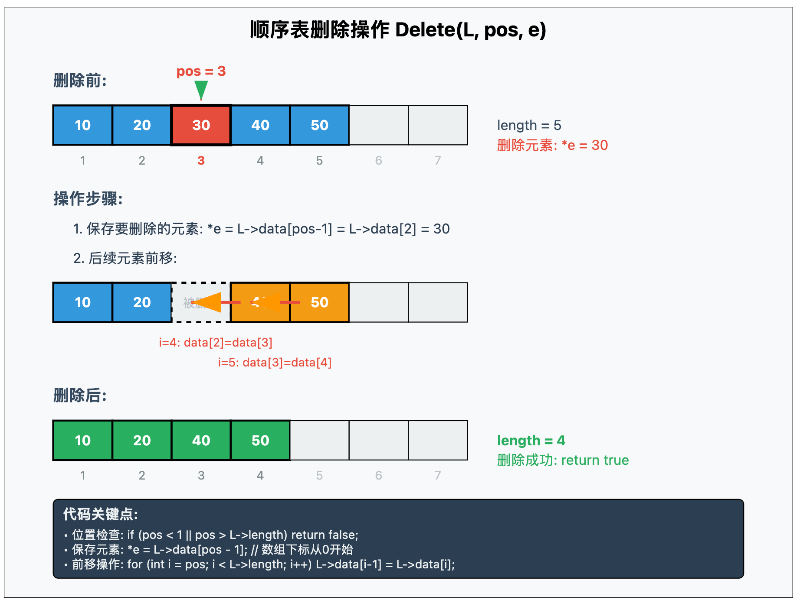

**删除第 `pos` 个元素**，并通过指针返回删除的元素值。删除后将该位置后的所有元素 **前移**，最后更新长度。

```c
bool Delete(SeqList *L, int pos, ElementType *e) {
    if (pos < 1 || pos > L->length) {
        return false;
    }
    *e = L->data[pos - 1];
    for (int i = pos; i < L->length; i++) {
        L->data[i - 1] = L->data[i];
    }
    L->length--;
    return true;
}
```

#### 2.4 查找操作

在线性表中 **顺序查找** 第一个值等于 `e` 的元素，返回其**逻辑位置**（从 1 开始）；若未找到，返回 0。

```c
int LocateElem(SeqList L, ElementType e) {
    for (int i = 0; i < L.length; i++) {
        if (L.data[i] == e) {
            return i + 1;
        }
    }
    return 0;
}
```

#### 2.5 获取元素

**获取顺序表中第 `pos` 个元素**，返回值通过指针 `*e` 输出。若位置非法则返回 *false*。

```c
bool GetElem(SeqList L, int pos, ElementType *e) {
    if (pos < 1 || pos > L.length) {
        return false;
    }
    *e = L.data[pos - 1];
    return true;
}
```

#### 2.6 判空

**判断顺序表是否为空**，直接判断 `length` 是否为 *0*。

```c
bool IsEmpty(SeqList L) {
    return L.length == 0;
}
```

#### 2.7 清空

**清空顺序表**，只需将 `length` *置 0*，无需实际删除元素，等价于逻辑上的清空。

```c
void ClearList(SeqList *L) {
    L->length = 0;
}
```

#### 2.8 长度

**返回当前顺序表的长度**，即有效元素个数。

```c
int Length(SeqList L) {
    return L.length;
}
```

---

## 链表表示

### 一、单链表定义

线性表的 **链式表示** 通常指的是使用 **链表** 来实现线性表。**链表** 是由一系列 **结点** 组成的，每个 **结点** 都包含一个 **数据元素** 和一个指向下一个 **结点** 的 **指针**。这种结构允许我们 **动态地插入** 和 **删除元素**，而不需要移动其他元素。

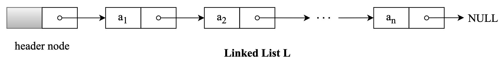

与顺序表不同，单链表中每个 **结点** 的存储空间都是 **动态分配** 的，即使用 c 语言中的 `malloc()` 函数或者 c++ 中的 `new` 操作符。

**动态分配** 的空间存储在 **[进程的堆](https://www.csgraduates.com/operating_system/process/process_thread/#进程内存空间)** 中，这些 **结点** 占用的存储空间不是连续的，而是离散的，如下图所示：

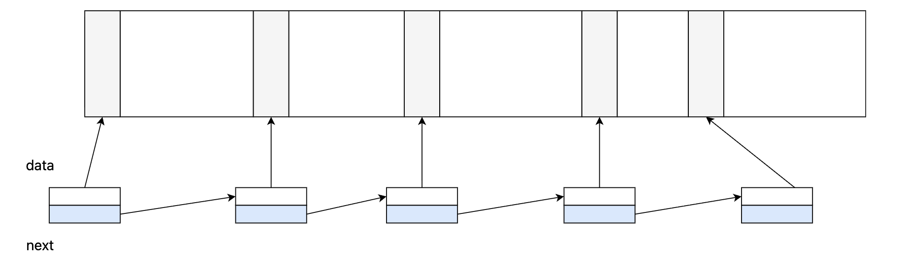

由于堆的这种 **动态内存分配** 特性，**单链表** 具备如下优点：

- **链表大小可以动态变化**：链表的 **结点** 是在需要时 **动态分配** 的，因此在使用过程中不需要提前分配固定大小的存储空间，可以随时 **插入** 或 **删除** **结点**。
- **插入和删除方便**：只要知道了某个 **结点** 的位置，就可以在 *O(1)* 的时间复杂度内 **插入** 或 **删除** 该 **结点**。而顺序表可能需要移动大量的元素。
- **无需预估数据大小**：链表可以灵活地增长，而顺序表需要预先定义一个固定大小，或者使用 **动态数组** 实现，但重新分配和拷贝的开销可能会很大。

数组（顺序表）与 **链表** 不同，由于数组一般是直接作为函数的局部变量使用 `int a[N]` 定义的，所以数组存储在 **[进程的栈](https://www.csgraduates.com/operating_system/process/process_thread/#进程内存空间)** 中，数组中的相邻元素是 **连续** 地存储在栈上，如下图所示：

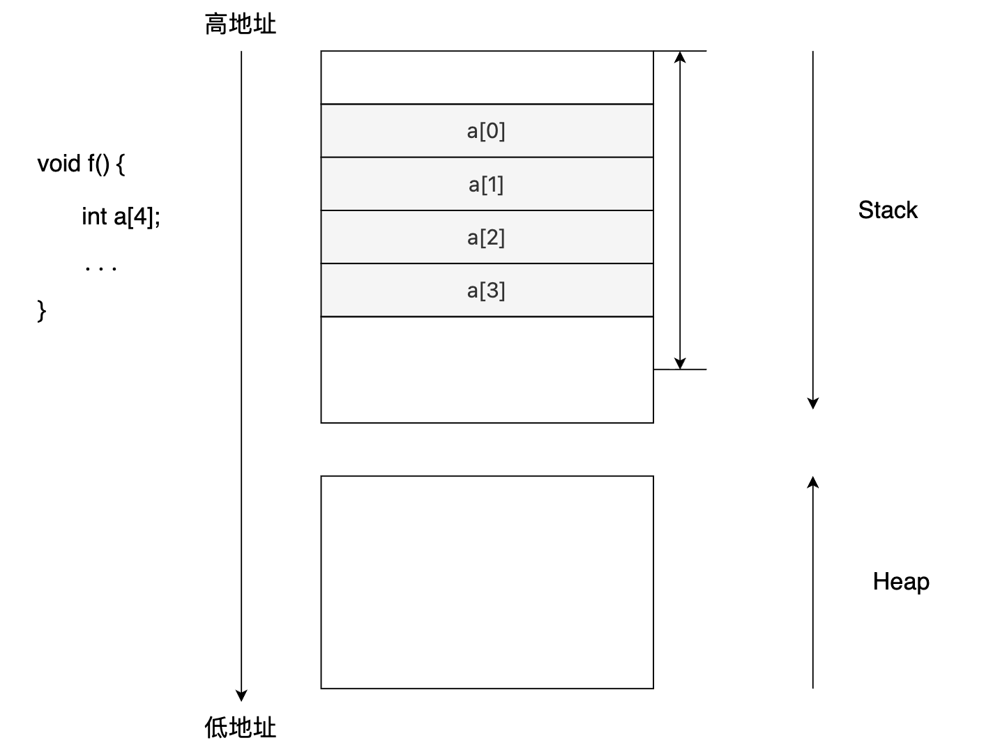

由于数组在内存中的存储是 **连续** 的，这有利于程序的 [**空间局部性**](https://www.csgraduates.com/constitution_principle/storage/cache/#空间局部性)，当访问一个元素时，相邻的元素也会被加载到 **CPU 缓存** 中，这提高了访问速度。
此外，通过数组的起始地址和一个偏移，我们可以快速地定位到某个数组元素在内存中的地址，实现 **随机访问**。

相比而言，**链表** 则不具备以上特性，**链表** 的缺点如下：

- **随机访问较慢**：**链表** 不支持直接通过索引进行 **随机访问**，必须从头部开始逐个遍历 **结点**，直到找到所需的 **结点**，所以访问 **链表** 中的元素需要 *O(n)* 的时间复杂度。
- **空间开销较大**：除了 **数据元素** 的存储外，每个 **结点** 还需要额外的空间存储一个 **指针**，这增加了 **链表** 的存储开销。

### 二、操作

**链表** 的操作经常考察，需要熟练掌握，并且能够手写代码。

#### 2.1 数据结构定义

可以使用如下结构体来描述 **单链表** 中的 **结点**：

```c
// 链表定义
typedef struct Node {
    int data;
    struct Node *next;
} Node;
```

其中结构体中包含两个元素，一个是 **数据**，另一个 **指向下一个结点的指针**。

通过这种方式，**链表** 可以在内存中以非连续的方式存储数据，每个 **结点** 通过 **指针** 连接起来。

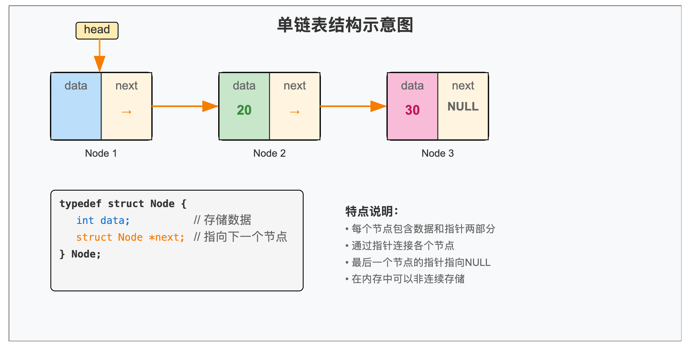

在这个例子中，`data` 的类型是 `int`，意味着这个 **链表** 用于存储整数。但是，你可以根据需要更改 `data` 的类型，例如 `float`、`char` 或者自定义的结构体类型，以存储不同类型的数据。

`next` 指针的作用是 **连接链表中的各个结点**。它存储了下一个结点的内存地址。通过 `next` 指针，我们可以从一个结点访问到下一个结点，从而遍历整个链表。

#### 2.2 初始化链表

在 **初始化** 链表时我们需要为其创建一个 **头结点**，并将 **头结点** 的 `next` 设置为空。

```c
// 初始化
Node* init_linkedlist() {
    Node *head = (Node *)malloc(sizeof(Node));  // 创建头结点
    if (head == NULL) exit(1);  // 内存分配失败
    head->next = NULL;  // 初始为空链表
    return head;
}
```

**头结点** 的目的在于 **简化空链表的处理** 和 **统一链表的操作**：

- 引入 **头结点** 后，即使链表为空，**头指针** 也始终指向 **头结点**。
- 通过引入 **头结点**，可以使链表的第一个 **结点**（实际数据 **结点**）的操作与其他 **结点** 的操作保持一致。

#### 2.3 判空

如果 **头指针** 的 `next` 为空的话，说明 **单链表** 为空：

```c
bool is_empty(Node *head) {
    return head->next == NULL;
}
```

#### 2.4 插入

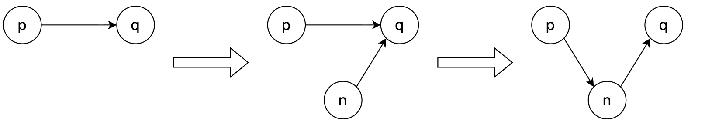

对于在 **链表** 的一个 **结点** `p` 之后插入一个新 **结点** `n` 可以抽象如下操作：

```c
// 插入结点
void insert_node_after(Node *p, Node *n) {
    Node *q = p->next;
    n->next = q;
    p->next = n;
}

// 插入值
void insert_value_after(Node *n, int value) {
    Node *p = malloc(sizeof(Node));
    p->value = value;
    Node *q = n->next;
    n->next = p;
    p->next = q;
}
```

当然，如果我们想插入一个实际值 `value` 的话，你需要通过 `Node *p = malloc(sizeof(Node)); p->data = value;` 来创建一个新 **结点**，然后再将新创建的 **结点** 通过以上函数插入。

在实际考察 **插入** 操作的过程中，可能会涉及到三种情况：在 **链表** 头部插入、在 **链表** 尾部插入 或 在任意位置插入。

```c
// 头部插入
void insert_after_head(Node *head, int value) {
    // 调用上文定义的插入函数
    insert_value_after(head, value);
}

// 尾部插入
void insert_after_tail(Node *head, int value) {
    // 找到链表的尾部结点
    Node *tail = head;
    while (tail->next != NULL) {
        tail = tail->next;
    }
    // 在该位置插入
    insert_value_after(tail, value);
}

// 任意位置
// 在链表的第 pos 个位置插入（位置从 0 开始计数），返回值 bool 表示插入是否成功
bool insert_at_pos(Node *head, int pos, int value) {
    Node *p = head;
    int i = 0;
    // 找到第 pos-1 个结点
    while (p && i < pos - 1) { 
        p = p->next;
        i++;
    }
    // 如果该位置不存在的话，返回 false
    if (!p || i > pos - 1) return false;

    insert_value_after(p, value);
    return true;
}
```

#### 2.5 删除

假设指针 `p` 指向 **链表** 中的某个 **结点**，如果我们想删除 `p` 的下一个 **结点** 的话，可以通过如下代码：

```c
void delete_node_after(Node *p) {
    Node *q = p->next;
    // 需要判断 q 是否存在
    if (q) {
        // 设置 p 的下一个结点跳过 q
        p->next = q->next;
        // 释放 q 的空间
        free(q);
    }
}
```

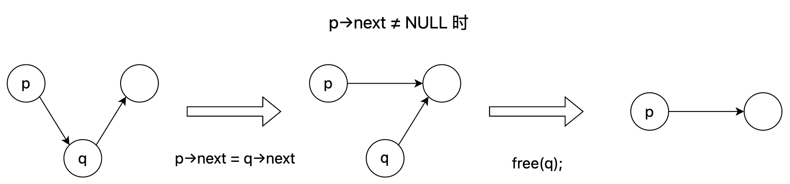

如果我们想删除 **单链表** 中的第 `pos` 个 **结点** 的话，可以通过如下代码：

```c
// 返回 true 表示删除成功，返回 false 表示删除失败。
bool delete(Node *head, int pos) {
    Node *p = head;
    int i = 0;
    while (p->next && i < pos - 1) {  // 找到第 pos-1 个结点
        p = p->next;
        i++;
    }
    // 如果 p 是链表中最后一个结点，或者 pos-1 的结点不存在的话，返回 false
    if (!(p->next) || i > pos - 1) return false;

    // 删除下一个结点
    Node *q = p->next;
    p->next = q->next;
    free(q);
    return true;
}
```

#### 2.6 查找

如果要查找 **链表** 中是否有 **结点** 存储有 `value` 的值的话，可以通过如下函数：

```c
// 返回 0 表示未找到
int Find(Node *head, int value) {
    Node *p = head->next;
    int i = 1;
    // 遍历链表判断是否有结点值域 value 相同
    while (p) {
        if (p->data == value) return i;
        p = p->next;
        i++;
    }
    return 0;
}
```

#### 2.7 清空

清空 **链表** 需要删除 **链表** 中的每一个 **结点**，并且将 **链表** 设置为空，可以通过如下函数：

```c
void ClearList(Node *head) {
    Node *p = head->next, *q;
    head->next = NULL;
    // 遍历每个结点，并且 free 结点
    while (p) {
        q = p->next; // 暂存下一个结点
        free(p);
        p = q;
    }
}
```

### 三、其他链表实现

#### 3.1 双向链表

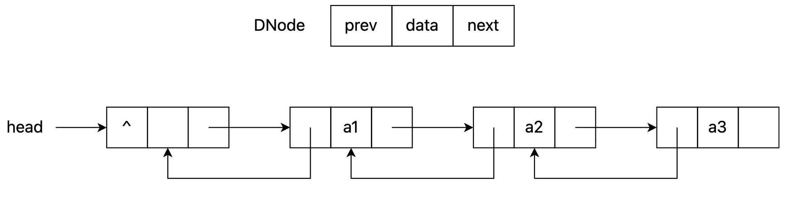

在 **双向链表** 中，每个节点包含三个部分：**数据**、**前驱指针** `prev`、**后继指针** `next`。

```c
typedef struct DNode {
    ElementType data;
    struct DNode *prev;  // 指向前驱节点
    struct DNode *next;  // 指向后继节点
} DNode;
```

**双向链表** 主要具备以下优势：

- 可以 **双向遍历**，支持从任意节点向前或向后查找。
- **插入和删除** 某个节点时，不需要再查找其前一个节点（与单链表相比更方便）。

**插入操作**

假设插入 `s` 到 `p` 前：

```
原来：
... ⟷ pre ⟷ p ⟷ ...

插入后：
... ⟷ pre ⟷ s ⟷ p ⟷ ...
```

具体操作步骤如下：

```c
// 假设 p 是链表中的某个节点，s 是新建节点
s->prev = p->prev;      // 步骤①：新节点 s 的前驱是 p 的前驱
s->next = p;            // 步骤②：新节点 s 的后继是 p
p->prev->next = s;      // 步骤③：p 原前驱节点的 next 改为 s
p->prev = s;            // 步骤④：p 的前驱改为 s
```

**删除操作**

假设删除节点 `p`：

```
... ⟷ prev ⟷ p ⟷ next ⟷ ...
        ↓ 删除 p
... ⟷ prev ⟷ next ⟷ ...
```

具体操作步骤如下：

```c
p->prev->next = p->next;  // 步骤①：前驱的 next 指向 p 的后继
p->next->prev = p->prev;  // 步骤②：后继的 prev 指向 p 的前驱
free(p);                  // 步骤③：释放 p 节点
```

#### 3.2 静态链表

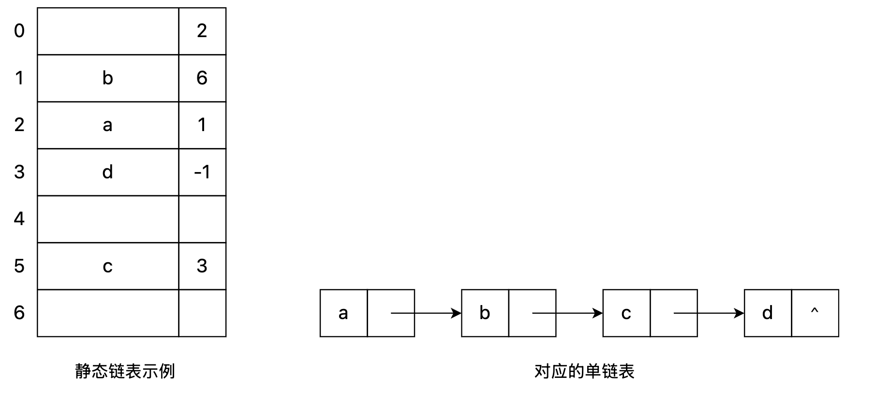

**静态链表** 实际上就是用 **顺序表**（一个结构体数组）来模拟 **链表**。结构体中包含两个元素：`data` 和 `next`，其中 `data` 存储数据，`next` 存储下一个元素的下标（相当于指针的作用）：

```c
#define MAXSIZE 100

typedef struct {
    ElementType data;
    int next;
} SNode;

SNode list[MAXSIZE];
```

**静态链表** 使用 `next == -1` 作为其结束的标志。**静态链表** 的各种操作和 **动态链表** 基本一致，只需要修改指针，不需要移动元素。

#### 3.3 循环链表

**循环链表**（Circular Linked List）是一种特殊的 **链表** 结构，其 **最后一个节点的指针指向头节点**，使得整个 **链表** 形成一个 **环状结构**。因此，从任何一个节点开始遍历，只要不断沿着指针走，就一定会回到起点。

**循环链表** 可分为两种类型：

| 类型             | 说明                                                         |
| ---------------- | ------------------------------------------------------------ |
| **单向循环链表** | 每个节点只有一个 `next` 指针，最后一个节点的 `next` 指向头节点 |
| **双向循环链表** | 每个节点有 `prev` 和 `next`，首尾相连，前后都可以循环遍历    |

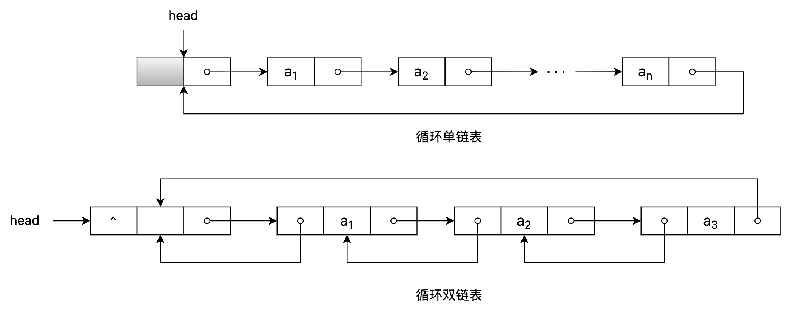


