# 栈、队列、数组

## 栈

### 一、定义

**栈** 是一个元素的集合，加入元素的操作叫做 **“压栈”（push）**，而移除元素的操作叫做 **“出栈”（pop）**。它遵循 **后进先出（LIFO, Last In First Out）** 的原则。*这意味着最后被压入栈的元素是第一个被弹出的元素*。

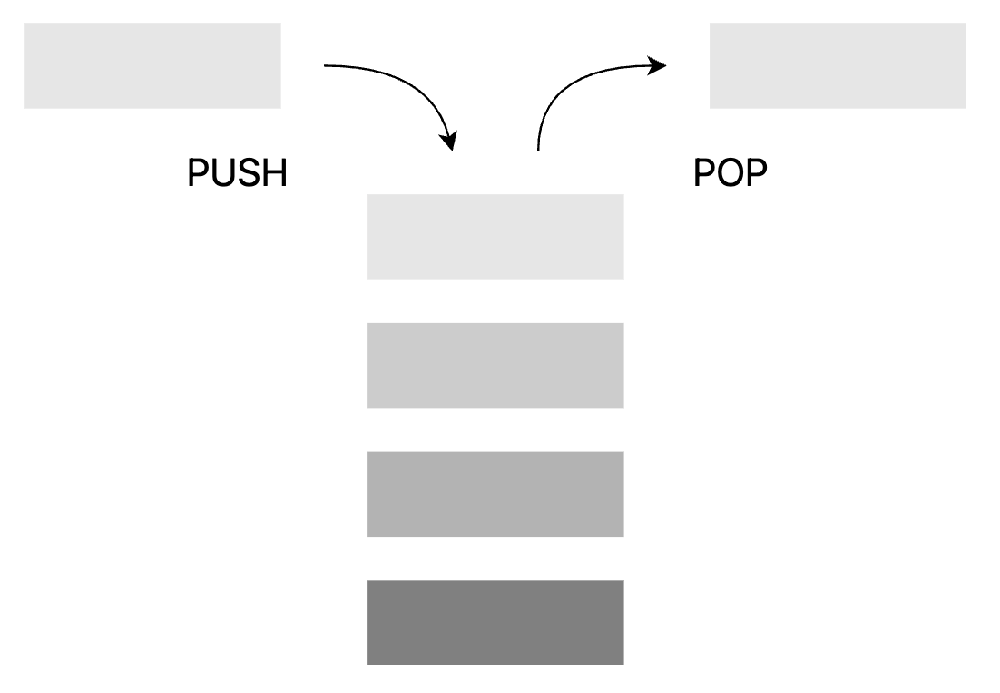

### 二、基本操作

- `push(element)`: 将元素添加到 **栈** 的顶部。
- `pop()`: 移除并返回 **栈顶** 的元素。如果 **栈** 为空，这个操作可能会抛出一个错误或返回特定的值（例如 null 或 undefined），具体取决于实现。
- `peek()` 或 `top()`: 返回 **栈顶** 的元素但不移除它。这只是一个查看操作，**栈** 的内容不会改变。如果 **栈** 为空，这个操作可能会抛出一个错误或返回特定的值。
- `isEmpty()`: 判断 **栈** 是否为空。如果 **栈** 为空，返回 **true**；否则返回 **false**。
- `size()` 或 `length()`: 返回 **栈** 中元素的数量。

### 三、实现

**栈** 的实现方式有两种，**顺序栈** 和 **链式栈**。
**顺序栈** 是在 **顺序表** 的基础上实现 **栈结构**，
**链式栈** 是在 **链表** 的基础上实现 **栈结构**。

#### 3.1 顺序栈

**顺序栈**是使用 **数组** 来实现的 **栈**，利用数组的索引来模拟 **栈** 的操作。
与普通的线性表不同，**栈** 的操作被限制在表的一端进行，这一端被称为 **栈顶 (Top)**，另一端被称为 **栈底 (Bottom)**。

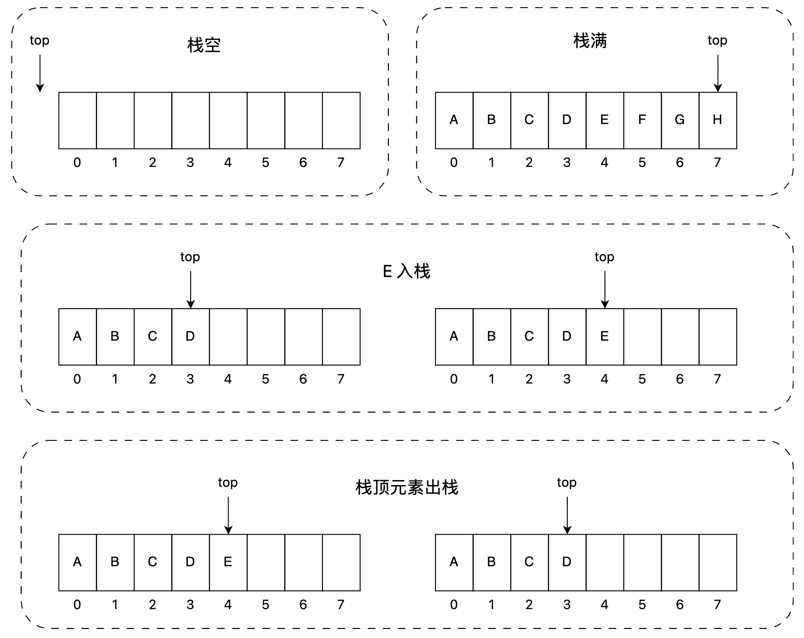

**顺序栈**的关键在于 **栈顶指针**，**栈顶指针**是一个整数变量，用于指示 **栈顶** 元素在 **数组** 中的位置。其值的变化直接反映了栈中元素的变化。

当 **栈空** 时，一般将 **栈顶指针**设置为 **1**，当 **栈满** 时，**栈顶指针**指向 **数组** 中的最后一个元素。

当元素 **入栈** 时，将栈顶指针 **向后** 移动一个位置、然后放置新元素即可。当元素 **出栈** 时，需要将栈顶指针 **向前** 移动一个位置。

当然，入栈需要保证栈不满，出栈需要保证栈不空。

```c
// 1.栈的定义
#define MAX_SIZE 100 // 定义栈的最大容量

// 定义顺序栈的结构
typedef struct {
    int data[MAX_SIZE]; // 使用数组存储数据
    int top;            // 栈顶指针
} SeqStack;

// 2.初始化
// 初始化栈
SeqStack* initStack() {
    SeqStack* stack = (SeqStack*)malloc(sizeof(SeqStack));
    if(!stack) {
        printf("Failed to allocate memory for stack\n");
        exit(1);
    }
    // 栈顶指针初始化为 -1，表示栈为空
    stack->top = -1; 
    return stack;
}

// 3.入栈
// 入栈操作
bool push(SeqStack* stack, int value) {
    if (isFull(stack)) {
        printf("Stack is full!\n");
        return false;
    }
    // 先移动栈顶指针，再存放元素
    stack->data[++stack->top] = value;
    return true;
}

// 4.出栈
// 出栈操作
bool pop(SeqStack* stack, int* value) {
    if (isEmpty(stack)) {
        printf("Stack is empty!\n");
        return false;
    }
    // 先取出元素，再移动栈顶指针
    *value = stack->data[stack->top--];
    return true;
}

// 5.获取栈顶元素
// 获取栈顶元素
bool peek(SeqStack* stack, int* value) {
    if (isEmpty(stack)) {
        printf("Stack is empty!\n");
        return false;
    }
    *value = stack->data[stack->top];
    return true;
}

// 6.判断栈空
// 判断栈是否为空
// 当栈中没有元素时，栈顶指针通常指向一个特殊的位置，例如 -1。
bool isEmpty(SeqStack* stack) {
    return stack->top == -1;
}

// 判断栈是否已满
// 当栈顶指针指向数组中的最后一个元素时，说明栈已经满了
bool isFull(SeqStack* stack) {
    return stack->top == MAX_SIZE - 1;
}
```

#### 3.2 链式栈

栈的 **链式存储结构** 利用 **[单链表](https://www.csgraduates.com/data_structure/linearlist/linked/#单链表定义)** 来实现栈的功能。

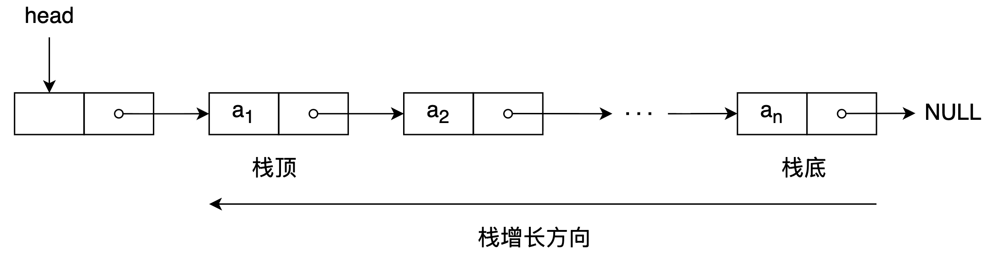

在 **链式栈** 实现中，一般 **头结点不存放数据**，仅作为链表的固定起点。栈顶元素始终为 `head->next`。这样依然可以保证 入栈 和 出栈 的时间复杂度为 *O*(1) 。

链式栈具备以下 **重要特性**：

- `head` 始终存在，不存储实际数据，只作为哨兵节点。
- **栈顶元素** 始终位于 `head->next`。
- **空栈** 时，`head->next == NULL`。
- 入栈时在 `head->next` 前插入新节点；出栈时删除 `head->next`。

```c
// 1.栈的定义
// 定义链式栈的节点结构
typedef struct Node {
int data;
struct Node* next;
} Node;

// 定义链式栈（带头结点）
typedef struct {
Node* head;  // 指向头结点
} LinkedStack;

// 2.初始化
// 初始化栈（带头结点）
LinkedStack* initStack() {
    LinkedStack* stack = (LinkedStack*)malloc(sizeof(LinkedStack));
    if (!stack) {
        printf("Failed to allocate memory for stack\n");
        exit(1);
    }
    stack->head = (Node*)malloc(sizeof(Node)); // 创建头结点
    if (!stack->head) {
        printf("Failed to allocate memory for head node\n");
        exit(1);
    }
    stack->head->next = NULL; // 初始为空栈
    return stack;
}

// 3.入栈
// 入栈操作（头插法）
void push(LinkedStack* stack, int value) {
    Node* newNode = (Node*)malloc(sizeof(Node));
    if (!newNode) {
        printf("Failed to allocate memory for new node\n");
        exit(1);
    }
    newNode->data = value;
    newNode->next = stack->head->next;
    stack->head->next = newNode;
}

// 4.出栈
// 出栈操作
bool pop(LinkedStack* stack, int* value) {
    if (isEmpty(stack)) {
        printf("Stack is empty!\n");
        return false;
    }
    Node* topNode = stack->head->next;
    *value = topNode->data;
    stack->head->next = topNode->next;
    free(topNode);
    return true;
}

// 5.获取栈顶元素
// 获取栈顶元素
bool peek(LinkedStack* stack, int* value) {
    if (isEmpty(stack)) {
        printf("Stack is empty!\n");
        return false;
    }
    *value = stack->head->next->data;
    return true;
}

// 6.判断栈空
// 判断栈是否为空
bool isEmpty(LinkedStack* stack) {
    return stack->head->next == NULL;
}
```

---

## 队列

### 一、定义

队列是一种遵循 **先入先出** (FIFO, First In First Out) 原则的线性数据结构。元素在 **队尾** 添加，在 **队首** 删除。

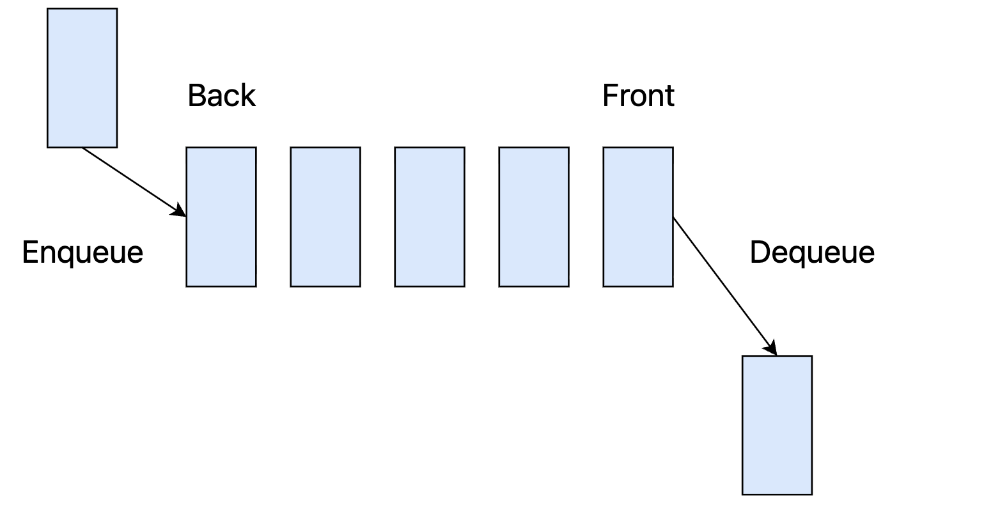

### 二、基本操作

- `enqueue(element)`: 将元素添加到 **队列** 的尾部。
- `dequeue()`: 从 **队列** 的头部移除并返回元素。如果 **队列** 为空，此操作可能会返回特定的值或引发错误。
- `front()` 或 `peek()`: 返回 **队首** 的元素但不移除它。
- `isEmpty()`: 判断 **队列** 是否为空。
- `size()`: 返回 **队列** 中元素的数量。

### 三、实现

#### 3.1 顺序队列

顺序队列通常是指使用固定大小的数组来存储 **队列** 中的元素。在顺序队列中，通常有两个指标：一个是 **队头**（front），另一个是 **队尾**（rear）。当插入（入队）或删除（出队）元素时，这两个指标会移动。

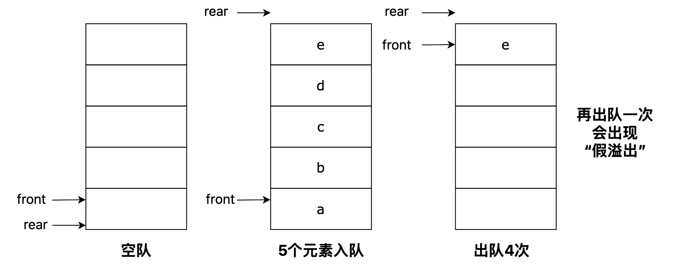

顺序队列有一个明显的问题：随着时间的推移，**队列** 中的元素可能向数组的末尾移动，即使 **队列** 并不满，也可能无法再插入新的元素，因为 **队尾** 已经达到了数组的末尾。这种现象称为 **假溢出**。

#### 3.2 循环队列

为了解决上述问题，可以使用 **循环队列**（也称为环形队列）。**循环队列** 是顺序队列的一个变种，它把数组视为一个循环的结构。当 **队尾** 指标达到数组的最后一个位置并且还需要进一步移动时，它会回到数组的起始位置。

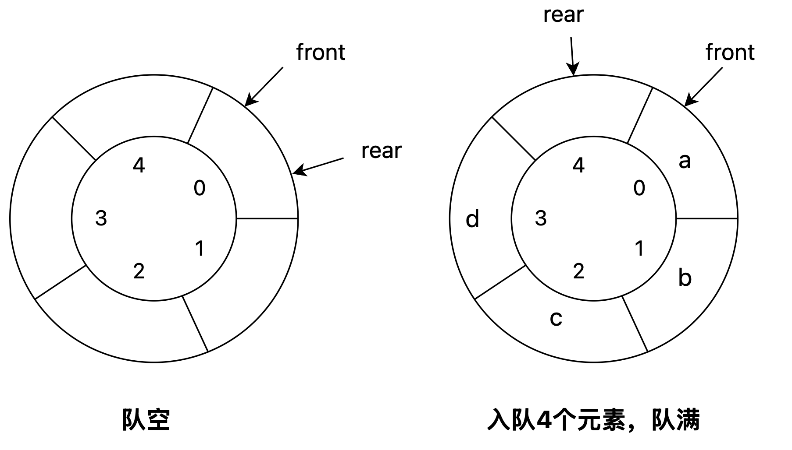

需要注意的是，在 **循环队列** 中需要牺牲一个存储单元以区分 **队空** 和 **队满** 的情况。

- 当 `front == rear` 时，*队列为空*
- 当 `(rear + 1) % size == front` 时，*队列为满*

```c
// 1.定义
#define MAX_SIZE 100

typedef struct {
    int data[MAX_SIZE];
    int front, rear;
} CircularQueue;

// 初始化队列
void initQueue(CircularQueue* q) {
    q->front = q->rear = 0;
}

// 2.入队
// 入队操作
bool enqueue(CircularQueue* q, int value) {
    if (isFull(q)) return false;
    q->data[q->rear] = value;
    q->rear = (q->rear + 1) % MAX_SIZE;
    return true;
}

// 3.出队
// 出队操作
bool dequeue(CircularQueue* q, int* value) {
    if (isEmpty(q)) return false;
    *value = q->data[q->front];
    q->front = (q->front + 1) % MAX_SIZE;
    return true;
}

// 4.首尾元素
// 获取队首元素
bool front(CircularQueue* q, int* value) {
    if (isEmpty(q)) return false;
    *value = q->data[q->front];
    return true;
}

// 获取队尾元素
bool rear(CircularQueue* q, int* value) {
    if (isEmpty(q)) return false;
    *value = q->data[(q->rear - 1 + MAX_SIZE) % MAX_SIZE];
    return true;
}

// 5.判断对空或满
// 判断队列是否为空
bool isEmpty(CircularQueue* q) {
    return q->front == q->rear;
}

// 判断队列是否满
bool isFull(CircularQueue* q) {
    return (q->rear + 1) % MAX_SIZE == q->front;
}
```

#### 3.3 链式队列

**链式队列** 是使用 **链表结构** 来实现的 **队列**。它充分利用了链表的动态性质，允许队列在运行时 **动态增长或缩小**，不存在顺序存储中需要预先分配空间的问题。

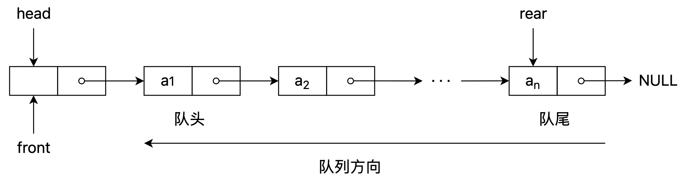

链式队列通常包含三个指针：

1. 头结点（head）
   - **始终存在**，不存放有效数据，只是一个哨兵结点。
   - 主要作用：简化出队操作（避免删除第一个结点时单独处理）。
2. 队头指针（front）
   - **固定指向头结点**。
   - 注意：`front` 不直接指向第一个有效结点，而是 **指向头结点**。
   - 因此，真正的队头元素在 `front->next`。
3. 队尾指针（rear）
   - 始终指向最后一个有效结点。
   - 如果队列为空，`rear == front == head`。

链式队列一般使用 **单链表** 来实现，入队和出队操作可以基于队头和队尾指针实现：

- **入队（enqueue）**：在队尾插入新元素。由于维护了 **尾指针**，因此只需 `O(1)` 时间。
- **出队（dequeue）**：在队头删除元素。由于维护了 **头指针**，因此只需 `O(1)` 时间。

```c
// 1.定义
// 结点定义
typedef struct QNode {
    int data;               // 数据域
    struct QNode *next;     // 指针域
} QNode;

// 链式队列结构
typedef struct {
    QNode *front;   // 队头指针 (指向头结点)
    QNode *rear;    // 队尾指针 (指向队尾结点)
} LinkQueue;

// 初始化队列（带头结点）
void InitQueue(LinkQueue *Q) {
    QNode *head = (QNode *)malloc(sizeof(QNode));  // 申请头结点
    head->next = NULL;
    Q->front = Q->rear = head;  // front、rear 都指向头结点
}

// 2.入队
// 入队操作
void EnQueue(LinkQueue *Q, int x) {
    QNode *node = (QNode *)malloc(sizeof(QNode));
    node->data = x;
    node->next = NULL;

    Q->rear->next = node;   // 新结点挂在队尾
    Q->rear = node;         // 更新队尾指针
}

// 3.出对
// 出队操作
int DeQueue(LinkQueue *Q, int *x) {
    if (IsEmpty()) return 0;  // 队空

    QNode *p = Q->front->next;  // 队头第一个有效结点
    *x = p->data;
    Q->front->next = p->next;   // 删除结点

    if (Q->rear == p) {         // 如果队尾被删空了
        Q->rear = Q->front;     // rear 重新指向头结点
    }
    free(p);
    return 1;
}

// 4.判空
// 判断队列是否为空
int IsEmpty(LinkQueue Q) {
    return Q.front == Q.rear;
}
```

---

## 栈和队列的应用

### 一、二叉排序树

**二叉表达式树** 是一种特殊的二叉树，用于表示算术或逻辑表达式。它的每个 **叶子节点** 通常存放 **操作数**（operand，如数字或变量），每个 **非叶子节点** 存放 **操作符**（operator，如 `+`, `-`, `*`, `/`）。

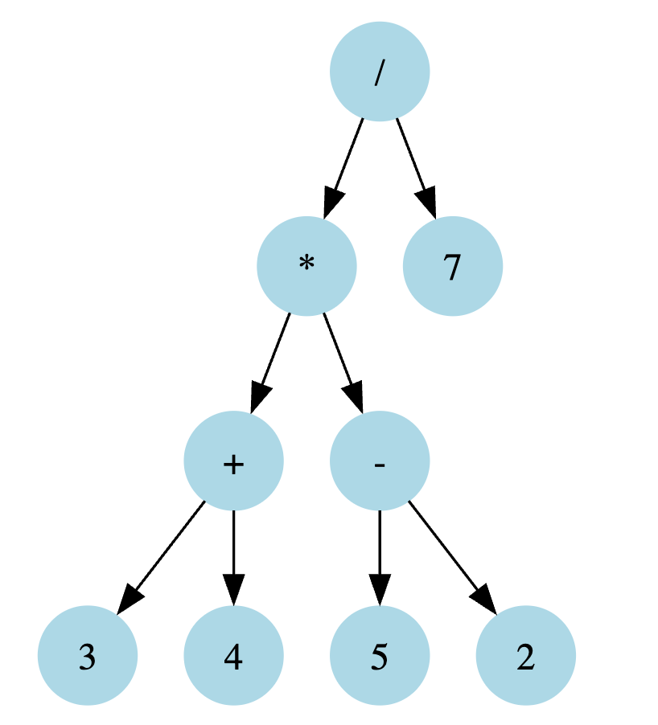

### 二、表达式种类

前序表达式（Preorder，波兰表示法）、中序表达式（Infix）和后序表达式（Postorder，逆波兰表示法）是根据二叉表达式树的不同遍历方式得到的表达式结果。具体来说：

- 前序表达式：**[前序遍历](https://www.csgraduates.com/data_structure/tree/btree/#前序遍历)** 得到的序列。
- 中序表达式：**[中序遍历](https://www.csgraduates.com/data_structure/tree/btree/#中序遍历)** 得到的序列。
- 后序表达式：**[后序遍历](https://www.csgraduates.com/data_structure/tree/btree/#后序遍历)** 得到的序列。

这三种表达式的 **操作符** 和 **操作数** 间的相对位置有所不同：

| 表达式类型 | 描述                                       | 示例表达式    | 对应的公式    |
| ---------- | ------------------------------------------ | ------------- | ------------- |
| 前序       | 操作符位于其操作数之前                     | `* + A B C`   | `(A + B) * C` |
| 中序       | 操作符位于其两个操作数之间，最常见的表示法 | `(A + B) * C` | `(A + B) * C` |
| 后序       | 操作符位于其操作数之后                     | `A B + C *`   | `(A + B) * C` |

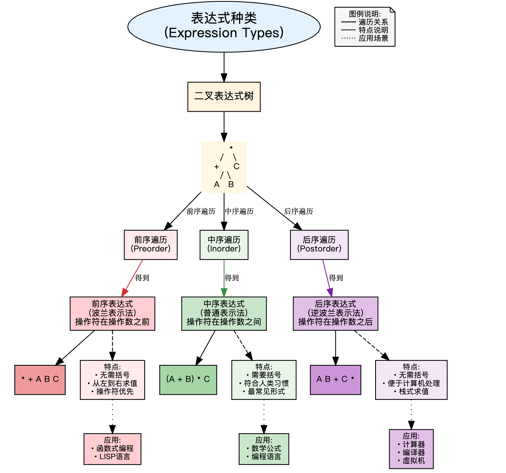

### 三、中序表达式求值

中序表达式求值涉及到两个主要的数据结构：**操作符栈** 与 **操作数栈**。其核心思路是逐个读取中序表达式的字符，根据字符的类型（**操作数**、**操作符**、**括号**）进行不同的处理，最终得到表达式的值。

1. 初始化两个栈：
   - **操作数栈**：用来存储数字。
   - **操作符栈**：用来存储操作符和左括号。
2. 逐个读取中序表达式的字符：
   - 如果是 **操作数**（数字），则直接压入 **操作数栈**。
   - 如果是 **左括号**，则直接压入 **操作符栈**。
   - 如果是 右括号，则：
     - 从 **操作符栈** 中弹出一个操作符。
     - 从 **操作数栈** 中弹出所需的操作数。
     - 执行该操作符对应的运算。
     - 将结果压入 **操作数栈**。
     - 重复以上步骤，直到从 **操作符栈** 中弹出一个左括号。
   - 如果是操作符（如+、-、*、/等）：
     - 如果 **操作符栈** 为空，或栈顶是左括号，或当前操作符 **优先级** 高于栈顶操作符的 **优先级**，则直接压入 **操作符栈**。
     - 否则：
       - 从 **操作符栈** 中弹出一个操作符。
       - 从 **操作数栈** 中弹出所需的操作数。
       - 执行该操作符对应的运算。
       - 将结果压入 **操作数栈**。
       - 重复以上步骤，直到满足上述的压栈条件。
3. 处理完所有字符后：
   - 如果操作符栈不为空，则：
     - 从 **操作符栈** 中弹出一个操作符。
     - 从 **操作数栈** 中弹出所需的操作数。
     - 执行该操作符对应的运算。
     - 将结果压入 **操作数栈**。
     - 重复以上步骤，直到 **操作符栈** 为空。
4. 得到结果：
   - 此时，**操作数栈** 中仅存一个数字，这就是整个中序表达式的值。

中序表达式求值的过程可以参照以下流程图进行理解：

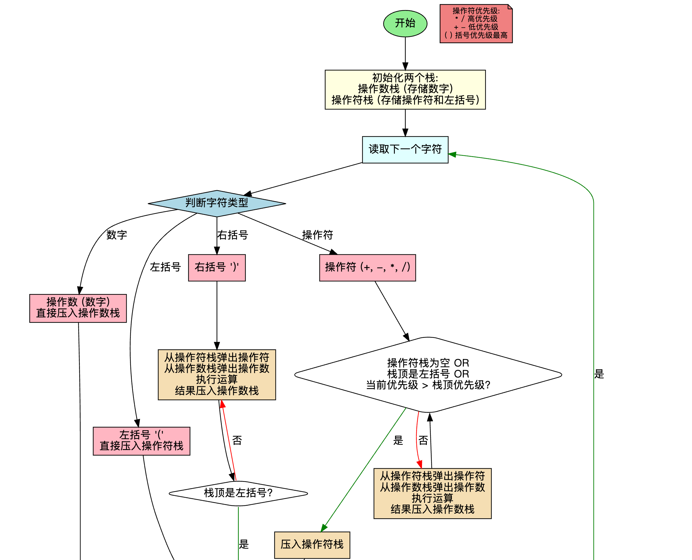

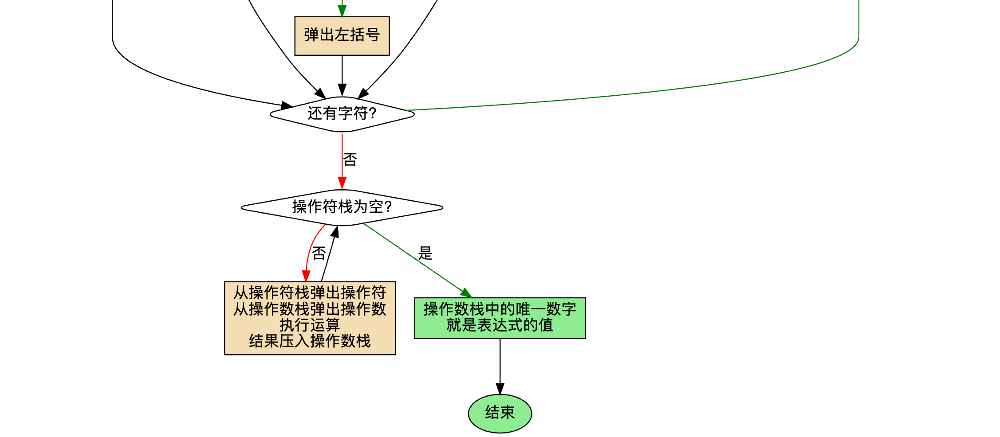

以表达式 `3 + (5 * 2 - 8)` 说明计算过程：

| 步骤 | 输入字符 | 操作                                                 | 操作符栈  | 数据栈     |
| ---- | -------- | ---------------------------------------------------- | --------- | ---------- |
| 1    | `3`      | 压入数据栈                                           |           | `3`        |
| 2    | `+`      | 压入 **操作符栈**                                    | `+`       | `3`        |
| 3    | `(`      | 压入 **操作符栈**                                    | `+, (`    | `3`        |
| 4    | `5`      | 压入数据栈                                           | `+, (`    | `3, 5`     |
| 5    | `*`      | 压入 **操作符栈**                                    | `+, (, *` | `3, 5`     |
| 6    | `2`      | 压入数据栈                                           | `+, (, *` | `3, 5, 2`  |
| 7    | `-`      | `*` **优先级** 高于 `-`，`*` 出栈计算后，将 `-` 入栈 | `+, (, -` | `3, 10`    |
| 8    | `8`      | 压入数据栈                                           | `+, (, -` | `3, 10, 8` |
| 9    | `)`      | 处理到 `(` 之前的所有操作符                          | `+`       | `3, 2`     |
| 10   |          | 用 `+` 运算符计算                                    |           | `5`        |

### 四、后序表达式求值

后序表达式求值主要依赖一个 **操作数栈**。其核心思路是逐个读取后序表达式的元素，并根据元素的类型（**操作数**或**操作符**）进行处理。

1. 初始化一个 **操作数栈**：
   - 用于存储后序表达式中的数字。
2. 逐个读取后序表达式的元素：
   - 如果是**操作数**，则直接压入 **操作数栈**。
   - 如果是操作符（如+、-、*、/等）：
     - 从 **操作数栈** 中弹出所需的操作数。注意，因为操作符是后置的，所以先弹出的数字是第二操作数，后弹出的是第一操作数。
     - 根据操作符执行相应的运算。
     - 将计算结果压入 **操作数栈**。
3. 完成后序表达式的读取：
   - **操作数栈** 中的顶部元素即为整个后序表达式的值。

后序表达式求值的过程可以参照以下流程图进行理解：

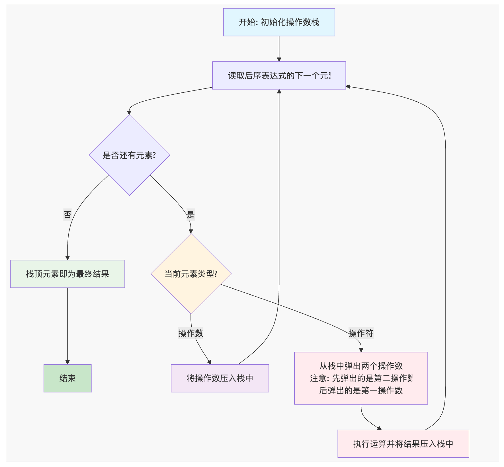

以表达式 `3 5 2 * 8 - +` 说明计算过程：

| 步骤 | 输入字符 | 操作                                        | 操作数栈   |
| ---- | -------- | ------------------------------------------- | ---------- |
| 1    | `3`      | 压入 **操作数栈**                           | `3`        |
| 2    | `5`      | 压入 **操作数栈**                           | `3, 5`     |
| 3    | `2`      | 压入 **操作数栈**                           | `3, 5, 2`  |
| 4    | `*`      | 弹出两个操作数并相乘，结果压入 **操作数栈** | `3, 10`    |
| 5    | `8`      | 压入 **操作数栈**                           | `3, 10, 8` |
| 6    | `-`      | 弹出两个操作数并相减，结果压入 **操作数栈** | `3, 2`     |
| 7    | `+`      | 弹出两个操作数并相加，结果压入 **操作数栈** | `5`        |

### 五、中序转后序

将中缀表达式转换为后缀表达式的算法思想如下：

初始化一个 **操作符栈**，从左向右开始扫描中缀表达式；

- 遇到数字时，加入后缀表达式；
- 遇到运算符时：
  - 若为 `（`，入栈；
  - 若为 `）`，则依次把栈中的运算符加入后缀表达式中，直到出现 `（`，从栈中删除 `（`；
  - 若为除括号外的其他运算符
    - 当其 **优先级** 高于除 `（` 以外的栈顶运算符时，直接入栈；
    - 否则从栈顶开始，依次弹出 **优先级** 高于或等于当前运算符的运算符，直到遇到 **优先级** 更低的运算符或左括号为止。

中序转后序的过程可以参照以下流程图进行理解：

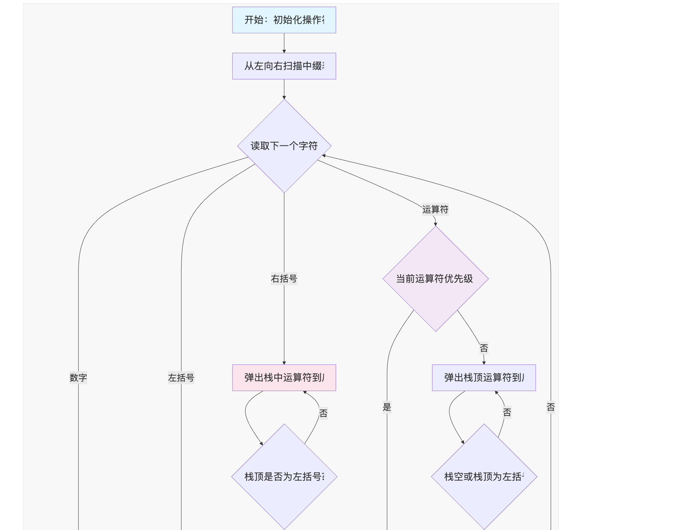

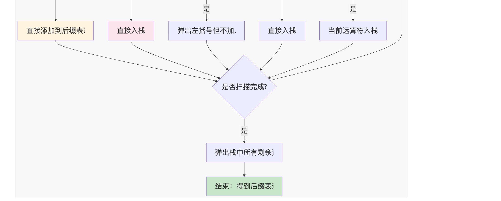

以中序表达式 `a/b+(c*d-e*f)/g` 为例，可以通过如下步骤将其转换为后续表达式：

|    待处理序列     |   栈   |   后缀表达式    | 当前扫描元素 |                    动作                     |
| :---------------: | :----: | :-------------: | :----------: | :-----------------------------------------: |
| `a/b+(c*d-e*f)/g` |        |                 |     `a`      |             `a` 加入后缀表达式              |
| `/b+(c*d-e*t)/g`  |        |       `a`       |     `/`      |                  `／` 入栈                  |
|  `b+(c*d-e*f)/g`  |  `/`   |       `a`       |     `b`      |             `b` 加入后缀表达式              |
|  `+(c*d-e*f)/g`   |  `/`   |      `ab`       |     `+`      |  `＋` **优先级** 低于栈顶的 `/`，弹出 `／`  |
|  `+(c*d-e*f)/g`   |        |      `ab/`      |     `+`      |                  `＋` 入栈                  |
|   `(c*d-e*f)/g`   |  `+`   |      `ab/`      |     `(`      |                  `（` 入栈                  |
|   `c*d-e*f)/g`    |  `+(`  |      `ab/`      |     `c`      |             `c` 加入后缀表达式              |
|    `*d-e*f)/g`    |  `+(`  |     `ab/c`      |     `*`      |            栈顶为 `(`，`＊` 入栈            |
|    `d-e*t)/g`     | `+(*`  |     `ab/c`      |     `d`      |             `d` 加入后缀表达式              |
|     `-e*f)/g`     | `+(*`  |     `ab/cd`     |     `-`      |      `-` 先级低于栈顶的 `*`，弹出 `*`       |
|     `-e*f)/g`     |  `+(`  |    `ab/cd*`     |     `-`      |            栈顶为 `(`，`－` 入栈            |
|     `e*t)/g`      | `+(-`  |    `ab/cd*`     |     `e`      |             `e` 加入后缀表达式              |
|      `*f)/g`      | `＋(-` |    `ab/cd*e`    |     `＊`     | `＊` **优先级** 高于栈顶的 `－`， `＊` 入栈 |
|      `f)/g`       | `+(-*` |    `ab/cd*e`    |     `f`      |             `f` 加入后缀表达式              |
|       `)/g`       | `+(-*` |   `ab/cd*ef`    |     `）`     |       把栈中 `(` 之前的符号加入表达式       |
|       `/g`        |  `＋`  |  `ab/cd*ef*-`   |     `/`      |   `/` **优先级** 高于栈顶的 `+`，`/` 入栈   |
|        `g`        |  `+/`  |  `ab/cd*ef*-`   |     `g`      |             `g` 加入后缀表达式              |
|                   |  `+/`  |  `ab/cd*ef*-g`  |              |     扫描完毕，运算符依次退栈加入表达式      |
|                   |        | `ab/cd*ef*-g/+` |     完成     |                                             |

### 六、入栈出栈序列

入栈出栈是常考的问题，这类问题的核心可以被总结为以下两种范式：

- **给定一个入栈序列，判断哪些出栈序列是不可能的？**
- **给定一个入栈序列，其出栈序列序列有多少种？**

这里给出这两个常见问题的解答。

#### 6.1 不可能的出栈序列

给定一个入栈序列，其出栈序列可能有很多种，因为一个元素的出栈时间比较灵活，比如它可以一入栈马上出栈，也可以等一会再出栈。要辨别不可能的出栈系列，需要 **抓住关键规则**：只有 **栈顶元素** 能够最先出栈。

也就是说，对于下图这种情况，A 被 B 压住了，在出栈序列中，A 一定在 B 的后面。如果某个出栈序列中 A 在 B 的前面，则这种出栈序列是不可能出现的。

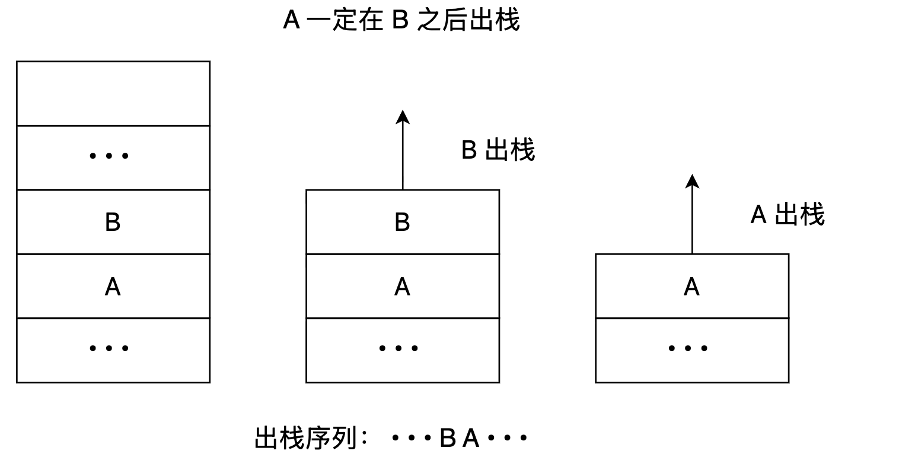

#### 6.2 卡特兰数

考虑这样一个问题：有 *n* 个不同的元素（例如 1,2,⋯,*n* ），我们按照某种顺序依次将它们 **入栈**，并且在任意时刻可以选择 **出栈**。每个元素都必须恰好入栈一次、出栈一次。我们想知道，所有可能的出栈序列共有多少种。

这个问题的答案可以用 **卡特兰数（Catalan number）** 来表示。卡特兰数的公式如下：

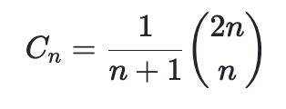

也就是说，上述问题中 *n* 个元素的所有可能出栈序列数量就是 Cn。

那么为什么入栈出栈序列总数可以用卡特兰数来表示呢？

我们可以把每一次操作用数字表示：

- **入栈**：记作 `+1`
- **出栈**：记作 `-1`

整个过程总共有 2*n* 次操作，其中有 *n* 次入栈，*n* 次出栈。为了保证操作合法（不能在栈为空时出栈），必须满足：在任意时刻，出栈次数 **不能超过** 入栈次数。

这恰好 **与卡特兰数的经典定义相对应**：卡特兰数计数的就是符合类似限制的序列数量。因此，入栈出栈序列数量正好是 Cn。

卡特兰数不仅出现在入栈出栈序列中，还常 **出现在很多等价问题中**，例如：

1. **二叉树计数** 给定 *n*个不同节点，可以构造的不同形态二叉树的数量为 Cn

2. **括号匹配** *n* 对括号的合法匹配序列数量也为 Cn。 例如，当 n=2*n*=2 时，合法的序列有：

   ```
   ()()   (())
   ```

---

## 数组和特殊矩阵

### 一、多维数组的存储

在计算机内存中，数组元素是 **连续存放** 的。对于一个二维数组来说，它实际上只是对一维数组的一种逻辑抽象。理解其存储方式的关键在于：**如何将二维坐标 (i,j) 映射到一维的线性内存地址**。

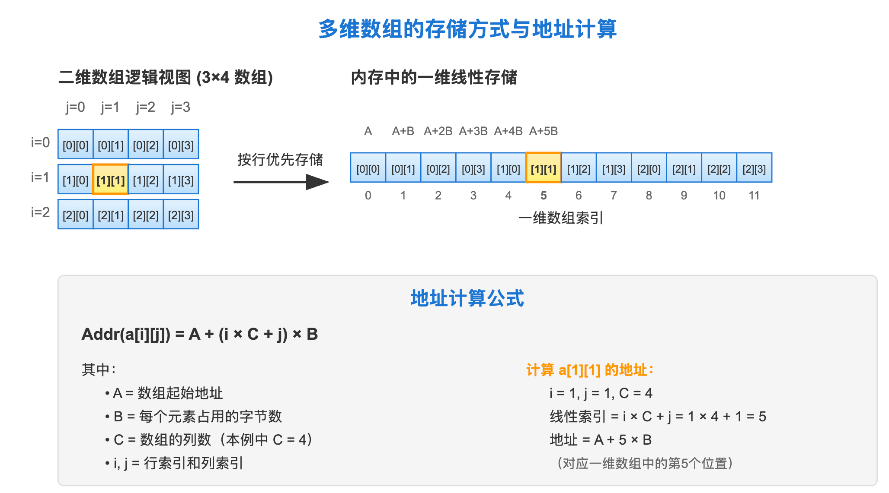

假设：

- 数组的第一个元素起始地址为 *A*；
- 每个元素占用 *B* 个字节；
- 数组一共有 *R* 行、*C* 列；

那么数组中元素 a[i] [j] 的存储地址为：

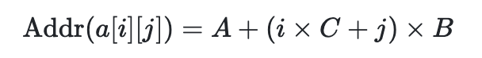

其中：

- *i*×*C* 表示从第 0 行到第*i*−1 行总共有多少个元素；
- 再加上 *j*，就得到了在一维展开后对应的下标；
- 乘以 *B* 后，加上基址 *A*，就得到了该元素在内存中的实际地址。

举个 C 语言的示例进行说明，如果我们定义一个二维数组：

```c
int a[2][3] = {{1, 2, 3}, {4, 5, 6}};
```

这个数组的内存布局可以视为一个一维数组，如下所示：

```
  +---------+---------+---------+---------+---------+---------+
  | a[0][0] | a[0][1] | a[0][2] | a[1][0] | a[1][1] | a[1][2] |
  +---------+---------+---------+---------+---------+---------+
0x100      0x104    0x108     0x10C     0x110     0x114
```

#### 1.1 行主序和列主序

需要注意的是，不同语言对多维数组的存储顺序可能不同：

- **C / C++** 等主流编程语言：采用 **行主序（Row-major order）**，即先存满一行，再存下一行。
- **Fortran / MATLAB**：采用 **列主序（Column-major order）**，即先存满一列，再存下一列。

如果按列主序存储，上面例子 `a[2][3]` 的内存布局会变为：

```
  +---------+---------+---------+---------+---------+---------+
  | a[0][0] | a[1][0] | a[0][1] | a[1][1] | a[0][2] | a[1][2] |
  +---------+---------+---------+---------+---------+---------+
```

### 二、特殊矩阵的压缩存储

#### 2.1 对称矩阵

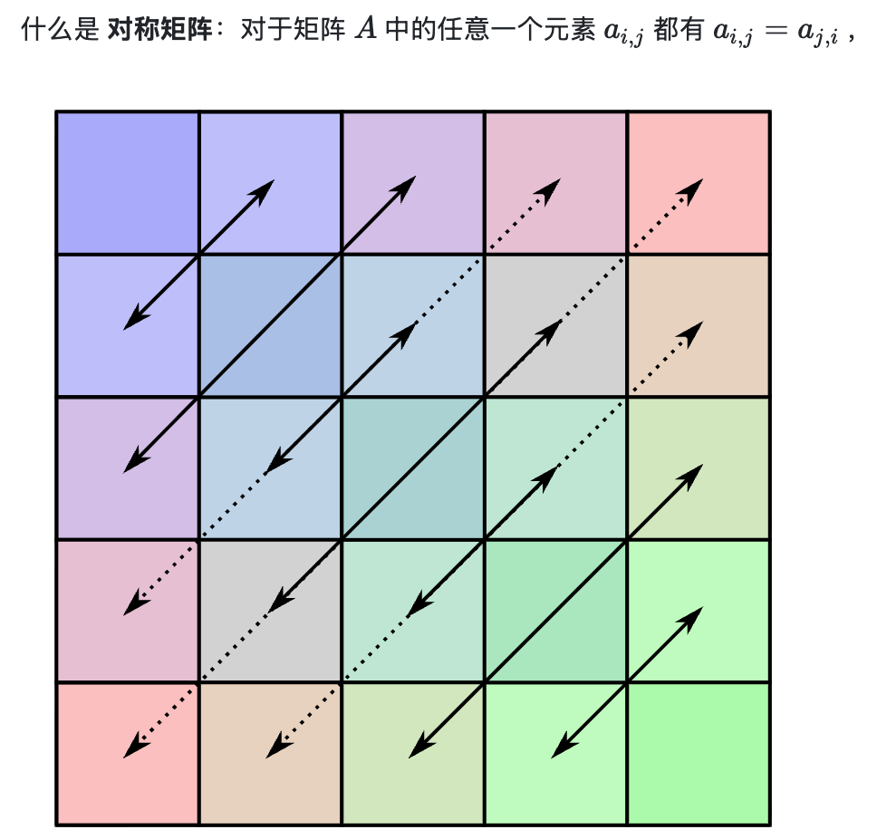

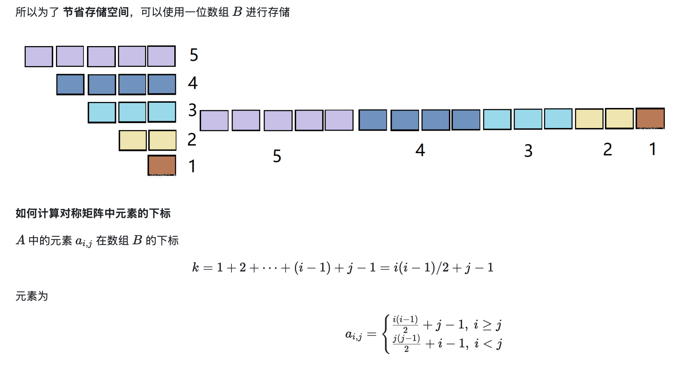

#### 2.2 三角矩阵

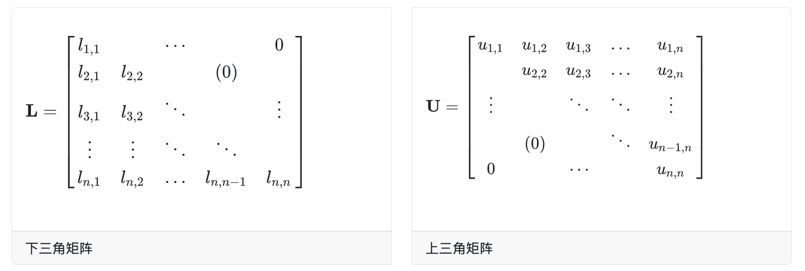

- **下三角矩阵** 是一个方阵，其主对角线及其以下（右下部分）的所有元素都不为零，而主对角线以上的所有元素都为零。
- **上三角矩阵** 是一个方阵，其主对角线及其以上（左上部分）的所有元素都不为零，而主对角线以下的所有元素都为常数。

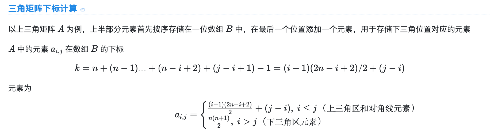

#### 2.3 稀疏矩阵

**稀疏矩阵**（Sparse Matrix）是指在矩阵中大部分元素为零的矩阵。与之相对的是 **稠密矩阵**（Dense Matrix），即大部分元素非零。

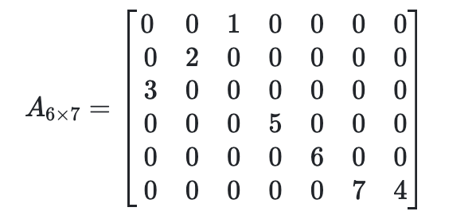

由于 **稀疏矩阵** 的非零元素远少于零元素，存储整个矩阵（包括所有零元素）会浪费大量空间。因此，稀疏矩阵通常使用特定的数据结构（**三元组表** 和 **十字链表**）来高效存储和操作，只保存非零元素及其位置信息。

**三元组表**（Triple Table） 是一种稀疏矩阵的顺序存储方法。它利用三个一维数组（或一个结构体数组）分别存放非零元素的 **行号**、**列号** 和 **数值**，从而节省内存空间。

对于一个 *m*×*n* 的稀疏矩阵 A*A*，若其中只有 *t* 个非零元素，则三元组表的长度就是 *t*。存储时，一般约定按照 **行序优先**（先按行号从小到大排序，行号相同时再按列号从小到大）存放，便于后续矩阵运算和查找。

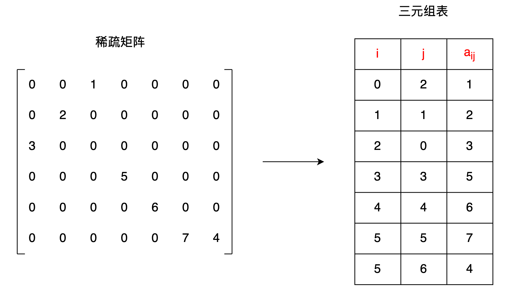

在程序实现时，常见的两种方式是：

1. **分开存储法**
   用三个等长的一维数组 `row[]`、`col[]` 和 `val[]` 分别保存行号、列号和数值。
2. **结构体存储法**
   定义一个结构体 `Triple`，包含 `(row, col, value)` 三个字段，再用一个一维数组 `Triple data[t]` 来存储。

```c
// 1.分开存储法
#define MAXSIZE 100  // 最大非零元素个数

// 稀疏矩阵三元组表（分开存储）
typedef struct {
    int m, n, t;          // 矩阵的行数、列数、非零元素个数
    int row[MAXSIZE];     // 行号数组
    int col[MAXSIZE];     // 列号数组
    int val[MAXSIZE];     // 数值数组
} TSMatrix;

// 2.结构体存储法
#define MAXSIZE 100  // 最大非零元素个数

// 三元组
typedef struct {
    int row, col;  // 行号、列号
    int val;       // 数值
} Triple;

// 稀疏矩阵三元组表（结构体存储）
typedef struct {
    int m, n, t;        // 矩阵的行数、列数、非零元素个数
    Triple data[MAXSIZE]; // 非零元素数组
} TSMatrix;
```

三元组表的优点是 **存储结构简单、节省空间**，但缺点是 **随机访问代价较高** —— 若要访问某个元素，需要顺序扫描查找对应行列下标，适合用于矩阵转置、稀疏矩阵相加、输出等操作。

在实际应用中，如果需要频繁地进行按行、按列的运算，就会引入 **十字链表** 等更复杂的存储方式。

**十字链表**（Cross List） 是一种用于稀疏矩阵的存储结构，它的核心思想是利用**行方向和列方向两个链表**同时组织非零元素，从而使得既能按行遍历，也能按列遍历，访问效率都较高。相比于普通的顺序存储或单一链表结构，十字链表在需要频繁进行矩阵运算、转置或按行按列混合访问的场景下具有明显优势。

下图给出了一个十字链表的实例：

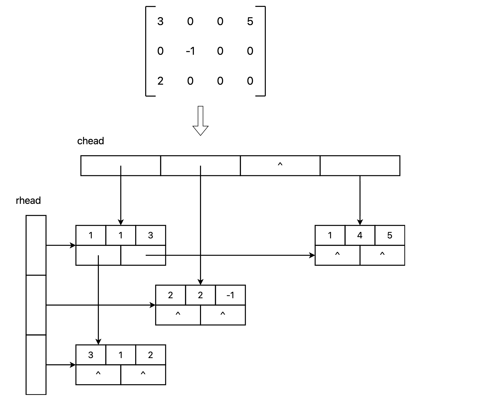

在十字链表中，每一个非零元素都会建立一个结点。该结点需要记录**行号（i）、列号（j）、元素值（value）**，同时还要保存两个方向的指针：**right 指针**指向同一行中的下一个非零元素，**down 指针**指向同一列中的下一个非零元素。借助这两个指针，矩阵可以在行链和列链之间灵活切换，实现双向高效的访问。

为了快速定位某一行或某一列的首个非零元素，还需要额外设置**行头指针数组（rhead）和 列头指针数组（chead）**。每一行和每一列都对应一个头指针，这些头指针并不存储具体数值，而是起到索引的作用，使得从某一行或某一列开始的遍历可以在常数时间内定位到第一个非零元素。

```c
// 1.结点定义
// 十字链表结点定义
typedef struct CrossListNode {
    int row;                    // 行号
    int col;                    // 列号
    int value;                  // 元素值
    struct CrossListNode* right;  // 指向同一行下一个非零元素
    struct CrossListNode* down;   // 指向同一列下一个非零元素
} CrossListNode;

// 2.十字链表结构
// 十字链表结构
typedef struct {
    CrossListNode** rhead;      // 行头指针数组
    CrossListNode** chead;      // 列头指针数组
    int rows;                   // 矩阵行数
    int cols;                   // 矩阵列数
    int nums;                   // 非零元素个数
} CrossList;
```

十字链表的优势主要体现在三个方面：其一，**空间效率高**，仅存储非零元素及必要的指针；其二，**支持按行或按列的双向遍历**，在算法实现中非常灵活；其三，**插入与删除操作方便**，只需在相应行和列的链表中调整指针即可，而不必像顺序存储那样整体移动元素。因此，十字链表常被用于**稀疏矩阵运算**和**图的邻接矩阵存储**，是数据结构与图论中重要的一种存储方式。

#### 2.4 三对角矩阵

**三对角矩阵**是一种特殊的稀疏矩阵，它除了主对角线外，只在其上下相邻的两条对角线上有非零元素，其余元素均为零。

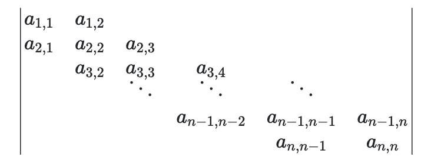

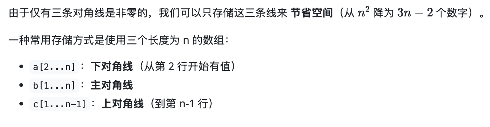


