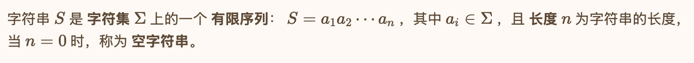
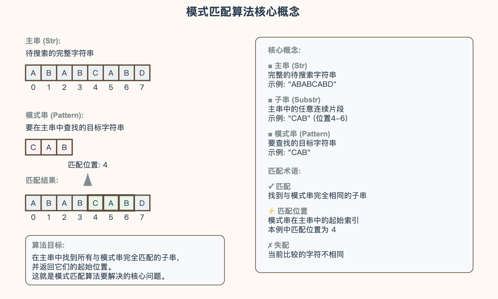
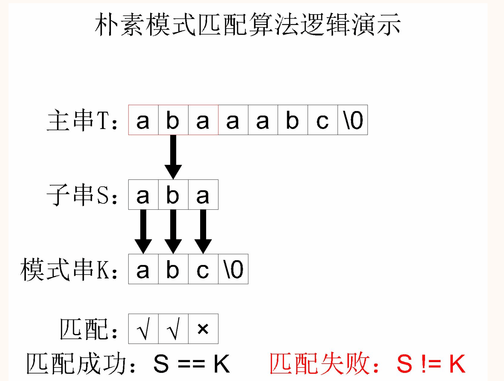
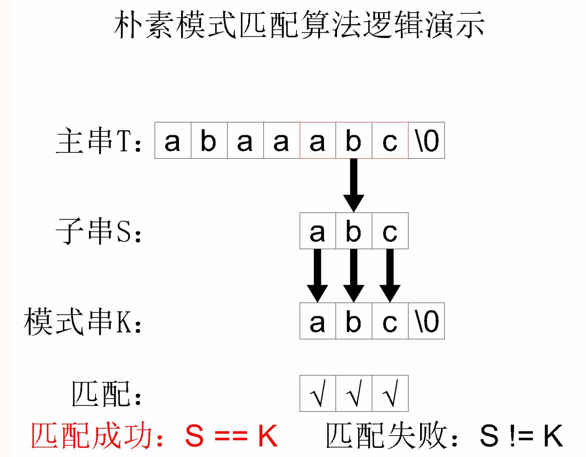
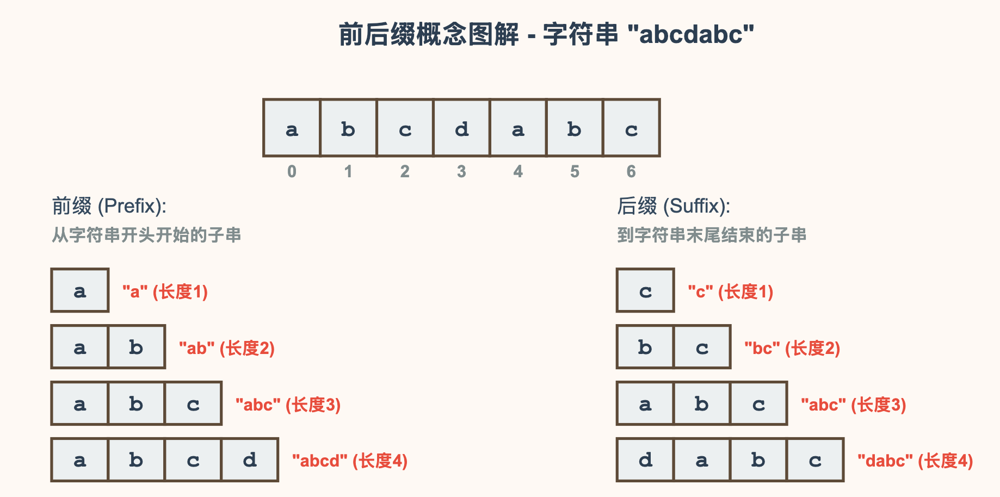
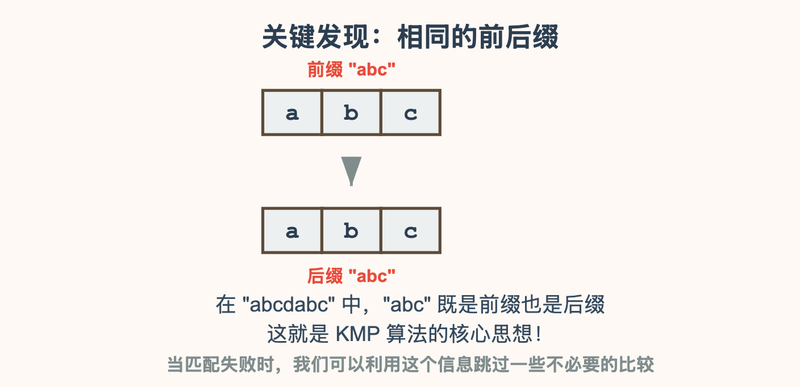
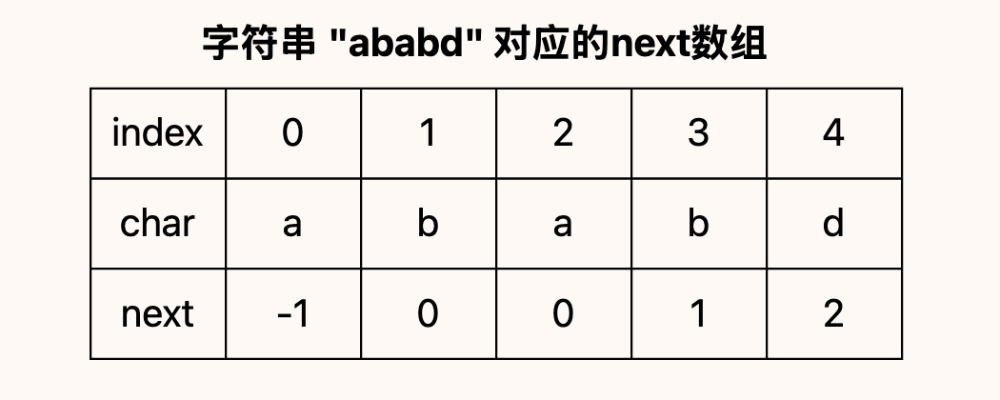
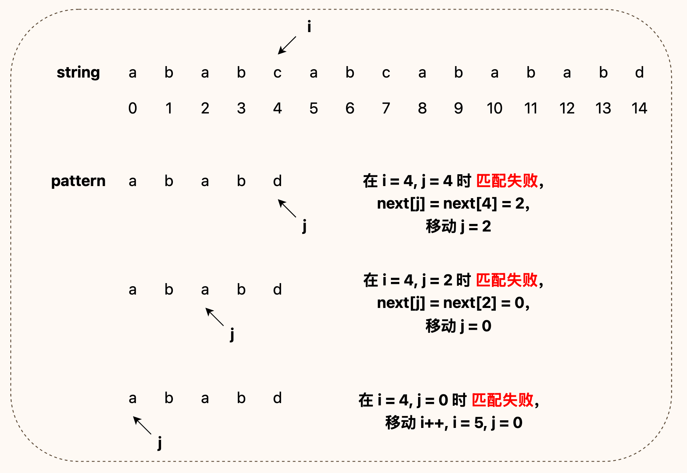
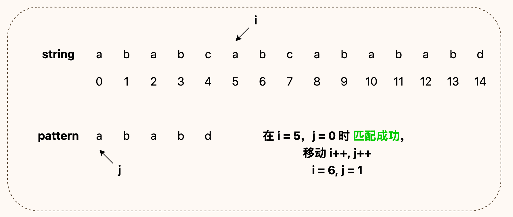
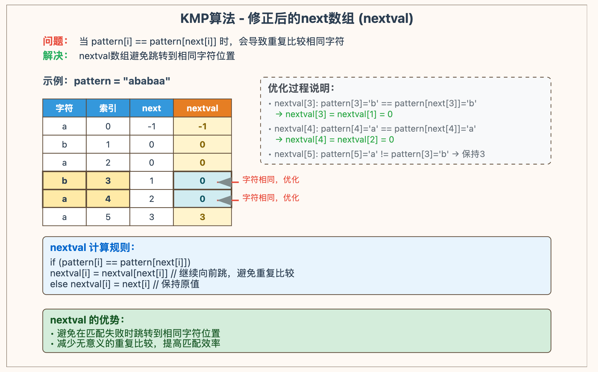

# 字符串

## 定义与实现

### 一、串的定义

字符串是计算机科学中的一个基本概念，通常被定义为 **有限序列** 中 **字符** 的有序集合。

**形式定义：**



### 二、串的存储结构

#### 2.1 定长顺序存储表示

在 **定长顺序存储表示** 中，每个字符串都有固定的长度，通常用一个预定义的最大大小来表示。这种表示方法使用一个一维数组，数组的大小等于预定的最大长度。

在某些语境中（例如 C 语言），使用特殊字符（如 `'\0'`）来标识字符串结束。

```c
#define MAX_SIZE 100 // 预定义的最大大小

typedef struct {
    char data[MAX_SIZE];  // 字符数组
    int length;           // 当前字符串的长度
} FixedString;
```

#### 2.2 堆分配存储表示

在 **堆分配存储表示** 中，每个字符串具有其自己的 **长度**，因此可以动态地分配存储空间。字符串在堆中分配空间，只需要那么多的空间来存储实际的字符以及结束字符或 **长度** 信息。

```c
typedef struct {
    char *data;           // 指向动态分配空间的指针
    int length;           // 字符串的长度
} HeapString;

// 创建一个新的字符串
void initHeapString(HeapString *s, const char *str) {
    s->length = strlen(str);
    s->data = (char *)malloc((s->length + 1) * sizeof(char));
    if (s->data == NULL) {
        exit(1);  // 分配失败
    }
    strcpy(s->data, str);
}

// 释放字符串
void freeHeapString(HeapString *s) {
    free(s->data);
    s->length = 0;
}
```

#### 2.3 块链存储表示

**块链存储表示** 是结合了 **链表** 与 **块** 存储的思想。串分为较小的 **块**，每个块存储一部分 **字符**。块之间使用 **指针** 链接。这样，整个字符串就变成了一个字符块的链表。

```c
#define BLOCK_SIZE 4 // 为了简单起见，设块大小为 4

typedef struct StringBlock {
    char data[BLOCK_SIZE];   // 块中的字符数据
    struct StringBlock *next;  // 指向下一个块的指针
} StringBlock;

typedef struct {
    StringBlock *head;      // 指向第一个块的指针
    int length;             // 字符串的总长度
} BlockString;

// 初始化块链字符串
void initBlockString(BlockString *s) {
    s->head = NULL;
    s->length = 0;
}

// 为了简化，这里只展示了数据结构定义和初始化函数。实际应用中还需要考虑其他函数，如插入、删除、销毁等。
```

### 三、串的基本操作

- 赋值（ Assign ）：
  - 将一个串的内容复制到另一个串。
- 比较（ Compare ）：
  - 根据字符的字典顺序比较两个串。可以判断两个串是否相等，或者一个串是否小于或大于另一个串。
- 长度（ Length ）：
  - 返回串的 **长度**，即串中字符的数目。
- 连接（ Concat ）：
  - 将两个串连接成一个新的串。例如，将串"Hello"和串"World"连接为"HelloWorld"。
- 子串提取（ Substr ）：
  - 从串中提取某个指定位置开始的指定 **长度** 的字符序列作为一个新的串。例如，从串"HelloWorld"中提取从位置 1 开始的 5 个字符，得到"Hello"。
- 插入（ Insert ）：
  - 在串的指定位置插入另一个串。例如，在串"HelloWorld"的第 6 个位置插入串"Beautiful", 得到"HelloBeautifulWorld"。
- 删除（ Delete）：
  - 从串中删除从指定位置开始的指定 **长度** 的字符。
- 替换（ Subsititude ）：
  - 将串中某个子串的所有出现替换为另一个子串。例如，将串"apple, banana, apple"中的"apple"替换为"orange"，得到"orange, banana, orange"。
- 模式匹配（ Index）：
  - 在串中查找另一个子串的位置。这通常使用算法如 KMP、BM 或 Sunday 来加速查找。
- 清空（ Clear ）：
  - 释放串的存储空间并将其设置为 **空字符串**。

---

## 模式匹配

**字符串模式匹配** 是计算机科学中的基础问题，主要是在一个 **主字符串** 中查找一个 **子字符串** 模式。

### 一、串概念



在介绍模式匹配算法之前，需要能够区分关于串的几个概念：

- **主串**（Str / 主字符串）：待搜索的那一整段字符串。
- **子串**（Substr / 子字符串）：主串中的某一段字符串
- **模式串**（Pattern / 模式字符串）：要在主串中查找的目标。

以及以下几个关于 **模式匹配** 的术语：

- **匹配**：在主串中找到与模式串完全相同的子串
- **匹配位置**：模式串在主串中出现的起始位置
- **失配**：当前字符不匹配

**模式匹配算法** 就是将 **模式串** 与 **主串** 相匹配，企图找到主串中的某个和 **子串** 和 **模式串** 完全相同。

---

### 二、简单模式匹配算法

**简单模式匹配算法**（即暴力匹配 / 朴素匹配）的 **基本思想** 是：逐个检查 **主串** 的每一个位置，判断 **从该位置开始的子串** 是否与 **模式串** 完全相同。

**算法描述：**

1. 从 **主串** 的第一个字符开始，尝试与 **模式串** 匹配。
2. 如果当前字符匹配，则继续比较下一个字符，依此类推。
3. 如果在某一位置发生不匹配，则将 **模式串** 移动到 **主串** 的下一个起始位置，重新匹配。
4. 如果某一段 **子串** 与 **模式串** 完全相同，则返回该 **子串在主串中的起始位置**。
5. 如果扫描完整个 **主串** 都没有找到匹配的 **子串**，则返回 -1。

```c
int simplePatternMatching(const char* mainStr, const char* pattern) {
    int m = strlen(mainStr);
    int n = strlen(pattern);

    // 如果主字符串的长度小于模式字符串的长度，直接返回 -1
    if (m < n) return -1;

    for (int i = 0; i <= m - n; i++) {
        int j;
        for (j = 0; j < n; j++) {
            if (mainStr[i + j] != pattern[j]) {
                break;
            }
        }
        // 如果 j 等于模式串的长度，说明已经找到匹配
        if (j == n) return i;
    }
    return -1;  // 没有找到匹配
}
```

简单模式匹配算法的 **核心思路** 其实就是将主串中的每个字串和模式串进行对比。举个例子，主串 `abaaabc` 和模式串 `abc` 进行简单模式匹配的过程如下：





这个简单模式匹配算法的 **时间复杂度** 是 *O*(*mn*) ，其中 *m* 是 **主字符串** 的长度， *n* 是 **模式字符串** 的长度。

### 三、KMP算法

与 **简单模式匹配算法** 不同， **KMP 算法** 在发现不匹配的字符时能够避免不必要的比较，从而提高效率。

#### 3.1 前后缀

**简单模式匹配** 时间复杂度过高，因为每一次匹配失败都得从下一个位置重新开始。这就没有充分应用 **模式串** 的特性，比如对于字符串 `abcdabc`，我们可以发现：

- 其 **前缀** 包含`a`, `ab`, `abc`, `abcd` 等
- 起 **后缀** 包含`c`, `bc`, `abc`, `dabc` 等

`abc` 是在其 **前缀** 和 **后缀** 中都包含的部分，在字符串匹配时，我们可以充分利用该信息，匹配失败时，我们可以不用从下一个位置开始，而是从 **模式串内部的某个位置** 开始。





**KMP 算法** 就是基于这个思想，其核心是一个称为 “**部分匹配表**” 或 “**前缀函数**” 的辅助数组（通常称为 **next 数组**），该数组用于确定当 **模式串** 在 **主串** 不匹配时应该如何有效地移动 **模式串**。

#### 3.2 算法描述

1. 构建 **部分匹配表**（**next 数组**）：`next[i]` 表示：当 **模式串** 在第 i 位 **匹配失败** 时，下一次 **应该跳到的模式串位置**。
2. 不断进行 **模式匹配**，直到匹配成功或 **主串** 结束。

#### 3.3 next数组计算

如果 **模式串** 为 `pattern`，用通俗的话来说，`next[k]` 就是第 k 个字符的 **前缀字符串** `pattern[0:k-1]`（pattern 的前 k 个字符构成的子串，不包含当前字符）的最长相同 **前缀** 和 **后缀** 的长度。

以 `ababac` 字符串为例，可以得到以下的 next 数组：

| 模式串（pattern）                 | a    | b    | a    | b    | a    | c    |
| --------------------------------- | ---- | ---- | ---- | ---- | ---- | ---- |
| 下标（index）                     | 0    | 1    | 2    | 3    | 4    | 5    |
| pattern[0:index] 的相同前后缀长度 | 0    | 0    | 1    | 2    | 3    | 0    |
| next                              | -1   | 0    | 0    | 1    | 2    | 3    |

一般而言，**next 数组** 中的第一个元素被设置为 -1（因为第一个字符不存在 **前缀子串**）。

以 c 字符为例，我们需要计算 `next[5]`，所以需要统计 c 的 **前缀字符串** ababa 的最长相同 **前缀** 和 **后缀** 的长度，可以观察到，最长的相同 **前缀** 和 **后缀** 为 aba，长度为 3，所以 `next[5] = 3`。

#### 3.4 使用next调整位置

用 `i` 表示 **主串** 当前下标，用 `j` 表示 **模式串** 当前下标：

- 如果 `main[i] == pattern[j]`，将 `i` 和 `j` 向后向后移动一位。
- 如果 main[i] != pattern[j]：
  - 如果 `j == 0`，将 `i` 向后移动一位。
  - 如果 `j != 0`，将 `j` 移动到 `next[j]`。

以下图为例，说明 **主串** “ababcabcabababd” 和 **模式串** “ababd” 的匹配过程。







#### 3.5 算法实现

算法实现了解即可，考试基本不会考察 **kmp 算法** 实现，只要能够熟练地在纸上模拟 **kmp 算法** 流程即可。

```c
void computeNextArray(const char* pattern, int m, int* next) {
    int len = 0;
    next[0] = 0;
    int i = 1;

    while (i < m) {
        if (pattern[i] == pattern[len]) {
            len++;
            next[i] = len;
            i++;
        } else {
            if (len != 0) {
                len = next[len - 1];
            } else {
                next[i] = 0;
                i++;
            }
        }
    }
}

int KMP(const char* mainStr, const char* pattern) {
    int m = strlen(mainStr);
    int n = strlen(pattern);

    int next[n];
    computeNextArray(pattern, n, next);

    int i = 0, j = 0;
    while (i < m) {
        if (pattern[j] == mainStr[i]) {
            i++;
            j++;
        }

        if (j == n) {
            return i - j;
        } else if (i < m && pattern[j] != mainStr[i]) {
            if (j != 0)
                j = next[j - 1];
            else
                i++;
        }
    }

    return -1; // 没有找到匹配
}
```

#### 3.6 修正后的next数组

其实上述内容就是 **kmp 算法** 的核心了，当然有时候也会涉及到这样一个概念： **修正后的 next 数组**。

这个概念其实来源于早期教材（特别是严蔚敏的《数据结构》）， **修正后的 next 数组** 常称作 **nextval 数组**，其目的是避免某些情况下的冗余匹配。

`nextval` 数组是为了修正 `next` 数组存在的以下问题：当 `pattern[i] == pattern[next[i]]` 时，如果直接使用 `next[i]`，会导致重复比较已经失败过的字符。

为了解决这个问题，定义了 `nextval`：其核心思想是：避免跳转到与当前位置字符相同的地方，减少无意义的重复比较。

- 如果 `pattern[i] == pattern[next[i]]` → 则 `nextval[i] = nextval[next[i]]`
- 否则 → `nextval[i] = next[i]`

`nextval` 的构建规则如下：

```
if (next[i] == -1) {
    nextval[i] = -1;
} else {
    int k = next[i];
    while (k != -1 && pattern[i] == pattern[k]) {
        k = nextval[k]; // 向前继续跳
    }
    nextval[i] = k;
}
```

需要注意的，`nextval` 的计算过程是迭代向前的，因为我们希望减少无意义的比较，所以要争取找到一个不同的字符。



以字符串 ababaa 为例，我们首先可以计算出其 **next 数组**：

| pattern  | a    | b    | a    | b    | a    | a    |
| -------- | ---- | ---- | ---- | ---- | ---- | ---- |
| index    | 0    | 1    | 2    | 3    | 4    | 5    |
| **next** | -1   | 0    | 0    | 1    | 2    | 3    |

然后计算出 **nextval 数组**：

| pattern     | a    | b    | a    | b    | a    | a    |
| ----------- | ---- | ---- | ---- | ---- | ---- | ---- |
| index       | 0    | 1    | 2    | 3    | 4    | 5    |
| **nextval** | -1   | 0    | 0    | 0    | 0    | 3    |

- `nextval[0] = -1`
- `nextval[1] = 0`
- `nextval[2] = 0`
- `pattern[3] = b, pattern[next[3]] = pattern[1] = b,` 相等，优化：`nextval[3] = nextval[1] = 0`
- `pattern[4] = a, pattern[next[4]] = pattern[2] = a,` 相等，优化：`nextval[4] = nextval[2] = 0`
- `nextval[5] = 3`（`pattern[5] = a, pattern[next[5]] = pattern[3] = b`，不相等，保留原值）

其实 **kmp** 的现代实现中一般使用 **next 数组** 就足够了，`nextval` 主要是优化了极少数情况下的性能，特别是在大量重复字符的 **模式串** 里效果明显。


