# 树与二叉树

## 树

### 一、树的基本概念

#### 1.1 结点属性

- **双亲** （parent）：如果一个结点包含子结点，则该结点被称为其子结点的双亲。
- **兄弟** （sibling）：具有相同双亲结点的结点互称为兄弟结点。
- **孩子** （child）：一个结点直接连接到另一个结点，并且位于较低的层级，则该结点被称为子结点或孩子。

#### 1.2 度

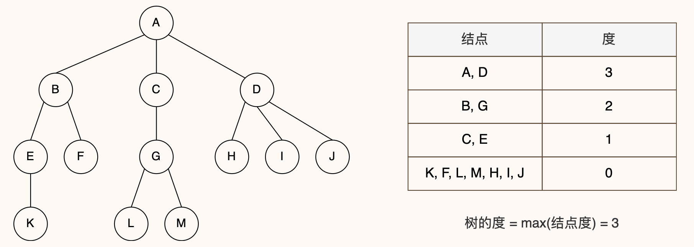

- **结点的度**：结点的孩子数量
- **树的度**：等于树中所有结点度的最大值
- **分支结点**（非终端结点）：度大于 0 的结点
- **叶子结点**（终端结点）：度等于 0 的结点

#### 1.3 深度

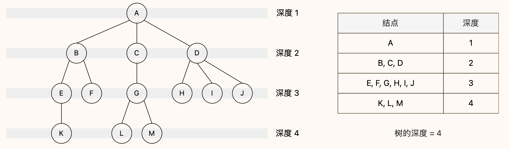

- **树的深度**（Depth）：从根结点到最远叶子结点的 **结点总数**。
- **结点的深度**：是指从根结点到该结点的结点总数。

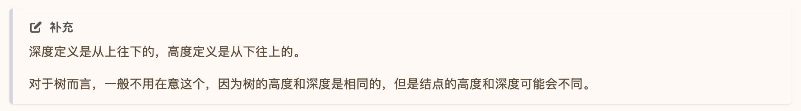

#### 1.4 高度

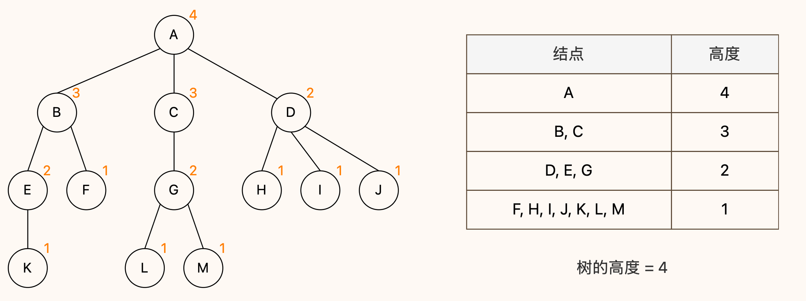

- **树的高度**（Height）：从根结点到最远叶子结点的 **结点总数**。
- **结点的高度**：从该结点到其最远叶子结点的 结点总数。

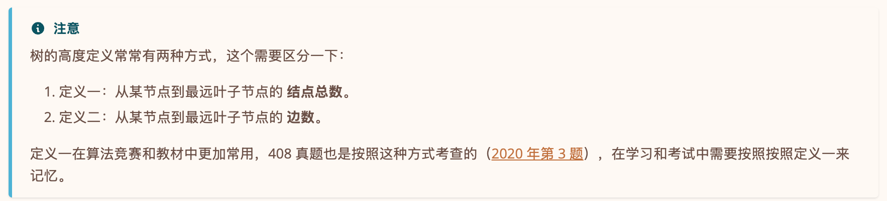

#### 1.5 路径

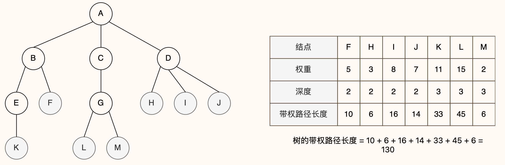

- **路径**：在一棵树中，从一个结点到另一个结点所经过的所有结点，被称为这两个结点之间的路径。
- **结点的权**：每个结点被赋予的一个数值，通常表示该结点的重要性或频率。
- **结点的带权路径长度**：从根结点到该结点的路径长度与该结点权值的乘积。
- **树的带权路径长度**：所有叶子结点的带权路径长度之和。

### 二、树的存储结构

树的 **存储结构** 是指在计算机中如何表示和存储树这种数据结构，这里主要了解 **双亲表示法**、**孩子表示法** 和 **孩子兄弟表示法** 即可。

#### 2.1 双亲表示法

**双亲表示法** 主要是使用一个数组，其中每个结点都有一个指示其双亲结点在数组中位置的索引。

```c
#define MAXSIZE 100
typedef struct {
    int data;         // 结点数据
    int parent;       // 双亲的位置
} PTNode;

typedef struct {
    PTNode nodes[MAXSIZE];  // 结点数组
    int n;                  // 结点数
} PTree;
```

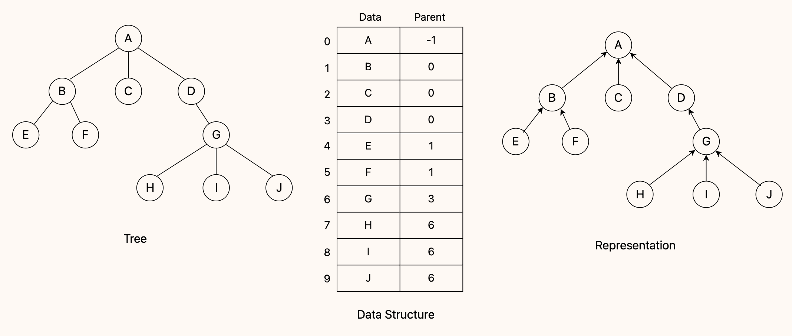

#### 2.2 孩子表示法

**孩子表示法** 将每个结点的孩子结点排列起来，以单链表作为存储结构。然后再用一个数组与之相配合。

```c
#define MAXSIZE 100

// 孩子结点
typedef struct ChildNode {
    int child;                   // 孩子结点在数组中的位置
    struct ChildNode* next;     // 下一个孩子
} *ChildPtr;

// 表头结构
typedef struct {
    int data;                   // 结点数据
    ChildPtr firstchild;        // 第一个孩子的指针
} CTBox;

typedef struct {
    CTBox nodes[MAXSIZE];       // 结点数组
    int n;                      // 结点数
} CTree;
```

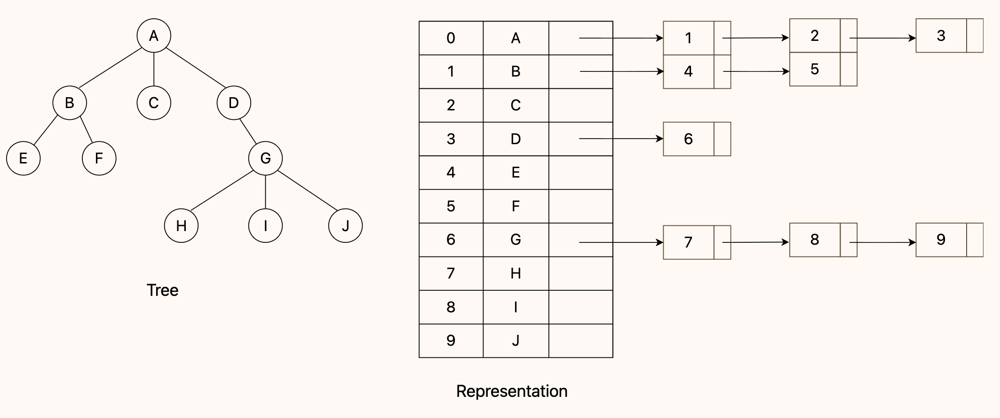

#### 2.3 孩子兄弟表示法

**孩子兄弟表示法** 是将树转化为 **二叉树** 的形式来存储。每个结点有两个指针，一个指向它的第一个孩子，另一个指向它的右兄弟。

```c
typedef struct CSNode {
    int data;                     // 结点数据
    struct CSNode* firstchild;   // 第一个孩子
    struct CSNode* rightsib;     // 右兄弟
} CSNode, *CSTree;
```

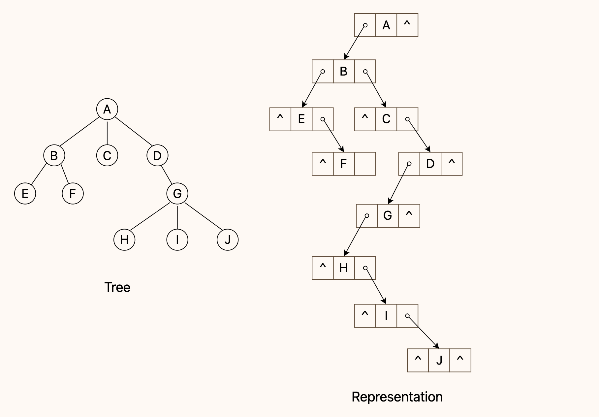

### 三、森林的基本概念

**森林**（Forest）是一组互不相交的树的集合。换句话说，森林由若干棵树组成，每棵树都是一个独立的层次结构，且这些树之间没有连接关系。

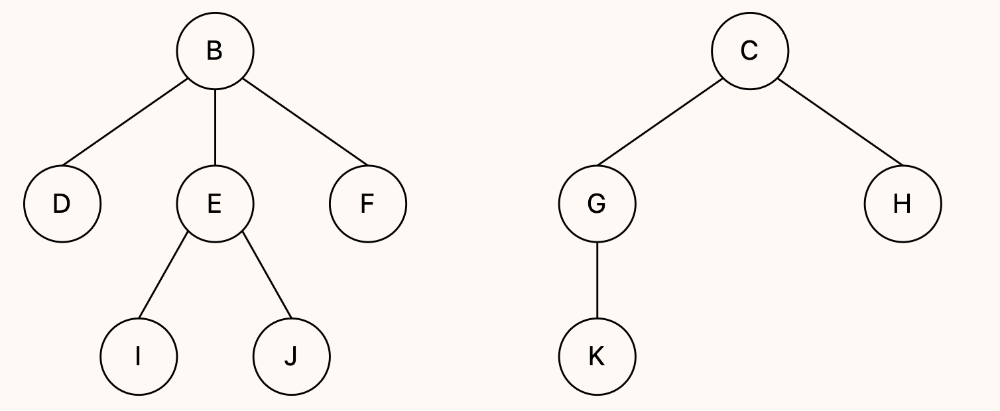

- 森林与树的区别：
  - 一棵树只有一个 **根结点**，而森林可以有多个 **根结点**（每棵树一个）。
  - 森林可以看作是多个树的并集，树是森林的一个特例（森林中只有一棵树）。
- **森林的深度**：森林中所有树的最大 **高度**（从根到最远叶结点的路径长度）。

### 四、树、森林和二叉树的转换

#### 4.1 树转化为二叉树

- 若树的根结点有孩子，那么第一个孩子是 **二叉树** 的左孩子，其他的孩子结点依次作为前一个孩子结点的右孩子。
- 对每个孩子执行上述步骤。

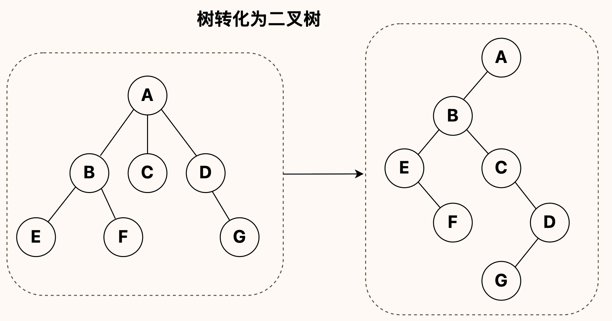

#### 4.2 森林转二叉树

- 把森林中的每一棵树转换为 **二叉树**。
- 第一棵二叉树不动，从第二棵二叉树开始，依次将后一棵二叉树的根作为前一棵二叉树的右孩子。其结果是一个 **二叉树**。

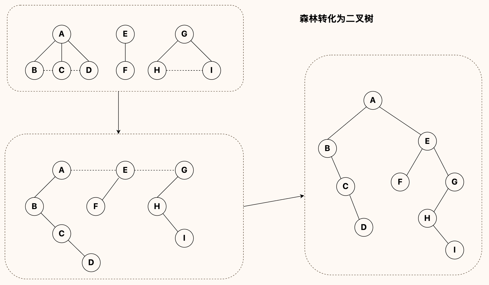

### 五、树和森林的遍历

#### 5.1 树的遍历

对于一个给定的树，通常有以下两种遍历方式：

1. 先根遍历

   （类似于二叉树的前序遍历）：

   - 访问树的根结点。
   - 递归地 **先根遍历** 根的每一棵子树。

2. 后根遍历

   （类似于二叉树的后序遍历）：

   - 递归地 **后根遍历** 根的每一棵子树。
   - 访问树的根结点。

注意树是没有 **中根遍历** 的，除非这棵树是二叉树。

```c
// 1.树结点的定义
#define MAXCHILD 20

typedef struct TreeNode {
    int value;
    int numChildren; // 子结点的数量
    struct TreeNode *children[MAXCHILD]; // 子结点指针数组
} TreeNode;

// 2.先根遍历
void preOrderTraversal(TreeNode* root) {
    if (root == NULL) {
        return;
    }
    printf("%d ", root->value);  // 先访问根结点
    // 然后遍历子结点
    for (int i = 0; i < root->numChildren; ++i) {
        preOrderTraversal(root->children[i]);
    }
}

// 3.后根遍历
void postOrderTraversal(TreeNode* root) {
    if (root == NULL) {
        return;
    }

    // 先遍历子结点
    for (int i = 0; i < root->numChildren; ++i) {
        postOrderTraversal(root->children[i]);
    }
    printf("%d ", root->value);  // 再访问根结点
}
```

对于 [上图](https://www.csgraduates.com/data_structure/tree/tree/#树转化为二叉树) 所示的树：其 **先根遍历** 为 `A, B, E, F, C, D, G`，**后根遍历** 为`E, F, B, C, G, D, A`。

观察可以得到如下结论：

- 树的 **先根遍历** 和其对应的二叉树的 **先序遍历** 相同
- 树的 **后根遍历** 和其对应的二叉树的 **中序遍历** 相同

#### 5.2 森林的遍历

对于一个给定的森林，遍历方式如下：

1. **先根遍历**（与树的先根遍历相似）：依次 **先根遍历** 森林中的每一棵树。
2. **后根遍历**（与树的后根遍历相似）：依次 **后根遍历** 森林中的每一棵树。
3. **中根遍历**（普通的树构成的森林是不存在中序遍历的，这里的中序遍历指代的是二叉树森林）：依次 **中根遍历** 森林中的每一棵二叉树。

对于[上图](https://www.csgraduates.com/data_structure/tree/tree/#森林转二叉树) 所示的森林：其**先根遍历** 为 `A, B, C, D, E, F, G, H, I`，**后根遍历** 为 `B, C, D, A, F, E, H, I, G`，**中根遍历** 为 `B, C, D, A, F, E, H, I, G`

观察可以得到如下结论：

- 森林的 **先根遍历** 和其对应的二叉树的 **先序遍历** 相同
- 森林的 **中根遍历** 和其对应的二叉树的 **中序遍历** 相同

---

## 二叉树

### 一、二叉树存储结构

1. 链式存储结构：
   - 链式存储是最常见的二叉树存储方式。在链式存储中，每个节点都包含一个数据元素以及指向其左子树和右子树的指针。
   - 链式存储结构适用于表示任意形状和大小的二叉树，并且对于树的动态操作（插入、删除节点）非常方便。
2. 顺序存储结构（数组表示）：
   - 顺序存储结构使用数组来表示二叉树。通常，数组的索引与二叉树的节点之间存在特定的关系，例如，对于索引 *i* 的节点，其左子节点在索引 2*i*+1 处，右子节点在索引 2*i*+2 处，父节点在索引 (*i*−1) / 2 处。
   - 顺序存储结构通常用于堆数据结构（如二叉堆）的实现，其中对于堆的性质要求，使得数组表示变得非常有效

#### 1.1 链式存储

在 **链接存储** 中，我们需要在结构体中定义两个指针，分别指向二叉树左边的结点和右边的结点。

```c
typedef struct TreeNode {
    ElementType data;
    struct TreeNode* left;
    struct TreeNode* right;
} TreeNode;
```

#### 1.2 顺序存储

顺序存储表示用数组存储一颗树，如下图所示。

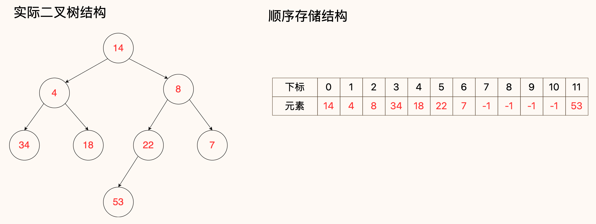

理解顺序存储的关键在于理解其 **结点的隐式链接关系** 以及 **空指针的定义** 这两点。

- 在顺序存储中，结点的链接关系由其下标指定：
  - 数组的下标从 1 开始的话，如果当前结点的下标为 *i* ，那么其左结点的下标为 2*i* ，右结点的下标为 2*i*+1 。
  - 数组的下标从 0 开始的话，如果当前结点的下标为 *i* ，那么其左结点的下标为 2*i*+1 ，右结点的下标为 2*i*+2 。
- 通常采用一个特殊值来表示空指针，上图中采用 -1 表示空指针。

```c
#define MAX_SIZE 100

int tree[MAX_SIZE];

int lchild(int i) {
    return tree[2 * i + 1];
})

int rchild(int i) {
    return tree[2 * i + 2];
}
```

顺序存储最常见于 [堆排序](https://www.csgraduates.com/data_structure/sort/internal/#堆排序) 中。因为 **堆是一棵完全二叉树**。

- 对完全二叉树而言，顺序存储不会造成空间浪费；
- 父结点与子结点之间的关系可以直接通过下标计算得到（无需额外指针）；
- 堆排序过程中需要频繁地比较和交换父结点与子结点，数组下标运算能显著提升效率。

因此，堆排序天然适合采用顺序存储结构来实现。

### 二、特殊二叉树

**特殊的二叉树** 包含满二叉树、完全二叉树两种。

简单来说，**满二叉树** 必须每一层结点数都是满的， **完全二叉树** 允许最后一层的最后几个结点为空。

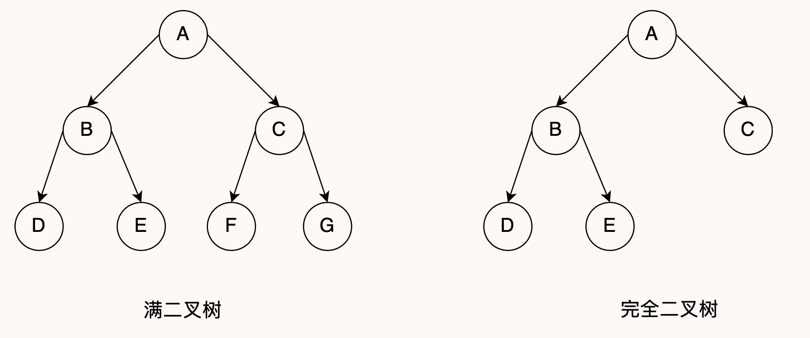

#### 2.1 满二叉树

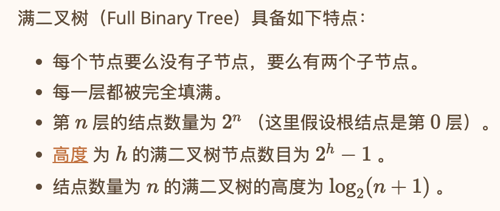

#### 2.2 完全二叉树

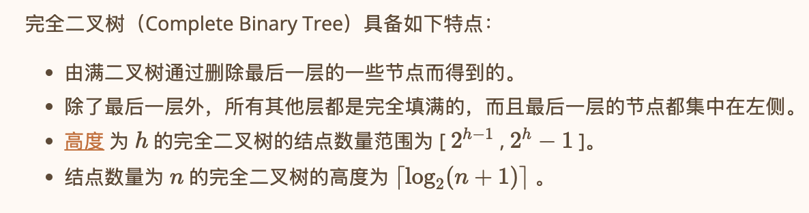

### 三、遍历方式

#### 3.1 DFS

**深度优先搜索**（DFS，Depth-First Search）是一种用于遍历或搜索树或图的算法。

当使用 DFS 遍历二叉树中的结点时，算法会优先探索树的深度，直到达到最深的节点。 当达到叶子节点或无法继续深入时，算法会回溯返回到上一个节点，探索其他分支。

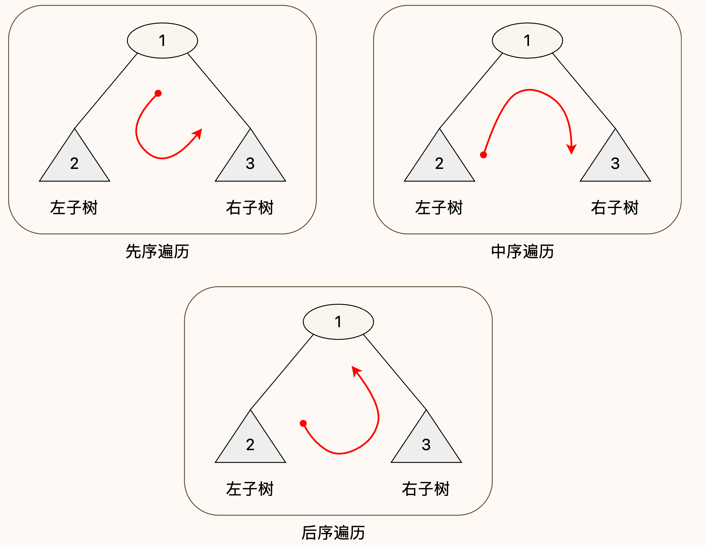

二叉树的深度优先（DFS）遍历方式包含前序、中序、后序遍历三种。 理解这三种遍历方式的关键在于理解其递归过程，不同方式的递归顺序不一样。 具体不同点如下表所示：

| 访问方式 |   递归顺序    |
| :------: | :-----------: |
|   前序   | 根左右（NLR） |
|   中序   | 左根右（LNR） |
|   后序   | 左右根（LRN） |

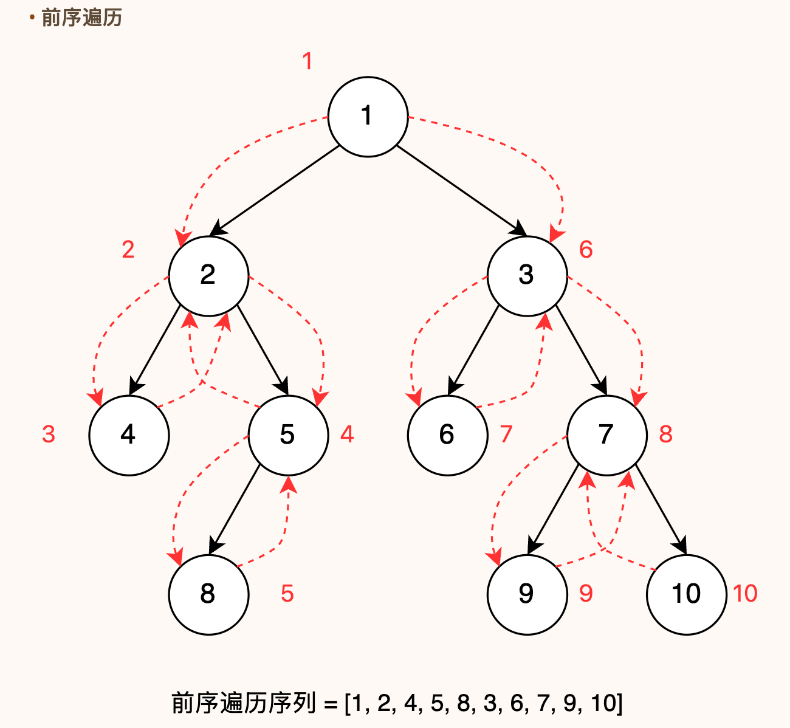

- 访问顺序：根节点 -> 左子树 -> 右子树
- 步骤：
  1. 访问根节点。
  2. 递归地进行前序遍历左子树。
  3. 递归地进行前序遍历右子树。

```c
void preorderTraversal(struct TreeNode* root) {
    if (root == NULL) {
        return;
    }
    // operation here
    preorderTraversal(root->left); // 遍历左子树
    preorderTraversal(root->right); // 遍历右子树
}
```

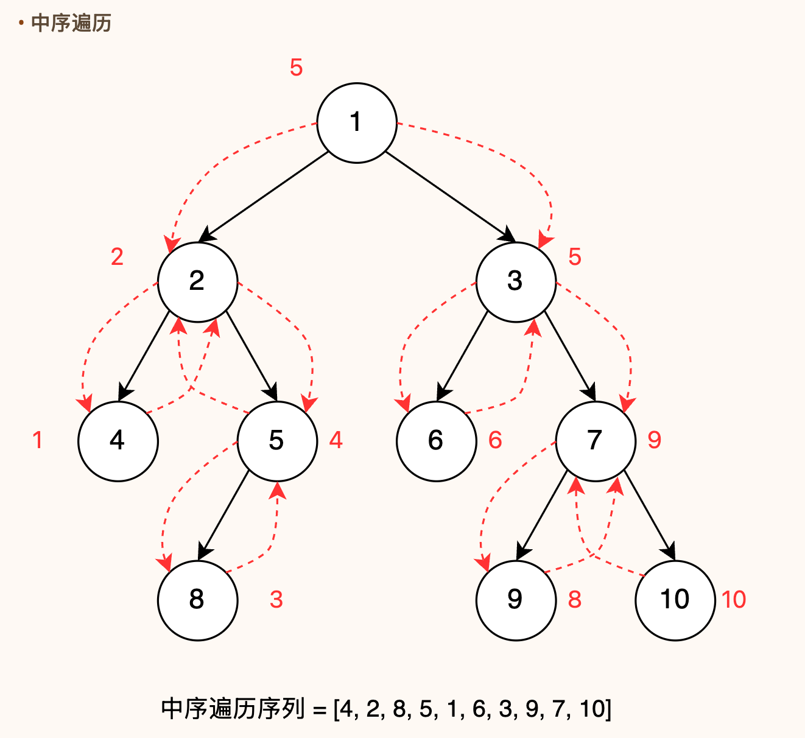

- 访问顺序：左子树 -> 根节点 -> 右子树
- 步骤：
  1. 递归地进行中序遍历左子树。
  2. 访问根节点。
  3. 递归地进行中序遍历右子树。

```c
void inorderTraversal(struct TreeNode* root) {
    if (root == NULL) {
        return;
    }
    inorderTraversal(root->left); // 遍历左子树
    // operation here
    inorderTraversal(root->right); // 遍历右子树
}
```

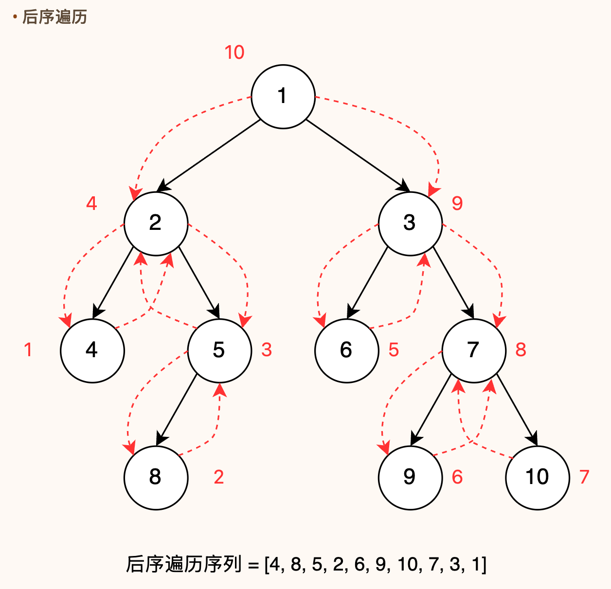

- 访问顺序：左子树 -> 右子树 -> 根节点
- 步骤：
  1. 递归地进行后序遍历左子树。
  2. 递归地进行后序遍历右子树。
  3. 访问根节点。

```c
void postorderTraversal(struct TreeNode* root) {
    if (root == NULL) {
        return;
    }
    postorderTraversal(root->left); // 遍历左子树
    postorderTraversal(root->right); // 遍历右子树
    // operation here
}
```

#### 3.2 BFS

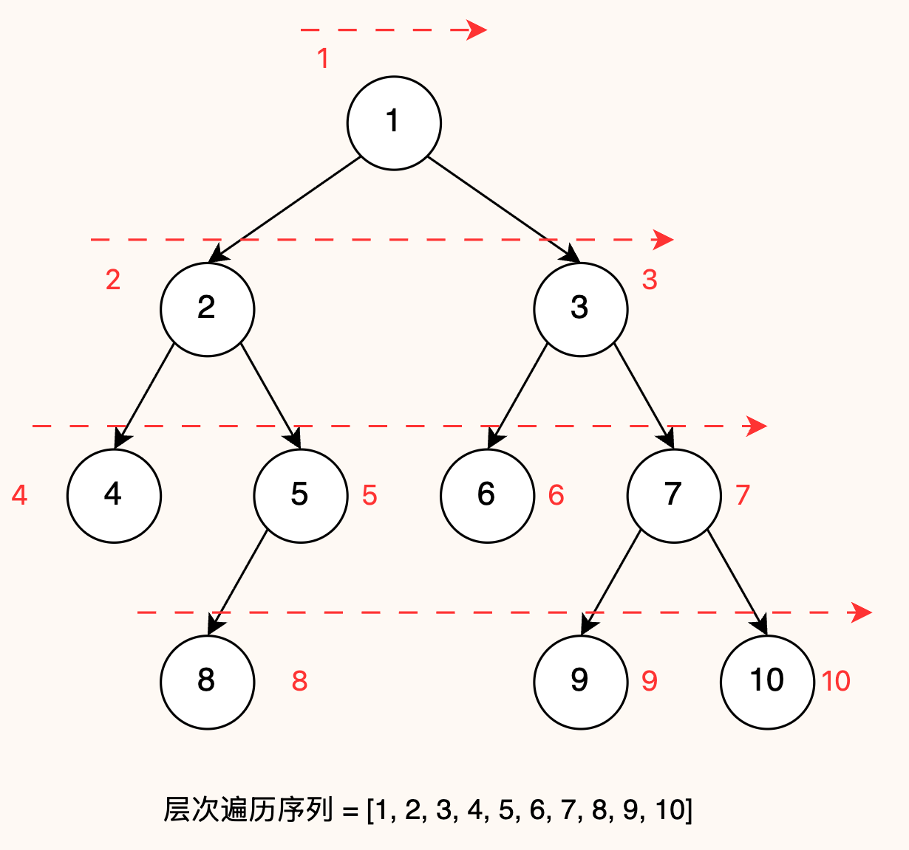

二叉树的层次遍历（Level Order Traversal），也称为 **广度优先搜索**（BFS），是一种从上到下、从左到右逐层访问二叉树节点的方法。

BFS 算法从根节点开始，**逐层访问节点**。同一层级的节点按照从左到右的顺序访问。

```c
void levelOrderTraversal(struct TreeNode* root) {
    if (root == NULL) {
        return;
    }

    struct Queue* queue = createQueue();
    enqueue(queue, root);

    while (queue->front != NULL) {
        struct TreeNode* current = dequeue(queue);
        // operation here

        if (current->left != NULL) {
            enqueue(queue, current->left);
        }

        if (current->right != NULL) {
            enqueue(queue, current->right);
        }
    }
}
```

### 四、线索二叉树

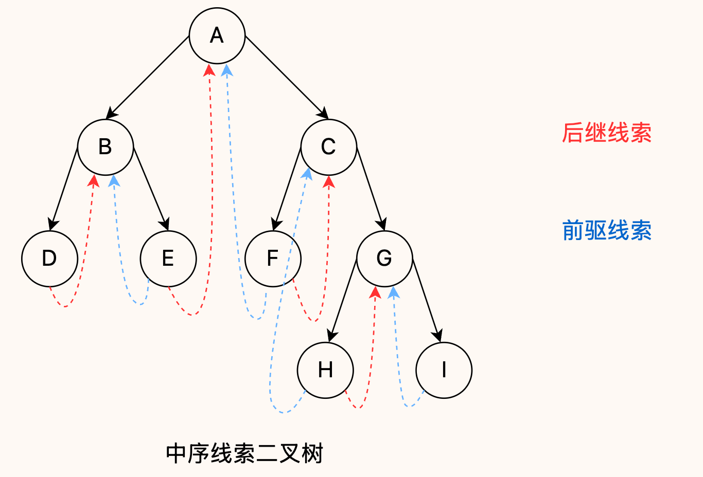

**线索二叉树**（Threaded Binary Tree）是一种为了提高二叉树遍历效率而设计的数据结构。它通过利用二叉树中原本为空的指针域来存储指向前驱或后继结点的指针（称为“线索”），从而省去递归或栈的遍历方式。

[普通二叉树](https://www.csgraduates.com/data_structure/tree/btree/#链接存储) 的结点有两个指针：`left` 和 `right`，但在一棵 `n` 个结点的二叉树中，实际的左右子树为空的指针数有很多（约 `2n` 个）。线索二叉树的思想就是把 **这些空指针利用起来**，指向结点在某种遍历序列中的前驱或后继。

#### 4.1 数据结构

```c
// 1.节点存储结构
// ltag = 1 时表示 lchild 域指向节点的前驱
// rtag = 1 时表示 rchild 域指向节点的后继
typedef struct ThreadNode {
    ElementType data;
    struct ThreadNode *lchild, *rchild;
    int ltag, rtag;
} ThreadNode;

// 2.遍历
// 以中序线索二叉树为例
// 中序遍历，找到中序遍历的第一个节点，然后遍历 rchild 即可
void InOrder(ThreadNode *n) {
    ThreadNode *p = n;
    while (p->lchild) {
        p = p->lchild;
    }
    for (; p != NULL; p = p->rchild) {
        visit(p);
    }
}
```

线索二叉树中的每个节点都可以包含以下线索信息：

- 前驱线索
  - 如果 `p` 的左子指针 `left` 原本为空，那么将其改为指向 `p` 的“遍历前驱结点”。
  - 同时 `ltag = 1`，表示这个指针是线索，而不是左孩子。
- 后继线索
  - 如果 `p` 的右子指针 `right` 原本为空，那么将其改为指向 `p` 的“遍历后继结点”。
  - 同时 `rtag = 1`，表示这个指针是线索，而不是右孩子。

#### 4.2 类型

📌 按不同的遍历方式，线索可分为：

| 线索类型     | 前驱 / 后继定义               |
| ------------ | ----------------------------- |
| **前序线索** | 指向前序遍历的前驱 / 后继结点 |
| **中序线索** | 指向中序遍历的前驱 / 后继结点 |
| **后序线索** | 指向后序遍历的前驱 / 后继结点 |

在实际应用中，最广泛使用的是 **中序线索二叉树**。因为通过中序线索，可以用如下方式访问整棵树：

1. 从最左下角的结点开始
2. 通过右线索一步步访问中序后继
3. 直到结束，不需要递归或辅助栈

这种遍历方法最简单、最直接。

### 五、二叉树构建

已知二叉树，可以获得其前序、中序和后序遍历序列。

反之，给定二叉树的遍历序列，可以通过以下两种方式重建其二叉树结构：

1. **带空指针的单序列重建**：给定包含空指针信息的单一遍历序列（如带空指针的前序遍历），可以唯一确定二叉树的结构。
2. **双序列组合重建**：给定两种不同的遍历序列组合，可以唯一确定二叉树的结构。

#### 5.1 带空指针的单序列

在二叉树的遍历序列中，**明确标记空节点**（例如用 `#` 或 `NULL`），可以保证仅通过 **一个前序遍历序列** 就能唯一确定一棵二叉树的结构。

如果只用常规的前序、中序或后序遍历而不标记空节点，那么遇到某些情况时会出现歧义。例如，一棵根节点为 `1` 的树，如果它只有一个左孩子或只有一个右孩子，两种情况的普通前序序列都是 `1 X`，无法区分。

但是如果在遍历时显式地写出空指针（`#`），序列就变得 **无歧义**。

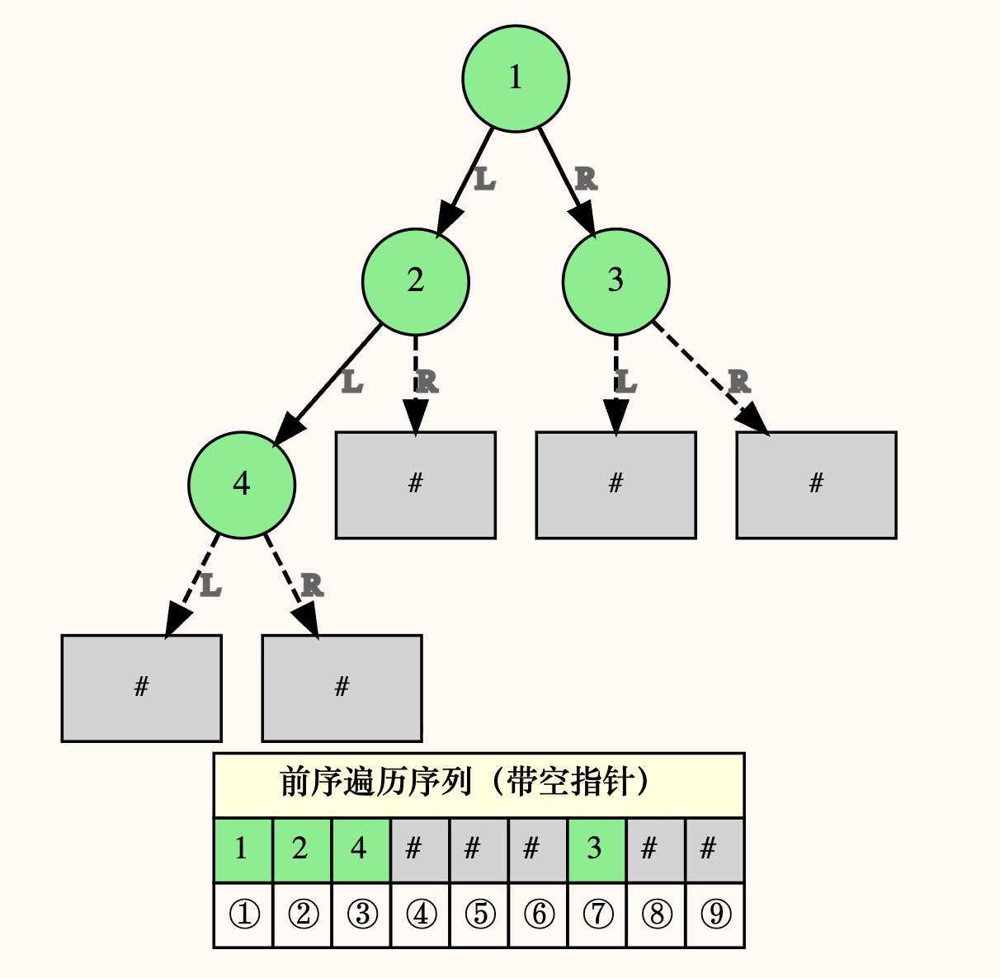

举个例子，对于以上二叉树，我们可以使用以下方法构建二叉树：

1. 从序列的第一个元素开始：
   - 如果是 `#`，说明该子树为空，返回 `NULL`。
   - 否则，创建一个新节点作为当前子树的根。
2. 递归处理下一个元素：
   - 按前序规则，先为当前节点构建 **左子树**。
   - 如果遇到 `#`，左子树为空，返回。
3. 再递归处理下一个元素：
   - 构建 **右子树**。
   - 如果遇到 `#`，右子树为空，返回。
4. 重复步骤 1–3，直到序列完全读完。

```c
TreeNode* createTree(char a[], int *i) {
    if (a[*i] == '#') {   // 空指针标记
        (*i)++;           // 别忘了推进下标
        return NULL;
    }
    // 创建当前节点
    TreeNode *cur = (TreeNode*)malloc(sizeof(TreeNode));
    cur->val = a[*i];
    (*i)++;               // 消费当前字符

    // 按前序顺序构建左右子树
    cur->left = createTree(a, i);
    cur->right = createTree(a, i);

    return cur;
}
```

####  5.2 双序列组合重建

从前序、中序、后序序列中选两个构造二叉树，有两种方式：

1. **前序 + 中序**：这是最常见的组合，因为前序确定了根节点的位置，而中序则可以区分哪些节点在左子树，哪些在右子树。有了这两个信息，就可以唯一确定一棵二叉树。
2. **后序 + 中序**：后序确定了根节点的位置（它是后序遍历的最后一个节点），而中序同样可以帮助我们区分左、右子树。因此，这两者也可以唯一确定一棵二叉树。

重点在于选取的两种遍历方式可以提供关于这颗二叉树的结构信息，以 **前序** 和 **中序** 为例：

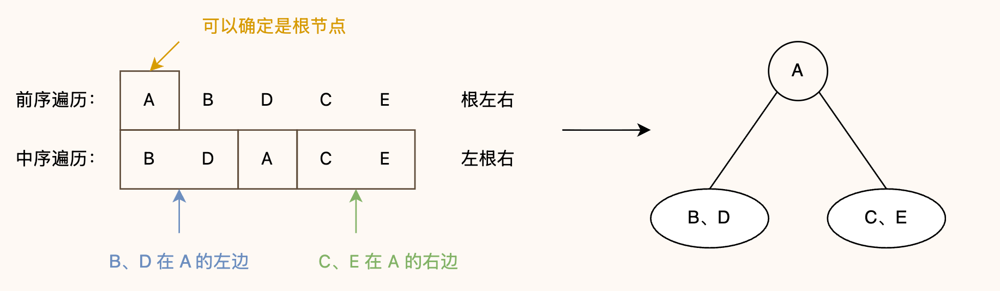

如上图所示，给定起始序列，可以判断先序序列中的第一个元素 A 是树的根结点。 再根据中序序列，可以判断 B、D 在 A 的左子树中，C、E 在 A 的右子树中。

由此我们就得到了二叉树的一部分结构，再继续递归地对 A 的左子树和右子树重复如上过程，即可得到完整的二叉树结构。

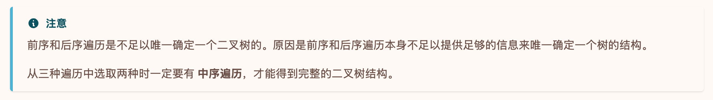

上述例子的具体重建过程如下：

- 前序遍历的第一个元素 `A` 是根节点。
- 在中序遍历中， `A` 将序列分为两部分： `BD` 和 `CE` 。左边部分 `BD` 对应于左子树，右边部分 `CE` 对应于右子树。
- 在前序遍历中，继 `A` 之后的 `BD` 对应于左子树，而 `CE` 对应于右子树。
- 对于左子树，其前序遍历为 `BD` ，中序遍历为 `BD` 。从这可以确定 `B` 是左子树的根，而 `D` 是它的右孩子。
- 对于右子树，其前序遍历为 `CE` ，中序遍列为 `CE` 。从这可以确定 `C` 是右子树的根，而 `E` 是它的右孩子。

重建后可以得到二叉树结构：

```
    A
   / \
  B   C
   \   \
    D   E
```

### 六、BST

二叉排序树，也称为 **二叉查找树**（Binary Search Tree, BST），是一种特殊的二叉树。它或者是一棵空树，或者是满足以下性质的二叉树：

1. 若它的 **左子树** 不空，则左子树上所有结点的值均 **小于** 它的根结点的值。
2. 若它的 **右子树** 不空，则右子树上所有结点的值均 **大于** 它的根结点的值。
3. 它的左、右子树也分别为二叉排序树。

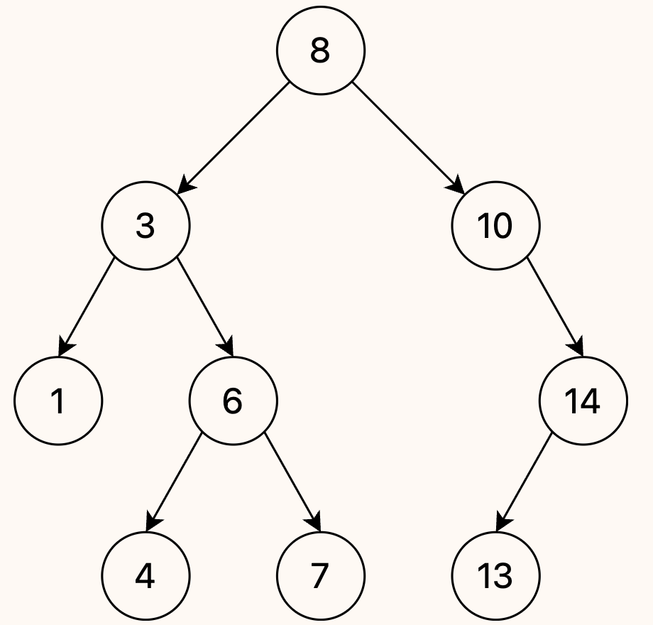

二叉查找树的 **主要操作** 有：

1. **插入**：从根节点开始，如果待插入的值小于当前节点的值，就将其插入到左子树中，否则插入到右子树中。
2. **查找**：从根节点开始，如果待查找的值小于当前节点的值，就在左子树中查找，否则在右子树中查找。
3. 删除：有三种情况：
   - 如果是叶子节点，直接删除。
   - 如果只有一个子节点，删除它并将其子节点连接到它的父节点。
   - 如果有两个子节点，找到其右子树的最小值或左子树的最大值来替换该节点，然后删除那个节点。

```c
// 1.结点定义
typedef struct TreeNode {
    int data;
    struct TreeNode* left;
    struct TreeNode* right;
} TreeNode;

// 创建新节点
TreeNode* newNode(int data) {
    TreeNode* node = (TreeNode*)malloc(sizeof(TreeNode));
    node->data = data;
    node->left = NULL;
    node->right = NULL;
    return node;
}

// 2.插入
// 插入新节点
TreeNode* insert(TreeNode* root, int data) {
    if (root == NULL) {
        return newNode(data);
    }
    if (data < root->data) {
        root->left = insert(root->left, data);
    } else if (data > root->data) {
        root->right = insert(root->right, data);
    }
    return root;
}

// 3.查找
// 查找节点
TreeNode* search(TreeNode* root, int data) {
    if (root == NULL || root->data == data) {
        return root;
    }
    if (data < root->data) {
        return search(root->left, data);
    }
    return search(root->right, data);
}

// 4.删除
// 删除节点
TreeNode* deleteNode(TreeNode* root, int data) {
    if (root == NULL) {
        return root;
    }
    if (data < root->data) {
        root->left = deleteNode(root->left, data);
    } else if (data > root->data) {
        root->right = deleteNode(root->right, data);
    } else {
        // 节点有一个或没有子节点
        if (root->left == NULL) {
            TreeNode* temp = root->right;
            free(root);
            return temp;
        } else if (root->right == NULL) {
            TreeNode* temp = root->left;
            free(root);
            return temp;
        }

        // 节点有两个子节点，找到右子树的最小节点
        TreeNode* temp = findMin(root->right);

        // 复制右子树的最小节点的值
        root->data = temp->data;

        // 删除右子树的最小节点
        root->right = deleteNode(root->right, temp->data);
    }
    return root;
}
```

### 七、AVL

**平衡二叉树**（Balanced Binary Tree），也叫做 **AVL 树**。它的特点是任意节点的左右子树高度差（**平衡因子**）的绝对值不超过 1，这确保了树的高度始终保持在 *O*(log*n*) 的水平，使得查找、插入和删除操作的时间复杂度都保持在 *O*(log*n*) 。

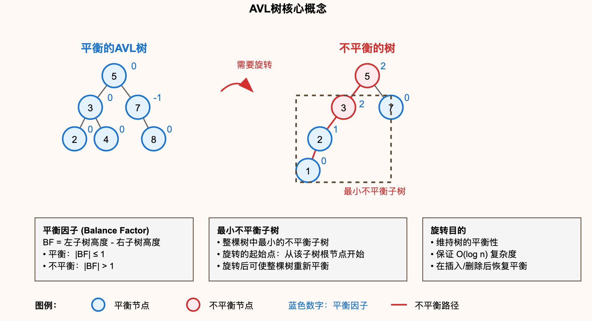

理解 AVL 的关键在于理解 AVL 的 **旋转过程**，以下针对几个疑问带大家迅速了解关键知识：

1. **为什么需要旋转？**

我们时常需要对 AVL 中的结点进行插入和删除操作，这些操作可能导致 AVL 中的某个子树进入不平衡的状态。 通过旋转操作可以使得不平衡的子树和整棵 AVL 树都 **重新平衡**。

1. **从哪个节点开始旋转？**

从 **最小不平衡子树的根节点** 旋转，旋转操作会使得最小不平衡子树从不平衡变得平衡。

理解这句话你需要掌握以下概念：

- **平衡因子**：每个节点的平衡因子是其左子树的高度减去右子树的高度
- **最小不平衡子树**：最小不平衡子树是指在整棵二叉树中，高度差（平衡因子的绝对值）最小的子树，该子树的平衡因子绝对值超过 1，即它是导致整棵树不平衡的最小子树。

#### 7.1 旋转方式

执行插入操作时，如果该次插入使得 AVL 不平衡的话，首先找到最小不平衡子树根节点（用 A 表示该节点）的位置，然后根据插入节点（用 N 表示）相对于 A 的位置，可能有四种不同的 **旋转** 操作：

1. **LL**，N 在 A 的左子树的左子树中（A 的平衡因子 +2，A 的左子树根节点平衡因子 +1）：A 右旋
2. **RR**，N 在 A 的右子树的右子树中（A 的平衡因子 -2，A 的右子树根节点平衡因子 -1）：A 左旋
3. **LR**，N 在 A 的左子树的右子树中（A 的平衡因子 +2，A 的左子树根节点平衡因子 -1）：A 的左子树左旋，然后 A 右旋
4. **RL**，N 在 A 的右子树的左子树中（A 的平衡因子 -2，A 的右子树根节点平衡因子 +1）：A 的右子树右旋，然后 A 左旋

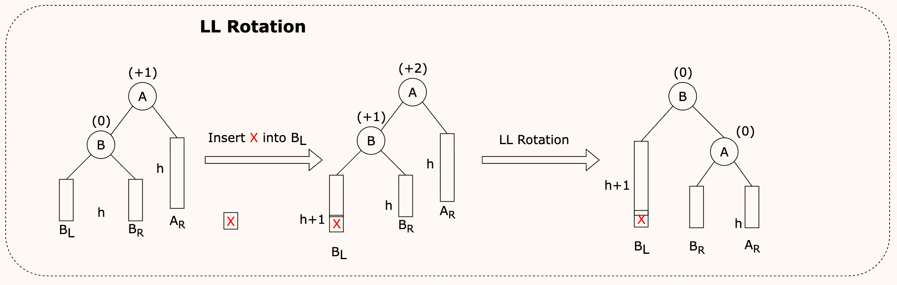

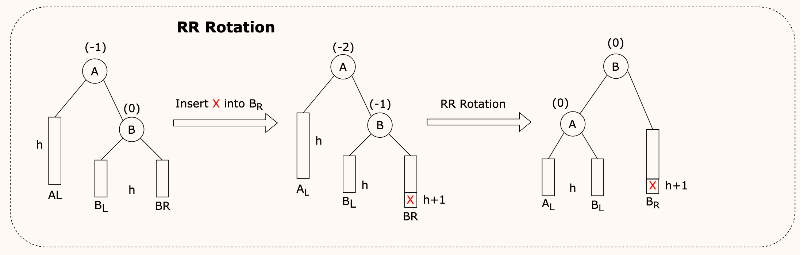

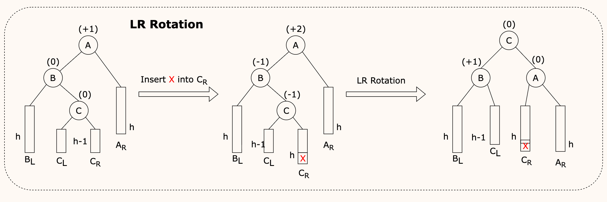

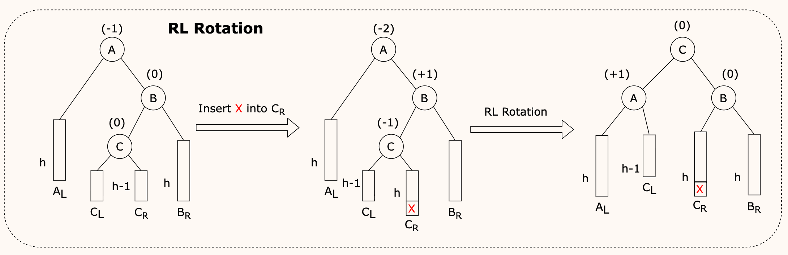

AVL 平衡旋转的代码实现如下所示，过程比较繁琐，了解即可，重点在与如何掌握如何“人脑”模拟旋转过程。

```c
// 1.节点定义
struct TreeNode {
    int data;
    struct TreeNode* left;
    struct TreeNode* right;
    int height; // 节点高度
};

// 2.左旋
struct TreeNode* leftRotate(struct TreeNode* x) {
    struct TreeNode* y = x->right;
    struct TreeNode* T2 = y->left;

    // 执行旋转
    y->left = x;
    x->right = T2;

    // 更新高度
    updateHeight(x);
    updateHeight(y);

    return y;
}

// 3.右旋
struct TreeNode* rightRotate(struct TreeNode* y) {
    struct TreeNode* x = y->left;
    struct TreeNode* T2 = x->right;

    // 执行旋转
    x->right = y;
    y->left = T2;

    // 更新高度
    updateHeight(y);
    updateHeight(x);

    return x;
}

// 4.计算平衡因子
// 计算以 node 为根节点的子树高度
int getHeight(struct TreeNode* node) {
    if (node == NULL) {
        return 0;
    }
    return node->height;
}

// 获取平衡因子
int getBalanceFactor(struct TreeNode* node) {
    if (node == NULL) {
        return 0;
    }
    return getHeight(node->left) - getHeight(node->right);
}

// 5.更新节点高度
// 在插入时需要使用该操作，重新计算子树高度
void updateHeight(struct TreeNode* node) {
    int leftHeight = getHeight(node->left);
    int rightHeight = getHeight(node->right);
    node->height = (leftHeight > rightHeight ? leftHeight : rightHeight) + 1;
}

// 6.旋转的完整实现
struct TreeNode* insert(struct TreeNode* node, int data) {
    // 步骤 1：执行标准 BST 插入
    if (node == NULL) {
        return createNode(data);
    }

    if (data < node->data) {
        node->left = insert(node->left, data);
    } else if (data > node->data) {
        node->right = insert(node->right, data);
    } else { // 如果键值相等，则不插入
        return node;
    }

    // 步骤 2：更新节点的高度
    updateHeight(node);

    // 步骤 3：获取节点的平衡因子
    int balanceFactor = getBalanceFactor(node);

    // 步骤 4：平衡调：根据新插入结点的位置 相对于 最小不平衡子树根节点的位置进行旋转
    // LL 型：右旋
    if (balanceFactor > 1 && data < node->left->data) {
        return rightRotate(node);
    }
    // RR 型：左旋
    if (balanceFactor < -1 && data > node->right->data) {
        return leftRotate(node);
    }
    // LR 型：先左旋，再右旋
    if (balanceFactor > 1 && data > node->left->data) {
        node->left = leftRotate(node->left);
        return rightRotate(node);
    }
    // RL 型：先右旋，再左旋
    if (balanceFactor < -1 && data < node->right->data) {
        node->right = rightRotate(node->right);
        return leftRotate(node);
    }

    // 返回未被修改的节点指针
    return node;
}
```

### 八、红黑树

为了保证 **AVL** 的平衡性，插入和删除操作后，非常频繁地调整全树整体拓扑结构，代价很大。为此在 AVL 树的平衡标准上进一步放宽条件，引入 **红黑树** 的结构。

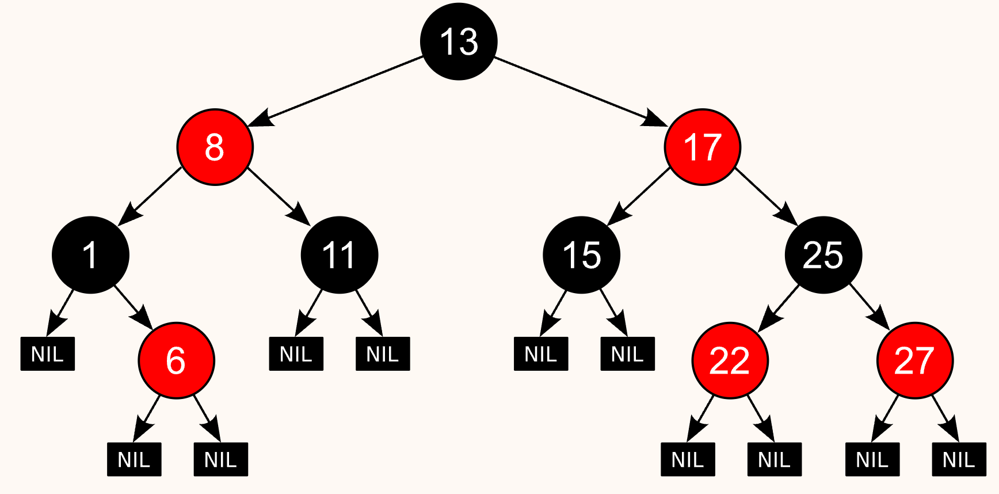

红黑树的考察不会很深，了解以下概念即可：

1. 从根结点到叶结点的最长路径不大于最短路径的 2 倍。
2. 根节点和叶结点是黑色的。
3. 不存在两个相邻的红结点。
4. 对每个结点，从该结点到任一叶结点的简单路径上，所含黑结点的数量相同。

---

## 树的应用

### 一、编码和解码

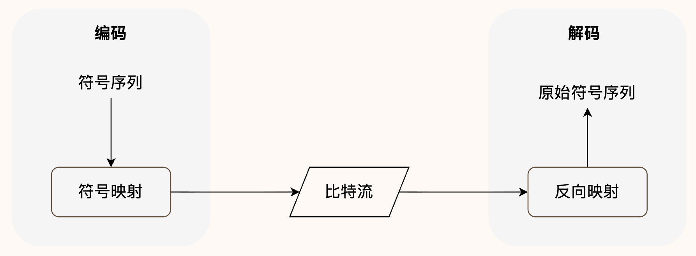

**编码**（Encoding）是将信息从一种形式（通常是人类可读的符号或数据）转换为另一种形式（通常是机器可处理的格式，如二进制比特流）的过程。其目的是为了便于存储、传输或处理信息。**编码**通常涉及将原始数据（如字符、数字等）映射为特定的代码，这些代码由一组 **编码规则** 定义。

**解码**（Decoding）是编码的 **逆过程**，即将编码后的数据（如二进制比特流）转换回原始形式的过程。解码需要依赖编码时使用的规则或 **编码表**，以确保正确还原原始信息。

#### 1.1 编码集分类

**编码集**是一组用于表示特定符号或数据的 **编码规则** 的集合。

**编码集** 常按以下方式分类：

- 固定长度 vs 非固定长度
  - **固定长度编码集**（定长）：每个代码的长度相同，例如 ASCII 编码中每个字符都用 8 位表示。
  - **可变长度编码集**（变长）：代码长度可以不同，例如 [哈夫曼编码](https://www.csgraduates.com/data_structure/tree/app/#哈夫曼编码) 中高频符号用较短代码，低频符号用较长代码，以实现数据压缩。
- 前缀 vs 非前缀
  - **前缀编码**：没有一个编码是另一个编码的前缀
  - **非前缀编码**：有编码是其他编码的前缀

##### 定长编码

定长编码是指：**为每个符号分配长度完全相同的二进制编码。**
也就是说，不管某个符号出现得多还是少，它所占用的 **比特数** 都是一样的。

定长编码的 **构建方式** 如下：

1. **统计符号集合**：先确定总共有多少个不同的符号，记为 *n* 。
2. **计算编码长度**：要为每个符号分配一个不同的二进制码，所需的最小码长 l 满足：

*l*=⌈log*n*⌉

也就是说，使用 *l* 位二进制，可以最多表示 2*l* 个不同的符号。

3. **分配编码**：从 0 开始，依次将二进制数分配给每个符号，使用前导零补足到长度 *l* 。

**举个实例** 说明一下

假设有 5 个符号：A、B、C、D、E

- 总数 *n*=5 ，因此编码长度 *l*=⌈log5⌉=3
- 3 位二进制能编码最多 2^3=8 个符号，足够使用
- 分配如下：

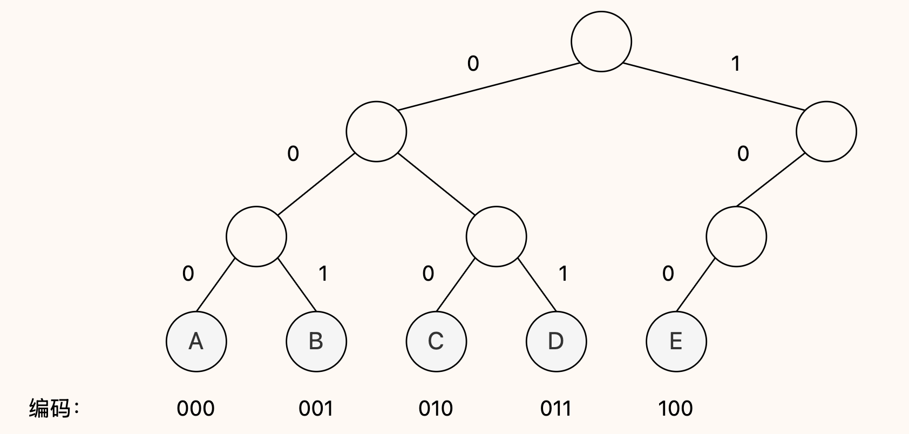

根据以上构建过程可知：在定长编码中，所有 **叶子结点**（对应字符的结点）都位于同一层，在 变长编码中，**叶子结点** 可以不位于同一层。

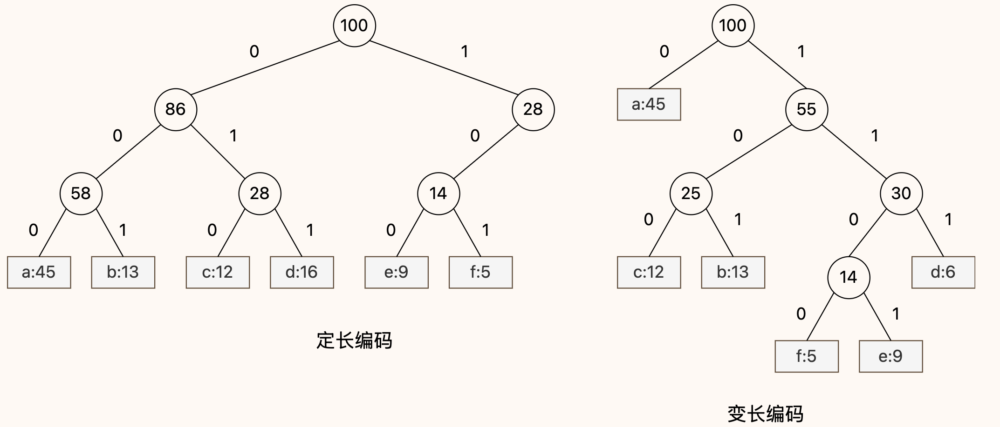

##### 前缀编码

**前缀编码**（Prefix Code）是一种编码方式，其中没有任何编码是另一个编码的前缀。换句话说，在一组编码中，任何一个编码字符串都不会是另一个编码字符串的开头部分。这种特性确保了编码可以被唯一且无歧义地解码，常用于数据压缩和通信系统。

前缀编码表示 **编码集中没有编码是另一个编码的前缀**，不要这个定义和它的名字弄混了。

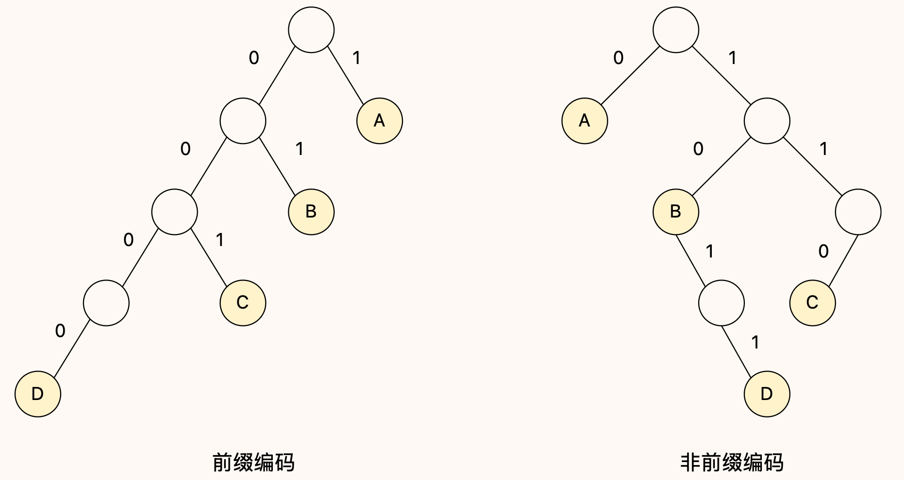

编码集 {1, 01, 001, 0000} 对应的二叉树如上面的左图所示。该编码集为**前缀编码**，可以观察到，**前缀编码**的每一个编码都处于 **叶子结点** 的位置，这说明在对比特流进行解码的过程中不会出现歧义（想要获取到编码需要唯一地到达 **叶子结点**）。

编码集 {0, 10, 110, 1011} 对应的二叉树如上面的右图所示。该编码集为**非前缀编码**，可以观察到，**非前缀编码** 有编码处于 **中间结点** 的位置，这说明在对比特流进行解码的过程中会出现歧义，比如对于 10110，解码器无法确认是将开始的 10 解码为 B 还是将 1011 解码为 D。

#### 1.2 编码长度计算

在信息编码相关的试题中，常会考察两种编码长度的计算方式：**加权路径长度** 和 **加权平均长度**。这两个概念虽相关，但含义和用途不同，需要仔细辨别。

此外，计算这两个指标时还涉及到两个基本的量：**频次** 和 **概率**。它们在形式上相似，但在理解和运用时也要有所区分。

- **频次**：表示某个符号在整体数据中实际出现的次数。
- **概率**：表示某个符号出现的相对频率，即该符号出现的频次除以总频次。

编码长度的计算可以基于**频次**，也可以基于**概率**。两种方法在数值上本质一致，只是表达形式不同，使用**频次**适用于原始统计数据，使用**概率**则适用于标准化分析。

接下来我们就分别介绍这两种编码长度的具体含义及其数学计算方式。

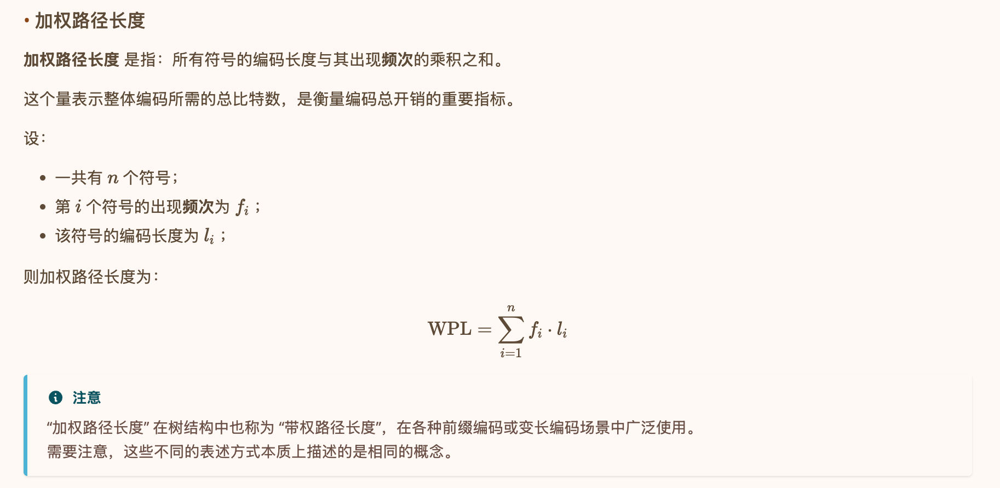

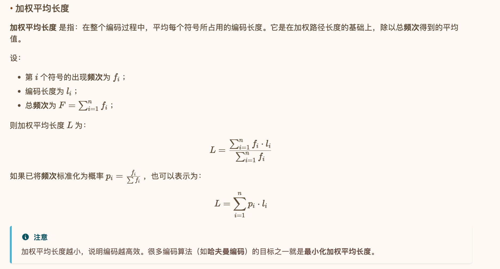

接下来通过一个 **实例** 来说明一下两个概念的计算：

假设我们有如下符号统计信息：

| 符号 | 出现频次 *f**i* | 概率 *p**i* | 编码 *l**i* |
| ---- | --------------- | ----------- | ----------- |
| A    | 50              | 0.50        | 1           |
| B    | 20              | 0.20        | 2           |
| C    | 20              | 0.20        | 3           |
| D    | 10              | 0.10        | 3           |

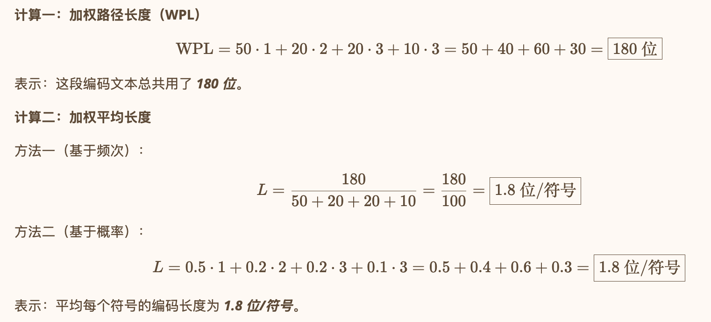

**对比总结**

| 项目         | 值   | 单位                  | 用途                       |
| ------------ | ---- | --------------------- | -------------------------- |
| 加权路径长度 | 180  | 位（bit）             | 整体编码所占的总位数       |
| 加权平均长度 | 1.8  | 位/符号（bit/symbol） | 衡量单位符号的平均编码效率 |

### 二、哈夫曼树

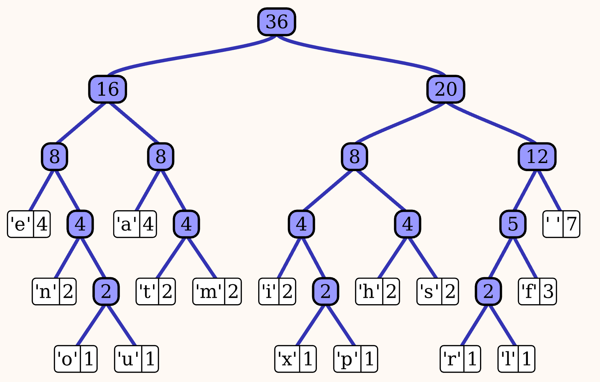

**哈夫曼树**（Huffman Tree）是一种特殊的 **二叉树**，通常用于 **数据压缩** 算法中，特别是用于构建 **哈夫曼编码**（Huffman Coding）。哈夫曼树的主要目标是实现 **无损压缩**，通过赋予不同的数据符号不同长度的编码来减少数据的存储空间。

#### 2.1 特点

1. 哈夫曼树是一棵二叉树，通常是 **带权二叉树**，其中每个 **叶子节点** 都对应一个数据符号，而每个内部节点都没有数据，只有 **权值**。
2. 哈夫曼树的 **叶子节点** 的 **权值** 通常表示数据符号的 **出现频率**，而内部节点的 **权值** 等于其子节点 **权值之和**。
3. 哈夫曼树 的 **构建目标** 是找到一棵树，使得权值较高的数据符号拥有 较短的编码，权值较低的数据符号拥有较长的编码。

#### 2.2 构建过程

1. 创建一个包含所有数据符号的森林（初始状态下，每个数据符号都是一棵单节点树）。
2. 从森林中 **选择两棵树**，这两棵树的 **权值最小**。将它们 **合并为一棵新的树**，新树的 **权值** 为两棵树的 **权值之和**。
3. 将 **新的树放回森林** 中，重复步骤 2，直到森林中只剩下一棵树，这棵树就是 **哈夫曼树**。
4. 构建好的哈夫曼树具有一个重要的性质：权值较高的数据符号在树中的深度较浅，权值较低的数据符号在树中的深度较深。

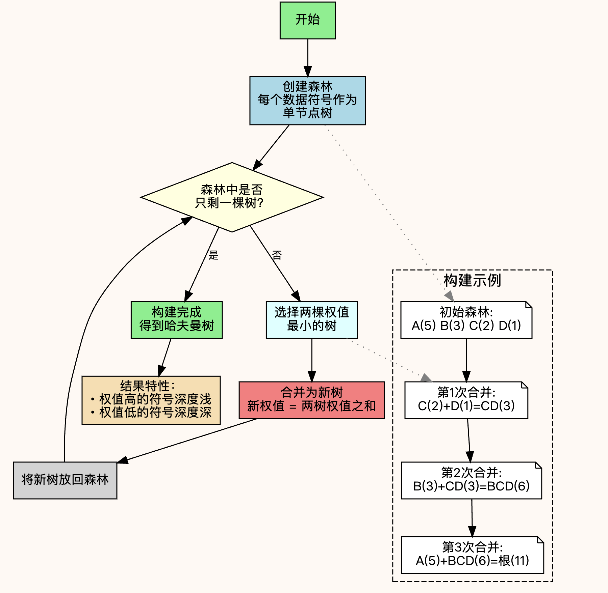

一旦构建了哈夫曼树，就可以生成数据符号的 **哈夫曼编码**。哈夫曼编码是一种 **变长编码**，用于表示不同数据符号。在哈夫曼编码中，**权值较高** 的数据符号通常对应 **较短的编码**，**权值较低** 的数据符号对应 **较长的编码**。这种编码方式可以实现数据的高效压缩和解压缩。

哈夫曼树 和 哈夫曼编码 在 **数据压缩** 领域具有广泛的应用，例如在无损压缩算法中，如 ZIP 文件压缩，图像压缩（如 JPEG）等。通过构建适用的 哈夫曼树 和 编码，可以大幅减少数据的存储和传输成本。

#### 2.3 哈夫曼编码

遍历 **哈夫曼树**，为每个数据符号生成相应的 **哈夫曼编码**。编码的生成方式如下（左 0 右 1）：

- 向左走时添加一个 0 位。
- 向右走时添加一个 1 位。
- 沿着树的路径一直到达 **叶子节点** 时，即可生成该 **叶子节点** 对应的数据符号的编码。

**实例**

为 a, b, c, d 四个字母生成 **哈夫曼编码**，其对应的权值分别为 7, 5, 2, 4

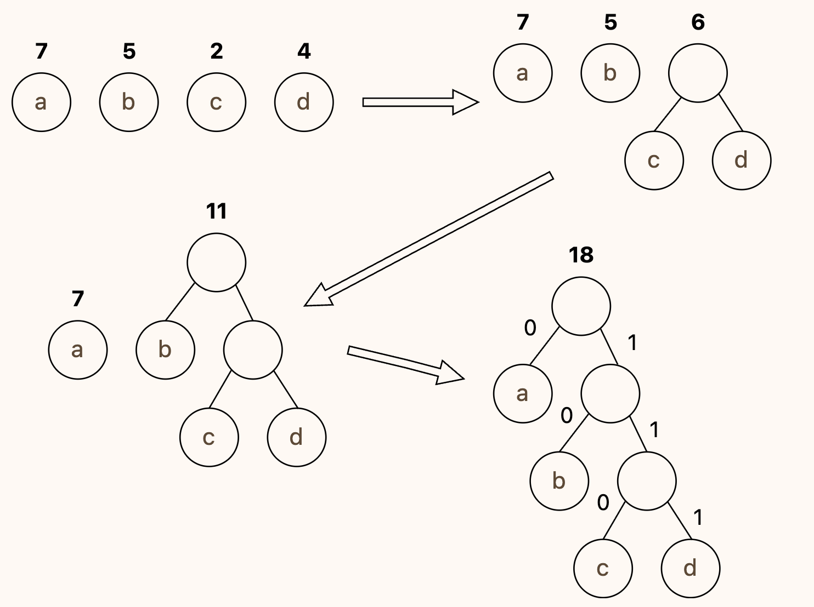

**哈夫曼编码** 是一种经典的 [前缀编码](https://www.csgraduates.com/data_structure/tree/app/#前缀编码)。

### 三、并查集

**并查集**（Union-Find）是一种数据结构，主要用于解决 **集合划分** 及 **查询问题**。它主要支持两种操作：**查找**（Find）和 **合并**（Union）。其核心思想是使用一个数组（或其他数据结构）来存储每个元素的 **父节点信息**。

#### 3.1 查找

**查找操作** 的目的是找到给定元素所属 **集合** 的代表。这可以通过追踪 **父节点** 来实现，直到找到 **根元素**（即 **父节点** 为其自身的元素）。**路径压缩** 可以在查找过程中应用，使得从指定节点到其根的路径上的每个节点都直接指向根，从而提高后续查找的效率。

#### 3.2 合并

**合并操作** 的目的是将两个 **集合** 合并为一个集合。为了执行合并，首先使用 **Find** 操作找到两个集合的代表，然后决定哪个代表成为新的根。为了保持 **树的平衡性**，并减少查找时间，常用的策略是 **按秩合并**。其中，**秩** 通常表示 **树的高度**。**较低的树** 会被附加到 **较高的树** 的根上。

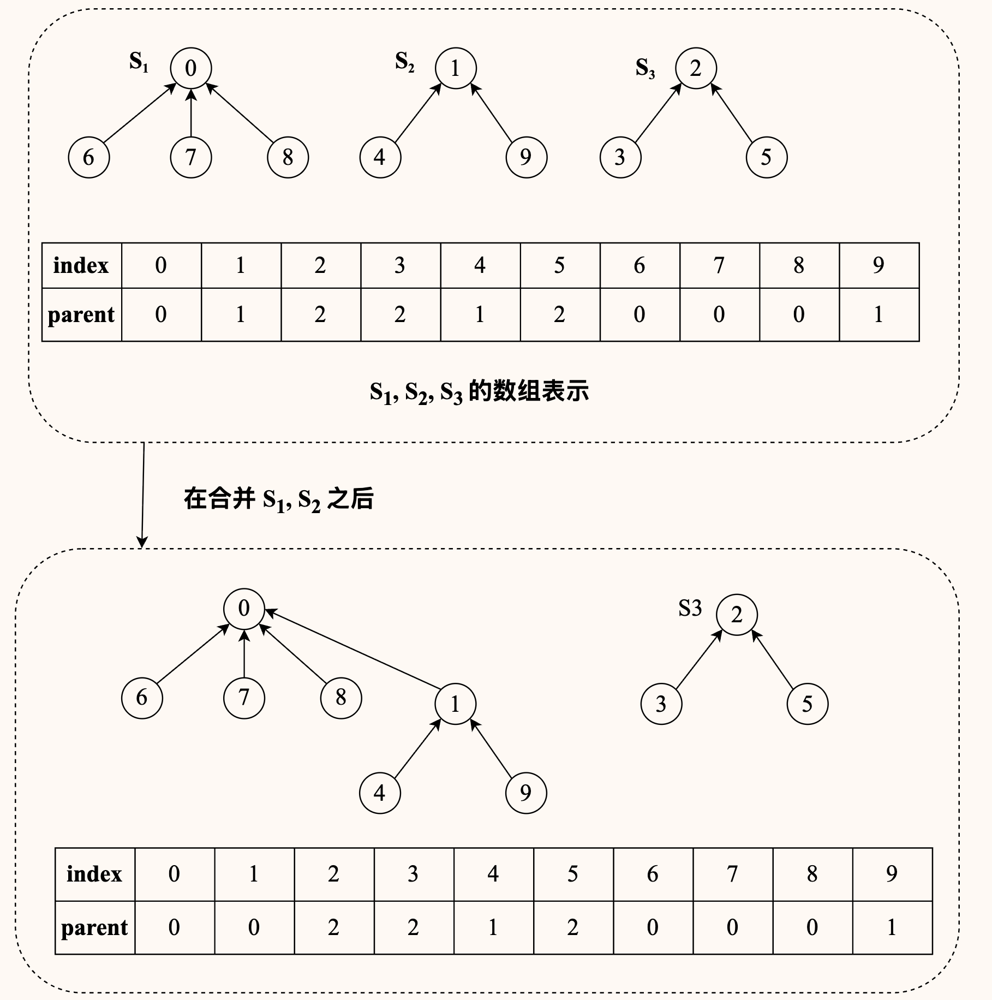

```c
#define MAXN 1000

int parent[MAXN];  // 存储每个点的父节点
int rank[MAXN];    // 秩

// 初始化
void initialize(int n) {
    for (int i = 0; i < n; i++) {
        parent[i] = i;  // 初始时，每个元素的父节点是其自身
        rank[i] = 0;    // 初始时，每个元素的秩为 0
    }
}

// 查找
int find(int x) {
    if (parent[x] != x) {
        // 路径压缩
        parent[x] = find(parent[x]);
    }
    return parent[x];
}

// 合并
void unionSet(int x, int y) {
    int rootX = find(x);
    int rootY = find(y);
    if (rootX != rootY) {
        if (rank[rootX] > rank[rootY]) {
            parent[rootY] = rootX;
        } else if (rank[rootX] < rank[rootY]) {
            parent[rootX] = rootY;
        } else {
            parent[rootY] = rootX;
            rank[rootX]++;
        }
    }
}
```


