# 图

## 定义

### 一、图的概念

**图** 是由 **顶点** 和 **边** 组成的非线性数据结构。**顶点** 有时也被称为节点，而 **边** 是连接图中任意两个节点的线或弧。更正式地说，**图** 是由一组 **顶点** (*V*) 和一组 **边** (*E*) 组成的。图用 *G*(*E*,*V*) 表示。

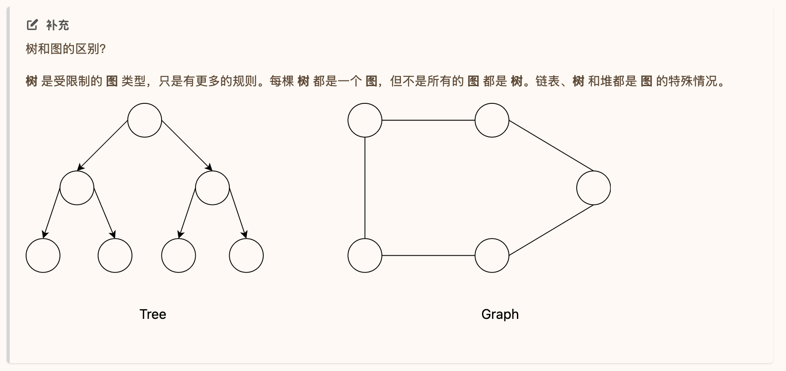

在 **图论** 中，根据边的方向性、连接方式、顶点间的关系等，可以进一步划分出多种类型的图，并引入如 **连通性**、**完全性**、**度数** 等一系列关键概念。这些分类和术语有助于我们更好地理解 图的结构特点和应用场景，下面我们将逐一进行介绍。

#### 1.1 方向

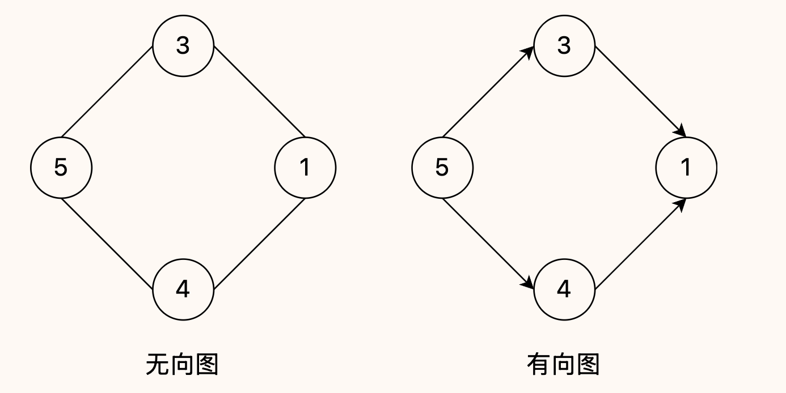

- **有向图**（directed graph）：边是有方向的，从一个定点指向另一个定点
- **无向图**（undirected graph）：边是没有方向的

#### 1.2 连通性

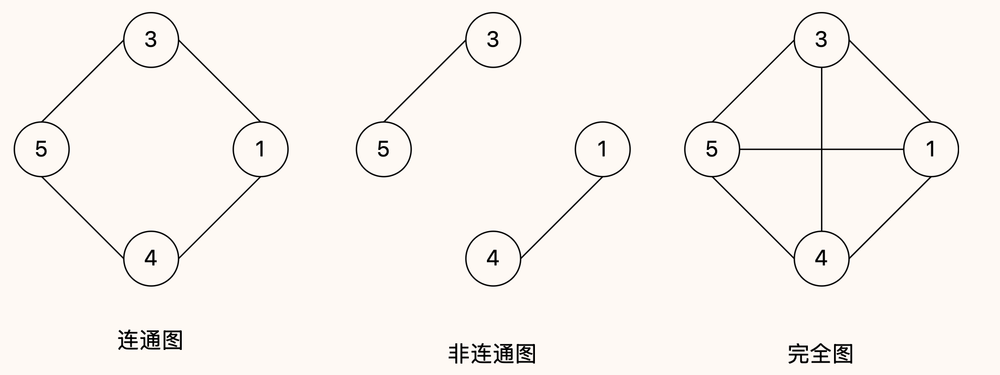

- **连通图**（Connected Graph）：图中的每一对不同顶点都可以通过一条或多条边相互连接，也就是说，从图中的任意一个顶点出发，都可以到达图中的任意其他顶点。
- **非连通图**（Disconnected Graph）：图中存在两个或多个互不相连的子图，也就是说，其中至少存在一个顶点集合，无法通过边连接到图中的其他顶点集合。
- **完全图**（Complete Graph）：完全图是一种特殊的图，其中每一对不同的顶点都直接相连，也就是说，完全图中的任意两个顶点之间都存在一条边。如果一个完全图有 *n* 个顶点，那么它将有 *C*(*n*,2)=*n*(*n*−1)/2 条边，其中 *C*(*n*,2) 表示从 n 个顶点中选择 2 个顶点的组合数。

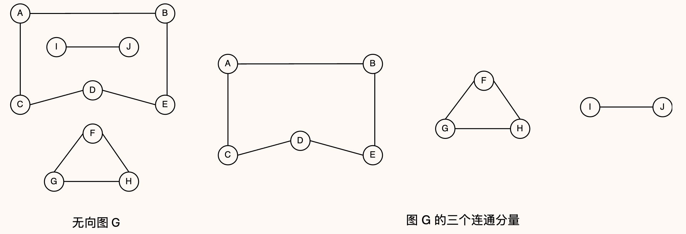

- **连通分量**（Connected Components）：也称为连通子图，是一个无向图中的一个重要概念。一个连通分量是指在无向图中，如果从其中一个顶点出发，可以通过边的路径到达该连通分量内的任何其他顶点，而无法通过图中的边到达其他连通分量内的顶点。

#### 1.3 度

- 顶点的度（Degree）：顶点的度是指与该顶点相邻的边的数量，也就是与该顶点直接相连的其他顶点的个数。对于有向图和无向图都适用。
  - 在无向 **图** 中，**顶点** 的度就是与该 **顶点** 相邻的 **边** 的数量。
  - 在有向 **图** 中，**顶点** 的度分为 **入度** 和 **出度**，分别表示指向该 **顶点** 的 **边** 的数量和从该 **顶点** 出发的 **边** 的数量的总和。
- **入度**（In-Degree）：入度是指在有向图中指向某个顶点的边的数量，也就是与该顶点关联的边中以该顶点为终点的边的数量。
- **出度**（Out-Degree）：出度是指在有向图中从某个顶点出发的边的数量，也就是与该顶点关联的边中以该顶点为起点的边的数量。

#### 1.4 路径

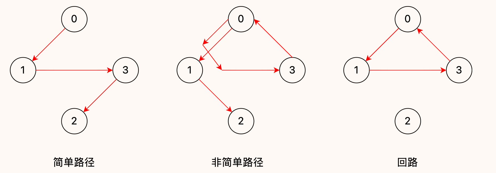

- **简单路径**：顶点不出现重复的路径
- **非简单路径**：顶点出现重复的路径
- **回路**：路径的起点和终点相同

### 二、图的存储

在我们使用数据结构存储 **图** 时，主要关注两点：1. 如何存储 **顶点**？2. 如何存储 **边**？
采用的数据结构需要能够准备表示这些信息。

#### 2.1 领接矩阵

图的 **邻接矩阵**（Adjacency Matrix）是一种常用的图表示方法，特别适用于 **稠密图**，它以矩阵的形式表示图的连接关系。

在邻接矩阵中，行和列分别代表 **图的顶点**，矩阵的元素表示顶点之间是否相邻或者 **边的权重**。

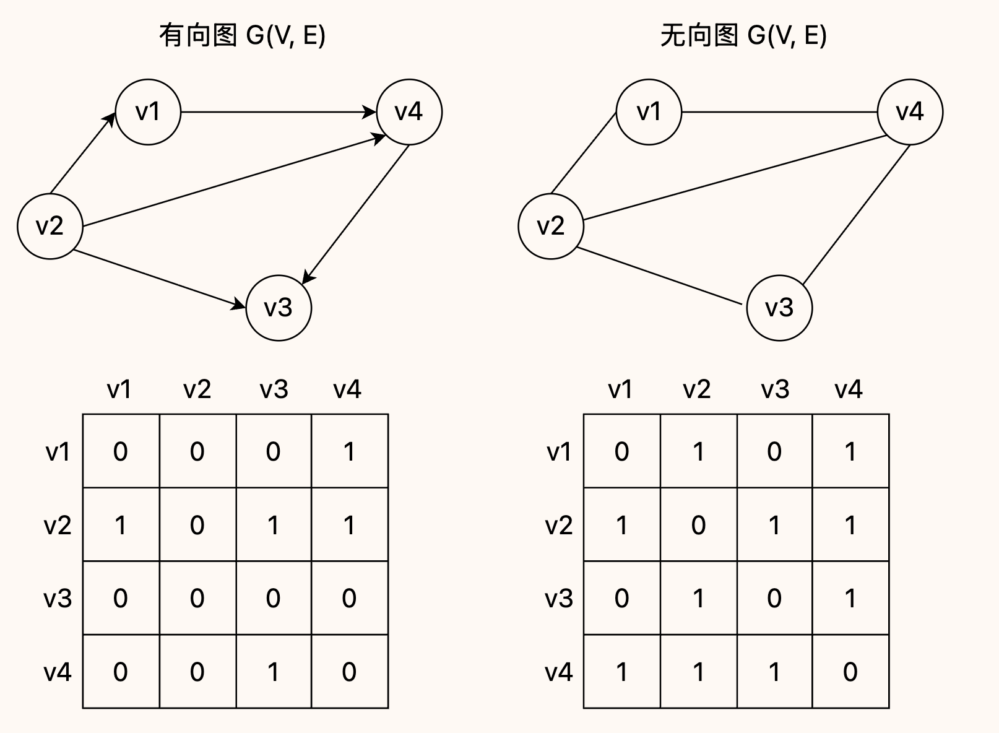

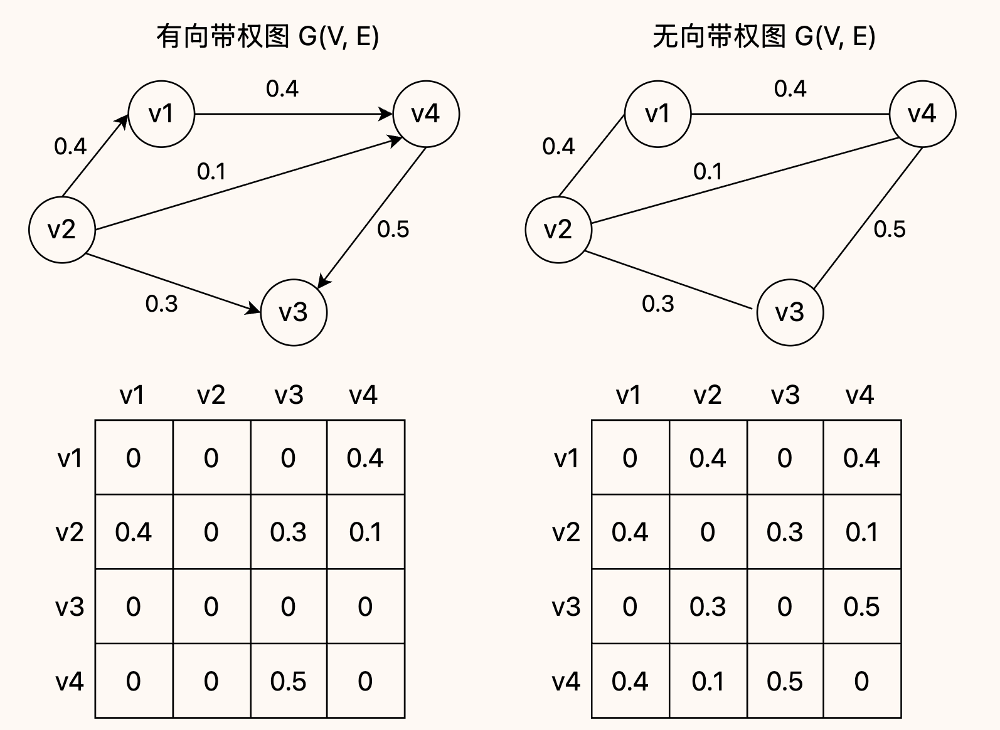

1. 对于无向图：
   - 如果顶点 *i* 和顶点 *j* 之间存在边，则邻接矩阵中 (*i*,*j*) 和 (*j*,*i*) 位置的元素都被标记为 1 （或者表示 边 的权重）。
   - 如果顶点 *i* 和顶点 *j* 之间不存在边，则邻接矩阵中 (*i*,*j*) 和 (*j*,*i*) 位置的元素都被标记为 0 。
2. 对于有向图：
   - 如果有一条从顶点 *i* 到顶点 *j* 的有向边，则邻接矩阵中 (*i*,*j*) 位置的元素被标记为 1 （或者表示 边 的权重）。
   - 如果没有从顶点 *i* 到顶点 *j* 的有向边，则邻接矩阵中 (*i*,*j*) 位置的元素被标记为 0 。

在邻接矩阵的实现中，我们使用一个 **二维数组** 来表示图的连接关系，邻接矩阵`matrix` 的行数和列数与图中的顶点数量相同。
其中 `matrix[i][j]` 表示顶点`i` 到顶点`j` 是否有边（或边的权值）。

```c
// 1.领接矩阵定义
#define MAX_VERTICES 100

int adjMatrix[MAX_VERTICES][MAX_VERTICES]; // 邻接矩阵

// 初始化邻接矩阵
void initializeMatrix(int vertices) {
    for (int i = 0; i < vertices; i++) {
        for (int j = 0; j < vertices; j++) {
            adjMatrix[i][j] = 0; // 初始化所有元素为 0
        }
    }
}

// 2.添加边
// 在邻接矩阵中添加一条边
void addEdge(int start, int end) {
    adjMatrix[start][end] = 1; // 添加边，将对应位置的元素设为 1
    adjMatrix[end][start] = 1; // 无向图需要将对称位置的元素也设为 1
}
```

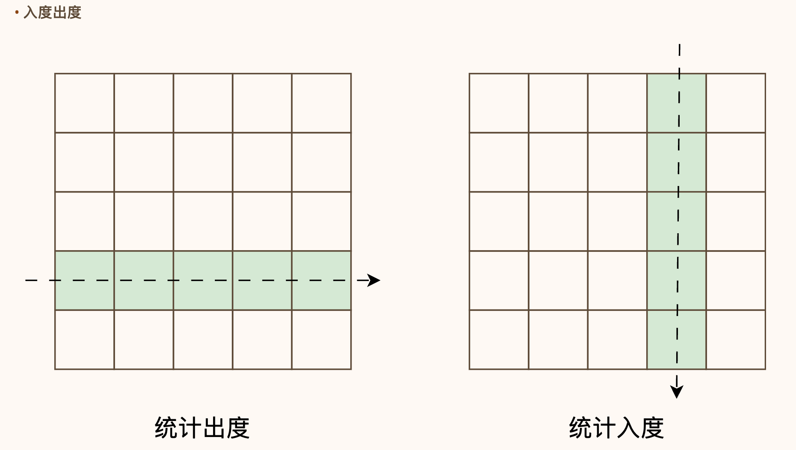

如果需要计算 **邻接矩阵** 中某个 **顶点** 的 **出度** 的话，假设 **顶点** 编号为 i，我们统计 **邻接矩阵** 中的 **第 i 行** 有多少元素不为 0 即可（该顶点指向哪些顶点）。

如果需要计算 **邻接矩阵** 中某个 **顶点** 的 **入度** 的话，假设 **顶点** 编号为 i，我们统计 **邻接矩阵** 中的 **第 i 列** 有多少元素不为 0 即可（哪些顶点指向该顶点）。

#### 2.2 邻接表

图的 **邻接表**（Adjacency List）是一种常见的图表示方法，特别适用于 **稀疏图**，它使用链表或数组的形式来表示图的连接关系。每个顶点都对应一个链表，链表中存储与该顶点相邻的其他顶点。

邻接表的主要思想是为 **每个顶点创建一个链表**，链表中的每个节点表示与该顶点相邻的另一个顶点。对于无向图，通常需要为每一条边创建两个链表节点，分别表示两个相邻的顶点。

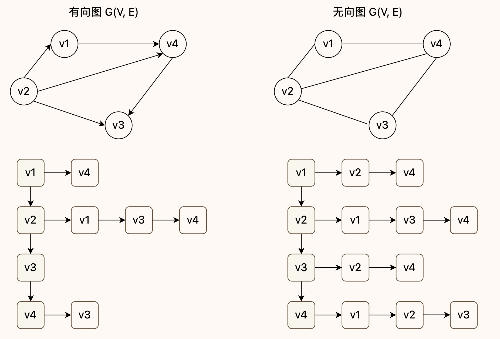

在邻接表的实现中，我们为每个顶点维护一个链表，用于存储与该顶点相邻的所有顶点；所有顶点对应的 **链表头节点** 组成一个数组或列表（在以下实现为 `struct AdjList *array`），形成整个图的邻接表结构。

```c
// 1.数据结构
// 链表节点结构：表示邻接的一个顶点
struct Node {
    int dest;            // 邻接顶点的编号
    struct Node* next;   // 指向下一个邻接点
};

// 邻接表：每个顶点有一个链表
struct AdjList {
    struct Node* head;   // 链表头
};

// 图结构
struct Graph {
    int V;                      // 顶点数
    struct AdjList* array;      // 邻接表数组
};

// 2.创建新节点
struct Node* newNode(int dest) {
    struct Node* node = (struct Node*)malloc(sizeof(struct Node));
    node->dest = dest;
    node->next = NULL;
    return node;
}

// 3.创建图
struct Graph* createGraph(int V) {
    struct Graph* graph = (struct Graph*)malloc(sizeof(struct Graph));
    graph->V = V;

    // 创建邻接表数组
    graph->array = (struct AdjList*)malloc(V * sizeof(struct AdjList));
    for (int i = 0; i < V; ++i)
        graph->array[i].head = NULL;

    return graph;
}

// 4.添加边
void addEdge(struct Graph* graph, int src, int dest) {
    // src -> dest
    struct Node* n1 = newNode(dest);
    n1->next = graph->array[src].head;
    graph->array[src].head = n1;

    // dest -> src（因为是无向图）
    struct Node* n2 = newNode(src);
    n2->next = graph->array[dest].head;
    graph->array[dest].head = n2;
}
```

#### 2.3 邻接多重表

**邻接多重表**（Adjacency Multi-list）是一种用于表示 **无向图** 的数据结构，主要用于避免在 **邻接表** 存储方式中重复存储 **无向边**，提高存储效率，同时便于图的操作（如 **边** 的删除）。

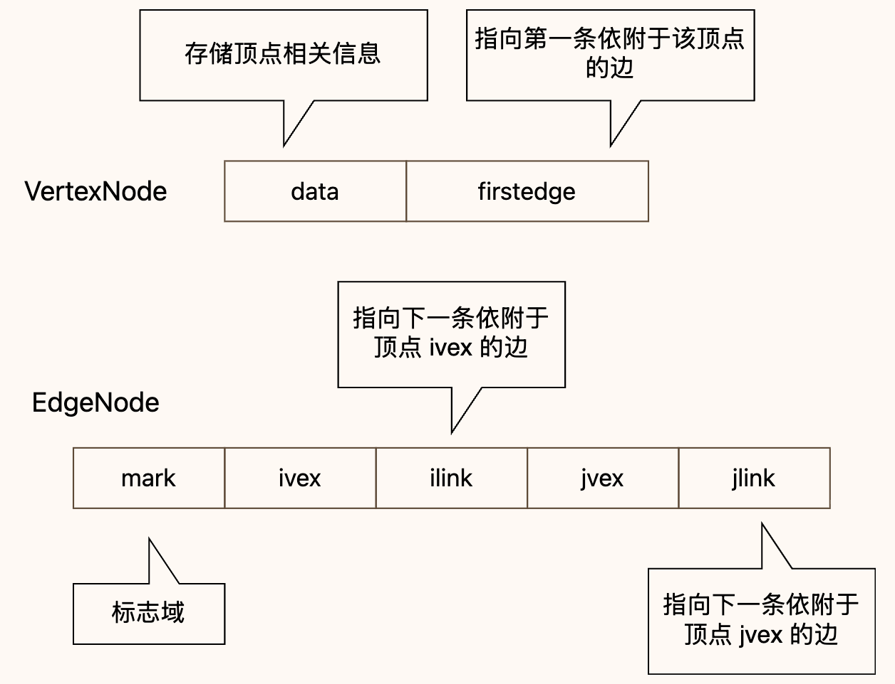

邻接多重表中顶点种类 **分为两种**：

- 顶点结点（Vertex Node）：
  - 每个顶点有一个头结点，存储该顶点的信息，以及指向其所有关联边的指针。
- 边结点（Edge Node）：
  - 每条边有一个结点，存储该边的两个顶点及其相关信息。
  - 该结点包含两个指针，分别指向该边所连接的两个顶点的邻接边链表的下一条边，使得图的存储更加紧凑。

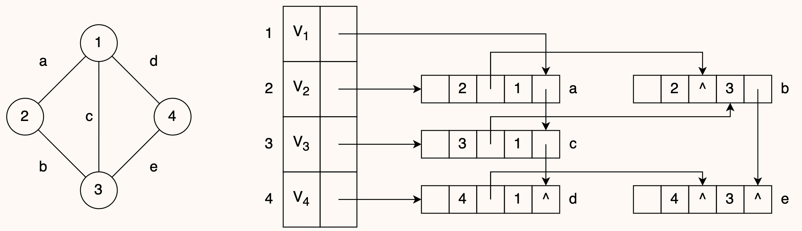

还是举个实际例子说明，在上述的邻接多重表中，总共需要存储 5 条边，每条边只需要存储一次，所以总共有 5 个边结点，每个边结点中存储的数据如下表所示：

| 边   | `ivex` | `jvex` | `ilink` 指向 | `jlink` 指向 |
| ---- | ------ | ------ | ------------ | ------------ |
| 12   | 1      | 2      | 13           | 23           |
| 13   | 1      | 3      | 14           | 32           |
| 14   | 1      | 4      | NULL         | 43           |
| 23   | 2      | 3      | NULL         | 34           |
| 34   | 3      | 4      | NULL         | NULL         |

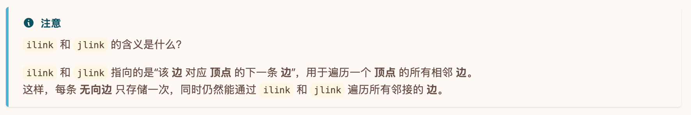

总结一下，相比于邻接表，邻接多重表最大的不同在于如下两点：

- **节省存储空间**：对于无向图，每条边只存储一次。
- **方便进行边的操作**：例如，删除一条边时，只需要修改相关顶点的链表中的指针，而不需要像邻接表那样在两个顶点的邻接表中都进行操作。

#### 2.4 十字链表

**十字链表**（Orthogonal List）是一种用于表示 **有向图** 的链式存储结构，它兼顾了 **出边** 和 **入边** 的高效查找。相比 **邻接表** 只方便查找 **出边**，**十字链表** 允许同时高效遍历某个顶点的所有出边和所有入边。

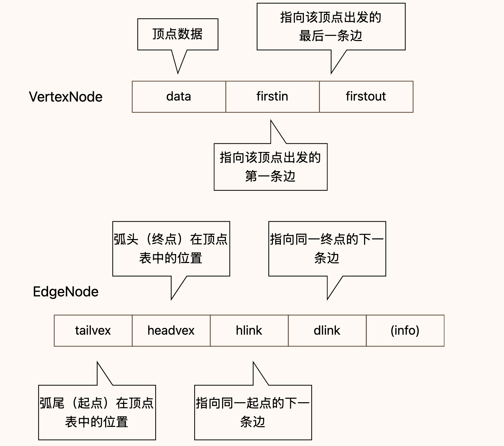

在 **十字链表**（Orthogonal List）中，顶点种类也可以分为两种：

- 顶点结点：
  - 每个顶点对应一个头结点，存储该顶点的信息；
  - 同时包含两个指针：
    - `firstout`：指向从该顶点出发的第一条出边；
    - `firstin`：指向以该顶点为终点的第一条入边；
  - 这样可分别建立“出边链表”和“入边链表”。
- 边结点：
  - 每条有向边对应一个边结点，存储该边的起点和终点在顶点表中的位置；
  - 包含两个指针，使该边同时链接在：
    - 起点顶点的出边链表中（通过 `hlink`）；
    - 终点顶点的入边链表中（通过 `tlink`）；
  - 边结点也可扩展存储额外信息（如权重）。

下图给出了一个 **十字链表** 的一个实例，其中忽略了 **边结点** 的 `info` 字段。我们可以沿着 **顶点结点** 的 `firstin` 和 `firstout` 字段高效遍历所有的 **入边** 和 **出边**。

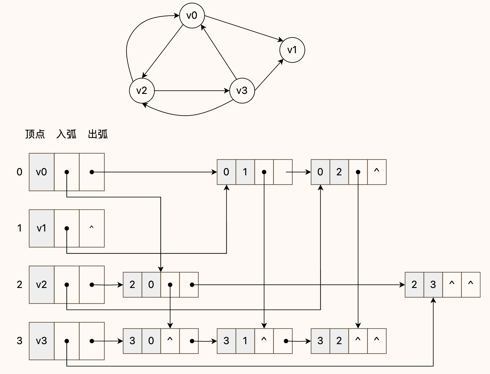

---

## 算法和应用

### 一、DFS

深度优先搜索（Depth-First Search，简称 **DFS**）是一种用于图的遍历和搜索的算法，它从图中的一个起始顶点开始，尽可能深地访问顶点，直到无法继续前进，然后回溯到之前的顶点，继续深入其他分支。**DFS** 通常用递归或栈来实现，确保在深度方向上优先遍历。

以下是 **DFS** 算法的一般步骤：

1. 从起始顶点开始，将其标记为已访问。
2. 遍历与当前顶点相邻的未访问顶点，选择其中一个未访问顶点作为下一个深度遍历的目标，然后递归地进行 **DFS**。
3. 如果无法继续深度遍历（即当前顶点没有未访问的邻居），则回溯到上一个顶点，继续遍历其他未访问的邻居。
4. 重复步骤 2 和步骤 3，直到所有顶点都被访问。

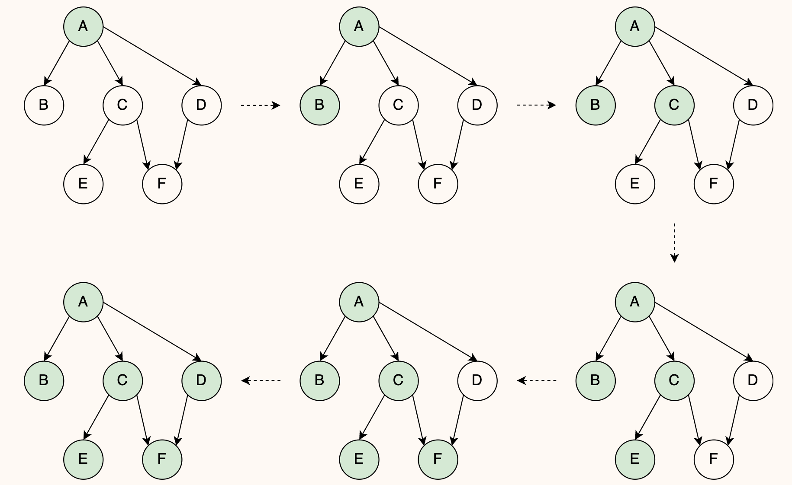

图中 **DFS** 实现的框架与 [树的遍历](https://www.csgraduates.com/data_structure/tree/tree/#树的遍历) 类似，不同点在于需要使用 `visit` 数组记录已经访问过的节点，避免重复遍历：

```c
function DFS(G, v, visited):
    visited[v] ← true
    for each neighbor u of v in G.adjacent[v]:
        if not visited[u]:
            DFS(G, u, visited)
```

图在 **邻接矩阵** 和 **邻接表** 中的 **DFS** 都遵循这个框架，两者的不同点在于获取 v 的邻居 u 的方式不同。

#### 1.1 邻接矩阵

在 **邻接矩阵** 中，我们定义一个递归函数 `dfs`，函数从 `start` 顶点出发，输出当前结点，然后递归地去访问所有与其相邻的顶点。

注意递归前需要保证下一个顶点未被访问过，这样可以避免重复访问结点以及死循环。

```c
// 全局变量，标记顶点是否被访问过
int visited[MAX_VERTICES];

// 递归函数，从 start 顶点出发
void dfs(int start) {
    visited[start] = 1;
    printf("%d ", start);

    // 依次访问 start 的邻接顶点
    for (int i = 0; i < MAX_VERTICES; i++) {
        // 递归的两个条件：
        // 1. 顶点 (start, i) 之间存在边
        // 2. 顶点 i 未被访问过
        if (adjMatrix[start][i] == 1 && !visited[i]) {
            // 递归调用
            dfs(i);
        }
    }
}
```

#### 1.2 邻接表

**邻接表** 的递归思路与 **邻接矩阵** 一致，唯一的区别就是访问邻接顶点方式的不同。

在 **邻接矩阵** 中，通过遍历矩阵中的一行来访问相邻顶点。在 **邻接表** 中，通过遍历链表来访问相邻顶点。

```c
// 全局变量，标记顶点是否被访问过
int visited[MAX_VERTICES];

// 递归函数，从 start 顶点出发
void dfs(struct Graph* graph, int start) {
    visited[start] = 1;
    printf("%d ", start);

    // 依次访问 start 的邻接顶点
    struct Node* temp = graph->adjacencyList[start];
    while (temp) {
        int adjVertex = temp->data;
        // 递归条件：顶点 i 未被访问过
        if (!visited[adjVertex]) {
            dfs(graph, adjVertex);
        }
        temp = temp->next;
    }
}
```

### 二、BFS

广度优先搜索（Breadth-First Search，简称 **BFS**）是一种用于图的遍历和搜索的算法，它从图中的一个起始顶点开始，逐层地访问与该顶点相邻的顶点，然后再访问这些相邻顶点的邻居，以此类推。**BFS** 通常用 **队列** 来实现，确保按照广度优先的顺序访问顶点。

以下是 **BFS** 算法的一般步骤：

1. 将起始顶点放入队列中，标记为已访问。
2. 从队列中弹出一个顶点并访问它。
3. 遍历该顶点的所有未被访问的邻居，将它们放入队列中，并标记为已访问。
4. 重复步骤 2 和步骤 3，直到队列为空。

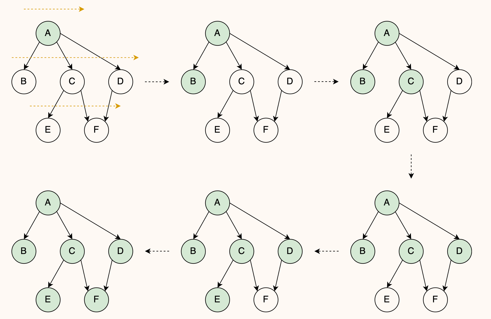

**BFS** 的伪代码实现如下所示，基于 **邻接矩阵** 或 **邻接表** 的 **BFS** 都遵循这个框架：

```c
function BFS(G, start):
    visited[start] ← true
    enqueue(Q, start)

    while Q is not empty:
        v ← dequeue(Q)
        process(v)
        for each neighbor u of v in G.adjacent[v]:
            if not visited[u]:
                visited[u] ← true
                enqueue(Q, u)
```

#### 2.1 邻接矩阵

实现 **BFS** 时，首先添加起始顶点进入队列中，然后不断从队列中取出顶点，并添加该顶点的未访问相邻顶点进入队列。重复直到队列为空。

在 **DFS** 中，`visited` 数组是各个递归函数都需要访问的数据结构，为了方便起见，可以定义为全局变量。
在 **BFS** 中，由于算法实现是基于迭代而非递归，所以 `visited` 和队列可以定义为局部变量。

```c
// 从 start 开始遍历图
void bfs(int start, int vertices) {
    // 队列 q
    queue q;
    // 标记顶点是否被访问过
    int visited[MAX_VERTICES];
    // 添加初始顶点
    q.enqueue(start);
    visited[start] = 1;

    // 一直遍历到队列为空
    while (q.size() > 0) {
        // 从队列头部取出结点作为当前结点
        int currentVertex = q.dequeue();
        // 输出当前结点
        printf("%d ", currentVertex);
        // 将当前结点的所有 相邻的未访问顶点 添加到队列中
        for (int i = 0; i < vertices; i++) {
            if (adjMatrix[currentVertex][i] == 1 && !visited[i]) {
                q.enqueue(i);
                visited[i] = 1;
            }
        }
    }
}
```

#### 2.2 邻接表

实现思路与 **邻接矩阵** 方式一致，不同点在于访问相邻顶点的方式不同。

```c
void bfs(struct Graph* graph, int start) {
    // 队列 q
    queue q;
    // 标记顶点是否被访问过
    int visited[MAX_VERTICES];
    // 添加初始顶点
    q.enqueue(start);
    visited[start] = 1;

    // 一直遍历到队列为空
    while (front != rear) {
        // 从队列头部取出结点作为当前结点
        int currentVertex = q.dequeue();
        // 输出当前结点
        printf("%d ", currentVertex);
        // 将当前结点的所有 相邻的未访问顶点 添加到队列中
        struct Node* temp = graph->adjacencyList[currentVertex];
        while (temp) {
            int adjVertex = temp->data;
            if (!visited[adjVertex]) {
                q.enqueue(adjVertex);
                visited[adjVertex] = 1;
            }
            temp = temp->next;
        }
    }
}
```

### 三、最小生成树

最小生成树（**Minimum Spanning Tree**，**MST**）是在一个连接所有顶点的无向图中，通过选择一部分边而形成的树，使得树的总权重（或成本）最小。

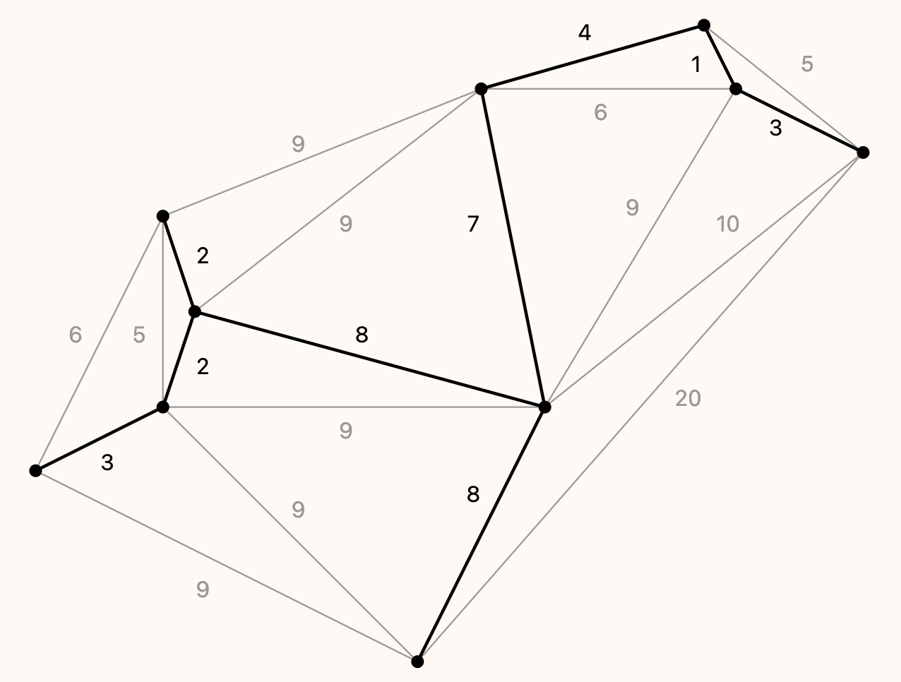

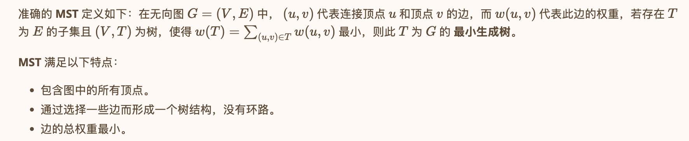

#### 3.1 prim算法

Prim 算法通过 **逐步扩展顶点集合** 来构建最小生成树：从一个初始顶点出发，每次都选择一条 **连接生成树与外部顶点的最小权重边**，并将该顶点并入生成树，直到所有顶点都被包含。

**prim 算法步骤** 如下：

1. 选定一个起始顶点作为生成树的根。
2. 初始化生成树，只含有该顶点。
3. 在所有 **连接生成树与未加入顶点的边** 中，选取权重最小的一条，并将对应顶点加入生成树。
4. 重复步骤 3，直到所有顶点均被纳入生成树。
5. 得到的生成树即为原图的 **最小生成树**。

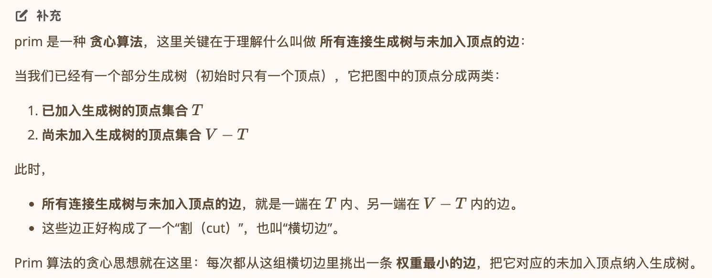

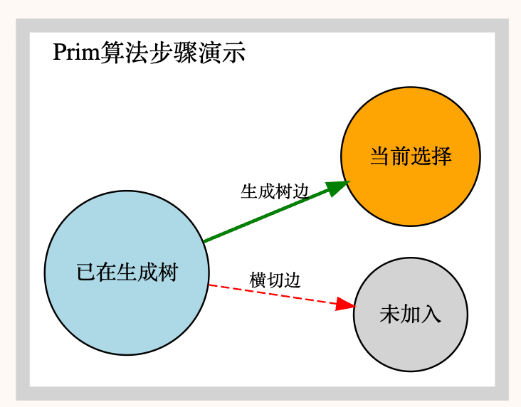

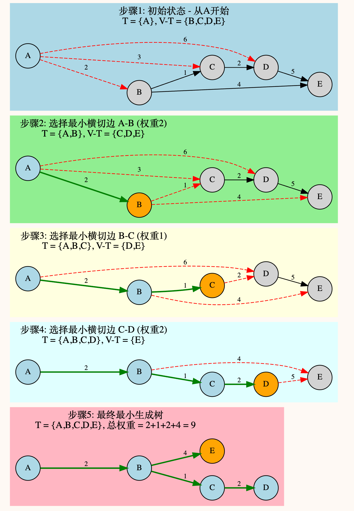

prim算法保证了：

- 每次扩展都是局部最优（加入的边在候选集合里是最小的）。
- 最终能够得到全局最优的最小生成树（证明基于“割性质”，不是重点这里不说明）。

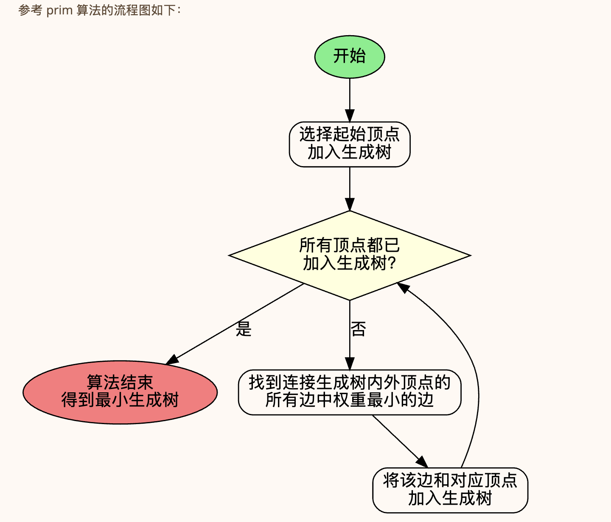

举个实际例子，对于以下的无向图，假设我们从顶点 a 出发使用 prim 算法寻找最小生成树，会逐步选择出 ab、bc、ci、cf、fg、gh、cd 以得到最小生成树：

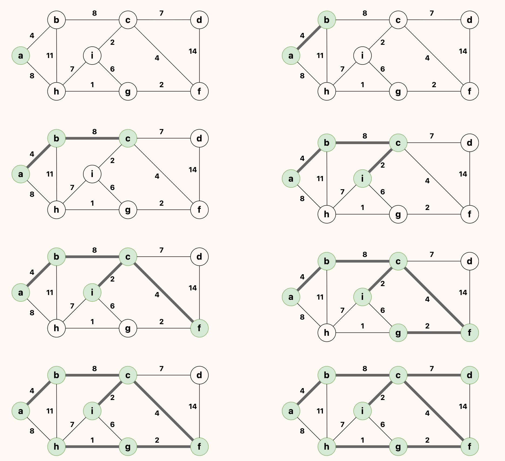

#### 3.2 kruskal算法

**Kruskal** 算法是一种用于求解 **最小生成树**（**MST**）的贪心算法。**Kruskal** 算法的基本思想是从边的权重最小的边开始，逐步构建生成树，确保不会形成环路。

以下是 **Kruskal** 算法的一般流程：

1. 初始化一个空的生成树，开始时生成树中没有边。
2. 将图中的所有边按照权重 **从小到大进行排序**。
3. 依次 **从排序后的边列表中选取边**，加入生成树，但要确保 **添加该边不会形成环路**。
4. 重复步骤 3，直到生成树包含了所有的顶点，即生成树中的边数等于顶点数减 1。
5. 返回生成树作为 **最小生成树**。

参考 kruskal 算法的流程图如下：

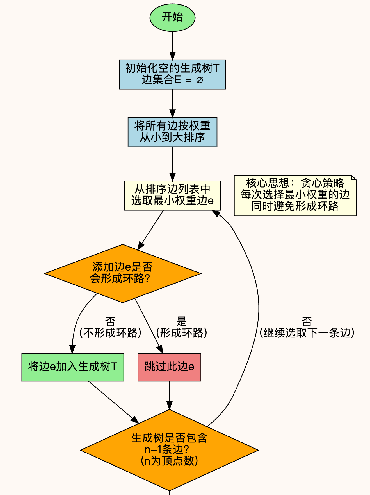

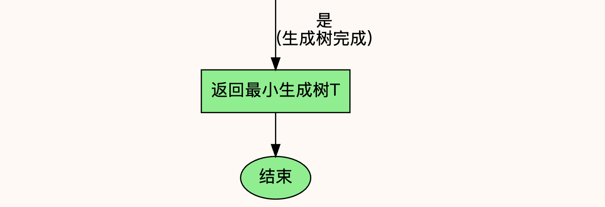

继续使用上文中 prim 中的无向图作为例子，使用 kruskal 算法，会依次选择 hg、ic、gf、ab、cf、cd、ah 以得到最小生成树：

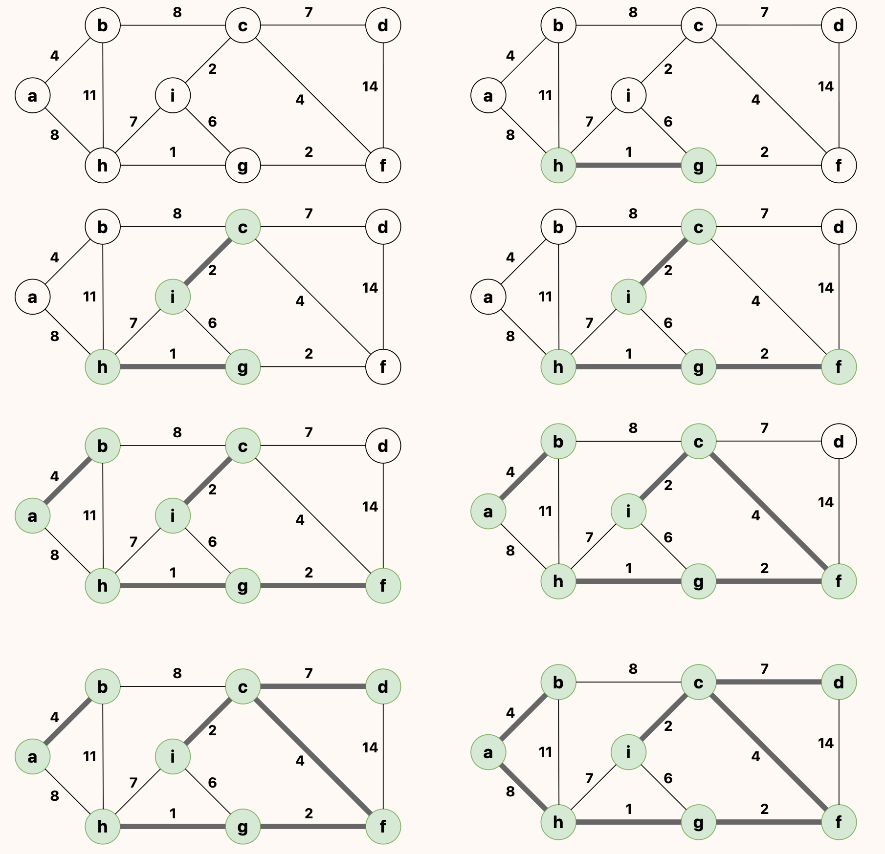

### 四、最短路径

#### 4.1 dijkstra算法

**Dijkstra** 算法是一种用于计算 **单源最短路径** 的经典算法，适用于 **带非负权重** 的有向或无向图。

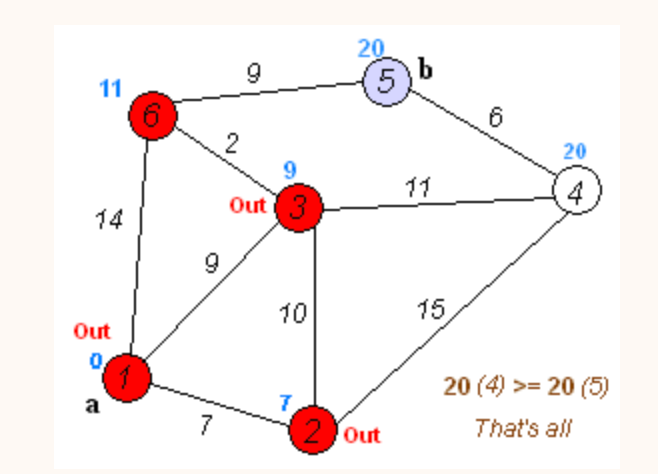

动图展示：https://www.csgraduates.com/data_structure/graph/operation/

Dijkstra 算法是一种 **贪心算法**。它的 **核心思想** 是：从起点出发，不断“扩展”到距离起点最近的节点，并利用这些节点去尝试更新其他节点的最短路径，直到所有节点的最短路径都被确定。

换句话说，算法始终保持一个 “已确定最短路径的集合”，并且在每一步中把离起点最近的“候选节点”加入其中：

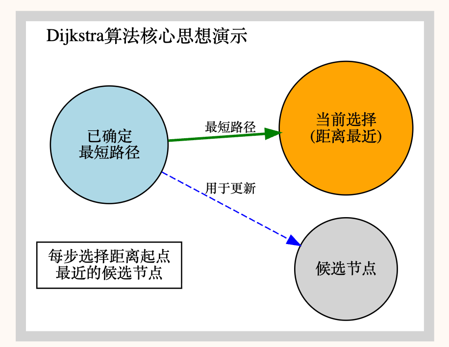

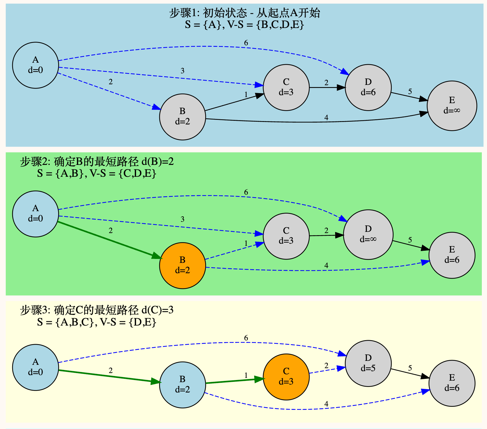

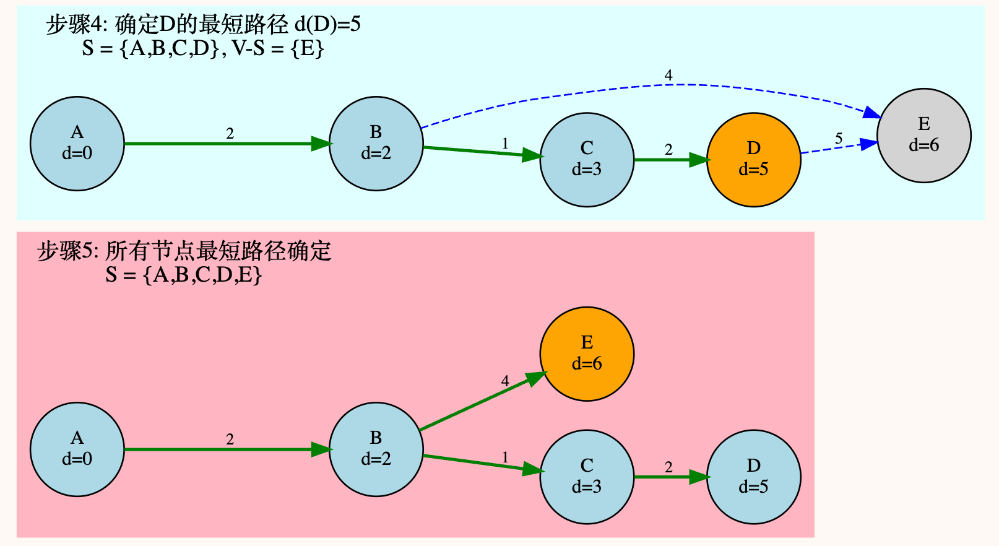

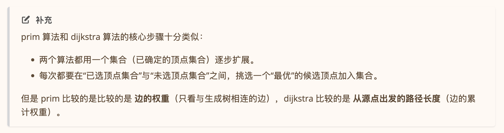

🛠️ dijkstra 算法需要定义以下 数据结构：

- dist[]：数组，dist[v]表示起点到节点v的当前已知最短路径长度。
  - 初始化时：`dist[source] = 0`，其余节点均为 `∞`。
- visited[]：布尔数组，表示某个节点的最短路径是否已经被最终确定。
  - 初始时：所有节点均为 `false`。

✨ dijkstra 算法流程 如下：

1. 初始化

   - 设起点为 `source`。
   - `dist[source] ← 0`
   - 对于其他顶点 `v`，`dist[v] ← ∞`
   - `visited[v] ← false`

2. 主循环（重复 |V| 次，即所有顶点都被处理完）

   - 从所有 **未访问** 的顶点中，找到一个 `dist[]` 值最小的顶点 `u`。 （这意味着：当前已知路径中，`u` 是离起点最近的尚未确定的节点。）

   - 将该顶点标记为已访问：`visited[u] ← true`。

   - 对于u的每个邻居v：

     - 如果v未被访问，并且通过u到达v的路径更短（即 dist[u] + w(u,v) < dist[v]）， 则更新：dist[v] ← dist[u] + w(u,v)

       （这一步就是“松弛操作”，表示尝试通过u改进到v的最短路径。）

3. 结束

   - 当所有顶点都被访问后，`dist[v]` 就保存了起点到各个顶点的最短路径长度。

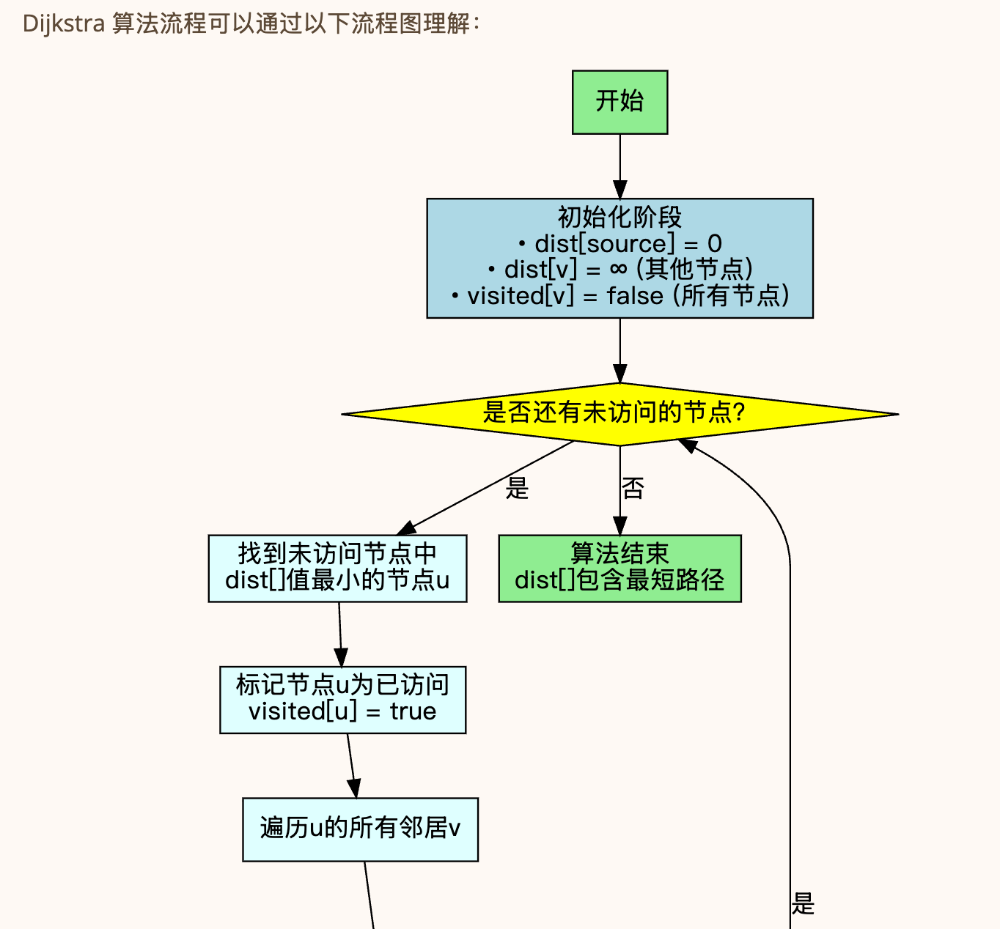

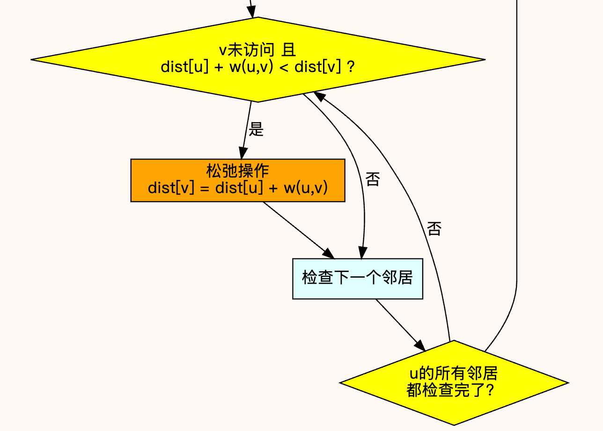

Dijkstra 的考察侧重于手工模拟其过程，代码实现一般不会考察，这里给出算法的简单 **伪代码实现**，帮助各位理清其中的处理细节。

```c
function Dijkstra_Simple(Graph, source):
    对于图中每个顶点 v:
        dist[v] ← ∞          // 起点到 v 的距离初始化为无穷大
        visited[v] ← false   // 所有顶点初始都未被访问
    dist[source] ← 0         // 起点到自身距离为 0

    重复 |图中顶点数| 次:
        u ← 所有未访问的顶点中 dist[u] 最小的顶点
        visited[u] ← true    // 标记 u 已被访问

        对于 u 的每个相邻顶点 v:
            边权重 weight ← 图中边(u, v) 的权重
            如果 v 未访问 且 dist[v] > dist[u] + weight:
                dist[v] ← dist[u] + weight  // 通过 u 到 v 更短，更新最短路径

    return dist[] // 表示起点到所有顶点的最短路径
```

假设顶点的个数为 *V* ，边的个数为 *E* ，那么 最佳实现（使用了优先队列）的 dijkstra 算法时间复杂度为 *O*(*V*+*E*) 。

#### 4.2 floyd算法

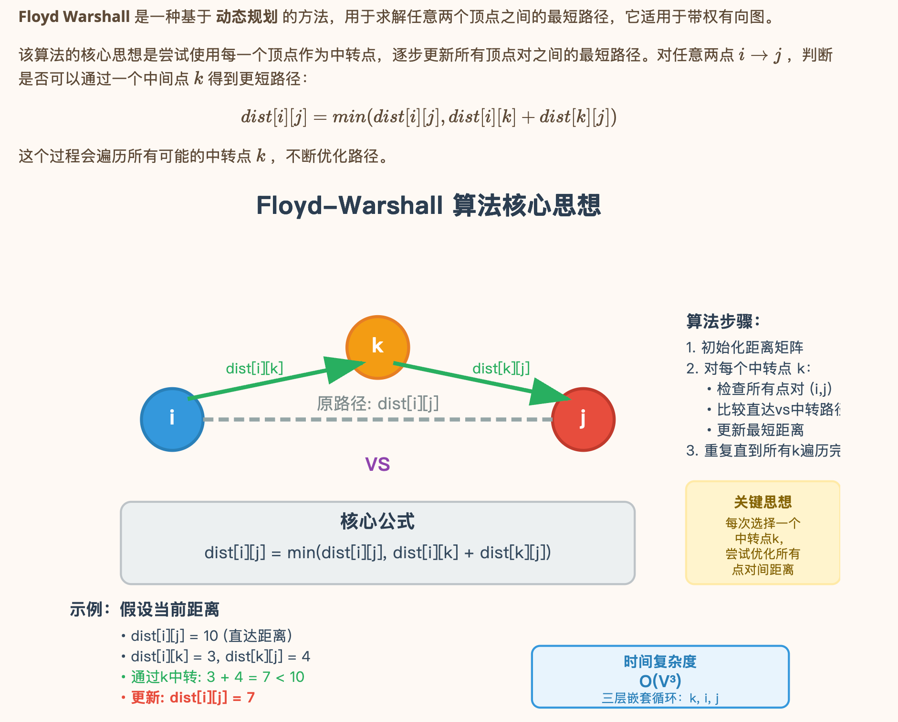

✨ 算法具体流程如下：

1. **初始化距离矩阵** `dist`：

   - `dist[i][j] = 0`（若 `i=j`）
   - `dist[i][j] = 边权`（若 `i→j` 有边）
   - `dist[i][j] = ∞`（其余情况）

2. **三重循环更新最短路径**

   ```c
   for k in 所有顶点:
       for i in 所有顶点:
           for j in 所有顶点:
               if dist[i][k] + dist[k][j] < dist[i][j]:
                   dist[i][j] ← dist[i][k] + dist[k][j]
   ```

3. **输出 dist 矩阵** ：表示所有顶点对之间的最短路径长度。

若顶点数为 *n* ，则 **Floyd Warshall** 算法的时间复杂度为 *O*(*n*^3) ，该算法适合在算法题中兜底使用，因为实现比较简单，建议大家熟练掌握代码实现。

### 五、拓扑排序

**拓扑排序** 这样一种对图中顶点的排序方式：将图中的所有顶点排序，使得对于每一条有向边 `u` → `v`，顶点 `u` 都排在 `v` 之前。

**拓扑排序** 主要应用于 **DAG**（有向无环图）或 **AOV** 网，这种图没有环路，因此可以对其进行拓扑排序。

首先需要区分 **AOV** 和 **AOE** 这两个概念，注意 **拓扑排序** 适用于 **AOV**，**关键路径** 适用于 **AOE**。

#### 5.1 AOV网

**AOV**（Activity on Vertex Network）网是一种以顶点表示活动或任务的网络模型。每个 **顶点** 代表一个 **任务或活动**，而 **边** 表示任务之间的 **依赖关系**。在AOV网中，任务或活动通常表示为顶点，而依赖关系（任务的先后顺序）表示为有向边。

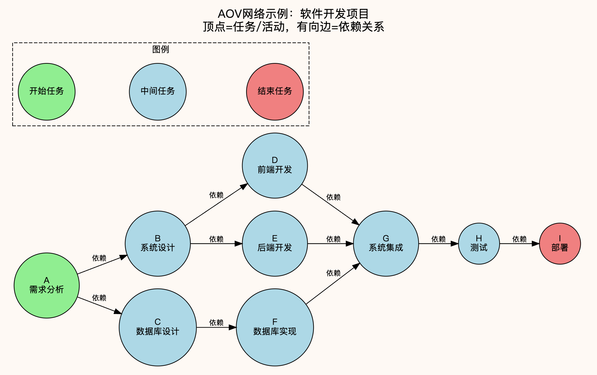

#### 5.2 算法步骤

计算 **拓扑排序** 的算法有两种，一种是 **Kahn** 算法（基于入度），另一种是 **DFS+栈** 的实现。

**Kahn** 算法的核心思想是 **依次选取入度为 0 的顶点进行输出**，其具体步骤如下：

1. 选择一个没有前驱顶点（入度为 0）的顶点作为起始顶点，将其加入拓扑排序的结果序列中。
2. 从图中移除该顶点以及与之相关的边（即将与之相邻的顶点的入度减 1）。
3. 重复步骤 1 和步骤 2，直到所有的顶点都被加入到拓扑排序的结果序列中，或者发现图中存在环路。
4. 如果所有的顶点都被成功加入结果序列，那么这个序列就是拓扑排序的结果。

下图展示了一个采用 **Kahn** 算法输出 **AOE** 网中的 **拓扑序列** 的实例：

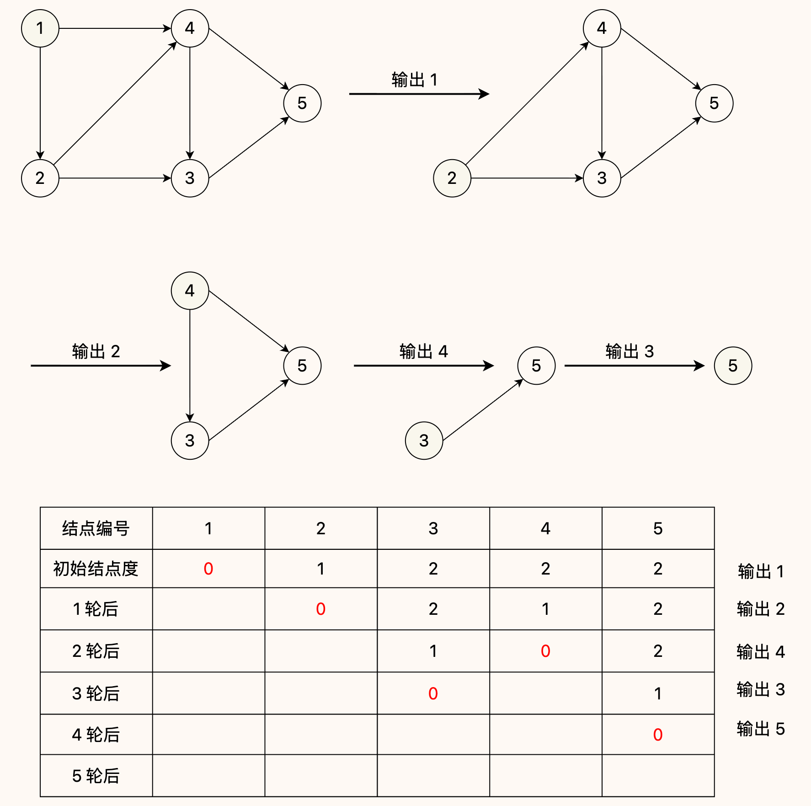

此外，可以通过 **DFS+栈** 得到 **拓扑序列**，其步骤如下：

1. 对图进行深度优先遍历。
2. 每个节点 **DFS** 结束后将其压入栈中。
3. 最后将栈中元素逆序输出，就是 **拓扑排序** 结果。

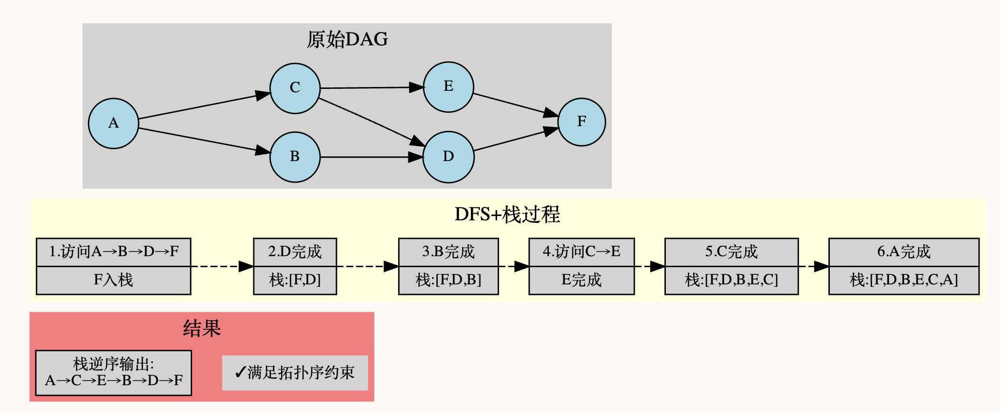

**DFS** 过程中，每个节点在其所有后继节点访问完成后才被加入栈中，因此栈中元素的逆序正好满足 **拓扑排序** 所需的“前驱先于后继”的约束。

**拓扑排序** 的时间复杂度通常为 *O*(*V*+*E*) ，其中 *V* 是顶点的数量， *E* 是边的数量。这个算法非常适合于解决任务调度和依赖关系问题，因为它可以确定任务的执行顺序或依赖关系的合理性。

关于拓扑排序，还需要关注以下几点：

- 拓扑排序的结果 **可能不唯一**，因为在构建过程中往往会出现多个入度为 0 的顶点，不同的选择顺序会产生不同的合法排序结果。
- 如果图中 **存在环路**，那么 **无法进行拓扑排序**，因为无法找到入度为 0 的顶点作为起始顶点。

### 六、关键路径

**关键路径** 是指 **AOE** 网（Activity On Edge Network）中，从源点到汇点所经过的 **最长路径**。这条路径决定了整个项目完成所需的最短时间，因此被称为 **关键** 路径。

#### 6.1 AOE网

**AOE**（Activity on Edge Network）网是一种以边表示活动或任务的网络模型。每条边代表一个任务或活动，而顶点通常表示事件，表示任务的开始或完成时间。

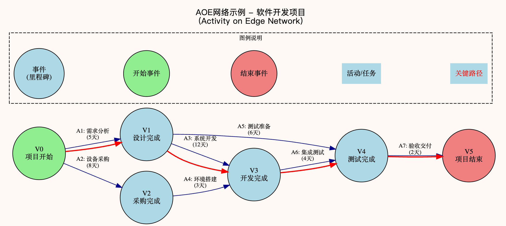

为了理解 **关键路径**，首先需要明确 **AOE** 网中的以下概念：

- **源点**：在 **AOE** 网中仅有一个入度为 0 的顶点，称为开始顶点，表示整个工程的开始。
- **汇点**：在 **AOE** 网中仅有一个出度为 0 的顶点，称为结束结点，表示整个工程的结束。
- **关键路径的长度**：完成整个工程的最短时间，也是 **AOE** 网中从源点到汇点的 **最长路径**。
- **关键活动**：**关键路径** 上的活动。
- **活动的时间余量**：某个活动可以被延迟的最大时间，而不会影响整个项目的最短完成时间（总工期）。
- `ve(k)`：事件 *v**k* 的最早可以发生时间。
- `vl(k)`：事件 *v**k* 的最晚可以发生时间。

有几个概念比较重要，还需要进行进一步的阐述：

事件和活动 

在 **AOE** 网中，**边代表活动（Activity）**，**顶点代表事件（Event）**。

- **活动（边）**：表示一个具体的工作、任务或操作，具有确定的持续时间。一个活动必须在其起点事件“发生”之后才能开始。
- **事件（顶点）**：表示一个时间点，通常是某些活动的“开始”或“结束”条件已经满足，代表某种逻辑上的时刻状态。

通俗来讲：**活动是“做某事”，事件是“可以开始做某事的时间点”**

事件的发生时间 

在 **AOE** 网中，一个事件的“发生”是指其**所有前驱活动都已完成**，这标志着“条件成熟”，从该事件出发的活动才可能被启动。

**两个关键时间**：

| 时间名称         | 含义                                   | 数学符号 |
| ---------------- | -------------------------------------- | -------- |
| **最早发生时间** | 某事件最早可以发生的时间               | `ve(i)`  |
| **最晚发生时间** | 某事件最晚必须发生的时间（不影响工期） | `vl(i)`  |

**事件发生的判断逻辑**：

一个事件是否可以发生，不看它的出边活动，而是看**它的所有前驱活动（入边）是否完成**：

- 若某事件 `i` 的所有进入活动（任务）都已完成 → 则事件 `i` 发生；
- 一旦事件 `i` 发生，其所有出边活动 **可以开始**，但 **不必须同时开始**；
- 出边活动的实际开始时间取决于它们自身的调度灵活性（浮动时间）。

活动时间余量 

“活动的时间余量” 在 **AOE** 网中指的是：

**一个活动可以被延迟的最大时间**，而不会影响整个项目的最短完成时间（总工期）。

首先，为什么要有时间余量呢？因为在 **AOE** 网络中，不是所有活动都在 **关键路径** 上。

- **关键路径上的活动**：必须准时进行，**没有时间余量**（余量 = 0）
- **非关键路径上的活动**：允许适当延迟，但必须不阻碍项目的最晚结束时间

时间余量可以通过以下数学公式计算：

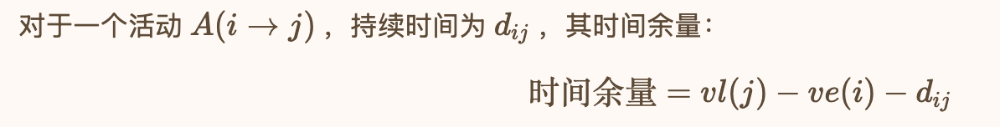

其中：

- ve(*i*) ：起点事件 i 的最早发生时间
- vl(*j*) ：终点事件 j 的最晚发生时间
- dij ：活动持续时间

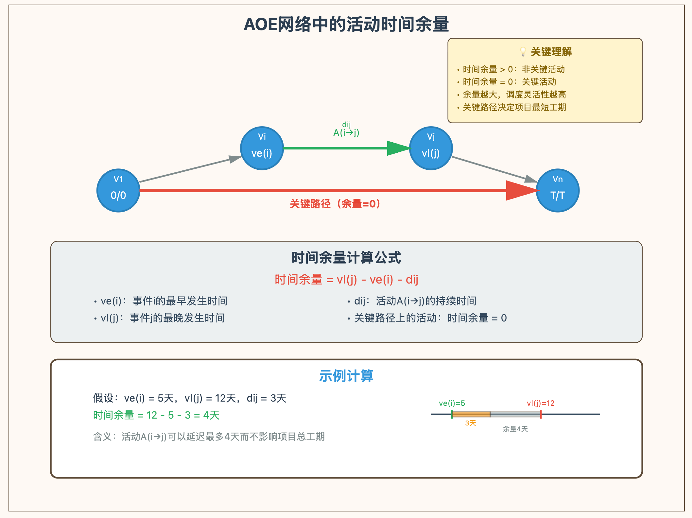

关键路径和活动 

**关键路径** 上的所有活动都是 **关键活动**，它是决定整个工程的关键因素，因此可通过加快关键活动来缩短整个工程的工期。

**关键路径和关键活动具有以下典型特征**：

1. **关键活动的时间余量为 0**：即对某活动 *A*(*i*→*j*) 有

   vl(*j*)−ve*(*i*)−*dij=0

   说明该活动不能被延迟任何时间，否则将影响总工期。

2. **关键活动连接的事件满足**：

   ve(*i*)=vl(*i*)且ve(*j*)=vl(*j*)

   即活动的起点和终点事件的最早发生时间等于最晚发生时间。它们必须在确定的时间点发生，不能提前也不能推迟。

3. **关键路径是工程中的最长路径**：它决定了整个项目从开始到结束所需的最短时间，也即项目总工期。

4. **关键路径可能有多条**：若多个路径的总时长都等于项目的最短完成时间，这些路径上的活动都必须受到严格监控。

#### 6.2 算法步骤

求解 **关键路径** 的 **核心思路** 在于找到所有 **最早发生时间** 和 **最晚发生时间** 相同的结点，连接这些结点即可得到关键路径。

所以在求关键路径的算法中，我们需要依次计算每个顶点的最早发生时间（`ve`）和最晚发生时间（`vl`），然后判断哪些顶点的 `ve` 和 `vl` 相等。

为了得到关键路径，需要分三步计算：

**1. 计算最早发生时间 `ve`**

- 从 **源点** 出发，设 `ve(start) = 0`；
- 按照 **拓扑排序** 的顺序依次计算其他顶点的最早发生时间

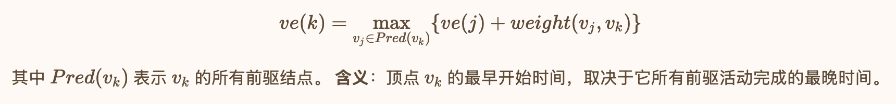

**2. 计算最迟发生时间 `vl`**

- 从 **汇点** 出发，设 `vl(end) = ve(end)`；
- 按照 **逆拓扑排序** 的顺序依次计算其余顶点的最迟发生时间：

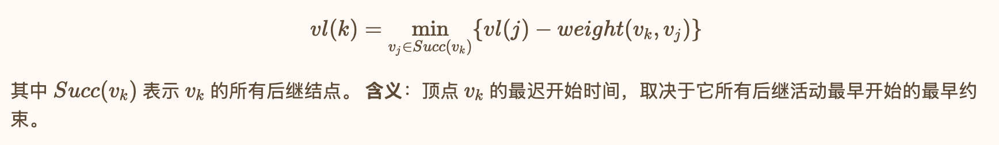

**3. 确定关键路径**

- 若某个顶点满足 `ve(i) = vl(i)`，则说明该顶点没有时间浮动，必须严格按时发生；
- 将这些顶点按拓扑顺序连接起来，得到关键路径。

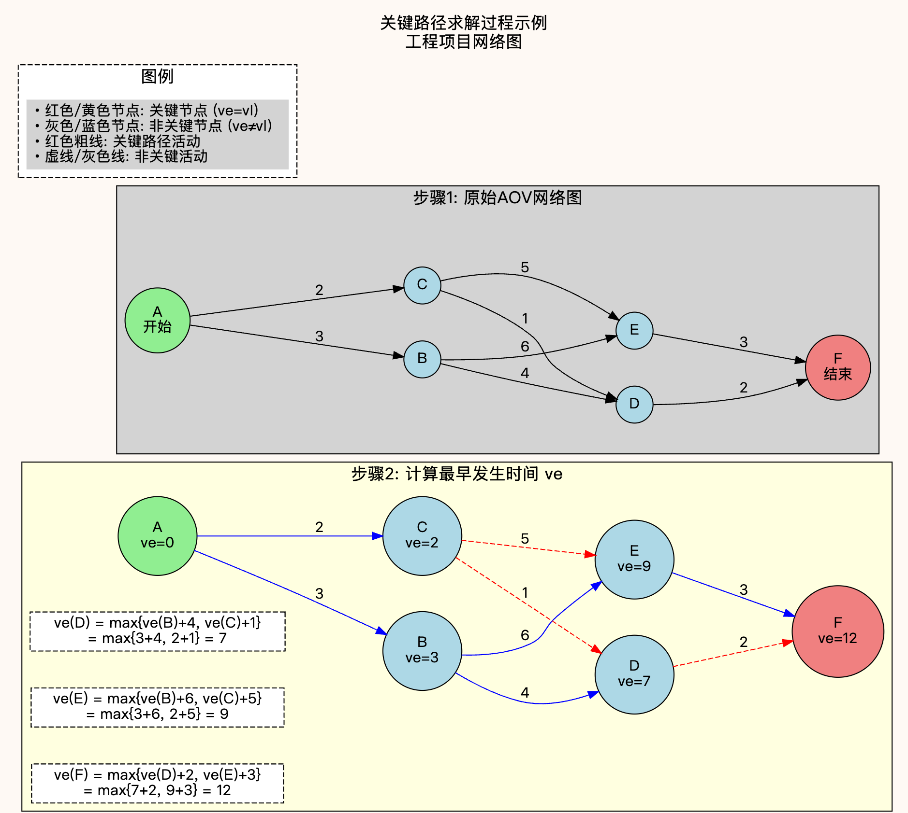

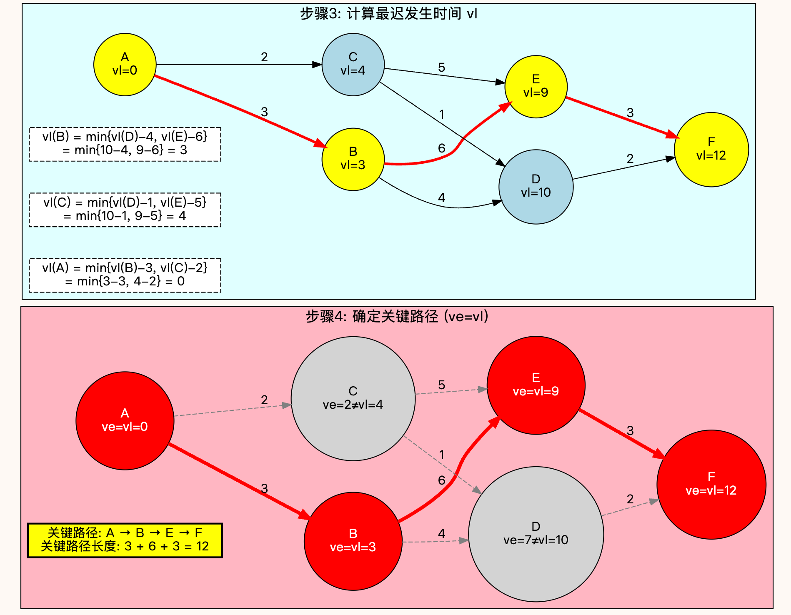

### 七、用图表示树

当表达式中存在共享的子表达式时，二叉树可能不是存储这些表达式的最有效方式，因为它会重复存储共享的子表达式。在这种情况下，可以使用 **有向无环图**（**DAG**）来表示表达式，这样可以避免重复，并且更有效地表示表达式。

比如对于表达式 `(x + y) * ((x + y) / x)`，用二叉树和 **DAG** 的表示如下图：

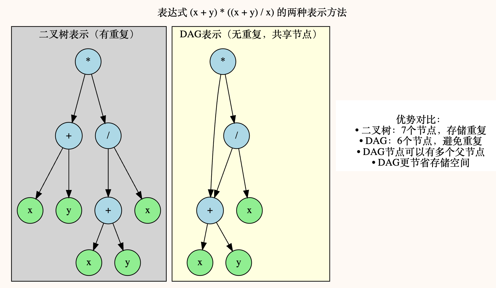


