# 查找

## 数组查找

### 一、顺序查找

顺序查找的 **核心思想** 是从数组（线性表）的第一个元素开始，逐个检查每个元素是否等于目标值，直到找到目标或检查完整个数组。

其代码实现如下，非常简单，遍历一次数组即可：

```c
int SequentialSearch(int A[], int n, int value) {
    for (int i = 0; i < n; i++) {
        if (A[i] == value) {
            return i;  // 找到，返回索引
        }
    }
    return -1;  // 未找到
}
```

顺序查找的 **时间复杂度** 如下：

- **最好情况**： *O*(1)
- **最坏情况**： *O*(*n*)
- **平均情况**： *O*(*n*)

### 二、折半查找

折半查找 **要求数组是有序的**。

其 **核心思想** 在于每次将查找范围折半，只保留目标可能存在的一半，直到范围为空或找到目标为止。

例如，在有序数组中查找一个元素时，可以先比较中间元素：

- 如果目标值小于中间值，查左半部分；
- 如果目标值大于中间值，查右半部分；
- 如果相等，则查找成功。

下图给出了一个实例，从数组中折半查找元素 23：

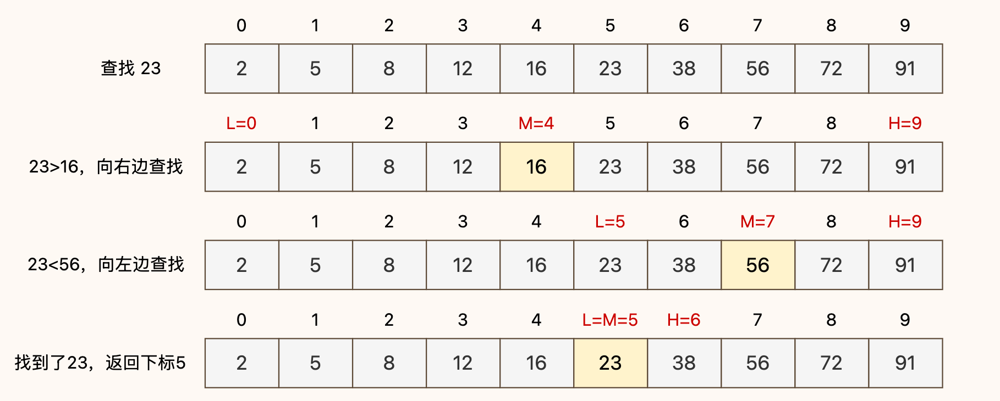

折半查找可以基于 **迭代实现**，也可以作为一个 **递归函数实现**：

```c
// 1.迭代版本
int BinarySearch(int A[], int n, int value) {
    int low = 0;
    int high = n - 1;

    while (low <= high) {
        int mid = low + (high - low) / 2;  // 防止溢出

        if (A[mid] == value) {
            return mid;  // 找到
        } else if (A[mid] < value) {
            low = mid + 1;
        } else {
            high = mid - 1;
        }
    }

    return -1;  // 未找到
}

// 2.递归版本
int BinarySearchRecursive(int A[], int low, int high, int value) {
    if (low > high) {
        return -1;  // 区间无效，查找失败
    }

    int mid = low + (high - low) / 2;

    if (A[mid] == value) {
        return mid;  // 找到目标
    } else if (A[mid] < value) {
        return BinarySearchRecursive(A, mid + 1, high, value);  // 查右半部分
    } else {
        return BinarySearchRecursive(A, low, mid - 1, value);   // 查左半部分
    }
}
```

折半查找的 **时间复杂度** 如下：

- **最好情况**： *O*(1)
- **最坏情况**： *O*(*l**o**g*2*n*)
- **平均情况**： *O*(*l**o**g*2*n*)

#### 2.1 折半查找判定树

折半查找判定树（Binary Search Decision Tree）是折半查找（Binary Search）过程的树形表示，用于清晰地 **描述在查找过程中所做的每一次比较决策**。

所以简单地来说，如何根据一个有序序列得到一个折半查找判定树呢，就是将折半查找的过程走一遍，举两个实际的例子来说明一下：

假设数组为 `[10, 20, 30, 40, 50, 60]`，元素个数为 6。

🌳 **折半查找判定树构造原则**

折半查找需要选一个“中点”作为根节点。偶数长度数组有两个中点，一般可以：

- 选靠左的那个（常见做法）：`mid = (low + high) // 2`
- 或者选靠右的那个

假设按 **常规左中点** 来构造，则 **构造过程如下**：

1. `[10, 20, 30, 40, 50, 60]`，`mid = 2` → 30 为根；
2. 左边 `[10, 20]`，`mid = 0` → 10 为左子树；
   - 右边是 `[20]` → 作为 10 的右子节点；
3. 右边 `[40, 50, 60]`，`mid = 4` → 50 为右子树；
   - 左边 `[40]` → 左子节点；
   - 右边 `[60]` → 右子节点。

最后可以得到如下折半查找判定树：

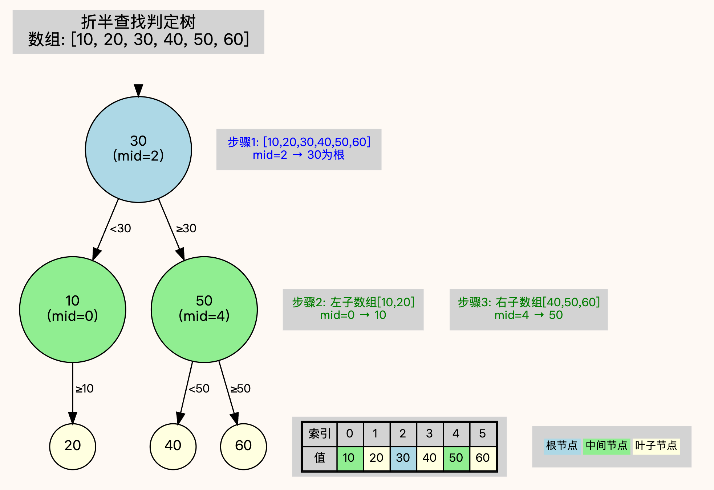

### 三、分块查找

线性表的 **分块查找** 通常应用于一种特定的情境：线性表（例如数组）被分为多个大小相等（或者最后一个块可能较小）的块，并且块内的元素是无序的，但是块与块之间是有序的。也就是说，每个块内的最大（或最小）元素小于下一个块的任意元素。

常用的 **分块查找策略** 如下：

1. 先对块索引进行顺序或二分查找以确定所需元素可能所在的块。
2. 然后在确定的块中进行顺序查找。

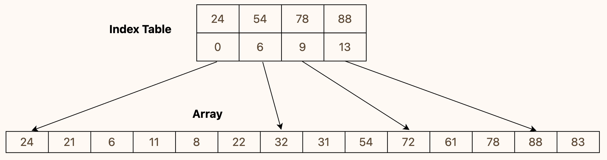

---

## 树形查找

### 一、基于BST的查找

在 [二叉查找树](https://www.csgraduates.com/data_structure/tree/btree/#bst) 以及它的改进版本 [AVL](https://www.csgraduates.com/data_structure/tree/btree/#avl) 树、[红黑树](https://www.csgraduates.com/data_structure/tree/btree/#红黑树) 中，查找操作 都遵循相同的基本原则：利用 **二叉树的有序性** 来快速定位目标元素。

复习以下，二叉查找树具备以下特点：

- 左子树中所有节点的值 **小于** 根节点的值。
- 右子树中所有节点的值 **大于** 根节点的值。
- 这种「左小右大」的有序性，使得查找可以逐层缩小范围。

所以在基于二叉查找树进行查找时，过程如下：

1. 从 **根节点** 开始。
2. 如果查询的值 **等于** 当前节点的值，返回 **当前节点**。
3. 如果查询的值 **小于** 当前节点的值，向 **左子树** 查询。
4. 如果查询的值 **大于** 当前节点的值，向 **右子树** 查询。
5. 如果到达 **空节点**，则查询失败，返回 **NULL**。

查找过程可以通过以下图示进行理解：

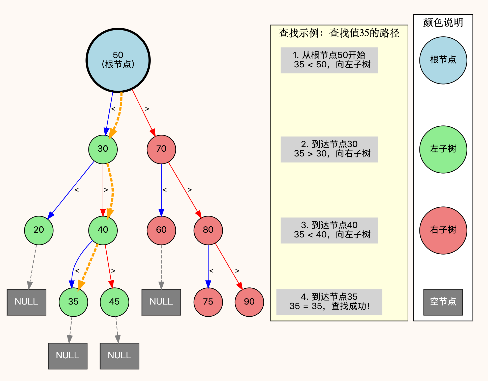

BST查找时间复杂度分析 

查找操作的时间复杂度，取决于树的 **高度**（Height）：

- 树的高度越小，查找路径越短，效率越高。
- 树的高度越大（越“瘦长”），查找路径越长，效率越低。

| 树类型 | **平均情况时间复杂度** | **最坏情况时间复杂度** | **说明**                                                     |
| ------ | ---------------------- | ---------------------- | ------------------------------------------------------------ |
| BST    | O(log⁡2n)*O*(log2*n*)   | O(n)*O*(*n*)           | 如果树接近平衡，高度约为 log⁡2nlog2*n*；但如果不断插入有序数据，可能退化为链表。 |
| AVL    | O(log⁡2n)*O*(log2*n*)   | O(log⁡2n)*O*(log2*n*)   | 通过严格的平衡条件保证树的高度始终在 log⁡2nlog2*n* 量级。     |
| 红黑树 | O(log⁡2n)*O*(log2*n*)   | O(log⁡2n)*O*(log2*n*)   | 相比 AVL，平衡条件更宽松，但依旧能保证树的高度不超过 2log⁡2n2log2*n*。 |

### 二、B树

**B 树**，也叫做多路平衡查找树。
是一种自平衡的树形数据结构，它广泛应用于数据库和文件系统中，用于高效地存储和检索大量有序数据。

#### 2.1 特性

**B 树**具备以下两个主要特点：

- 多路搜索树：B 树是一种多路搜索树，意味着每个节点可以拥有多个子节点，而不仅仅是两个（如二叉搜索树）。
  - **阶**（Order）：B 树的阶定义了每个节点可以拥有的 **最大子节点数**。
- **平衡性**：B 树通过保持所有叶子节点在同一层，确保了树的平衡，从而保证了搜索效率。

一颗 *m* **阶 B 树**，满足如下特性：

- 树中每个结点最多有 *m* 棵 **子树**，最多有 *m*−1 个 **关键字**。
- 若 **根节点** 不是 **叶子结点**，至少有 **两个** 子树。
- 除了 **根节点** 外的所有 **非叶结点** 最少有 ⌈*m*/2⌉ 棵子树，即最少有 ⌈*m*/2⌉−1 个 **关键字**。

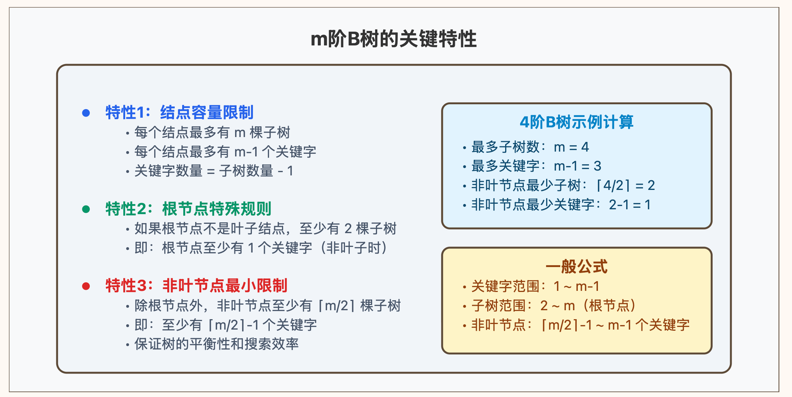

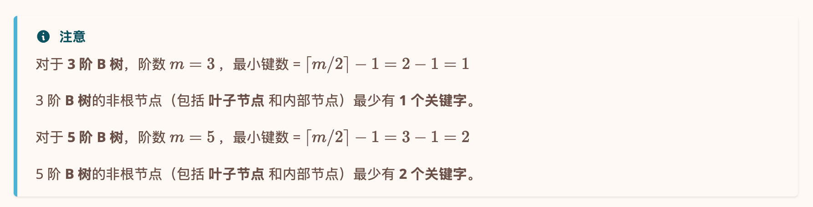

**B 树**结点结构如下：

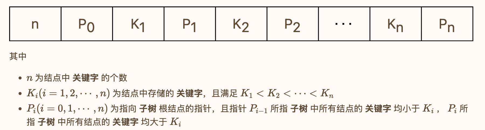

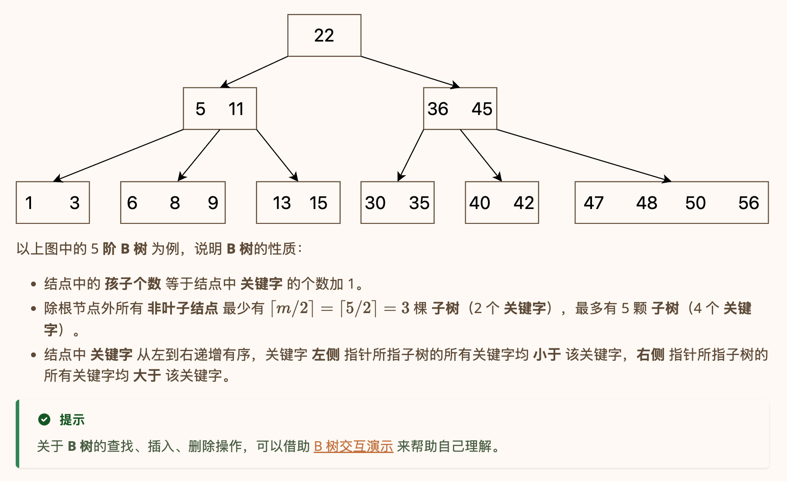

#### 2.2 查找

**B 树**查找与普通二叉查找树相似，但在每个节点上，需要进行多次比较。

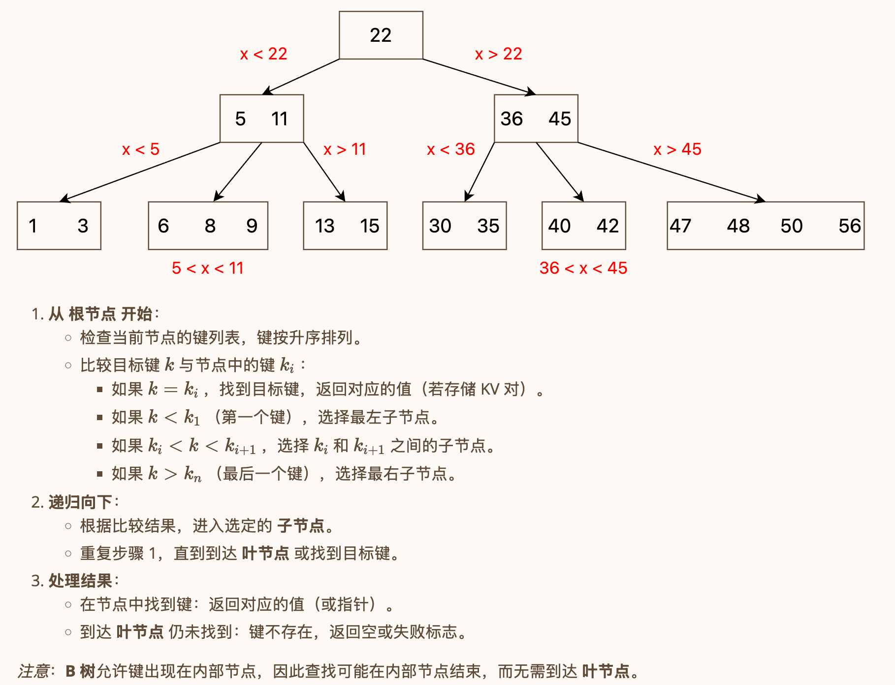

#### 2.3 插入

**B 树**的插入过程如下所示：

1. 查找关键字位置：
   - 从 **根结点** 开始，比较键值与节点中的键，选择合适的 **子节点** 继续递归向下，直到找到合适的 **叶节点**（插入点）。
   - **B 树**的所有插入操作 **都在叶节点进行**。
2. 插入关键字：
   - 将新键插入到 **叶节点** 的正确位置（保持键的有序性）。
   - 如果插入后 **叶节点** 的键数量不超过最大限制（ *m*−1 ），插入完成，过程结束。
   - 如果插入后键数量超过 *m*−1 （即节点溢出），需要进行 **分裂**。
3. 节点分裂：
   - 假设节点有 *m*个键（超限），将其分裂为两个新节点：
     - 取中间键（第 ⌈*m*/2⌉ 个键）作为分隔键。
     - 分隔键上移到 **父节点**。
     - 原节点分裂为两个新节点，分别包含中间键之前的键和之后的键。
   - 每个新节点的键数量约为 ⌈*m*/2⌉−1 （满足 **B 树**的最小键数要求）。
   - **子节点**指针也相应分配到两个新节点。

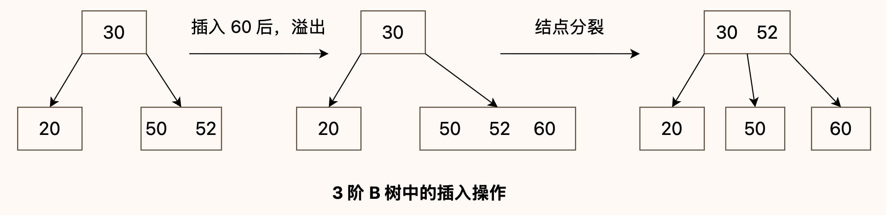

4. 更新 **父节点**

- 将中间键插入到 **父节点** 中（保持有序）。
- 如果 **父节点** 插入后也溢出，对 **父节点** 重复 **分裂** 操作（步骤 3）。
- 分裂可能递归向上传播，直到某个节点不再溢出或创建新的根节点。
  - 如果 **根结点** 分裂的话，则树的层数会增加一层。

下图展示了一个三阶 **B 树**的多次插入过程：

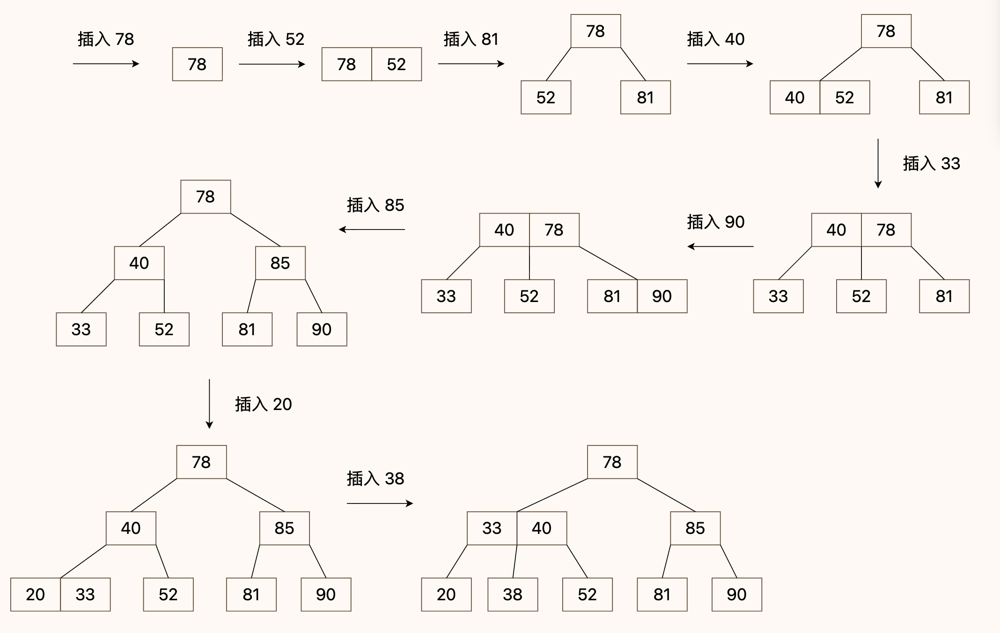

#### 2.4 删除

**B 树**的删除过程如下所示：

1. 查找关键字：首先查找要删除的关键字*k*。
   - 叶子节点中的关键字：
     - 如果键 *k* 在 **叶子节点**，且节点键数大于 ⌈*m*/2⌉−1 （最小键数），直接删除 *k* 。
     - 如果节点键数等于 ⌈*m*/2⌉−1 ，删除后会导致键数不足，需进行 **修复**（步骤 2）。
   - 内部节点中的关键字：
     - 找到 *k* 的前驱或后继键（通常是左子树的最大键或右子树的最小键，位于 **叶子节点**）。用前驱/后继键替换 *k* ，然后在 **叶子节点** 中删除该前驱/后继键。
     - 如果替换后 **叶子节点** 键数不足，需 **修复**（步骤 2）。
2. 节点键数不足的 **修复**：当删除键后，节点键数少于⌈*m*/2⌉−1，需要调整以恢复B 树性质：
   - 借键：如果左/右兄弟节点有多余键，借一个
     - 从 **父节点** 取一个键到当前节点。
     - 从兄弟节点取一个键到 **父节点**，相应调整 **子树** 指针。
   - 合并：如果兄弟节点也没有多余键：
     - 将当前节点与一个兄弟节点合并。
     - 从 **父节点** 取一个键作为合并节点的中间键。
     - 更新 **父节点** 的键和指针。
     - 如果 **父节点** 键数不足，递归对 **父节点** 应用 **修复**。
3. 递归处理
   - 删除操作可能引发多层节点调整，需递归处理 **父节点** 的键数不足问题，直到满足 **B 树**性质或到达 **根节点**。

***特殊情况***：删除操作可能引发多层节点调整，需递归处理 **父节点** 的键数不足问题，直到满足 **B 树**性质或到达 **根节点**。

下面以 3 **阶 B 树** 为例说明一下删除的多种情况：

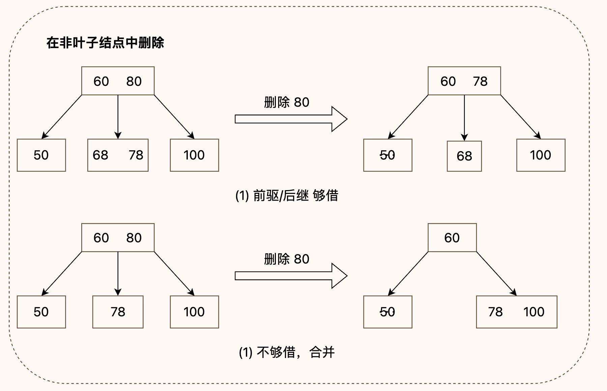

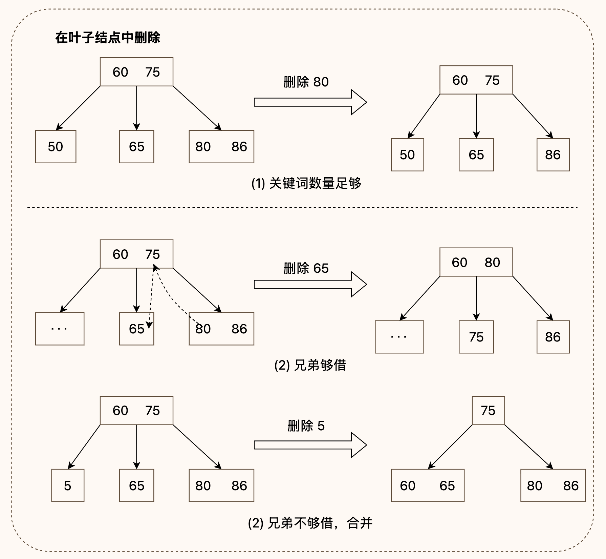

### 三、B+树

在实际应用中，**B 树** 和 **B+ 树** 通常存储的是键值对（Key-Value），例如在数据库索引或文件系统中，键用于定位记录，值可以是数据本身或指向数据的指针。在上文关于 **B 树**的说明中，为了突出算法逻辑，我们将 **B 树**中的元素表示为单个键，省略值的部分。

实际上存储有 **KV 对** 的 **B 树** 的结构如下图所示：

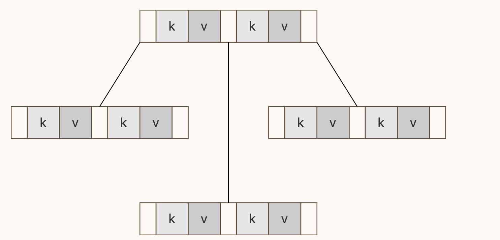

**B+ 树**是 **B 树** 的一种扩展。
在 **B+ 树** 中，只有 **叶子节点** 存储数据，而内部节点只存储键。所有的数据记录都存储在 **叶子节点** 中，并且 **叶子节点** 通过指针连接形成一个有序链表，如下图所示：

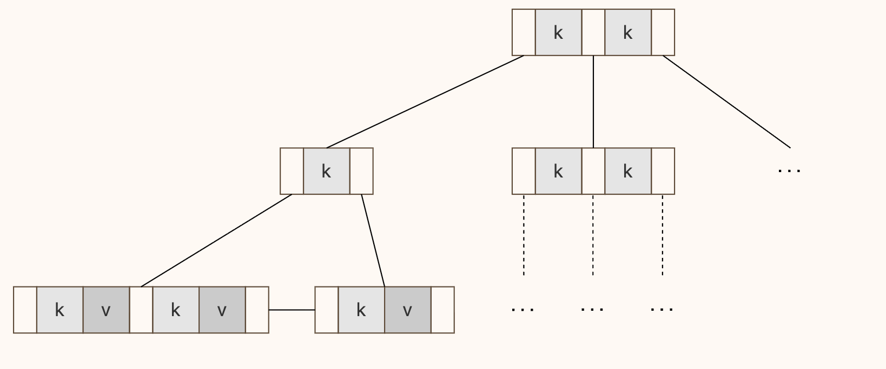

#### 3.1 特性

一颗 *m* **阶 B+ 树**满足如下条件：

1. 节点的容量限制
   - 每个 **非叶子节点**（分支节点）最多有 *m* 棵 **子树**。
   - 除 **根节点** 外，每个 **非叶子节点** 至少有 ⌈ *m*/2 ⌉ 棵 **子树**。
2. 关键字与子树的关系
   - 在一个 **非叶子节点** 中，如果有 *k* 个关键字，那么它会有 *k*+1 棵 **子树**。
   - 关键字起到分隔值域的作用，**子树**对应这些分隔区间。
3. 数据存储位置
   - 所有 **数据记录**（或指向数据的指针）都存储在 **叶子节点** 中。
   - **非叶子节点** 只存储关键字，用于索引和导航，不直接存放数据。
4. 叶子节点的顺序结构
   - 所有 **叶子节点** 之间通过链表指针相连。
   - 这种顺序结构可以支持高效的范围查询和顺序遍历。

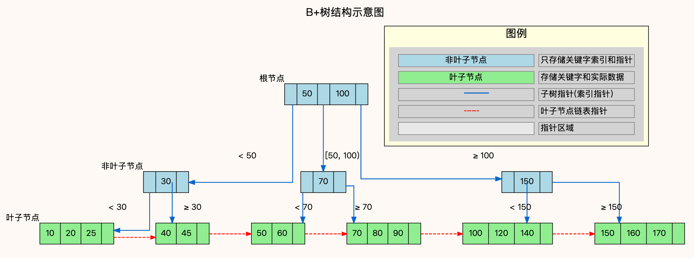

#### 3.2 操作

**B+ 树**的操作考察不多，了解与 **B 树**相应操作的不同之处即可：

- 查找：
  - **B 树**：所有节点（包括内部节点）存储 **KV 对**，查找可能在内部节点结束。
  - **B+ 树**：只有 **叶节点** 存储 **KV 对**，查找必须到达 **叶节点**。
- 插入：
  - **B 树**：所有节点存储 **KV 对**，分裂时中间键值对整体上移。
  - **B+ 树**：只有 **叶节点** 存储 **KV 对**，分裂时中间键复制到 **父节点**（仅键，不带值），**叶节点**保留所有键。
- 删除：
  - **B 树**：内部节点存储 **KV 对**，删除内部节点键需用后继/前驱替换，可能复杂。
  - **B+ 树**：删除只发生在 **叶节点**，内部节点键仅需调整（复制 **叶节点** 键），操作更简单。

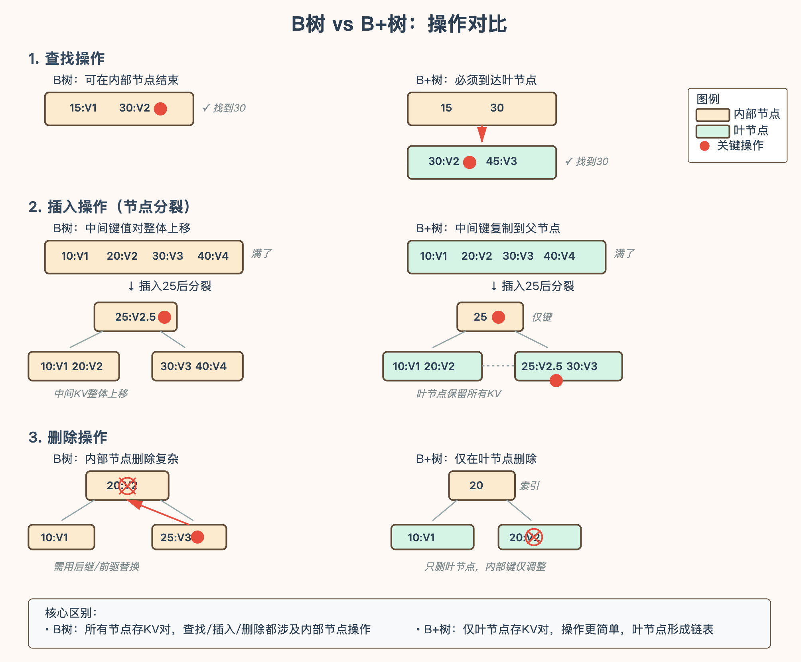

### 四、B和B+树比较

| 特性         | **B 树**                                 | **B+ 树**                                                    |
| ------------ | ---------------------------------------- | ------------------------------------------------------------ |
| 数据存储位置 | 关键字和数据存在于内部和 **叶子节点**    | 所有数据都存储在 **叶子节点**，内部节点只保存关键值和子节点的指针 |
| 叶子节点结构 | 叶子节点与内部节点类似，保存关键字和数据 | 所有 **叶子节点** 通过指针链接成链表                         |
| 分支因子     | 由于同时保存数据和关键字，可能较小       | 通常较大，因为内部节点只保存关键字和指针                     |
| 稳定性       | 关键字位置可能会频繁变动                 | 数据位置相对稳定                                             |
| 应用场景     | 适用于小至中等规模的数据存储系统         | 更常见于大型数据库系统和文件系统                             |
| 查找效率     | 在内部节点找到关键字后，查找即完成       | 查找必须遍历到 **叶子节点**，但由于通常高度较低，效率也很高  |

---

## 散列表查找

### 一、散列表

散列表（hash table），也叫 **哈希表**，是一种常用的数据结构，提供了快速的数据存储和检索操作。它使用一个数组（通常称为 **桶** 或 **槽**）来存储数据。为了将数据存储到散列表中，数据项首先与一个 **键** 关联，然后使用一个 **散列函数** 将该键转换为数组的索引。这样，通过该键可以快速找到相应的数据项。

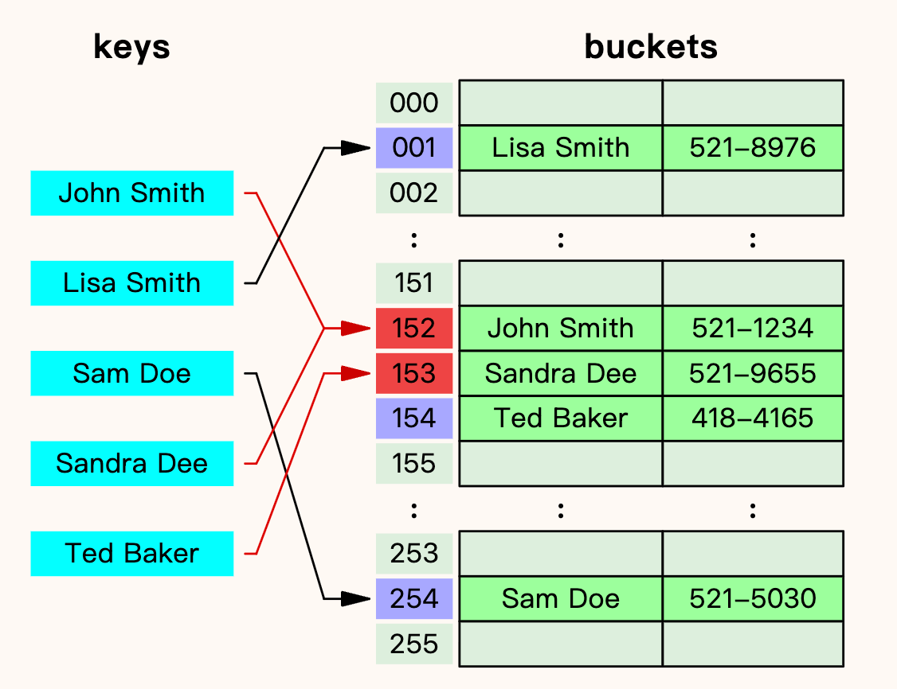

散列表的关键性能指标是其 **装载因子**，通常表示为 **λ**。装载因子是散列表中当前存储的元素数量与散列表的容量之比。随着装载因子的增加，**散列冲突**的可能性也会增加，这可能会降低散列表的性能。

#### 1.1 散列函数

**散列函数**（Hash Function）是一种函数，它接受一个输入（或“键”）并返回一个输出（或“值”），通常用作数组的索引。其主要目的是均匀地分布键到数组中，以便在可能的范围内平均分配值，从而最大限度地减少冲突。

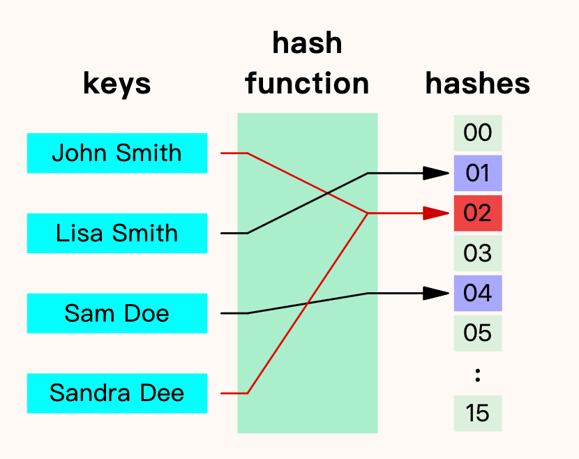

一个好的散列函数应具有以下特性：

- **均匀分布**：无论输入数据的分布如何，散列函数都应该确保输出均匀分布在其范围内，以减少冲突。
- **计算速度**：散列函数应该快速计算，这样就不会成为整个哈希过程的瓶颈。
- **确定性**：对于同一输入，散列函数应始终产生相同的输出。
- **最小冲突**：尽管冲突是不可避免的，但好的散列函数应该使它们降到最低。

##### 同义词

在哈希表中，**同义词**（synonym）指的是多个不同的键（key）通过哈希函数计算后，映射到 **同一个哈希表位置**（即相同的哈希值或索引）。这通常会导致 **冲突**，因为哈希表的一个槽位（bucket）只能存储一个键值对。

- 例如：
  - 假设哈希函数是 `h(key) = key % 10`，键 `15` 和 `25` 都会映射到索引 `5`（因为 `15 % 10 = 5` 和 `25 % 10 = 5`）。
  - 在这种情况下，`15` 和 `25` 就是同义词，因为它们在哈希表中竞争同一个位置。

同理，**非同义词**（non-synonym）指的是通过哈希函数计算后，映射到不同哈希表位置（即不同哈希值或索引）的键（key）。这些键不会竞争同一个槽位，因此不会引发冲突。

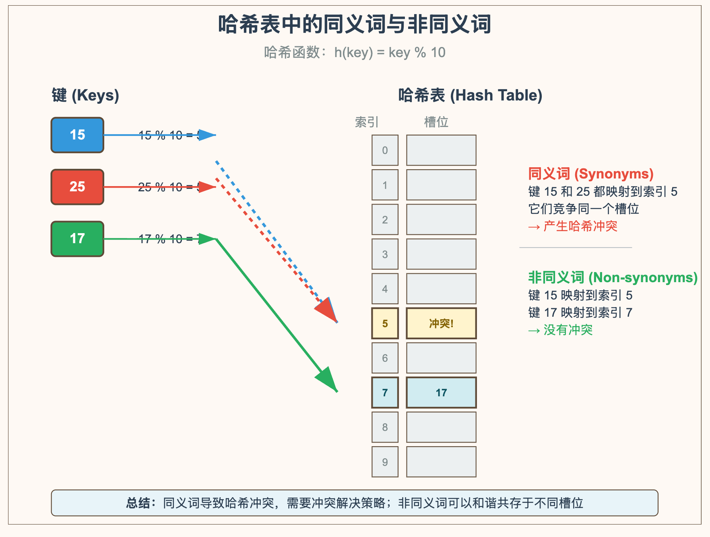

##### 非同义词

例如：

- 假设哈希函数是h(key) = key % 10：
  - 键 `15` 映射到索引 `5`（因为 `15 % 10 = 5`）。
  - 键 `17` 映射到索引 `7`（因为 `17 % 10 = 7`）。
- 在这种情况下，`15` 和 `17` 是非同义词，因为它们被哈希函数分配到不同的位置。

#### 1.2 查找方式

散列表的查找算法如下：

1. **哈希函数映射**：通过 **哈希函数** `h(key)` 将键映射到哈希表的索引位置。
2. **访问槽位**：根据索引访问哈希表中的对应 **槽位**。
3. **冲突处理**：如果发生冲突，通过 **探测方法** 计算下一个可能位置，直到找到匹配的键、遇到空槽或遍历完全部位置。
4. **返回结果**：找到匹配键则返回对应值，未找到则返回空。

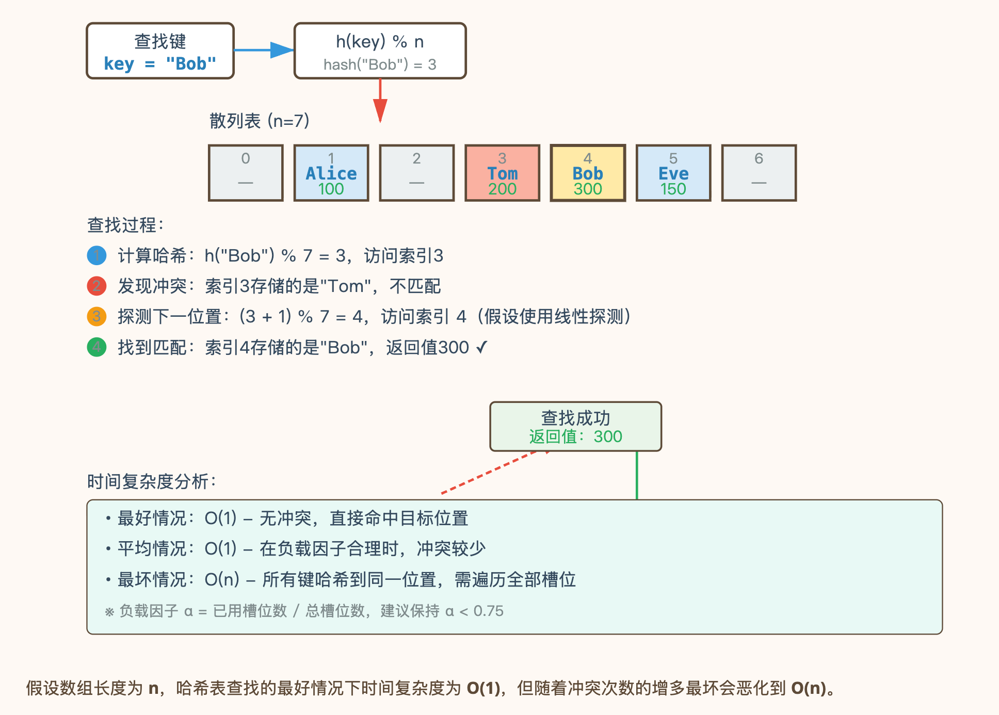

### 二、冲突处理方式

散列表的冲突处理策略总结为以下几种：

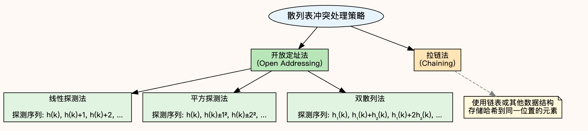

#### 2.1 开放定址法

开放定址法（Open Addressing）使用单个数组来存储所有的键值对。当发生冲突时，根据 **开放定址策略** 在散列表中寻找另一个空槽，将键值对存储在那里。

常用的 **开放定址策略** 有：**线性探测**、**平方探测**和 **双散列**

具体如下：

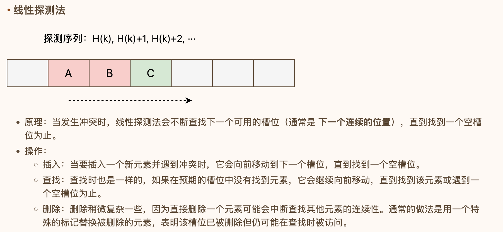

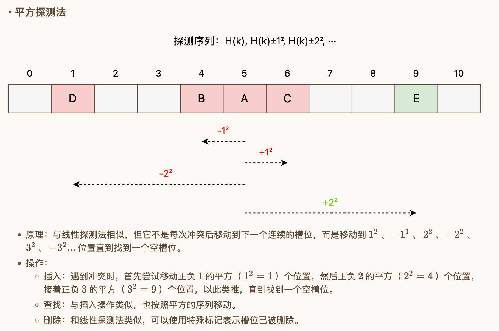

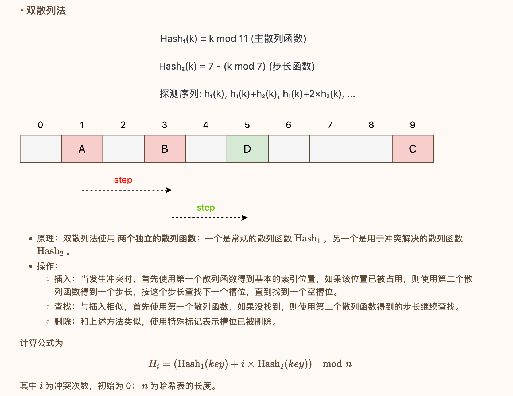

#### 2.2 拉链表

拉链法（Seperate Chaining）使用数组与 **链表** 相结合的方式。散列表的每个 **槽位** 都包含一个链表（或其他数据结构，如平衡树）。当发生冲突时，键值对被添加到相应槽位的链表中。

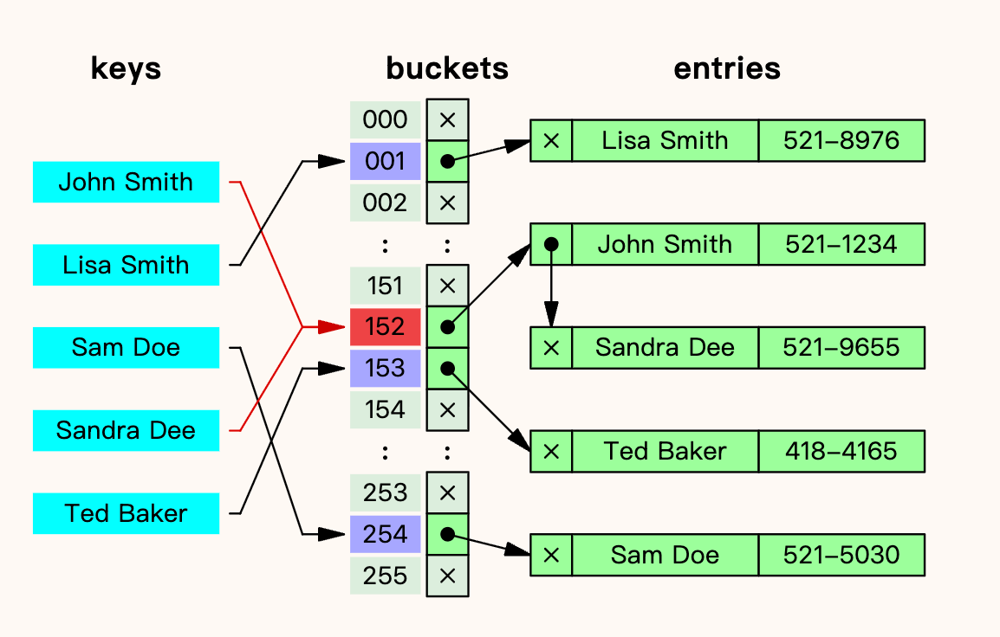

- 操作：
  - 查找：通过散列函数找到对应的索引位置，在该索引的链表中顺序查找键。
  - 插入：通过散列函数找到对应的索引位置。若该键在链表中已存在，更新其值；否则，在链表中添加新的键值对。
  - 删除：通过散列函数找到对应的索引位置。在链表中查找并删除对应的键值对，若未找到则无操作。

### 三、平均查找长度

#### 3.1 查找失败

在考题中常常需要计算散列表 **查找失败** 时的平均查找长度，这里举一个实例说明。

假设哈希表如下图所示，哈希表的长度为 11，哈希函数为`H(key) = key % 7`, 采用线性探测法检测冲突。

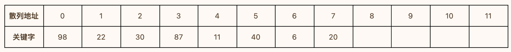

假如根据哈希函数计算出的初始查询位置为 0，查询失败时根据线性探测法一直向后探测，查找到位置 8 发现该位置为空得出查找失败，查询次数为 **9**，其他位置可以以此类推计算出来。

当查找一个新的 key 时，初始查询位置根据哈希函数计算可能在 0 到 6 之间，对于每个位置，查询失败时，需要查找的长度如下表所示：

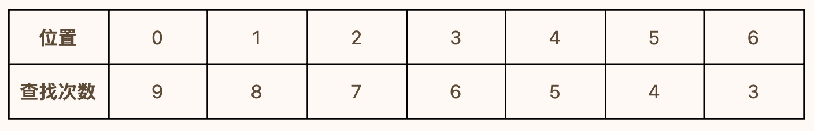

查找失败的 **平均查找长度** 为 **6**（`(9 + 8 + 7 + 6 + 5 + 4 + 3) / 7 = 6`）。

#### 3.2 查找成功

**查找成功时的平均查找长度如何计算呢？**

只有存储在散列表中的元素才能被成功查找，对于这些元素，查找成功的长度分为两种情况：

- 使用散列函数 **H(key)** 查找到某个位置，该位置存储的元素就是 key，查找次数为 **1**
- 对于上述情况，该位置存储的元素不是 key，则向下一个位置探测，直到找到元素 key，探测次数为 **N**，则查找次数为 **1 + N**

将散列表中的所有元素的查找次数求和，然后除以 **元素个数**，即得到 **查找成功时的平均查找长度**。

### 四、装填因子

装填因子（load factor）是一个衡量散列表“满”的程度的指标，其中 **装填因子 = 散列表中已存储的项数 / 散列表的总大小**。

例如，如果一个容量为 **100** 的散列表中已经有 **70** 项，那么装填因子为 **0.7**。

装填因子的值影响散列表的性能：

- 当装填因子太小，意味着散列表中有很多空位，这可能导致内存浪费。
- 当装填因子太大，冲突的概率会增加，从而降低查找、插入和删除的速度。

因此，常常在装填因子达到某个阈值时进行散列表 **扩容**，例如当装填因子大于 **0.7** 或 **0.75**。

### 五、扩容

扩容（Rehashing）是增加散列表容量以容纳更多元素并降低装载因子的过程。以下是扩容的主要步骤：

1. 创建一个 **更大容量** 的新散列表，通常采用指数倍增长策略（如容量翻倍）。
2. 遍历旧散列表中的所有元素，使用 **新的哈希函数**（或调整后的哈希函数）将它们重新插入到新散列表中。
3. 释放旧散列表的内存。

扩容会消耗一定时间，尤其当散列表元素较多时开销较大。然而，由于扩容操作不频繁，其时间成本被分摊到每次插入操作中，使得插入的平摊时间复杂度仍为 **O(1)**。

对于使用开放定址法的哈希表，扩容的过程如下图所示：

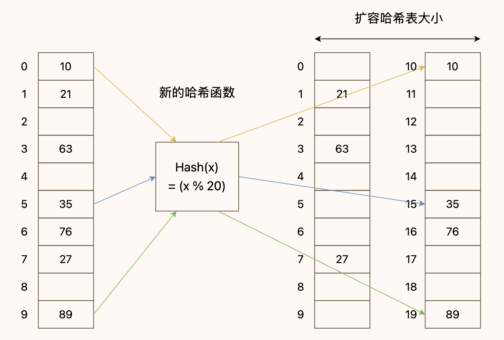

对于使用拉链法的哈希表，扩容前后的哈希表如下图所示：

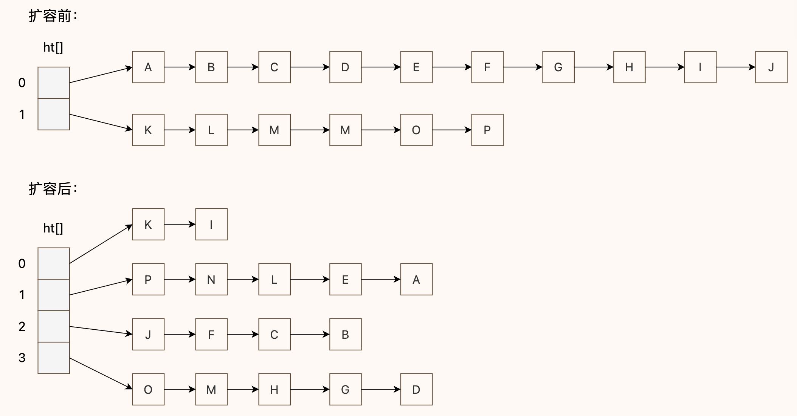


