# 排序

## 内部排序

### 一、排序概念

#### 1.1 稳定性

排序算法的 **稳定性** 是指：在排序过程中，**如果两个元素的键值相等**，排序后它们的 **相对顺序保持不变**，那么这个排序算法就是 **稳定的排序算法**。

比如排序前的数组是这样：`[... A ... B ...]`，并且 `A` 和 `B` 的值相同。

如果排序后的数组是这样：`[... B A ...]`，那么排序算法就是不稳定的，反之排序算法就是 **稳定的**。

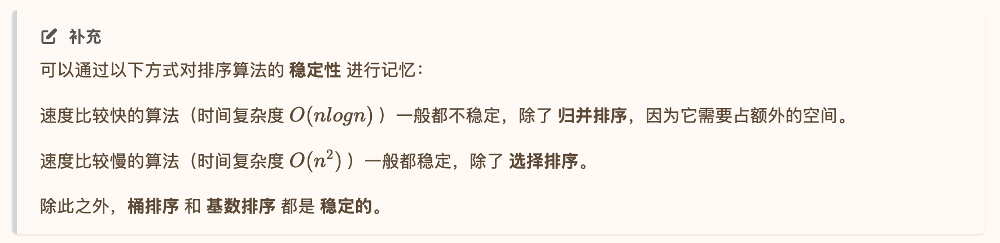

#### 1.2 元素移动次数

排序算法中的 **元素移动次数**，指的是在排序过程中对 **数组元素进行位置变换的次数**。

下表列出了各排序算法的 **元素移动次数**：

| 排序算法 | 元素移动次数                         | 说明                                                    |
| -------- | ------------------------------------ | ------------------------------------------------------- |
| 冒泡排序 | 最坏 *O*(*n*2)                       | 每次交换都移动两个元素，次数较多                        |
| 选择排序 | 最多 *O*(*n*)                        | 每轮找到最小值，只交换一次，移动次数较少，但比较多      |
| 插入排序 | 平均 *O*(*n*2)                       | 可能需要把一个元素插入前面，移动一串元素                |
| 归并排序 | *O*(*n*log*n*)                       | 借助辅助数组，搬来搬去，数据复制较频繁                  |
| 快速排序 | 平均 *O*(*n*log*n*) ，最坏 *O*(*n*2) | 每次划分区间时要交换元素                                |
| 堆排序   | *O*(*n*log*n*)                       | 每次堆化需要交换元素，整体移动较快速排序少              |
| 希尔排序 | *O*(*n*1.3∼2)                        | 分段插入，元素跳跃移动，次数难以精确界定                |
| 桶排序   | *O*(*n*)                             | 元素在桶中“复制”而不是交换，适合不比较的排序场景        |
| 基数排序 | *O*(*n*⋅*d*)                         | 每轮根据某位进行 **稳定排序**，通常使用计数排序复制元素 |

可以观察到，**选择排序** 和 **桶排序** 的 **元素移动次数** 是最少的，不涉及到大量的元素位置交换。

#### 1.3 复杂度

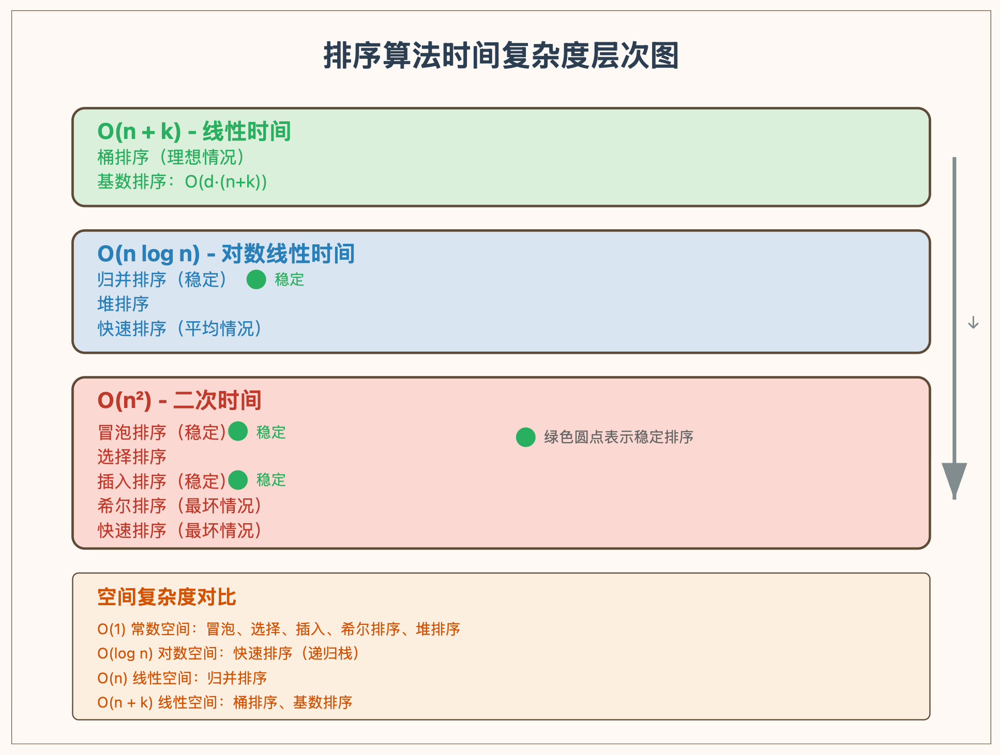

| 排序方式 | 时间复杂度                       | 空间复杂度 | 是否稳定                   |
| -------- | -------------------------------- | ---------- | -------------------------- |
| 冒泡排序 | O(n2)                            | O(1)       | 稳定                       |
| 选择排序 | O(n2)                            | O(1)       | 不稳定                     |
| 插入排序 | O(n2)                            | O(1)       | 稳定                       |
| 希尔排序 | 取决于增量序列，最坏 O(n2)       | O(1)       | 不稳定                     |
| 归并排序 | O(nlog⁡n)                         | O(n)       | 稳定                       |
| 快速排序 | 平均 O(nlog⁡n)，最坏 O(n2)        | O(log⁡n)    | 不稳定                     |
| 堆排序   | O(nlog⁡n)                         | O(1)       | 不稳定                     |
| 桶排序   | O(n+k)（k 为桶数）               | O(n+k)     | 稳定（视内部排序方式而定） |
| 基数排序 | O(d⋅(n+k))（d 为位数，k 为基数） | O(n+k)     | 稳定                       |

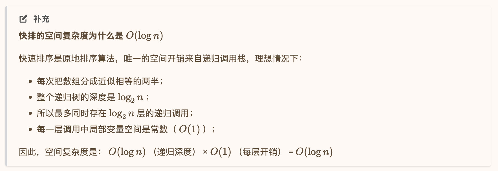

#### 1.4 躺特征

在排序算法中，**一趟（pass）** 通常指 **完成一次从头到尾（或部分范围）对数组进行处理的过程**，这一过程中可能会比较、移动、插入或交换若干元素。
换句话说，一趟就是排序算法中最小的完整“循环工作单元”，通常对应于外层循环的一次执行。

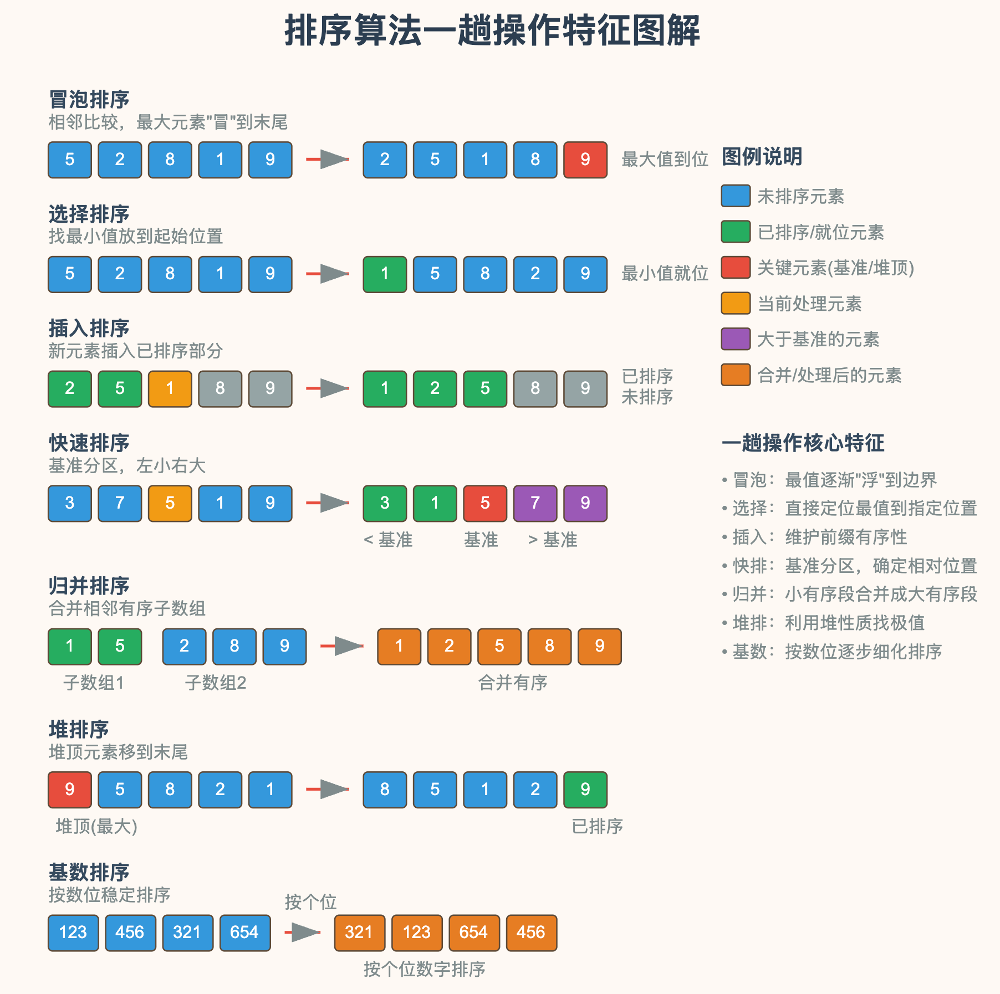

不同的排序算法在每趟排序后，数组中的元素会呈现不同特征，总结为下表：

| 排序算法     | 一趟操作含义                           | 一趟后的数组特征                                             |
| ------------ | -------------------------------------- | ------------------------------------------------------------ |
| **冒泡排序** | 从头到尾依次比较相邻元素并交换         | 最大元素被“冒”到最后                                         |
| **选择排序** | 遍历剩余元素，找到最小值并放到当前位置 | 最小元素被放到当前起始位                                     |
| **插入排序** | 将下一个元素插入到前面已排序序列中     | 前 i*i* 个元素是有序的                                       |
| **希尔排序** | 以某个 gap 为间隔，进行插入排序        | 每个间隔为 gap 的子序列局部有序                              |
| **归并排序** | 合并相邻的两个有序子数组               | 小规模区间逐步合并成更大的有序区间                           |
| **快速排序** | 选一个基准，划分左右小于/大于它的区间  | 基准元素被放到最终位置，两侧被初步分区 基准元素左边的值都比它小，右边的值都比它大 |
| **堆排序**   | 构建/调整堆，取出堆顶并放到末尾        | 当前堆顶（最大/最小）被移动到最终位置，堆被重构              |
| **桶排序**   | 元素被分配到不同桶中                   | 元素被归入对应桶，但桶内顺序未必有序                         |
| **基数排序** | 按某一数位进行 **稳定排序**（如个位）  | 按当前数位局部有序，低位排序逐步推进整体有序                 |

#### 1.5 伪代码

```c
// 1.冒泡排序
BubbleSort(arr)
    n ← arr.length
    for i from 0 to n - 1
        for j from 0 to n - i - 2
            if arr[j] > arr[j + 1]
                swap arr[j], arr[j + 1]
              
// 2.插入排序
InsertionSort(arr)
    n ← arr.length
    for i from 1 to n - 1
        key ← arr[i]
        j ← i - 1
        while j ≥ 0 and arr[j] > key
            arr[j + 1] ← arr[j]
            j ← j - 1
        arr[j + 1] ← key
          
// 3.选择排序
SelectionSort(arr)
    n ← arr.length
    for i from 0 to n - 1
        minIndex ← i
        for j from i + 1 to n - 1
            if arr[j] < arr[minIndex]
                minIndex ← j
        swap arr[i], arr[minIndex]
              
// 4.基数排序
RadixSort(arr)
    找到数组中最大值，确定最大位数 d
    for i from 1 to d
        对数组按第 i 位进行**稳定排序**
      
// 5.归并排序
MergeSort(arr)
    if arr.length ≤ 1
        return arr
    mid ← arr.length / 2
    left ← MergeSort(arr[0 to mid - 1])
    right ← MergeSort(arr[mid to end])
    return Merge(left, right)

Merge(left, right)
    result ← []
    while left ≠ ∅ and right ≠ ∅
        if left[0] ≤ right[0]
            append left[0] to result
            remove left[0] from left
        else
            append right[0] to result
            remove right[0] from right
    append remaining elements of left and right to result
    return result
          
// 6.希尔排序
ShellSort(arr)
    n ← arr.length
    gap ← n / 2
    while gap > 0
        for i from gap to n - 1
            temp ← arr[i]
            j ← i
            while j ≥ gap and arr[j - gap] > temp
                arr[j] ← arr[j - gap]
                j ← j - gap
            arr[j] ← temp
        gap ← gap / 2
              
// 7.快速排序
QuickSort(arr, low, high)
    if low < high
        pivotIndex ← Partition(arr, low, high)
        QuickSort(arr, low, pivotIndex - 1)
        QuickSort(arr, pivotIndex + 1, high)

Partition(arr, low, high)
    pivot ← arr[high]
    i ← low - 1
    for j from low to high - 1
        if arr[j] ≤ pivot
            i ← i + 1
            swap arr[i], arr[j]
    swap arr[i + 1], arr[high]
    return i + 1
          
// 8.堆排序
HeapSort(arr)
    BuildMaxHeap(arr)
    for i from arr.length - 1 down to 1
        swap arr[0], arr[i]
        MaxHeapify(arr, 0, i)

BuildMaxHeap(arr)
    n ← arr.length
    for i from n / 2 - 1 down to 0
        MaxHeapify(arr, i, n)

MaxHeapify(arr, i, n)
    largest ← i
    left ← 2 * i + 1
    right ← 2 * i + 2
    if left < n and arr[left] > arr[largest]
        largest ← left
    if right < n and arr[right] > arr[largest]
        largest ← right
    if largest ≠ i
        swap arr[i], arr[largest]
        MaxHeapify(arr, largest, n)
```

### 二、冒泡排序

冒泡排序（Bubble Sort）是一种 **简单的排序算法**，通过反复遍历数组，比较相邻元素并交换位置，将较大的（或较小的）元素逐步“冒泡”到数组的一端。过程如下：

1. 从数组开头开始，比较相邻的两个元素，如果顺序不对（例如前者大于后者，假设升序排序），则交换它们。
2. 遍历一遍后，**最大（或最小）的元素会被“冒泡”到数组末尾（或开头）**。
3. 对剩余的未排序部分重复上述步骤，每次遍历的范围减少一个元素，直到数组完全排序。

在升序排序中，较大的元素像气泡一样逐渐“浮”到数组的末端（或较小的元素“沉”到开头），每次遍历都将一个元素推到正确的位置，形似气泡在水中上升的过程，因此得名**“冒泡排序”**。

比如，对于数组 `5, 1, 4, 2, 8`的前两次冒泡过程如下：

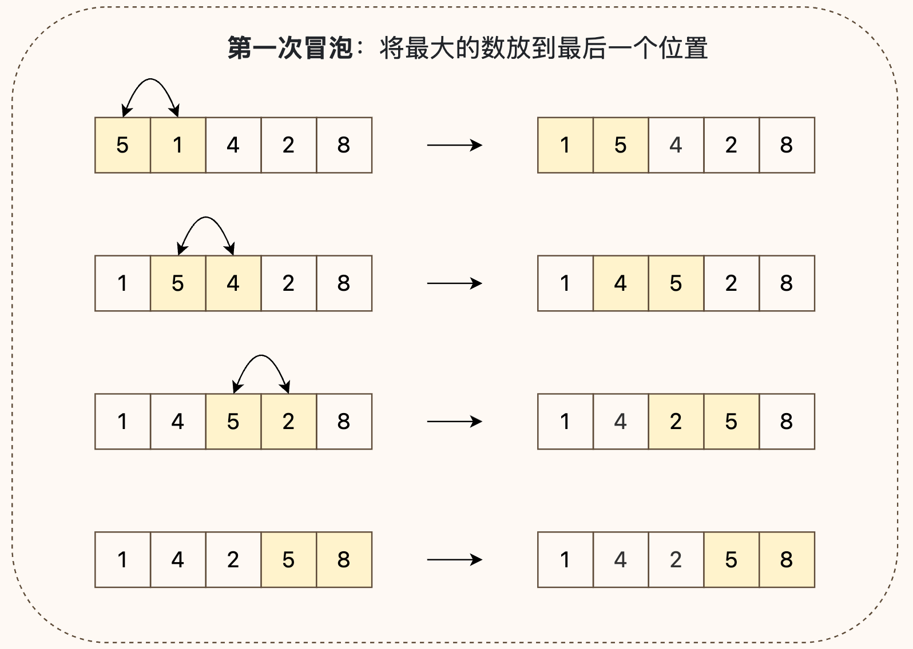

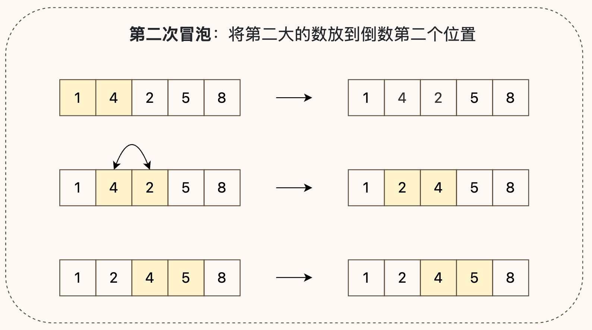

### 三、插入排序

插入排序（Insertion Sort）将数组分为 **未排序部分** 和 **已排序部分**，每次选取未排序部分的第一个元素作为插入元素，在已排序序列中 **从后向前** 扫描，找到相应位置并插入。

对于数组 `4, 3, 2, 10, 12, 1, 5, 6` 执行插入排序的过程：

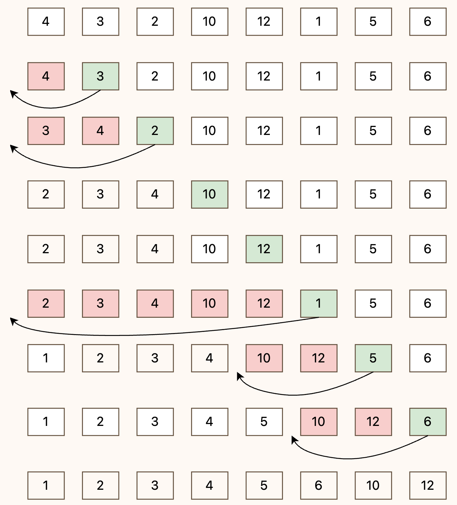

插入排序可以分为 直接插入排序 和 折半插入排序，其不同点在于 **寻找插入位置时** 使用的是 **从后向前顺序查找** 还是 **折半查找**。

插入排序适合 **大部分元素有序** 的场景，因为这种情况下进行插入比较的次数较少，排序算法执行更加高效。

### 四、选择排序

在 **选择排序（Selection Sort）** 中，数组被分为 **有序子数组** 和 **无序子数组** 这两个部分。
每次迭代时，算法会 **在未排序部分中找到最小元素，将其放到已排序部分的末尾**（与有序子数组的下一个元素交换位置）。这样，每一次选择操作后，未排序部分减少一个元素，而有序部分则增加一个元素。

以排序数组`11, 25, 12, 22, 64`为例：

| 有序子数组           | 无序子数组           | 无序子数组中的最小值 |
| -------------------- | -------------------- | -------------------- |
| ()                   | (11, 25, 12, 22, 64) | 11                   |
| (11)                 | (25, 12, 22, 64)     | 12                   |
| (11, 12)             | (25, 22, 64)         | 22                   |
| (11, 12, 22)         | (25, 64)             | 25                   |
| (11, 12, 22, 25)     | (64)                 | 64                   |
| (11, 12, 22, 25, 64) | ()                   |                      |

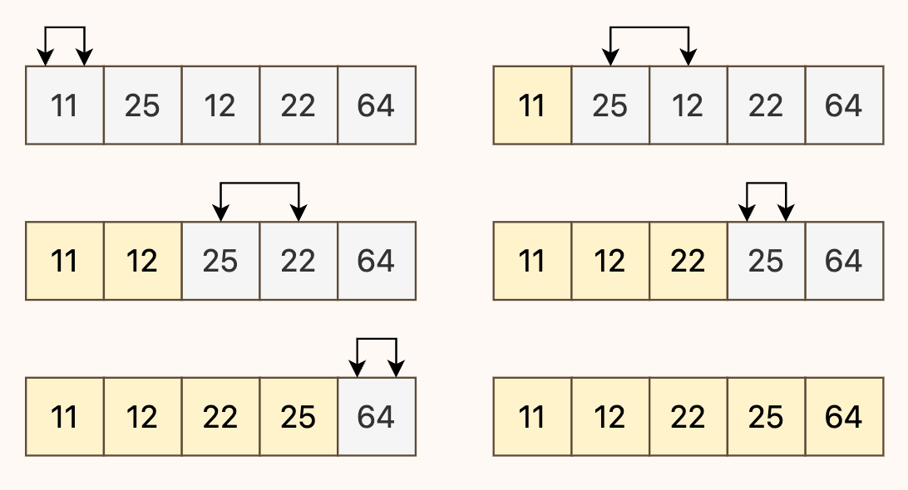

### 五、归并排序

归并排序（Merge Sort）是一个典型的 **分而治之** 策略的应用。它将一个大问题分解成若干小问题分别解决，然后将这些小问题的解合并为大问题的解。归并排序的主要思想是将已有序的子序列合并，得到完全有序的序列；即先使每个子序列有序，再使子序列段间有序。若将两个有序表合并成一个有序表，称为二路归并。

基本思想：

1. **分解**：分解待排序的数据数组为两个长度相等（或几乎相等）的子数组。
2. **递归**：递归地排序两个子数组。
3. **合并**：合并（归并）两个已排序的子数组以产生排序好的数据数组。

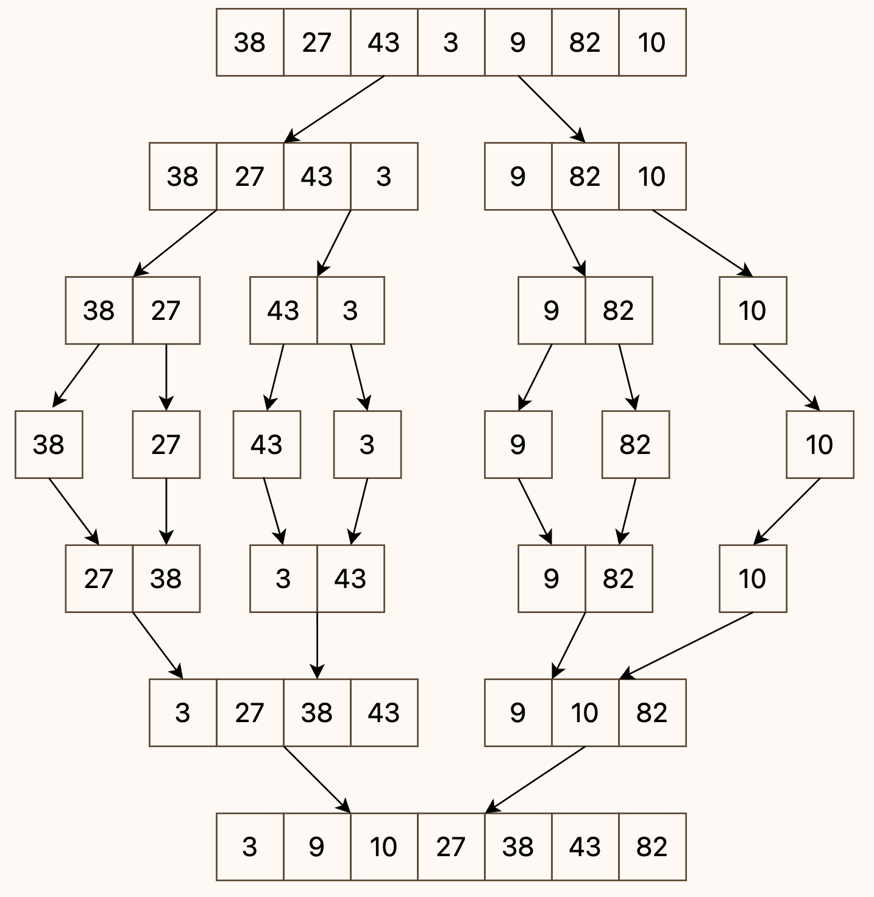

### 六、快速排序

快速排序（Quick Sort）的核心思想和归并排序一样，也是 **分而治之**，其步骤如下：

1. **选择一个基准元素**（Pivot）：从数组中选择一个元素作为基准。
2. **分区**（Partition）：重新排列数组，使得所有小于基准的元素都在其左侧，所有大于基准的元素都在其右侧。在这个分区结束之后，该基准就处于数组的最终排序位置。
3. **递归地排序子序列**：递归地对基准左侧和右侧的子数组进行快速排序。

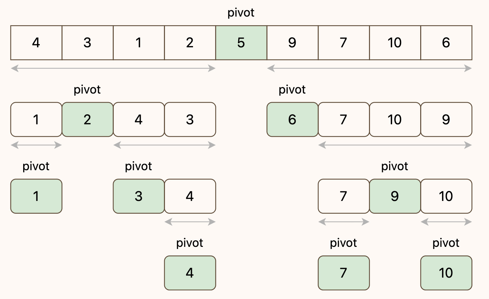

#### 6.1 代码实现

快排代码包含两个函数，一个是 `partition`，用于选择基准元素，并对其进行分区。

其中分区的实现方式有很多种，此处使用双指针法实现分区，该算法比较简短，方便记忆。

```c
// [low, high] 为分区的范围，返回值为分区后 pivot 在数组中的下表
int partition(int a[], int low, int high) {
    int pivot = a[low];     // 设置基准元素为 [low, high] 区间中的第一个元素
    int l = low, r = high;  // 设置双指针
    while (l < r) {
        while (l < r && a[r] >= pivot) r--; // 从右到左寻找小于 pivot 的元素
        while (l < r && a[l] <= pivot) l++; // 从左到右寻找大于 pivot 的元素
        if (l < r) swap(a[l], a[r]);        // 交换两个元素
    }
    swap(a[low], a[r]); // 将 pivot 置换到中间位置
    return r;
}

void quickSort(int a[], int low, int high) {
    // 递归的结束条件，不要遗漏
    if (low < high) {
        int pivotIdx = partition(a, low, high);
        // 递归地对两个
        quickSort(a, low, pivotIdx - 1);
        quickSort(a, pivotIdx + 1, high);
    }
}
```

快速排序的代码实现需要熟练掌握（能够手写代码），在数据结构的算法解答题中可以作为兜底的方案。

#### 6.2 单向递归算法

每一次基于基准元素执行分区操作后，可以基于基准元素的位置将数组分为两个部分，这个时候 **基准元素的位置与最后有序数组中的位置相同**。

基于这一点常常会做一些考察，比如如果我们需要寻找数组中 **第 k 大的数**（即找到有序数组中下标为 k 的数），这个时候我们就不需要向两个方向递归，只需要 **向一个方向递归** 即可，如果当前基准被确定在第 k 个位置，即可退出递归。

```c
// 分区算法实现与标准快排相同，这里不赘述
int partition(int a[], int low, int high) { ... }

// 寻找数组中第 k 大的数字，返回值为该元素
int quickSelect(int a[], int low, int high, int k) {
    if (low < high) {
        pivotIdx = partition(a, low, high);
        // 如果 pivotIndex 与 k 相等，那么 a[pivotIdx] 就是我们要找的第 k 大的数
        if (pivotIdx == k) {
            return a[pivotIdx];
        }
        // 如果 pivotIdx 小于 k，说明第 k 大的数在右边分区
        if (pivotIdx < k) {
            return quickSelect(a, pivotIdx+1, high, k);
        }
        // 否则在左边分区
        return quickSelect(a, low, pivotIdx-1, k);
    }
}
```

### 七、堆排序

堆排序的核心在于利用 **堆的性质** 进行排序，在了解堆排序过程之前，需要了解堆的基本概念。

#### 7.1 堆

在二叉树一节中我们提到，[二叉树的存储方式](https://www.csgraduates.com/data_structure/tree/btree/#二叉树存储结构) 包含 **链接存储** 和 **顺序存储** 两种。
堆就是采用 **顺序存储** 的方式，在这种方式中，我们使用一个数组来模拟一颗二叉树，二叉树中的结点操作被转化为数组元素操作。

满足以下性质的树 被称为 **堆**（Heap）：

1. **结构性质**：堆总是一颗 **完全二叉树**，即除了最后一层之外的其他每一层都被元素填满，且最后一层的元素都尽可能地靠左排列。
2. 有序性质：树中的每个结点 相对于 子结点 都保证有序关系，要么父结点的值都大于等于子结点的值，要么都小于等于子结点的值，按照这种有序关系堆可以分为两种类型：
   - 大根堆（Max Heap）：堆中的任意结点，其值都 **≥** 其子结点的值。这意味着 **根结点是最大值**。
   - 小根堆（Min Heap）：堆中的任意结点，其值都 **≤** 其子结点的值。这意味着 **根结点是最小值**。

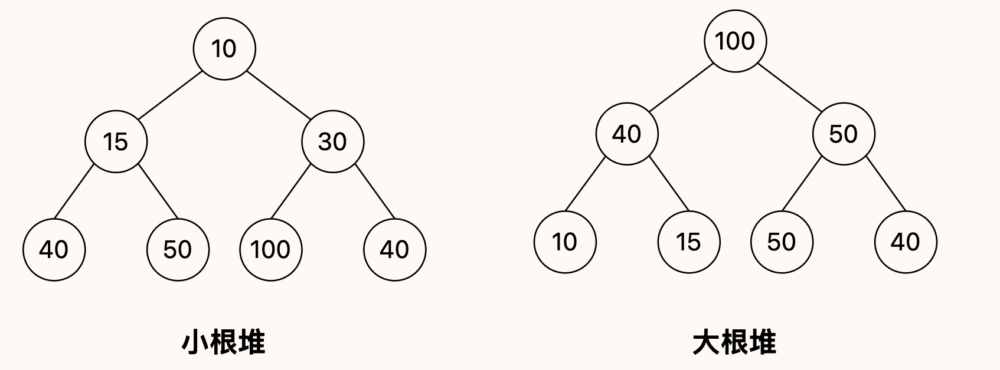

基于这些性质，堆常常被用于实现 **优先队列**。对于大根堆，我们总是可以在 **O(1)** 的时间内得到最大的元素（即根结点），而对于小根堆，我们总是可以在 **O(1)** 的时间内得到最小的元素。

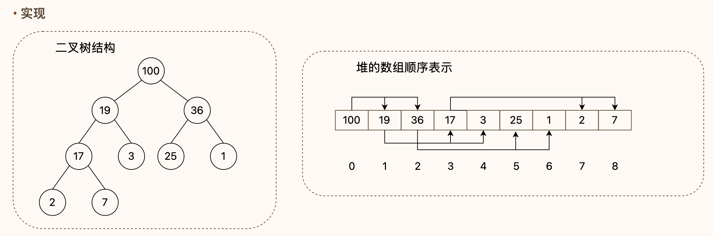

堆通常使用数组来实现，而不需要使用真正的树或链表结构。利用数组实现堆时，每个元素都有一个固定的位置，而该位置与元素在树中的位置有关。

假设数组的起始索引为 1，若某元素的索引为 `i`，则它的：

- 左孩子的索引为 `2i`
- 右孩子的索引为 `2i + 1`
- 父结点的索引为 `i/2` （整数除法）

如果数组的起始索引为 0，若某元素的索引为 `i`，则它的：

- 左孩子的索引为 `2i + 1`
- 右孩子的索引为 `2i + 2`
- 父结点的索引为 `(i-1)/2`（整数除法）

堆的操作：对于堆，重点掌握 **堆化（heapify）**、**构建初始堆**、**删除** 和 **插入** 操作。

##### 堆化

堆化是从某个结点开始，调整以该结点为根的子树，使其满足堆性质（以最大堆为例说明其过程）：

- 比较 **当前结点** 与 **左右子结点** 的值。
- 如果某个子结点 **比当前结点大**，交换当前结点与较大的子结点。
- 交换后，继续对 **被交换的子结点** 递归地执行堆化，直到子树满足堆性质。

以大根堆 `50,13,40,30,20,22,24,15,11` 为例，若我们从结点 `13` 执行堆化，会发生如下图所示的过程：

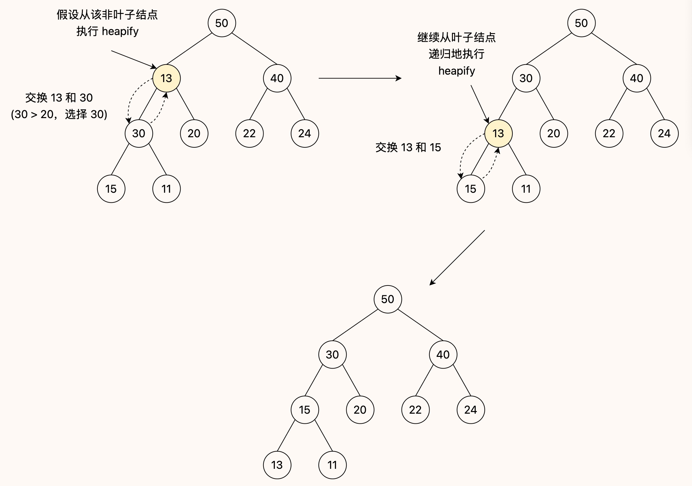

注意堆化的过程是递归的，当我们交换父结点和子结点后，需要从子结点进一步执行堆化操作。

##### 构建初始堆

构造初始堆有两种方式：

- 方法 1：向一个初始为空的堆中不断 **插入** 新的元素。
- 方法 2：将无序数组转化为最大堆，核心是从 **最后一个非叶子结点** 开始，从后向前逐一对每个子树执行 **堆化** 操作。

以数组 `1,3,5,4,6,13,10,9,8,15,17` 为例，假设我们使用方法 2 将其初始化为大根堆，会发生如下图所示的过程：

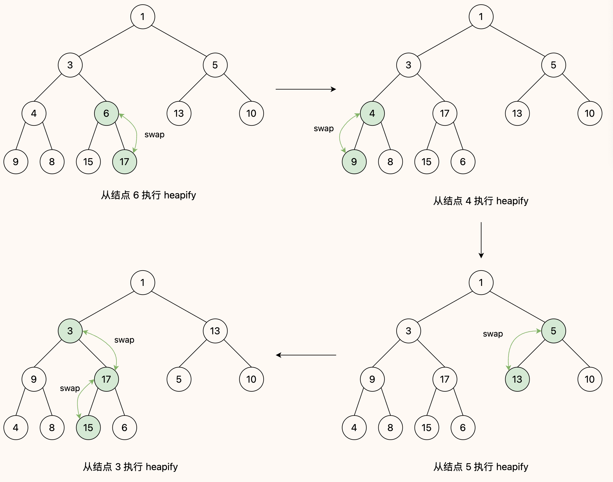

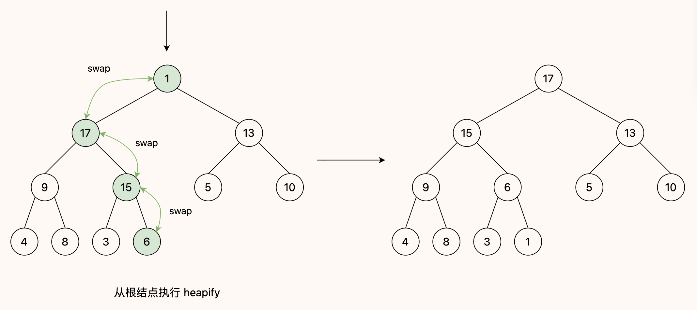

##### 删除

堆中的删除一般都发生在 **堆顶**，其过程如下：

- 将堆顶元素和堆中最后一个元素互换，然后删除最后一个结点
- 对新的堆顶执行 **堆化**，调整堆使其重新满足最大堆性质

##### 插入

在堆中插入新元素后，需维护堆性质。

- 将新元素添加到堆底（数组末尾）。
- 从新元素开始，向上与父结点比较，若 **大于父结点** 则交换（上浮）。
- 重复上浮直到满足堆性质或到达堆顶。

```c
// 1.堆化
// 调整 i 结点为根的子树，使其满足堆的性质
void heapify(int heap[], int size, int i) {
    int largest = i;       // 假设当前结点是最大的
    int left = 2 * i + 1;  // 左结点下标
    int right = 2 * i + 2; // 右结点下标
    if (left < size && heap[left] > heap[largest]) {
        largest = left;
    }
    if (right < size && heap[right] > heap[largest]) {
        largest = right;
    }
    // 如果最大值不是根结点
    if (largest != i) {
        swap(heap[i], heap[largest]);
        heapify(heap, size, largest);  // 递归堆化受影响的子树
    }
}

// 2.构造初始堆
// 建立最大堆
void buildHeap(int heap[], int size) {
    // 从最后一个非叶结点开始，向前堆化每个结点
    for (int i = (size / 2) - 1; i >= 0; i--) {
        heapify(heap, size, i);
    }
}

// 3.堆插入元素
// 向大小为 size 的堆中插入元素 value
void heapInsert(int heap[], int *size, int value) {
    heap[*size] = value;
    int current = *size;
    int parent = (current - 1) / 2;
    
    // 如果新插入的元素比父结点的元素大，需要将其向上移动
    while (current > 0 && heap[current] > heap[parent]) {
        swap(heap[current], heap[parent]); // 交换当前结点和父结点
        current = parent;
        parent = (current - 1) / 2; // 重新计算当前结点和其父结点的位置
    }
  
    (*size)++;  // 增加堆的大小
}

// 4.堆删除元素
// 删除堆根结点
void heapDelete(int heap[], int *size) {
    if (*size <= 0) {
        return;
    }
    heap[0] = heap[*size - 1]; // 将堆顶元素替换为最后一个元素
    (*size)--;   // 将堆大小减 1
    heapify(heap, *size, 0);   // 调整堆
}
```

#### 7.2 过程

堆排序（Heap Sort）其主要思想是将待排序的序列构造成一个 **大顶堆** 或 **小顶堆**，然后交换堆顶和最后一个元素的位置，使最大或最小的元素放到序列的末尾。这样，就得到一个部分有序的序列。接下来，再对剩下的部分重新调整为大顶堆或小顶堆，并重复上述过程，直到整个序列有序。

堆排序的主要步骤：

1. **构造初始堆**：将给定无序序列构造成一个大顶堆（对于升序排序）或小顶堆（对于降序排序）。
2. **交换数据**：将堆顶元素与末尾元素交换，这样最大元素就位于序列的末尾。然后，将未排序的序列的长度减 1，因为最后一个元素已经排序好了。
3. **重建堆**：对于剩下的未排序的序列，重新调整为大顶堆。
4. **重复步骤 2 和 3**，直到整个序列有序。

调整堆过程：

1. 选择一个结点 `i`，它的左子结点为 `2i`，右子结点为 `2i+1`。
2. 如果结点 `i` 的值小于其子结点的值，则找到 **最大的子结点**。
3. 将结点 `i` 与 **最大的子结点** 交换。
4. 交换后可能会破坏下一层的堆结构，所以需要对换到的子结点重复步骤 1‑3 的调整，直到整个子树满足堆的性质。

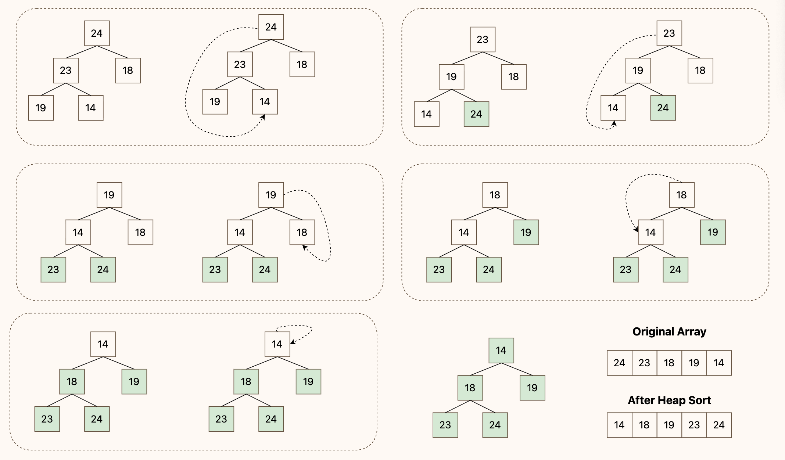

堆排序的代码实现如下所示：

```c
void heapSort(int heap[], int size) {
    // 构建最大堆 buildHeap
    for (int i = (size / 2) - 1; i >= 0; i--) {
        heapify(heap, size, i);
    }
    
    // 一个个从堆中取出元素
    for (int i = size - 1; i >= 0; i--) {
        swap(heap[0], heap[i]); // 将当前最大元素（堆顶）移到数组末尾
        heapify(heap, i, 0);    // 调整堆以维护最大堆性质
    }
}
```

### 八、希尔排序

希尔排序（Shell Sort）是一种 **基于插入排序** 的改进算法，通过分组和逐步减小步长来提高效率。

希尔排序的过程如下所示：

1. 确定初始步长（增量）：
   - 选择一个初始步长（gap），通常可以 **取数组长度的一半**（例如 `gap = n/2`）。
2. 分组插入排序：
   - 将数组按步长 `gap` 分成若干组，每组内的元素相距 `gap` 个位置。
   - 对每组进行插入排序。例如，若 `gap=4`，比较和排序索引为 `0,4,8...` 的元素，`1,5,9...` 的元素，依此类推。
3. 减小步长：
   - 将步长缩小（通常除以 2 或按增量序列递减），例如 `gap = gap/2`。
   - 重复步骤 2，对新的分组进行插入排序。
4. 重复直到步长为 1：
   - 当步长减小到 1 时，相当于对整个数组进行一次标准插入排序。此时数组已接近有序，插入排序的效率较高。
5. 排序完成：
   - 步长为 1 的插入排序完成后，数组完全有序。


以数组 `32, 95, 16, 82, 24, 66, 35, 19, 75, 54, 40, 43, 93, 68` 为例进行 **希尔排序**，数组长度为 14，初始步长为 7，然后选择步长 3、1，依次按照步长对所有子数组排序。

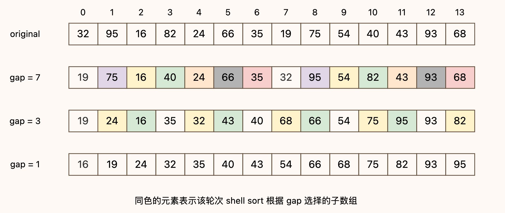

### 九、桶排序

桶排序（bucket sort）核心思想是将数据映射到不同的 **桶** 中，然后对每个桶内部排序，最后合并所有桶中的数据。

桶排序的步骤如下：

1. 选择合适 **桶数**，并将数据放入桶中
2. **桶内数据排序**
3. **合并** 所有桶

举个例子，对 `12, 9, 24, 4, 19, 21, 14, 6, 2, 16` 进行桶排序的过程如下：

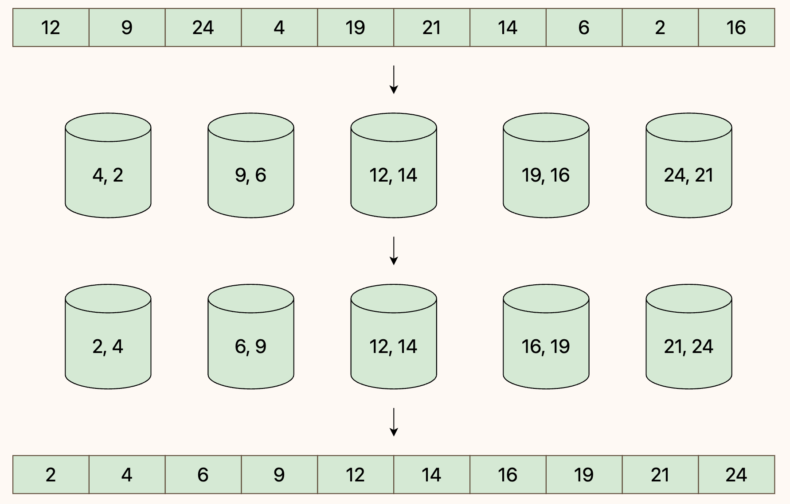

### 十、基数排序

基数排序（Radix Sort）的核心思想是将整数分解为单独的数字，然后进行多轮排序，最终使数据有序。

基数排序分为 **低位优先**（LSD，Least Significant Digit first）和 **高位优先**（MSD，Most Significant Digit first）两种方案。这里重点掌握 **LSD** 的方案，**MSD** 的方式了解即可。

#### 10.1 低位优先

1. 先按照最低位进行 **桶排序**（或计数排序）。
2. 然后按照次低位进行 **桶排序**，但保持上一轮的相对顺序（**稳定排序**）。
3. 依次进行，直到最高位排序完成。

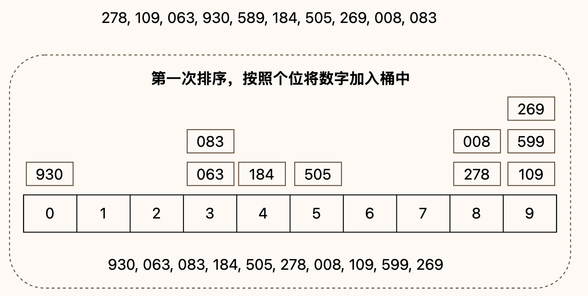

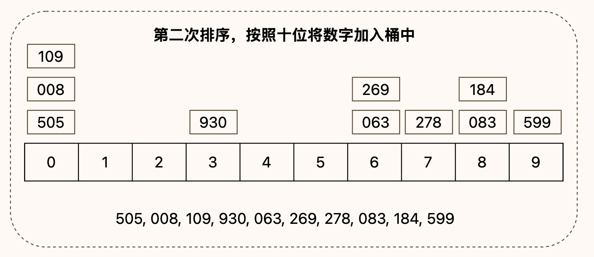

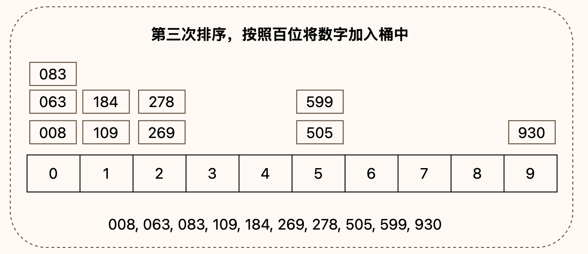

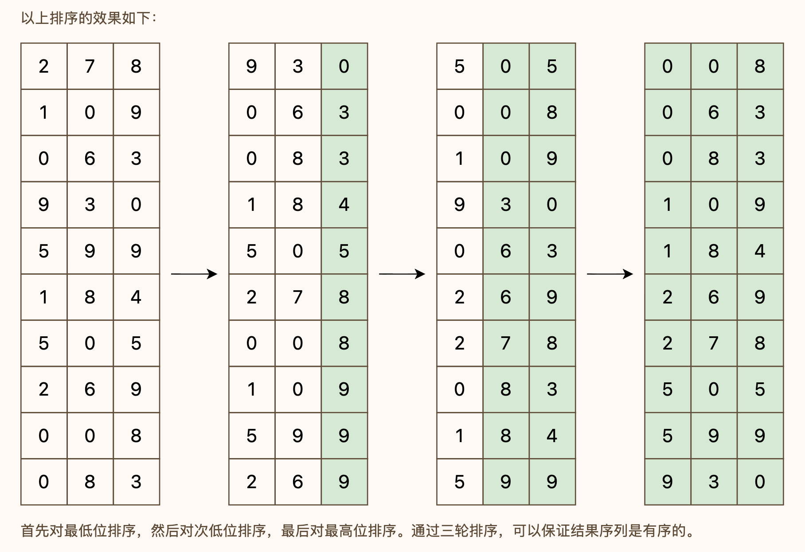

#### 10.2 高位优先

MSD（高位优先）基数排序的核心思想是从最高位开始，对数据进行递归分类，直到所有数字或字符串都排好序。

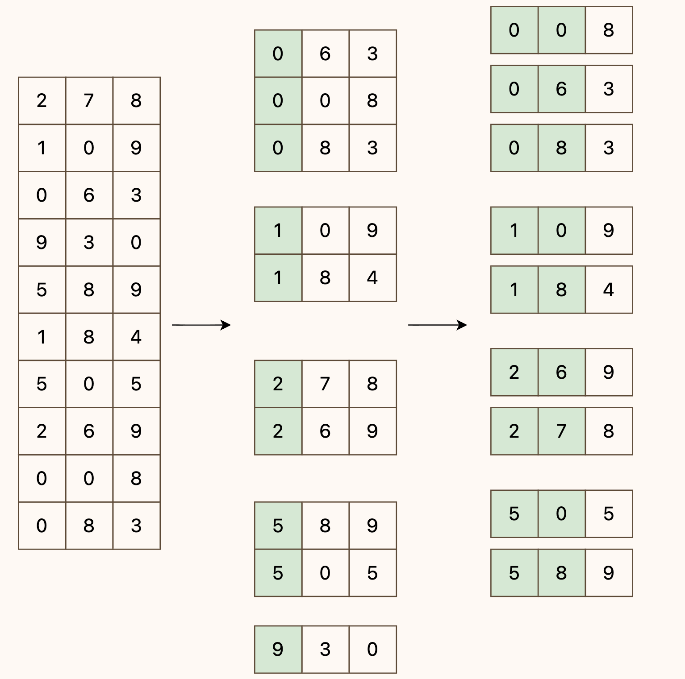

如上图所示，MSD 首先根据最高位对数据进行分组，然后再根据次高位对数据进行分组，以此类推，递归直到每组中只有一个元素。

MSD 基数排序适用于 **字符串或变长数据**，因为它先处理最高位，可以提前分组。适合 **字典序排序**，如 IP 地址、文件名、长整型数值等。

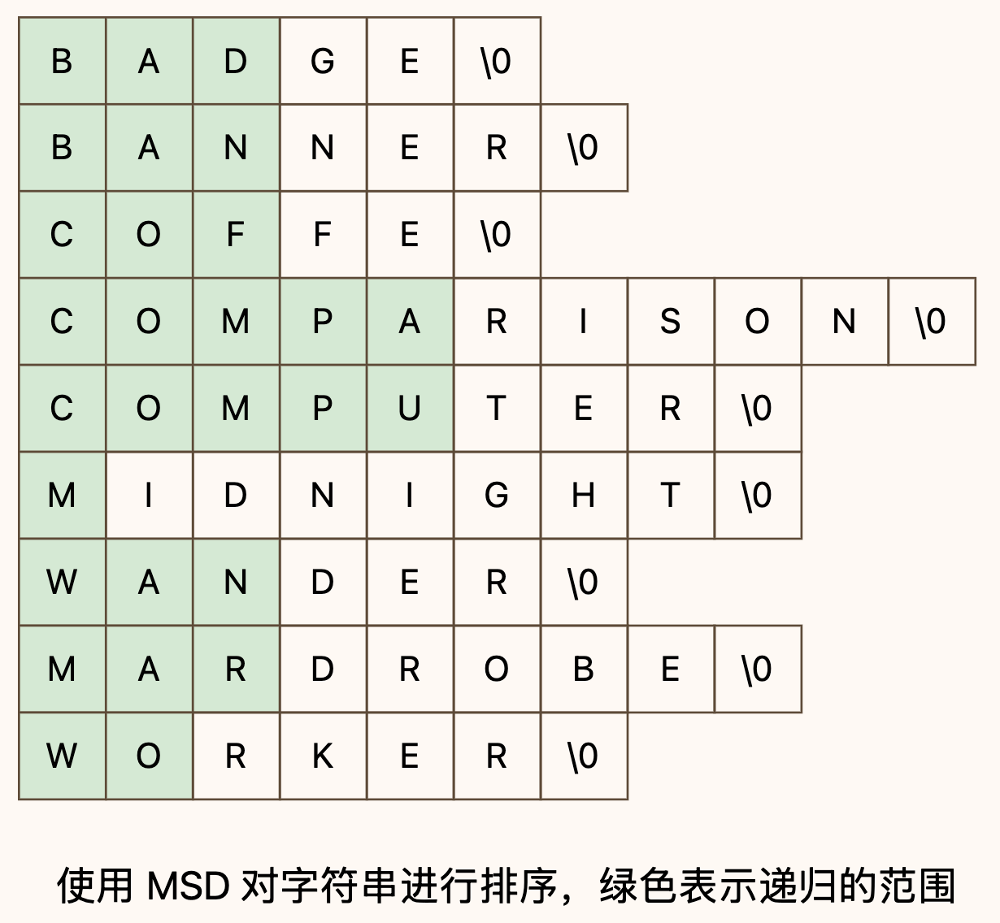

#### 10.3 对比

|   方式   |         低位优先（LSD）          |       高位优先（MSD）       |
| :------: | :------------------------------: | :-------------------------: |
| 排序顺序 |           从低位到高位           |        从高位到低位         |
| 是否递归 |                否                |             是              |
| 适用数据 | 等长数据（整数、固定长度字符串） | 变长数据（字符串、IP 地址） |
| 适用场景 |           大量数值排序           |   变长字符串、字典序排序    |
| 实现难度 |              较简单              |      需要递归，较复杂       |

---

## 外部排序

### 一、外部排序概念

当待排序的数据量大到无法一次性全部装入内存时，就必须采用 **外部排序**。外部排序的基本思路是：先将整个数据集划分成若干能够装入内存的子块，对每个子块在内存中完成内部排序；随后再把这些已排序的子块逐步合并，最终得到整体有序的结果。这样既克服了内存容量的限制，又能高效地对海量数据完成排序。

外部排序的整体过程通常可以划分为两个关键阶段：

1. **生成初始归并段**
   先采用 [**置换选择排序**](https://www.csgraduates.com/data_structure/sort/external/#置换选择排序) 对原始的无序文件进行扫描。置换选择能够在一次扫描中尽可能长地生成有序子文件，这些子文件即称为 **初始归并段**。每个归并段都是内部有序的，且长度尽量大，以减少后续合并的轮数。
2. **多路归并**
   将所有 **初始归并段** 以多路归并的方式逐步合并。每一次归并都会把若干归并段合并成一个更长的有序段，重复此过程直至只剩下一个完整的有序文件，从而得到最终的排序结果。

通过上述两步，外部排序能够在 **磁盘与内存之间** 高效地完成大规模数据的排序。

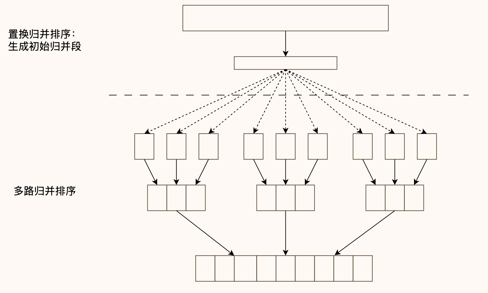

### 二、置换选择排序

**置换选择排序**（Replacement Selection Sort）是 **外部排序** 的一个步骤，用于生成 **初始归并段**，其核心功能是在 **内存缓冲区** 有限的情况下，尽可能地生成较长的 **初始归并段**。

**置换选择排序** 通过维护一个 **工作区** 来实现这一目标，工作区是一个 **小根堆**。

其算法步骤如下：

1. 初始化：
   - 将待排序文件中的前 **M** 个记录读入 **工作区**，建立一个 **最小堆**（**M** 为 **工作区** 的大小）。
2. 生成归并段：
   - 判断是否有 初始归并段
     - 如果不存在任何 **初始归并段** 的话，创建一个 **初始归并段**，并添加 **工作区** 中的最小元素加入其中。
     - 否则将工作区中的元素与上一个初始归并段的最大值MAXV进行比较。
       - 如果 **工作区** 中的所有元素都 ≤ **MAXV** 的话，创建一个新的 **初始归并段**，并添加 **工作区** 中的最小元素加入其中。
       - 否则找到第一个 > **MAXV** 的元素，将其添加到上一个 **初始归并段** 的末尾。
   - 从输入文件中读取下一个值加入 **工作区**。

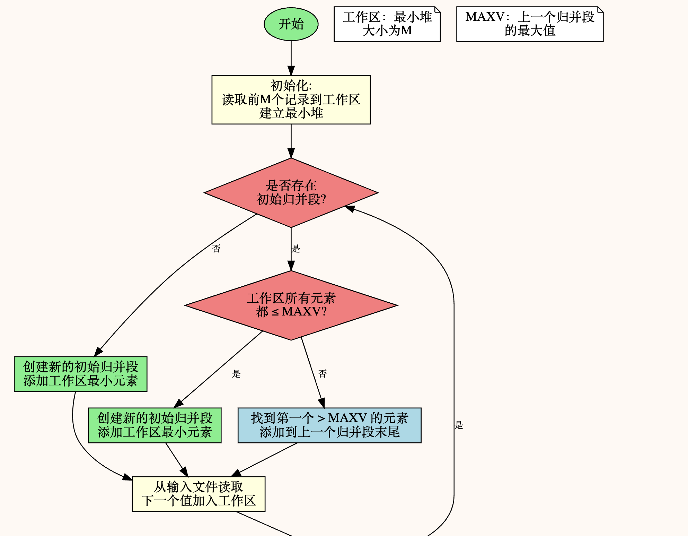


置换选择排序 **核心思想** 的如下：

- **判断工作区**：如果工作区中所有记录的键值都小于当前输出文件（即已生成的有序段）中最后一个记录的键值，则需要**新建一个输出文件**，并将这些记录写入该文件，开启新的有序段。
- **继续合并**：如果工作区中存在键值不小于当前输出文件末尾记录的记录，则 **不断将这些记录追加到已有的输出文件**中。这样可以确保输出文件始终保持递增有序，从而形成一个完整的有序序列。

通过上述两步的交替执行，置换选择排序能够在外部存储环境下有效地生成有序文件，适用于大型数据集的排序任务。

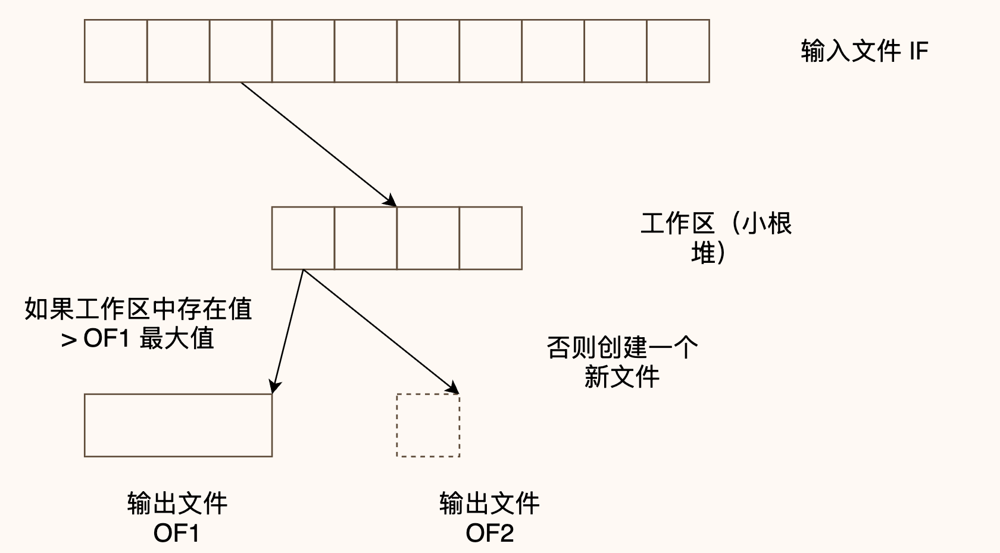

举一个实际的例子，假设一个输入文件 **FI** 的内容为 51, 94, 37, 92, 14, 63, 15, 99, 48, 56, 23, 60, 31, 17, 43, 8, 90, 166, 100。

我们可以通过 **置换选择排序** 生成 3 个 **初始归并段**，分别为 {37, 51, 63, 92, 94, 99} ，{14, 15, 23, 31, 48, 56, 60, 90, 166} ，{8, 17, 43, 100} 。

算法执行的过程如下表所示：

|             输出文件 FO              |   工作区 WA    |                         输入文件 FI                          |
| :----------------------------------: | :------------: | :----------------------------------------------------------: |
|                  ——                  |       ——       | 51, 94, 37, 92, 14, 63, 15, 99, 48, 56, 23, 60, 31, 17, 43, 8, 90, 166, 100 |
|                  ——                  | 51, 94, 37, 92 | 14, 63, 15, 99, 48, 56, 23, 60, 31, 17, 43, 8, 90, 166, 100  |
|                  37                  | 51, 94, 14, 92 |   63, 15, 99, 48, 56, 23, 60, 31, 17, 43, 8, 90, 166, 100    |
|                37, 51                | 63, 94, 14, 92 |     15, 99, 48, 56, 23, 60, 31, 17, 43, 8, 90, 166, 100      |
|              37, 51, 63              | 15, 94, 14, 92 |       99, 48, 56, 23, 60, 31, 17, 43, 8, 90, 166, 100        |
|            37, 51, 63, 92            | 15, 94, 14, 99 |         48, 56, 23, 60, 31, 17, 43, 8, 90, 166, 100          |
|          37, 51, 63, 92, 94          | 15, 48, 14, 99 |           56, 23, 60, 31, 17, 43, 8, 90, 166, 100            |
|        37, 51, 63, 92, 94, 99        | 15, 48, 14, 56 |             23, 60, 31, 17, 43, 8, 90, 166, 100              |
|       37, 51, 63, 92, 94, 99#        | 15, 48, 14, 56 |             23, 60, 31, 17, 43, 8, 90, 166, 100              |
|                  14                  | 15, 48, 23, 56 |               60, 31, 17, 43, 8, 90, 166, 100                |
|                14, 15                | 60, 48, 23, 56 |                 31, 17, 43, 8, 90, 166, 100                  |
|              14, 15, 23              | 60, 48, 31, 56 |                   17, 43, 8, 90, 166, 100                    |
|            14, 15, 23, 31            | 60, 48, 17, 56 |                     43, 8, 90, 166, 100                      |
|          14, 15, 23, 31, 48          | 60, 43, 17, 56 |                       8, 90, 166, 100                        |
|        14, 15, 23, 31, 48, 56        | 60, 43, 17, 8  |                         90, 166, 100                         |
|      14, 15, 23, 31, 48, 56, 60      | 90, 43, 17, 8  |                           166, 100                           |
|    14, 15, 23, 31, 48, 56, 60, 90    | 166, 43, 17, 8 |                             100                              |
| 14, 15, 23, 31, 48, 56, 60, 90, 166  | 100, 43, 17, 8 |                              ——                              |
| 14, 15, 23, 31, 48, 56, 60, 90, 166# | 100, 43, 17, 8 |                              ——                              |
|                  8                   |  100, 43, 17   |                              ——                              |
|                8, 17                 |    100, 43     |                              ——                              |
|              8, 17, 43               |      100       |                              ——                              |
|            8, 17, 43, 100            |       ——       |                              ——                              |
|           8, 17, 43, 100#            |       ——       |                              ——                              |

### 三、多路归并

**多路归并** 的目标是将多个已经排序的 **初始归并段**（子文件）合并成一个更大的有序文件。

其核心思想是从若干 **归并段** 中每次选取一个最小的元素加入 **工作区**（**小根堆**），然后从 **工作区** 中选取最小的元素添加到 **输出文件** 中，通过这种方式可以保证每次添加到 **输出文件** 中的值是当前的最小值。

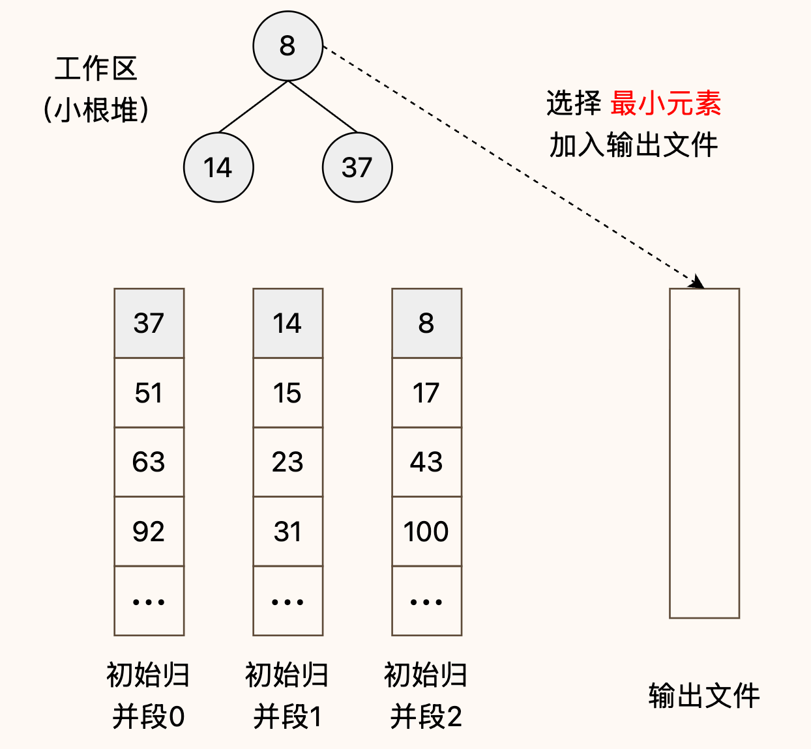

**多路归并** 的具体过程如下：

1. 初始化：
   - 打开所有参与归并的 **初始归并段**，并读取每个归并段的第一个元素。
   - 将这些元素放入一个数据结构中，以便快速找到最小值（例如，**最小堆**）。
2. 归并：
   - 从数据结构中取出最小的元素，将其输出到结果文件中。
   - 找到该元素所属的归并段，并从该归并段中读取下一个元素。
   - 将新读取的元素放入数据结构中，并调整数据结构，以保持有序。
   - 重复上述步骤，直到所有归并段都被处理完毕。
3. 结束：
   - 当所有归并段都为空时，归并过程结束，结果文件即为完全有序的文件。

多路归并的过程可以通过以下流程图理解：

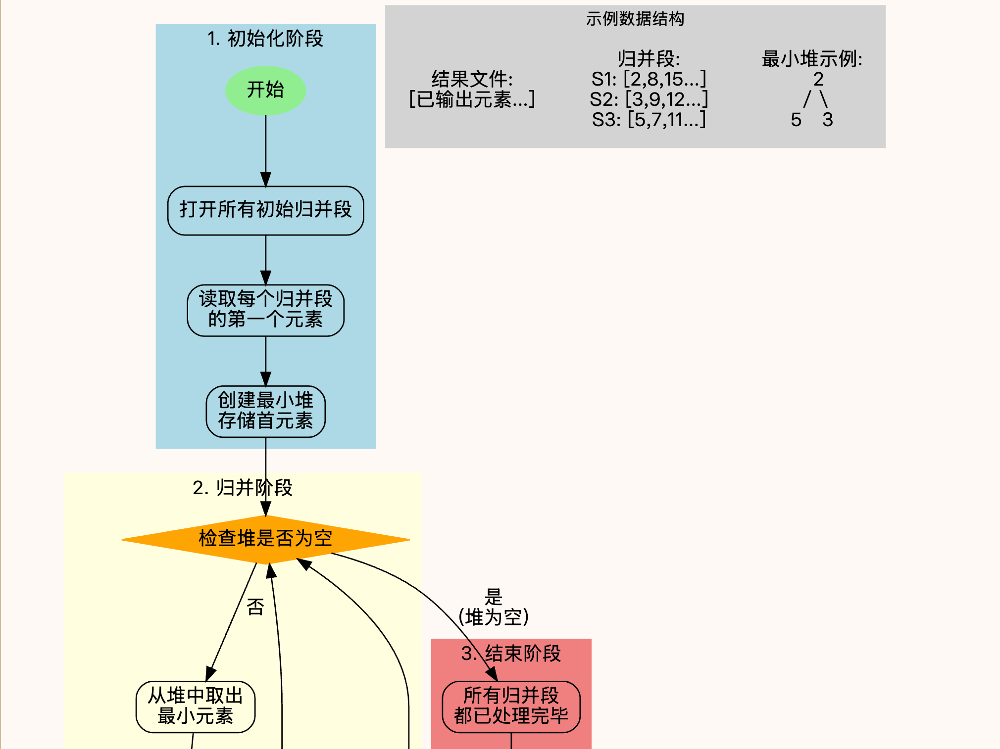

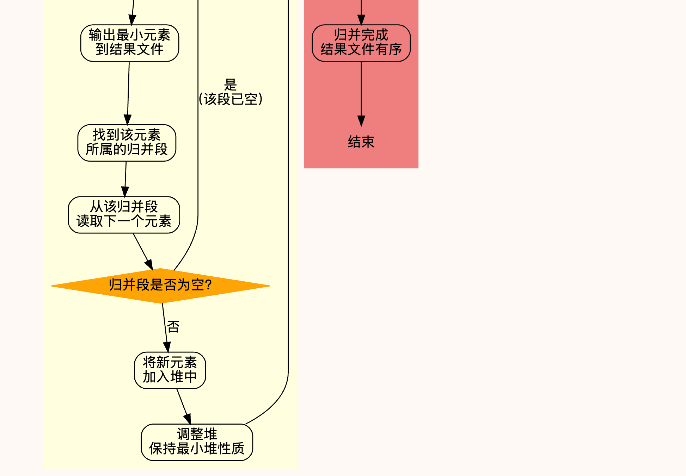

继续用上文中通过 **置换选择算法** 生成的三个 **初始归并段** {37, 51, 63, 92, 94, 99} ，{14, 15, 23, 31, 48, 56, 60, 90, 166} ，{8, 17, 43, 100} 作为例子。对于这三个 **初始归并段**，**多路归并** 的过程如下（假设采用三路归并的话）：

| 归并段 1               | 归并段 2                            | 归并段 3       | 工作区       | 输出文件                                                     |
| ---------------------- | ----------------------------------- | -------------- | ------------ | ------------------------------------------------------------ |
| 37, 51, 63, 92, 94, 99 | 14, 15, 23, 31, 48, 56, 60, 90, 166 | 8, 17, 43, 100 | –            | –                                                            |
| 51, 63, 92, 94, 99     | 15, 23, 31, 48, 56, 60, 90, 166     | 17, 43, 100    | 8, 14, 37    | –                                                            |
| 51, 63, 92, 94, 99     | 15, 23, 31, 48, 56, 60, 90, 166     | 43, 100        | 14, 17, 37   | 8                                                            |
| 51, 63, 92, 94, 99     | 23, 31, 48, 56, 60, 90, 166         | 43, 100        | 15, 17, 37   | 8, 14                                                        |
| 51, 63, 92, 94, 99     | 31, 48, 56, 60, 90, 166             | 43, 100        | 17, 23, 37   | 8, 14, 15                                                    |
| 51, 63, 92, 94, 99     | 31, 48, 56, 60, 90, 166             | 100            | 23, 37, 43   | 8, 14, 15, 17                                                |
| 51, 63, 92, 94, 99     | 48, 56, 60, 90, 166                 | 100            | 31, 37, 43   | 8, 14, 15, 17, 23                                            |
| 51, 63, 92, 94, 99     | 56, 60, 90, 166                     | 100            | 37, 43, 48   | 8, 14, 15, 17, 23, 31                                        |
| 63, 92, 94, 99         | 56, 60, 90, 166                     | 100            | 43, 48, 51   | 8, 14, 15, 17, 23, 31, 37                                    |
| 63, 92, 94, 99         | 56, 60, 90, 166                     | –              | 48, 51, 100  | 8, 14, 15, 17, 23, 31, 37, 43                                |
| 63, 92, 94, 99         | 60, 90, 166                         | –              | 51, 56, 100  | 8, 14, 15, 17, 23, 31, 37, 43, 48                            |
| 92, 94, 99             | 60, 90, 166                         | –              | 56, 63, 100  | 8, 14, 15, 17, 23, 31, 37, 43, 48, 51                        |
| 92, 94, 99             | 90, 166                             | –              | 60, 63, 100  | 8, 14, 15, 17, 23, 31, 37, 43, 48, 51, 56                    |
| 92, 94, 99             | 166                                 | –              | 63, 90, 100  | 8, 14, 15, 17, 23, 31, 37, 43, 48, 51, 56, 60                |
| 94, 99                 | 166                                 | –              | 90, 92, 100  | 8, 14, 15, 17, 23, 31, 37, 43, 48, 51, 56, 60, 63            |
| 94, 99                 | –                                   | –              | 92, 100, 166 | 8, 14, 15, 17, 23, 31, 37, 43, 48, 51, 56, 60, 63, 90        |
| 99                     | –                                   | –              | 94, 100, 166 | 8, 14, 15, 17, 23, 31, 37, 43, 48, 51, 56, 60, 63, 90, 92    |
| –                      | –                                   | –              | 99, 100, 166 | 8, 14, 15, 17, 23, 31, 37, 43, 48, 51, 56, 60, 63, 90, 92, 94 |
| –                      | –                                   | –              | –            | 8, 14, 15, 17, 23, 31, 37, 43, 48, 51, 56, 60, 63, 90, 92, 94, 99, 100, 166 |

### 四、胜者树

在进行 *k* 路归并（如外排序）时，我们需要从多个有序子序列中 **快速找出当前最小元素**，然后将其输出并替换为该序列的下一个元素。

最简单的做法就是每次遍历序列头部元素，找到最小值。该方法的时间复杂度为 *O*(*k*) ，效率比较低，尤其是当 *k* **比较大** 时。

树形结构优化（**胜者树**/**败者树**）优化的目的就是优化这个过程：

- 用一棵完全二叉树维护每一轮比较的结果，使得我们可以在 *O*(log*k*) 时间内完成最小值查找与更新。

**胜者树** 可以理解为 **胜者晋级的淘汰赛模型**：类比体育比赛的淘汰制，每一轮两个选手进行比较，胜者晋级上一轮，最终全局胜者抵达根节点。

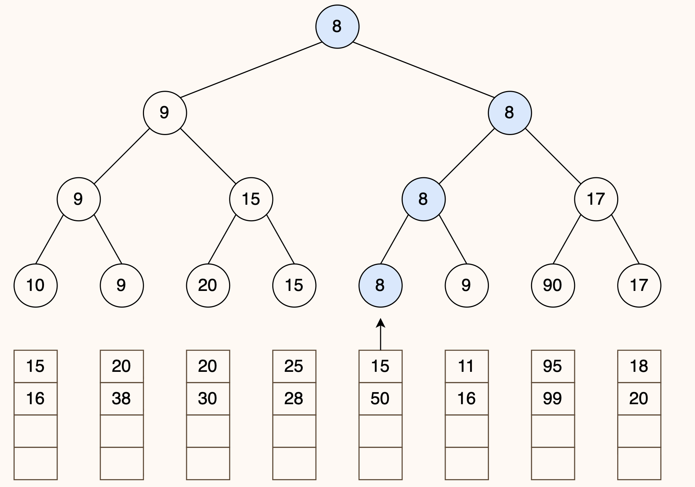

在 **胜者树** 中，每个 **内部结点** 记录的是该轮比较的 **胜者**（较小的元素），而 **叶子节点** 表示每个输入归并段的当前值。因此，整棵树的 **根节点** 就表示 **全局最小值**。

当某个归并段输出了最小值并更新为下一个元素时，需要 **从该叶子节点向上，逐层与兄弟节点重新比较，构建新的胜者路径**，最终将新的最小值更新到根节点。

### 五、败者树

**败者树** 可以理解为 **败者记录的升降赛模型**：类比体育比赛中每场比赛将败者淘汰出局但保留记录，胜者则继续晋级下一轮，最终全局胜者脱颖而出，但 **不会被记录在树中，而是单独保留**，以便快速访问。

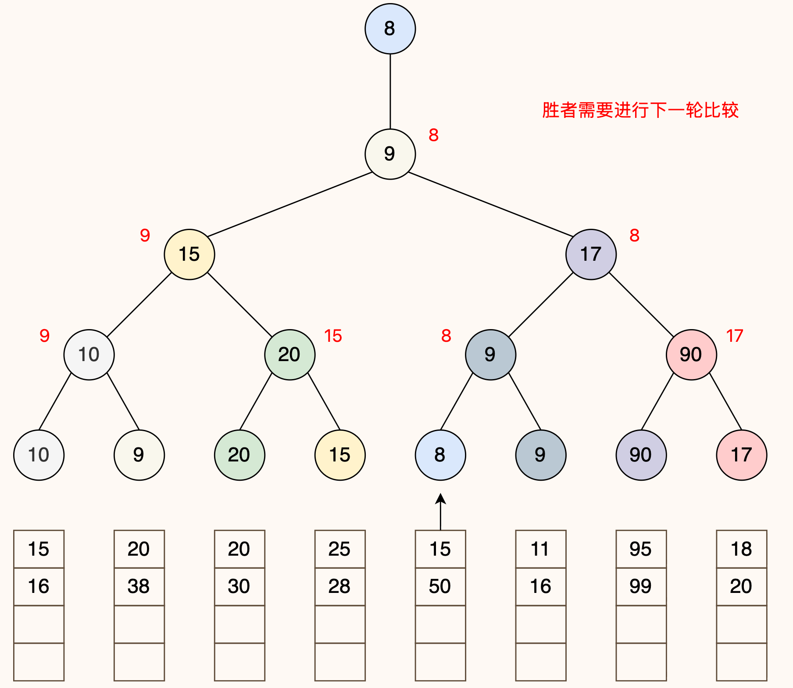

在 **败者树** 中，每个 **内部结点** 记录的是该轮比较的 **败者**（较大的元素），而 **叶子节点** 同样表示每个输入归并段的当前值。最终的全局胜者（最小值） **不保存在树中，而是单独保存在一个外部变量中**。

当某个归并段输出了最小值并更新为下一个元素时，需要 **从该叶子节点出发，沿着路径向上与路径上的败者重新比较，并在每一层更新败者信息**。

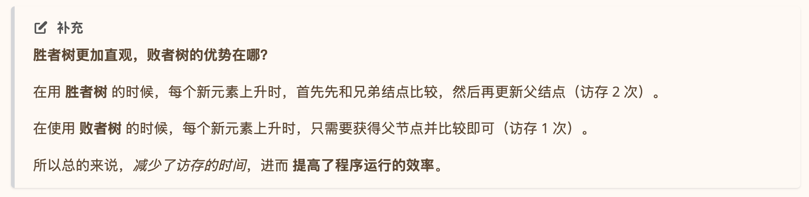


