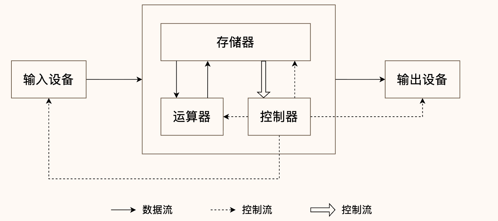
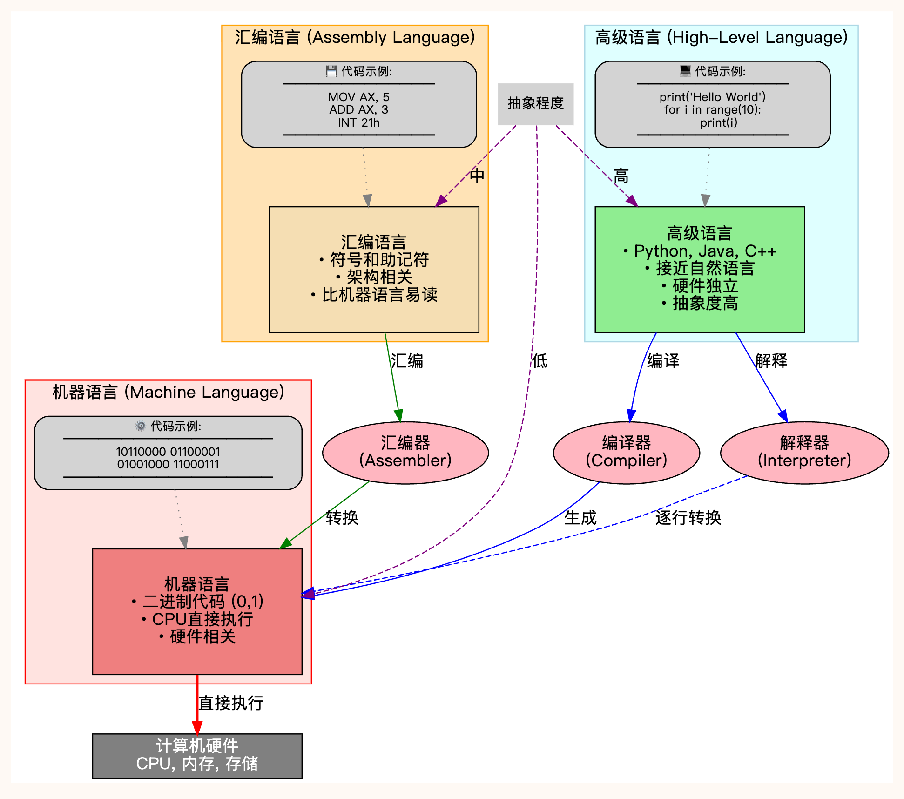
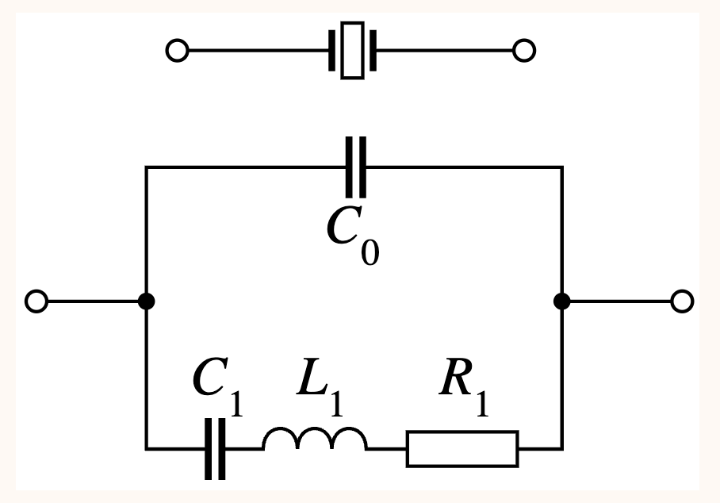
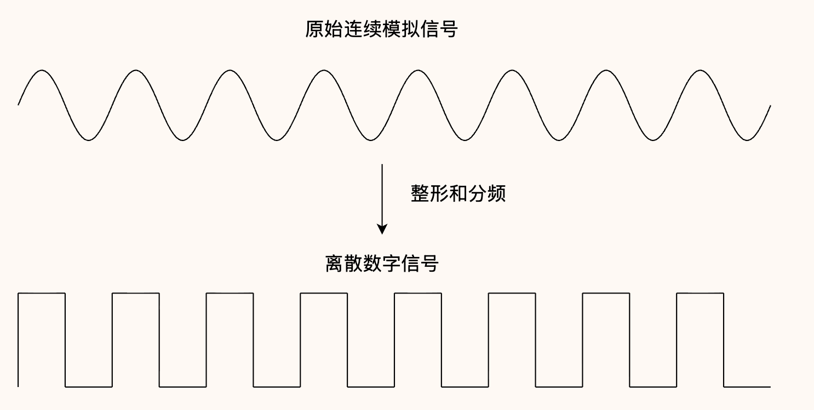
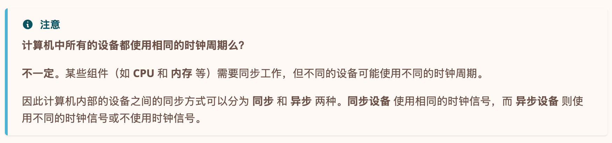
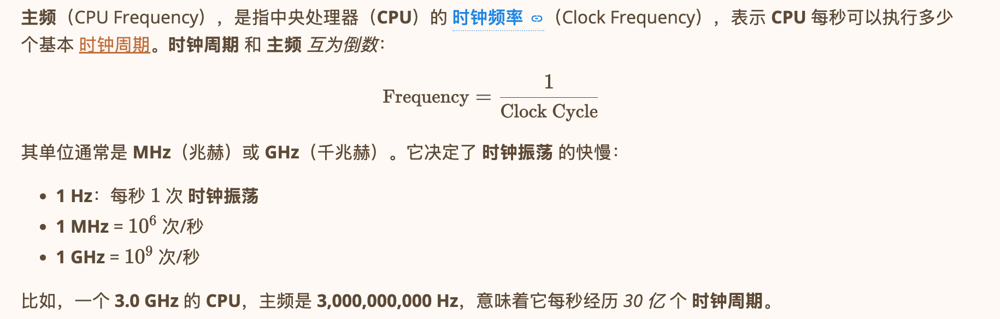
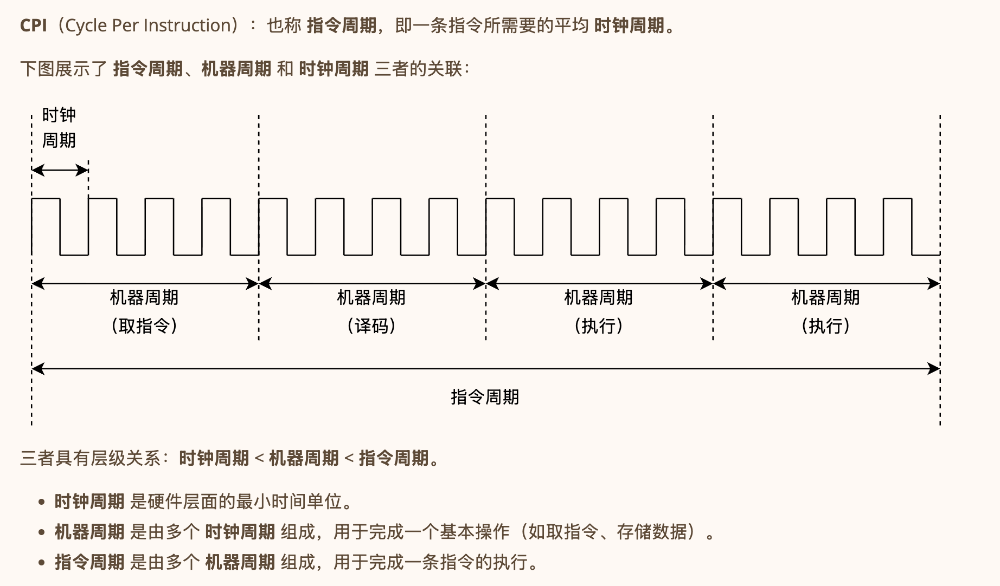
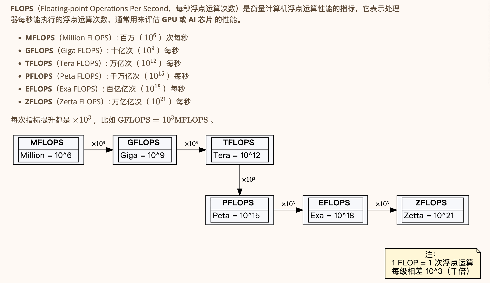

# 概述

## 计算机系统层次结构

### 一、计算机系统的基本组成

**硬件** 系统和 **软件** 系统共同构成了一个完整的计算机系统。硬件指的是有形的物理设备，是计算机系统中实际物理装置的总称。软件指的是在硬件上运行的程序和相关的数据及文档。

**硬件** 和 **软件** 关系：硬件是计算机的物理部分，它提供了运行软件所需的基础设施，而软件则是 **指令集**，**指导** 硬件如何工作以执行特定的任务。

### 二、计算机硬件

#### 2.1 冯诺伊曼结构

冯·诺依曼提出的 **“存储程序”** 的思想奠定了当代计算机的基本结构，以此概念为基础的各类计算机通称为 **冯·诺依曼机**，其特点如下：

1. 计算机 **硬件** 系统由 **运算器**、**存储器**、**控制器**、**输入设备** 和 **输出设备** ***5 大部件*** 组成。
2. **指令和数据** 以同等地位存储在 **存储器** 中，形式上没有区别，但计算机应能区分它们。
3. 指令和数据均用 **二进制代码** 表示，指令包含操作码和地址码，操作码指出操作的类型，地址码指出操作数的地址。
4. 以 **运算器** 为中心，其他部件配合其工作。



其中 五大部件 的具体功能如下：

1. **运算器**（ALU）：负责算术运算（加减乘除）和逻辑运算（与或非）。
2. **控制器**（CU）：从 **存储器** 中读取指令，解码并控制其他部件协同工作。
3. **存储器**（Memory）：存储程序指令和运算数据（如内存、硬盘）。
4. **输入设备**（Input）：接收外部数据（如键盘、鼠标）。
5. **输出设备**（Output）：将结果反馈给用户（如显示器、打印机）。

### 三、计算机软件

#### 3.1 系统软件和应用软件

1. 系统软件 (System Software)
   - 定义：**系统软件** 是直接运行在 **硬件** 上的 **软件**，为其他 **软件** 提供一个运行和执行的平台。
   - 功能：
     - 管理和控制计算机 **硬件**，使其能够与 **应用软件** 进行交互。
     - 提供 **应用软件** 开发的基础服务和接口。
2. 应用软件（Application Software）
   - 定义：**应用软件** 是构建在 **系统软件** 之上，为用户提供特定功能或执行特定任务的 **软件**。
   - 功能：
     - 解决用户的具体问题或满足特定需求。
     - 提供与用户的直接交互界面。

#### 3.2 三个级别的语言

1. 机器语言 (Machine Language):
   - 定义：这是 **计算机硬件** 直接理解和执行的语言，它是用 **二进制代码** 表示的（通常是 0 和 1）。
   - 特点：
     - 与特定计算机架构紧密相关。
     - 非常低级：每条机器代码对应 **硬件** 的一个操作。
     - 对于人类来说，阅读和编写是困难的。
2. 汇编语言 (Assembly Language):
   - 定义：这是一种低级编程语言，它使用符号和助记符（而非 **二进制代码**）来代表机器语言的指令。
   - 特点：
     - 与特定计算机架构紧密相关。
     - 比机器语言更容易理解和编写。
     - 需要一个汇编器来将汇编代码转换为机器代码。
3. 高级语言 (High-Level Language):
   - 定义：这是为了更方便地编写和理解计算机程序而设计的语言。它们与特定的 **硬件平台** 相对独立。
   - 特点：
     - 抽象度高，语法通常更接近自然语言或数学符号。
     - 可以在不同的 **硬件平台** 上运行，只需适当地 **编译** 或 **解释**。
     - 需要一个 **编译器** 或 **解释器** 来将高级语言代码转换为机器代码（或执行）。

三种语言的关系可以参照下图理解：



### 四、计算机系统的工作原理

#### 4.1 从源程序到可执行程序

1. **预处理**（Preprocessing）：**预处理** 器会执行诸如宏替换、文件包含、条件编译等任务，仅限于某些语言，比如 `C` 和 `C++`。
2. **编译**（Compilation）：**编译** 器将源代码或 **预处理** 后的源代码转换为中间代码或目标代码，目标代码通常是特定平台的汇编语言代码或机器代码。
3. **汇编**（Assembly）：**汇编** 器将汇编语言代码转换为机器代码。
4. **链接**（Linking）：**链接** 器将一个或多个目标文件与所需的库文件链接在一起，生成一个可执行文件。这个步骤确保所有函数或方法的调用都能找到它们在内存中的正确位置。
5. **加载和执行**（Execution）：当你运行可执行文件时，操作系统的 **加载器** 会将它加载到内存中。CPU 开始按照程序的指令执行任务。

```bash
# 预处理
gcc -E hello.c -o hello.i
# 编译
gcc -c hello.c -o hello.o
# 汇编
gcc -S hello.c
# 链接
gcc hello.o -o hello
# 加载和执行
./hello
```

---

## 计算机性能指标

### 一、CPU指标

#### 1.1 时钟周期

**时钟周期**（Clock Cycle）是计算机中 **CPU** 执行指令的基本时间单位，由系统时钟产生的一个“高低电平”变化（通常称为 **脉冲**）所定义。

计算机内部有一个 **晶体振荡器**，通常采用石英晶体，利用其压电效应产生规律的 脉冲信号。石英晶体在施加电压时会发生机械振动，而机械振动反过来又会产生电压。通过在电路中合理配置电容和电感元件，晶体振荡器能够在特定频率上持续振荡，形成稳定的机器脉冲源。



**原始的脉冲信号** 是一个连续的 **模拟信号**，在计算机系统中，这个模拟信号通常不会直接使用。为了适配数字电路的需要，**晶体振荡器** 产生的 **模拟信号** 会经过整形和分频电路处理，转换为方波形式的 **数字脉冲信号**，用于同步计算机中各个硬件组件的操作。**时钟脉冲信号** 的宽度，即连续两个 **脉冲** 之间的时间间隔，称为 **时钟周期**。





#### 1.2 主频



#### 1.3 指令执行指标




#### 1.4 浮点运算指标



### 二、计算机指标

#### 2.1 字长

**字长**（Word Length）指的是计算机在内部一次操作中所能处理的 **二进制数字位数**。例如，一个 **32 位** 的 **CPU** 一次可以处理 **32 位** 的数据。

**数据通路带宽**（Data Bus Width） 是 **CPU** 和 **内存** 之间传输数据的宽度，通常以 **位** 为单位表示。比如，**64 位** 的数据总线意味着每个 **时钟周期** 内，可以传输 **64 位** 的数据。

#### 2.2 主存容量

**主存储器** 能够存储信息的最大容量，通常用 **字节** 来衡量。

**MAR** 的 **位数** 反映了 **可寻址范围** 的最大值（不一定是存储器的实际容量），与 **地址总线** 的 **位数** 一致。

这里主要看清题目中的 **按字节寻址** 和 **按字寻址**，内存空间 / 寻址单位 = 可寻址范围，通过 可寻址范围 计算 **MAR** 的 **位数**。

比如主存地址空间大小为 128KB= 2^17 B，字长16 位（2B），按字寻址，则 MAR 位数为16。

### 2.3 吞吐量

**吞吐量**（Throughput）表示在 **单位时间** 内，系统可以完成的 **任务数量**。在计算机网络中，它可能表示 **数据的传输速率**；在 **计算** 中，它可能表示 **每秒执行的操作数**。


