# 数据表示和计算

## 整数的表示

### 一、BCD码

**BCD**（Binary-Coded Decimal）码是一种 **二进制编码方法**，用于表示 **十进制数字**。每个十进制数字（0-9）都使用 **四位二进制数字** 表示。

BCD 码的基本思路是 **单独表示每个十进制数字的二进制值**，而不是像传统的二进制数系统那样对整个数字进行编码。例如，在传统的二进制编码中，数字"19"会表示为 10011，但在 BCD 中，它被表示为两个独立的数字：“0001”（对应于 1）和“1001”（对应于 9），因此整个表示为“0001 1001”。

```c
0 - 0000    1 - 0001    2 - 0010
3 - 0011    4 - 0100    5 - 0101
6 - 0110    7 - 0111    8 - 1000
9 - 1001
```

BCD 编码在某些应用中是很有用的，特别是在需要与 **十进制界面** 进行交互的地方，如 **数字显示** 或某些早期的计算机系统。尽管它不如 **纯二进制编码** 效率高，但它简化了与十进制数据的转换过程。

### 二、整数的表示

在介绍整数的不同表示之前，我们首先要定义清楚不同的名词，否则会造成极大的概念混淆。

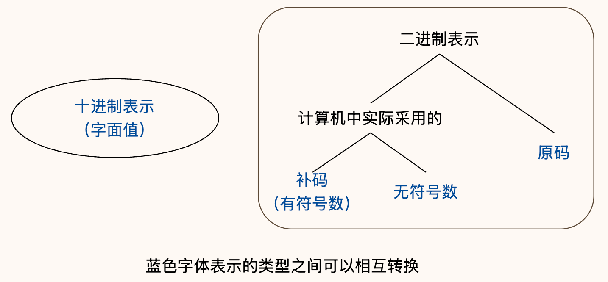

在日常生活中，我们使用十进制表示数字，并通过符号（如 + 和 -）表示正负。这种用十进制表达的数字也叫做 **字面值**。

而计算机以二进制形式存储数据，**补码、原码、无符号数** 等只是 **对二进制位的一种解释方式**，它们决定了同一组二进制位所代表的实际数值。

在实际的计算机中，没有采用 [原码](https://www.csgraduates.com/constitution_principle/representation/integer/#原码) 存储数据的，具体原因后面会谈到到。对于计算机中存储的数字来说，它的二进制只可能是 **有符号数**（signed） 或者 **无符号数**（unsigned） 这两种情况。

#### 2.1 无符号数

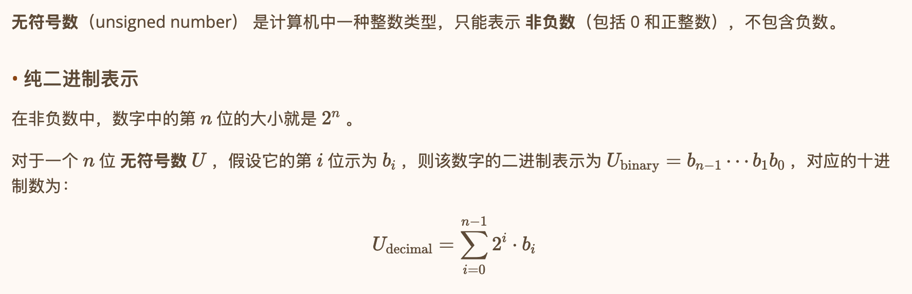

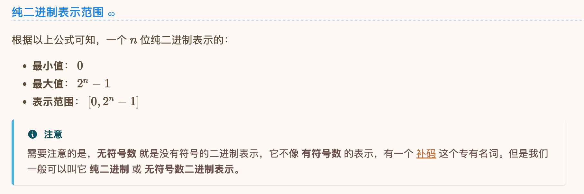

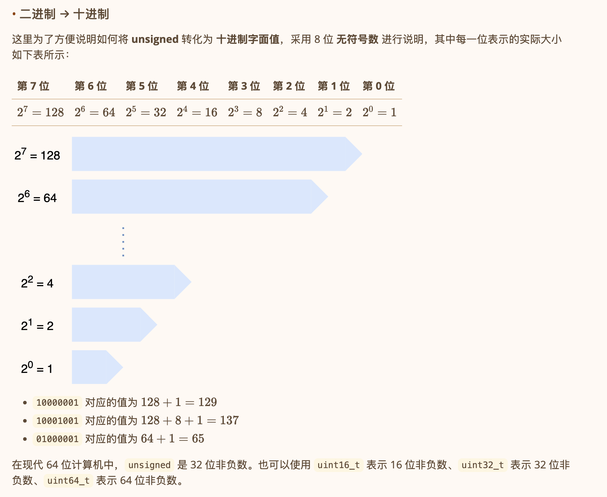

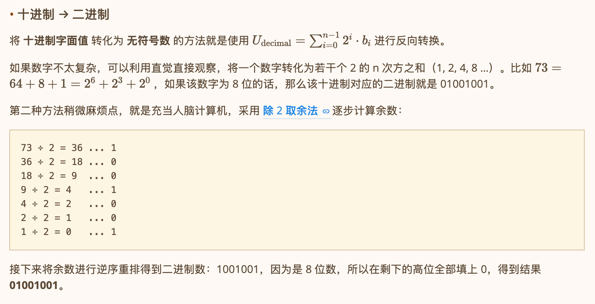

总结两种转换方式如下图：

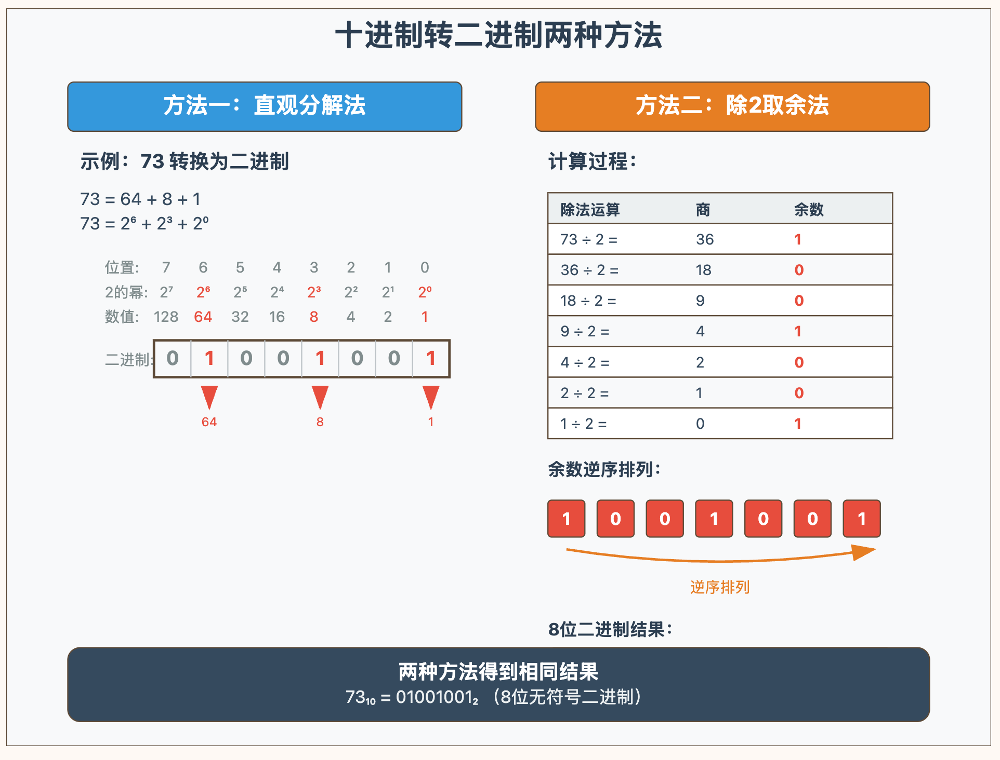

#### 2.2 有符号数

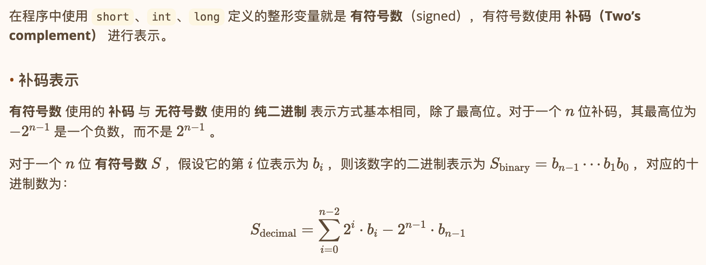

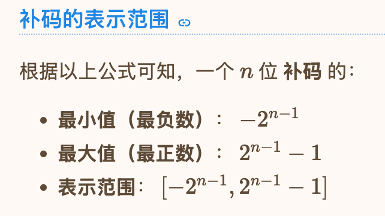

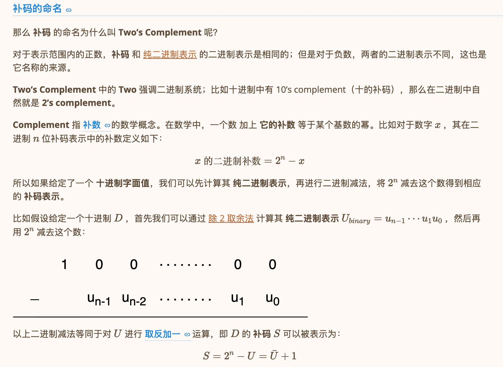

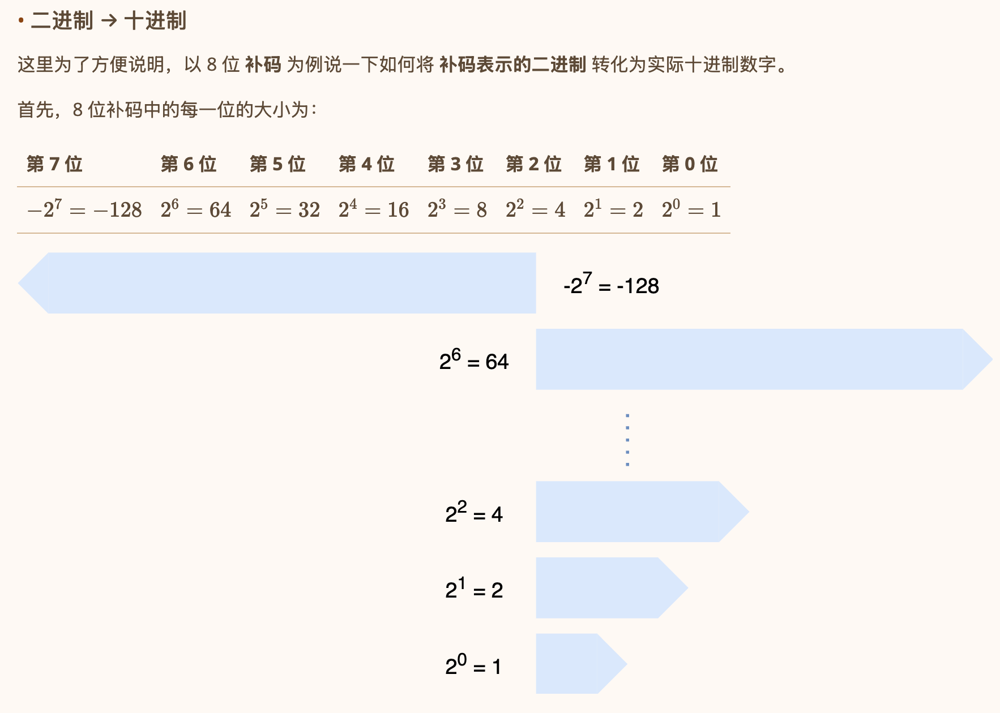

例子：

- `10000001` 对应的值为 −128+1=−127
- `10001001` 对应的值为 −128+8+1=−119
- `01000001` 对应的值为 64+1=65

以 8 位二进制数为例：

1. 对于正数，例如 +5，其二进制表示为 00000101，**补码** 也是 00000101。
2. 对于负数，例如 -5，首先写出 5 的二进制表示：00000101。
   - 按位取反得到：11111010
   - 加 1 得到：11111011
   - 所以，-5 的 **补码** 是 11111011。

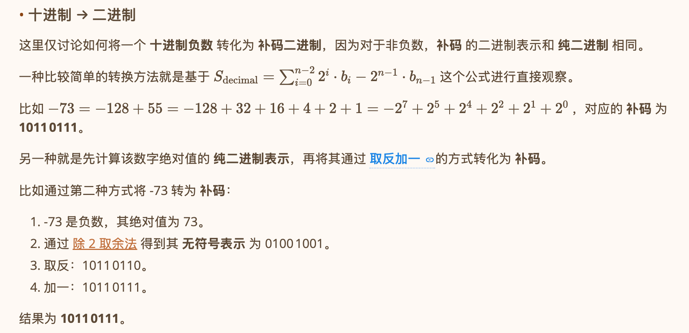

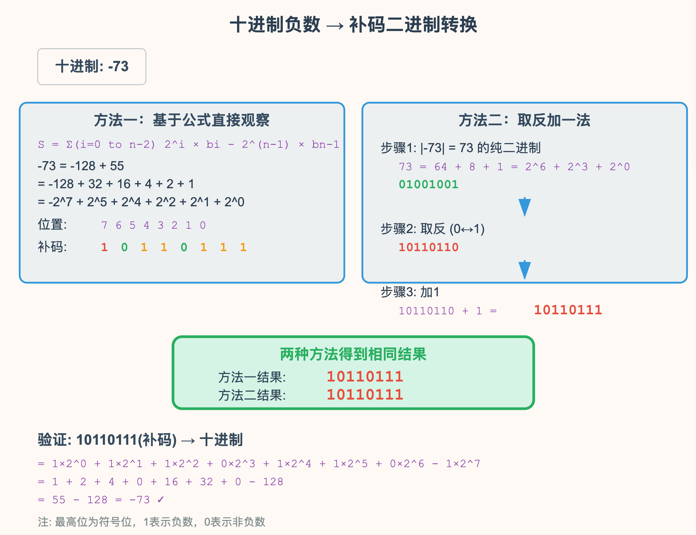

##### 优点

使用 **补码** 可以使得 **加法、减法和负数的表示** 变得简单和统一。比如给定两个数字 A 和 B，我们想要计算 C = A + B。A + B 由硬件加法器得到的二进制结果可以直接作为 C 的二进制表示。

**补码** 的设计使得负数的加法变得简单。当使用 **补码** 表示时，可以直接将两个数相加，即使其中一个数是负数，而不需要进行任何特殊处理。这简化了计算机硬件的设计。

#### 2.3 原码

**原码（Sign-Magnitude）** 是一种简单的方式来表示二进制中的 **有符号整数**。在这种表示法中，数字的 **最高位**（最左边的位）用于表示符号，其余的位表示数字的大小。通常，符号位为 0 表示正数，而 1 表示负数。

原码的表示方法：

1. 正数的原码：**最高位** 为 0，其余位表示这个数的绝对值的二进制形式。
2. 负数的原码：**最高位** 为 1，其余位表示这个数的绝对值的二进制形式。
3. 零的原码：符号位可以是 0（表示 +0）或 1（表示 -0），但在实际应用中，通常只使用一个零，即符号位为 0。

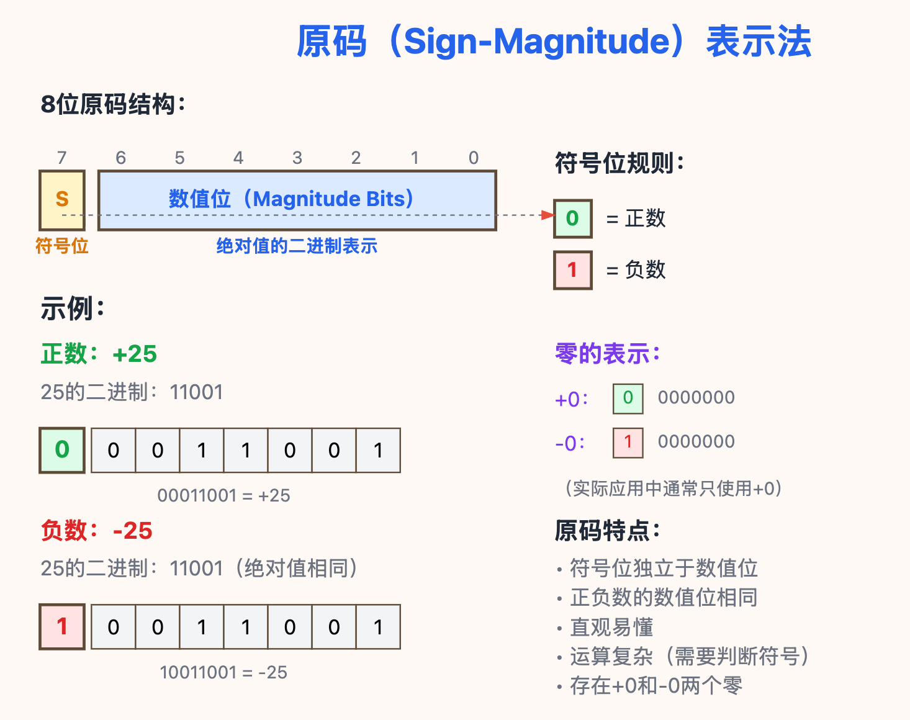

举例（以 8 位二进制数为例）：

- +25 的原码是：`0 0011001`
- -25 的原码是：`1 0011001`

##### 缺点

- 存在 **正零** 和 **负零** 的表示。
- 在进行算术运算时，正数和负数需要不同的处理，这使得硬件设计变得复杂。

由于上述的缺点，**原码** 并不是计算机中最常用的表示法。在现代计算机中，**补码** 是更常用的方式来表示 **有符号整数**，因为它简化了算术运算的处理，并且没有 **+0** 和 **-0** 的冗余表示。

---

## 浮点数表示

### 一、实数的二进制表示

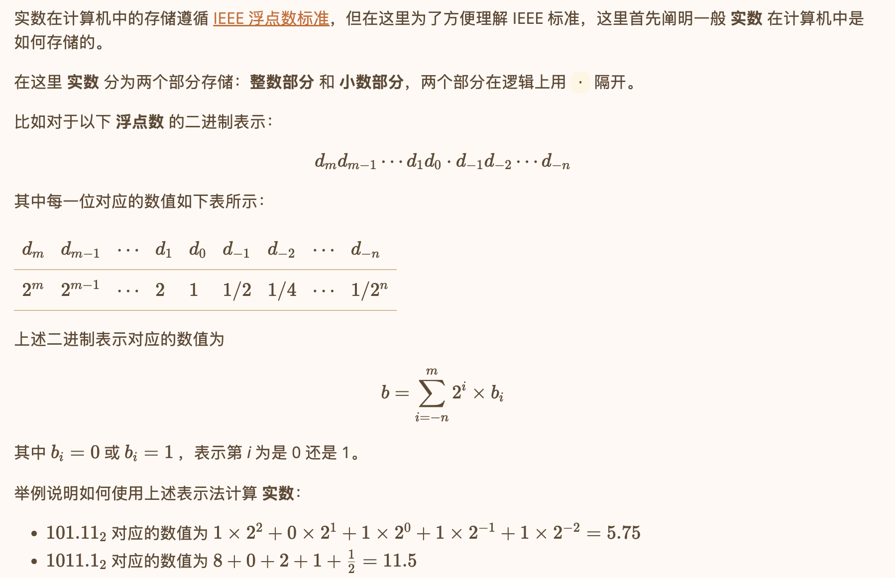

#### 1.1 字面值转二进制

举个实际的例子，将 *1.2* 转换为二进制表示。

**整数部分** 1 的二进制是 1。
**小数部分** 0.2 的二进制表示是一个无限循环小数。通过不断乘以 2，可以得到近似的二进制：

- 0.2 × 2 = 0.4 → 整数部分 0
- 0.4 × 2 = 0.8 → 整数部分 0
- 0.8 × 2 = 1.6 → 整数部分 1
- 0.6 × 2 = 1.2 → 整数部分 1
- 0.2 × 2 = 0.4 → 重复…

于是，*1.2* 在二进制中近似为 `1.0011001100110011...`。

### 二、IEEE浮点数表示

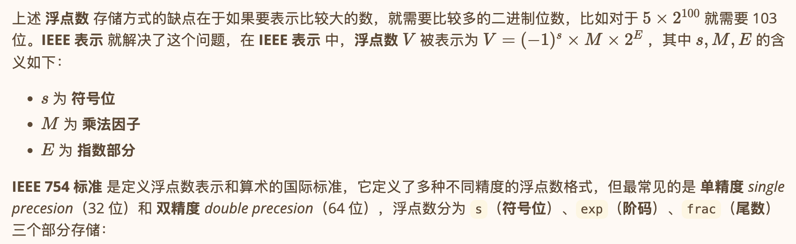

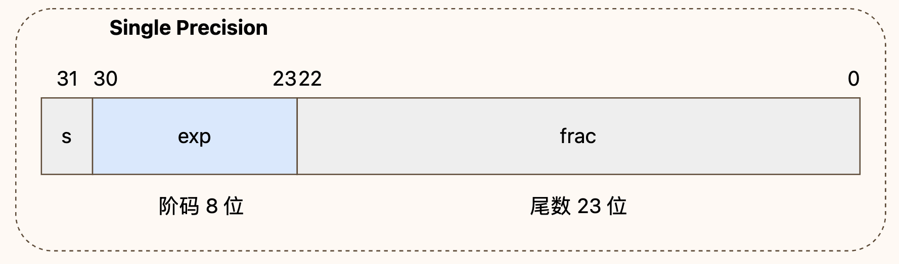

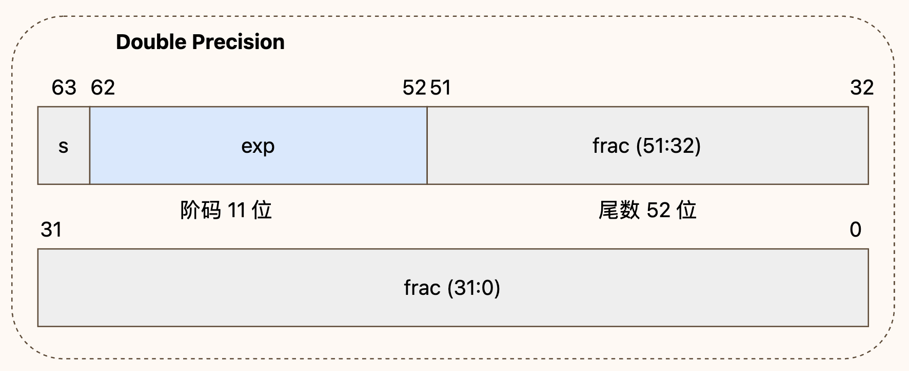

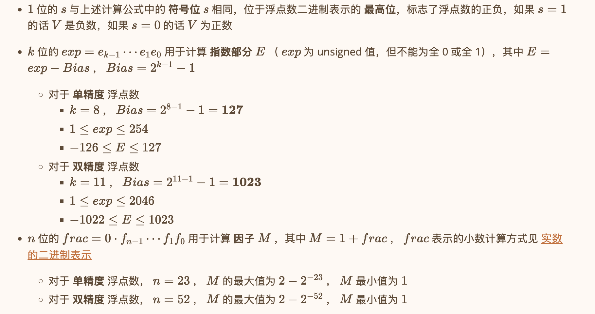

**总结** **单精度** 和 **双精度** **浮点数** 表示如下：

| 类型   | 符号位 s | 阶码 exp | 尾数 frac | 总位数 | 偏置值 |
| ------ | -------- | -------- | --------- | ------ | ------ |
| 单精度 | 1        | 8        | 23        | 32     | 127    |
| 双精度 | 1        | 11       | 52        | 64     | 1023   |

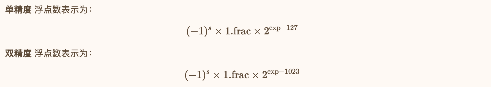

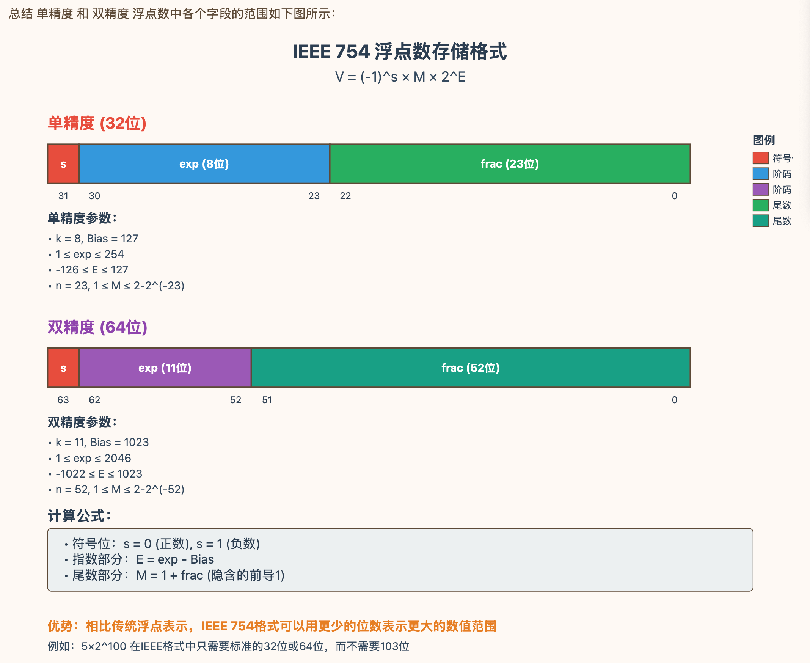

#### 2.1 异常值

注意 **IEEE 浮点数** 表示分为 **Normalized Values**（正常值）和 **Denormalized Values**（非正常值）以及**特殊值**，上节中提到的 **IEEE 浮点数** 计算方法只适用于 **正常值**，**正常值** 的 **阶码**（exp）不能为全 0 或全 1。

下图是 **浮点数** 各种类型的图示（以 **单精度** 为例）：

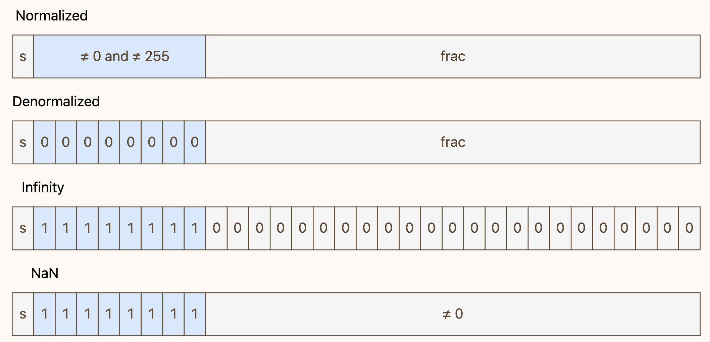

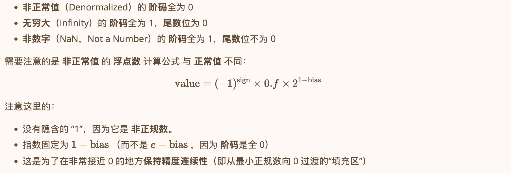

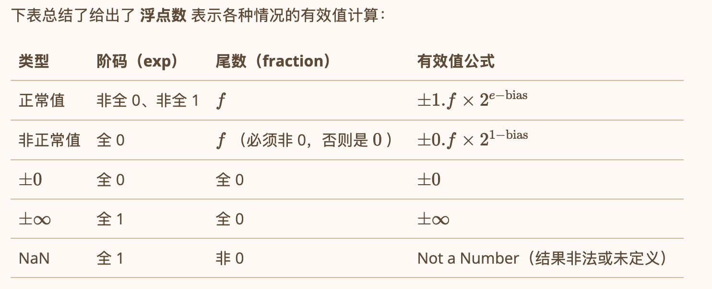

#### 2.2 字面值转二进制

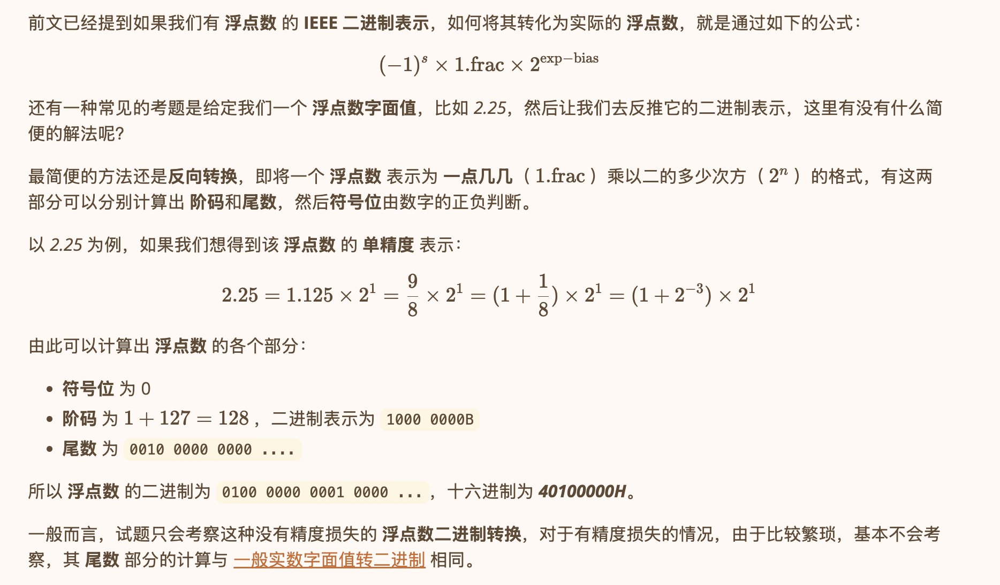

#### 2.3 表示精度

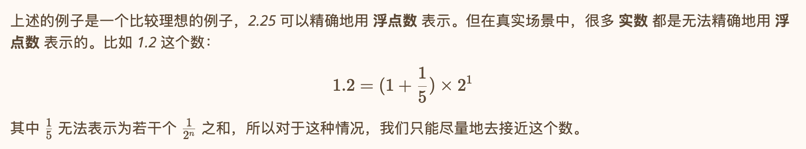

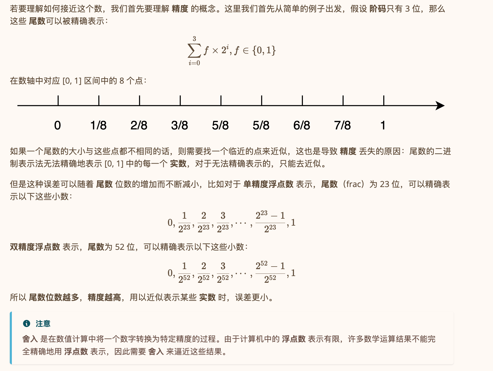

#### 2.4 浮点数加法

**浮点数** 加减计算过程包含以下几个步骤：**对阶**、**尾数加减**、**尾数规格化**。

1. 对阶：为了进行加减运算，两个浮点数必须具有相同的指数，这里采用低阶向高阶对齐的原则，过程如下：
   - 比较两个浮点数的 **指数**。
   - 将较小指数的浮点数的 **尾数右移**，直到两个指数相等。
   - 右移过程中，需要注意尾数的 **精度损失**（尾数右移时可能会丢失低位精度）。
2. 尾数加减：在指数对齐后，直接对两个浮点数的尾数进行加减。
   - 由于尾数已经对齐，可以直接进行 **加减操作**。
   - 根据操作结果可能需要处理进位或借位。
3. 尾数规格化：确保结果符合标准化浮点数的格式，即尾数以 1 开头。
   - 如果结果尾数不符合 1.xxxx 格式，则需要进行 **规格化调整**。
   - 左移尾数并相应减少指数，或右移尾数并相应增加指数。
   - 规格化后，可能还需要进行舍入，以符合尾数的位数限制。
     - 根据舍入模式（如“向偶数舍入”、“向零舍入”等）完成必要操作。

在 **对阶** 和 **尾数规格化** 的过程中，由于可能存在 **尾数**右移，所以可能会导致 **精度缺失**。
因为 IEEE 浮点数尾数的位数是有限的，如果右移的过程中尾数中最右边的 1 被清除，就会导致 **精度缺失**。

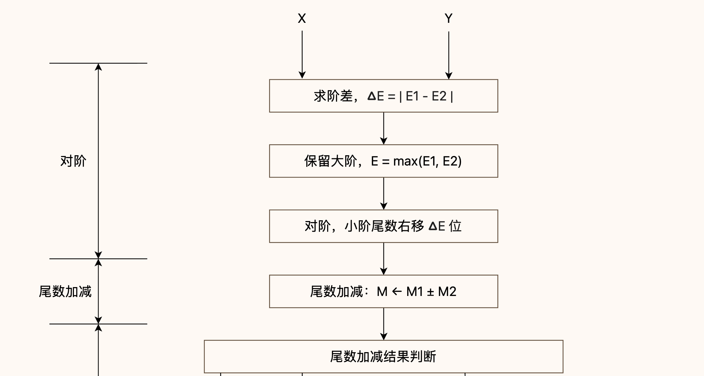

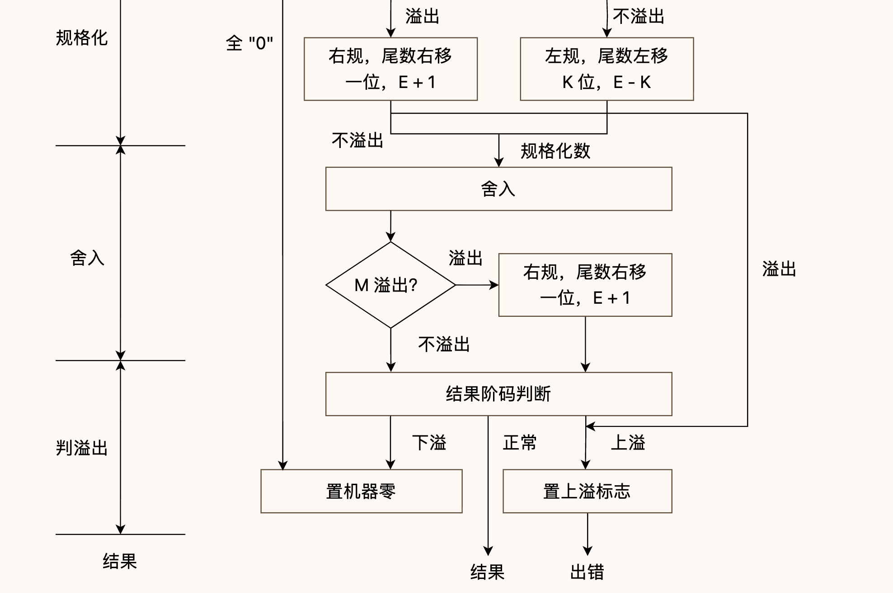

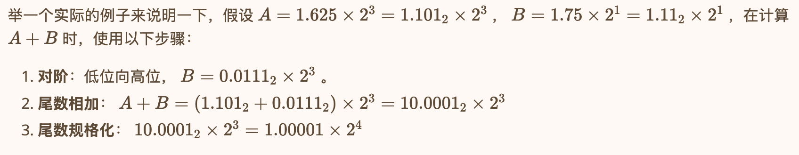

---

## 运算电路

### 一、加法运算电路

#### 1.1 半加器

最基本的加法单元是 **半加器**（Half Adder）。它有两个输入，一个是加数，一个是被加数，并有两个输出，一个是和，一个是进位。

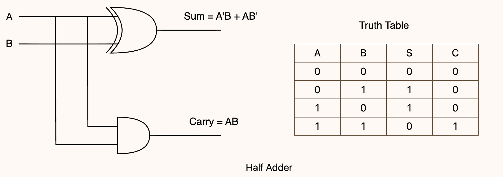

如上图所示，通过对两个输入（A 和 B）进行 **异或**（XOR）计算，可以得到 **和**（S）。
通过对两个输入进行 **与**（AND）操作，可以得到 **进位**（C，即 Carry）。

**半加器** 的主要限制是它只能对两个位进行加法，并且不能处理来自低位的进位输入。

#### 1.2 全加器

**全加器**（Full Adder）是 **半加器** 的扩展，它加上了前一位的 **进位**（Cin）作为第三个输入，并有两个输出，一个是 **和**（S），一个是 **进位**（C）。

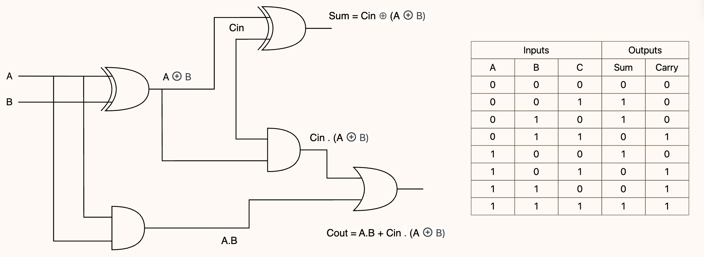

**半加器**用于处理两个位的简单加法，而 **全加器**则可以处理包括 **进位** 在内的三位加法，是构建复杂加法电路的基础。

#### 1.3 加法器

为了进行多位数的加法，**全加器** 可以串联起来形成一个 **加法器**，以处理多个位的二进制数加法。在这种安排中，每个 **全加器** 的 **进位输出** 连接到下一个 **全加器** 的 **进位输入**。这样，一个 n 位的 **加法器** 可以通过串联 n 个 **全加器** 来实现。

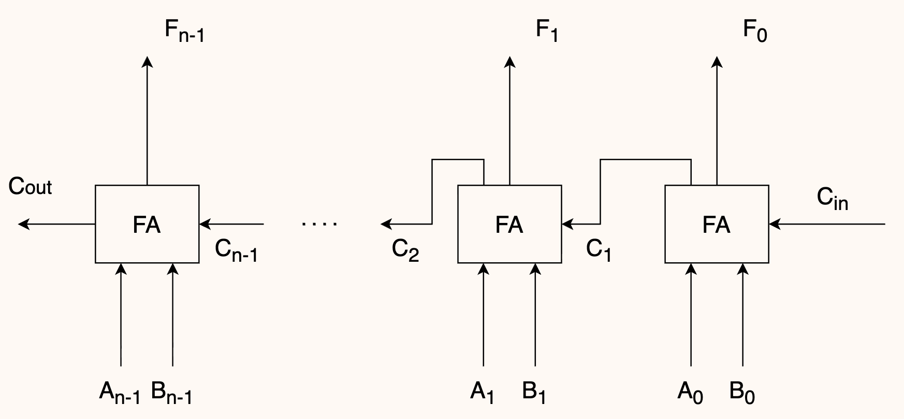

上述 **加法器** 既可以处理 **无符号加法**（unisnged），也可以处理 **有符号加法**（int），因为二进制加法与数据类型无关，从 **加法器** 来说，只是对 0 和 1 进行操作，数据类型是对于二进制的解释方式。

一般而言，对于 **有符号加法**，加法器还需要考虑 **标志位**，所以加法器也被扩展为如下结构：

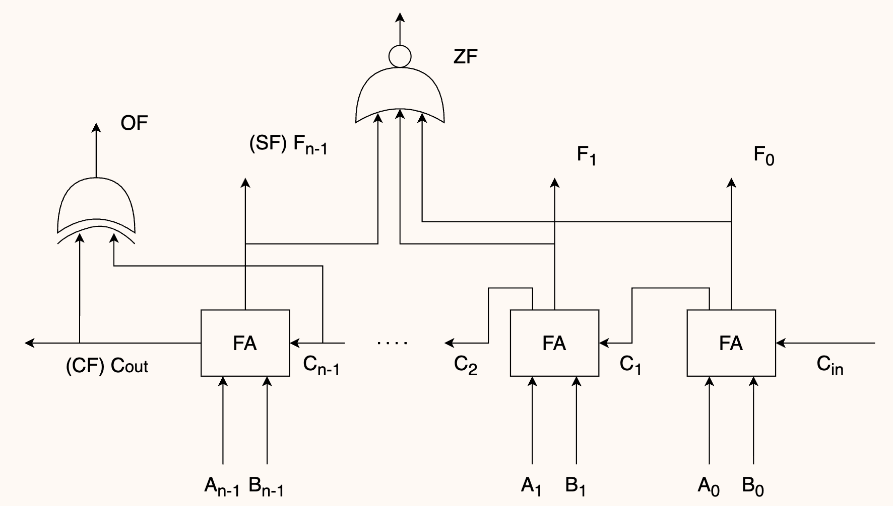

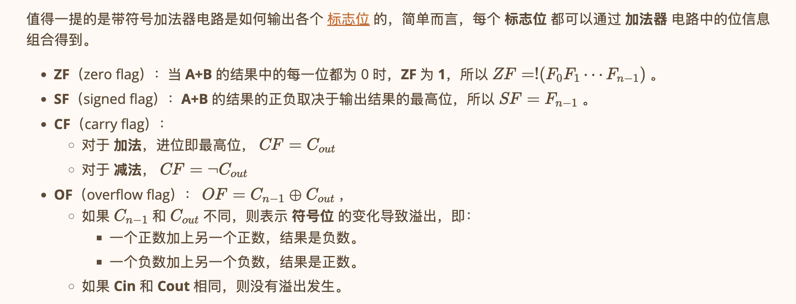

### 二、减法运算电路

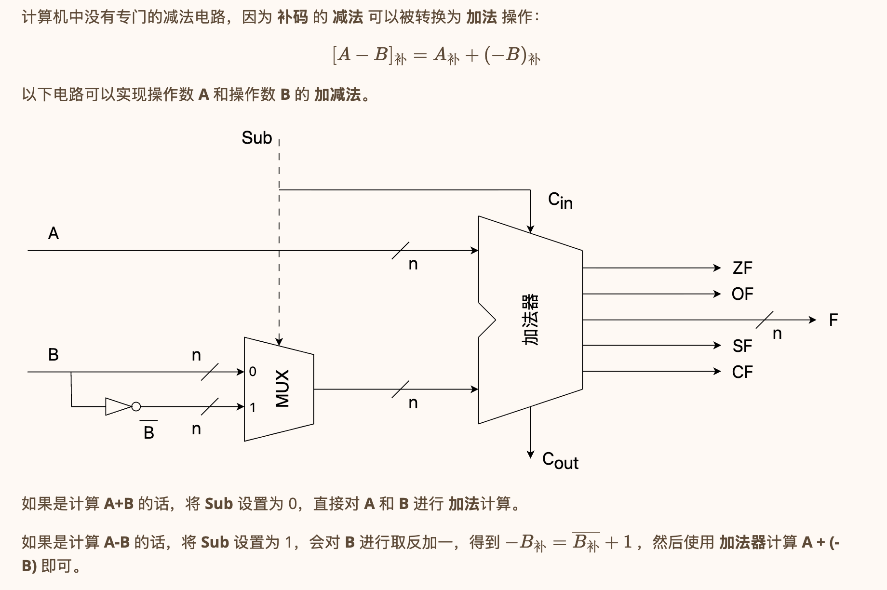

### 三、乘法运算电路

**二进制乘法** 与十进制乘法的手工计算方式类似：

```c
       1011   (this is binary for decimal 11)
     × 1110   (this is binary for decimal 14)
     ======
       0000   (this is 1011 × 0)
      1011    (this is 1011 × 1, shifted one position to the left)
     1011     (this is 1011 × 1, shifted two positions to the left)
  + 1011      (this is 1011 × 1, shifted three positions to the left)
  =========
   10011010   (this is binary for decimal 154)
```

在计算机中实现 **乘法指令**可以通过如下几种方式模拟以上过程：

#### 3.1 软件算法

如果没有专有硬件支持，可以通过一系列 **加法**和 **位移**操作来实现 **乘法**。编译器将 **乘法运算**转换为一个循环代码段，在循环代码段中通过比较、**加法**和移位等指令实现 **乘法运算**。

```c
// 如何使用加法和位移来实现两个整数的乘法（了解即可）
unsigned int multiply(unsigned int a, unsigned int b) {
    unsigned int result = 0;  // 结果初始化为 0
    while (b > 0) {           // 当第二个操作数大于 0 时继续循环
        if (b & 1) {          // 检查 b 的最低位是否为 1
            result += a;      // 如果是，将 a 加到结果上
        }
        a <<= 1;              // 将 a 左移一位，相当于 a 乘以 2
        b >>= 1;              // 将 b 右移一位，去掉已经处理过的最低位
    }
    return result;            // 返回计算的乘积
}
```

#### 3.2 顺序乘法器

通过硬件的方式串行地模拟手工计算的方式，无符号数的 **乘法硬件电路** 如下图所示（了解即可）：

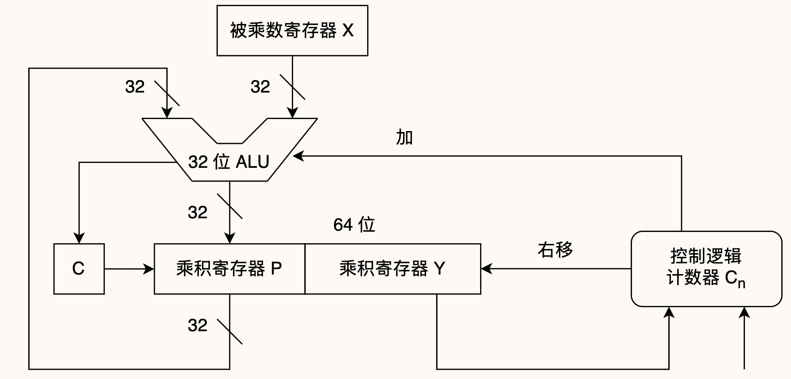

其思路是通过 **右移**和 **加法**，每次输出 **乘法结果**中的一位，由于原理稍复杂，这里不阐述更多细节。

#### 3.3 阵列乘法器

**阵列乘法器**（Array Multiplier）是一种用于执行 **乘法运算**的硬件电路，它通过布置一系列 **全加器**和 **半加器**在一个二维网格或阵列中来实现，它能够并行处理多个位的 **乘法**和 **累加**，可以在一个或多个时钟周期内完成 **乘法操作**。

### 四、除法运算电路

二进制 **除法**在计算机中的实现与我们在十进制中所执行的传统 **除法**类似。

```c
          00111   商 = 0111 = 7
     ----------
0010 | 00001111   被除数 X = 15 = 1111 = 00001111
         0010     除数 Y = 2 = 0010
         -----
          0011
          0010
          -----
           0011
           0010
           ----
           0001   余数 = 0001 = 1
```

二进制 **除法**可以被总结为如下步骤：

1. 准备：
   - 将被除数和除数都转换为二进制形式。
   - 写下被除数和除数，类似于十进制除法的长除法形式。
2. 除法：
   - 从被除数的最高位开始，与除数进行比较。
   - 如果被除数当前部分大于或等于除数，则商为 1，否则商为 0。
   - 如果商为 1，则将被除数当前部分减去除数，并将差写在下面。
   - 将被除数的下一位数字移下来，与差组成新的被除数部分。
   - 重复上述步骤，直到被除数的每一位都被处理完毕。
3. 余数：
   - 最后一次减法运算得到的差即为余数。
   - 如果最后一次减法得到的差是 0，则表示整除，没有余数。

简单的 **除法电路**结构也是通过模拟以上过程实现（了解即可）：

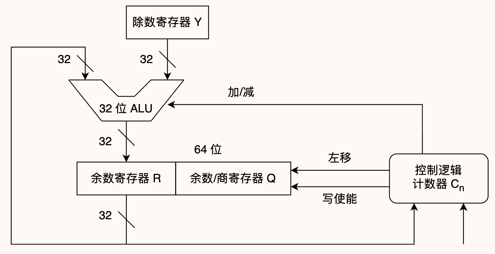

在 **除法电路** 中，在每次迭代中我们将当前 **余数** 左移一位，并引入 **被除数** 的下一位，然后执行 **余数减去除数** 的操作，接下来通过条件判断检测 **减法结果** 的符号以确定 **商** 的当前位。

在每次迭代中，我们可以输出 **除法结果** 中的一位，重复直到处理完所有位后，可以得到 **商** 和 **余数** 的结果。

---

## 类型转换

### 一、有符号整数和无符号整数

当 **有符号整数** 和 **无符号整数** 之间相互转换时，**二进制数据** 不变，只是改变了变量（或数字）的类型。

首先需要了解 **有符号整数**（int）和 **无符号整数**（unsigned）这两个类型：

- `int`：使用 **补码** 来存储数据。
- `unsigned`：所有位，包括最高位，都用于表示数值，表示非负数。

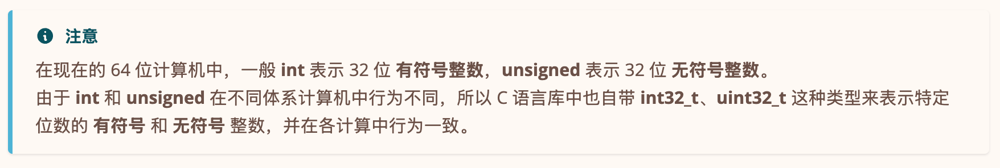

这里为了方便说明，以 8 位 **有符号整数** 和 **无符号整数** 为例：

- 8 位 有符号整数
  - 表示的范围为 `-128 ~ 127`
  - 最大数为`127`，对应的二进制为`0111 1111`
  - 最小数为`-128`，对应的二进制为`1000 0000`
- 8 位 无符号整数
  - 表示的范围为 `0 ~ 255`
  - 最大数为`255`，对应的二进制为`1111 1111`
  - 最小数为`0`，对应的二进制为`0000 0000`

当 **int** 和 **unsigned** 进行 **类型转化** 时，**位模式** 不变，可以理解成计算机存储单元中的二进制表示没有变化，只是从程序层面阐述该二进制数据的方式变了，如下图所示：

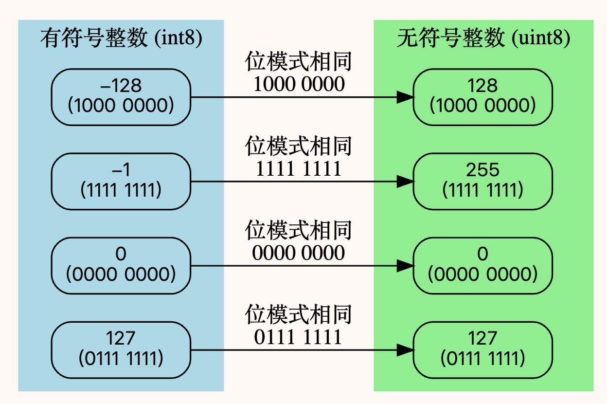

### 二、整形和浮点数

在计算机中，**整形**（short, int, long）和 **浮点数**（float, double）之间可以相互转换，但是在转换的过程中可能出现 **精度丢失** 或 **数据溢出**。

#### 2.1 整形转浮点数

如果一个整数被转换为浮点数，其结果是否会产生 **精度丢失** 取决于整数的大小是否超过浮点数可以精确表示的整数范围。
但当整数足够大时，转换可能导致 **精度损失**。

比如对于 **float** 类型，其尾数为 23 位，它可以精确表示的整数范围为 (−2^24,2^24) ，如果一个 **int** 类型的数字在这个范围内，则将其转换为 **float** 时 ***不会丢失精度***。

但是如果 **int** 类型数字超出这个范围且低 8 位不全为 0 的话，则将其转换为 **float** 会有 **精度丢失**。

#### 2.2 浮点数转整数

当 **浮点数** 被转换为 **整数** 时，小数部分会丢失，因为 **整数** 不能表示小数。

此外，如果 **浮点数** 超出了 **整形** 的表示范围，转换可能会 **溢出** 或产生未定义行为（取决于语言）。

### 三、不同长度的类型转换

| 类型        | 最小位数 | 常见位数（32 位系统） | 常见位数（64 位系统） |
| ----------- | -------- | --------------------- | --------------------- |
| `char`      | 8 位     | 8 位                  | 8 位                  |
| `short`     | 16 位    | 16 位                 | 16 位                 |
| `int`       | 16 位    | 32 位                 | 32 位                 |
| `long`      | 32 位    | 32 位                 | 64 位                 |
| `long long` | 64 位    | 64 位                 | 64 位                 |
| `float`     | -        | 32 位                 | 32 位                 |
| `double`    | -        | 64 位                 | 64 位                 |

**总结**一下不同长度的 **整数** 和 **浮点数** 的 **类型转换** 规则：

- 整数和整数
  - 较小的 **整数类型** 被转换为较大的 **整数类型** 时，高位会被自动填充为 0 或 1，不会有数据丢失。
  - 较大的 **整数类型** 被转换为较小的 **整数类型** 时，高位会被自动截断，可能有数据丢失。
- 浮点数和浮点数
  - `float` 转为 `double` 时，不会有 **精度丢失**，`double` 转为 `float` 时，可能有 **精度丢失**。

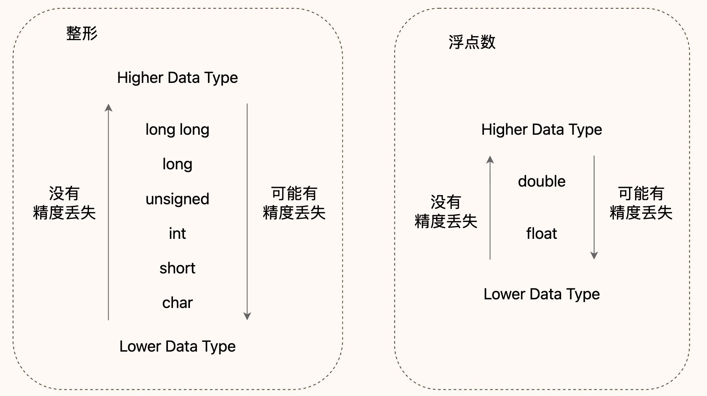

以 `short` 和 `int` 的类型转化为例说明：

```c
/* 将 short 转为 int */
short s = 0x1234;
int i = s;
// 高 16 位被填充为 0
// i = 0x00001234

/* 将 int 转为 short */
int i = 0x12345678;
short s = i;
// 高 16 位被截断
// s = 0x5678
```

### 四、类型转换

在编程中，**类型转换** 指的是将一种数据类型转换为另一种数据类型。主要分为两种：

- **隐式类型转换**（Implicit Type Conversion）（也称为 **类型提升**，Type Promotion）
- **显式类型转换**（Explicit Type Conversion）（也称为 **强制转换**，Type Casting）

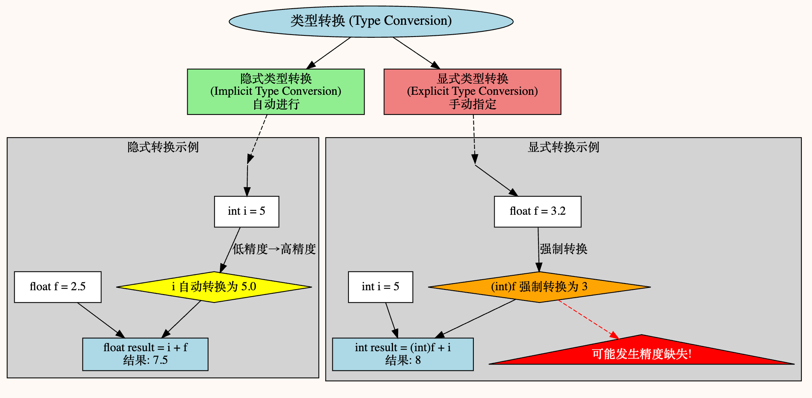

#### 4.1 隐式类型转换

在 C 语言中，当算术运算、赋值和比较表达式中涉及的多个变量类型不同时，如果没有显式指定类型，编译器会自动进行 **类型转换**。

```c
/* 隐式类型转换 */
int i = 5;
float f = 2.5;
float result = i + f;  // i 被隐式转换为 5.0 然后进行计算
```

你在一个表达式中混合使用 `int` 和 `float` 时，C 语言会自动进行 **类型转换** 以使得表达式可以正确计算。通常情况下，低精度类型会被提升到高精度类型，即 `int` 会被转换为 `float`。

#### 4.2 显式类型转换

也可以使用 **类型转换运算符** 显式地转换一个类型为另一个类型。

```c
/* 显式类型转换 */
int i = 5;
float f = 3.2;
int result = (int)f + i; // f 被显式转换为 3，然后与 i 相加
```

**显式类型转换** 会按照你指定的方式进行，在此过程中可能会发生 **精度缺失**。


