# 存储系统

## 存储系统概念

### 一、存储系统的层次结构

存储系统是计算机体系结构的核心组成部分之一，用于存储程序指令和数据，以支持处理器的运算需求。为了平衡速度、容量和成本，现代计算机采用了分层存储体系结构，从最快速但容量有限的 **寄存器** 到容量大但速度较慢的辅助存储设备，形成了存储层次结构。

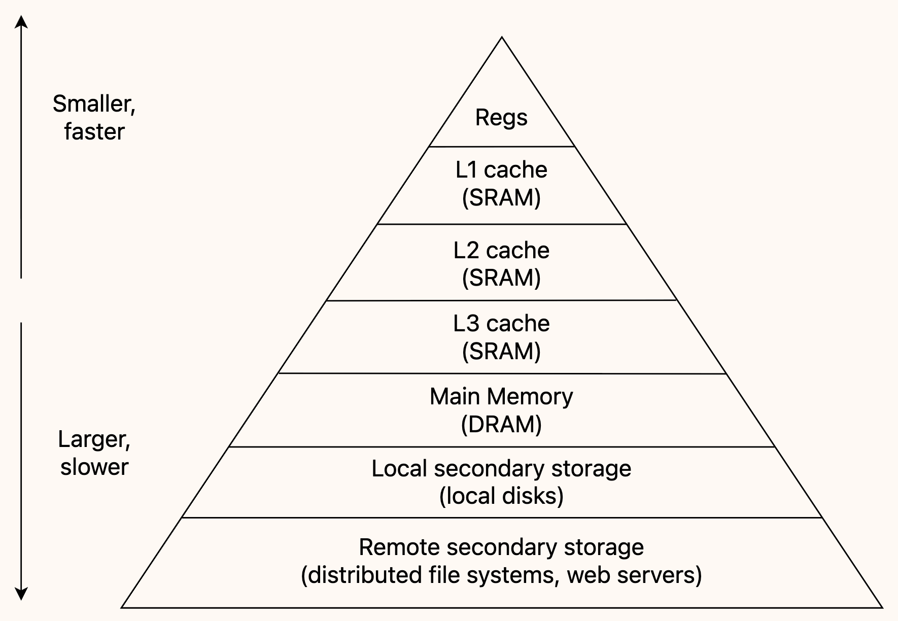

如上图所示，越靠近金字塔上层的容量越小但速度越快，越靠近金字塔下层的容量越大但速度越慢。计算机的存储系统包含以下层次：

1. 寄存器（Registers）:
   - **寄存器** 是位于处理器内部的最快速存储单元。
   - 它们提供极快的数据访问速度，但其容量非常有限。
2. 一级缓存（L1 Cache）:
   - L1 缓存位于处理器内部，比 **寄存器** 空间稍大，速度比 L2 和 L3 Cache 更快。
   - 它通常分为 **数据缓存** （用于存储数据）和指令缓存（用于存储指令）。
3. 二级缓存（L2 Cache）:
   - L2 缓存比 L1 缓存大，并且位于处理器和主内存之间。
   - 它的速度比 L1 慢，但比主内存快。
4. 三级缓存（L3 Cache）:
   - 在某些系统中，还有 L3 缓存，这是一种更大但速度更慢的缓存。
   - 它位于 L2 缓存和主内存之间，旨在进一步减少对主内存的访问。
5. 主存（RAM）:
   - 就是我们常说的内存，比缓存慢，但比硬盘快得多，并且容量比缓存大。
   - **主存** 用于存储正在运行的程序和当前使用的数据。
6. 辅助存储（如硬盘驱动器或固态驱动器）:
   - **辅助存储** 设备提供大量的永久存储。
   - 与 **RAM** 相比，这些设备访问速度较慢，但能够存储更多的数据，并且在断电时不会丢失数据。
   - [机械硬盘](https://www.csgraduates.com/constitution_principle/storage/storage/#机械硬盘)（HDD）和[固态硬盘](https://www.csgraduates.com/constitution_principle/storage/storage/#固态硬盘)（SSD）是常见的 **辅助存储** 设备。

存储器层次结构的主要思想是上一层的存储器作为低一层存储器的高速缓存。当 CPU 要从存储器中存取数据时，先访问 **Cache**，若不在 **Cache** 中，则访问 **主存**，若不在 **主存** 中，则访问磁盘，此时，操作数从磁盘读出送到 **主存**，然后从 **主存** 送到 **Cache**。

**Cache——主存层** 主要解决 CPU 和主存速度不匹配的问题，主存和 **Cache** 之间的数据调动是由硬件自动完成的。

**主存一辅存层** 主要解决存储系统的容量问题，主存和 **辅存** 之间的数据调动是由硬件和操作系统共同完成的，**两者对于应用程序员都是透明的**。

### 二、RAM

半导体随机存储器的英文为 `Semiconductor Random-Access Memory` （ `RAM` ）。

首先说一下这个名词中的几个部分：

- 半导体：这种存储器使用半导体材料（如硅）制成。晶体管是构成半导体存储器的基本组成部分。
- 随机：随机的意思是随机访问，意味着可以以几乎恒定的时间访问存储器中的任意位置，它与其他存储技术（如磁盘或磁带）不同，后者需要按顺序访问数据。

随机存储器主要分为 **SRAM** 和 **DRAM** 两种。

#### 2.1 SRAM

**SRAM**（Static RAM，静态随机存取存储器）使用触发器（通常由 4-6 个晶体管组成）构成存储器的基本存储单元，存储每个比特的数据，如下图所示：

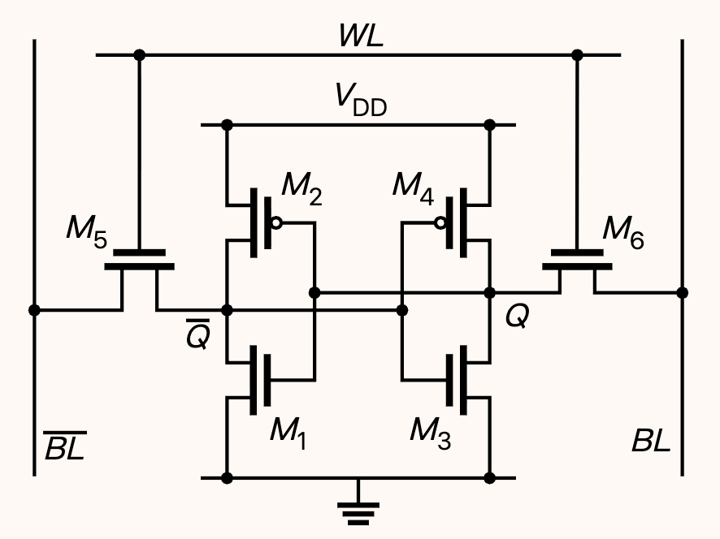

只要电源持续供应，数据无需刷新即可保持稳定。

**SRAM** 通过将触发器组织成二维阵列构成存储器，每行连接一个字线（Word Line），控制该行所有单元的访问。
每列连接一对位线（Bit Line），用于传输数据。

**SRAM** **主要用于** CPU 缓存（L1/L2/L3 Cache）、寄存器、嵌入式系统中的小型高速存储。

#### 2.2 DRAM

**DRAM**（Dynamic RAM，动态随机存储器）使用 1 个晶体管和 1 个电容器（1T1C 结构）构成存储器的基本存储单元，存储每个比特的数据。

- 电容器存储电荷，表示 1 比特数据（有电荷为 1，无电荷为 0）。
- 晶体管作为开关，控制电容器与外部位线（bit line）的连接，读写数据。

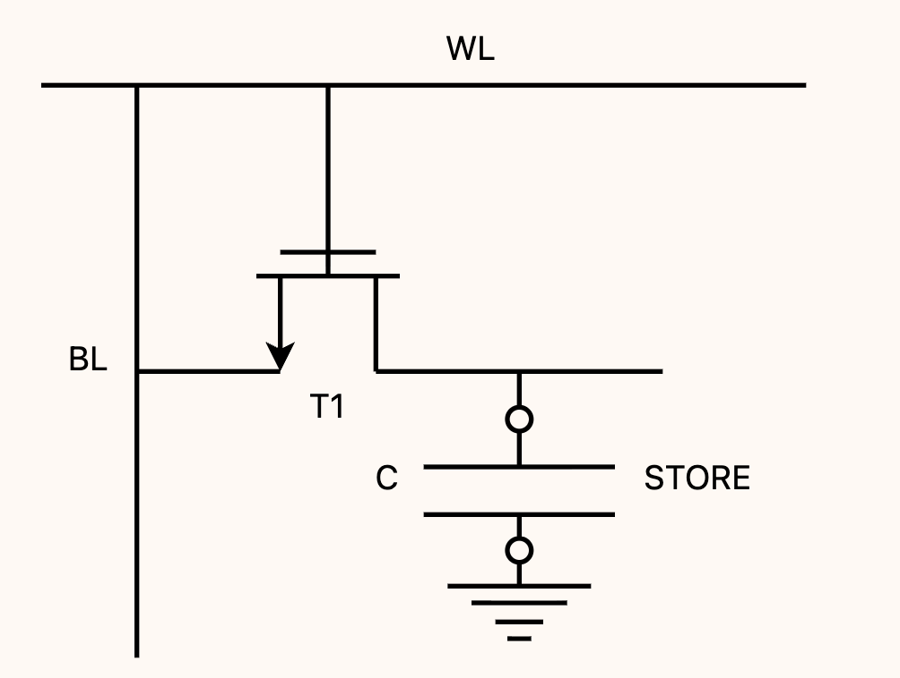

与触发器不同，电容器具有 **动态特性**，会随时间漏电，导致数据丢失，因此需要 **定期刷新**（通常每几毫秒）以恢复电荷。

**DRAM** 和 **SRAM** 的存储阵列在宏观上类似，都采用二维矩阵结构，通过字线和位线实现随机访问，主要区别在于基本存储单元的不同：

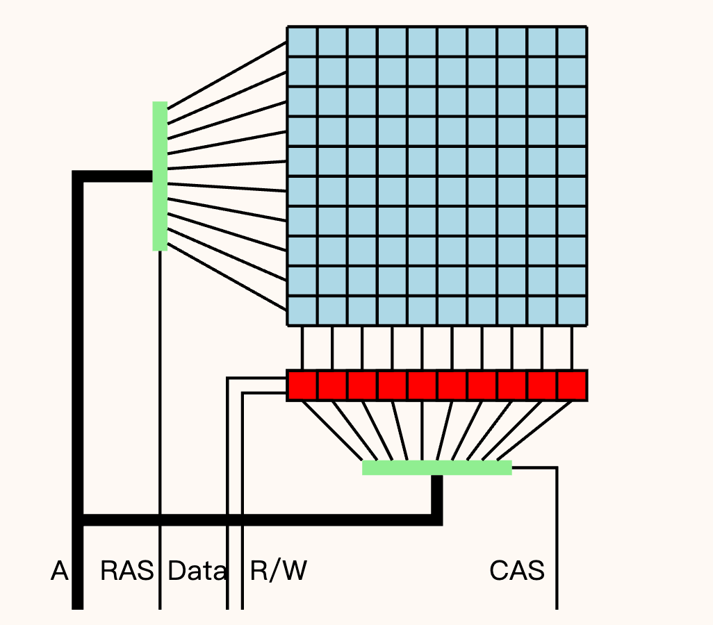

它以低成本和高容量著称，**主要用于** 计算机主内存（如系统 **RAM**）、显卡内存等。

##### 行列复用

需要注意一点，绝大多数 DRAM 芯片的引脚都采用了 采用了 “行列地址复用” 的方式。

- DRAM 芯片内部存储单元是一个二维阵列：
  - 行表示字线。
  - 列表示位线。
- 如果直接给每个单元提供地址引脚，需要 log₂(行数) + log₂(列数)个引脚。
  - 例如：64K × 4 DRAM（64K 个字，每个字 4 bit），如果阵列是 256 行 × 256 列，就需要 16 根地址线。
- 但在 20 世纪 70、80 年代，封装引脚数量有限，无法承受那么多地址线。

于是，引入了 **行列地址复用**（Address Multiplexing）：

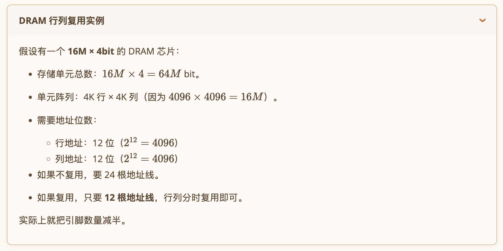

- 芯片的外部只提供 **log₂(max(行数, 列数))** 根地址线。
- 地址分两次送入：
  1. 先送行地址（RAS，Row Address Strobe 信号有效时锁存）。
  2. 再送列地址（CAS，Column Address Strobe 信号有效时锁存）。

但是 **SRAM** 一般不使用行列复用：外部地址线一次性给出完整的地址，直接解码到存储单元。因为 SRAM 容量较小且速度有限，所以引脚数量不会太多。

| 特性     | DRAM               | SRAM             |
| -------- | ------------------ | ---------------- |
| 存储单元 | 1 晶体管 +1 电容器 | 4-6 晶体管       |
| 速度     | 较慢               | **更快**         |
| 功耗     | 刷新导致较高功耗   | 静态低，总体较高 |
| 成本     | 低                 | 高               |
| 容量     | 大                 | 小               |
| 刷新需求 | 需要 **定期刷新**  | 无需刷新         |
| 应用     | 主内存、显存       | CPU 缓存、寄存器 |

### 三、Flash存储

Flash 存储器是一种 ***非易失性*** 的电子存储设备，它利用半导体技术来存储数据。通常用于长期数据存储，如 USB 闪存驱动器、固态硬盘（SSD）和移动设备的内部存储。它在读取速度上比 **RAM** 慢，但优于传统的硬盘驱动器（HDD）。

Flash 存储器使用电子方式来擦写和重新编程存储单元。这意味着可以通过电信号快速擦除和写入数据。数据存储在小型存储单元中，每个单元由浮动门晶体管组成。这些晶体管可以保持其充电状态，从而代表不同的数据位。

Flash 存储主要分为 `NAND Flash` 和 `NOR Flash` 这两种类型。

### 四、ROM

**ROM**（Read-Only Memory）是一种 ***非易失性*** 存储设备，主要用于永久性地存储数据。

**ROM** 主要用于读取操作。虽然早期的 **ROM** 在制造过程中就已经被编程，不能修改，但现代的 **ROM**（如 EPROM 和 Flash 存储器）可以被重新编程。

**ROM** 常用于存储固件，这是一种软件程序，直接嵌入在硬件设备中，用于控制设备的基本操作。例如，BIOS（基本输入输出系统）通常存储在 **ROM** 中。

注意一下 **ROM** 和 **RAM** 的对比如下：

| 特征       | RAM（随机存取存储器）                  | ROM（只读存储器）                      |
| ---------- | -------------------------------------- | -------------------------------------- |
| 易失性     | 是（断电时数据丧失）                   | 否（数据在断电时不丧失）               |
| 读写能力   | 可以被随机读取和写入                   | 通常只读，只读数据不能随机写入         |
| 用途       | 用于存储正在运行的程序、操作系统和数据 | 用于存储固定程序代码、固件、启动程序等 |
| 存储容量   | 通常较大，以支持多个程序同时运行       | 通常较小，主要用于存储核心系统和固件   |
| 数据持续性 | 不持久，数据在断电时丧失               | 持久，数据在断电时不丧失               |
| 修改权限   | 可以随机修改和写入数据                 | 通常只读，只读数据无法被修改           |

**ROM** 的类型主要了解 **EPROM** 和 **CDMROM** 这两种：

- **EPROM** 可以通过紫外线照射来擦除数据，然后重新写入数据。写入数据和擦除数据都较为繁琐，且需要物理操作。常用作电脑的 BIOS 芯片，支持随机存取。

- **CDROM** 是一种光盘存储设备，数据在生产时一次性写入，不能被修改（只能读取）。

---

## 内存

### 一、DRAM芯片

[DRAM](https://www.csgraduates.com/constitution_principle/storage/defs/#dram) 芯片是一种 **动态随机存取存储器**，通过 **1T1C**（1 晶体管 +1 电容器）存储单元以行列矩阵形式组织数据，依靠电容器电荷存储比特，需定期 **刷新** 以防止数据丢失。其 **高容量、低成本** 特性使其广泛用于计算机 **主内存**。

#### 1.1 刷新方式

DRAM 的刷新方式包括：

- **集中刷新**（Burst Refresh），暂停数据访问，在短时间内快速 **刷新所有行**，效率高但延迟大；
- **分散刷新**（Distributed Refresh），将刷新操作均匀分布在时间段内，与正常访问交错，延迟小但控制复杂；
- **异步刷新**（Asynchronous Refresh），由外部控制器根据需要触发刷新，灵活但依赖控制器设计。

这些刷新方式的具体对比如下表所示：

| 特征     | 集中刷新                                     | 分散刷新                                   | 异步刷新                                       |
| -------- | -------------------------------------------- | ------------------------------------------ | ---------------------------------------------- |
| 刷新方式 | 所有存储单元同时刷新                         | 根据存储单元的需求刷新                     | 根据使用情况和需求刷新                         |
| 性能影响 | 可能导致性能下降，因为刷新操作同时进行       | 最小程度影响性能，仅刷新需要刷新的存储单元 | 最小程度影响性能，根据实际使用情况调整刷新操作 |
| 硬件要求 | 硬件和控制器相对简单                         | 需要更复杂的硬件和控制器                   | 需要智能的内存控制器和硬件支持                 |
| 能源效率 | 可能相对较低                                 | 较高，因为只刷新需要刷新的存储单元         | 较高，因为根据需求动态调整刷新频率             |
| 寿命     | 可能影响寿命，特别是对于不经常使用的存储单元 | 可以延长内存寿命                           | 可以延长内存寿命                               |
| 灵活性   | 有限的灵活性                                 | 更大的灵活性                               | 高度灵活，可根据使用情况自动调整刷新频率       |

### 二、多模块存储器

利用多个结构完全相同的 **存储模块** 的并行工作来提高存储器的 **吞吐率**：

- **单体多字存储器**
- 多体交叉存储器
  - **高位交叉存储器**
  - **低位交叉存储器**

#### 2.1 单体多字存储器

按同一地址码并行地访问各自对应单元，每一个单元为一个字，每字 **m 位**。可以同时选中存储器的 **n 个单元**，可以将带宽提高 **n 倍**。

仅做简单了解，这里不详细说明，考试重点在 **多体交叉存储器**。

#### 2.2 多体交叉存储器

在 **多体交叉存储器** 的设计中，为了提高存储系统的并行性和带宽，常采用 **交叉编址** 的方式将主存划分为多个 **存储体（memory bank）**。根据地址在各存储体之间的分布方式，交叉编址又分为 **高位交叉编址** 和 **低位交叉编址** 两种。

##### 高位交叉编址

在 **高位交叉编址** 中，**地址的高位** 用于选择 **存储体**，**低位** 表示在该存储体中的偏移地址。

例如：若系统有 4 个存储体，地址空间大小为 4n，则：

- 地址 0 ~ n−1 存储在 **M0**；
- 地址 n ~ 2n−1 存储在 **M1**；
- 地址 2n ~ 3n−1 存储在 **M2**；
- 地址 3n ~ 4n−1 存储在 **M3**。

也就是说，**一整个存储体连续存储一段地址空间**，相邻地址数据往往在同一个存储体中。如下图所示：

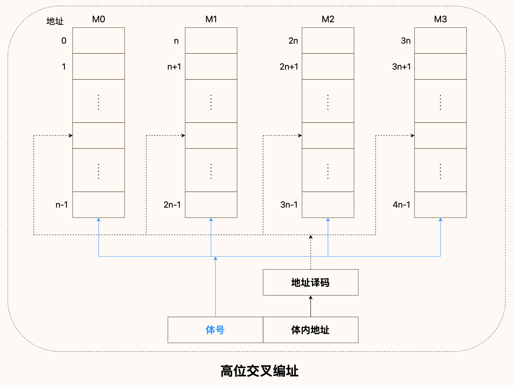

由于这种方式下，相邻数据集中在一个存储体中，**多个存储体无法并行工作**，而是 **串行工作**：

- 所有存储体共用一个 **地址寄存器（AR）** 和 **数据寄存器（DR）**；
- 每次只能访问一个存储体，其它存储体处于空闲状态。

这种串行访问的结构较为简单，适用于对并行性能要求不高的场景，但 **无法提升带宽或访问效率**，无法发挥出多体结构的优势。

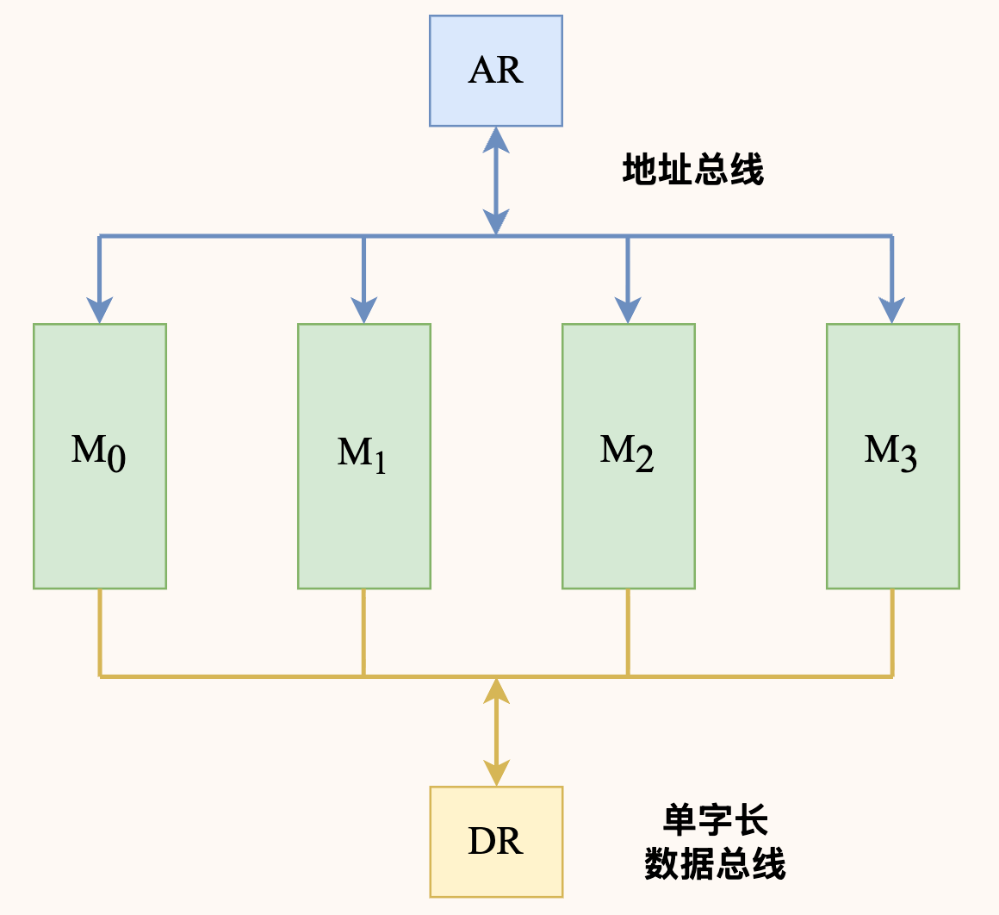

##### 低位交叉编址

在 **低位交叉编址** 中，**地址的低位** 用于选择 **存储体**，**高位** 用于标识该存储体内的偏移地址。

以 4 个存储体为例，地址也分别映射到 **M0~M3**，以此类推。这样就实现了 **相邻地址分散存储在不同存储体中** 的效果：

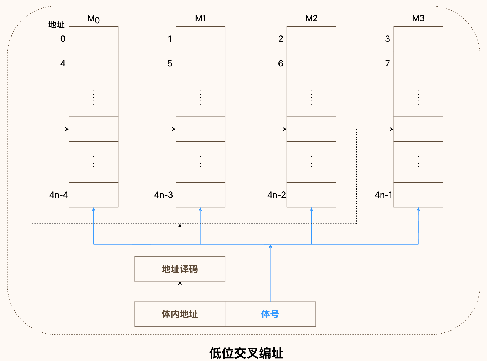

在这种方式下，多个存储体可以 **并行工作**，大大提高了访问效率。但为了支持并行，每个存储体 **都需配备自己的地址寄存器和数据寄存器**，如下图所示：

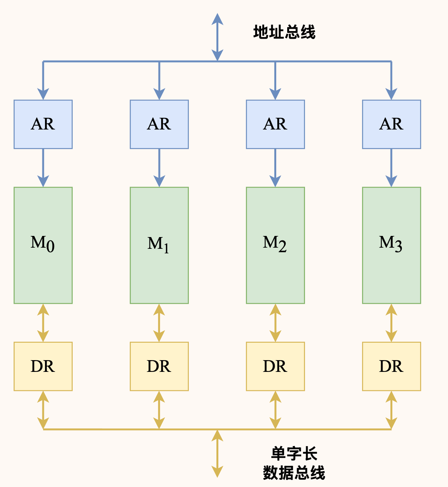

##### 并行性

在 [低位交叉编址](https://www.csgraduates.com/constitution_principle/storage/memory/#低位交叉编址) 中，**相邻地址的数据分布在不同的存储体中**，多个存储体可以 **并行处理请求**，这种并行方式类似于 [指令流水线](https://www.csgraduates.com/constitution_principle/cpu/pipeline/)，极大提升了主存的访问带宽。

在介绍并行性概念之前，首先要介绍一下 存储周期  的概念：

**存储周期** 是指某个存储体完成一次数据读/写后，必须等待一定时间后才能再次被访问。例如，一个存储体的存储周期为 **40 ns**，意味着它每 **40 ns** 才能响应一次请求。

设主存划分为 *n* 个存储体，每个体的存储周期为 *T* ，则通过低位交叉编址，可以实现如下 **并行/流水访问机制**：

- 连续访问的数据地址被轮流分配到不同的存储体中（例如地址 0 到 **M0**，地址 1 到 **M1**，…，地址 n 到 **M0**，再次轮转）；
- 由于每次访问都落在不同的存储体上，**只要下一次访问与当前访问不落在同一个体内，就不会发生冲突**；
- 这样可以实现在每个较短的时间间隔内从不同的存储体中连续读出数据。

因此，整个系统的 **最小连续访问间隔 = 存储周期 / 存储体数目**。

**最小连续访问间隔** = n/T

其中：

- *T* 是单个存储体的存储周期（如 **40 ns**）；
- *n* 是存储体数（如 **8 体交叉**）；
- 于是主存系统 **可以每 T/n 秒读取一个字**。

低位交叉存储器天然适合与 **访问流水线** 结合。例如一个读取操作可分为：

1. *P*1 ：送地址和命令（送地址至存储器的 **AR** 中）
2. *P*2 ：存储器读取数据（读取数据到 **DR** 中，该周期也称作 **存储周期**）
3. *P*3 ：传送数据（从 **DR** 中读取数据并传输到内存的物理地址中）

假设 CPU 的时钟周期为 *t* ， *P*1 和 *P*3 的耗时为一个时钟周期即 *t* 。 *P*2 的耗时为四个时钟周期即 4×*t* ，那么对于上图所示的 四体交叉存储器，读取 八个字长的数据 的流水线如下所示：

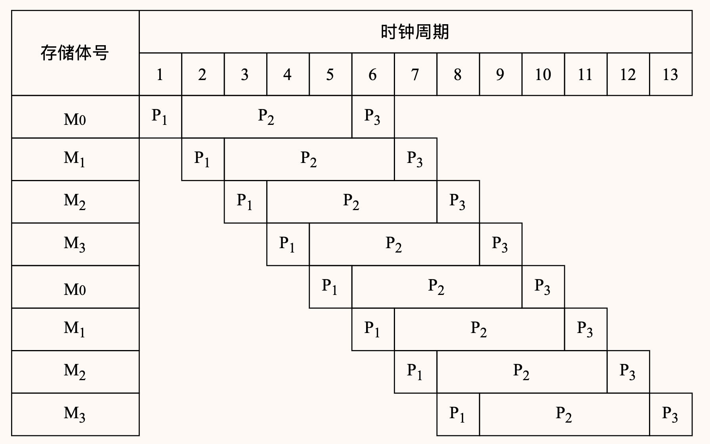

采用流水线方式后，即使存储体尚未完成其自身内部访问，也可以开始对其他体的下一条指令进行地址投送，实现访问阶段的 **重叠执行**，从而提升 **吞吐率**。

#### 2.3 主存容量的扩展

虽然单体存储芯片的容量和字长在不断扩大，但是在实际应用的过程中，仍然会出现芯片的容量或者字长满足不了应用的情况，因此就有了 **存储扩展** 的需求；

假设存储芯片的字长为 *N* ，存储字数为 *M* ，则存储芯片的容量为 *M*×*N* 。


常见的存储扩展包括三种：**位扩展、字扩展、字位扩展**：

- **位扩展**：扩展字长
- **字扩展**：扩展字数
- **字位扩展**：同时扩展字长和字数

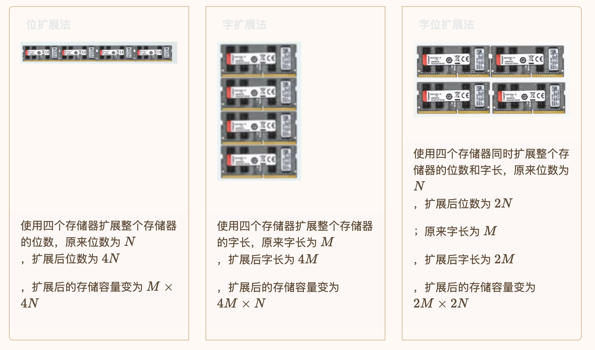


##### 位扩展

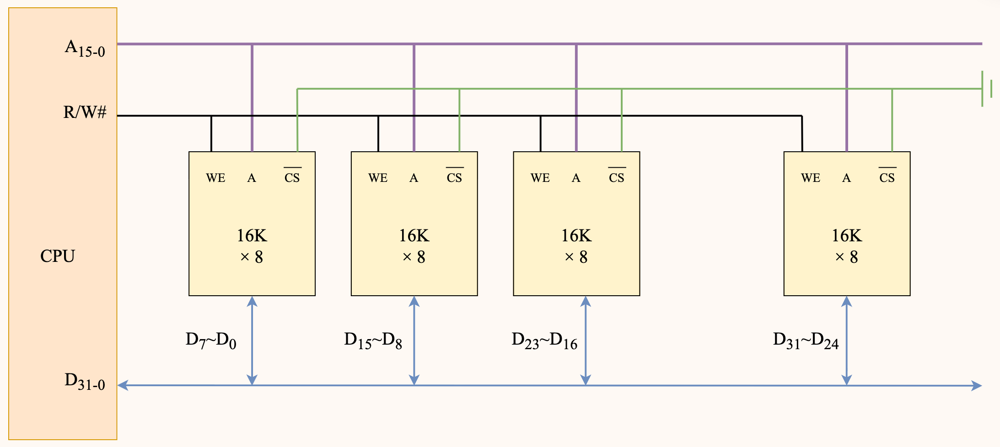

如上图所示，用 16*K*×8 bit 的存储芯片用来构建 16*K*×32 *bit* 的存储器。

需要的芯片数量为 (16*K*×32)/(16*K*×8)=4 。

由于是 **位扩展**，所以四个芯片的片选信号要连接在一起，并处在常有效的状况；（片选信号是读写操作的开关）。

由于原存储器的 8 位的，扩展之后变为 32 位，这 32 位的位线同 CPU 的 32 位数据线相连接，所有存储芯片并行工作，贡献 32 位数据中的不同 8 位；

图中，4 个存储器共同构成 64*KB*=216*B* 的存储空间，所以地址总线为 16 位，即从 *A*0 到 *A*15 。 但是由于 16*KB* 的存储芯片只需要 14 根地址线，因此只需要 14 位地址线与存储线相连，即从 *A*2 到 *A*15 。 这里 *A*0 到 *A*1 不被使用，因为这 **低两位地址线** 相当于被用来扩展字长。

##### 字扩展

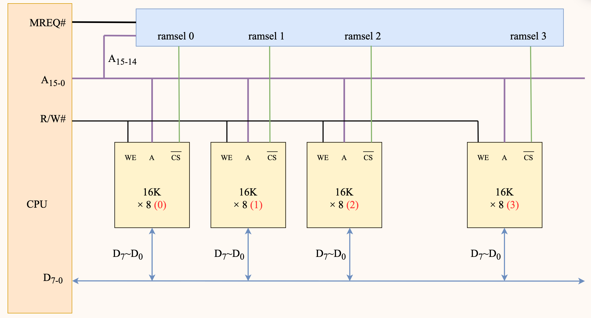

如上图所示，用 16*K*×8 *bit* 的存储芯片用来构建 64*K*×8 *bit* 的存储器。

需要的芯片数量为 (64*K*×8)/(16*K*×8)=4 。

地址总线的位数为 16 ， 但是由于 16*K**B* 的存储芯片只需要 14 根地址线，因此只需要 14 位地址线与存储线相连，即从 *A*0 到 *A*13 。 **高两位地址线** *A*14 到 *A*15 与片选译码器相连，由此产生片选信号。

##### 字位扩展

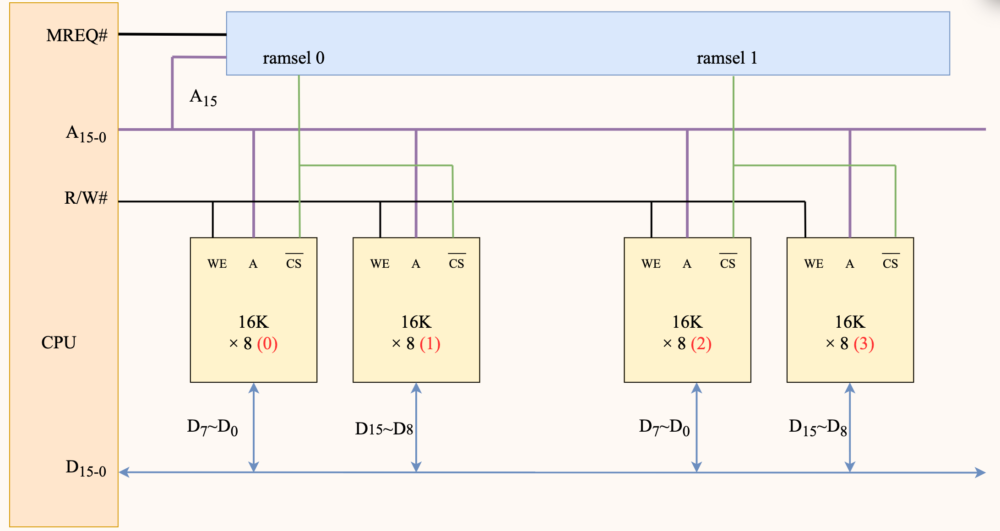

如上图所示，用 16*K*×8 *bit* 的存储芯片用来构建 32*K*×16 *bit* 的存储器。

需要的芯片数量为 (32*K*×16)/(16*K*×8)=4 。

地址总线的位数为 16 ，地址线 *A*1∼*A*14 与存储器相连， *A*0 不使用，被用来扩展字长。 *A*15 用来产生片选信号。

---

## 外存

### 一、机械硬盘

**机械硬盘**（Hard Disk Drive, HDD）是一种使用磁性存储介质来存储和读取数据的非易失性存储设备，广泛应用于计算机和数据存储系统中。

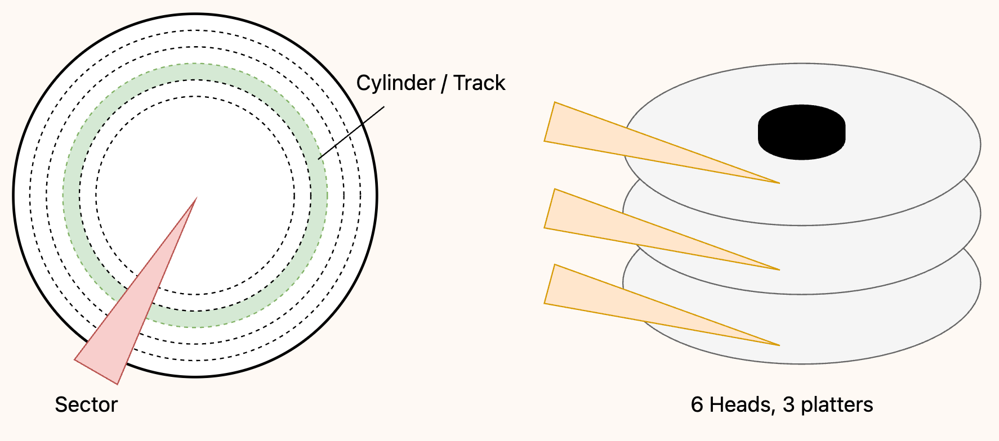

#### 1.1 存储区域

为了理解机械硬盘是如何存储数据的，需要理解如下概念：

1. **磁头（Heads）**：磁头是位于硬盘驱动器的读/写臂上的设备，用于读取和写入磁盘上的数据。每个盘片（硬盘通常包含多个盘片，每个盘片都有两个表面）上都有一个磁头，因此每个磁头都可以读取或写入盘片上的数据。磁头通过移动到不同的 **磁道（track）** 来寻找并访问数据。
2. **Track（磁道）**：磁道是磁盘上的一个同心圆环。
3. **Cylinders（柱面）**：柱面是硬盘上的一个数据存储区域，由相同半径位置上的多个盘片上的磁道组成。换句话说，它是所有盘片上相同半径位置的磁道的集合。
4. **Sectors（扇区）**：扇区是磁盘上的最小数据存储单元。磁盘通常被划分成许多扇区，每个扇区可以存储一定数量的数据。扇区的大小通常是 **512 字节** 或 **4KB**。操作系统和磁盘控制器使用扇区作为数据的最小单元，以读取和写入数据。

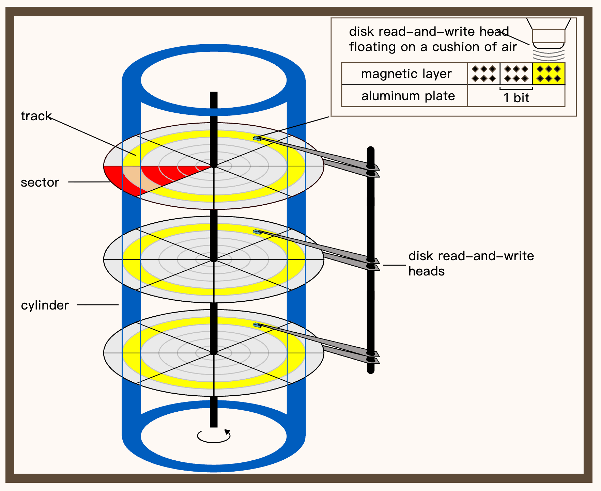

#### 1.2 CHS地址

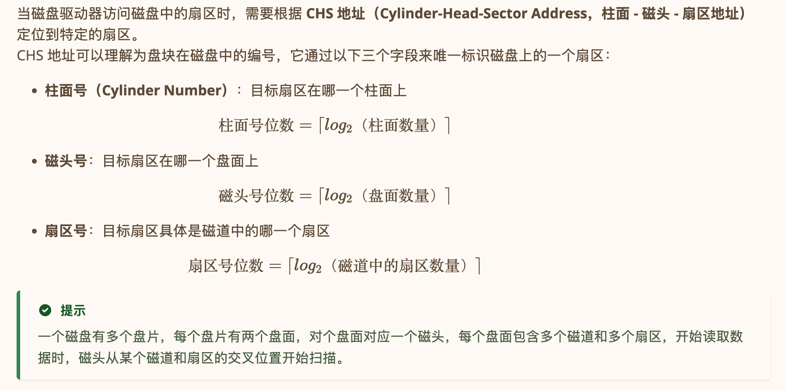

假设一个磁盘有 **1000** 个柱面、**4** 个盘面、**32** 个扇区/磁道：

- **柱面号位数**： ⌈log2(1000)⌉≈⌈9.97⌉=10 位
- **磁头号位数**： ⌈log2(4)⌉=2 位
- **扇区号位数**： ⌈log2(32)⌉=5 位
- **CHS 地址总位数**： 10+2+5=7 位

通过 **CHS 地址**（例如，C=500, H=2, S=15），磁盘驱动器可以精确定位到特定扇区。

#### 1.3 性能指标

##### 平均存取时间

**平均存取时间**是磁盘完成一次读写操作的平均耗时，由 **寻道时间**（Seek Time）、**旋转延迟**（Rotational Latency）和 **传输时间**（Read/Write Time）这三部分构成：

- **寻道时间**：磁头从当前位置移动到目标磁道所需的时间，通常与磁头移动距离和致动器性能有关。
- **旋转延迟**：盘片旋转使目标扇区到达磁头下方所需的时间，通常为盘片旋转半圈的平均时间，取决于转速。
- **传输时间**：读取或写入目标扇区数据的实际时间，与扇区大小和数据传输率相关。

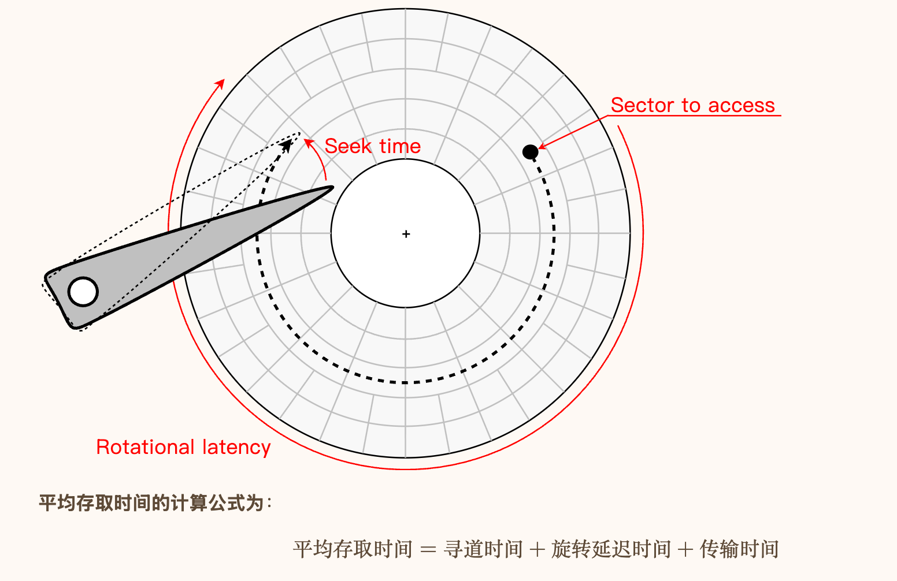

##### 数据传输率

**数据传输率** 表示磁盘每秒向主机传输数据的字节数，反映硬盘的读写速度。假设磁盘转速为 *r* 传/秒，每条磁道容量为 *N* 字节，则数据传输率 *Dr* 为：

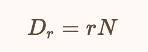

### 二、RAID

RAID 全称为 **独立磁盘冗余阵列**（Redundant Arrar of Independent Disks）
由于磁盘存储介质数据的可靠性容易受到环境影响，而发生数据错误的代价非常大，因此需要考虑存储的容灾与恢复。

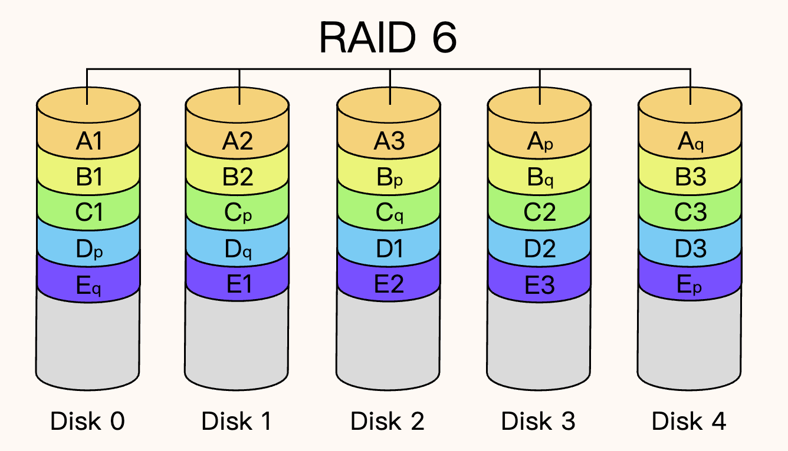

RAID 将多个独立的物理磁盘组成一个独立的逻辑盘，数据在多个物理盘上分割交叉存储、并行访问，具有更好的存储性能、可靠性和安全性。

RAID 的实现涉及以下核心技术：

- **磁盘镜像**：将相同数据写入多块磁盘，提高可靠性。典型如 **RAID1**。
- **条带化**：将数据分段交叉存储在多个磁盘上，提升性能。典型如 **RAID0**，但不具备容错能力。
- **奇偶校验**：通过冗余校验位在部分磁盘损坏时重建数据，兼顾可靠性与存储效率。用于 **RAID3/5/6**。
- **Cache 机制**：提高读写性能，但本身不增加可靠性，除非使用掉电保护的写缓存。

常见 RAID 等级如 **RAID1（镜像）**、**RAID5（条带化 + 奇偶校验）**、**RAID6（双重奇偶校验）**等在性能与容错能力之间做出不同权衡。

### 三、固态硬盘

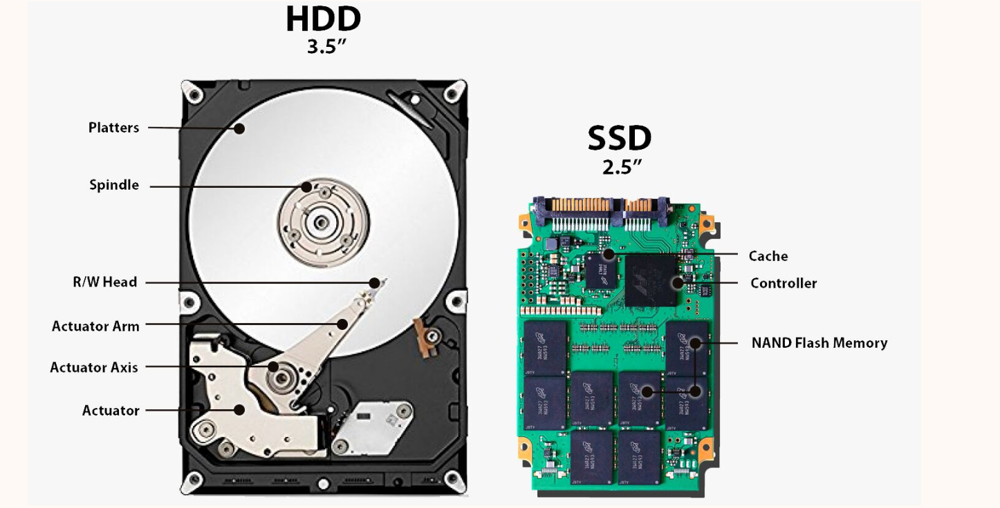

固态硬盘（**Solid State Drive, SSD**）是一种使用闪存（**NAND Flash**）作为存储介质的非易失性存储设备，与传统机械硬盘（**HDD**）相比，SSD 在性能、耐用性和能效等方面具有显著优势。SSD 具备以下特点：

- **无机械部件**：SSD 没有旋转盘片、磁头或机械臂等移动部件，它使用闪存存储芯片来存储数据。这意味着它不会受到机械故障的威胁，具有更高的耐用性。
- **更快的读写速度**：SSD 的读写速度远远超过传统的机械硬盘，因为数据可以立即访问，无需等待盘片旋转和磁头寻道。这使得计算机启动更快，应用程序响应更迅速。
- **低访问时间**：由于 **没有机械延迟**，SSD 的访问时间极低，通常在微秒级别。这有助于加快文件读取和数据检索。
- **长寿命**：虽然每个存储单元有写入次数的限制，但现代 SSD 使用错误检查和纠正（ECC）技术，以延长其寿命，并且通常拥有较长的保修期。
- **无碎片化**：SSD 的数据存储方式基于闪存单元，读取速度不受数据物理位置的影响，因此不会像 HDD 那样因数据碎片化而降低性能。
- 局限性：
  - **容量限制**：SSD 的高容量型号（例如 **4TB 以上**）价格昂贵，而 HDD 在大容量存储上更具优势。
  - **写入寿命有限**：尽管现代技术已大幅延长寿命，但重度写入场景下仍需关注寿命问题。

#### 3.1 机械和固态硬盘对比

以下是从多个维度对 SSD 和 HDD 进行的详细对比：

| **特性**     | **SSD（固态硬盘）**                       | **HDD（机械硬盘）**                  |
| ------------ | ----------------------------------------- | ------------------------------------ |
| 存储介质     | 闪存（NAND Flash）                        | 旋转盘片 + 磁头                      |
| 机械部件     | 无，纯电子存储                            | 有，盘片、磁头、机械臂等             |
| 读写速度     | 极快（500 MB/s 至 7000 MB/s，视接口而定） | 较慢（100-200 MB/s）                 |
| 随机访问时间 | 极低（0.1 毫秒以下）                      | 较高（5-10 毫秒）                    |
| 耐用性       | 抗震抗摔，无机械故障风险                  | 易受震动、摔落影响，机械故障风险较高 |
| 噪音         | 无噪音                                    | 有盘片旋转和磁头移动的噪音           |
| 重量与体积   | 轻薄，适合移动设备                        | 较重，体积较大                       |
| 碎片化问题   | 无需碎片整理                              | 需定期碎片整理以维持性能             |
| 适用场景     | 系统盘、高性能计算、移动设备              | 大容量存储、备份、成本敏感场景       |

---

## Cache

### 一、cache原理

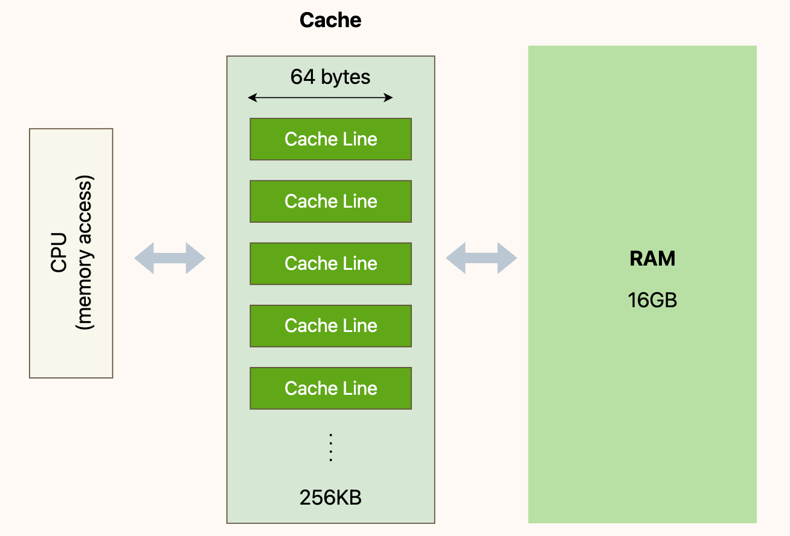

**缓存** 是一种临时存储数据的硬件或软件组件，旨在加快后续对该数据的访问速度。当您请求数据时，计算机会先检查 **缓存** 中是否存在该数据。如果存在（称为 **“缓存命中”**，Cache Hit），则可以直接从 **缓存** 中获取数据，而无需访问内存，从而节省时间和资源。如果 **缓存** 中不存在该数据（称为 **“缓存未命中”**，Cache Miss），则需要从内存获取数据，并将其存储在 **缓存** 中，以备将来使用。

#### 1.1 cache工作原理

**缓存**（cache）是计算机系统中的一种用于加速数据访问的技术，其原理是在高速存储介质中暂时存储常用数据，以便更快地满足后续的访问请求。

**缓存** 对于程序执行的加速主要来自于 **计算机程序** 的 **时间局部性**（Temperal Locality）和 **空间局部性**（Spatial Locality）：

##### 时间局部性

时间局部性指的就是 **“刚刚用过的数据，很可能很快又会被用到**。

这种特性常见于 **循环结构和频繁访问的变量**，例如循环中的计数器或者经常读取的配置值：

```c
int sum = 0;
int arr[1000];

// 初始化数组
// ....
// 访问同一个变量 i 很多次
for (int i = 0; i < 1000; i++) {
    sum += arr[i];   // 访问 arr[i]
    sum += arr[i];   // 再次访问 arr[i]
}
```

在 **缓存** 设计中，利用 **时间局部性** 意味着一旦数据被加载到 **缓存** 中，它应该在那里保留一段时间，因为很可能很快会再次需要它。

##### 空间局部性

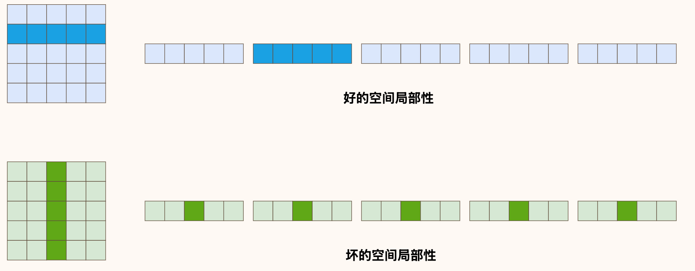

如果一个数据项被访问，那么存储在其附近的数据项也很可能在不久的将来被访问。

这种特性在数组遍历或结构体访问时尤为明显，因为这些数据元素通常在内存中是连续存储的。

利用 **空间局部性** 的 **缓存** 设计会在访问一个数据项时，同时把它附近的数据也加载到 **缓存** 中，因为这些数据很可能在接下来的操作中被用到。

#### 1.2 cache概念

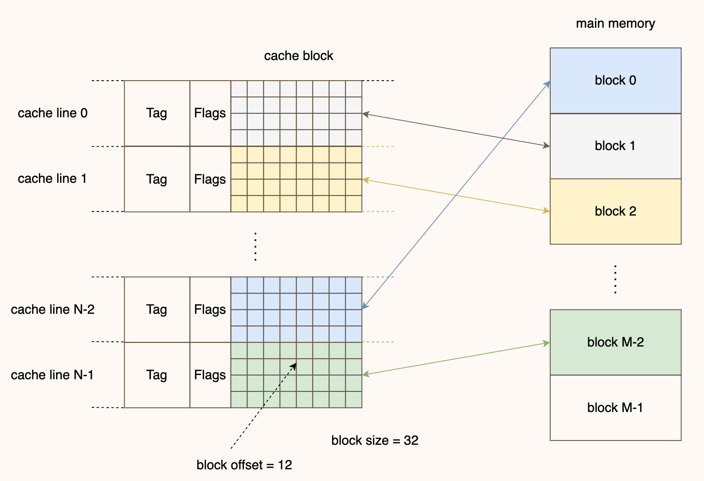

- **cache 行**（cache line）：**cache 行** 中包含 **各种标记字段**（flag）和 **数据**（cache 块）
- **缓存块**（cache 块）：**cache** 中的一块存储空间，是与 **主存** 进行数据交换的基本单元
- **主存块**：**主存** 中的一块存储空间，**主存块** 的大小一般与 **cache 块** 一致
- **块内偏移**：某一个地址在块内的偏移，找到对应的块后，通过块内偏移找到该地址的具体位置
- **块大小**：用于判断块内偏移的位数，比如 1024=210 ，所以 1KB 的块对应的块内偏移位数为 10

#### 1.3 缓存块

**Cache block**（缓存块），是计算机系统中用于存储的最小数据单元，它是 **缓存** 中的一个固定大小的数据块。每个 **缓存块** 包含一定数量的字节或字（通常是 2 的幂次方个字节），并用于存储从 **主存**（或更低级别的 **缓存**）中加载的数据。

**cache block** 的目的是为了方便对于 **主存**（main memory）数据的 **缓存**，**主存块** 的大小与 **缓存块** 大小一致，这样就可以将 **缓存块** 和 **主存块** 对应起来。

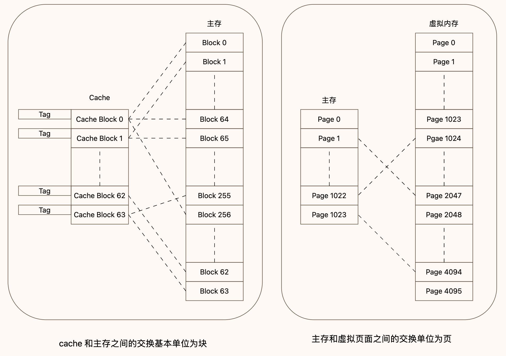

**cache** 中的存储空间可以被分为若干个 **cache 块**，**主存** 也可以被分为若干个 **主存块**，**主存** 和 **cache** 间的数据置换是以 **块** 为基本单位的。
这可以和页式内存进行类比，虚拟内存和物理内存都被分为若干个页面，物理内存空间的置换以 **页面** 为基本单位。

**缓存块的大小？**

**Cache block** 的大小在不同计算机体系结构中可以有所不同，通常以字节（bytes）或字（words）为单位来表示。典型的 **缓存块** 大小可以是 32 字节、64 字节、128 字节等。较大的 **缓存块** 可以容纳更多的数据，提高了数据的局部性，但在某些情况下，较小的 **缓存块** 可能更适合，特别是对于小规模的数据访问。

### 二、cache和主存映射方式

Cache 的容量远小于主存，而主存中的任意一个数据块在程序运行过程中，都有可能被调入 Cache。 因此，体系结构必须回答一个核心问题：

- **当某个主存块需要进入 Cache 时，它可以（或应该）放到 Cache 的哪个位置？**

这个从 **主存块 → Cache 块** 的对应规则，就称为 **映射方式（Mapping）**。

从抽象角度看，映射本质上定义了三件事：

1. **可放置性**：
   一个主存块，**允许**放入 Cache 的哪些位置？
2. **唯一性或灵活性**：
   是只能放到一个固定位置，还是可以放到多个位置，甚至任意位置？
3. **硬件代价与性能权衡**：
   放得越自由，命中率越高，但查找与比较逻辑越复杂； 放得越受限，硬件越简单，但冲突失效（conflict miss）越频繁。

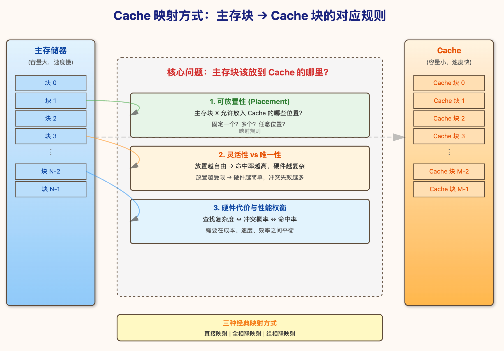

不同的映射方式，本质上就是在 **命中率、访问速度、硬件复杂度** 三者之间做不同取舍。

按照“一个主存块能映射到多少个 Cache 块”这一自由度的不同，常见的映射方式可以分为：

- **直接映射（Direct Mapped）**：只能映射到 **唯一一个** Cache 块
- **全相联映射（Fully Associative）**：可以映射到 **任意一个** Cache 块
- **组相联映射（Set Associative）**：只能映射到 **某一组中的任意一个** Cache 块

下面我们从**最简单、硬件代价最低**的直接映射开始分析。

#### 2.1 直接映射

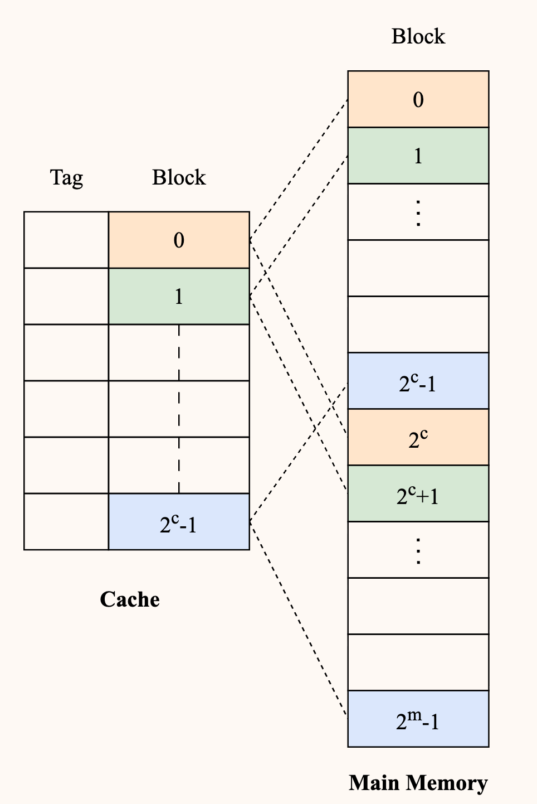

在 **直接映射**（directed mapped）缓存 中，每个 **主存块** 只能映射到缓存中的 **一个特定缓存块**。这意味着每个 主存块只有一个缓存块可以存储它。

主存块号 *k* 映射到缓存块号的计算公式为：


其中：

- *k* 为主存块号（从 0 开始编号），
- *M* 为缓存中的总块数。

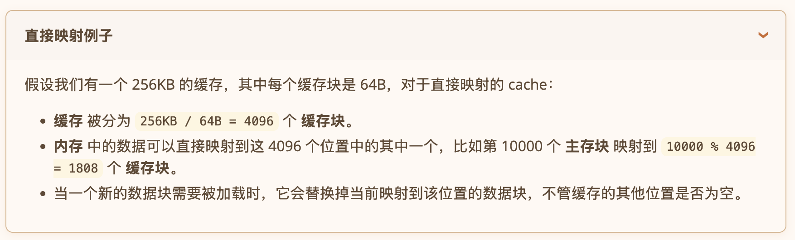

#### 2.2 全相联映射

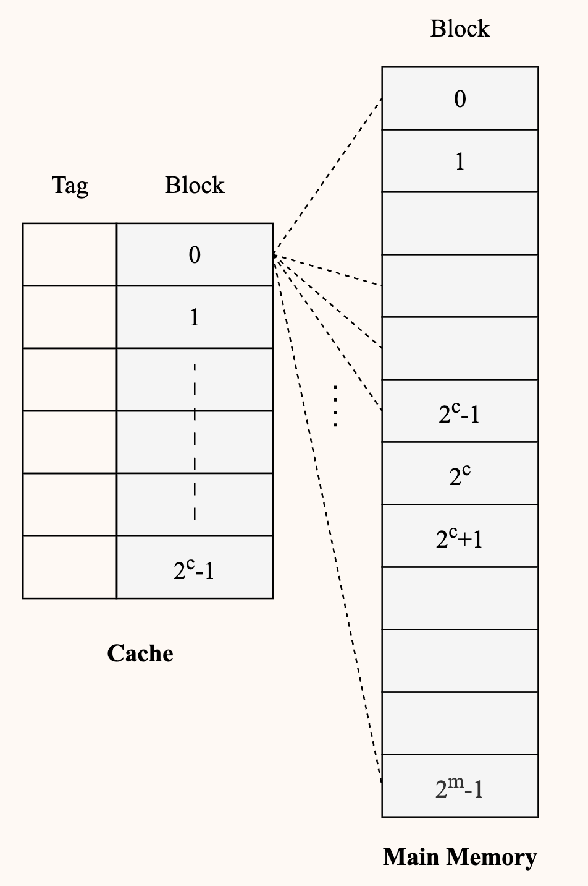

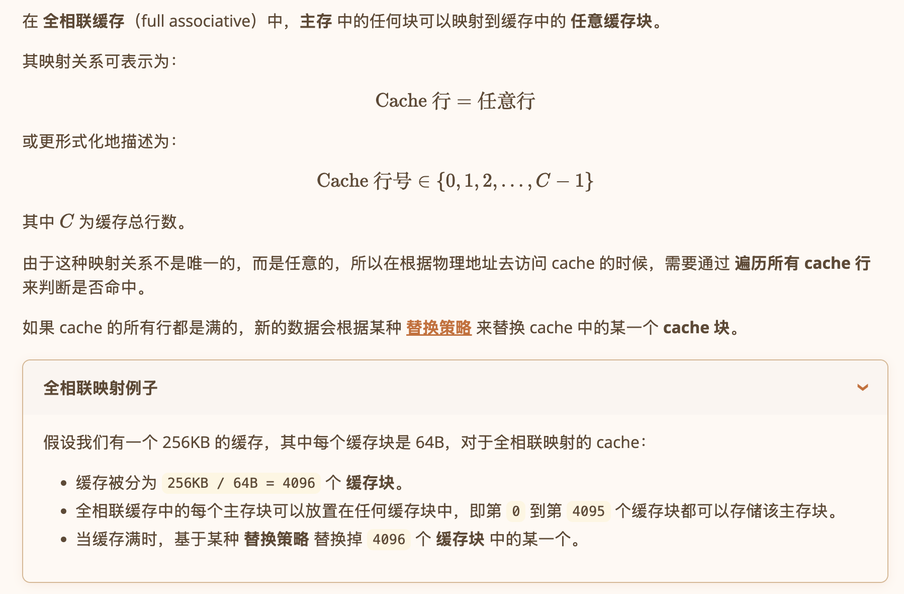

#### 2.3 组相联映射

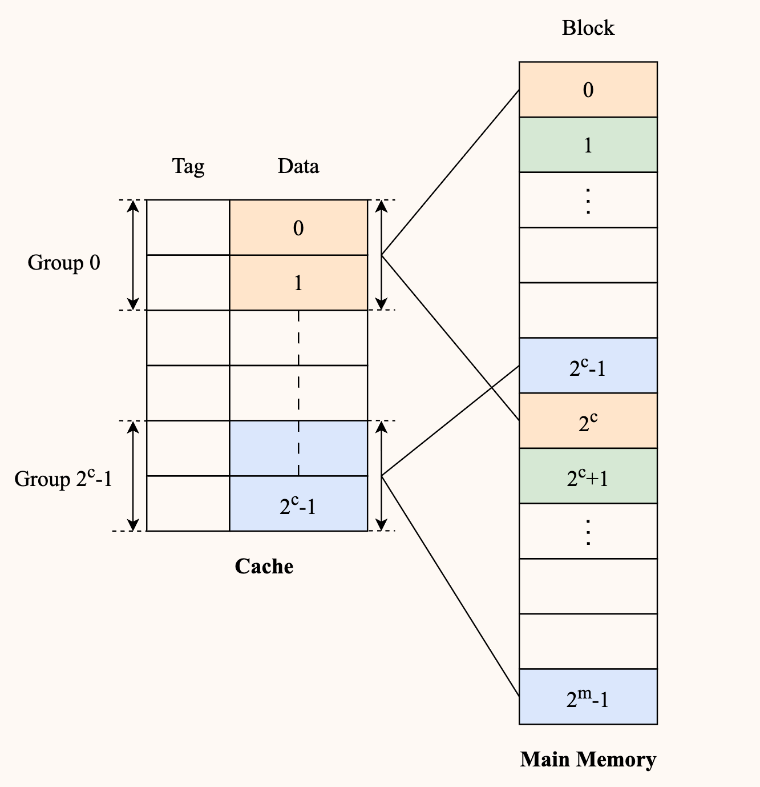

**组相联缓存**（set associative 或 group associative）是 直接映射缓存 和 全相联缓存 之间的一种 **折中方案**。它将缓存块分为多个 **组**，每个组包含多个缓存块。主存块可以 **映射到组中的任意一个缓存块**。

当我们说一个缓存是 `N 路组相连` 的，意味着缓存被分为多个 **组**，每个 **组** 有 N 个 **缓存块**（N 路）。这样，当一个内存地址被映射到一个特定的组时，它可以放在该 **组的任何一个缓冲块**（一路）上。

如果一个组是满的，新的数据会根据某种 **[替换策略](https://www.csgraduates.com/constitution_principle/storage/cache/#cache-中的块替换算法)** 来替换组中的一个 **缓存块**。


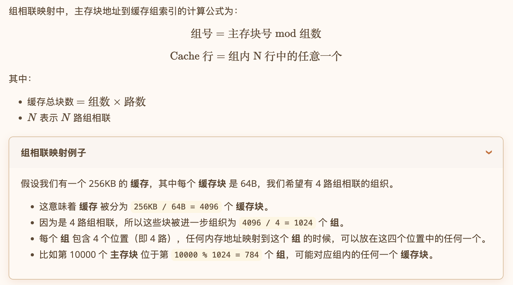

##### 硬件结构

下图展示的是一个 **二路组相联 Cache** 的结构示意图。

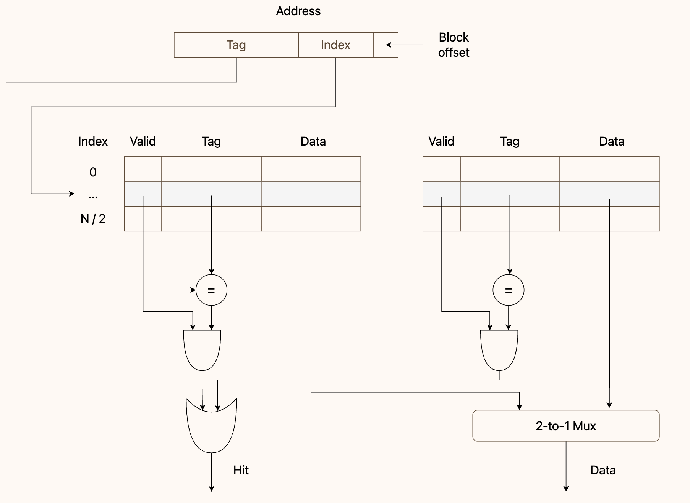

访问时，物理地址中的 **组号**（index） 用于定位到 **Cache** 中的某一 **组**。该 **组** 包含两个 **Cache 块**，每个块有 **valid 位** 和 **tag 字段**。

地址中的 **tag** 会同时送入两个 **比较器**，分别与组内两个块的 **tag** 进行匹配，并结合 **valid 位** 判断是否命中。

如果命中，**选择器**（multiplexer）根据比较结果，从两个块中选出正确的数据输出给处理器。若都未命中，则访问 **主存**。

🔧 比较器与选择器的作用 

- **比较器**（Comparator）：用于判断 **Cache 块** 中的 **tag** 是否与当前地址匹配，决定是否命中；
- **选择器**（Multiplexer）：在多个块中有可能命中的情况下，负责根据比较结果选出正确的数据路径。

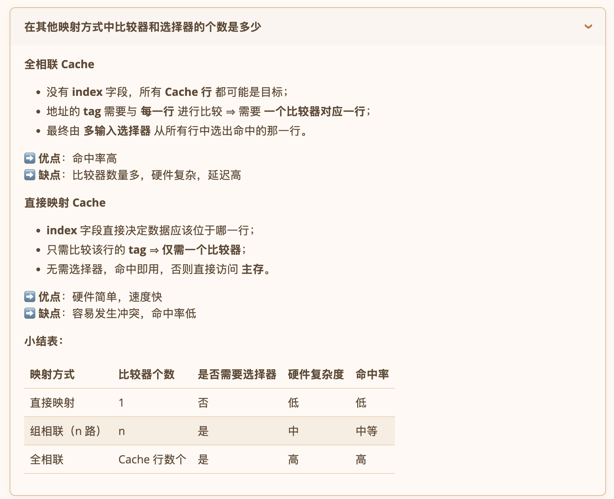

#### 2.4 映射方式对比

假设 **cache** 有 M 个 **cache 块**，对于块号为 k 的 **主存块**：

- **直接映射**：被映射到块号 `k % M` 的 **cache 块**
- **全相连映射**：可能被映射到任意一个 **cache 块**
- **组相连映射**：对于 m 路组相连，被映射到组号为 `k % (M / m)` 的 **cache 组** 中的任意一个 **cache 块**

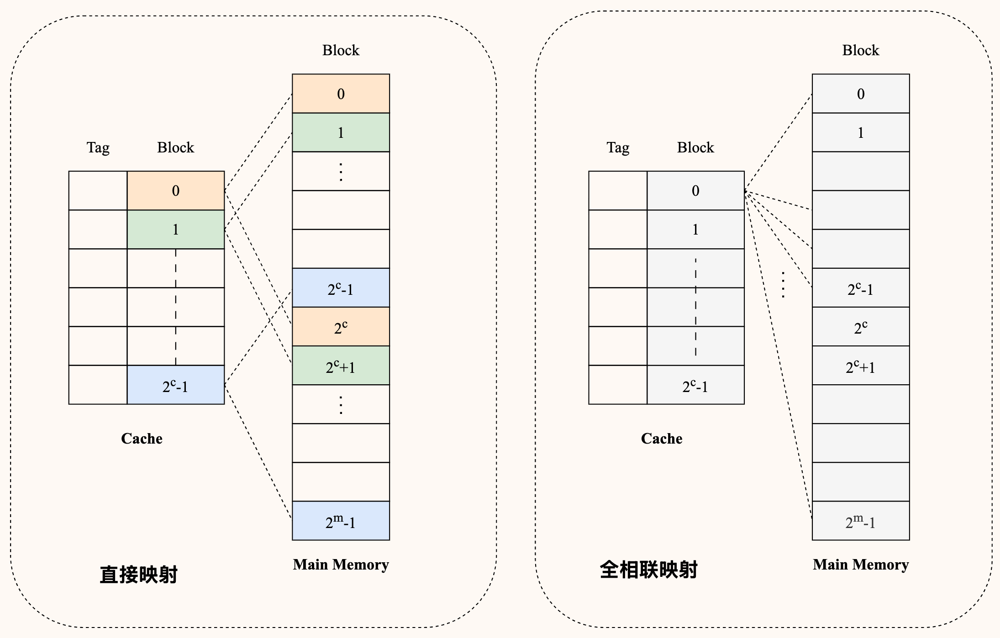

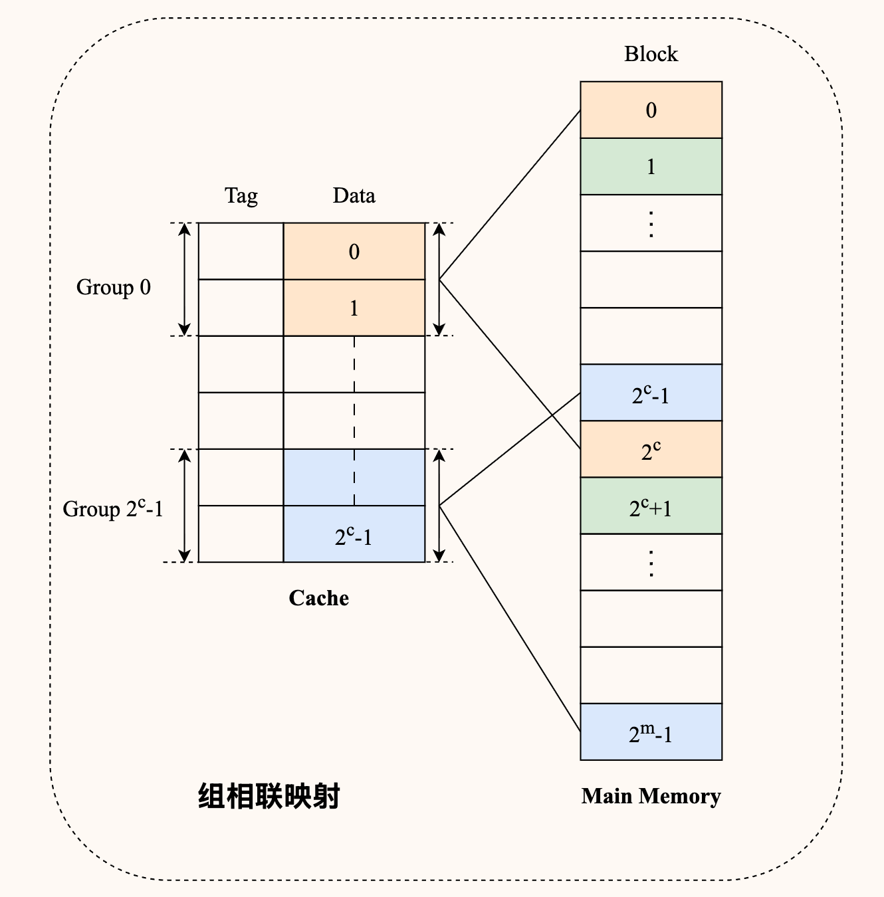

| 特点                     | 直接映射缓存 | 全相联缓存         | 组相联缓存               |
| ------------------------ | ------------ | ------------------ | ------------------------ |
| 主存块到缓存块的映射关系 | 固定的       | 任意的             | 组内任意                 |
| 硬件复杂度               | 较低         | 高                 | 介于两者之间             |
| 查找速度                 | 快           | 相对较慢           | 介于两者之间             |
| 成本                     | 低           | 高                 | 介于两者之间             |
| 性能优点                 | 简单、低成本 | 无缓存冲突、高性能 | 较低的缓存冲突，性能适中 |

#### 2.5 关联度

**Cache 关联度**（associativity）描述的是一块 **主存地址** 可以被映射到 **缓存** 中多少个不同的位置（cache lines）。

根据上面提及的 [映射方式对比](https://www.csgraduates.com/constitution_principle/storage/cache/#映射方式对比) 可知关联度对比：

**全相联** > **组相联** > **直接映射**

更高的关联度意味着 **缓存冲突** 减少，**命中率** 提高。但是另一方面，硬件开销（比较器、替换策略复杂度）和访问延迟增加。所以关联度选择**需权衡性能与成本**。

### 三、cache地址结构

当给定一个 **物理地址** 时，Cache 的访问过程可以抽象为三个连续的问题：

1. 这个地址属于主存中的哪一个块？
2. 这个主存块在 Cache 中可能出现在哪些位置？
3. 这些位置中是否真的缓存了该主存块？

#### 3.1 逻辑划分

因此，从 **“硬件判定流程”** 的角度，物理地址在逻辑上可划分为以下三部分：


##### 块内地址

- **作用**： 确定访问数据在一个 **主存块 / cache 块** 内的具体偏移
- **位数**： log2(块大小)
- **说明**： 这一部分 **只用于块内寻址**，与映射方式无关

##### Cache 块匹配字段

- **作用**： 用于 **缩小搜索范围**，确定该主存块**可能被缓存在哪些 cache 块中**
- **含义因映射方式而异**

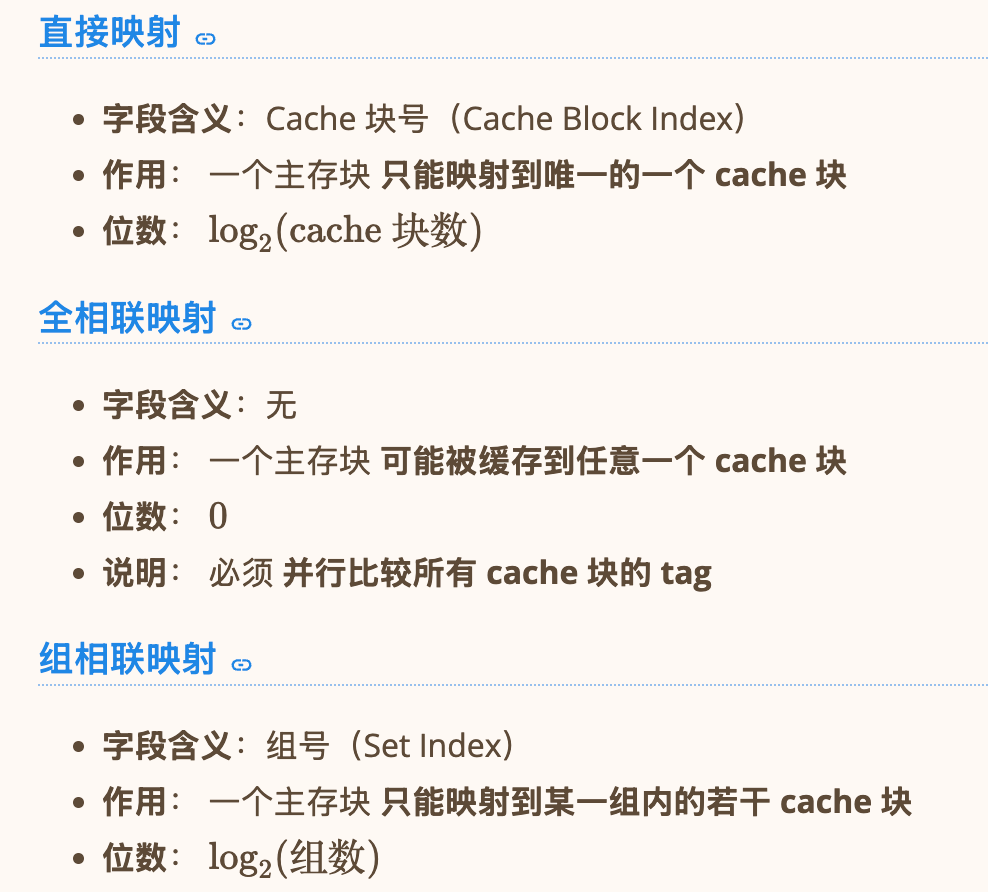

总结一下三种映射方式的块匹配字段的计算方法：

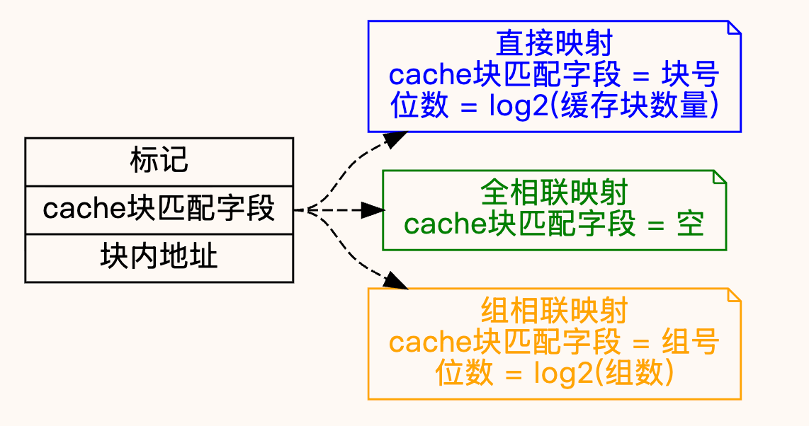

##### 标记

- **作用**： 在已确定的候选 cache 块（或某一组）中， **通过比较 tag 判断是否真正命中**
- **位数**：


#### 3.2 物理地址对应

具体而言，给定一个物理地址，访问 Cache 时的各个字段的对应方式如下图所示：

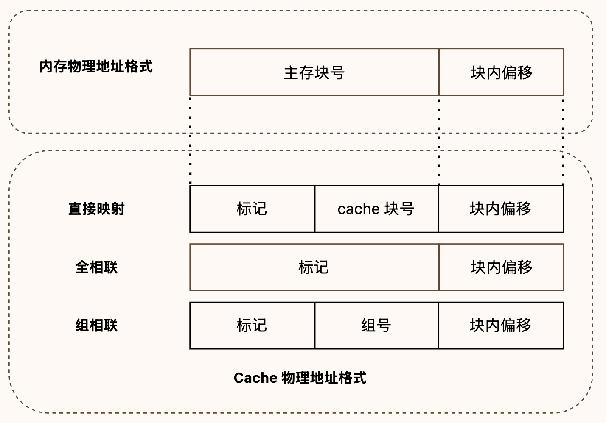

其中 块内偏移、cache 块号（直接映射）、cache 组号（组相联映射）的位数可以直接根据 cache 的参数计算出来，Tag 字段的位数需要通过物理地址的位数减去其他字段的位数来得到。

### 四、cache存储结构

cache 存储的内容大体上来说可以分为 数据 和 元数据 这两个部分：

- 数据部分：即 cache 块（cache block），缓存了某个主存块的内容
- 元数据部分：对 cache 访问的过程进行控制

cache 的存储结构可以理解为一张表：

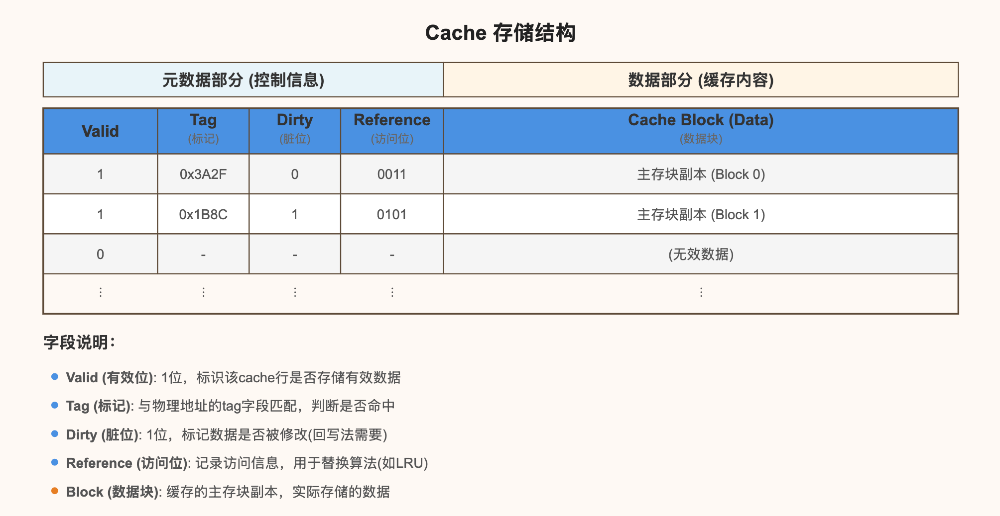

其中字段的含义与 [页表](https://www.csgraduates.com/constitution_principle/storage/virtual/#单级页表) 近似，下面列出了：

- 有效位（valid）：
  - 该 **cache 行** 是否存储有缓存数据，位数为 1 位。
- 标记（tag）：
  - 根据物理地址中的 **tag** 字段与该字段匹配，以判断是否命中，位数按照 **cache 地址结构** 进行计算。
- 脏位（dirty）：
  - 标记该 cache是否修改过，与写策略相关。
    - 如果采用 [**直写法**](https://www.csgraduates.com/constitution_principle/storage/cache/#直写法)，则无需设置 **脏位**。
    - 如果采用 [**回写法**](https://www.csgraduates.com/constitution_principle/storage/cache/#回写法)，设置 1 位 **脏位**。
  - 该字段也常被称为 **修改位**。
- 访问位（reference）：
  - 用于记录访问信息，服务于 **块替换算法**，其位数取决于替换算法。
  - 如果采用 **LRU** 替换算法，则 **访问位** 的位数为 *l**o**g*2(主存快对应的缓存块数量) 。
- 数据块（block）：
  - 缓存的数据块，为 **主存块** 的一个副本。


### 五、cache中的块替换

块替换算法适用于 **全相联映射** 和 **组相联映射**，因为在这两种组织方式中，同一主存块可能被 **多个 cache 块** 中的任意一个所缓存；因此当需要把新块写入时必须决定把哪一个已有的 cache 块淘汰。而在 **直接映射方式** 中，主存块只能对应唯一的 **一个 cache 块**，如果发生冲突，直接用新块覆盖该 cache 块即可，无需额外的替换算法。

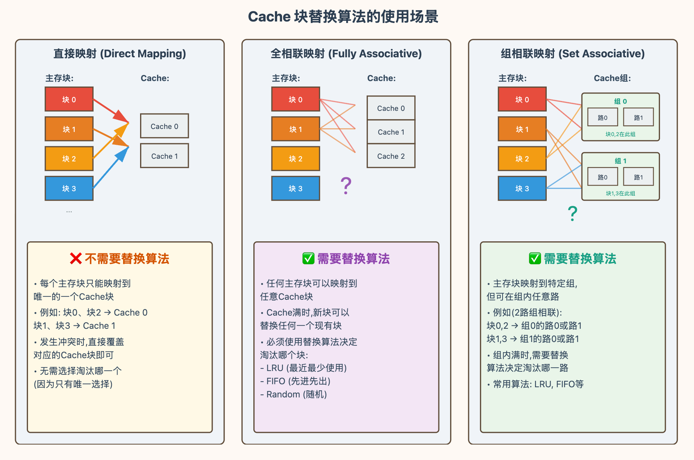

#### 5.1 替换过程

**cache 块替换与命中判定过程（以组相联/全相联为例）：**

1. **确定候选集合** 根据地址映射方式，确定对应的 cache 组（组相联）或整个 cache（全相联）作为候选块集合。
2. 命中判定在候选块中：
   - **仅对 valid=1 的块进行 tag 比较**；
   - 若存在某块 `valid=1 且 tag 匹配`，则发生 **cache 命中**，访问结束。
3. 缺失处理（cache miss）若未发生命中：
   - 若候选块中存在 `valid=0` 的块，则选择其中一个空闲块，将主存块加载到该块中，并设置 `valid=1`、更新 tag；
   - 若所有候选块均为 `valid=1`，则根据 **块替换算法**（如 LRU、FIFO、随机等）选择一个块进行淘汰，并写入新主存块。

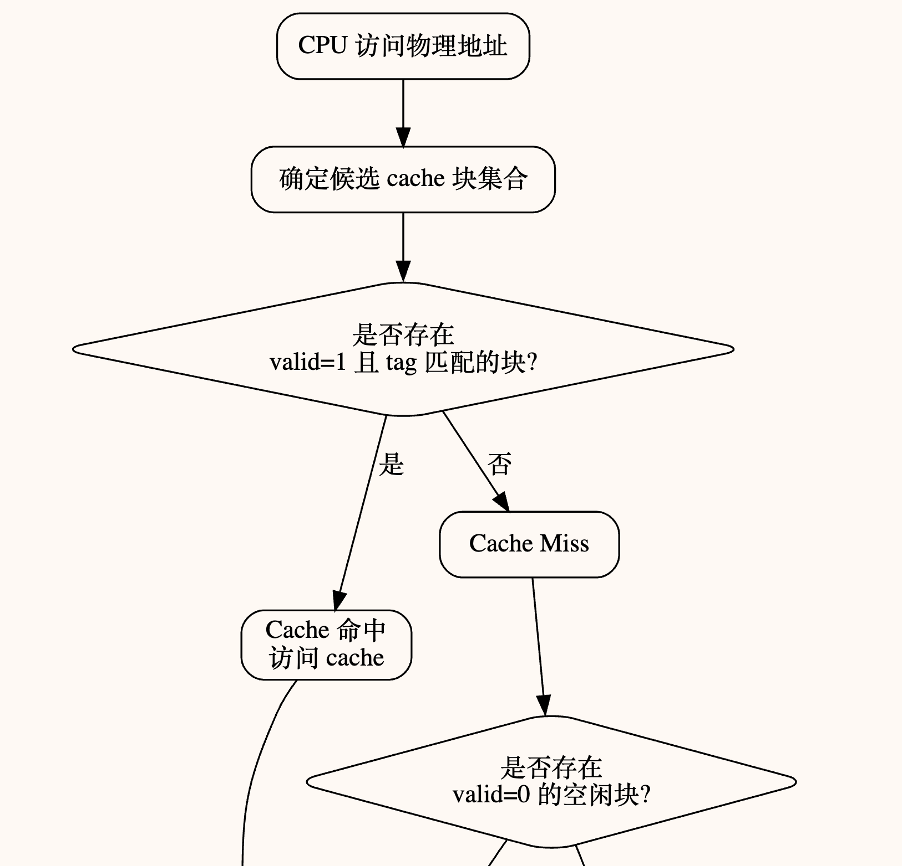

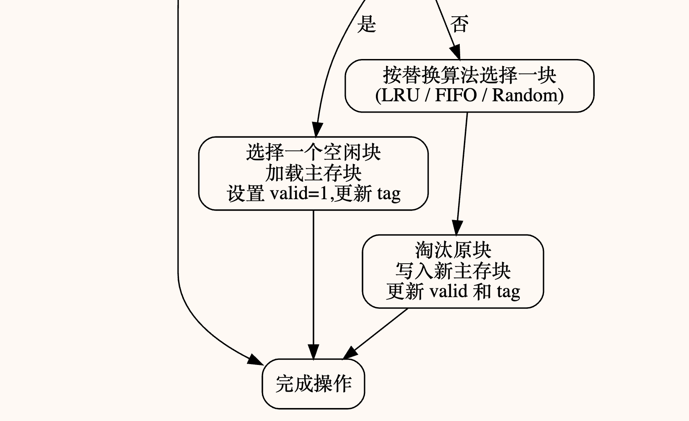

#### 5.2 替换算法

当 CPU 访问某个物理地址而在 cache 中未命中时，需要把该地址所在的 **主存块** 调入 cache。如果该 **主存块** 映射到的 **cache 块**（即同一路径或同一个集合）已经全部占满，就必须在这些已占用的 **cache 块** 中挑选一个进行替换。常用的替换策略有 **FIFO**（先进先出）、**LRU**（最近最少使用）和 **LFU**（最不经常使用）等。

这套思路与操作系统中的页面置换算法本质相同，详情请参见 [**页面置换算法**](https://www.csgraduates.com/operating_system/memory/management/#页置换算法)。

### 六、cache写策略

因为 cache 实际上存储的是主存的一个小副本，所以对于写操作，就需要考虑两者间的数据一致性的问题。

cache 的写策略代表当我们对某个物理地址上的数据进行写入时，应该如何写入对应的存储单元，以及如何协调 cache 和 主存之间的 **数据一致性**，写策略按照地址查询是否命中 cache 可以分为四种方式。

#### 6.1 命中时

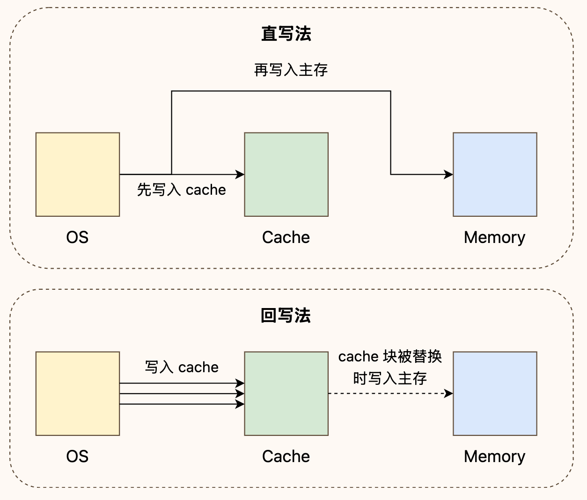

如果某次地址查询**命中 cache**，可以使用如下策略：

- **直写法**（Write Through）：
  - 每次写操作都会同时更新缓存和主存。
  - 这种写策略是 **同步的**，每次更新 **缓存** 时要同步地更新 **主存**。
- **回写法**（Write Back）：
  - 当数据被修改时，它首先被缓存在 cache 中，**只有当 cache 块被替换时才写入对应的主存块**。
  - 这种写策略是异步的，并不是写入 cache 后立马就要写入主存，可以多次写入 cache 后在另一个时刻再将cache 块写入主存。

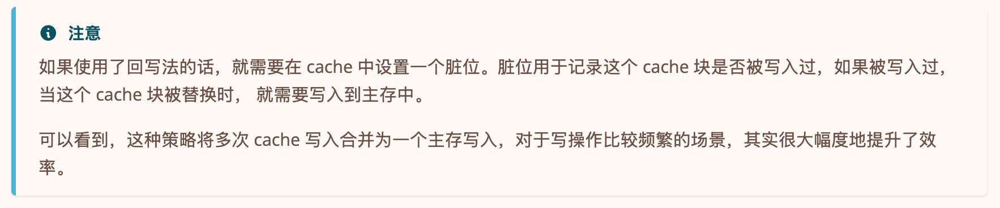

#### 6.2 未命中时

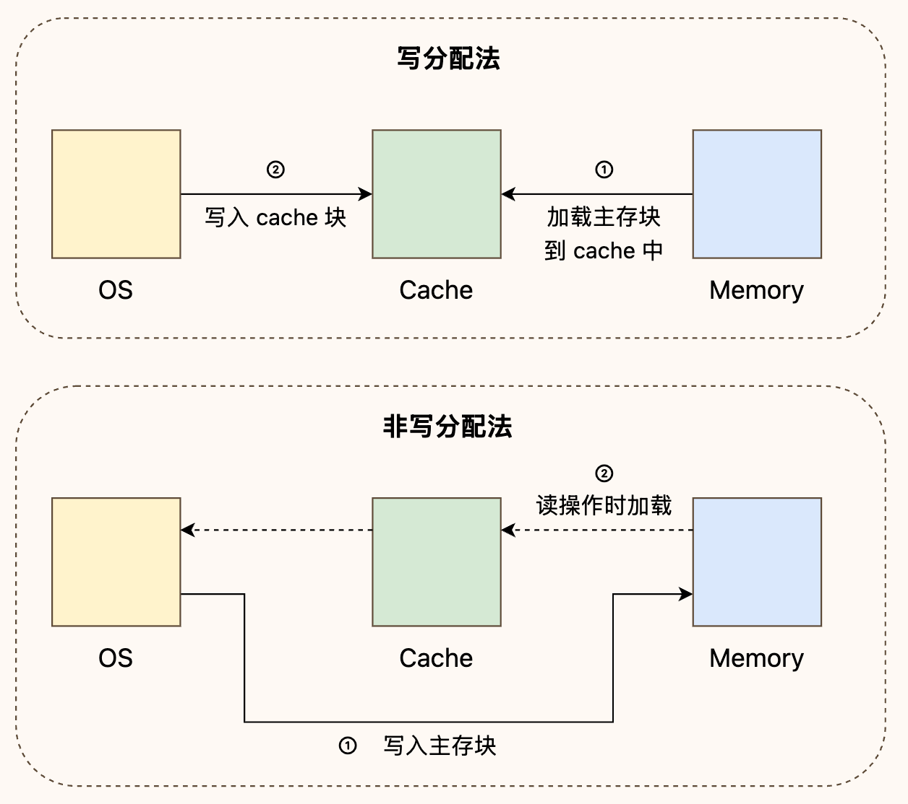

如果 **没有命中 cache**，也有如下策略：

- **写分配法**（Write Allocate）：
  - 物理地址对应主存块被 **加载** 到 cache 块中（先执行一次对应主存块的读操作），**然后更新** cache 块
- **非写分配法**（Not Write Allocate）：
  - **不加载** 主存块至 cache 中，直接更新主存块，只有当执行读操作时才将主存块加载进入 cache 块

#### 6.3 策略的组合

**命中** 和 **未命中** 的方法常常通过如下方式一起使用：

- **直写法**（write-through）和 **非写分配法**（not-write-allocate）通常会一起使用，适用于那些写操作不频繁或者写操作不太可能访问同一数据的情况。
- **回写法**（write-back）和 **写分配法**（write-allocate）通常会一起使用，适用于那些写操作频繁的情况。

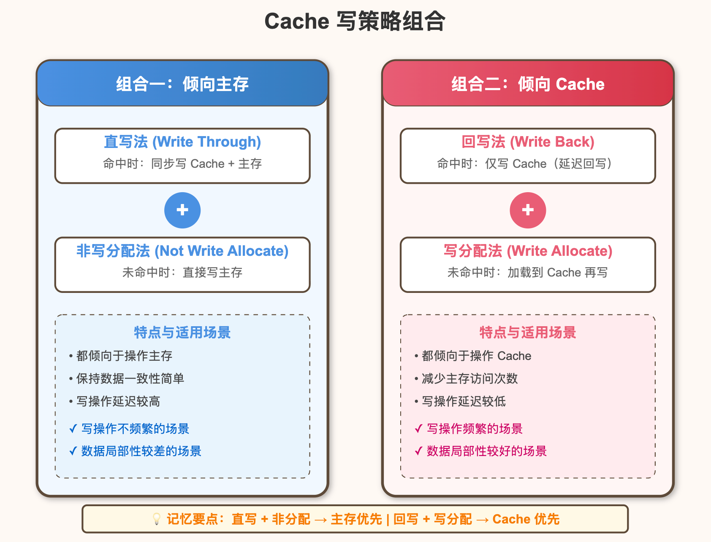


---

## 虚拟存储器

**虚拟存储器** 是一种 **计算机内存管理技术**，它在 **物理内存** 和 **磁盘存储** 之间创建了一个抽象的、扩展的内存空间，以提供更大的可用内存容量。

**设计核心** 在于将 逻辑地址空间 与 物理内存 进行 **解耦**。程序在 **编译和运行** 时所看到的是一个连续、完整的虚拟地址空间，而实际上这些地址并不直接对应物理内存中的位置，而是通过 页表和TLB 进行映射。

### 一、物理内存

**物理内存**（Physical Memory）指的是计算机系统中的实际硬件内存，即随机存取存储器（RAM）。

**物理内存** 是计算机直接用于存储和操作数据的地方，所有进程的数据和代码实际上都是存储在 **物理内存** 上。

当访问物理内存时，必须使用 **物理地址**，物理地址就是 **物理内存** 中每个存储单元的唯一编号

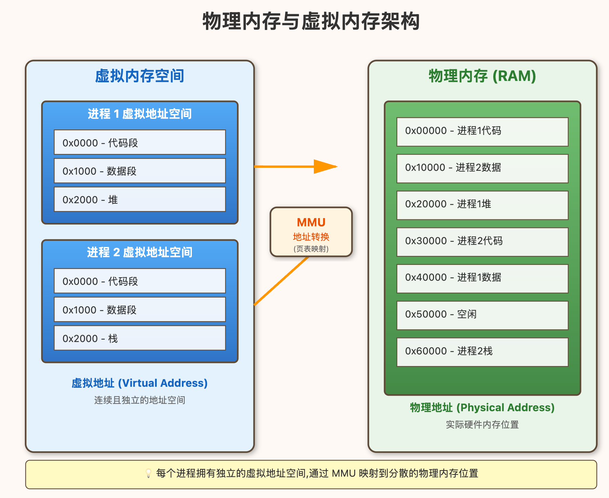

### 二、虚拟内存

**虚拟内存**（Virtual Memory）是一种计算机系统内存管理技术，它使得进程可以认为自己拥有一个 **连续且独立的内存空间**，即使实际上 **物理内存** 可能不够用或者是分散的。

进程使用 **虚拟地址** 来访问内存中的数据和指令，而不需要了解 **物理内存** 的详细情况。进程使用虚拟地址去访问 **虚拟内存**，

当进程访问 **虚拟内存** 时，**操作系统** 会将 虚拟地址 **转化为物理地址**， 进而根据物理地址去访问 **物理内存**。

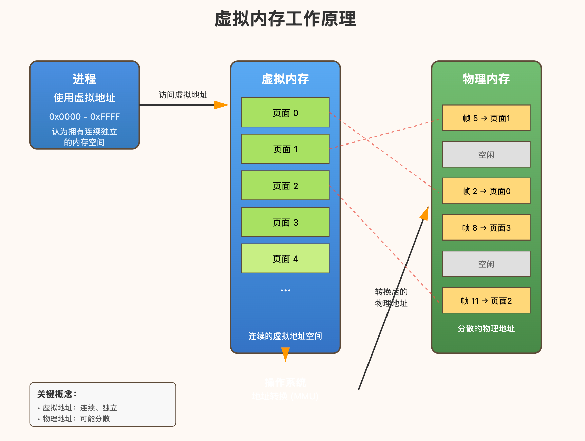

### 三、页式虚拟存储器

为了更灵活地管理内存，操作系统采用 **页式虚拟存储器** 的方式，将 **虚拟地址空间** 和 **物理地址空间** 都划分为大小固定的 **页（Page）**。程序运行时，并不需要将整个虚拟地址空间都加载到 **物理内存** 中，而是按需将部分 **页面** 载入内存，其余的页面保存在硬盘上。

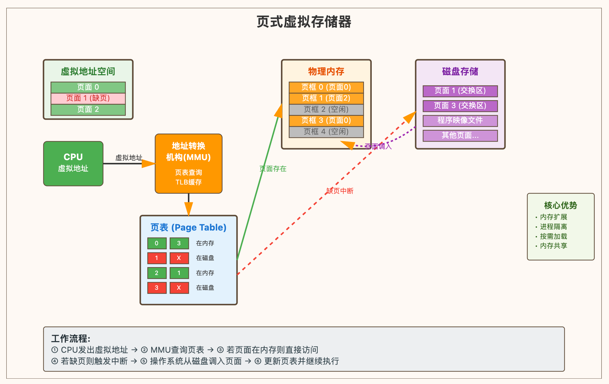

当 CPU 发出一条内存访问指令时，**地址转换机构** 会找到对应的物理页框。如果发现该页面尚未加载到内存，就会触发 **缺页中断**。缺页中断交由操作系统内核处理，内核会判断该页面是否在磁盘的交换区或程序映像文件中，如果存在，就将其调入内存。如果内存已满，还需要根据 **页面置换算法**（如最近最少使用 LRU 或时钟算法）选择一个合适的页面换出到磁盘，再将新页面调入。整个过程对应用程序是透明的，它只会感知到一次访问延迟，而不会意识到内存与磁盘之间的交换。

这种机制不仅让 **有限的物理内存** 可以支持 **更大规模的虚拟地址空间**，还实现了多进程之间的 **隔离与保护**。每个进程都有自己的页表，彼此之间的虚拟地址不会直接冲突，从而避免了进程间的非法访问。同时，页式虚拟存储器还为实现内存共享提供了可能，比如多个进程可以将不同的虚拟页映射到同一个物理页框，用于共享代码段或数据。

### 四、页面划分和地址结构

在 **页式虚拟存储器** 中，**虚拟内存空间** 被划分为一个个 **虚拟页面**（VP，Virtual Page），**物理内存空间** 被划分为一个个 **物理页面**（PP，Physical Page）。

**虚拟地址**（VA, Virutal Address）被划分为 **虚拟页面号**（VPN，Virutal Page Number）和 **页内偏移**（Offset）这两个字段。

在使用 **虚拟地址** 去访问 **虚拟内存** 时，我们可以根据 **虚拟页面号** 找到该地址所在的 **虚拟页面**，在找到 **虚拟页面** 后，我们可以根据 **页内偏移** 找到该地址在 **虚拟页面** 内的偏移大小。


同理，物理地址（PA, Physical Address）被划分为 **物理页面号**（PPN，Physical Page Number）和 **页内偏移**（Offset）这两个字段。

在使用 **物理地址** 去访问 **物理内存** 时，我们可以根据 **物理页面号** 找到该地址所在的 **物理页面**，在找到 **物理页面** 后，我们可以根据 **页内偏移** 找到该地址在 **物理页面** 内的偏移大小。


### 五、地址翻译机构


CPU 中的 **内存管理单元**（Memory Management Unit，MMU）是计算机体系结构的重要组成部分，它负责 **虚拟内存** 到 **物理内存** 的地址映射和内存访问的控制。MMU 的主要功能包括：

- **地址转换**：MMU 负责将程序使用的 **虚拟地址** 转换为对应的 **物理地址**。
- **地址保护**：MMU 实施内存保护策略，以确保不同的程序或进程无法越界访问彼此的内存空间。
- **内存访问权限**：MMU 根据地址映射和保护位（在页表或段表中定义）来控制内存访问权限，包括读、写、执行等。


### 六、页表

**页表**（page table）是操作系统维护的一张表，用于将 **虚拟地址** 转化为 **物理地址**，每个运行的进程都有自己 **页表**。
进程的 **页表** 存储在其内存空间中的 **内核空间** 中，详见[进程内存空间](https://www.csgraduates.com/operating_system/process/process_thread/#进程内存空间)。
在进程执行时，MMU 使用当前活动进程的 **页表** 来执行地址转换。

#### 6.1 单级页表

**页表** 的功能是将 **虚拟页号** 转换为 **物理页号**，进而实现地址翻译。


对于 **单级页表** 而言，只需访问一次 **页表** 即可实现 **页面号** 的翻译过程。

##### 单级页表结构

一个典型的 **单级页表** 结构如下图所示：


页表项 

**页表** 中的每一行叫做 **页表项**（PTE, page table entry），**页表项** 可包含如下内容：

- **虚拟页框号**（VPN，Virtual Page Number）：对于 **单级页表** 而言，VPN 并不需要实际存储在 **页表** 的字段中，其隐性地作为 **页表项** 的下标进行存储。
- **物理页框号**（PPN，Physical Page Number）：当前 VPN 所对应的 **物理页号**。
- **有效位**（Valid Bit）：用于指示虚拟页 **是否有效**。若为 **1**，表示可用于地址转换；若为 **0**，表示无效，会导致错误。
- **修改位**（Dirty Bit）：用于指示虚拟页的内容 **是否已被修改**。若为 **1**，可能需要写回到磁盘或其他非易失性存储介质。
- **访问位**（Accessed Bit）：用于指示虚拟页 **是否已被访问**。若为 **1**，对页面置换算法有帮助。
- **保护位**（Protection Bits）：用于指定虚拟页的 **访问权限**，例如读取、写入或执行权限。
- **缓存位**（Caching Bits）：用于指示是否允许将虚拟页的内容 **缓存在高速缓存中**。


##### 单级页表地址翻译

虚拟地址和物理地址格式如下：

- 虚拟地址

  （Virutal Address）分为两个部分：

  - **虚拟页框号**（VPN, Virtual Page Number）：当前地址所在的页框在 **虚拟内存** 对应的所有页框中的下标
  - **页内偏移**（VPO, Virutal Page Offset）：地址在页面内的偏移

- 物理地址

  （Physical Address）同样分为两个部分：

  - **物理页框号**（PPN, Physical Page Number）：当前地址所在的页框在 **物理内存** 对应的所有页框中的下标
  - **页内偏移**（PPO, Physical Page Offset）：地址在页面内的偏移


单级页表地址翻译过程如下：

**PPO** 和 **VPO** 的内容一致，所以地址翻译主要在于通过将 **VPN** 转化为 **PPN**。**VPN** 的值为对应的 **页表项**（PTE）在 **页表** 中的下标。找到对应的 **页表项** 后，判断 **Valid** 字段是否为 **1**：

- 若为 **0**，会发生 [缺页中断](https://www.csgraduates.com/constitution_principle/storage/virtual/#缺页中断)
- 若为 **1**，读取其中的 **PPN**，完成地址翻译


#### 6.2 多级页表

**单级页表会有什么问题？**

在 **单级页表** 中，为了管理大型 **虚拟地址空间**，需要创建庞大的 **页表**，其中包含大量 **页表项**，这会导致 **页表** 本身占用大量内存。

假如我们有一个 **32 位 4GB** 的 **虚拟地址空间**、**4KB** 的页面和一个 **4 字节** 的 **PTE**，那么我们将需要一个 **4 MB** 的 **页面表** 始终驻留在内存中，即使应用程序只引用 **虚拟地址空间** 的一小块。

**多级页表结构**


只有一级页表需要始终在主存中，对于其他层次的页表，可以 **按需分配**；如果使用到的，就在内存中创建对应的页表结构，如果未使用到，就不需要为其分配内存。这代表了巨大的潜在节省，因为典型程序的 **4GB 虚拟地址空间** 中的大部分都是未分配的。

对于 **k** 级页表而言，前 **k‑1** 级页表中 **PTE** 存储的关键字段都是下一级页表的位置，如果其中某个 **PTE** 的 **有效位** 为 **0**，那么操作系统无需为该 **页表项** 对应的下一级页表分配内存空间。

#### 6.3 进程切换和页表管理

MMU 进行地址翻译的时候需要使用到页表，但是每个进程的页表不同，MMU 怎么知道当前进程的页表在物理内存的哪个位置呢？

其实操作系统是这样管理不同进程的页表的：


- 每个进程都有一个关键的内核数据结构，通常叫做 [PCB 进程控制块](https://www.csgraduates.com/operating_system/process/process_thread/#进程控制块)。
- PCB 中保存了一个关键信息：**页表基址寄存器** 应该加载的物理地址。这个物理地址指向该进程 **顶级页表** 在物理内存中的起始位置。
- 当操作系统进行进程上下文切换时，它会：
  1. 保存当前进程的CPU状态到其PCB。
  2. 将下一个进程的PCB中保存的**页表基址物理地址**加载到CR3寄存器中。
  3. 恢复下一个进程的CPU状态。
- **一旦页表基址存储器被切换，MMU 接下来进行地址转换时，就会使用新进程的页表**。这就是不同进程拥有不同虚拟地址空间映射的根本机制。

##### PTBR

**PTBR**（Page Table Base Register，页表基址寄存器） 是处理器中用于 **指向当前进程顶级页表物理地址** 的专用寄存器。

- 它保存的是 **页表在物理内存中的起始地址**，而不是虚拟地址
- MMU 在进行地址翻译时，会 **从 PTBR 出发逐级查页表**
- **每个进程都有自己的页表，但同一时刻只有一个 PTBR 生效**

> **PTBR 决定了“当前 CPU 看到的是哪一个进程的虚拟地址空间”**


与进程切换的关系：

- **进程切换 = 切换 PTBR**
- 操作系统在上下文切换时，把新进程页表的物理地址加载进 PTBR（如 CR3）
- 之后 MMU 的所有地址翻译都会基于新进程的页表

### 七、TLB

**TLB**（Translation Lookaside Buffer）是 CPU **内存管理单元**（MMU）中的一种 **高速缓存**，用于加速 **虚拟地址**（VA）到 **物理地址**（PA）的地址转换过程。TLB 存储了最近用过的 **虚拟地址** 到 **物理地址** 的映射，以减少每次内存访问时的地址翻译延迟。


由于 **页表** 存储在内存中，所以每一次通过 **页表** 的地址翻译过程都至少需要一次访存，开销仍然比较大。为降低开销，**TLB** 应运而生。与 **Cache** 类似，你可以从概念上将 **TLB** 理解成一个硬件结构，因离 **CPU** 更近，其访问速度更快。

#### 7.1 存储结构

**TLB** 是一个硬件结构，但从逻辑上可以将其理解为一张表。


与 [cache 存储结构](https://www.csgraduates.com/constitution_principle/storage/cache/#cache-存储结构) 类似，**TLB** 由许多 **表项**（TLB Entry）构成，每一个 **表项** 包含多个字段，其中 **tag** 和 **PPN** 是必须的，其他字段是可选的。

#### 7.2 TLB和cache对比

**TLB** 和 **页表** 的关系类似于 **cache** 与 **主存** 的关系，**TLB** 和 **cache** 都是硬件结构，只是作用场景不同。**TLB** 与 **Cache** 的区别如下表所示：

|                    | **TLB**                                | **Cache**            |
| ------------------ | -------------------------------------- | -------------------- |
| 存储的是什么？     | 物理页面号（PPN）                      | 主存块               |
| 使用什么去查找？   | 虚拟页面号（VPN）                      | 主存块号             |
| 在何种场景下使用？ | 将 **虚拟地址** 翻译为 **物理地址** 时 | 访问 **物理地址** 时 |

**TLB** 中也包含三种映射方式：**直接映射**、**全相联映射**、**组相联映射**。

在访问 **TLB** 时，**虚拟地址** 中的 **虚拟页号**（VPN）被按照映射方式进行不同的切分。在访问 **cache** 时，**物理地址** 中的 **主存块号** 被按照映射方式进行不同的切分。

两者的对比如下所示：


在 **直接映射** 中，通过 **TLB** 行号去对应行的 **表项** 进行查询。

在 **组相联映射** 中，通过 **TLB** 组号去对应组进行查询（遍历组中的所有 **TLB 表项**）。

在 **全相联映射** 中，遍历 **TLB** 中的所有 **表项**。

#### 7.3 地址结构

当我们通过 **TLB** 进行 **虚拟页号（VPN）→ 物理页号（PPN）** 的翻译时，访问 **TLB** 需要使用到 **VPN**。
从逻辑上而言，**VPN** 可以被分为 **标记** 和 **匹配字段** 这两个部分：

- **标记**（TLBT, 即 **TLB Tag**）：与 **TLB** 中的 **tag** 进行对比，判断是否命中 **TLB** 表项。
- 匹配字段（Match Field），通过该字段判断 VPN可能被哪些TLB表项所缓存，这里TLB与Cache类似，同样具有三种映射方式，每一种映射方式的匹配字段位数不同：
  - **直接映射**：匹配字段为 **TLB** 表项编号，即行编号（TLB entry index），其位数为 log (TLB 行数)
  - **全相联映射**：没有匹配字段，即匹配字段位数为 **0**，因为每一个 **VPN** 都可能被任何一个 **TLB** 行所缓存
  - **组相联映射**：匹配字段为组号（TLB group index），位数为 log (TLB 组数)


使用 **TLB** 进行地址翻译的过程如下：

1. 给定一个 **虚拟地址**（VA），从中提取出 **虚拟页号**（VPN）
2. 根据映射方式从 **VPN** 中提取出 **标记**（TLBT）和 **匹配字段**
3. 根据匹配字段从TLB的相应表项中依次查找，命中时应满足如下条件：
   - **有效位**（valid）为 **1**
   - 该表项中的 **TLBT** 与 **VPN** 中的 **tag** 字段相同
4. 若命中某个表项，则通过 **TLB** 完成 **VPN → PPN** 的翻译
5. 若未命中，则通过 **页表** 完成翻译

### 八、请求页式管理

**请求页式管理**（Demand Paging）是一种计算机操作系统中的内存管理技术，它允许进程在需要时才将 **页面**（或者说 **虚拟内存** 中的数据块）加载到 **物理内存** 中，而不是一次性将整个进程加载到内存中：

- 进程开始运行时，并 **不把所有页装入内存**
- 访问到某一页时才触发：
  - 缺页异常（page fault）
  - 从磁盘调入该页
- 是一种 **懒加载**（lazy loading）


#### 8.1 页面错误

当进程尝试访问一个 **虚拟页面**，但该页面当前未加载到 **物理内存** 中时，会触发 **页面错误**（page fault）。此时，操作系统会将相应的页面从磁盘加载到 **物理内存**，进行 **页面替换**。

当然，上述说法中沿用了教材中的叙述方式：

> 缺页 → 从磁盘调入 → 进行页面替换

这是一个 **简化模型**。

实际上，**page fault 的本质** 是：

> CPU 访问虚拟地址
> 页表项 valid = 0 触发异常
> 由内核修复映射

至于修复方式：

- 建立映射
- 分配物理页
- 读磁盘

都可能。


#### 8.2 页面替换

**页面替换** 时包含两种情况：

1. **物理内存** 中存在 **空闲页面**（未被任何进程使用的页面）。
2. **进程** 中不存在任何 **空闲页面**，即所有页面都被进程使用了。


如果存在 **空闲页面**，当一个进程出现 **缺页中断** 时，直接使用 **空闲页面** 即可。

如果 **物理内存** 已满，操作系统需要选择一个页面来替换。通常，操作系统会选择一个 **不再需要的页面** 进行替换，这个决策基于 [使用的页面置换算法](https://www.csgraduates.com/operating_system/memory/management/#页置换算法)。

如果操作系统中配置了 **交换分区**（swap area），被置换的页面会被写入 **交换分区**；当该页面再次被需要时，页面会从 **交换分区** 中加载回 **物理内存**。


**交换分区** 是硬盘上专门划出的一个区域，用来作为系统内存的“扩展”。当 **物理内存** 使用接近或达到上限时，操作系统会把暂时不用的内存页（比如不活跃的后台程序）移到 **交换分区**，从而释放出 **物理内存**。

### 九、访存过程

对于进程而言，它自己可见的就是 **虚拟地址**（VA），当进程访问 **虚拟地址** 时，实际上是对某个 **物理地址** 进行访问。


**访存** 主要包含两大过程：

1. **地址翻译**：VPN → PPN，即由 **虚拟地址**（VA）得到 **物理地址**（PA）的过程。
2. 根据 **物理地址**（PA）去 **cache** 或 **主存** 中读取数据。

需要熟练掌握这两大过程中的各种细节，考试中常将这些知识点组合考察。

#### 9.1 虚拟地址翻译过程

操作系统经过如下步骤将 **虚拟地址** 转为 **物理地址**：

1. 从 **虚拟地址**（VA）中提取 **VPN**（虚拟页号）。
2. 根据VPN去访问TLB。
   - **命中 TLB**：从 **TLB** 中读取相应的 **物理页号**（PPN）。
   - 未命中 TLB：读取页表后更新TLB。
     - **命中页表**：从 **页表** 中读取相应的 **PPN**，并更新 **TLB** 表项。
     - 未命中页表：触发 缺页中断，从内存中找一个页面以加载物理页面
       - 存在 **空闲页面**，直接使用 **空闲页面**，使用其 **PPN** 更新 **页表**。
       - 不存在 **空闲页面**，选择一个进程的页面进行置换。
3. 组装 **物理页号**（PPN）和 **页内偏移**（PPO）得到 **物理地址**。

上述过程可以由如下的流程图表示：


缺页中断 

上文中提到的 **缺页中断** 过程忽略了一些细节，详细过程如下：

1. 触发缺页中断：
   - 当 **CPU** 尝试访问一个 **虚拟内存页面**，但该页面未加载到 **物理内存**（或页面无效）时，**MMU** 检测到页面缺失，触发 **缺页中断**。
2. 判断缺页原因：
   - **页面未分配**、**页面在磁盘（换出）**、**非法访问**（越界或权限不足）。
   - 若为 **非法访问**，操作系统会终止程序（如段错误，Segmentation Fault）。
3. 判断是否有空闲页面：
   - 若有 **空闲页面**，操作系统会分配一个新的 **物理页面**。
   - 若 **物理内存** 不足，可能会通过页面置换算法（如 **LRU**）选择一个现有页面换出到磁盘，腾出空间。
4. 加载页面内容：
   - 若 **页面未分配**，操作系统会分配一个新的 **物理页面**。
   - 若 **物理内存** 不足，同上使用页面置换算法。
5. **更新页表**：添加一条新的页面映射表项。
6. **恢复执行**：**缺页中断** 处理完成后，操作系统恢复被中断的程序上下文。**CPU** 重新执行引发缺页的指令，此时页面已可用，程序继续正常运行。

可以通过以下流程图理解缺页中断的过程：


#### 9.2 物理地址访存过程

**访存** 过程常与 **地址翻译** 过程一起考察。进程访问一个 **虚拟地址** 时，首先完成 **地址翻译** 得到 **物理地址**，随后使用该 **物理地址** 访问内存。

使用 **物理地址** 访问内存时首先判断是否命中 **cache**；若未命中，则访问 **内存**，随后更新 **cache**。在使用 **主存块** 更新 **cache 块** 的过程中，还要根据 **cache** 与 **主存** 的映射方式决定替换哪个 **cache 块**，详细过程如下图所示。


