# 指令系统

## 格式和寻址方式

### 一、指令格式

指令的功能就是 **对某些数据** 进行 **某种操作**。

所以指令中主要包含两个部分：**操作码**（opcode）以及 **地址**（address）。

- 操作码（opcode）就是决定了指令的类型：
  - 这个指令是干嘛的？进行哪种操作？
- 地址是一个通用含义，指的是操作的对象：
  - 可以是一个 **内存地址**（`<addr>`）
  - 也可以是 **CPU 中的一个寄存器编号**（`<reg>`）
  - 也可以是一个 **立即数**（`<imm>`）

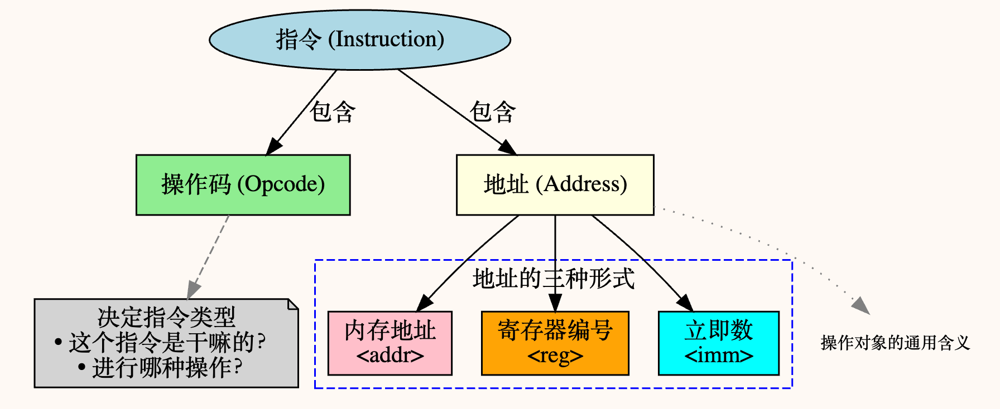

### 二、指令类型

#### 2.1 根据操作码分类

指令根据其 **操作码**（opcode）的不同可以分为以下类别：

1. 数据传输指令
   - `MOV`：将数据从一个位置传输到另一个位置，可以是寄存器到寄存器、内存到寄存器、寄存器到内存等。
   - `PUSH`：将数据（通常是寄存器中的值）推入堆栈。
   - `POP`：从堆栈中弹出数据并存储到寄存器中。
2. 算术和逻辑运算指令
   - `ADD`、`SUB`、`MUL`、`DIV`：执行算术运算，如加法、减法、乘法和除法。
   - `AND`、`OR`、`XOR`、`NOT`：执行逻辑运算，如按位与、按位或、按位异或和按位取反。
   - `INC`、`DEC`：递增和递减操作数的值。
   - `CMP`：用于比较两个值，并根据结果设置标志寄存器的状态。
3. 控制转移指令
   - `JMP`：用于无条件跳转到指定的目标地址。
   - `Jxx`：条件跳转指令，根据特定的条件（如零标志、进位标志等）来决定是否跳转。
   - `CALL`：调用子程序或函数。
   - `RET`：从子程序返回。
4. 输入/输出指令
   - `IN`：从外部设备或端口读取数据。
   - `OUT`：向外部设备或端口发送数据。
5. 字符串操作指令（String Instructions）：
   - `MOVS`、`LODS`、`STOS`、`CMPS`：用于在内存中执行字符串操作，如移动、加载、存储、比较。
6. 陷阱指令（Trap Instructions）：
   - `INT`：用于引发中断，通常用于与操作系统进行通信。
7. 协处理器指令（Coprocessor Instructions）：
   - `CLI`、`STI`：用于清除和设置 CPU 的中断标志，通常只能在内核模式下执行。

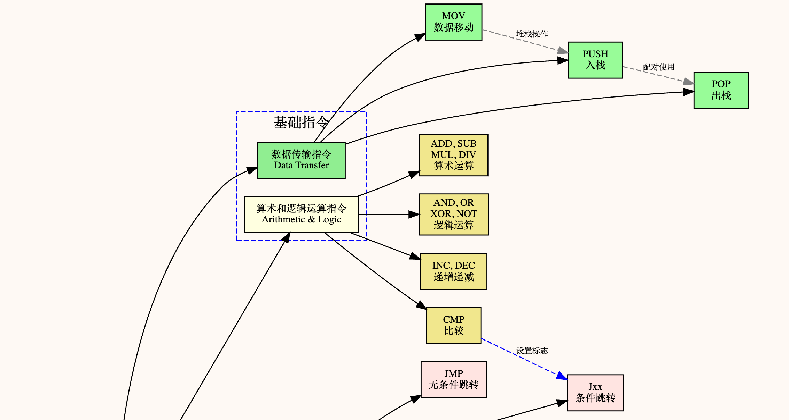

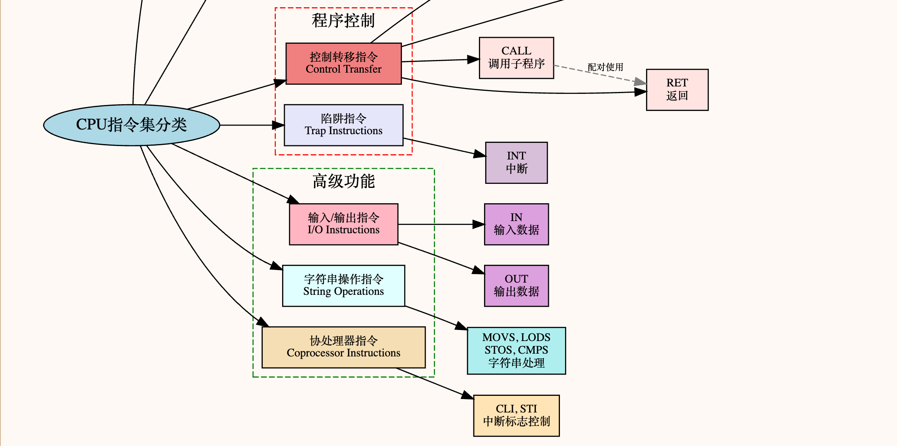

#### 2.2 根据地址个数分类

根据指令中的 **地址** 个数，可以将指令划分为以下类型。
这些地址可以是 **寄存器**、**内存地址**，也可以是 **立即数**。

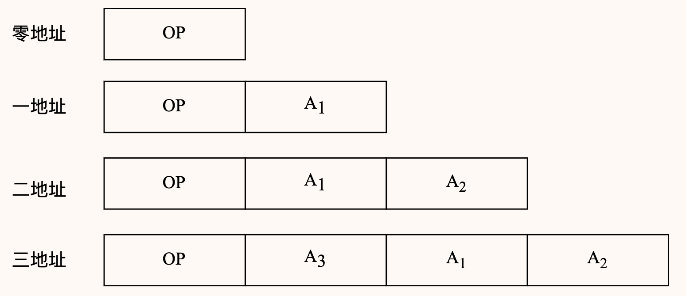

| 指令格式       | 指令格式         | 含义                                                        |
| -------------- | ---------------- | ----------------------------------------------------------- |
| **零地址指令** | `op`             | 执行操作 *op* ，操作数隐含在栈中                            |
| **一地址指令** | `op, A1`         | *op*(*A*1)→*A*1 ：对 *A*1 操作并将结果存回 *A*1             |
| **二地址指令** | `op, A1, A2`     | (*A*1)*op*(*A*2)→*A*1 ：将 *A*1 和 *A*2 运算，结果存入 *A*1 |
| **三地址指令** | `op, A3, A1, A2` | (*A*1)*op*(*A*2)→*A*3 ：对 *A*1 和 *A*2 运算，结果存入 *A*3 |

#### 2.3 定长和变长指令

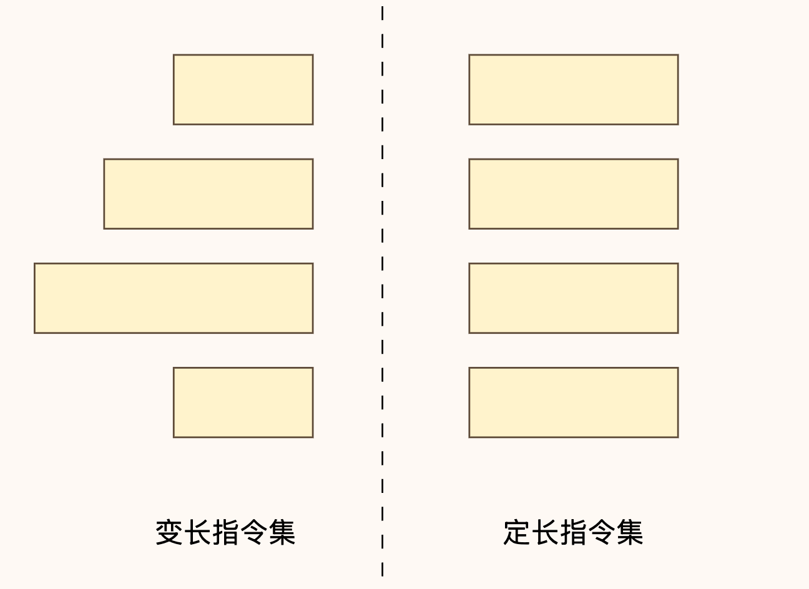

指令长度的设计可以分为两类：

- **定长指令集**：所有指令的长度完全相同
  → 典型架构：ARM（[RISC](https://www.csgraduates.com/constitution_principle/instruction/concepts/#risc)）
  → 优点：解码简单、高效
  → 缺点：指令中可能出现浪费空间的无效字段
- **变长指令集**：不同指令具有不同长度
  → 典型架构：x86（[CISC](https://www.csgraduates.com/constitution_principle/instruction/concepts/#cisc)）
  → 优点：编码更紧凑，能支持更复杂操作
  → 缺点：解码过程复杂，需要准确识别指令边界

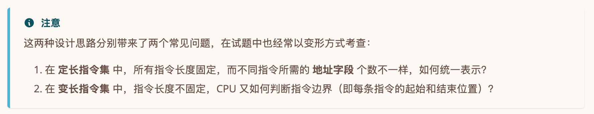

🧩 **解决思路**

**问题 1：定长指令中地址字段数量不统一怎么办？**

解决方法是使用 **无效字段填充**。

即：当某条指令所需的 **地址字段** 不足以填满整个固定长度时，剩余部分使用 **填充值**（无效字段）占位。这些填充值不会影响指令执行，仅用于保证每条指令长度一致，简化硬件解码逻辑。

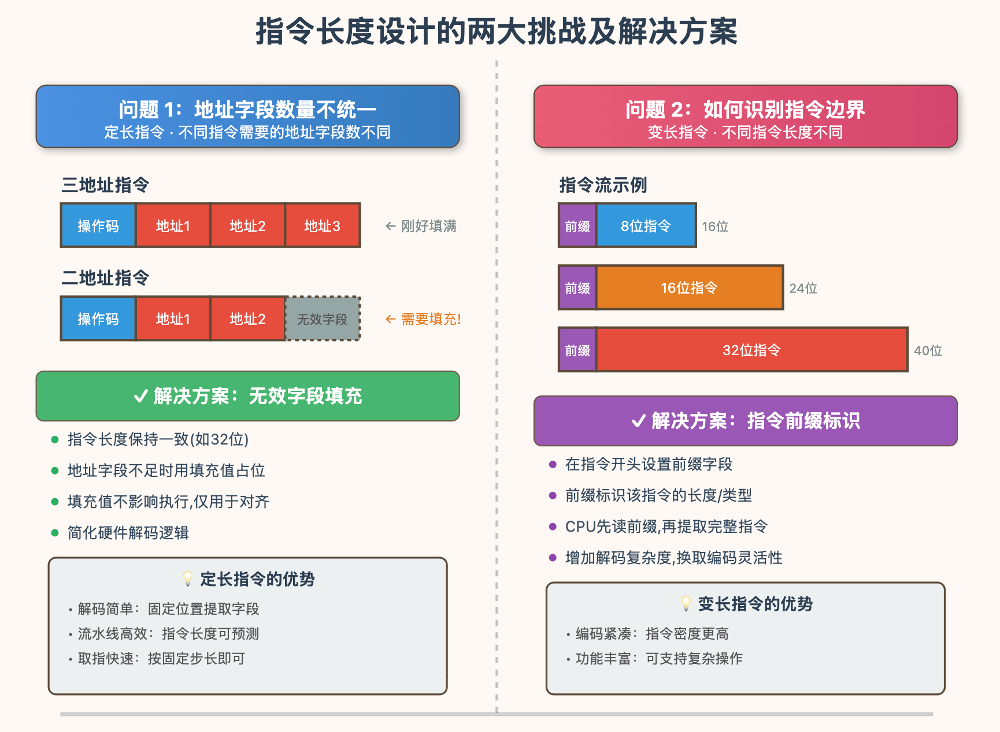

**问题 2：变长指令中如何识别指令边界？**

一种常用方案是引入 **指令前缀**。

即：在每条指令的开头，设置一个前缀字段，或在 **操作码** 的高位嵌入标志，用来标识该指令的长度或类型。CPU 在解码时先读取前缀位，就能判断指令长度，从而准确提取整条指令。

虽然这种方式增加了解码复杂度，但换来了更大的编码灵活性与指令集的扩展能力。

##### 操作码扩展编码

为了在统一的指令格式中支持不同 **地址数** 的操作，同时避免指令之间产生歧义，指令系统通常采用：

> **可变长度操作码 + 定长指令字** 的方式，
> 并要求这些 **操作码** 遵循 [**前缀码**](https://www.csgraduates.com/data_structure/tree/app/#前缀编码) 设计原则。

🌟 **先举个简单的例子：**

假设我们设计如下 **操作码长度规则**：

- 零地址指令使用 **4 位** 操作码
- 一地址指令使用 **6 位** 操作码
- 二地址指令使用 **8 位** 操作码

为了防止解析冲突，必须满足 **前缀码** 的要求：

- 任意一个 **4 位** 操作码不能是任何 **6 位** 或 **8 位** 操作码的前缀
- 任意一个 **6 位** 操作码不能是任何 **8 位** 操作码的前缀

这样，每条指令的 **操作码** 就能**唯一识别其类别与长度**，避免歧义，并保持系统的可扩展性和解码自同步。

🌟 **再举个复杂的例子：**

假设某指令系统指令长 **16 位**，**操作码字段**为 **4 位**，**地址码字段**为 **4 位**，采用扩展 **操作码** 技术，形成 **三地址指令** 15 条、**二地址指令** 12 条、**一地址指令** 63 条、**零地址指令** 16 条。

那么 **三地址指令** 格式如下：

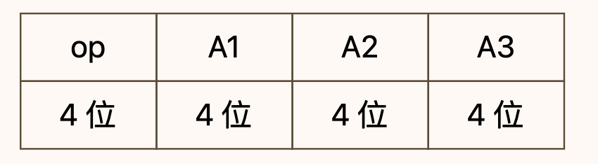

**二地址指令** 复用 **三地址指令** 的 A1 字段，**一地址指令** 复用 **三地址指令** 的 A1 和 A2 字段，**零地址指令** 复用 **三地址指令** 的 A1、A2 和 A3 字段。

可以通过树形扩展得到不同指令的 **op 前缀**：

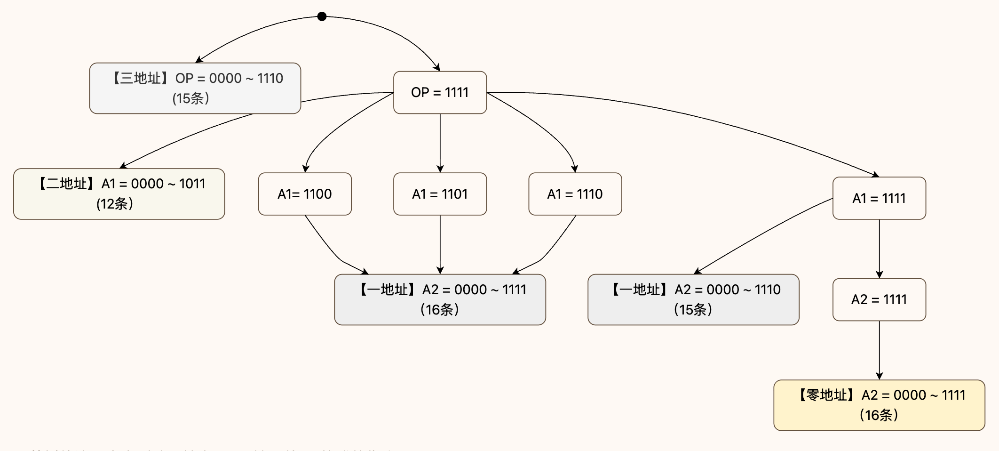

沿着树的边一直走到叶子结点，可以得到如下格式的指令：

| 指令类型                | **操作码**                                | 地址码1 | 地址码2 | 地址码3 |
| ----------------------- | ----------------------------------------- | ------- | ------- | ------- |
| **三地址指令**（15 条） | 0000 ~ 1110                               | A1      | A2      | A3      |
| **二地址指令**（12 条） | 1111 0000 ~ 1111 1011                     |         | A2      | A3      |
| **一地址指令**（63 条） | 1111 1100 0000 ~ 1111 1111 1110           |         |         | A3      |
| **零地址指令**（16 条） | 1111 1111 1111 0000 ~ 1111 1111 1111 1111 |         |         |         |

### 三、寻址方式

计算机中的 **寻址方式**（Addressing Modes）是指在 **指令中如何指定操作数的位置或地址**，**寻址方式**可以被归为以下种类：

#### 3.1 立即数寻址

**立即数寻址**（Immediate Addressing）是一种将 **常量值直接嵌入指令中** 的寻址方式，常用于赋值、初始化、比较等基本操作。

在 **立即数寻址** 之中，操作数本身就是指令的一部分，而不是从寄存器或内存中取得。这种寻址方式不涉及额外的地址计算，执行效率较高。

举个实际例子，下图是指令 `MOV AX, 4567H` 存储结构和执行示意图，指令直接将 **立即数** `4567H` 存储到寄存器 R1 中：

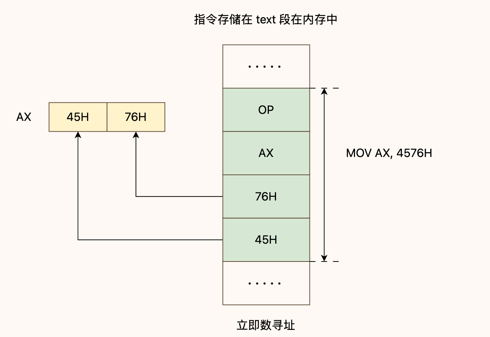

📌 示例应用

| **应用**   | **示例说明**                    |
| ---------- | ------------------------------- |
| 加载常量   | `MOV AX, 5` —— 将常数 5 加入 AX |
| 比较固定值 | `CMP AL, 0` —— 判断 AL 是否为零 |

#### 3.2 寄存器寻址

**寄存器寻址**（Register Addressing）是一种将操作数存储在寄存器中的寻址方式。在这种模式下，指令通过指定寄存器来访问操作数，寄存器本身就是操作数的存储位置。

举个实际例子，指令 `MOV AX, BX` 表示将寄存器 BX 中的值复制到寄存器 AX 中：

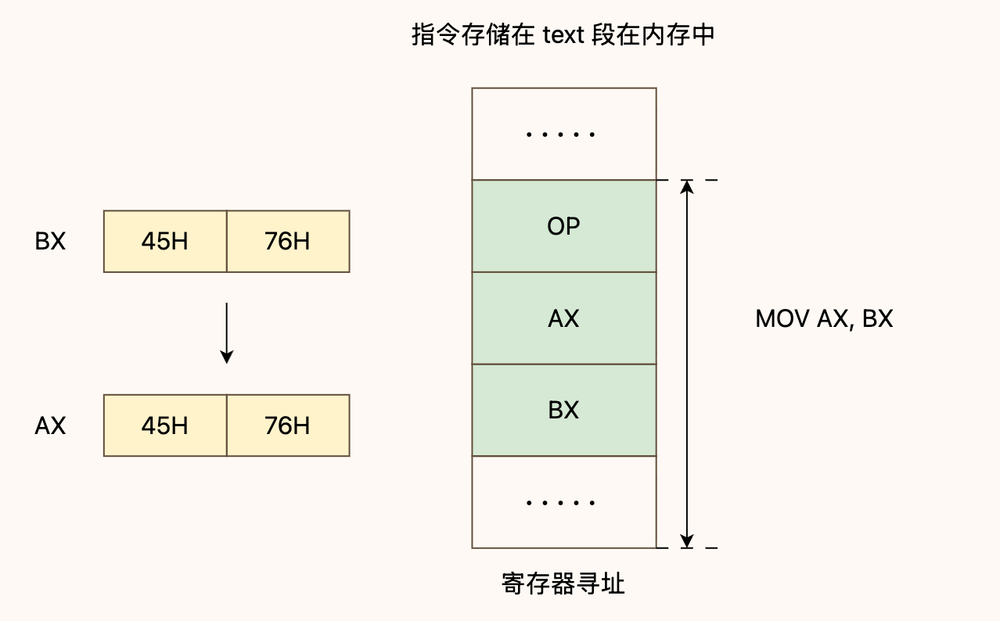

📌 示例应用

| **应用**       | **示例说明**                        |
| -------------- | ----------------------------------- |
| 拷贝寄存器内容 | `MOV AX, BX` —— 将 BX 内容拷贝到 AX |
| 比较寄存器     | `CMP AX, BX` —— 判断 AL 是否为零    |

#### 3.3 直接寻址

**直接寻址**（Direct Addressing）是一种通过 **在指令中显式给出操作数的内存地址** 来访问数据的方式，适用于访问固定位置的数据。

在 **直接寻址** 中，指令中包含了操作数在内存中的确切地址。CPU 在执行指令时，会直接从该地址读取或写入数据，不依赖寄存器辅助寻址。

举个实际例子，下图是指令 `MOV R1, [1000]` 的执行示意图，以 **立即数** 1000 作为访存地址，指令从内存地址 1000 的单元读取数据并加载到寄存器 R1 中：

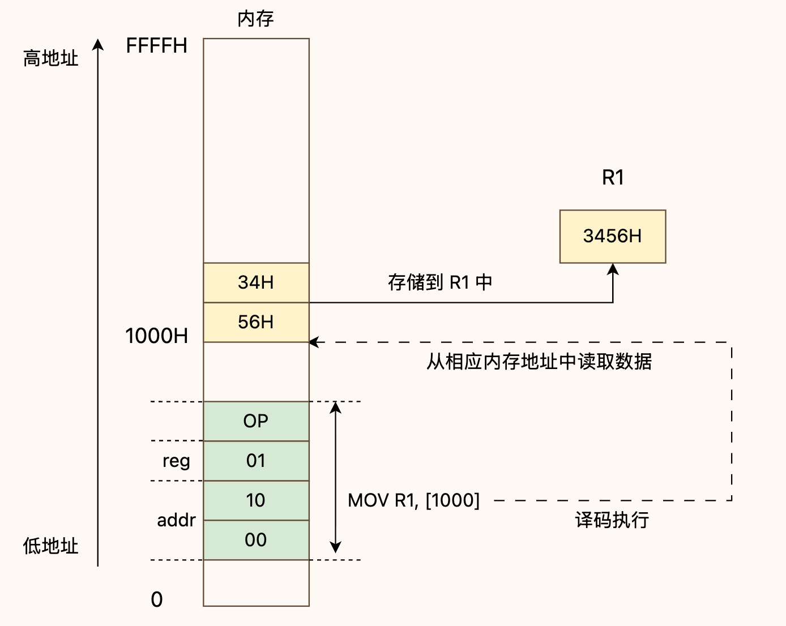

📌 示例应用

| **应用**       | **示例说明**                                     |
| -------------- | ------------------------------------------------ |
| 访问固定内存   | `MOV AX, [0x1234]` —— 读取内存地址 0x1234 的内容 |
| 读取硬件端口   | `IN AL, [0x60]` —— 从端口地址读取键盘输入        |
| 设置显存颜色值 | `MOV [0xB8000], AL` —— 设置文本模式字符颜色      |

#### 3.4 间接寻址

**间接寻址**（Indirect Addressing）是一种通过 **寄存器或内存中的地址来访问实际数据地址** 的方式，适用于访问指针、链表等动态结构。

在 **间接寻址** 中，指令中提供的是一个地址的“指针”，实际的数据地址存储在寄存器或内存单元中。CPU 先访问该中间地址，再通过它获取最终的操作数地址。

举个实际例子，下图是指令 `MOV R1, [R2]` 的执行示意图，访存地址间接地存储在寄存器 R2 中，指令首先从 R2 中读取目标地址，然后在相应的地址中读取数据加载进入 R1 中：

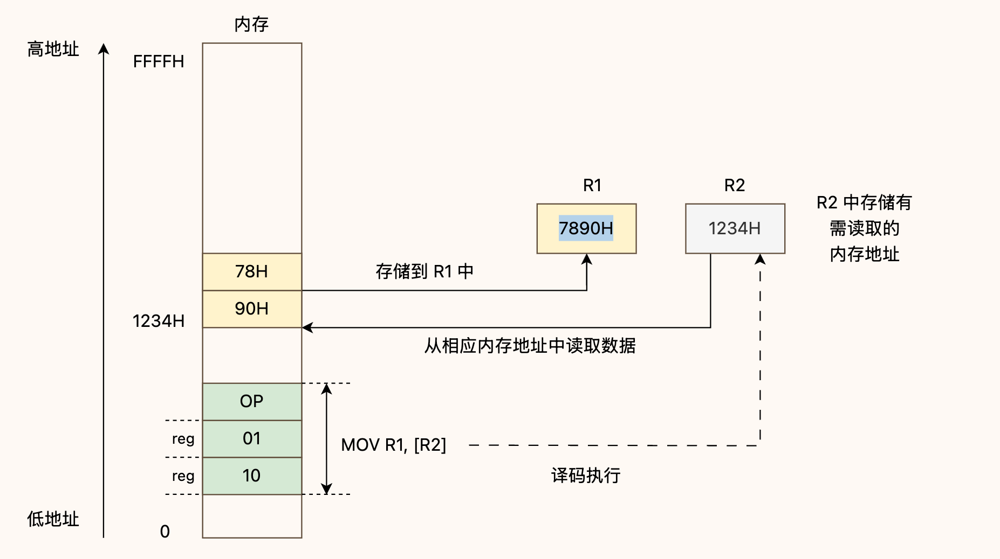

**间接寻址** 包含多种类型，其中最常见的是 **寄存器间接寻址**：

**操作数的地址保存在寄存器中**，CPU 通过这个寄存器中存储的地址访问内存中的操作数。

当我们提到 **间接寻址** 时，大多数时候都是 **寄存器间接寻址**：

📌 示例应用

| **应用**         | **示例说明**                        |
| ---------------- | ----------------------------------- |
| 通过指针访问数据 | `MOV AX, [BX]` —— BX 存储了目标地址 |

#### 3.5 基址寻址

**基址寻址**（Base Addressing）是一种通过 **基址寄存器与偏移值相加** 来访问结构体字段或局部变量的方式，常见于函数调用过程中的栈帧操作。

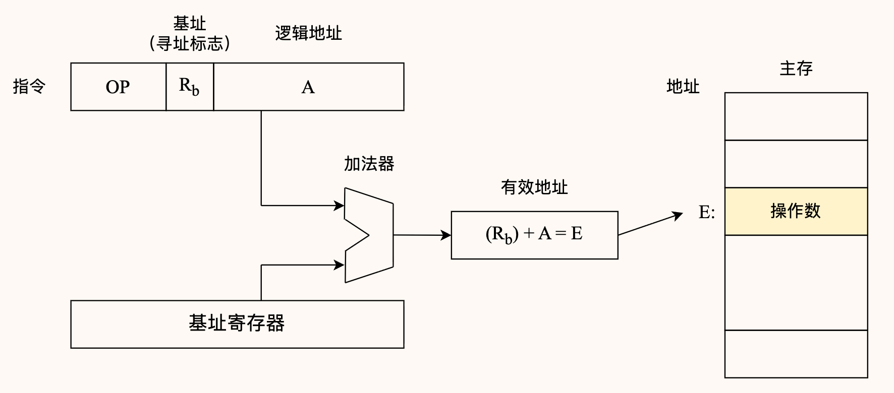

📌 示例应用

| **应用**                 | **示例说明**                           |
| ------------------------ | -------------------------------------- |
| 栈帧内访问局部变量或参数 | `MOV AX, [BP - 2]`、`MOV AX, [BP + 6]` |

**基址寻址和变址寻址的区别** 

首先，两者具有共同点：基址寻址与变址寻址都类似于相对寻址，它们的有效地址 **EA = 基址 + 指令字中形式地址 A**。

1、**基址寻址**

计算公式：**EA = (BR) + A**

有效地址是将 CPU 中 **基址寄存器** BR 的内容加上指令字中形式地址 A。BR 的内容由操作系统决定，在程序执行过程中 BR 的内容不可变，而形式地址是可变的。**基址寻址** 方式适合解决动态定位的问题。在多道程序的环境当中，操作系统根据内存空间的情况赋值给 BR，一旦赋值成功就不可更改，直至用户程序结束，使得用户不必关心实际的地址而只需要关心自己的地址空间即可。

2、**变址寻址**

计算公式：**EA = (IX) + A**

有效地址是将 CPU 中 **变址寄存器** IX 的内容加上指令字中有效地址 A。其指令字的形式地址作为一个基准地址，内容不可变，而 CPU 中 **变址寄存器** IX 在程序执行过程中根据使用情况发生改变。这样的寻址方式非常适合于循环问题，原因在于指令的“基址”（形式地址）保持不变，使得执行循环时，只需要改变 IX 的内容即可（比如迭代时，不断加 4）。假若使用 **基址寻址** 的方式，意味着循环过程中不断需要新的“基址”，也就是需要更多的指令字加以控制。而 **变址寻址** 只需要一条指令即可完成相关操作，可以大量缩短指令编码的长度，提高指令字的可用性。

两种寻址方式都是解决特定应用场景的问题，它们本质上是一样的，只是表现形式的不同而已。

#### 3.6 变址寻址

**变址寻址**（Indexed Addressing）是一种通过 **变址寄存器的值加上偏移量** 来获取操作数地址的寻址方式，通常用于数组或表格中元素的访问。

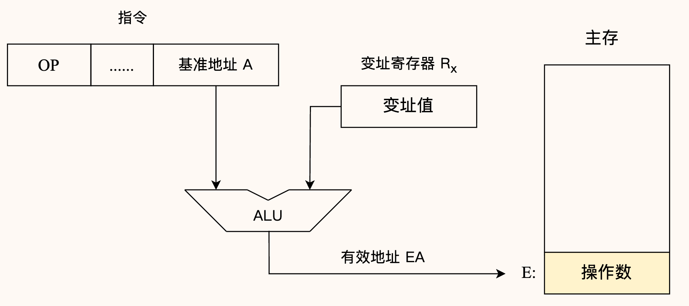

📌 示例应用

| **应用**             | **示例说明**                                 |
| -------------------- | -------------------------------------------- |
| 多维数组访问         | `MOV AX, [BX + SI]` —— 行列下标组合          |
| 结构体数组成员访问   | `MOV AX, [DI + SI*4]` —— 每个结构体占 4 字节 |
| 动态偏移数据结构遍历 | `MOV AL, [BX + CX]` —— 使用索引偏移访问      |

#### 3.7 相对寻址

**相对寻址**（Relative Addressing）是一种根据 **当前指令地址（PC）与偏移量** 来确定跳转或访问目标位置的方式，广泛应用于控制流指令。

在 **相对寻址** 中，以当前程序计数器（PC）作为基准，通过加上一个有符号的偏移量来计算跳转目标地址。这种寻址方式便于编写可重定位代码。

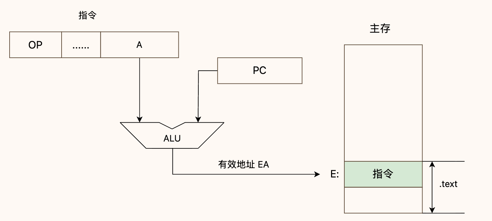

📌 示例应用

| **应用**           | **示例说明**                             |
| ------------------ | ---------------------------------------- |
| 条件跳转（分支）   | `JZ LABEL` —— 如果为零，跳转到相对偏移处 |
| 循环控制           | `LOOP LOOP_START` —— PC 相对跳转         |
| 实现函数局部跳转表 | `JMP [PC + offset]`（某些架构中）        |

#### 3.8 堆栈寻址

**堆栈寻址**（Stack Addressing）是一种通过 **栈指针或基址指针** 来访问 [栈中数据](https://www.csgraduates.com/operating_system/process/process_thread/#函数调用时内存结构) 的方式，广泛应用于函数调用过程中的参数传递和返回值保存。

在 **堆栈寻址** 中，利用 **SP**（栈指针）或 **BP**（基址指针）定位栈中元素，通过栈顶向下或向上偏移来读取或写入局部变量、返回地址等。通常与 **PUSH**、**POP**、**CALL**、**RET** 等指令结合使用。

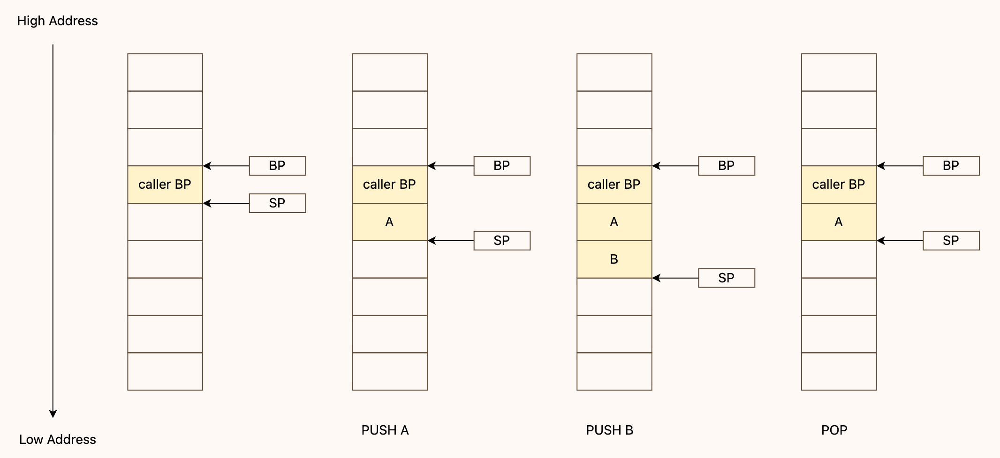

📌 示例应用

| **应用**           | **示例说明**                             |
| ------------------ | ---------------------------------------- |
| 函数调用和返回     | `CALL FUNC`、`RET` —— 使用栈存储返回地址 |
| 保存和恢复寄存器值 | `PUSH AX`、`POP AX`                      |

#### 3.9 寻址方式对比

下表给出了各个 **寻址方式** 的核心区别：

| **寻址方式**   | **描述**                                                     | **示例**                                    |
| -------------- | ------------------------------------------------------------ | ------------------------------------------- |
| **立即寻址**   | 操作数直接包含在指令中。                                     | `MOV R1, #5` （将 5 加载到 R1 寄存器）      |
| **寄存器寻址** | 操作数在寄存器中。                                           | `ADD R1, R2` （R2 加到 R1 中）              |
| **直接寻址**   | 操作数的内存地址直接包含在指令中。                           | `MOV R1, [1000]` （从内存地址 1000 取数据） |
| **间接寻址**   | 操作数的地址存储在寄存器中，指令通过寄存器访问内存中的数据。 | `MOV R1, [R2]` （R2 寄存器中是内存地址）    |
| **基址寻址**   | 使用基址寄存器和偏移量计算操作数的实际地址。                 | `MOV R1, [R2 + 4]` （基址 R2 加偏移 4）     |
| **变址寻址**   | 通过基址寄存器和索引寄存器的和来确定操作数地址，常用于数组操作。 | `MOV R1, [R2 + R3]` （R2 与 R3 相加）       |
| **相对寻址**   | 操作数地址通过程序计数器（PC）当前值加上指令中的偏移量计算，常用于跳转指令。 | `JMP LABEL` （跳转到相对地址）              |
| **堆栈寻址**   | 通过堆栈顶指针（SP）来访问操作数，常用于函数调用和返回。     | `PUSH R1` （将 R1 压入堆栈）                |

---

## 数据对齐方式

### 一、数据对齐

**数据对齐** （Data Alignment）是指数据在内存中的存放方式，它要求数据的起始地址必须是某个数（通常是 1、2、4、8）的整数倍，这个数被称为 **对齐因子** （Alignment Factor）。数据对齐的目的是为了提高 **内存访问** 的效率，因为许多计算机系统都是按照数据的对齐边界来设计 **内存访问** 硬件的。

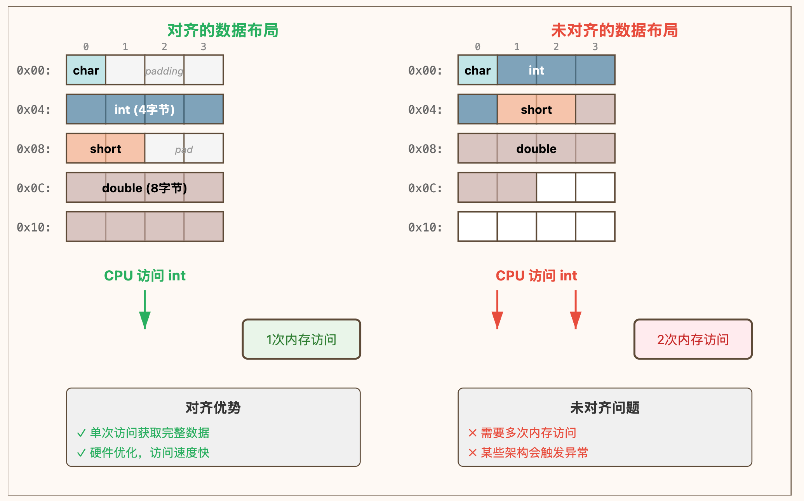

**不对齐** 的数据访问可能会导致 **性能下降**，因为处理器可能需要额外的 **内存访问** 来获取不完整的数据。在一些严格要求 **数据对齐** 的架构中，**不对齐** 的数据访问甚至会导致 **硬件异常**。

不同数据类型具有不同的 对齐因子，这是由处理器架构以及编译器的实现共同决定的。一般来说，对齐因子与数据类型的 **字节大小** 密切相关，基本规律是：

数据类型的对齐因子通常等于其自身大小（或该架构所支持的最大对齐限制）。

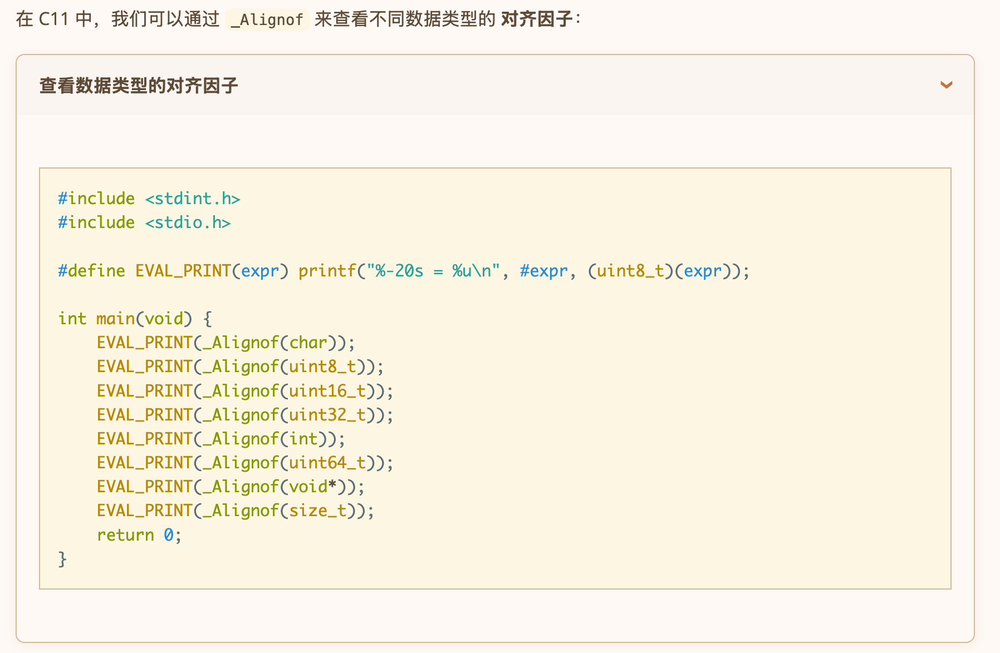

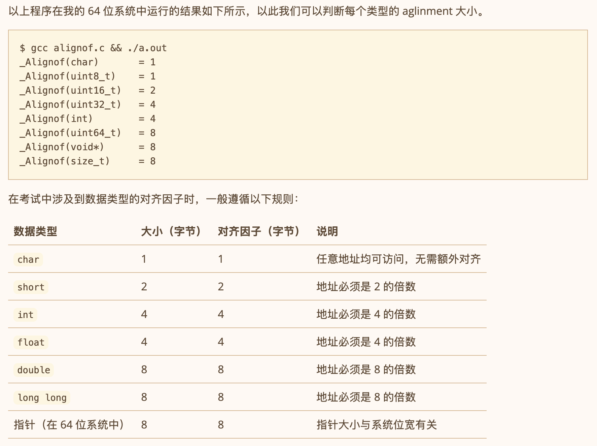

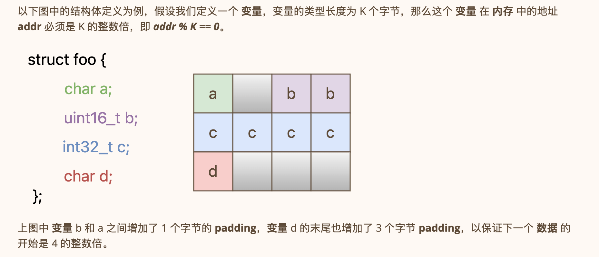

### 二、大小端

**大小端** （Endianness）是指多字节 **数据在内存中的字节序**，也就是 **字节** 的排列顺序。主要有两种存放方式：

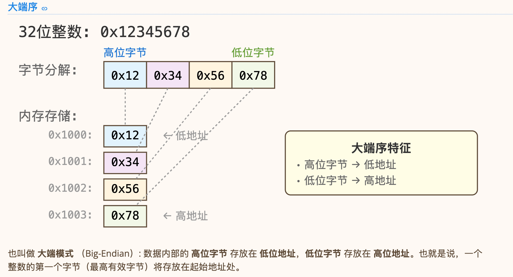

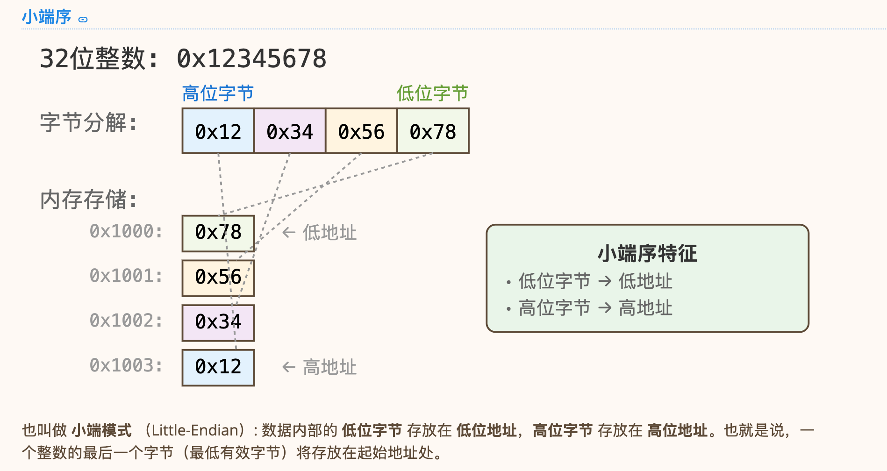

举一个例子，假如定义数组 `long a[2] = {0x76543210, 0xFEDCBA98}`，`long` 类型的大小为 8 字节，数组`a` 在内存中的起始地址为 `0x1000`，则数组中两个元素在内存中的字节排列如下图所示：

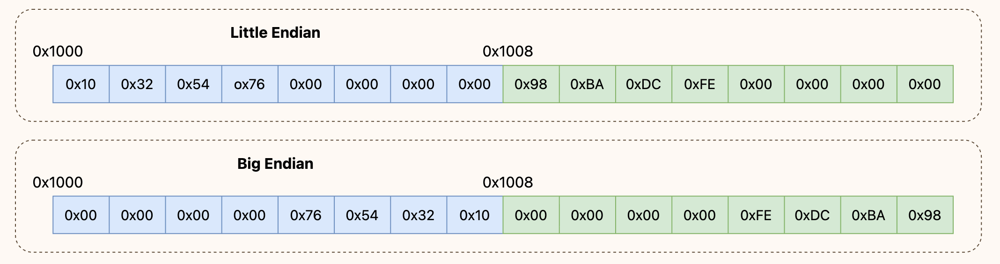

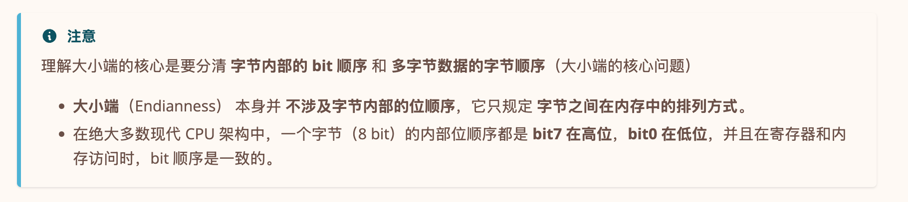

**大小端** 的选择通常是由计算机的 **CPU 架构** 决定的，不同的架构有不同的 **字节序** 要求。例如，Intel x86 和 x86-64 架构是 **小端**，而网络协议通常是 **大端**，因为 **大端** 的格式在 **字节流** 中的表示更加直观。

最后一句话总结一下 **大小端**：

- 小端序 是低位字节在低地址
- 大端序 是高位字节在低地址

---

## 指令集种类

### 一、指令体系结构

**指令体系结构** （Instruction Set Architecture，简称 ISA） 是计算机体系结构中定义处理器 **指令集** 的规范。它是硬件与软件之间的接口，规定了处理器能够执行的 **指令集合**、**指令格式**、**寻址方式**、**寄存器** 组织、**内存访问方式** 以及 **数据类型** 等。

具体来说，ISA 包括以下关键内容：

1. **指令集** ：处理器支持的所有操作（如加法、跳转、加载/存储等）。
2. **指令格式** ：每条指令的编码结构，如操作码、操作数等。
3. **寄存器** ：可用的寄存器数量、类型和用途（如通用寄存器、程序计数器等）。
4. **寻址方式** ：如何指定操作数的存储位置（如立即数、寄存器寻址、内存寻址等）。
5. **内存模型** ：内存的组织方式和访问规则。
6. **中断和异常处理** ：如何处理外部事件或错误。

**ISA** 决定了软件如何与硬件交互，是 **编译器**、**操作系统** 和 **应用程序** 开发的基础。常见的 ISA 包括 **x86**、**ARM**、**RISC‑V** 等，每种 ISA 在 **性能**、**功耗** 和 **应用场景** 上各有特点。例如，**RISC** （精简指令集计算机）强调 **简单高效** 的指令，而 **CISC** （复杂指令集计算机）提供更 **复杂** 的指令以减少代码量。

*简而言之，ISA 是计算机的核心“语言”，定义了处理器能做什么以及如何做。*

### 二、复杂和精简指令集

**CISC** （Complex Instruction Set Computer）和 **RISC** （Reduced Instruction Set Computer）是两种不同的计算机体系结构设计哲学，它们在 **指令集架构** 和 **执行方式** 上有显著的差异。

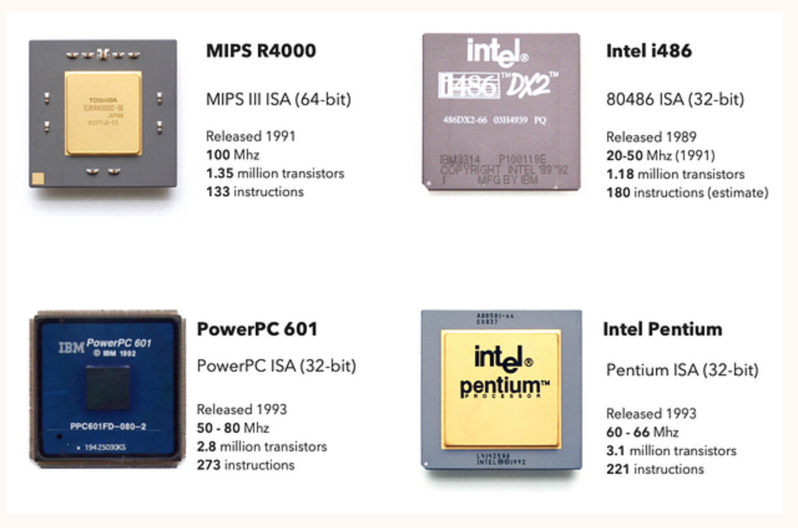

#### 2.1 CISC

1. **指令集复杂** ：CISC 指令集包含大量 **复杂的指令**，其中一条指令可以执行多种操作，包括 **内存访问**、**算术运算**、**逻辑运算** 等。
2. **指令不定长** ：CISC 支持多种长度的指令。
3. **多寻址模式** ：CISC 指令通常支持多种 **寻址模式**，允许直接访问内存，因此可以在一条指令中执行复杂的操作。
4. **微程序控制** ：CISC 计算机通常使用 **微程序控制单元**，指令解码和执行过程相对复杂。
5. **复杂硬件** ：CISC 处理器通常包括大量的硬件单元，用于支持 **复杂的指令集**，这使得 CISC 芯片相对较大。

**CISC** 的典型芯片就是 **x86** 系列，如 Intel 的 **Core i** 系列处理器和 AMD 的 **Ryzen** 系列处理器。

#### 2.2  RISC

1. **指令集精简** ：RISC 计算机的指令集更加精简，通常包含较少、更 **简**
2. **单的指令**。每条指令只执行一种操作。
3. **指令定长** ：RISC 指令集中所有指令长度相同。
4. **固定寻址模式** ：RISC 指令通常只支持一种或者很少种 **寻址模式**，鼓励将数据加载到寄存器中后再执行操作。
5. **硬布线控制** ：RISC 计算机使用 **硬布线控制单元**，指令解码和执行过程较为简单。
6. **精简硬件** ：RISC 处理器通常采用更 **精简的硬件**，以提高 **性能** 和降低 **成本**。

**RISC** 的典型芯片就是 **arm** 系列，比如苹果的 **A** 系列和 **M** 系列处理器。

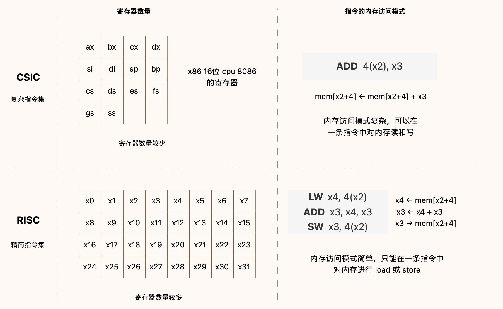

上图体现了 **CISC** 和 **RISC** 的差别：**RISC** 寄存器数量比 **CISC** 更多，**CISC** 的访存指令比 **RISC** 更加复杂（**CISC** 单条指令完成的工作 **RISC** 需要多条指令才能完成）。

#### 2.3 程序示例

这一节举个实际的例子说明一下 **CISC** 和 **RISC** 上的汇编代码区别。

```c
for (i = 0; i < 24; i++)
    for (j = 0; j < 24; j++)
        ...
        a[i][j] = 10;
        ...
```

对于上述的循环代码段，编译器将其编译为如下的 **intel x86** 汇编代码（**CISC**）和 **arm mips** 汇编代码（**RISC**）：

```c
for (i = 0; i < 24; i++)
1  00401072  C7 45 F8 00 00 00 00      mov     dword ptr [ebp-8], 0   ; i = 0，初始化 i 变量
2  00401079  EB 09                     jmp     00401084h              ; 跳转到循环条件检查
3  0040107B  8B 55 F8                  mov     eax, [ebp-8]           ; 读取 i 的值到 eax
    ... ... ...
7  00401088  7D 32                     jge     004010BCh              ; 若 i >= 24，跳出循环

    for (j = 0; j < 64; j++)
8  0040108A  C7 45 FC 00 00 00 00      mov     dword ptr [ebp-4], 0   ; j = 0，初始化 j 变量
        ... ... ...
        a[i][j] = 10;
        ... ... ...
19 004010AE  C7 84 82 00 20 42 00 0A 00 00 00
                                       mov     dword ptr [ecx+edx*4+00422000h], 0Ah
                                                                      ; 存储 10 到 a[i][j]，计算地址：
                                                                      ; ecx = i, edx = j
                                                                      ; a[i][j] = 10
20 ... ...
```

```c
for (i = 0; i < 24; i++)
1  00401000  20020000      addi  $v0, $zero, 0       # i = 0
2  00401004  08004004      j     0x00401010          # 跳转到循环条件检查
3  00401008  8C430008      lw    $v1, 8($fp)         # 读取 i
    ... ... ...
7  00401010  1C600018      bge   $v1, 24, 0x00401040 # if (i >= 24) 跳出循环
    for (j = 0; j < 64; j++)
8  00401014  20040000      addi  $a0, $zero, 0       # j = 0
        ... ... ...
        a[i][j] = 10;
17 00401028  00031880      sll   $v1, $v1, 6         # i × 64
18 0040102C  00641820      add   $v1, $v1, $a0       # i × 64 + j
19 00401030  00031880      sll   $v1, $v1, 2         # (i × 64 + j) × 4
20 00401034  3C010042      lui   $at, 0x0042         # 加载基地址高 16 位
21 00401038  34222000      ori   $v0, $at, 0x2000    # 完整基地址 0x00422000
22 0040103C  00621020      add   $v0, $v1, $v0       # 计算目标地址
23 00401040  2405000A      li    $a1, 10             # 10 存入 $a1
24 00401044  AC450000      sw    $a1, 0($v0)         # a[i][j] = 10
25 ... ...
```

#### 2.4 对比

**CISC** 和 **RISC** 的主要区别如下表所示：

| 特性           | **CISC**                         | **RISC**                               |
| -------------- | -------------------------------- | -------------------------------------- |
| **指令集**     | 复杂，指令数量多                 | 精简，指令数量少                       |
| **指令长度**   | 不定长                           | 固定长度                               |
| **寻址模式**   | 多种寻址模式                     | 较少寻址模式                           |
| **控制方式**   | 微程序控制                       | 硬布线控制                             |
| **硬件复杂度** | 复杂                             | 精简                                   |
| **优点**       | 功能强大，一条指令可完成复杂操作 | *性能高，功耗低*                       |
| **缺点**       | 硬件复杂，指令执行效率相对较低   | 功能相对简单，复杂操作需要多条指令完成 |

### 三、不同位数指令

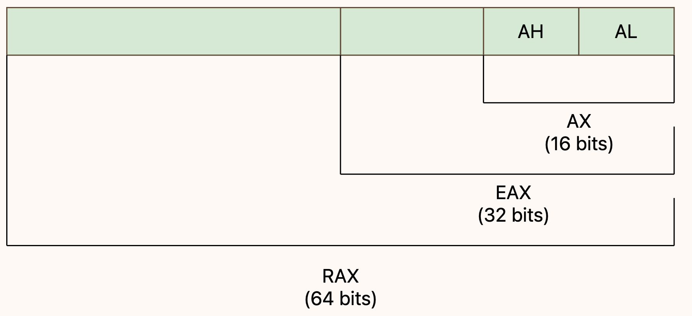

从 **8086**（16 位 **intel** 处理器）再到后来的 **32 位** 以及 **64 位** 的 CPU，差异主要体现在以下几个方面：

1. **寄存器位数** 和 **命名** 不同：32 位寄存器有 `E` 前缀，64 位寄存器有 `R` 前缀。
2. **指令集** 不同：32 位处理器相比 16 位处理器有着更加复杂的指令集，64 位处理器的指令集也比 32 位更加复杂。

下表中给出了不同位数寄存器的对比，注意每个寄存器的开头都与一个 **单次** 相对应，在最初 **8086** 的设计中这是代表一种语义。

| 寄存器              | 16 位 | 32 位 | 64 位 | 类型    |
| ------------------- | ----- | ----- | ----- | ------- |
| Accumulator         | AX    | EAX   | RAX   | General |
| Base                | BX    | EBX   | RBX   | General |
| Counter             | CX    | ECX   | RCX   | General |
| Data                | DX    | EDX   | RDX   | General |
| Source Index        | SI    | ESI   | RSI   | Pointer |
| Destination Index   | DI    | EDI   | RDI   | Pointer |
| Base Pointer        | BP    | EBP   | RBP   | Pointer |
| Stack Pointer       | SP    | ESP   | RSP   | Pointer |
| Instruction Pointer | IP    | EIP   | RIP   | Pointer |
| Code Segment        | CS    | -     | -     | Segment |
| Data Segment        | DS    | -     | -     | Segment |

### 四、AT&T 和 Intel指令

在 **x86** 汇编指令集中，常有 **AT&T** 和 **Intel** 两种格式，两种格式有较大差异。在考试中主要考察的是 **Intel** 格式，但是 **AT&T** 也需稍作了解，在遇到指令时能辨认出即可。

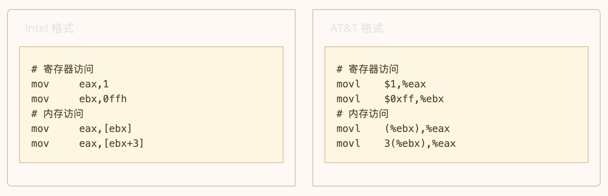

两种指令格式的不同主要在于 **Intel** 格式的 **目的操作数** 在左，**源操作数** 在右，而 **AT&T** 格式 **目的操作数** 在右，**源操作数** 在左。

两种指令格式的具体表格如下表所示：

| 特性           | **Intel** 格式 | **AT&T** 格式   |
| -------------- | -------------- | --------------- |
| **操作数顺序** | 目的，源       | 源，目的        |
| **寄存器**     | `eax, ebx...`  | `%eax, %ebx...` |
| **常数**       | `10, 0x20...`  | `$10, $0x20...` |
| **内存寻址**   | `[]`           | `()`            |

---

## 高级语言和机器码

### 一、编译过程

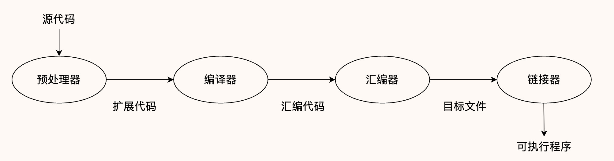

一个传统的 C 程序从源代码到可执行二进制程序的过程中，需要经历 **预处理**（Preprocess）、 **编译**（Compile）、 **汇编**（Assemble）、 **链接**（Link）四个步骤，这四个步骤分别由 **预处理器**（Preprocessor）、 **编译器**（Compiler）、 **汇编器**（Assembler）、 **链接器**（Linker）完成。

#### 1.1 预处理

**预处理**（Preprocess）阶段负责对 **源代码**（source code）进行文本的转换和处理，将其转化为 **扩展代码**（expanded code）。具体而言，**预处理**阶段包含如下工作：

- **头文件包含**：将 `#include` 指令包含的头文件内容插入到源文件中。
- **宏替换**：将源代码中定义的宏 `#define` 进行替换。
- **删除注释**：将代码中的注释删除。

#### 1.2 编译

**编译**（Compile）阶段将 **预处理后源代码**（extended code）翻译成 **汇编代码**（assembly code）。编译阶段包含 词法分析、语法分析、语义分析、中间代码优化 和 汇编代码生成 等子过程。

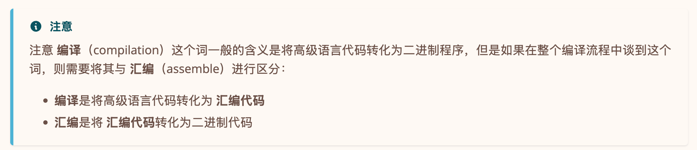

#### 1.3 汇编

**汇编**（Assemble）阶段负责将 **汇编代码**（assembly code）转换为 **目标文件**（object file）。**汇编器**（assembler）解析 **汇编指令**，将其翻译为对应的 **机器码**。

#### 1.4 链接

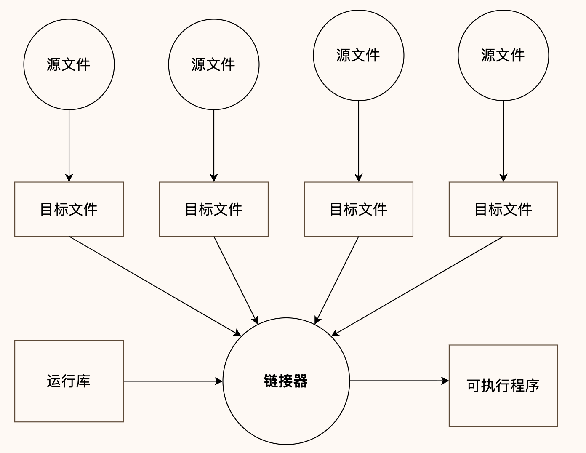

如上图所示，**链接器**（linker）的作用是将由编译器生成的一个或多个 **目标代码文件**（object file，通常是汇编器生成的机器代码）合并为一个单一的 **可执行文件**。在这个过程中，链接器主要完成如下任务：

1. **符号解析**：查找所有未定义的符号（如函数调用、全局变量）并找到对应的定义。
2. **重定位**：确定 **目标文件**中的符号地址，并更新相关指令或数据。
3. **合并代码和数据段**：将不同 **目标文件**的代码和数据合并，形成最终的 **可执行文件**。

**链接**分为 **静态链接** 和 **动态链接** 两种方式。

- **静态链接**：静态链接是在编译时将所有依赖的库代码拷贝到最终的 **可执行文件** 中，生成一个 **完全独立的二进制文件**。
- **动态链接**：动态链接不会在编译时将库代码合并，而是在运行时加载外部共享库（.so / .dll）。**可执行文件** 只包含对库的引用，而不包含库的代码。

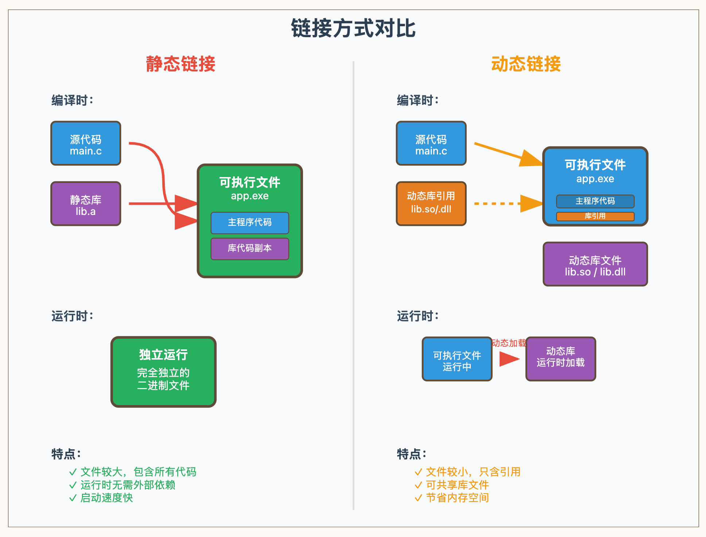

### 二、汇编代码

高级语言程序对应的 **汇编代码** 常常与 [存储系统](https://www.csgraduates.com/constitution_principle/storage/) 在大题中进行综合考察，这里需要重点掌握 **选择**、**循环**、**函数调用** 语句对应的汇编代码。

#### 2.1 选择结构语句

**选择结构** 在汇编中通过 **条件比较指令**（如 cmp）设置标志位，再利用 **条件跳转指令**（如 jle, jne 等）决定程序流程是否进入某个分支，同时通过 **无条件跳转**（jmp）跳过不应执行的分支，最终形成“判断 ➝ 跳转 ➝ 执行 ➝ 合流”的控制流图结构。

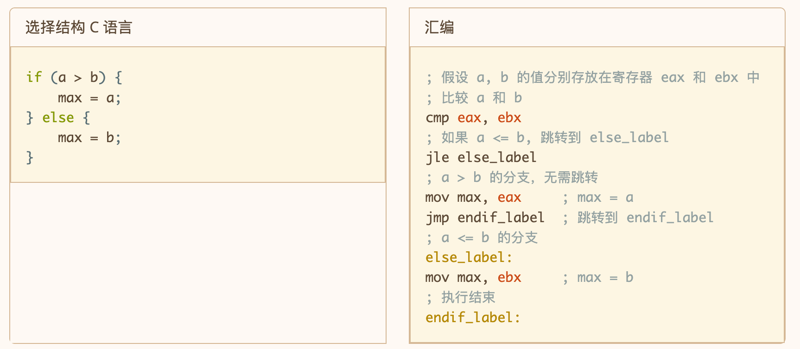

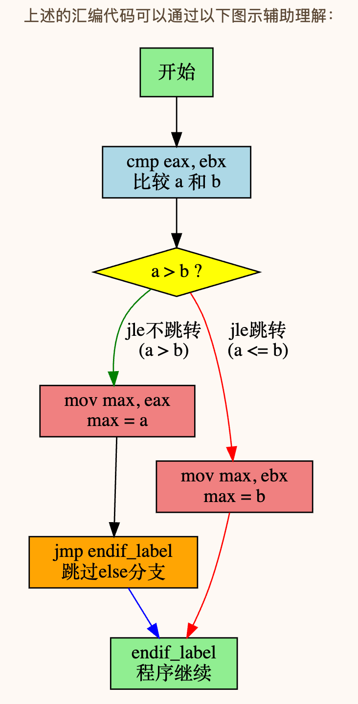

#### 2.2 循环结构语句

**循环结构**在 **汇编**中以一个入口标签开始，通过 cmp 或类似指令判断循环条件，结合 **条件跳转**（如 jge, jl）决定是否继续执行循环体，然后在循环末尾使用 **无条件跳转**（jmp）返回判断处，形成“判断 ➝ 执行 ➝ 跳回 ➝ 再判断”的闭环结构，直到条件不满足跳出循环。

C 语言中循环语句有 `while`、`do-while` 和 `for` 三种，三者执行流程稍有差别，但核心都在于都使用 **条件跳转** 控制循环流程：

##### while 语句

`while` 循环在汇编中实现的关键是 “**先判断、后执行**”，即编译器会先生成一个条件判断的跳转逻辑，如果条件不满足则跳出循环，否则进入循环体执行，再跳回判断位置重复该过程。

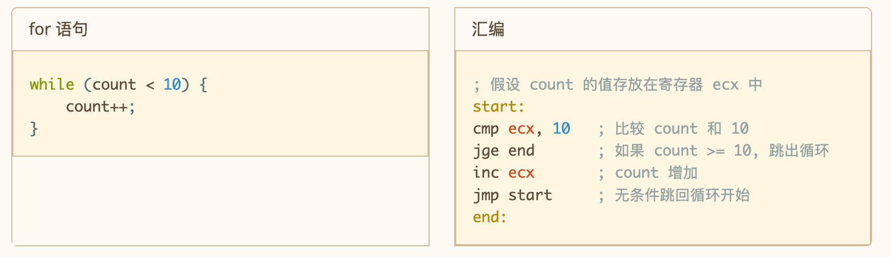

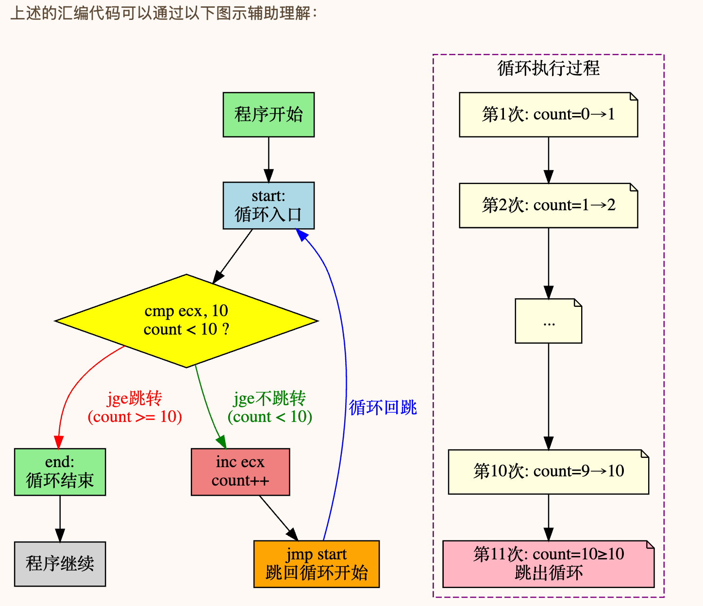

##### do-while 语句

`do-while` 循环的核心在于 **“先执行一次，再判断”**，因此汇编中先直接执行循环体，然后再进行条件判断，根据比较结果决定是否跳回继续执行。这种结构通过将判断逻辑放在循环体之后，确保循环体至少执行一次。

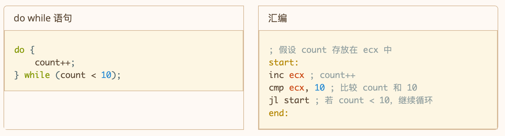

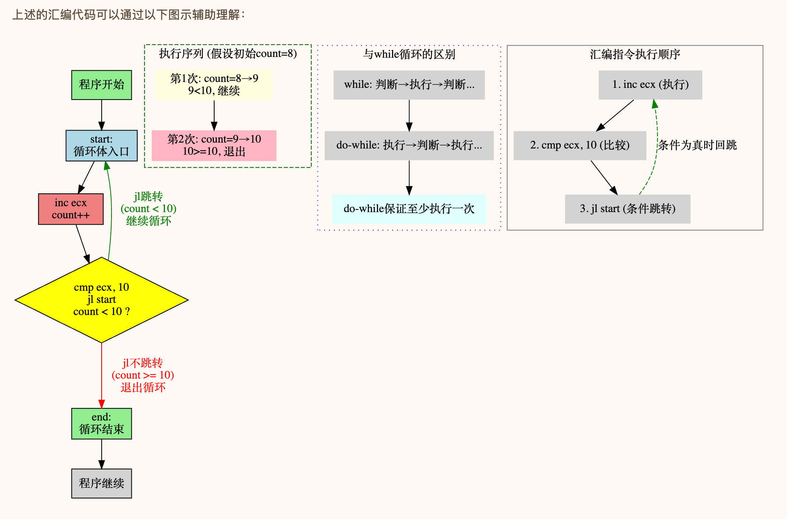

##### for 语句

`for` 循环在汇编中的实现是将 **初始化**、**判断**、**更新**三个阶段明确拆分：先初始化循环变量，再判断是否进入循环体；执行完循环体后进行变量更新，并跳回判断位置。它的本质是 `while` 循环的结构化变体，但语义更集中，便于生成高效指令序列。

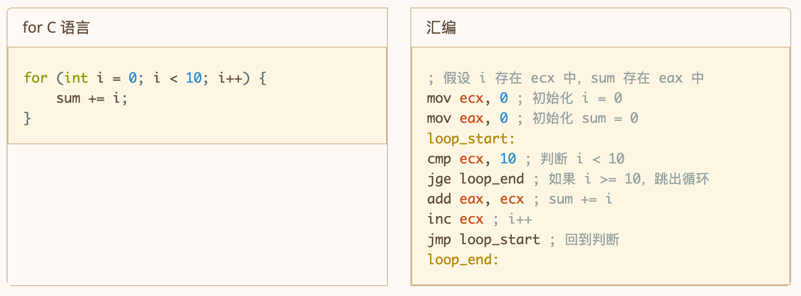

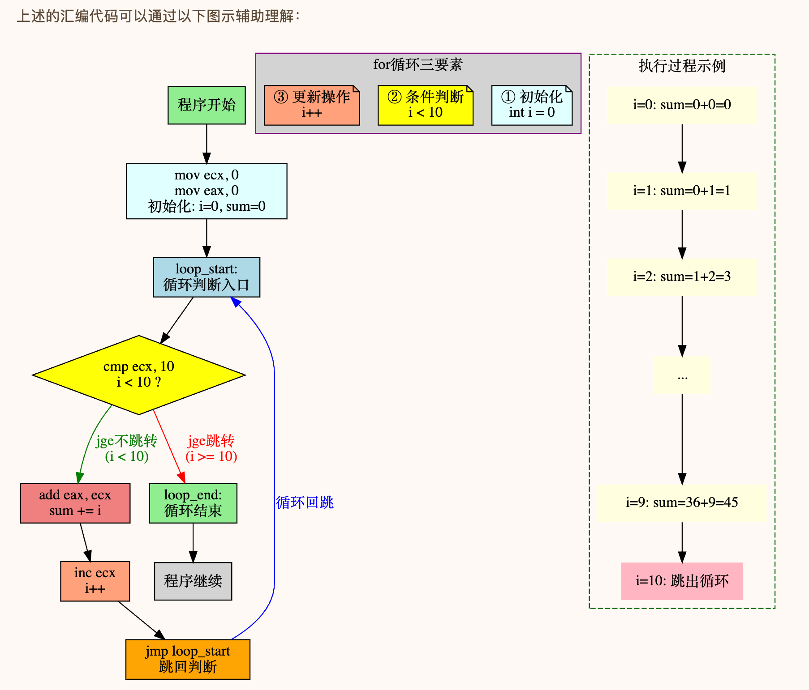

### 2.3 函数定义和调用

在 C 语言中，每一个函数调用在底层都会被编译为一套具体的 **汇编指令**。为了实现 **函数的参数传递**、**局部变量管理**、**返回值传递**等，**汇编层面**必须精细地管理 **栈帧**（stack frame）、**寄存器**（register）以及 **指令流程**（control flow）。

**函数调用在汇编中的三大阶段：**

1. 函数入口
   - **保存寄存器**：保存 **caller** 的寄存器，以确保在函数执行完后，寄存器的值不被改变。
   - **设置栈帧**：保存 **caller** 的栈帧，设置 **callee** 的栈帧。
2. 函数体
   - 这部分是函数的执行逻辑，会包含各种操作指令，此时 **局部变量**会被保存到栈上。
3. 函数返回
   - 如果函数有返回值，通常会将结果保存在 **eax** 寄存器中。
   - **恢复栈帧**：恢复栈指针，确保栈帧被正确销毁。
   - **恢复寄存器**：如果函数入口时保存了寄存器，那么在返回之前，需要将它们恢复。

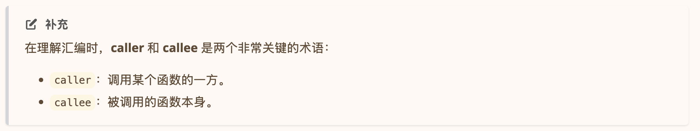

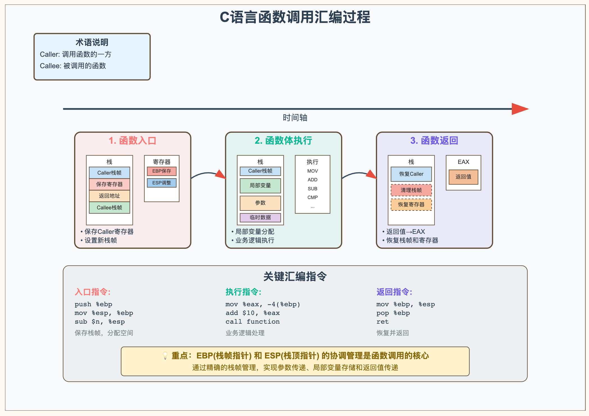

这一节可以结合 [函数调用时内存结构](https://www.csgraduates.com/operating_system/process/process_thread/#函数调用时内存结构) 共同理解，下面通过几个简单的例子说明以下 **函数定义** 和 **调用**。

##### 函数定义

本节以一个非常简单的加法函数 `add` 进行说明：

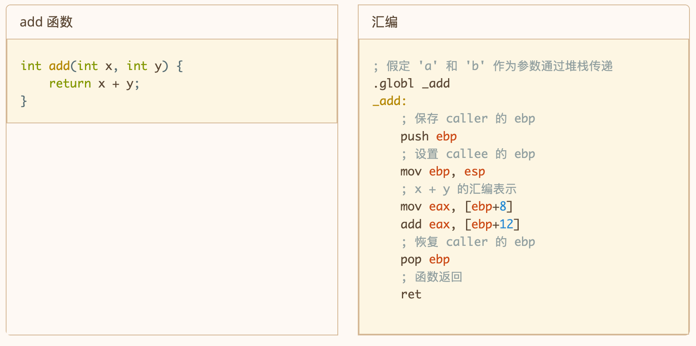

**说明**

- `add` 函数的两个参数 `x` 和 `y` 是通过栈传递的。`[ebp+8]` 和 `[ebp+12]` 分别代表第一个和第二个参数。
- 函数返回值被保存在 **eax** 寄存器中。
- `push ebp / mov ebp, esp` 是标准做法，用于设置新函数的栈帧，确保不同函数调用之间互不干扰。

##### 函数调用

再看一个稍复杂的例子，`func` 函数调用了 `add` 函数。

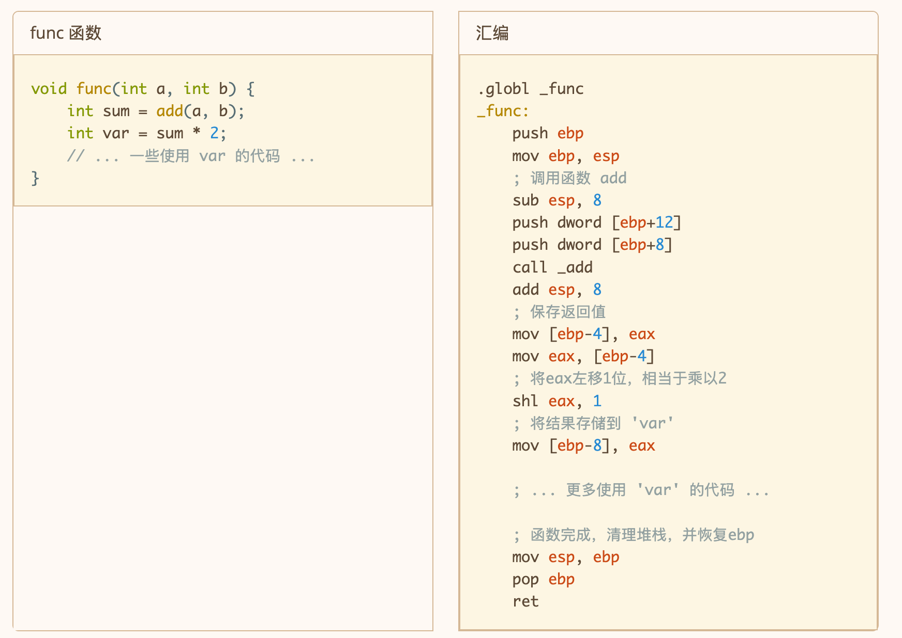

**说明：**

- 调用 `add(a, b)` 之前，参数是从右往左压栈的，这是 `C` 语言默认的调用约定（`cdecl`）。
- `call _add` 会把当前指令地址压入栈中（以便 `ret` 时跳回来）。
- **eax** 保存了 `add` 的返回值，存入局部变量 `sum`。
- 使用 `shl eax, 1` 是将 `sum` 乘以 `2`（左移一位即乘 *2*）。

---

## 指令操作码

### 一、数据传输指令

#### 1.1 数据传送

**数据传送指令**在 x86 中就是 `MOV`，将第二个操作数（**寄存器**的内容、**内存**中的内容或**常数**值）复制到第一个操作数（**寄存器**或**内存**），可以实现 **寄存器**、**内存**之间的 **数据传送**。

```nasm
// 1.语法
; 数据传送指令语法
mov <reg>, <reg>   ; 复制寄存器值
mov <reg>, <mem>   ; 从内存加载数据到寄存器
mov <mem>, <reg>   ; 把寄存器值存入内存
mov <reg>, <con>   ; 立即数赋值给寄存器
mov <mem>, <con>   ; 立即数赋值给内存

// 2.实例
; 数据传送指令实例
mov eax, ebx       ; 把 ebx 复制到 eax
mov eax, [var]     ; 把变量 var 的值存入 eax
mov [var], eax     ; 把 eax 的值存入变量 var
mov ecx, 100       ; 将 100 赋值给 ecx
mov byte ptr [var], 5  ; 只修改 var 指向的 1 字节
```

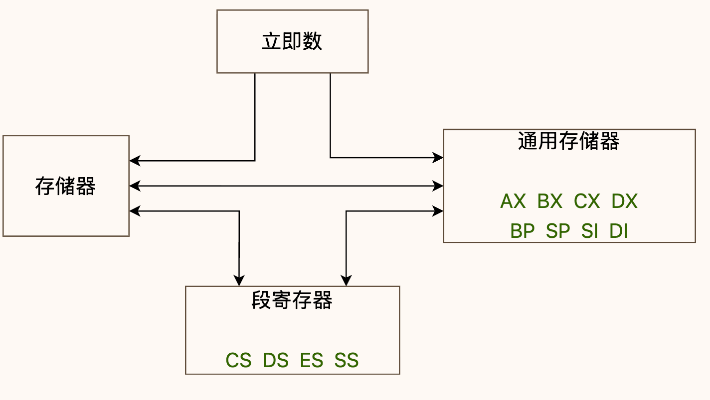

#### 1.2 栈操作

[堆栈](https://www.csgraduates.com/operating_system/process/process_thread/#函数调用时内存结构) 指的是程序的运行栈，从高地址向低地址增长。`PUSH` 指令将 **数据**压入栈顶，`POP` 指令从栈顶取出 **数据**，并存入 **寄存器**或者 **内存单元**。

```nasm
// 1.语法
push <reg>    ; 将寄存器值压入堆栈
push <mem>    ; 将内存值压入堆栈
push <con>    ; 将立即数压入堆栈

pop <reg>     ; 从堆栈弹出值存入寄存器
pop <mem>     ; 从堆栈弹出值存入内存

// 2.实例
push eax      ; 将 eax 压入栈
push 10       ; 将 10 压入栈
pop ebx       ; 弹出栈顶的值存入 ebx

// 3.入栈操作解释
; PUSH 指令等同于以下指令序列
sub esp, 4      ; esp 向低地址移动
mov [esp], eax  ; 把 eax 的值写入栈顶

// 4.出栈操作解释
; POP 指令等同于以下指令序列
mov ebx, [esp]  ; 从栈顶读取值
add esp, 4      ; esp 向高地址移动
```

- 当执行 `PUSH` 指令时，需要将 `ESP` 的值 **减去数据大小**，然后将 **数据**写入新地址处。
- 当执行 `POP` 指令时，需要将栈顶的 **数据**（即 `[ESP]` 处的值）读取到目标 **寄存器**或 **内存**，然后将 `ESP` 的值 **加上数据大小**，即弹出 **数据**。

下图给出了一个入栈出栈指令的实例，通过 `PUSH` 和 `POP` 指令实现了 **寄存器** `EAX` 和 `EBX` 内容交换：

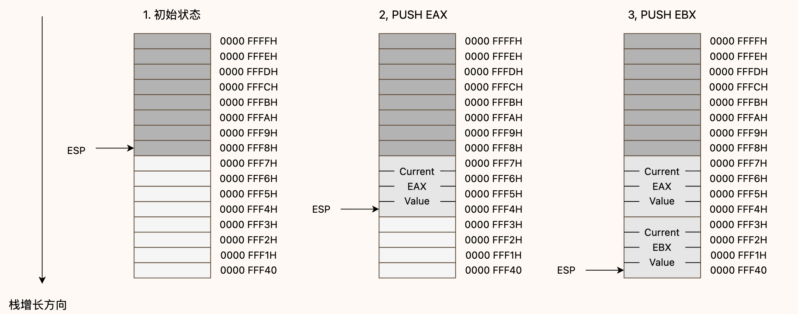

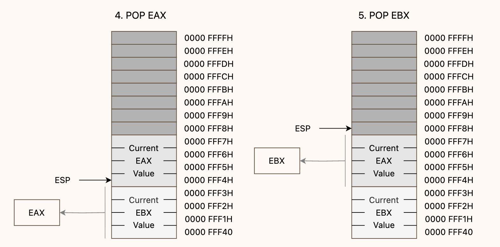

### 二、算术和逻辑运算指令

#### 2.1 加减

可以通过 `ADD` 和 `SUB` 两个指令实现 **加减** 操作：

- `ADD` 指令执行 **加法**，将结果存入第一个操作数。
- `SUB` 指令执行 **减法**：第一个操作数减去第二个操作数。

```nasm
// 1.语法
add <reg/mem>, <reg/mem/con>   ; 加法
sub <reg/mem>, <reg/mem/con>   ; 减法

// 2.实例
add eax, ebx    ; eax ← eax + ebx
sub eax, 10     ; eax ← eax - 10
add [var], cl   ; var ← var + cl
```

#### 2.2 乘除

在 x86 架构中，乘除法使用专门的指令 `MUL`、`IMUL`、`DIV` 和 `IDIV`，它们大多依赖默认 **寄存器**（如 `EAX` 和 `EDX`），操作前需准备好相关 **寄存器**的值。

```nasm
// 1.语法
; 无符号乘法
mul <reg/mem>   ; EAX × 操作数 → EDX:EAX
; 有符号乘法
imul <reg/mem>              ; EAX × 操作数 → EDX:EAX
imul reg, <reg/mem>         ; reg ← 被乘数 × 操作数
imul reg, <reg/mem>, <imm>  ; reg ← 操作数 × 常数
; 无符号除法
div <reg/mem>   ; 被除数：EDX:EAX，商 → EAX，余数 → EDX
; 有符号除法
idiv <reg/mem>  ; 被除数：EDX:EAX，商 → EAX，余数 → EDX

// 2.实例
; 无符号乘法
mov eax, 6
mov ebx, 4
mul ebx        ; → EAX = 24, EDX = 0

; 有符号乘法
mov eax, -6
mov ebx, 4
imul ebx       ; → EAX = -24, EDX = 0

imul ecx, ebx      ; ecx ← ecx * ebx
imul edx, ebx, 10  ; edx ← ebx * 10

; 无符号除法
mov edx, 0     ; 高位清零
mov eax, 20
mov ecx, 3
div ecx        ; → EAX = 6, EDX = 2 （20 ÷ 3）

; 有符号除法
mov eax, -20
cdq            ; EDX ← EAX 的符号扩展
mov ecx, 3
idiv ecx       ; → EAX = -6, EDX = -2
```

除法指令可能会触发 [异常](https://www.csgraduates.com/constitution_principle/cpu/interrupt/#异常)：

- **除数等于 0**：无符号或有符号除法中，如果除数是 0，会导致数学上未定义，立即触发异常。
- **结果溢出**：特别常见于 `IDIV` 有符号除法中，被除数是最小负数 `0x80000000`，除以 `-1` 会得到 `0x80000000`（超出 `32` 位有符号整数范围）。

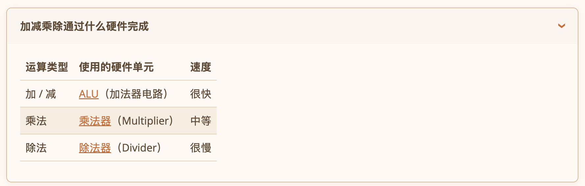

#### 2.3 位操作

位操作用于对 **寄存器**或 **内存**中的二进制位直接进行按位运算，位操作包含如下类型：

- `AND`：保留指定位，其它位清零；
- `OR`：将指定位设置为 1；
- `XOR`：将指定位翻转（0 ↔ 1）；
- `NOT`：将所有位取反（补码的按位非）；

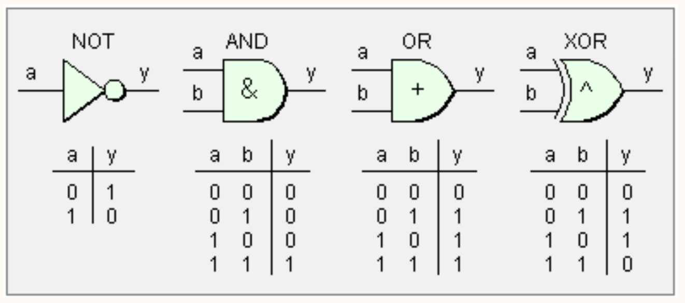

```nasm
// 1.语法
and <reg/mem>, <reg/mem/con>   ; 按位与：目标 ← 目标 & 源
or  <reg/mem>, <reg/mem/con>   ; 按位或：目标 ← 目标 | 源
xor <reg/mem>, <reg/mem/con>   ; 按位异或：目标 ← 目标 ^ 源
not <reg/mem>                  ; 按位取反：目标 ← ~目标

// 2.实例
; 按位与：清除低位
and eax, 0xF0      ; eax ← eax & 0xF0，仅保留高 4 位

; 按位或：设置低位
or eax, 0x0F       ; eax ← eax | 0x0F，将低 4 位全部置为 1

; 按位异或：清零技巧
xor eax, eax       ; eax ← eax ^ eax，结果为 0

; 按位取反：翻转全部位
not eax            ; eax ← ~eax
```

#### 2.4 自增自减

自增（`INC`）与自减（`DEC`）分别等价于对操作数 **加 1** 或 **减 1**，常用于循环计数或栈指针调整等场景。

- `INC` 等同于 `ADD 1`。
- `DEC` 等同于 `SUB 1`。

```nasm
// 1.语法
inc <reg/mem>    ; 加 1：目标 ← 目标 + 1
dec <reg/mem>    ; 减 1：目标 ← 目标 - 1

// 2.实例
inc eax          ; eax ← eax + 1
dec ebx          ; ebx ← ebx - 1
inc byte [cnt]   ; 将内存中 cnt 所指的字节加 1
```

#### 2.5 比较

`CMP` 指令用于 **比较**两个操作数的差值，不保存结果，只更新条件标志位（如 `ZF`、`SF`、`CF`、`OF`），常与条件跳转指令配合使用。

本质上，`CMP A, B` 等价于 `SUB A, B`，但不会改变 `A` 的值。

```nasm
// 1.语法
cmp <reg/mem>, <reg/mem/con>  ; 比较：目标 - 源，仅影响标志位

// 2.实例
cmp eax, ebx       ; 比较 eax 和 ebx
je  equal_label    ; 若 eax == ebx，跳转
cmp byte [x], 0
jl  less_than_zero ; 若 [x] 为负数，跳转
```

比较运算和加减操作一样，会影响以下 [条件标志](https://www.csgraduates.com/constitution_principle/cpu/structure/#条件标志)：

- `ZF`（Zero Flag）：结果是否为零
- `SF`（Sign Flag）：结果是否为负
- `CF`（Carry Flag）：是否产生了进位/借位（无符号溢出）
- `OF`（Overflow Flag）：是否有符号溢出


这些标志用于后续的 [条件跳转](https://www.csgraduates.com/constitution_principle/instruction/instruction_ops/#条件跳转)，如 `je`、`jg`、`jl` 等。

#### 2.6 移位

**移位**是一种常见的位运算操作，常用于实现快速的乘法、除法、符号扩展等功能。根据处理方式不同，移位可分为 **逻辑移位**、**算术移位**和**循环移位**三类：

- **逻辑移位**（Logical Shift）：用于 **无符号整数**，空位统一用 `0` 填充。
- **算术移位**（Arithmetic Shift）：用于 **有符号整数**，右移时保持符号位不变。
- **循环移位**（Rotate Shift）：将移出的位补回另一端，不丢失任何一位。


常见的移位指令如下表所示：

| 指令        | 含义              | 说明                                          |
| ----------- | ----------------- | --------------------------------------------- |
| `SHL`/`SAL` | 左移（逻辑/算术） | 功能相同，等效于乘以 2 的幂                   |
| `SHR`       | 逻辑右移          | 高位补 `0`，用于 **无符号数**                 |
| `SAR`       | 算术右移          | 高位补符号位（即保留符号），用于 **有符号数** |
| `ROL`       | 循环左移          | 将最高位移出，补入最低位，位模式循环          |
| `ROR`       | 循环右移          | 将最低位移出，补入最高位，位模式循环          |

逻辑移位 

**逻辑移位**适用于 **无符号整数**，移位时将空出的位补为 `0`，不考虑操作数的符号。

- **逻辑左移 (`SHL`)**：整体向左移动，低位补 `0`，高位移出丢弃；
- **逻辑右移 (`SHR`)**：整体向右移动，高位补 `0`，低位移出丢弃。

```nasm
; 逻辑移位的实例
mov al, 10000000b  ; 原值 -128（补码表示）
shr al, 1          ; 结果变为 01000000b，即十进制 64
```

尽管原数是负数，但使用 `SHR` 逻辑右移时，仍然将高位补 `0`，因此结果不再保留符号。

算术移位 

**算术移位**适用于 **有符号整数**，在右移时会 **保留符号位**（最高位），使符号不变，符合数学意义上的除法。

- **算术左移 (`SAL`)**：整体向左移动，低位补 `0`，高位移出丢弃；
- **算术右移 (`SAR`)**：整体向右移动，最高位保持原符号位的值。

```nasm
; 算术移位的实例
mov al, -16        ; 二进制补码：11110000（0xF0）
sar al, 1          ; 结果：11111000（0xF8）→ -8
```

由于保留了最高位 `1`，右移后结果仍为负数。

循环移位 

**循环移位**（Rotate Shift）是一种将移出的位 **重新从另一端补入** 的移位方式，不改变位的总数，也不会丢弃任何一位，常用于加密、校验等需要 “保留所有信息” 的场景。

常见类型包括：

- **循环左移 (`ROL`)**：将最高位移出后补入最低位；
- **循环右移 (`ROR`)**：将最低位移出后补入最高位。

```nasm
; 循环右移的实例
mov al, 10000001b  ; 原值：0x81
ror al, 1          ; 结果：11000000b（原最低位 1 补到了最高位）
```

与逻辑移位和算术移位不同，循环移位不引入新的位填充，因此所有位的内容只是位置发生变化，适用于 **无符号与有符号数** 的位模式操作，但不适合做乘除法运算。

### 三、控制转移指令

#### 3.1 无条件跳转

**无条件跳转**到某个标签（label）。

标签是一个可识别的标识符，标签通常是一个有意义的名字，后跟一个冒号，用于标记程序中的某个位置或地址。

```nasm
jmp label
```


跳转指令编译后通常使用 [相对寻址](https://www.csgraduates.com/constitution_principle/instruction/format/#相对寻址)，也就是 **跳转偏移量** 是相对于下一条指令的地址（即当前 PC + 指令长度） 来计算的。

对于 `jmp label` 指令，若 label 在距离当前指令之后 N 字节处，则相对寻址的偏移量可以通过以下公式计算：

```
偏移量 = 标签地址 - (当前 PC 值 + 指令长度)
```

#### 3.2 条件跳转

在 `CMP` 指令后常常跟一个 **条件跳转** 指令，**条件跳转**指令会检查 [标志寄存器](https://www.csgraduates.com/constitution_principle/cpu/structure/#标志寄存器)（FLAGS）的标志，从而决定是否跳转到某个标签（条件成立时），如果选择不跳转的话，则继续向后执行。

| 指令               | 全称                                              | 跳转条件        |
| ------------------ | ------------------------------------------------- | --------------- |
| `JE/JZ` JE/SW      | jump equal/zero（相等/零） 跳跃等于/零（相等/零） | `ZF=1`          |
| `JNE/JNZ` 等等/JNZ | not equal/zero（不等/非零）                       | `ZF=0`          |
| `JG`（大于）       | greater（大于）                                   | `ZF=0 且 SF=OF` |
| `JL`（小于）       | less（小于）                                      | `SF≠OF` 科幻≠   |
| `JGE`（大于等于）  | greater equal（大于等于）                         | `SF=OF`         |
| `JLE`（小于等于）  | less equal（小于等于）                            | `ZF=1 或 SF≠OF` |

```nasm
; 比较 eax 和 ebx 的值
cmp eax, ebx
; 执行条件跳转
je equal_label
```

条件跳转的过程可以通过下图进行辅助理解：


#### 3.3 子程序调用

在汇编语言中，调用一个子程序通常使用 `CALL` 指令，执行完子程序后使用 `RET` 指令返回。两者配合，实现了 **从主程序跳转到子程序，再返回继续执行** 的控制流程。

```nasm
call subroutine
...
subroutine:
    ; 执行一些操作
    ret
```

`CALL` 指令用于 **调用子程序**，涉及以下步骤：

- 保存返回地址：将当前指令的下一个地址（即返回地址）压入栈中，这样子程序返回时才知道从哪一条指令继续执行。
- 跳转到子程序：将程序计数器设置为子程序的入口地址，开始执行子程序的代码。

`RET` 指令用于 **从子程序返回到调用函数**，涉及以下步骤：

- 从栈中弹出返回地址：从栈顶弹出一个值，并将这个值作为返回地址。这是之前 `CALL` 指令压入栈的地址。
- 跳转到返回地址：将程序计数器设置为返回地址，继续执行从调用子程序的指令的下一条指令。

子程序调用的过程可以通过下图进行辅助理解：


图的阅读顺序对应四个步骤：

1. **CALL 跳转**：执行 `call 0x2000`，PC 被设为子程序入口地址 `0x2000`，控制流从主程序跳转过去。
2. **压入返回地址**：CALL 同时把下一条指令的地址（`0x1008`，即 `call` 后面那条）压入栈顶，SP 下移指向新的栈顶。
3. **弹出返回地址**：子程序执行完毕，`ret` 从栈顶弹出 `0x1008`，SP 上移恢复。
4. **RET 返回**：PC 被设为弹出的 `0x1008`，控制流跳回主程序，从 `call` 的下一条指令继续执行，宛如什么都没发生过。

### 四、陷阱指令

**陷阱指令**（Trap Instruction）是一类特殊的 **同步异常触发指令**，用于从 **用户态切换到内核态**，以请求操作系统执行特权操作。它们本质上是一种 **软件中断机制**，通常用于：

- 实现 **系统调用**（如文件操作、进程控制等）；
- 支持 **断点调试**（例如 IDE 或 GDB 中设置断点）；
- 报告程序运行中出现的 **异常情况**（如除 0、非法访问）等。

陷阱的特点是由 **程序主动触发**，与硬件中断（如 I/O、时钟中断）区分开来。

INT 抄截 

`INT` 指令用于产生一个软件中断，它后面跟着一个中断向量号（通常是一个字节大小的立即数），用于指定要调用的中断或服务例程：

```nasm
INT n  ; n 为中断向量号（0~255）
```

执行后，CPU 根据中断向量号 n 查找 [中断向量表](https://www.csgraduates.com/constitution_principle/bus/io/#基础概念)（Interrupt Vector Table, IVT）中对应的处理程序地址，并跳转执行。常见用法如下：

```nasm
mov eax, 1   ; 系统调用：exit
mov ebx, 0   ; 退出代码
int 0x80     ; 触发中断
```


### 五、协处理器指令

#### 5.1 开关中断

`CLI` 和 `STI` 用于控制 CPU 的 **中断响应**能力。具体来说，这两条指令用于修改处理器的 **中断标志**（IF，Interrupt Flag），从而控制外部硬件中断的使能和禁止。

**中断标志** (IF) 是状态寄存器中的一个标志位。如果 IF 位被设置（即为 1），处理器将响应外部硬件中断。如果 IF 位被清除（即为 0），处理器将忽略外部硬件中断请求。

- `CLI`：清除 **中断标志**位（Clear Interrupt Flag），将 IF 位设置为 0，从而禁止处理器响应外部硬件中断。
- `STI`：设置 **中断标志**位（Set Interrupt Flag），将 IF 位设置为 1，从而允许处理器响应外部硬件中断。

```nasm
cli   ; 关闭中断
sti   ; 开启中断
```


### 六、输入输出

`IN` 和 `OUT` 指令用于处理与外部设备的 **输入/输出**（I/O）操作。这些指令让 CPU 可以直接与硬件端口通信，从而读取或发送数据。


- `IN`：从指定的 **I/O 端口**读取数据到 **寄存器**。通过 `IN` 指令，可以从硬件设备读取状态信息或数据。
- `OUT`： **将寄存器**中的数据写入到指定的 **I/O 端口**。通过 `OUT` 指令，CPU 可以向设备发送控制命令或数据。

```nasm
// 1.语法
; 输入指令
in  reg, port      ; 从 I/O 端口 port 读取一个字节/字到 reg 寄存器

; 输出指令
out port, reg      ; 将 reg 寄存器中的值写入 I/O 端口 port

// 2.实例
; 读取键盘控制器状态（端口 0x60）
in al, 0x60

; 将 AL 中的数据再次写回键盘控制器
out 0x60, al
```

注意 **I/O 端口**的 [编址方式](https://www.csgraduates.com/constitution_principle/bus/io/#编址方式) 有两种：统一编址 和 独立编址，`IN/OUT` 指令仅适用于独立编址，对于统一编址，使用 `MOV` 指令即可完成输入输出。

**输入输出指令**（如 `IN` / `OUT`）常用于 [程序查询方式](https://www.csgraduates.com/constitution_principle/bus/io/#程序查询方式) 和 [程序中断方式](https://www.csgraduates.com/constitution_principle/bus/io/#程序中断方式) 中，由 CPU 发出指令与设备进行数据交换。相比之下，DMA 方式则由硬件控制器自动完成传输，通常不依赖此类指令。

程序查询方式 和 程序中断方式 这两种 **I/O** 方式的实现的核心逻辑可以参考下述代码：

```c
// 1.程序查询方式
// 用户态伪代码
write_to_device(data) {
    while (1) {
        if (kernel_read_port(STATUS_PORT) & READY_BIT) { // 轮询
            kernel_write_port(DATA_PORT, data);          // 实际执行 OUT
            break;
        }
    }
}

// 内核态驱动伪代码，用一个 C 函数封装了底层输入输出汇编指令
// 通过读取端口内容，获取设备状态
uint8_t kernel_read_port(uint16_t port) {
    asm("in %%dx, %%al" : "=a"(value) : "d"(port));
    return value;
}

// 通过端口向设备写入
void kernel_write_port(uint16_t port, uint8_t data) {
    asm("out %%al, %%dx" : : "a"(data), "d"(port));
}

// 2.中断方式
// 用户程序只发起请求，挂起等待中断
read_from_device(buffer) {
    request_read();  // 向设备发送读取命令
}

// 内核：中断服务例程
interrupt_handler() {
    uint8_t data = inb(DATA_PORT);  // IN 指令读取设备数据
    kernel_buffer = data;
    wake_up_user();
}
```

- 在程序查询方式中，CPU 通过反复执行 **输入输出指令**轮询设备状态，当设备准备就绪后再通过 **输入输出指令**执行读写操作。
- 在中断方式中，当设备准备好数据后会向 CPU 发送中断信号；CPU 响应后进入中断服务程序，并在其中执行 **输入输出指令**与设备进行数据交换。

### 七、字符串操作指令

字符串操作指令基本不考察，这里简单了解即可。

MOVS 

复制字符串（`ES:EDI` ← `DS:ESI`）。

```nasm
movs byte ptr es:[edi], byte ptr ds:[esi]  ; 复制 1 字节
movs dword ptr es:[edi], dword ptr ds:[esi]  ; 复制 4 字节
```

LODS 

从 `DS:ESI` 加载数据到 `AL/AX/EAX`。

```nasm
lodsb  ; 读取 1 字节
lodsd  ; 读取 4 字节
```

STOS 

将 `AL/AX/EAX` 存储到 `ES:EDI`。

```nasm
stosb  ; 存储 1 字节
stosd  ; 存储 4 字节
```

CMPS 

比较两个字符串。

```nasm
cmpsb  ; 比较字节
cmpsd  ; 比较 4 字节
```


### 八、指令汇总


