# 中央处理器

## 功能和结构

### 一、CPU

作为计算机的“大脑”，CPU（中央处理器）是执行程序指令、处理数据的关键部件。从宏观的计算机体系结构来看，CPU 是冯·诺依曼架构中“运算器”与“控制器”两大核心部件的具体实现与集成。因此，剖析 CPU 的内部组成，本质上就是探究现代计算机如何通过精密的硬件设计，将“运算”与“控制”这两大基本功能高效、协调地融为一体，并最终执行复杂的任务。

#### 1.1 组成结构

在介绍 CPU 的组成结构之前，首先回顾一下计算机的 [冯诺依曼结构](https://www.csgraduates.com/constitution_principle/overview/structure/#冯诺依曼结构)，其中 **运算器**、**控制器**、**存储器**、**输入**、**输出** 为计算机组成的五大部件，其中 CPU 涵盖的功能就包含 **运算器** 和 **控制器** 这两个。

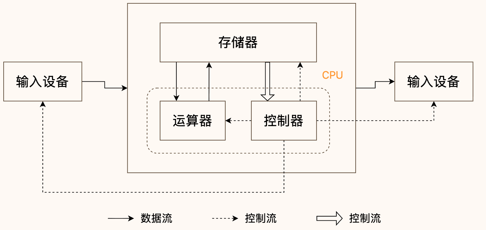

CPU 的核心功能包含 **运算和控制** 这两大模块，这对应了计算机五大部件中的 **运算器** 和 **控制器**。具体而言：运算功能（执行功能）是指 CPU 根据指令对数据进行算术或逻辑运算；控制功能则是指 CPU 通过指令协调计算机中各个部件的工作。

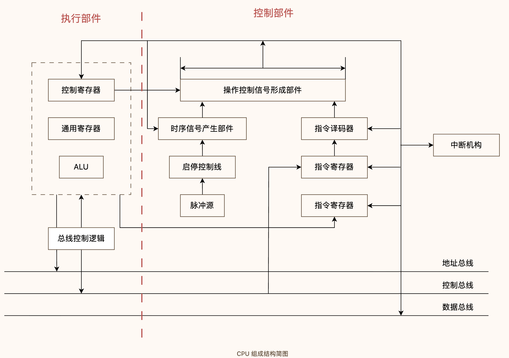

CPU 的结构简图如上图所示，CPU 由 **运算部件** 和 **控制部件** 组成。但是其实这两者并不能完全涵盖 CPU 的所有结构，因为这种分类方式忽略了 CPU 了内总线，所以一种更完善的 CPU 组件分类方法是将其分为 **数据通路** 和 **控制器** 这两部分：

- **数据通路**（Datapath）是指令执行过程中，数据所经过的路径，包括路径中的部件。它是指令的 **执行部件**。
- **控制器**（Control Unit）对指令进行解码，生成对应的控制信号，控制 **数据通路** 的动作。能够执行指令发出控制信号，是指令的 **控制部件**。

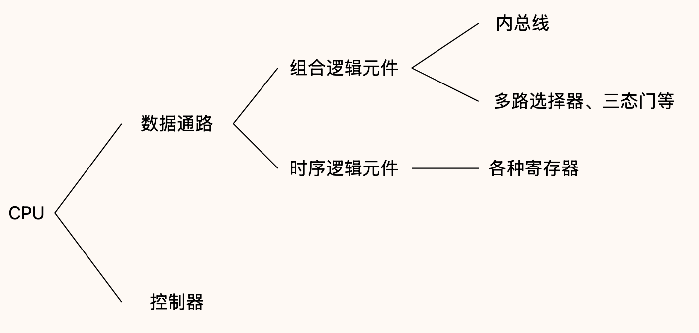

##### 数据通路

CPU 的 **数据通路** 是指 CPU 在执行指令的过程中内部数据流动的路径，**ALU**、**寄存器组**、**多路选择器** 都属于数据通路的一部分。数据通路 **描述了** 信息从哪里开始，中间经过哪些部件，最后被传送到哪里。数据通路由 [控制部件](https://www.csgraduates.com/constitution_principle/cpu/controller/) 控制，控制部件根据每条指令功能的不同，生成对数据通路的控制信号。

数据通路的元件主要分为 **组合逻辑元件** 和 **时序逻辑元件** 两类：

组合逻辑元件 

**组合逻辑元件**（操作元件）指那些仅由 **组合逻辑电路** 组成的元件，其输出仅取决于当前的输入，而不受存储器或时钟信号的影响。输入和输出之间无反馈通路，信号是单向传输的。

数据通路中常用的组合逻辑元件有 **算数逻辑单元**（**ALU**）、**译码器**、**多路选择器**、**三态门** 等，如下图所示：

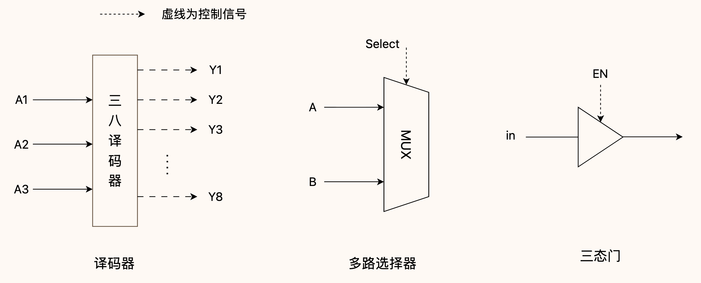

- **译码器**：用于操作码或地址码译码， *n* 位输入对应 2*n* 种不同组合，因此有 2*n* 种不同的输出，但是每次只有一个输出被使能。
- **多路选择器**：有多个输入，输出与其中一个输入相同，需要用控制信号 **Select** 选择哪个输入作为输出。
- **三态门**：可以被视为一种控制开关，由控制信号 **EN** 决定信号线的通断，当 **EN=1** 时，三态门被打开，输入信号等于输出信号；当 **EN = 0** 时，输出端呈现高阻态，数据通路被断开。

时序逻辑元件 

对于 **时序逻辑元件**（状态元件），其任何时刻的输出不仅与该时刻的输入有关，还与该时刻以前的输入有关，并且 **具备状态存储** 功能。此外，时序电路必须在 **时钟节拍** 下工作。

各类 **寄存器** 和 **存储器**，如 **通用寄存器组**、**程序计数器**、**状态/移位/暂存/锁存寄存器**等，都属于时序逻辑元件。

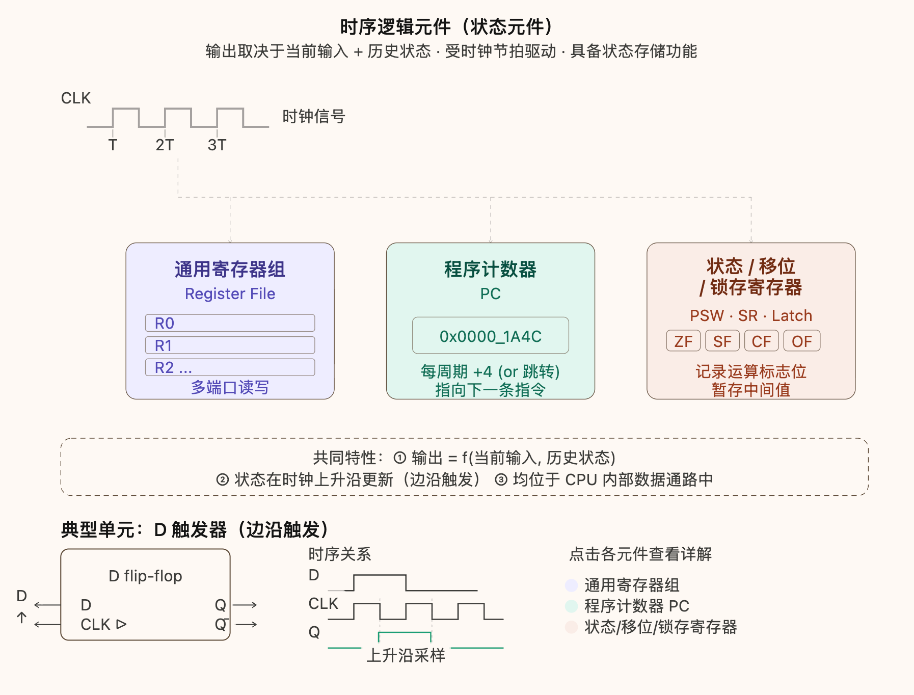

##### 控制器

**控制器**是计算机的指挥中心，它负责协调和控制计算机的所有操作。其核心功能是根据当前正在执行的**指令**，生成一系列**控制信号**，精确地指挥**数据通路**中的各个部件（如 ALU、寄存器、多路选择器）协同工作，从而完成指令所规定的任务。

控制器可以被视为整个 CPU 的“大脑”或“指挥家”。它不直接处理数据，而是决定数据在何时、何地、以何种方式流动和运算。

控制器的 **基本工作原理** 如下：

1. **取指令**：控制器指挥程序计数器（PC）送出当前指令地址，从存储器中取出指令，并送入指令寄存器（IR）。
2. **分析指令**：对指令寄存器中的指令进行**译码**，识别出指令的操作类型（如加法、跳转）、寻址方式以及所需的操作数。
3. **执行指令**：根据指令译码的结果，控制器在正确的时序下，生成并发出对应的控制信号序列。这些信号控制数据通路打开或关闭特定的数据路径，选择 ALU 的运算功能，决定是否写入寄存器或内存等。
4. **转向下条指令**：在完成当前指令后，控制器会更新程序计数器，为取下一条指令做好准备，从而开始新一轮的循环。

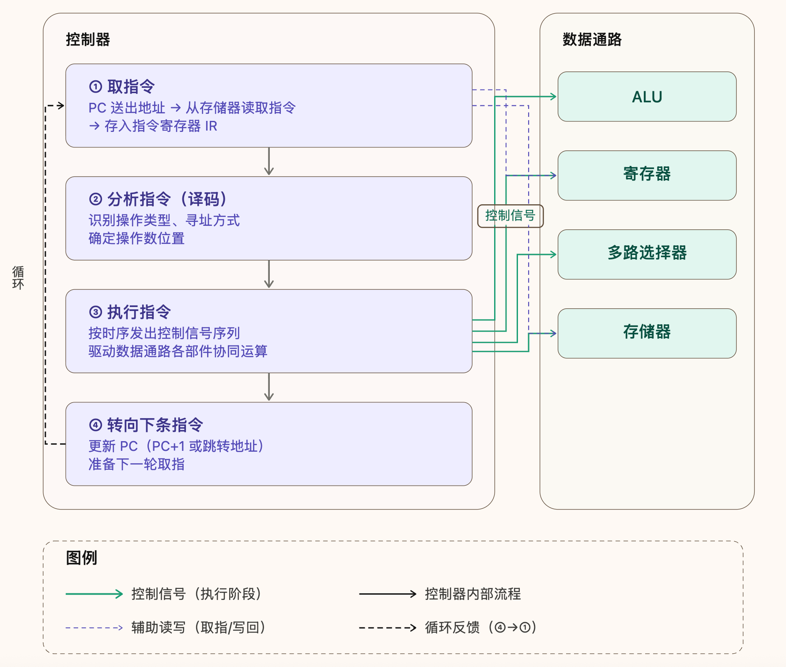

控制器的功能和组成详见 [该节](https://www.csgraduates.com/constitution_principle/cpu/controller/)。

### 二、8086 CPU

上文已经对 CPU 中的组件进行了分类，但是仅有抽象概念是不足够的，该节会提供一个非常简单的 CPU 实现来说明情况，这个 CPU 就是 **8086**。

**8086** 是 Intel 首款真正的 16 位处理器，也是现代 **x86** 处理器的开端，只要掌握了这个 CPU 的架构，就能搞定绝大多数考试过程中会遇到的问题。

#### 2.1 结构

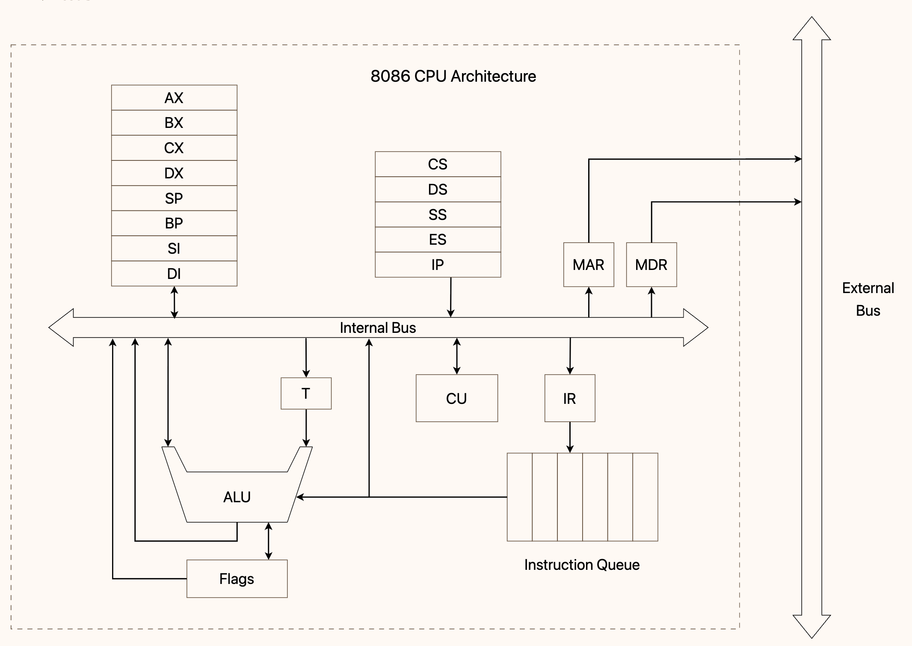

上文已经提到了 [CPU 的组成结构](https://www.csgraduates.com/constitution_principle/cpu/structure/#组成结构) 可以分为 **数据通路** 和 **控制器** 这两部分，**8086** 中的 **数据通路** 由指令队列、[寄存器](https://www.csgraduates.com/constitution_principle/cpu/structure/#寄存器) 和内总线组成。**控制器**中包含指令译码器、时序控制单元、标志控制逻辑和微指令控制逻辑。

下文会按照这个脉络对 **8086** 中的组件进行详细说明。

#### 2.2 寄存器

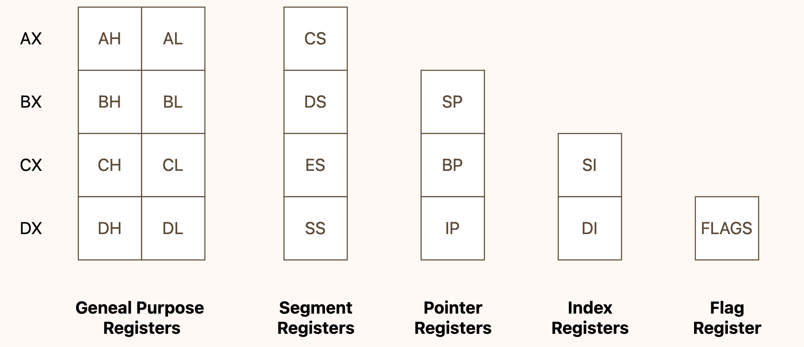

从功能的角度进行区分，**8086 CPU** 的 **寄存器** 可以为分为 **通用寄存器**、**段寄存器**、**指针寄存器**、**附加寄存器** 和 **标志寄存器** 这五类：

1. 通用寄存器：用于存储任意的地址或者数据。
   - `AX` 寄存器：累加器（Accumulator），用于执行算术和逻辑运算。
   - `BX` 寄存器：基址寄存器（Base Register），通常用于存储内存地址。
   - `CX` 寄存器：计数寄存器（Counter Register），用于循环计数和移位操作。
   - `DX` 寄存器：数据寄存器（Data Register），用于输入/输出操作和大整数运算。
2. 段寄存器：用于存储内存段的起始地址。
   - `CS (Code Segment)` 寄存器：代码段寄存器，存储指向代码段的地址。
   - `DS (Data Segment)` 寄存器：数据段寄存器，存储指向数据段的地址。
   - `ES (Extra Segment)` 寄存器：附加数据段寄存器，通常用于数据访问。
   - `SS (Stack Segment)` 寄存器：堆栈段寄存器，存储指向堆栈段的地址。
3. 变址寄存器：用于支持变址寻址模式，和数组和指针操作相关。
   - `SI` 寄存器：源变址寄存器，通常用于数据传送操作。
   - `DI` 寄存器：目的变址寄存器，也通常用于数据传送操作。
4. 指针寄存器：
   - `SP (Stack Pointer)` 寄存器：堆栈指针寄存器，指向函数栈的顶部。
   - `BP (Base Pointer)` 寄存器：堆栈基址寄存器，指向函数栈的底部。
   - `IP` 寄存器：指令指针寄存器，存储当前执行指令的偏移地址。
5. 标志寄存器：
   - `FLAGS` 寄存器：标志寄存器，存储有关条件和状态的信息，例如进位、零标志、溢出等。
6. 特殊寄存器：
   - `IR (Instruction Register)` 寄存器：暂存读取的指令。
   - `T` 暂存器：暂存 **ALU** 一端的输入。

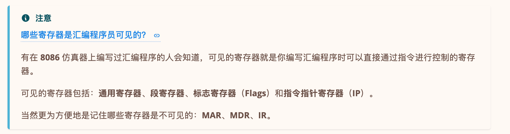

##### 段寄存器

**段寄存器**指向程序调用时的 **内存结构中不同段的起始位置**：

- **CS** 指向代码段（.text）的起始位置
- **SS** 指向栈段（User Stack）的起始位置
- **DS** 指向数据段（.data）的起始位置
- **ES** 指向附加段（Extra Segment）的起始位置

对于运行在 **8086** 上的程序而言，其内存结构相比 [现代进程内存空间](https://www.csgraduates.com/operating_system/process/process_thread/#进程内存空间) 更加简单，但其中的逻辑结构是类似的：

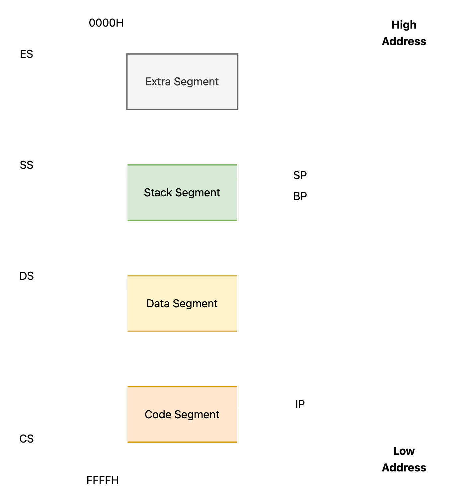

从逻辑上来说，程序的执行需要四个段：

- **代码段**：存储编译后程序指令的地方
- **数据段**：存储有全局数据的地方
- **栈段**：函数嵌套调用的发生场所
- **额外段**：提供一些灵活性，供程序员发挥

不同的段寄存器与不同的段相关联，指向相关段的起始地址。

##### 指针寄存器

对于有些段来说，仅仅知道其起始地址是不足够的，在程序执行过程中，需要一些额外的寄存器来实现我们需要的操作，**指针寄存器**主要操作 **栈段** 和 **代码段**。

栈指针寄存器 

**栈指针寄存器** 包含 **BP**、**SP** 这两个，在进一步了解这两个寄存器之前，请复习一下 [函数调用时的内存结构](https://www.csgraduates.com/operating_system/process/process_thread/#函数调用时内存结构)。

函数在执行过程中需要保存的数据与栈类似，具有先进后出的特点。

函数栈从高地址向低地址增长，嵌套调用的函数所对应的函数栈 在栈段上不断堆叠。如果我们在 `main()` 主函数中嵌套调用 `f(g(h(1)))`，那么该程序对应的栈段对应的逻辑结构如下所示：

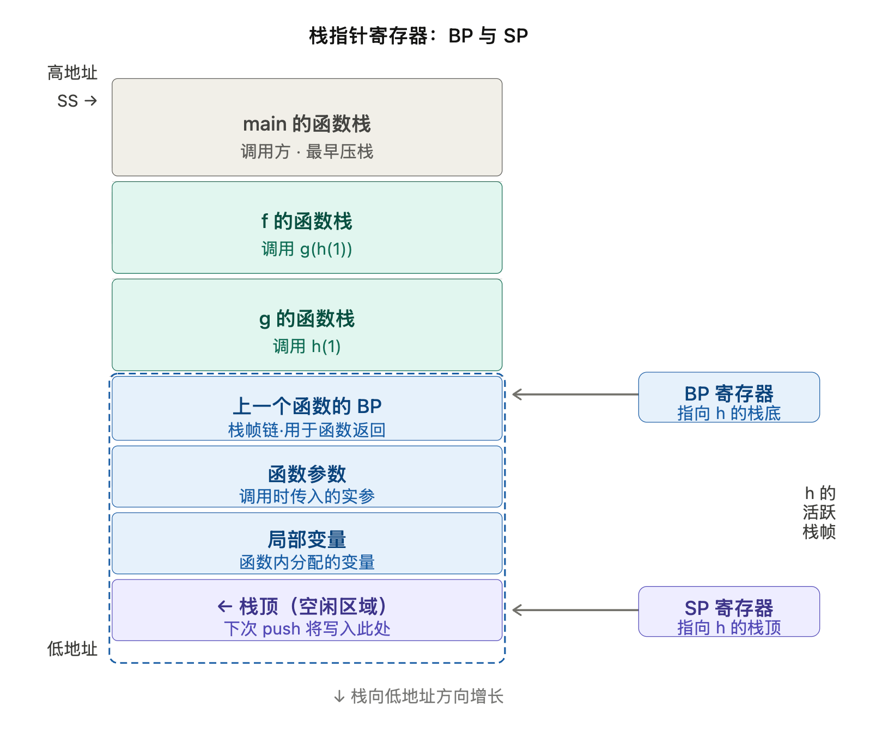

其中 **BP** 指向最后一个调用的函数栈的底部，**SP** 指向最后一个调用的函数栈的顶部，通过 **BP** 和 **SP** 我们保存了最后一个函数栈帧的栈底（开始位置）和栈顶（结束位置）。

指令指针寄存器 

在 **8086** 中，指令指针寄存器指的就是 **IP**（Instruction Pointer）寄存器。

指令在 **代码段**（.text 段）中是从低地址向高地址增长的，这种增长方式也符合 **程序计数器**（PC 或 IP）的增长逻辑：在 [指令执行的取指阶段](https://www.csgraduates.com/constitution_principle/cpu/controller/#指令执行的控制信号)，控制单元在完成取指后会控制 **IP = IP + 指令长度**，这样 **IP** 就指向了 **下一条待执行指令的地址**。

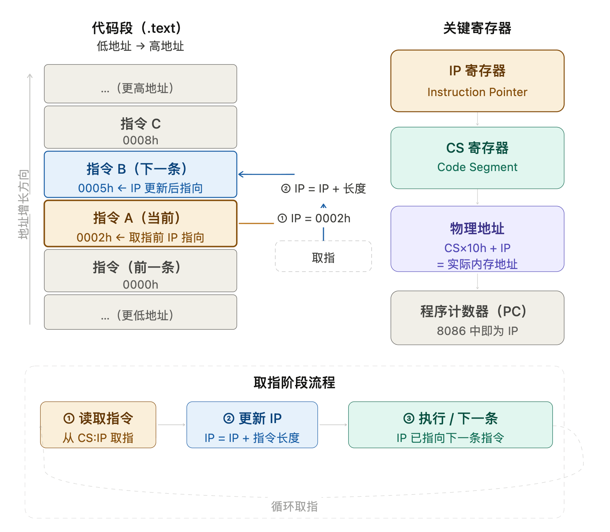

##### 变址寄存器

**变址寄存器** 主要用于实现变址寻址模式，方便对数组、字符串等数据结构中的 **第 i 个元素** 进行操作。**8086** 中的主要变址寄存器是 **SI**（源变址寄存器）和 **DI**（目的变址寄存器），下文分别从 **数组** 和 **字符串操作** 两个例子说明一下：

**数组操作**

以下汇编代码段通过一个循环操作实现了对于数组中的前五个元素进行操作。注意在 **8086** 中，我们是在 **CX** 中保存 loop 的轮数，每次 **LOOP** 被调用后 **CX** 的值自动被减一。

```
; 假设 DS 指向数据段并且数组从数据段开始
MOV DS, addr         ; 将数组的起始地址保存到 DS 中
MOV CX, 5            ; CX 用作循环计数器，假设数组有 5 个元素
MOV SI, 0            ; SI 作为索引寄存器，初始化为 0

NEXT_ELEMENT:
    MOV AX, [SI]     ; 从数组当前元素读取到 AX
    ; 对 AX 中的数据进行处理
    ADD SI, 2        ; 移动到下一个元素（假设每个元素 2 字节）
    LOOP NEXT_ELEMENT ; 循环直到 CX 为 0
```

**字符串操作**

以下汇编代码将一个字符串的前 **length** 个字符复制到另一个字符串中。

```
; 假设 DS 和 ES 已经分别指向源和目的数据段
MOV SI, OFFSET source ; SI 指向源字符串的起始位置
MOV DI, OFFSET dest   ; DI 指向目的字符串的起始位置
CLD                   ; 清除方向标志位，确保字符串操作从低地址到高地址

MOV CX, length        ; CX 初始化为字符串的长度

REP MOVSB             ; 复制 CX 个字节从 DS:SI 到 ES:DI
```

##### 标志寄存器

**标志寄存器**（**Flags**）用于存储处理器在 **执行指令过程中产生的各种状态和条件**，这些状态可以进一步被 [控制器](https://www.csgraduates.com/constitution_principle/cpu/controller/) 所用，控制后续指令执行的行为。

标志寄存器中的不同位用于标记某个特殊的状态，**8086** 中的 **标志寄存器** 是一个 **16 位** 的寄存器，其中 *9 个标志位* 被使用，其他 *7 个标志位* 没有含义。

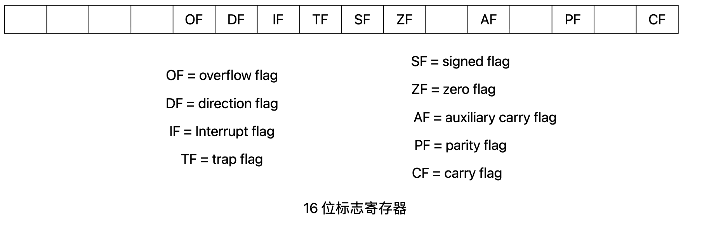

这些标志位在逻辑上可以被分为 **条件标志**（conditional flags）和 **控制标志**（control flags）两种：

条件标志 

条件标志用于标记指令执行后的结果状态，用于影响程序的控制流，**条件标志** 包含以下几种：

- OF (Overflow flag)：溢出标志。
  - 当 [有符号整数](https://www.csgraduates.com/constitution_principle/representation/integer/#有符号数) 运算的结果太大而无法适应目标寄存器时，**OF** 标志会设置为 1，表示发生了溢出。
- CF(Carry flag)：进位标志。
  - 当无符号整数 运算的结果超出了目标寄存器的位数，CF标志被设置为 1，表示发生了进位。
    - 加法时：**CF=1** 表示发生了 **进位**（即结果超过了寄存器能表示的范围）。
    - 减法时：**CF=1** 表示发生了 **借位**（即被减数小于减数）。
- SF(Sign flag)：符号标志。
  - 根据操作结果的符号位来设置，如果结果为负数，则 **SF** 被设置为 1，否则为 0。
- ZF(Zero flag)：零标志。
  - 当操作结果为零时，**ZF** 标志被设置为 1，否则为 0。
- AF(Auxiliary carry flag)：辅助进位标志。
  - 通常用于 BCD（二进制编码十进制）算术运算，指示低四位的进位。
- PF(Parity flag)：奇偶校验标志。
  - 根据结果中二进制位 1 的个数是奇数还是偶数，设置 **PF** 标志。奇数个 1 则 **PF** 为 1，偶数个 1 则 **PF** 为 0。

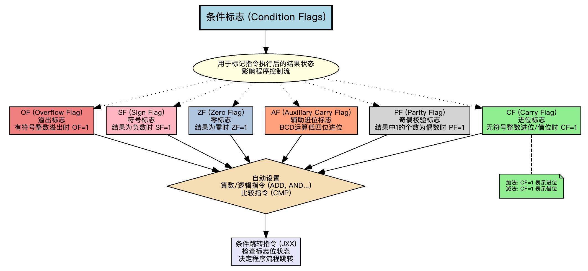

条件标志不需要 序员手动通过指令设置，当算数和逻辑指令（Add 和 AND 等）和 **比较指令**（CMP）被执行时，相关的标志位会被 **自动设置**。

条件标志通常用于控制 [条件跳转指令](https://www.csgraduates.com/constitution_principle/instruction/instruction_ops/#jxx-条件跳转指令) 的执行。条件跳转指令会检查条件寄存器中的标志位，根据标志位的状态决定是否将 **程序计数器**（PC）修改为目标地址，从而实现程序流程的跳转。

以下我们需要说明几个需要注意的点，这些知识点很容易被混淆：

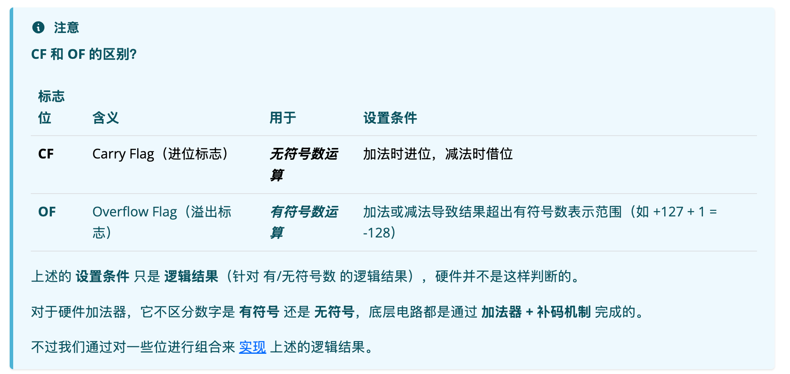

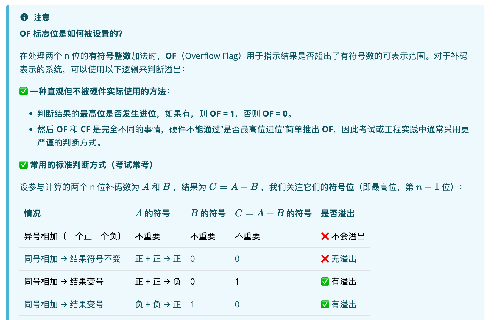

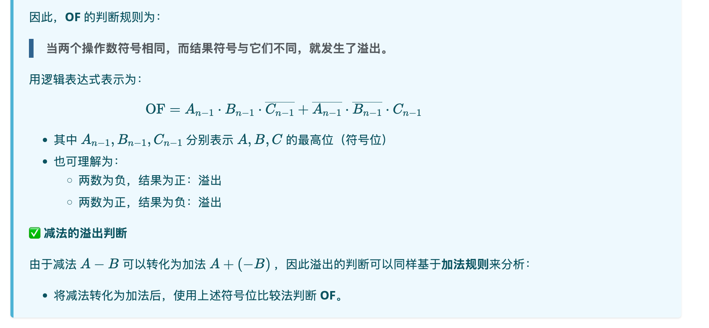

控制标志 

**控制标志** 并不会被通常的运算指令自动修改，而是通过专门的指令来进行设置或清除。对于以下字段，了解即可：

- IF(Interrupt flag)
  - 控制中断处理
  - 当 **IF** 被设置为 1 时，CPU 允许中断请求。如果 **IF** 为 0，CPU 将禁止所有 [**可屏蔽中断**](https://www.csgraduates.com/constitution_principle/bus/io/#可屏蔽中断)，无论是外部硬件中断还是软件中断。
- TF(Trap flag)
  - 控制单步执行。
  - 当 **TF** 被设置为 1 时，CPU 将进入单步执行模式。在单步执行模式下，每执行一条指令后，CPU 将引发一个单步中断，允许程序员逐条调试程序。
- DF(Direction flag)
  - 字符串操作的标志位。
  - 当 **DF** 被设置为 1 时，字符串操作（如 MOVS、LODS、STOS）在内存中向高地址方向移动。这通常用于从高地址向低地址扫描字符串。当 **DF** 被清除为 0 时，字符串操作在内存中向低地址方向移动。这通常用于从低地址向高地址扫描字符串。

##### 特殊寄存器

暂存器 

每次 **ALU** 操作都需要两个操作数，但是 **数据总线** 是 **共享的**，同一时刻只能传输一个操作数。所以在 **ALU** 会按照以下方式进行计算：

- 先读取第一个操作数，暂存在临时寄存器 **T** 中；
- 然后再读取第二个操作数；
- 最后，**ALU** 从 **T** 和第二个操作数一起执行运算。

所以在 **只有一个内部数据总线** 的设计里，为了配合 **ALU** 的两个输入，**暂存器**被设置用于存储前一个时钟周期的数据。

指令寄存器 

当 **CPU** 从内存或指令队列中取出一条指令时，这条指令会被送入 **IR**（指令寄存器），暂存在这里，供后续的译码和执行阶段使用。

控制单元（CU）可以对 **IR** 中的指令进行译码，生成一系列控制信号。

#### 2.3 引脚

CPU 的 **引脚**（Pin）是处理器与主板之间进行电气连接的接口，是 CPU 与外部组件（如内存、I/O 设备、电源等）之间通信的桥梁。**引脚** 的功能包括 **数据传输**、**地址定位**、**中断控制**、**时序控制** 等，是实现 CPU 与外部世界交互的关键通道。

为便于理解，本节以 **Intel 8086** 处理器为例进行说明。需要注意的是，本节内容以了解为主，试题通常不会直接考察，但对于理解计算机体系结构十分重要。

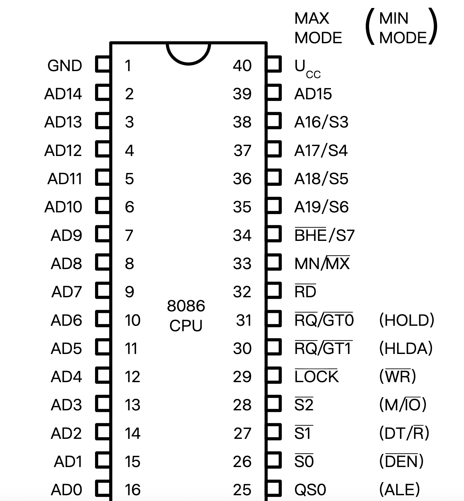

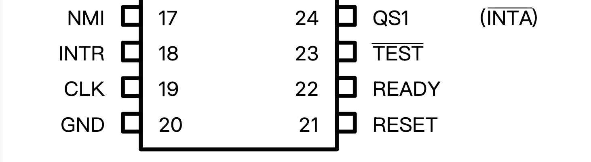

以 **8086** 为例，**8086** 为 16 位计算机，其 **数据总线** 为 16 位，可寻址地址空间为 1 MB，所以其 **地址总线** 为 20 位。数据总线和地址总线 **复用**，地址总线的高位与状态线复用：

| 引脚名        | 方向 | 说明                                                        |
| ------------- | ---- | ----------------------------------------------------------- |
| AD0–AD15      | 双向 | 地址/数据复用线： - 发地址时传送 A0–A15 - 传数据时传 D0–D15 |
| A16/S3–A19/S6 | 输出 | 高位地址线与状态线复用                                      |

在 **数据传输** 过程中，低位地址与数据使用同一组引脚（AD0–AD15），通过时序的不同进行区分。为了确保地址被正确识别，**8086** 使用 **ALE**（地址锁存使能）信号配合外部锁存器将地址锁存下来。

为了支持外设对 **CPU** 发起中断请求，以及对处理器进行复位操作，**8086** 设置了如下相关引脚：

| 引脚名    | 方向 | 说明                                                         |
| --------- | ---- | ------------------------------------------------------------ |
| **NMI**   | 输入 | [不可屏蔽中断](https://www.csgraduates.com/constitution_principle/bus/io/#不可屏蔽中断)，请求立即响应 |
| **INTR**  | 输入 | [可屏蔽中断](https://www.csgraduates.com/constitution_principle/bus/io/#可屏蔽中断) 请求 |
| **RESET** | 输入 | 复位输入，低电平有效，将 **CPU** 状态初始化                  |
| **INTA#** | 输出 | 中断响应信号，通知外设 **CPU** 正在响应中断                  |

此外，**CPU** 还需要通过控制信号对外设进行控制，下面列出了一些常用的控制信号：

| 引脚名    | 方向 | 说明                                                         |
| --------- | ---- | ------------------------------------------------------------ |
| **RD#**   | 输出 | 读信号，低电平有效，表示从内存/I/O 读取                      |
| **WR#**   | 输出 | 写信号，低电平有效，表示写入内存/I/O                         |
| **ALE**   | 输出 | 地址锁存使能，表示当前 AD0–AD15 是地址                       |
| **DT/R**  | 输出 | 数据传输方向：读=0，写=1                                     |
| **READY** | 输入 | 外设准备就绪信号，不就绪则 **CPU** 等待                      |
| **HOLD**  | 输入 | 外设 [请求总线控制权](https://www.csgraduates.com/constitution_principle/bus/io/#步骤) |
| **HLDA**  | 输出 | 总线控制权应答（HOLD Acknowledge）                           |

其中，**READY** 信号的作用是支持不同速度的外设。当某些设备处理速度较慢时，**CPU** 会检测到 **READY** 为低电平，从而暂停当前操作，等待设备准备就绪，避免数据错误。

而 **HOLD** 与 **HLDA** 是总线请求/响应配对信号，用于支持 **DMA** 等技术，使得外设可以在不经过 **CPU** 的情况下直接访问内存，从而提升数据传输效率。

---

## 控制器

### 一、主要功能

控制器是计算机系统的指挥中心，**控制器** 的主要功能有：

- **指令解码** ： CPU 从存储器取出一个指令后，控制器负责 **指令解码** 这个指令，以确定要执行的操作和涉及的操作数。
- **生成控制信号** ： 基于 **指令解码** 的指令，控制器 **生成控制信号**，这些信号会驱动其他计算机部分（如算术逻辑单元、寄存器和存储器）按预期执行相应的操作。
- **时序控制** ： 通过先后发出不同的 **时序控制** 信号，确保指令的逻辑正确被执行，

根据控制器产生微操作 **控制信号** 方式的不同，控制器可以分为 **硬布线控制器** 和 **微程序控制器**。

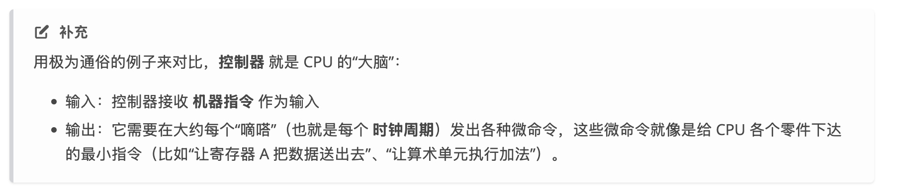

### 二、组成

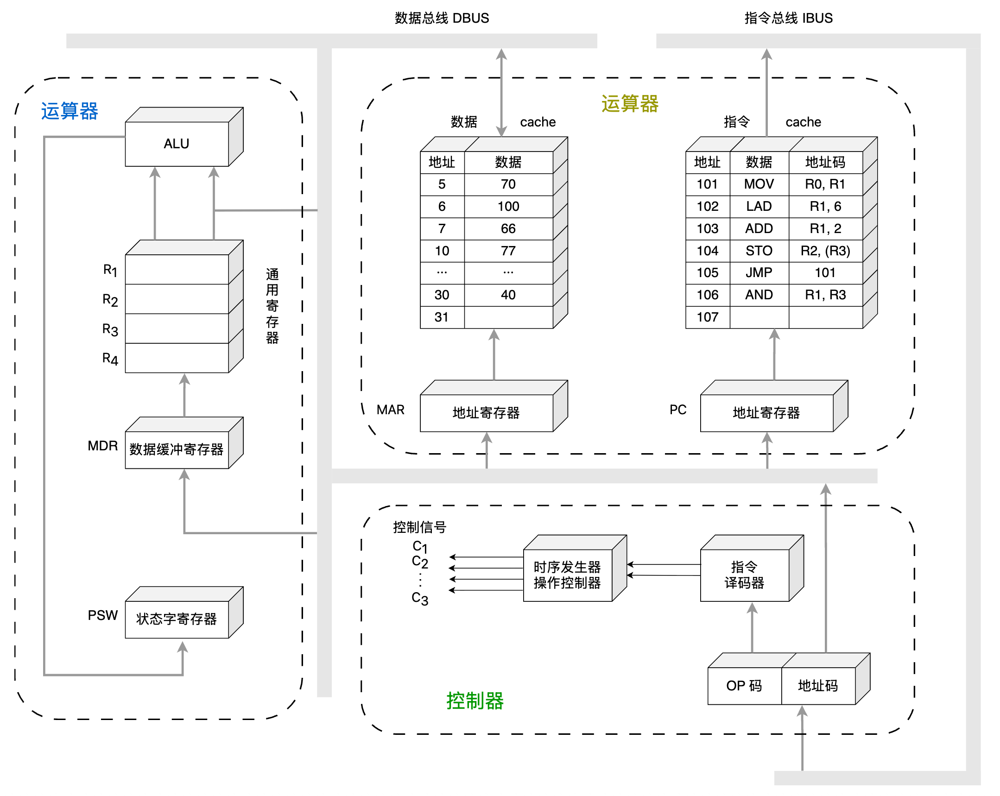

要理解控制器的组成，就要从其功能出发，大体来说，控制器的组成也可以分为 **三个组件**：

- **指令控制器** ：负责取指和译码，并且形成下一条指令的地址。
- **时序控制器** ：产生计算机运行所需的各种 **时序信号**。**时序控制器** 控制指令的执行节奏，确保各个部件协调工作。
- **控制信号发生器** ：根据 **指令译码器** 的输出，产生具体的 **控制信号**。这些 **控制信号** 用于控制计算机各个部件的微操作。

#### 2.1 指令控制器

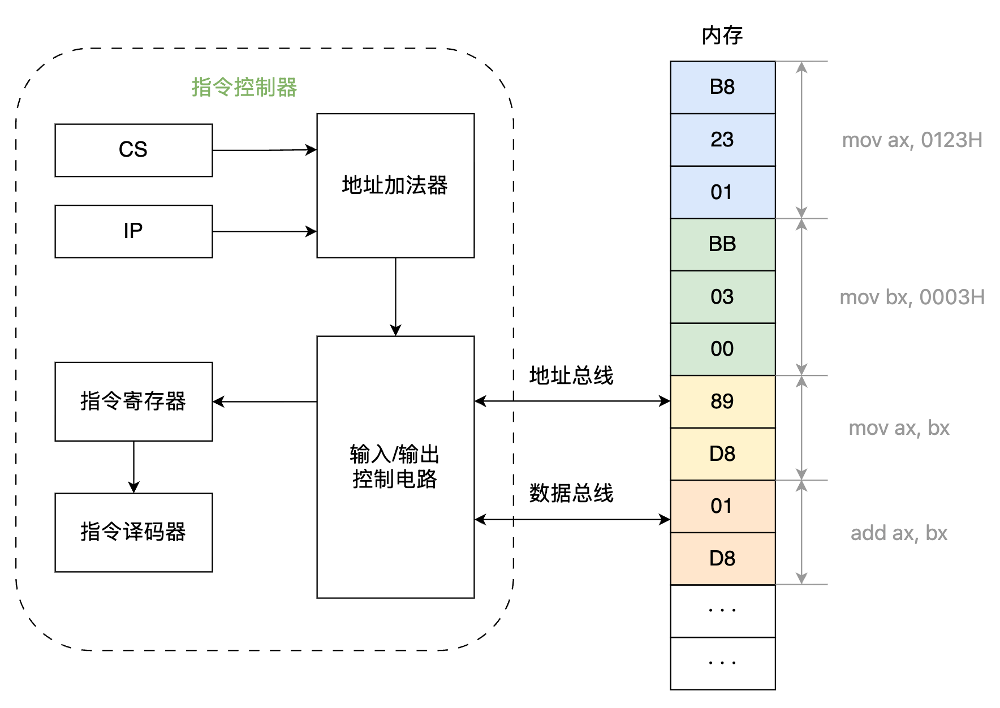

**指令控制器** 由 CS:IP 获取当前要执行的指令地址。 其中 CS 为程序段寄存器，标记了进程代码段（.code）的开始，IP 为指令指针寄存器，标记了当前指令在代码段内的偏移。

获取当前指令地址后，输入输出控制电路从内存中读取指令放入指令寄存器中。 然后修改 IP 寄存器的值，使 CS:IP 指向下一条指令的地址。

#### 2.2 时序控制器

**时序控制器** 的作用是为每条指令按时间顺序提供 **控制信号**。**时序控制器** 包括时钟发生器和倍频定义单元，其中时钟发生器由石英晶体振荡器发出非常稳定的脉冲信号，就是 CPU 的主频；而倍频定义单元则定义了 CPU 主频是存储器频率（总线频率）的几倍。

晶体振荡器利用石英晶体的压电效应，当施加电压时，晶体在特定频率下可以产生稳定的振荡。 晶体振荡器产生精确的频率信号，作为电子设备的时钟源。这个时钟信号就像一个“节拍器”，控制着设备内部各个部件的协调运作。

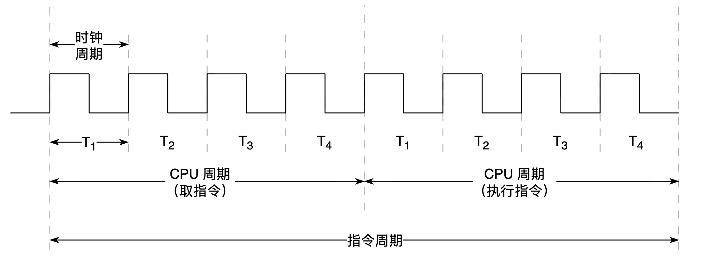

晶体振荡器产生的频率信号直接决定了电子设备的 **时钟周期**。一个指令周期中包含 取指令 和 执行指令 这两个 CPU 周期，而 CPU 周期又由多个时钟周期组成。

假设当前要执行 `MOV R1, [addr]` 这条指令，其功能就是找到内存中 addr 地址的数据，并且将其传输到寄存器 R1 中，这条指令的执行包含以下几个步骤：

1. 将地址传入 MAR 中。
2. 存储器从 MAR 中读取地址，并且读取数据，存入 MDR。
3. 从 MDR 中取出数据，通过 CPU 内的数据总线传输到寄存器 R1 中。

上述过程的执行需要保证严格的 **时序关系**，先后关系不可颠倒，否则会导致指令执行的出错。

通过这个简单的例子是为了说明这样一个原理：在 CPU 内部，一条指令的执行也会被拆分为若干的子过程，这些子过程需要满足严格的 **时序关系**，而这种 **时序关系** 就是由 **时序控制器** 进行控制的。

#### 2.3 控制信号发生器

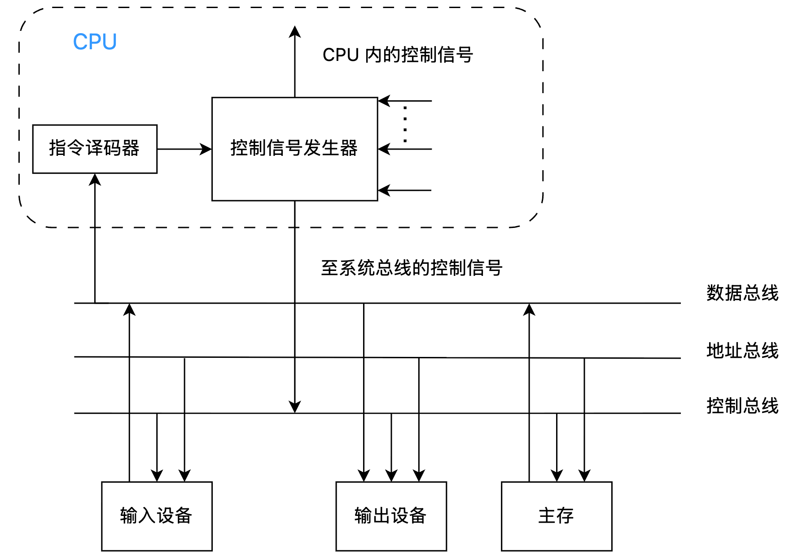

**控制信号发生器** 负责接收 **指令译码器** 的结果，并且在每个 **时钟周期** 内产生 [控制信号](https://www.csgraduates.com/constitution_principle/cpu/controller/#控制信号)。

其中控制信号可以是 CPU 内的控制信号，通过 CPU 内总线传输至 CPU 内其他部件。也可以是 CPU 外的控制信号，发送至系统的控制总线，用于协调计算机其他设备与 CPU 的交互。

### 三、控制信号

控制信号是由 **控制信号发生器** 生成和发出的电信号，这些信号用于指挥 CPU 内部的各种操作。例如，控制信号可以指示算术逻辑单元（ALU）执行加法还是减法，或者指示寄存器进行读写操作。

#### 3.1 类型

其实控制信号的种类很多，但就目前阶段而言，会考察的可以被总结为 **三类控制信号**：

- **内存读写** 控制信号：对内存或 IO 设备进行读写，比如 `MemR` 和 `MemW` 分别表示对内存进行读和写。
- **寄存器选择** 控制信号：选择特定的寄存器进行读写操作，比如 `Rin` 和 `Rout` 分别表示读寄存器和写寄存器。
- **ALU 操作码** 控制信号：选择算术逻辑单元（ALU）执行哪种运算，如加法、减法、与、或等，比如 `ALUop = Add` 表示让 ALU 执行加法操作。

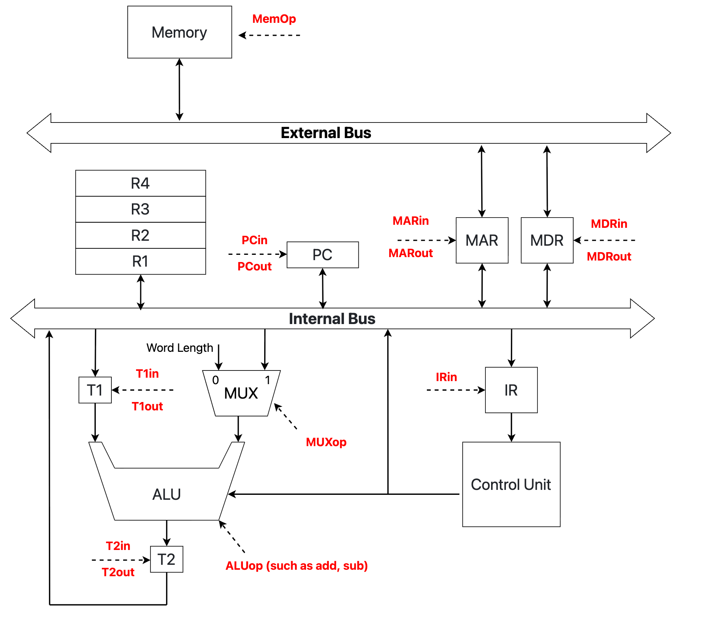

### 四、寄存器传送语言

控制信号决定了计算机指令的执行顺序和数据流动。计算机内部组件根据控制信号执行相应操作，数据流动通常用 **寄存器传送语言**（Regsiter Transfer Language, RTL）描述。

RTL 有多种表示方式，试题中会考察的是伪代码表示，这种表示方式常用于体系结构的教学。

这节先说明一下 RTL 伪代码表示的 **常见符号** 以及 **基本语法结构**，下一节会以一个实际的例子说明一下 RTL 和控制信号的编3写。

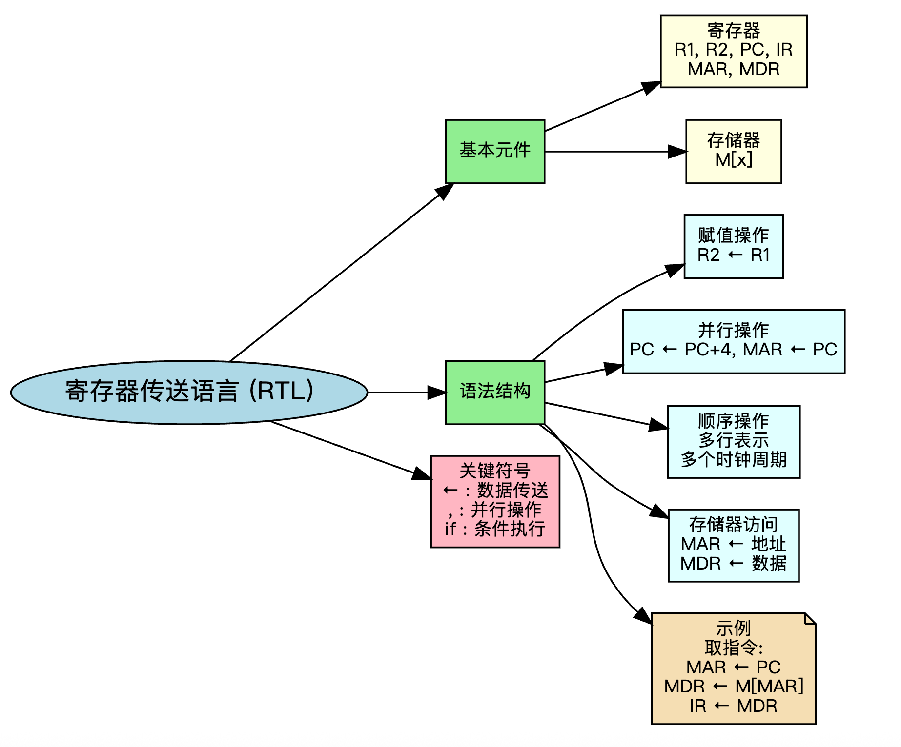

#### 4.1 常见元件和符号

RTL 中用一些符号来表示 CPU 中的基本元件：

| 元件/符号     | 含义                        |
| ------------- | --------------------------- |
| `R1, R2, ...` | 通用寄存器                  |
| `PC`          | 程序计数器                  |
| `IR`          | 指令寄存器                  |
| `MAR`         | 内存地址寄存器              |
| `MDR`         | 内存数据寄存器              |
| `M[x]`        | 内存中地址为 `x` 的数据单元 |
| `←`           | 数据从右边到左边            |
| `,`           | 并行操作                    |
| `if`          | 条件执行                    |

#### 4.2 基本语法结构

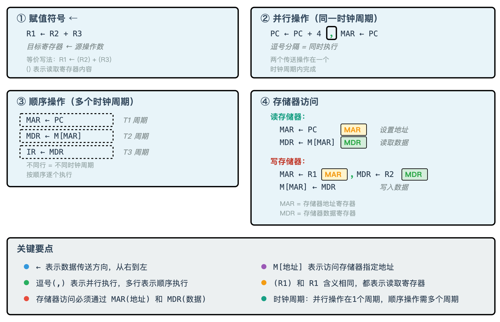

赋值符号 

用 `←` 表示寄存器传送，区别于一般的编程语言中的 `=`，`←` 右边为源寄存器，`←` 左边为目标寄存器。

```
// 将 R2 和 R3 的加和结果送入寄存器 R1（即执行加法后写入 R1）。
R1 ← R2 + R3
```


并行操作 

用 **逗号** 表示多个操作同时发生（在同一时钟周期）。

```
// 在一个时钟周期内执行两个操作：
// 1) 将 PC 的值 +4，使其指向下一条指令的地址。
// 2) 将当前指令的地址读取到
PC ← PC + 4, MAR ← PC
```

顺序操作 

**使用多行**，每一行一个时钟周期：

```
// 在连续三个时钟周期分别执行
MAR ← PC
MDR ← M[MAR]
IR ← MDR
```

存储器访问 

存储器访问需要用 `MAR` 指定地址，用 `MDR` 存储输入输出的数据。

```
// 读存储器：
MAR ← PC
MDR ← M(MAR)

// 写存储器：
MAR ← R1, MDR ← R2
M(MAR) ← MDR
```

### 五、指令的控制信号

[指令的执行阶段](https://www.csgraduates.com/constitution_principle/cpu/pipeline/#指令执行阶段) 包含取指、译码、执行、访内和写回阶段，在这五个阶段中 **控制单元** 会发出不同的 **控制信号**，以实现指令的执行。

以指令 `ADD R0, (R1)` 为例，说明一下指令执行阶段四个阶段的 **控制信号** 以及相应的功能，功能用寄存器传送语言给出描述。

#### 5.1 取指和译码阶段

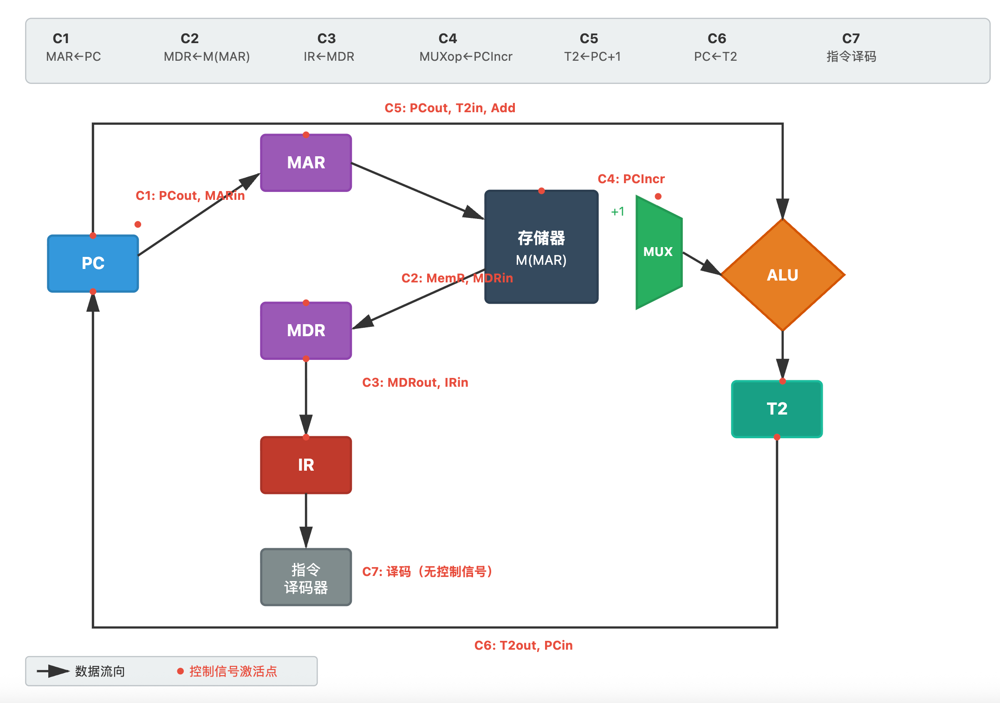

在该阶段中：PC 提供了当前需要读取指令的地址，从相应地址读取指令后，增加 PC 的值，使其指向下一条指令的地址，接着通过译码部件完成译码。

不同指令在取指和译码阶段的控制信号相同，该阶段主要包含如下表所示的 **控制信号**：

| 时钟 | 功能           | 控制信号               | 解释                                                    |
| ---- | -------------- | ---------------------- | ------------------------------------------------------- |
| C1   | MAR ← PC       | `PCout`, `MARin`       | 从 PC 中读取指令地址至 MAR 中                           |
| C2   | MDR ← M(MAR)   | `MemR`, `MDRin`        | 存储器从 MAR 地址所在的内存单元读取数据 并加载到 MDR 中 |
| C3   | IR ← MDR       | `MDRout`, `IRin`       | 将 MDR 中存放的指令数据传送到指令寄存器 IR 中，准备译码 |
| C4   | MUXop ← PCIncr | `PCIncr`               | 在二路选择器中生成值 1 添加入 ALU 的一端                |
| C5   | T2 ← PC + 1    | `PCout`, `T2in`, `Add` | ALU 计算下一条指令的地址                                |
| C6   | PC ← T2        | `T2out`, `PCin`        | 将计算得到的地址加载进 PC 中                            |
| C7   | 指令译码       | 无                     | 由指令译码器件完成                                      |

#### 5.2 执行、访存和写回阶段

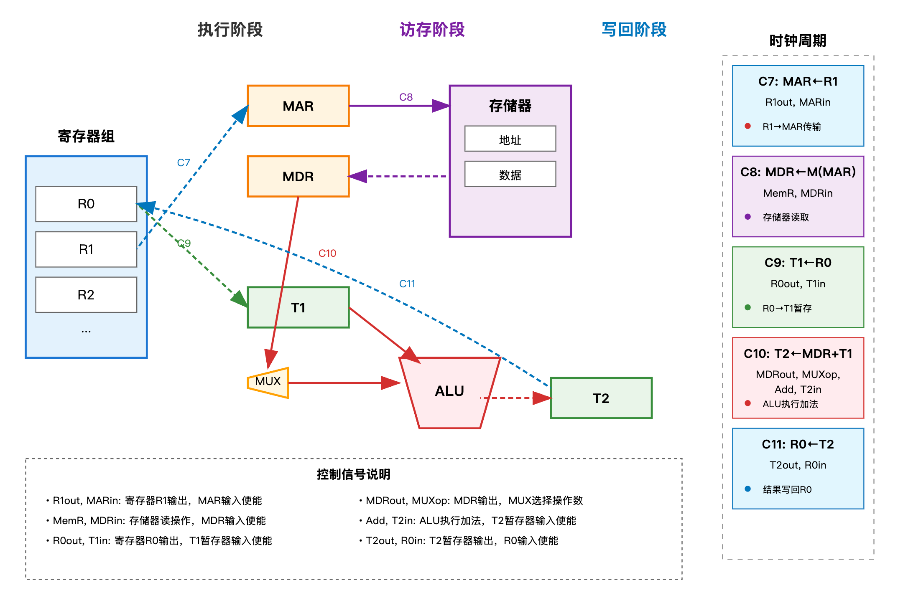

通过译码得到的控制信号，可以控制指令的执行和写回，对于 `ADD R0, (R1)` 为例，该阶段包含如下 **控制信号**：

| 时钟 | 功能          | 控制信号                         | 解释                                                         |
| ---- | ------------- | -------------------------------- | ------------------------------------------------------------ |
| C7   | MAR ← R1      | `R1out`,`MARin`                  | 将 R1 中的内容加载进 MAR                                     |
| C8   | MDR ← M(MAR)  | `MemR`, `MDRin`                  | 存储器从 MAR 地址所在的内存单元读取数据 并加载到 MDR 中      |
| C9   | T1 ← R0       | `R0out`, `T1in`                  | 将 R0 的内容存储在暂存器 T1                                  |
| C10  | T2 ← MDR + T1 | `MDRout`, `MUXop`, `Add`, `T2in` | 将`MDR`的内容存储进入`ALU`另一个入口 执行加法操作 并将结果存储进入`T2` |
| C11  | R0 ← T2       | `T2out`, `R0in`                  | 将计算结果写回 R0                                            |

### 六、控制器种类

控制器的种类分为 **硬布线控制器** 和 **微程序控制器**，这里了解即可。简而言之，硬布线控制器就是通过硬件的方式实现控制信号的输出，微程序控制器对指令的 OP 字段进行进一步编码，通过软件的方式实现控制信号的输出。

#### 6.1 硬布线控制器

**硬布线控制器**（Hardwired Controller）是一种通过物理连接逻辑门、触发器、译码器等硬件电路元件来生成控制信号的控制器。它本质上是一个有限状态机（Finite State Machine, FSM），其控制逻辑通过电路的实际布线来固定实现。

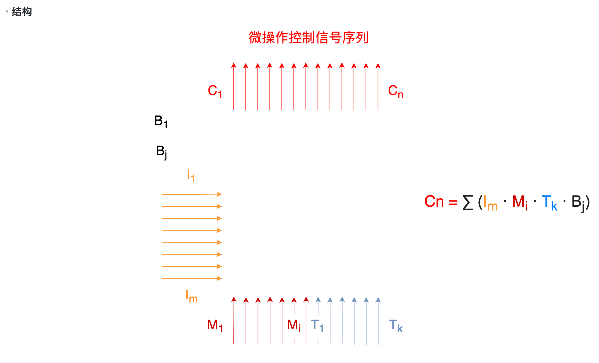

上图展示了硬布线控制器的基本结构，简单来说，其逻辑结构可以概括为：

**输入端**：接收指令信息（通过译码器转换），时序信息（时钟脉冲产生的节拍），以及来自执行部件的状态反馈信息（如运算结果的标志位）。

**核心部分**：一个由大量组合逻辑门电路（与门、或门、非门等）构成的网络。这个网络是预先设计好的，其内部连接是固定的。

**输出端**：根据当前的输入信号组合，通过这个固定的逻辑网络，直接生成一系列 **微操作控制信号**。

简单来说，它就像一个 **复杂的“查表器”**，不过这个“表”是用硬件电路固化下来的。当特定的输入信号组合出现时，就立即产生对应的输出 **控制信号**。

##### 特点

- **硬件实现**：控制逻辑直接通过物理电路（如印刷电路板上的导线、焊接点）来实现，而不是通过软件程序。
- **固定功能**：一旦设计和制造完成，其功能就基本固定。如果需要修改 **控制逻辑**，通常需要物理地改变电路结构，例如重新布线、更换芯片等。
- **高速性**：由于控制信号是通过组合逻辑电路直接生成的，没有额外的指令解释和软件开销，因此硬布线控制器通常具有非常高的执行速度。信号生成延迟主要取决于门电路的数量和传播延迟。
- **设计复杂性**：对于复杂的控制逻辑，硬布线控制器可能会变得非常复杂，难以设计和验证。

#### 6.2 微程序控制器

**微程序控制器**（Microprogrammed Controller）是一种与硬布线控制器相对的 CPU 控制单元设计方法。它不直接通过组合逻辑电路生成控制信号，而是将复杂的 **控制逻辑** 存储在一种特殊的存储器 —— **控制存储器**（Control Memory, CM） 中。

微程序控制器的 **核心思想** 是用“程序”来控制“程序”的执行。CPU 的每一条机器指令，都被分解成一系列更小的、更基本的微操作（Micro‑operation）。这些微操作的序列，构成了该机器指令的微程序（Microprogram）。

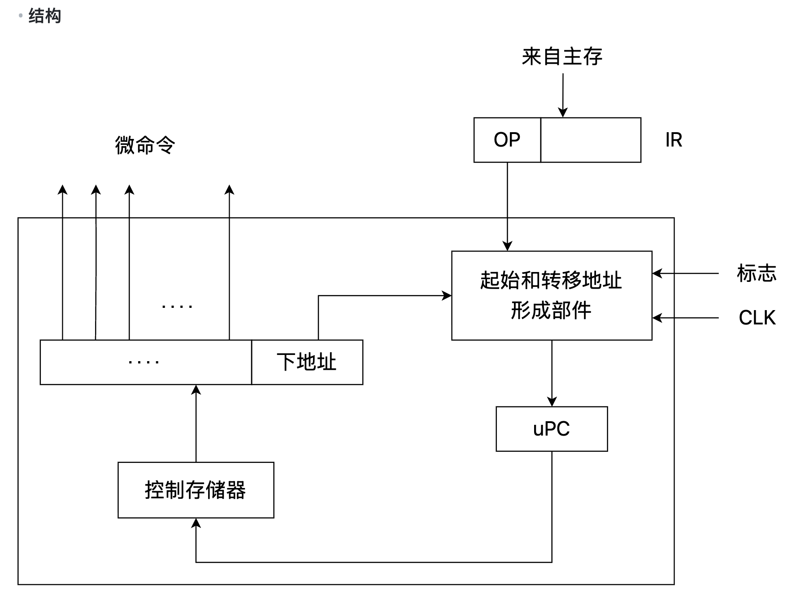

上图给出了一个 **微程序控制器** 的基本结构，其中包含以下组件：

1. **指令寄存器 (IR)** ：收并存储从主存储器中取出的机器指令。指令通常包含操作码（OP）和其他信息。
2. 起始和转移地址形成部件：这是微程序控制器的大脑。
   - 根据指令的操作码，生成该机器指令对应微程序的起始地址。
   - 根据当前微指令的“下地址”信息和外部标志信号，计算出下一条微指令的地址。
   - 它计算出的微指令地址被送入 **微程序计数器**。
3. **微程序计数器 (µPC)** ：接收 “起始和转移地址形成部件” 产生的微指令地址，并将其保存。它类似于 CPU 的程序计数器，但它指向的是控制存储器中的 **微指令地址**。
4. 控制存储器 (Control Storage)：这是微程序控制器的核心存储单元。
   - 输入：接收来自 µPC 的微指令地址。
   - 功能：根据 µPC 提供的地址，从中读取出对应的微指令。
   - 输出：读取到的微指令被送入 **微指令寄存器（µIR）**。
5. 微指令寄存器 (µIR)：用于存放从控制存储器中读出的当前正在执行的微指令。一条微指令通常包含两部分：
   - **微命令**（Microcommand）字段： 这是 **微程序控制器** 的最终输出，直接控制CPU内部各部件的微操作（例如，使能寄存器、控制ALU操作、控制总线传输等）。图中标示为“微命令”并有多个向外的箭头。
   - **下地址字段**（Next Address）： 这个字段指示了下一条微指令的地址生成方式或直接给出下一条微指令的相对/绝对地址。这个“下地址”信息被送回“起始和转移地址形成部件”，用于计算下一条微指令的地址。

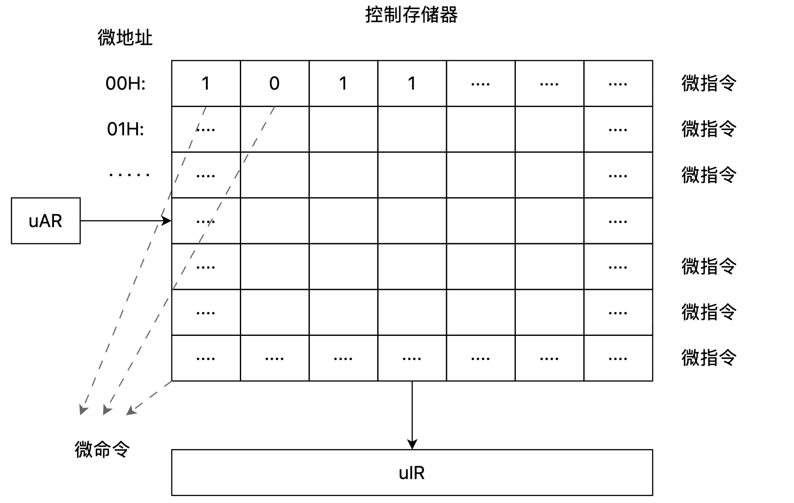

微程序控制器的 **工作流程** 如下：

1. **指令译码**：机器指令的操作码被译码，得到该指令对应微程序的起始地址。
2. **地址寻址**：微地址寄存器（µPC）根据这个起始地址，从控制存储器中取出微指令。
3. 微指令执行：取出的微指令被送入微指令寄存器（µIR）。微指令包含两部分：
   - 微命令：直接控制 CPU 各部件的微操作。
   - 下地址：指示下一条微指令的地址。
4. **循环**：根据下地址信息（并结合 CPU 状态），计算出下一条微指令的地址，送回 µPC，重复以上过程，直到完成当前机器指令的所有微操作。

##### 微指令编码方式

微指令编码方式是指如何组织微指令中各个字段，以便有效地表示和控制 CPU 中的各种微操作。不同的编码方式在灵活性、控制速度、微指令长度等方面有不同的权衡。

主要有以下三种微指令编码方式：

1. **直接编码方式**（Direct Control Microprogramming），也叫做水平编码（Horizontal Microprogramming）
2. **字段直接编码方式**（Field Decoding Microprogramming），也叫做垂直编码（Vertical Microprogramming）
3. **混合编码方式**（Hybrid Microprogramming）

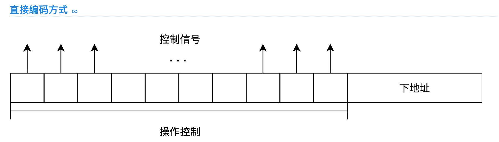

在 **直接编码方式** 中，微指令的微命令字段中的 **每一位** 都直接对应并控制 CPU 中的 **一个特定微命令** 或硬件操作。当某一位的值为 ‘1’ 时，对应的微命令被激活；当为 ‘0’ 时，则不激活。这种方式的特点是无需译码器，微指令的输出可以直接驱动控制线。

举个实际例子，假设我们有一个简单的 CPU，其中包含控制寄存器 A 加载、寄存器 B 加载、ALU 加法操作、ALU 减法操作、总线选择等微命令。在直接编码方式下，一条微指令的微命令字段可能长这样：

| 位   | D7      | D6      | D5      | D4      | D3    | D2    | D1   | D0   |
| ---- | ------- | ------- | ------- | ------- | ----- | ----- | ---- | ---- |
| 含义 | RA_load | RB_load | ALU_ADD | ALU_SUB | BUS_A | BUS_B | …    | …    |

如果一条微指令的这个字段是 `1 1 1 0 1 0 0 0`，则表示同时执行：将数据加载到寄存器 `A (RA_load)`、将数据加载到寄存器 `B (RB_load)`、执行 `ALU` 加法 `(ALU_ADD)`、以及选择总线 `A (BUS_A)`。

直接编码方式的 **特点** 如下：

- 高并行性：一条微指令可以同时激活多个互不冲突的微命令，实现高度并行的微操作。
- 高速性：由于无需经过译码，控制信号生成路径最短，执行速度最快。
- 微指令长度长：随着需要控制的微命令数量增加，微指令的位数会线性增长，导致控制存储器容量需求大。
- 设计复杂：设计者需要精确控制每一个独立的控制位，对微程序编写者要求较高。

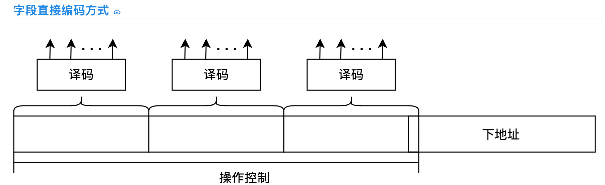

**字段直接编码方式** 将微指令的微命令字段逻辑地 **划分为若干个独立的组**（或称字段）。**每个字段内部** 包含 **一组互斥的微命令**（即在同一时刻，该字段内只能激活一个微命令）。**不同字段之间** 则包含 **相容** 的微命令（可以同时激活）。每个字段本身被编码为一个值，这个值经过译码器后，才能激活该字段内对应的具体微命令。

继续上面的例子，在字段直接编码方式下，微指令的微命令字段可能被划分为多个字段，例如：

| 字段   | F1 (寄存器操作) | F2 (ALU 操作) | F3 (总线选择) | …    |
| ------ | --------------- | ------------- | ------------- | ---- |
| 位数   | 2 位            | 2 位          | 1 位          |      |
| 编码值 | 00: 无操作      | 00: 无操作    | 0: 无操作     |      |
| 01:    | RA_load         | 01: ALU_ADD   | 1: BUS_A      |      |
| 10:    | RB_load         | 10: ALU_SUB   |               |      |

如果一条微指令的这个字段是 `01 | 01 | 1`，则表示：

- `F1` 编码为 `01`，经过译码器后激活 `RA_load` 微命令。
- `F2` 编码为 `01`，经过译码器后激活 `ALU_ADD` 微命令。
- `F3` 编码为 `1`，经过译码器后激活 `BUS_A` 微命令。

在这里，`RA_load` 和 `RB_load` 是互斥的，`ALU_ADD` 和 `ALU_SUB` 是互斥的，但 `RA_load` 和 `ALU_ADD` 可以并行。

字段直接编码方式的特点如下：

- 微指令长度短：通过字段内部编码共享位，大大减少了微指令的位数，从而节省控制存储器空间。
- 设计相对简单：微程序设计者只需选择字段中的某个编码值，无需关心具体的单个控制位。
- 并行性受限：同一字段内的微命令不能并行执行，因为它们是互斥的。不同字段间的微命令可以并行。
- 控制速度稍慢：由于需要经过译码器才能生成实际控制信号，会引入额外的延迟。

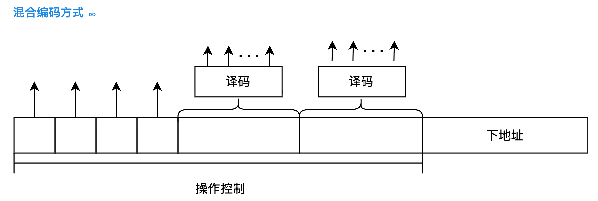

**混合编码方式** 是直接编码方式和字段直接编码方式的结合，旨在综合两者的优点。它将微指令的 **微命令字段划分为若干部分**：

- 一部分字段采用 **直接编码方式**：用于控制那些经常同时发生、对时序要求高且彼此不冲突的关键微命令。这部分保持了高并行度和快速响应。
- 另一部分字段采用 **字段直接编码方式**：用于控制那些互斥或并行性要求不那么高的微命令，以有效缩短微指令的整体长度。

通过这种混合设计，可以在保证较高并行度的同时，有效降低对 **控制存储器** 容量的需求。

##### 特点

相比于硬布线控制器，微程序控制器特点如下：

- **灵活性**：由于控制逻辑是存储在存储器中的，所以更改控制逻辑只需要更改存储的微指令，而无需更改硬件。
- **简化设计**：对于复杂的控制逻辑，使用微指令可能会简化设计和验证过程。
- **易于修改和扩展**：添加新的指令或修改现有的指令相对容易。
- **速度较慢**：相比硬布线控制器，微程序控制器需要额外的存储器访问（读取微指令）和地址计算（形成下一微地址）时间。这使得它的执行速度相对较慢。

##### 指令、微指令、微命令

在计算机的 CPU 中，要完成一个复杂的任务，需要层层分解为更基本、更具体的动作。指令、微指令和微命令正体现了这种自顶向下的控制层次结构。

- **指令**：程序员编写的高级语言程序经过编译、汇编后，最终形成并能被 CPU 直接识别和执行的最小功能单位。
- **微指令**：它是 **微程序控制器** 中的一个字，存储在特殊的 **控制存储器** 中。一条机器指令的执行过程，被分解为一系列更小的、更基本的步骤，每个步骤对应一条或多条微指令。
- **微命令**：计算机中最基本的、不可再分的、由硬件电路直接完成的操作。

回顾一下微程序控制器的 [结构](https://www.csgraduates.com/constitution_principle/cpu/controller/#结构)，对于控制器来说：输入是机器指令，输出是每个时钟周期不同的微命令。这种控制的实现机制是基于控制存储器（Control Memory, CM）。控制存储器内部存储着预先定义好的微指令序列。

所以一个指令对应一个微程序，一个微程序中包含多个微指令，每个微指令对应一系列微命令。下图展现了三者的层次关系：

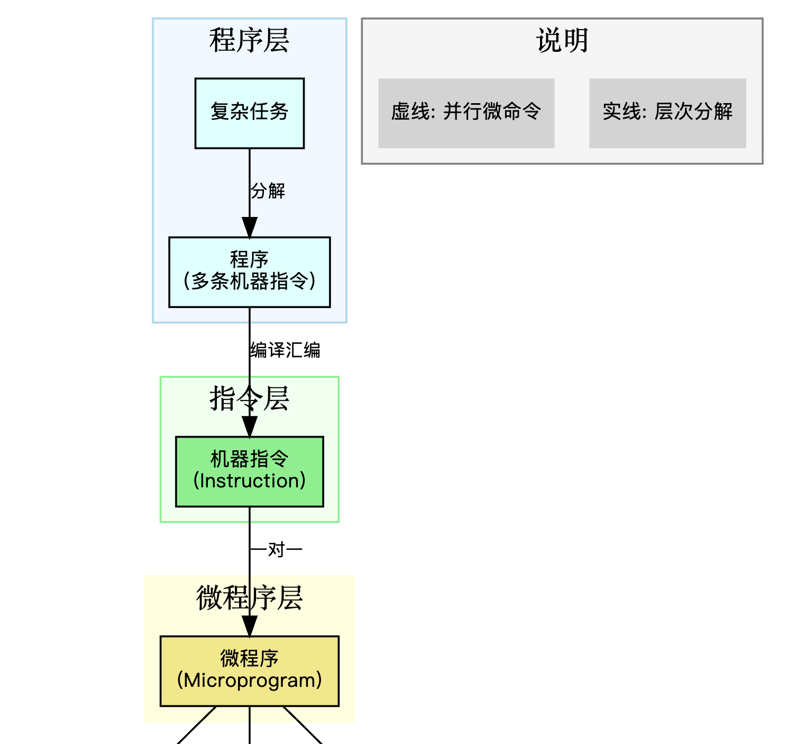

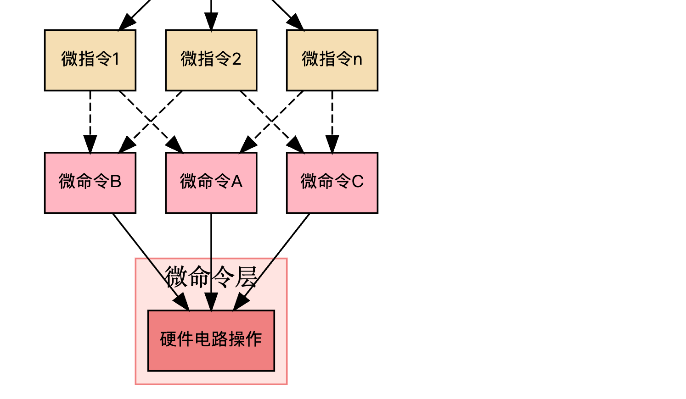

在上文的 [指令的控制信号](https://www.csgraduates.com/constitution_principle/cpu/controller/#指令的控制信号) 部分，我们详细阐述了指令 **ADD R0, (R1)** 所对应的微操作序列。为了进一步帮助各位读者理解 **指令**、**微指令**、**微命令** 三者之间的区别与联系，本节将通过以下表格，具体说明该指令（相当于一个微程序）各阶段的微指令和微命令：

| 时钟    | 功能             | 对应的微指令（简化） | 包含的微命令                                  |
| ------- | ---------------- | -------------------- | --------------------------------------------- |
| **C1**  | `MAR ← PC`       | 微指令 A             | `PCout`, `MARin`                              |
| **C2**  | `MDR ← M(MAR)`   | 微指令 B             | `MemR`, `MDRin`                               |
| **C3**  | `MUXop ← PCIncr` | 微指令 C             | `PCIncr`                                      |
| **C4**  | `T2 ← PC + 1`    | 微指令 D             | `PCout`, `Add`, `T2in`                        |
| **C5**  | `PC ← T2`        | 微指令 E             | `T2out`, `PCin`                               |
| **C6**  | 指令译码         | 微指令 F             | （硬件译码逻辑）                              |
| **C7**  | `MAR ← R1`       | 微指令 G             | `R1out`, `MARin`                              |
| **C8**  | `MDR ← M(MAR)`   | 微指令 H             | `MemR`, `MDRin`                               |
| **C9**  | `T1 ← R0`        | 微指令 I             | `R0out`, `T1in`                               |
| **C10** | `T2 ← MDR + T1`  | 微指令 J             | `MDRout`, `T1out_to_ALU_input`, `Add`, `T2in` |

---

## 异常与中断

### 一、异常

在 CPU 中，**异常** 是指在程序执行过程中出现的非正常或意外情况，CPU 需要暂停当前执行，转而调用操作系统提供的异常处理程序。异常机制确保系统能够安全、有效地处理错误或特殊事件，并对程序执行做出相应调整。

#### 1.1 类型

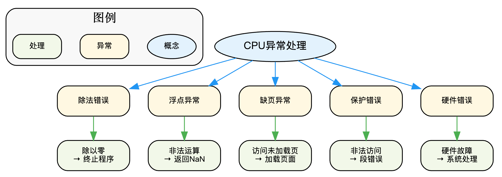

在执行指令的过程，可能发生如下五类异常：

1. 除法错误
   - **触发条件**：程序尝试除以零或执行非法除法操作。
   - **处理方式**：通常由操作系统捕获并中断程序执行，可能显示错误信息或终止程序。
2. 浮点异常
   - 触发条件：浮点运算出现错误，例如溢出、下溢、除以零或非法操作（如对负数开平方）。
   - 处理方式：操作系统可能中断程序、设置异常标志，或产生 NaN（非数）结果。
3. 缺页异常
   - 触发条件：程序访问的内存页尚未加载到物理内存中。
   - 处理方式：操作系统会将所需页从磁盘调入内存，更新页表后恢复程序执行。
4. 保护错误
   - 触发条件：程序试图进行非法操作，如写入只读内存、访问内核空间或执行特权指令。
   - 处理方式：操作系统中断程序执行，防止非法访问。
5. 硬件错误
   - 触发条件：由硬件错误引起，如内存故障、总线错误、电源故障等。
   - 处理方式：可能导致系统记录错误、尝试修复或直接宕机，具体行为依赖硬件和系统配置。

下表给出了每种类型的一个具体实例，帮助各位理解什么叫做异常：

```c
// 1.除法错误
int a = 10;
int b = 0;
int c = a / b;  // 除以零，触发除法错误

// 2.浮点异常
float x = 0.0;
float y = sqrt(-1.0);  // 无效操作，结果为 NaN（非数）

// 3.缺页异常
char* ptr = mmap(NULL, 4096, PROT_READ, MAP_PRIVATE, fd, 0);
char c = ptr[0];  // 当访问 ptr[0] 时，触发缺页异常
                  // 内核通过页调度机制将数据从磁盘加载进内存，随后程序继续执行。

// 4.硬件错误
int* ptr = (int*)0xFFFF0000;  // 指向只读或内核地址
*ptr = 42;  // 写操作触发保护错误（Segmentation Fault）

// 5.机器检查
// 机器检查异常通常由硬件引发，难以模拟。
// 示例：某些平台可使用特殊指令测试内存校验错误。
// 实际触发依赖硬件环境，下面为伪代码：
char* bad_addr = (char*)0xDEADBEEF;
char c = *bad_addr;  // 假设该地址引发硬件错误
```

#### 1.2 自陷

**自陷**（trap）是 CPU 主动转入异常处理的一种机制。当程序运行过程中出现某些情况需要操作系统介入时，CPU 会触发自陷，将控制权交给内核。与外部中断不同，自陷由当前执行指令或条件触发。

**自陷的典型应用：**

1. **异常处理** 当程序发生错误，如除零、非法内存访问、无效指令等，会触发自陷进入异常处理流程。
2. **系统调用** 用户程序请求操作系统服务（如打开文件、分配内存等）时，会使用特定的指令（如 x86 的 `syscall`）触发自陷，从而进入内核态执行系统调用处理程序。
3. **调试断点** 在调试程序时，可以设置断点。当程序运行到断点位置时，会触发自陷，暂停程序以供调试器介入。

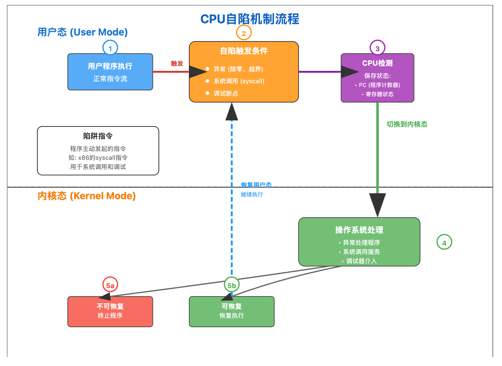**自陷处理流程**（简化版）如下：

- CPU 检测到自陷条件（异常、系统调用或断点）；
- 暂停当前程序执行，保存程序状态（如 PC、寄存器等）；
- CPU 切换到内核态，转入操作系统预设的自陷处理程序；
- 操作系统根据具体情况处理异常或完成服务；
- 若问题可恢复，恢复程序状态，继续执行；否则终止程序。

[**陷阱指令**](https://www.csgraduates.com/constitution_principle/instruction/instruction_ops/#陷阱指令) 是显式由程序发起的指令，用于触发自陷事件。它常用于系统调用、调试等场景，是用户程序与操作系统交互的重要机制。

通过异常和自陷机制，CPU 和操作系统能有效应对运行中的各种突发情况，既保证系统稳定，又提供对错误的良好容错与控制能力。

### 二、中断

中断是指 CPU 在正常执行程序过程中，由 **外部设备** 或 **软件指令** 触发的事件，促使 CPU 暂停当前执行，转而响应处理这些事件的一种机制。中断机制使得 CPU 能够及时响应外部输入、计时器、网络等事件，是现代操作系统和硬件协同工作的核心技术之一。

#### 2.1 分类

中断是一个比较大的概念，我们可以 按照其来源 或者 是否可以屏蔽 将其进行分类：

按照来源 

1. 外部中断：
   - 触发来源：外部设备或外部事件触发，如输入设备、时钟、外部信号等。
   - 响应：CPU 响应外部事件，执行相应的中断处理程序。
2. 内部中断（也叫异常）：
   - 触发来源：程序或 CPU 内部状态触发，如异常、错误等。
   - 响应：CPU 根据内部条件触发中断，执行特定的中断处理程序。

按照是否可屏蔽 

1. 可屏蔽中断

   （Maskable Interrupt）

   - 可以通过设置中断屏蔽位（如 CPU 的中断允许标志）来暂时禁止的中断。
   - 通常为普通外设中断，如键盘、鼠标、网卡等。

2. 不可屏蔽中断

   （Non-Maskable Interrupt, NMI）

   - 无法被屏蔽的紧急中断，常用于处理系统级错误，如电源故障、内存校验错误等。

中断的分类可以通过下图辅助理解：

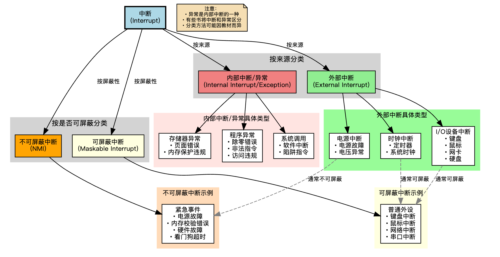

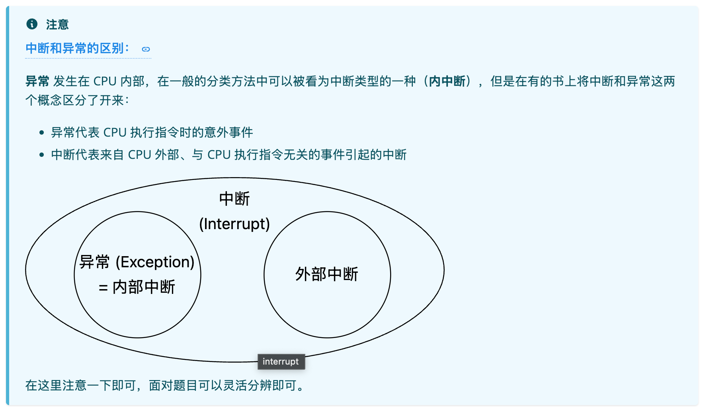

#### 2.2 中断处理流程

中断处理流程参考计算机组成原理中的 [该节](https://www.csgraduates.com/constitution_principle/bus/io/#程序中断方式)。

---

## 指令流水线

### 一、指令执行过程

指令的执行由很多按照时序进行的微操作组成，从逻辑角度进行划分，指令执行可以被分为 **五个阶段**：

1. **取指（IF）**：从指令存储器获取指令并更新程序计数器。
2. **译码（ID）**：解析指令、读取源寄存器并生成控制信号。
3. **执行（EX）**：执行计算或分支逻辑，生成中间结果。
4. **访存（MEM）**：执行内存读写操作，非内存指令为空。
5. **写回（WB）**：将结果写回寄存器，非写回指令为空。

采用这五个阶段的流水线也叫做 **五阶段流水线**。

#### 1.1 取指

取指（IF）阶段的主要任务包括：

- **从指令存储器获取指令**：根据程序计数器（PC）的值，从指令存储器（Instruction Memory）中读取当前指令。
- **更新程序计数器**（PC）：增加 PC 的值，指向下一条指令的地址。
- **传递指令**：将读取的指令存储到 IF/ID 流水线寄存器，供后续 ID 阶段使用。

#### 1.2 译码

译码（ID）阶段的主要任务包括：

- **解析指令**：解码指令的操作码和操作数，确定指令类型（如 ADD、LW、BEQ 等）。
- 读取源寄存器：从寄存器文件中读取指令所需的源寄存器值。例如：
  - 例如，对于 `ADD R1, R2, R3`，需要读取 R2 和 R3 的值。
- **生成控制信号**：根据指令类型生成后续阶段（如 EX、MEM、WB）所需的控制信号（如 ALU 操作、内存读写、写回使能等）。

#### 1.3 执行

执行（EX）阶段的主要任务包括：

- 执行计算操作：根据指令类型，使用算术逻辑单元（ALU）执行计算，如加法、减法、逻辑运算或地址计算。
  - 例如，对于 `ADD R1, R2, R3`，计算 R2 + R3。
- 处理分支条件：对于分支指令，比较寄存器值并确定是否跳转，更新 PC（如果分支预测错误，可能冲刷水线）。
  - 例如，对于 `BEQ R1, R2, label`，比较 R1 和 R2 是否相等。
- **传递结果**：将计算结果（如 ALU 输出或内存地址）存储到 EX/MEM 流水线寄存器，供后续阶段使用。

#### 1.4 访存

访存（MEM）阶段的主要任务包括：

- 执行内存操作：对于加载（load）或存储（store）指令，访问数据存储器（Data Memory）以读取或写入数据。
  - 对于 `MOV R1, 0(R2)`，从地址 R2 + 0 读取内存数据到 R1。
- **传递数据**：将内存读取的数据（对于加载指令）或 ALU 计算结果（对于非内存指令）存储到 MEM/WB 流水线寄存器。
- **空操作**（对于非内存指令）：对于非加载/存储指令（如 `ADD R1, R2, R3` 或 `BEQ`），MEM 阶段不执行实际操作，仅将 EX 阶段的结果传递到 WB 阶段。

#### 1.5 写回

- 将结果写回寄存器：将指令的最终结果（如 ALU 计算结果或加载的内存数据）写入目标寄存器。
  - 例如：`ADD R1, R2, R3` 将 R2 + R3 的结果写入 R1。
- 空操作（对于无需写回的指令）：对于不写回寄存器的指令，WB 阶段不执行实际操作
  - 例如，`JUMP label` 不包含写寄存器操作。

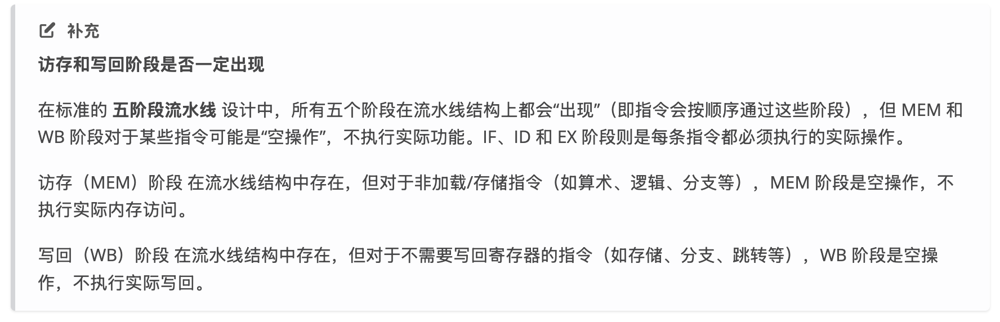

### 二、单周期处理器

单周期处理器是一种 CPU 设计，其中 **每条指令的执行都在一个时钟周期内完成**。这意味着从指令的取出、译码、执行到结果写回等所有步骤，都必须在一个统一的时钟周期内完成。这个时钟周期的长度必须足以容纳执行时间最长的指令。

单指令流水线设计简单，控制逻辑简单，便于实现和理解。但是其 **时钟周期由最慢的指令决定**，导致效率低下。

### 三、多周期处理器

在 [单周期处理器](https://www.csgraduates.com/constitution_principle/cpu/pipeline/#单周期处理器) 中，不对指令的执行过程进行拆分，指令的执行的粒度则是指令本身，如下图所示：

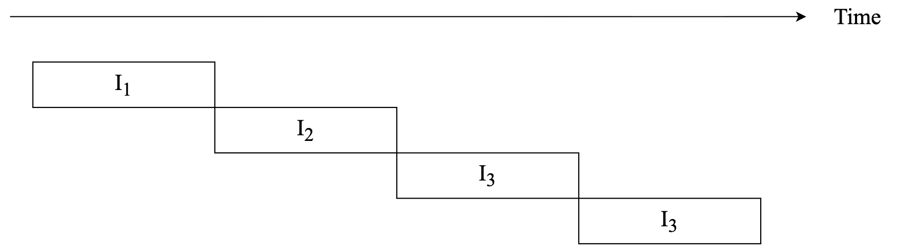

这样会导致 CPU 的执行效率很低，因为下一条指令必须等待上一条指令完全执行结束后，才能执行下一条指令。

这节谈到的 **多周期处理器** 就是对以上方式的优化：在 CPU 中将指令的执行过程拆分为多个阶段，每个阶段由不同的部件执行，每个阶段用一个时钟周期完成。不同阶段可以并行执行，形成流水线的结构。

#### 3.1 物理结构

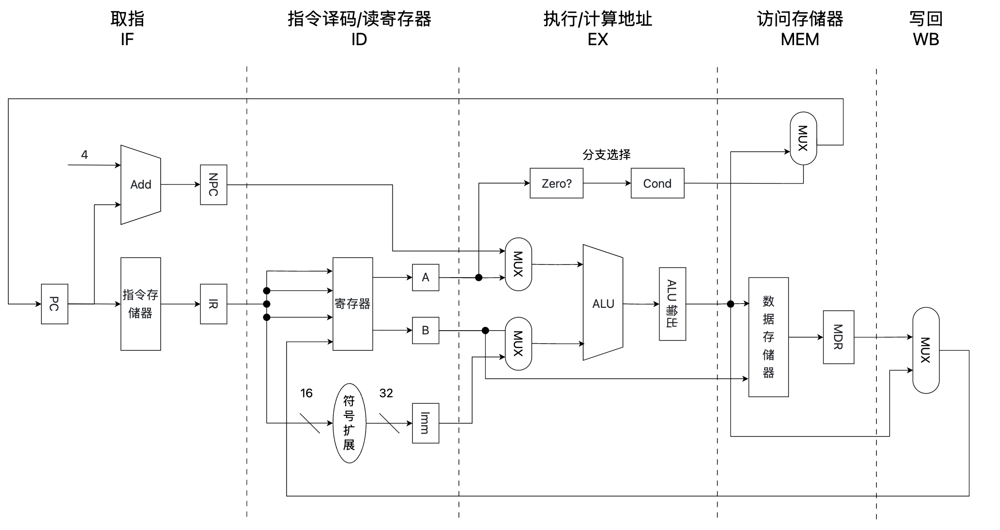

上图为流水线的 **物理结构**，指令执行的 [五个阶段](https://www.csgraduates.com/constitution_principle/cpu/pipeline/#指令执行阶段) 由 CPU 中不同的部件处理，下一阶段的执行部件的执行结果依赖上一个阶段的输入，不同阶段的部件可以并行工作。这样 CPU 中不同部件的利用率就得到了提高，CPU 执行指令的吞吐也会因此提高。

#### 3.2 逻辑结构

当然，上图中包含太多具体的器件，流水线的 **逻辑结构** 如下图所示：

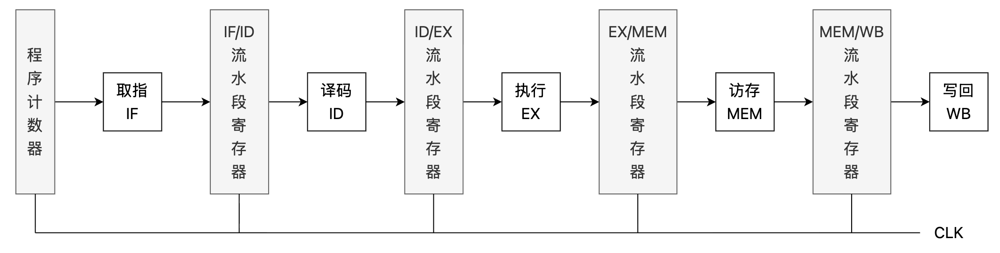

每个流水段后面都要增加一个 **流水段寄存器**，用于锁存本段处理完的所有数据，以保证本段的执行结果能在下个时钟周期给下一流水段使。

各种寄存器和数据存储器均采用统一时钟 CLK 进行同步，每来一个时钟，各段处理完的数据都将锁存到段尾的流水段寄存器中，作为后段的输入。同时，当前段也会收到前段通过流水段寄存器传递过来的数据。

#### 3.3 执行时序图

在多周期流水线中，指令执行的 **并行粒度** 从整条指令 降低到 **指令执行的各个阶段**。这种细粒度的并行使得不同指令的执行阶段可以重叠（overlap），从而显著缩短所有指令的总体执行时间。

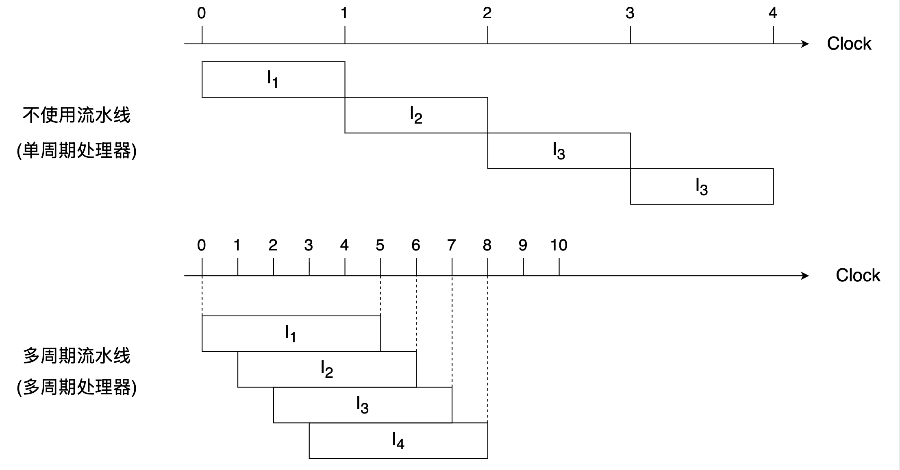

为了清晰地描述流水线的执行过程，通常需要通过图形化的方式来展示指令的执行情况。常见的表示方法有以下两种：

- **常规画法**：以横坐标表示时钟周期，纵坐标表示不同的指令。这种方式直观地展示每条指令在各个时钟周期中的执行阶段，便于理解指令间的并行关系和流水线的整体流程。

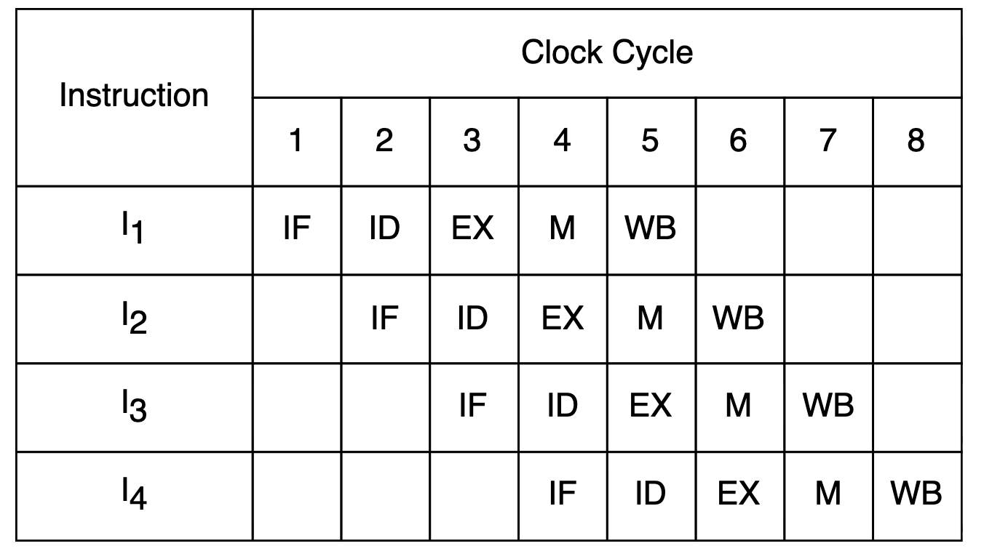

- **时空图**：一种更抽象的表示方法，结合时间和指令的执行阶段，通常以时间为横轴，执行阶段或资源占用为纵轴，展现指令在流水线中的动态流动和阶段重叠情况。

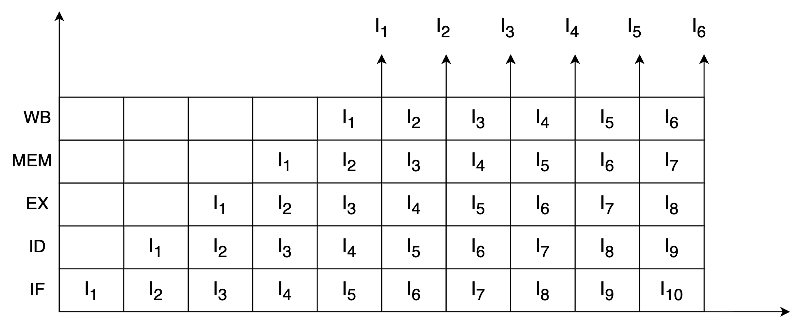

### 四、流水线的冒险和处理

上图中的指令流水线是一种理想情况，然后在实际情况中，情况不会这么简单。指令的流水线执行必须满足两个前提：

第一个前提是指令重叠执行时不会存在任何流水线资源冲突问题，即流水线的各段在同一个时钟周期内不会使用相同的数据通路资源。

第二个前提是指令通过流水线方式指令的结果与串行执行的结果应该相同。

违背以上前提的指令流水线调度方式即发生了 **冒险**，这些冒险总共可以分为三类：

- 第一种是 **结构冒险**，是指令在重叠执行的过程中，硬件资源满足不了指令重叠执行的要求，发生硬件资源冲突而产生的冲突。
- 第二种是 **数据冒险**，是指在同时重叠执行的几条指令中，一条指令依赖于前面指令执行结果数据，但是又得不到时发生的冲突。
- 第三种是 **控制冒险**，它是指流水线中的分支指令或者其他需要改写 PC 的指令造成的冲突。


#### 4.1 结构冒险

结构冒险是由于 CPU 的 **硬件资源有限** 而引起的。当两条或多条指令需要使用同一硬件资源时，就会发生结构冒险。

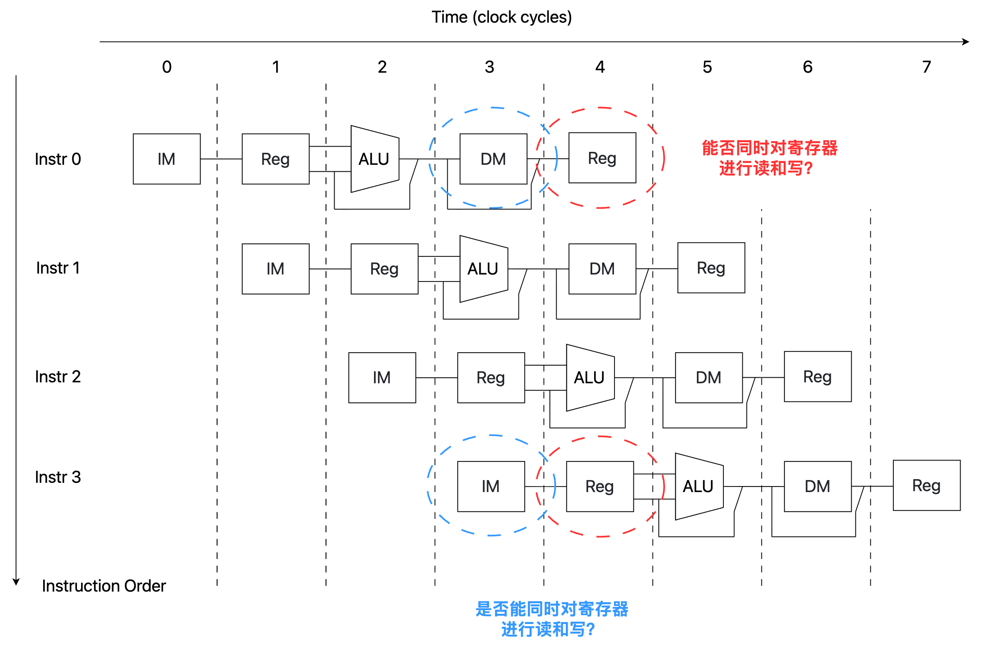

上图中画出了不同指令在每个时钟周期所需要使用到的硬件结构，其中指令 0 和指令 1 在第 4 个时钟周期分别需要读和写寄存器，但是 CPU 的架构却并不一定支持这种场景。同样，指令 0 和指令 3 在第 3 个时钟周期分别需要写和读存储器，存储器架构也不一定支持这种场景。若硬件不支持上述场景的话，指令间就发生了结构冒险。

其 **处理方法** 也很简单，主要分为两种：

- **资源重复**：既然结构冒险是资源受限所导致的，我们就增加硬件资源的数量，这样不同的指令在同一个时钟周期就可以去访问不同的硬件资源了。
- **流水线停顿**：如果指令 A 和指令 B 发生了结构冒险，那么我们就推迟指令 B 的执行，直到两者不发生结构冒险，如下图所示。

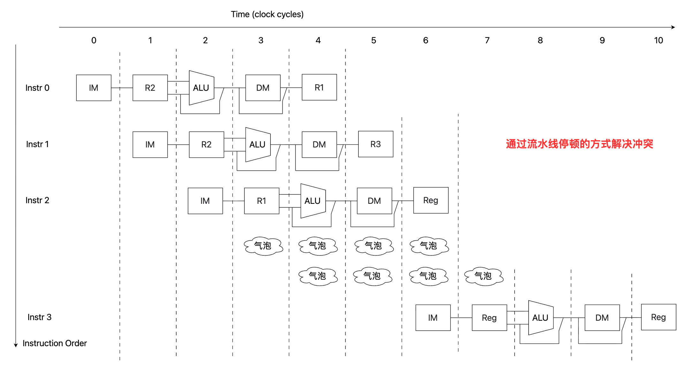

#### 4.2 数据冒险

数据冒险是由 **指令之间的依赖性** 引起的。一条指令可能需要使用另一条指令的结果，如果这些指令过早地进入流水线，它们可能会尝试在数据准备好之前使用数据。

数据冒险可以分为三类：

- **写后读（RAW, Read After Write）**：下一条指令的源操作数恰好是上一条指令的目的操作数，正常的逻辑是上一条指令写完该寄存器下一条指令才能读，如果下一条指令在上一条指令写完前就读了，就发生了 RAW 数据冒险。
- **读后写（WAR, Write After Read）**：下一条指令的目的操作数恰好是上一条指令的源操作数，正常的逻辑是上一条指令读完下一条指令才能写，如果下一条指令在上一条指令读完前就写了，就发生了 **WAR** 数据冒险。
- **写后写（WAW, Write After Write）**：两个指令写入同一个数据项，正常的逻辑是下一条指令比上一条指令更晚写，如果出现了相反的情况，就发生了 WAW 数据冒险。


##### 处理方法

数据冒险的 **处理方法** 如下所示：

- 流水线停顿（Pipeline Stall）：暂停流水线直到数据准备好。
  - 流水线停顿也可以处理结构冒险，是一种比较万能的方案。
- **数据前推（Data Forwarding）**：设置相关专用通路，直接将前一条指令的结果传递给需要它的下一条指令，不等结果写回寄存器。
- **重新排序指令（Instruction Reordering）**：编译器在编译时对指令进行重新排序，以减少数据冒险。

##### 流水线停顿

流水线停顿即当检测到数据冒险时，暂停后续指令（如 I2）的执行，插入 **“气泡”**（bubble，即空操作），让流水线等待，直到依赖的数据（如 I1 的结果）准备好。

假设 I1 和 I2 存在数据冲突，通过流水线停顿，我们可以将 I2 的译码阶段（ID）放到 I1 的写回（WB）之后，这样即可解决数据冲突：


##### 旁路转发

旁路技术也称为**数据前递（Data Forwarding）**，是一种用于 **解决 RAW（Read After Write）** 数据冒险的硬件优化技术。通过 **在流水线阶段之间直接传递数据**，旁路技术避免或减少因数据依赖导致的流水线停顿，从而提高流水线效率。

举个实际例子：

```
I1: ADD R1, R2, R3  ; R1 = R2 + R3
I2: SUB R4, R1, R5  ; R4 = R1 - R5
```

I1 和 I2 存在 RAW 冲突，若使用流水线停顿，需要插入气泡，等待 I1 的 WB 阶段执行完再执行 I2 的 ID 阶段。

若设置相关转发通路，不等前一条指令把计算结果写回寄存器，下一条指令也不再从寄存器读，而将 **数据通路中生成的中间数据直接转发** 到 ALU 的输入端。

指令 I1 在 EX 段结束时已得到 R1 的新值，被存放到 EX/MEM 流水段寄存器中，因此可以直接从该流水段寄存器中取出数据返送到 ALU 的输入端，这样，在指令 I2 执行时 ALU 中用的就是 R1 的新值，并且无需等待 I1 完成 WB 阶段。


✅ **可以建立的旁路路径有以下几种：**

1. EX→EX：
   - 适用于执行阶段产生的 ALU 结果，直接转发给下一条指令使用。例如 add → add。
2. M→EX：
   - 适用于 前一条指令在 M 阶段产生结果，而当前指令在 EX 阶段需要使用该结果的情况。
   - 例如：load 指令通常在 M 阶段才从内存中取出数据，如果下一条指令依赖该值，就需要从 M→EX 转发（但这在 Load-Use 中仍可能来不及，需要阻塞 1 周期）。
3. WB→EX：
   - 当前指令依赖的是 **更早之前** 指令的写回结果，此时只能从 WB 段取值转发给当前指令的 EX 阶段。

但是需要注意的是，旁路技术无法简单粗暴地解决所有 RAW 数据冒险，比如 **Load-Use** 数据冒险。

**装入-使用（Load-Use）冒险**是 RAW（写后读） 数据冒险的一种特殊情况，专门出现在 **load 指令后紧跟使用其结果的指令** 中。

这种冒险发生在以下场景：

- 指令 I1：从内存中加载一个值到寄存器（如 `load r1, 0(r2)`）；
- 紧接着的指令 I2：立即使用这个寄存器值（如 `add r3, r1, r4`）；
- 然而，在 I2 进入执行阶段（EX）时，I1 还未完成内存访问（M 阶段），也就 **还没有得到实际数据**，导致 I2 使用了 **尚未就绪的数据**。


面对以上问题，解决方案也很简单，即 **插入气泡（Bubble）或阻塞（Stall）一个周期**：

- 等待 load 指令完成 M 阶段；
- 然后在下一个周期使用转发线路，从 M→WB 寄存器转发值。


##### 冒险处理实例

下面通过一个实际的例子说明在如何在题目中画出 **解决了冒险的指令流水线**。

假设高级语言一条赋值语句被汇编微如下四条指令：

```
I1    LOAD  R1, [a]
I2    LOAD  R2, [b]
I3     ADD  R1, R2
I4   STORE  R1, [x]
```

其中 `I3` 和 `I1` 之间存在 **WAW** 数据冒险，
`I3` 和 `I2` 之间存在 **RAW** 数据冒险，
`I4` 和 `I3` 之间存在 **WAR** 数据冒险。

我们可以直接通过流水线停顿解决数据冒险：假设指令 A 和 B 发生了数据冲突，指令 A 在前，指令 B 在后，那么将 B 的 ID 放在 A 的 WB 之后就可以简单粗暴地解决冲突，在考试中画流水线都应采用这种方式。

解决冲突后，四条指令对应的流水线执行如下图所示：


#### 4.3 控制冒险

控制冒险是由分支和跳转指令引起的。因为 CPU 需要在执行分支和跳转指令后，才能知道下一条要执行的指令在哪里，这导致了流水线的暂停或者无效的指令进入流水线。

以下举例说明控制冒险是如何发生的：

```assembly
100: ADD R1, R2, R3    ; R1 = R2 + R3
104: BEQ R1, #0, 200   ; 如果 R1 等于 0，则跳转到地址 200
108: SUB R4, R5, R6    ; R4 = R5 - R6
112: MUL R7, R8, R9    ; R7 = R8 * R9
...
200: OR R10, R11, R12 ; R10 = R11 | R12
```

在 BEQ 指令的 EX 阶段完成之前，流水线已经开始取下一条指令（地址 108 的 SUB 指令）。问题在于，如果 BEQ 指令的条件成立，应该跳转到地址 200，而不是继续执行地址 108 的指令。这就产生了 **控制冒险**。


控制冲突的 **处理方法** 主要包含以下几种：

- **流水线停顿（Pipeline Stall/Bubble）**：在条件跳转指令之后，停止后续指令的执行，插入空操作。
- **分支预测（Branch Prediction）**：预测分支的结果（跳转或不跳转），并提前取指。如果预测正确，则可以避免停顿；如果预测错误，则需要清空流水线并重新取指。
- **延迟分支（Delayed Branch）**：编译器或处理器对代码进行优化，将分支指令后的一些不依赖于分支结果的指令先执行，从而减少因分支预测错误造成的开销。

### 五、性能指标

#### 5.1 吞吐量

流水线的 **吞吐率（Throughput）** 是流水线在单位时间内完成的任务数量。

吞吐率 TP 的计算公式为：


其中， *n* 是任务数， *Tk* 是处理完 *n* 个任务所用的总时间。

设时钟周期为 *Tc* ，流水线的段数为 *k* 。在理想**无阻塞**的情况下，一条 *k* 段流水线完成 *n* 个任务需要 *k*+n−1 个时钟周期，得出流水线的吞吐率为：


#### 5.2 加速比


### 六、高级流水线

高级流水线通过提升流水线的并行程度来提升流水线的执行效率。指令级并行（ILP）的提升主要有两种策略：**多发射技术** 通过多个功能单元并行处理指令，允许一次发射多条指令到流水线；**超流水线技术** 通过增加流水线级数，使更多指令在流水线中重叠执行。

以下介绍三种相关技术：**超标量流水线**、**超流水线**、**超长指令字**。


超标量流水线是一种能够在单个时钟周期内并行执行多条指令的处理器设计技术，通过 **多个并行的执行单元**（如 ALU、FPU 等），处理器可以同时处理多条指令，从而提高指令吞吐量。

指令获取和解码后，处理器动态分析指令之间的依赖关系。如果指令之间没有数据或控制依赖，处理器会将它们分配到不同的执行单元并行执行。


超流水线技术将指令 **执行过程细分为更多、更小的阶段**，从而缩短每个阶段的时间，允许更高的时钟频率。

传统流水线可能有 5 个阶段（如取指、解码、执行、访存、写回），超流水线可能细分为 10 个或更多阶段。每个阶段处理时间减少，处理器可以以更高频率运行。

- **超长指令字**

**超长指令字（VLIW, Very Long Instruction Word）** 是一种通过 **编译器在编译阶段完成指令级并行调度**，在一条“超长指令”中同时包含多条可并行执行的子指令，从而提升 ILP 的处理器架构技术。

一条 VLIW 指令本质上是多个“操作槽位（slot）”的组合，例如：

```
| ALU_op | MUL_op | LOAD_op | BRANCH_op |
```

处理器在 **一个时钟周期内同时执行这些互不相关的操作**。


超长指令字的 **核心思想** 是：

> **由编译器负责分析数据相关、控制相关和资源冲突，提前决定哪些指令能并行。**

处理器硬件不再需要复杂的：

- 乱序执行（Out-of-Order）
- 寄存器重命名（Rename）
- 动态相关性检测

从而大幅简化硬件复杂度和功耗。

最后再对比一下三种高级流水线的思路差异：

| 技术       | 提升 ILP 的方式 | 并行发生在哪里 | 控制复杂度 |
| ---------- | --------------- | -------------- | ---------- |
| 超标量     | 并行多发射      | 同一拍多条指令 | 极高       |
| 超流水线   | 拆细流水级      | 不同拍高度重叠 | 中         |
| 超长指令字 | 编译期打包并行  | 一条指令内并行 | 极低       |

一句话总结本质差异：

> - **超标量：硬件很“聪明”**
> - **超流水线：时钟切得很“细”**
> - **VLIW：编译器很“聪明”**

---

## 多处理器

### 一、费林分类法

**弗林分类法**（Flynn’s Taxonomy）是一种计算机体系结构的分类方法，由 **弗林**（Michael J. Flynn）于 1966 年提出。它根据计算机中 **指令流** 和 **数据流** 的数量，将计算机体系结构分为 **SISD**、**SIMD**、**MIMD**、**MISD** 四类：

|                | 单一指令流               | 多指令流                 |
| -------------- | ------------------------ | ------------------------ |
| **单一数据流** | 单指令流单数据流（SISD） | 多指令流单数据流（MISD） |
| **多数据流**   | 单指令流多数据流（SIMD） | 多指令流多数据流（MIMD） |

#### 1.1 指令流、数据流

**指令** 是告诉计算机执行特定操作的命令，例如“加法”、“减法”、“数据移动”等。
**指令流** 就是程序中一系列指令的有序集合，它决定了计算机执行的步骤。换句话说，**指令流** 就是“计算机要做什么”。

**数据** 可以是数字、字符、图像、视频等各种形式的信息。
**数据流** 指的是计算机在执行指令时处理的数据序列。换句话说，**数据流** 就是“计算机要处理什么”。

#### 1.2 SISD


**SISD** (Single Instruction Single Data) 指的是单指令流单数据流，每个指令部件每次仅译码一条指令，而且在执行时仅为操作部件提供一份数据。

如上图所示，一个 **处理单元**（**PU**，Processing Unit）接收单条 **指令流**，执行每条指令时，对单独的 **数据** 进行操作。

#### 1.3 SIMD

**SIMD**（Single Instruction Multiple Data）指的是单指令流多数据流，允许对多个数据点执行相同的操作，实现 **数据级并行性**。

如上图所示，**SIMD** 架构的计算机包含多个 **处理单元**，每个 **处理单元** 在同一个时刻执行相同的指令，但是对不同的 **数据** 进行操作。

这种方式可以大幅度提升计算的并行性，比如对于一个 **N x N** 的矩阵加法，在 **SIMD** 中，需要一个 **处理单元** 连续执行 **N x N** 次。而在 **SIMD** 中，如果有 **N** 个 **处理单元** 的话，只需要执行 **N** 次即可。


#### 1.4 MISD

**MISD**（Multiple Instruction Multiple Data）指的是多指令流单数据流，即多个 **处理单元** 同时对同一份 **数据** 执行不同的指令。
这种架构在实际应用中非常罕见，因为它难以实现，并且适用场景有限。
一些 **容错系统** 可能采用 **MISD** 架构，通过多个不同的 **处理单元** 对同一份 **数据** 进行计算，然后比较结果以确保正确性。

#### 1.5 MIMD

**MIMD**（Multiple Instruction Multiple Data）指的是多指令流多数据流，多个 **处理单元** 同时对不同的 **数据** 执行不同的指令。
现代计算机中的 **多核处理器** 就是 **MIMD** 架构的典型代表。


### 二、多核处理器


#### 2.1 物理核心

**物理核心** 是 CPU 芯片上实际存在的、独立的硬件 **处理单元**。
每个 **物理核心** 都拥有独立的运算电路和 **缓存**，能够独立执行指令。
物理核心是真实的硬件存在，是 CPU 进行计算的基础。

#### 2.2 逻辑核心

**逻辑核心** 是通过 **超线程**（Hyper-Threading）等技术，在一个 **物理核心** 上虚拟出的多个 **逻辑处理单元**。
**超线程** 技术允许一个 **物理核心** 同时执行多个 **线程**，从而提高 CPU 的利用率。
逻辑核心是操作系统层面识别的 **虚拟处理单元**，并非真实的硬件存在。

#### 2.3 超线程

**超线程** 技术的核心思想是将一个 **物理核心** 模拟成多个 **逻辑核心**（线程），从而在同一时间内执行多个 **线程**。每个 **逻辑核心** 都拥有自己的寄存器集合和执行单元，这些 **逻辑核心** 之间共享 **物理核心** 的资源，如 **缓存** 和执行单元。


**超线程** 技术旨在提高 CPU 的利用率，特别是在多线程应用程序中。
然而，超线程并不意味着性能翻倍。由于两个 **逻辑核心** 共享相同的 **物理执行资源**，因此 **性能提升通常在 20% 到 30% 之间**。

简单来说，**物理核心** 是实际存在的“房子”，**逻辑核心** 是在“房子”里隔出来的“房间”。

### 三、共享内存多处理机

**共享内存多处理机**（Shared Memory Multiprocessor）是一种并行计算机体系结构，其中多个处理器共享同一个 **物理内存空间**。这种架构允许处理器之间通过读写 **共享内存** 来进行通信和数据交换，从而实现并行计算。


**共享内存多处理机** 有两大主要架构特点：

- 共享内存空间：
  - 所有处理器都可以访问同一个 **物理内存空间**，使得数据共享变得简单高效。
  - 处理器之间通过读写 **共享内存** 中的数据来进行通信和同步。
- 处理器互连：
  - 处理器通过互连网络（如总线、交叉开关等）连接到 **共享内存**。
  - 互连网络的性能对 **共享内存多处理机** 的整体性能有重要影响。


