# 总线与输入输出系统

## 总线

### 一、基本概念

**总线** 是一组电子导线或信号线，它们允许不同的硬件设备（如 **CPU**、**内存**、**输入/输出** 设备等）之间进行数据传输和通信。总线是计算机内部和外部设备之间的信息传递通道。

### 二、总线分类

#### 2.1 功能

1. **核内总线** ：在处理器核内部各元件之间连线的总线称为 **核内总线** ，可连接核内各寄存器、ALU、指令部件等
2. **系统总线** ：指连接 **CPU**、主存和 **I/O** 接口等主要部件的总线，通常所说的总线是指这类在系统主要模块之间互连的总线。下面要介绍的也是这种 **系统总线** 。
3. **通信总线** ：计算机系统之间或计算机系统与其他系统（远程通信设备、测试设备）之间进行通信的总线，又称 **外部总线**。

#### 2.2 数据传送方式

**总线** 的数据传输方式包含 **串行** 和 **并行** 两种：

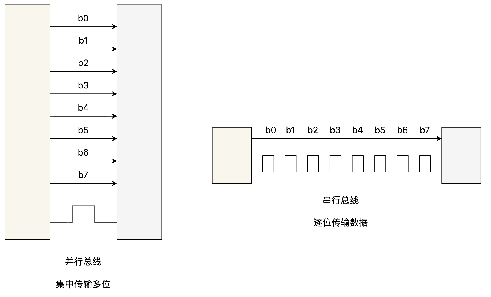

1. **串行总线** ：只含有一条双向数据线或两条单向数据线，数据按位分时传送。适合远距离通信，大多数 **通信总线** 属于 **串行总线**
2. **并行总线** ：含有多条双向数据线，可实现多位同时传送。传输效率高，但相邻数据线之间会相互干扰，适合近距离传输。大多数 **系统总线** 属于 **并行总线**

试题中常常考查 **哪些总线是串行总线，哪些总线是并行总线** 。

这里核心把握一点：***现代高速通信几乎都使用串行总线***（PCIe、USB、SATA、DisplayPort），而并行总线主要用于内存、老式设备或非常短距离的高速通信。

**常见的串行总线** 如下表所示：

| 总线类型                   | 简介                                                    |
| -------------------------- | ------------------------------------------------------- |
| **USB**（通用串行总线）    | 广泛用于外设连接，如鼠标、键盘、U盘。支持热插拔。       |
| **PCI Express (PCIe)**     | 高速内部总线，连接显卡、SSD 等。点对点串行通信。        |
| **SATA**（串行ATA）        | 硬盘、SSD 与主板间通信。取代并行ATA（PATA）。           |
| **Thunderbolt**            | 基于 PCIe 和 DisplayPort 的高速接口，可传输视频、数据。 |
| **DisplayPort、HDMI、DVI** | 显示器接口，虽然传视频数据，但本质上是高速串行通信。    |

**常见的并行总线** 如下表所示：

| 总线类型                  | 简介                                                         |
| ------------------------- | ------------------------------------------------------------ |
| **PCI**（老式）           | 并行总线，早期主板与扩展卡连接标准，已被 PCIe 取代。         |
| **ISA**（工业标准架构）   | 更早的并行总线，已淘汰。                                     |
| **IDE / PATA**（并行ATA） | 老式硬盘连接方式，已被 SATA 取代。                           |
| **内存总线（如 DDR）**    | 尽管速率非常高，但 DRAM 模块仍通过并行数据线传输数据（如 DDR4 有 64 数据线）。 |

#### 2.3 时序控制方式

1. 同步总线：采用公共的时钟信号进行定时，挂接在总线上的所有设备都从时钟线上获得定时信号
   - 总线 定时以 **最慢设备** 所用时间为标准，因此适合于存取时间相差不大的多个功能部件之间的通信
   - 由于时钟偏移问题，导致 **同步总线** 不能过长，否则会降低 **总线** 传输效率
   - **同步总线** 常采用 **并行传输**，即总线的数据条数为 8、16、32 或 64 位等
2. 异步总线：总线上连接的各部件或设备没有统一的时钟，而是依靠各自内部的定时操作，通过信号握手的方式来进行规定的总线操作，从而完成部件或设备之间的数据传输
   - 由于 **同步并行总线** 使用快速且长的传输线时，会导致传送到另一端的波形发生变形，从而使得（并行传输的）所有位中最快和最慢的位信号之间的时间差较大，因此现在更多使用 **异步串行方式** 进行传输：串行–传输速率可更快 + 不会影响到其他位

### 三、总线架构方式

**总线** 架构方式可以分成 **单总线**、**多总线** 以及 **分层结构** 三种。

#### 3.1 单总线结构

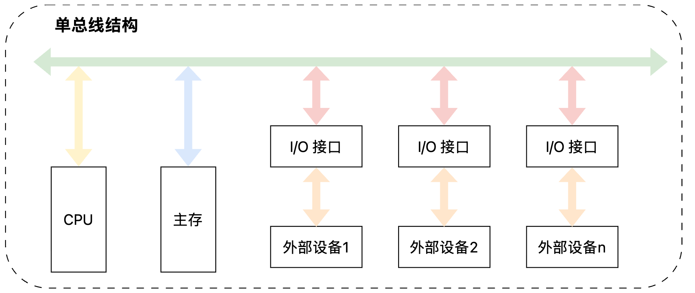

- **单总线结构** 中，所有处理器、主存储器和 **I/O** 设备 **共用一条总线进行通信** 。
- 优点是结构简单、实现成本低，适用于设备数量少、通信量低的系统。
- 缺点是所有设备必须轮流访问总线，存在通信冲突和带宽瓶颈，性能扩展性差。

#### 3.2 多总线结构

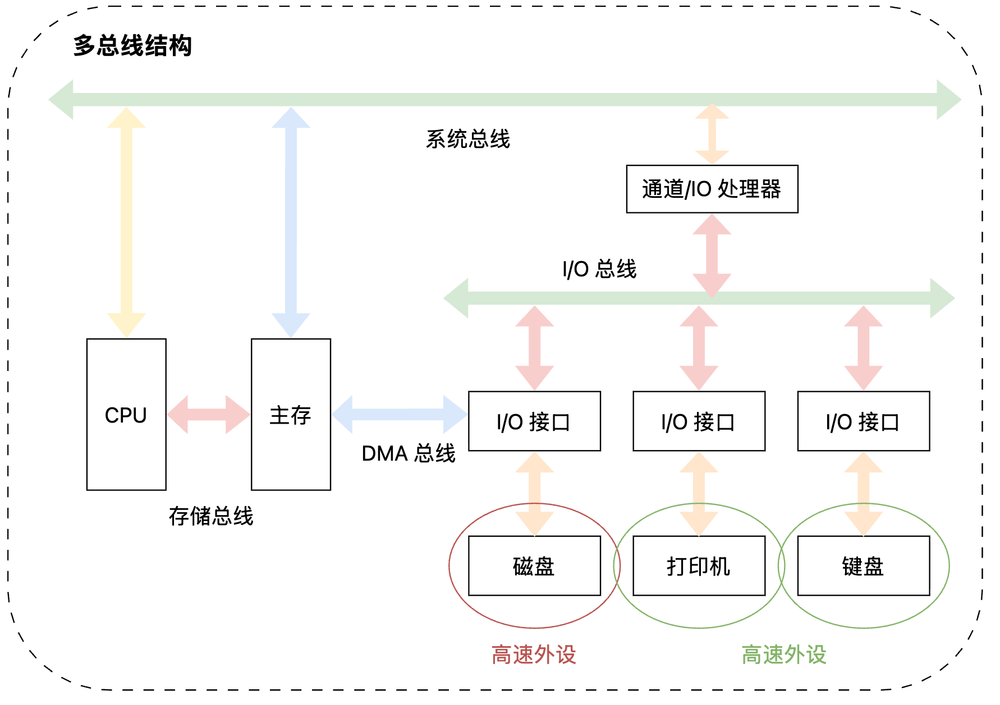

- **多总线结构** 在 **单总线** 的基础上进行拓展，**引入多条功能分化的总线**，例如系统总线、I/O 总线、存储器总线等。
- 常见做法是将 **处理器与主存之间的数据传输** 放在一条专用总线（如 **CPU-主存总线**），而 **I/O** 设备通过桥接芯片连接至另一条总线（如 **I/O 总线**）。
- 这样可以显著减轻主总线负载，提高系统并发性和吞吐能力。

#### 3.3 分层总线结构

现代计算机系统广泛采用 **分层总线结构**，其核心思想是在 **多总线结构** 的基础上进一步 **细化总线的功能与等级**，以更好适应不同设备对带宽和延迟的需求。

**核心特点** ：

- 将总线按速率和用途分层，如高速、中速、低速总线；
- 各层通过 [桥接控制器](https://www.csgraduates.com/constitution_principle/bus/io/#现代架构)（如 **PCH**）进行协调；
- 高速设备尽量绕过中间桥接器，直连 CPU 提高性能。

高速设备的连接方式

- **内存总线** ：使用 DDR4/DDR5 等内存通道，由集成在 CPU 内部的内存控制器（IMC）控制，实现低延迟高速访问；
- **显卡** ：通过 **PCIe** 高速通道，直接连接到 CPU 的 PCIe 控制器，适用于图形、大数据等吞吐密集型场景；
- **高速存储** （如 NVMe SSD） ：通过 **PCIe/NVMe** 通道连接，可直连 **CPU** 或走 **PCH**。

- 低速或通用设备的连接方式
  - 低速设备（如 **USB**、**SATA**、音频、网卡等）大多连接至 **平台控制器集线器**（**PCH**） 或 **南桥芯片**，再通过 **DMI**（Direct Media Interface）总线 与 CPU 通信；
  - 这些设备不要求极高带宽，通过桥接方式集中管理，可简化主板设计并降低成本。

### 四、总线组成


**系统总线** 通常由一组控制线、一组数据线和一组地址线构成。也有些总线没有单独的地址线，即数据线和地址线 **复用**。

1. 数据总线（Data Bus） ：数据总线用于在计算机系统的各个组件之间传输数据。它通常由多条并行线组成，每条线传输一个数据位（比特）。
   - 位数（数据总线条数）与机器字长、存储字长有关，一般是 8 位、16 位、32 位
2. 地址总线（Address Bus） ：地址总线用于传输内存地址或外部设备的地址信息，以确定数据的存储位置或目标设备。
   - 地址总线的宽度决定了系统可以寻址的内存或设备的数量。更宽的地址总线通常允许系统寻址更多的内存或设备。
3. **控制总线**（Control Bus） ：控制总线传输 **控制信号和命令**，用于控制各个硬件组件的操作。这些控制信号包括读/写信号、时钟信号、中断信号、复位信号等。控制总线用于协调数据传输和操作的序列。

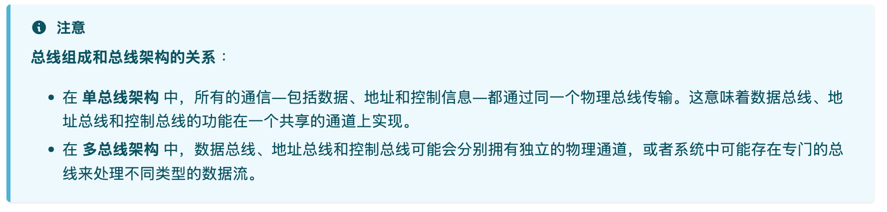

### 五、总线指标

总线时钟频率 

**时钟频率** 指总线所依赖的时钟信号的频率。它表示的是“时钟脉冲”产生的快慢。

时钟频率 **单位** 为 Hz，常见如 100MHz、133MHz 等。

总线传输周期 

**总线传输周期** 指一次完成总线数据传输所需的时间，包括申请、寻址、传输和结束阶段。

一个完整的传输周期可能需要 多个时钟周期。

总线工作频率 

**工作频率** 指总线 **实际传输数据** 的频率。

一般来说，工作频率与时钟频率相同，但有些总线为了提高带宽，会采用 **倍频/分频** 机制：

- SDR（单倍数据率）：每个时钟周期只在一个边沿传输数据，工作频率 = 时钟频率。
- DDR（双倍数据率）：在上升沿和下降沿各传输一次，工作频率 = 2 × 时钟频率。
- QDR（四倍数据率）：一个周期传四次，工作频率 = 4 × 时钟频率。

更加泛化地说，若总线传输周期 = N 个时钟周期，则总线的工作频率 = 时钟频率 / N。

总线宽度 

**总线宽度** 也叫做总线位宽，是总线上 **能同时传输的数据位数**，通常指的是数据总线的根数，如 32 根称为 32 位总线。

总线带宽 

**总线带宽** 指单位时间内总线能传输的最大数据量，通常用 MB/s、GB/s 表示，计算公式为：


### 六、常见总线标准

需要熟练掌握一些会考察的 **总线标准** 的名称：**PCI**、**SATA**、**ISA**、**IDE**、**USB**，并且能够和其他计算机领域的专业名词区分开来：

1. **PCI** ：**PCI 总线** 是一种用于连接内部扩展卡（如显卡、网卡、声卡等）到主板的标准。**PCI 总线** 存在多个版本，包括 **PCI**、**PCI-X** 和 **PCI Express**（**PCIe**），它们在带宽、速度和适用范围上有所不同。
2. **SATA** ：**SATA** 是一种用于连接存储设备（如硬盘驱动器和光盘驱动器）到计算机的总线标准。它广泛应用于个人电脑和服务器中。
3. **ISA** ：16 位体系结构，只能支持 16 位的 **I/O** 设备，是已经被淘汰的插槽接口。
4. **IDE** ：**IDE** 是早期计算机中用于连接硬盘驱动器和光盘驱动器的 **总线** 标准，现在已经被 **SATA** 所取代。
5. **USB** ：**USB** 是一种通用的总线标准，用于连接各种外部设备（如键盘、鼠标、打印机、存储设备等）到计算机。**USB** 有多个版本，包括 **USB 1.0**、**USB 2.0**、**USB 3.0**、**USB 3.1** 和 **USB 3.2**，它们在传输速度和功能上有所区别。

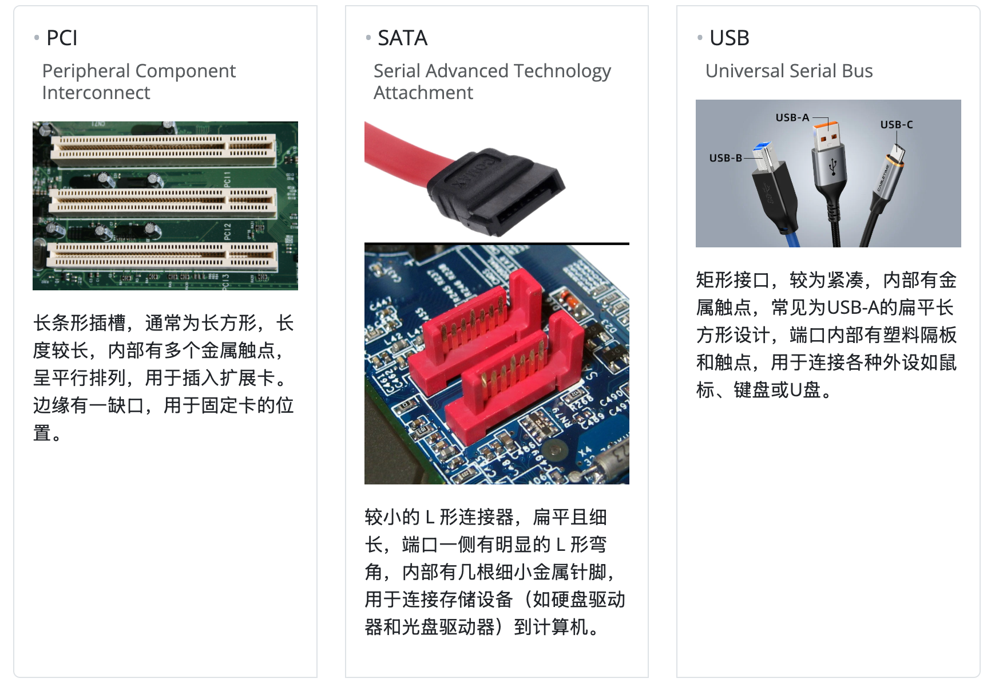

总线、协议、接口的区别 

这三个概念是经常被混淆的概念，这里还是多提一嘴。简单来说，**接口** 是硬件插入的位置，**协议** 是软件层面用于通信的规则，**总线** 是硬件之间的数据通路。下表给出一些常见例子来说明：

| 实际例子         | 插槽/接口  | 协议                       | 总线      |
| ---------------- | ---------- | -------------------------- | --------- |
| **SATA SSD**     | SATA 接口  | AHCI 协议                  | SATA 总线 |
| **M.2 SATA SSD** | M.2 插槽   | AHCI 协议                  | SATA 总线 |
| **M.2 NVMe SSD** | M.2 插槽   | NVMe 协议                  | PCIe 总线 |
| **PCIe 显卡**    | PCIe 插槽  | PCIe 协议                  | PCIe 总线 |
| **USB U盘**      | USB-A 接口 | USB 协议（2.0/3.0/3.1 等） | USB 总线  |

需要注意的是，有些名词（比如 **SATA**、**PCIe**、**USB**）是 **混合性术语**，既可以是 **总线**，也代表了协议和接口；有些名词（比如 **M.2**） 仅仅是接口；有些名词（比如 **NVMe**）仅仅是协议。

### 七、总线事务

**总线事务** 是计算机总线操作的一个 **基本单位**。一个总线事务通常涉及一系列的操作，这些操作可以是数据的读取或写入。

在一个总线事务中，**主设备**（发起事务的设备）通过总线控制线对总线进行控制，并发出地址和数据，以及读写信号。**从设备**（数据被读取或写入的设备）则识别地址，并根据读写信号进行相应的数据交换。

**总线事务** 包含几个主要阶段：

1. **请求**（Request） ：主设备发出 **总线传输请求**。
2. **仲裁**（Arbitration） ：如果多个设备同时尝试使用总线，它们必须通过某种仲裁过程来 **决定哪个设备有权** 控制总线。这通常涉及一个优先级方案，以防止冲突和数据损坏。
3. **寻址**（Addressing） ：主设备将 **目标地址** 放在总线上，以指定事务的目的地，如特定的内存地址或 I/O 设备。
4. **传输**（Transfer） ：一旦地址被确认，数据传输就会发生。这可以是读操作，也可以是写操作。
5. **终止**（Termination） ：一旦数据成功传输，事务就会结束。终止阶段可能包括从设备发出的确认信号，或者主设备撤销其对总线的控制。

#### 7.1 突发总线传输事务

**突发（Burst） 总线传输事务** 是指在总线通信中，一次性连续传输多个数据单元（通常是字节或字）而无需为每个数据单元单独发起请求或握手的过程。这种传输方式广泛应用于现代计算机体系结构中，以提高数据传输效率和总线利用率。

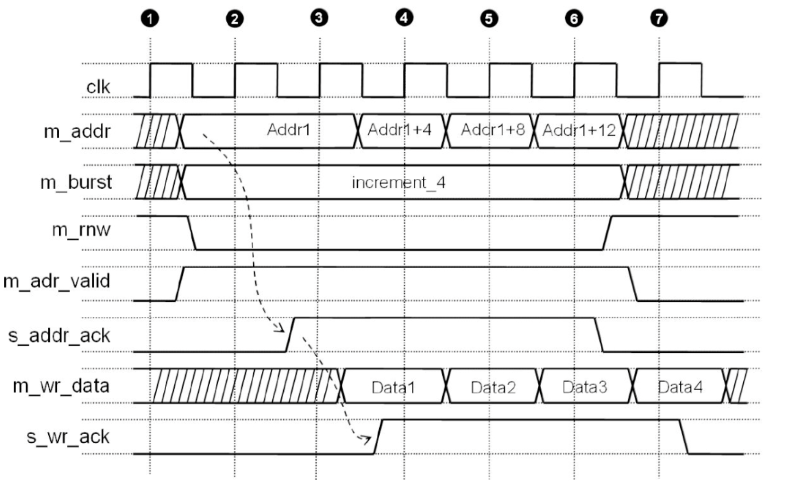

### 八、总线周期

**总线周期** 是指 **CPU** 通过 **总线** 与存储器或 **I/O** 接口进行一次数据传输所需的时间。
一个 **总线周期** 通常包含多个时钟周期，这些时钟周期可以被分为四个阶段（四个时钟周期 *T*1​,*T*2​,*T*3​,*T*4​ ）：

1. 申请分配阶段：主设备进行请求和仲裁。
2. 寻址阶段：主设备用地址信息来指明它想读/写的那个从设备是哪一个。
3. 传输阶段：主设备向从设备发出读命令或者写命令。
4. 结束阶段：主设备把地址信息、读写命令等从 **总线** 撤除，让出 **总线** 的使用权。

### 九、总线定时

根据 [时钟周期](https://www.csgraduates.com/constitution_principle/overview/performance/#时钟周期) 一节可知，计算机中的设备也许并不使用相同的时钟周期，但是设备间在交换数据的过程中需要时间上配合。

这种时间配合的控制过程就叫做 **总线定时**，**总线定时** 包含 **同步定时** 和 **异步定时** 两种方式。

#### 9.1 同步定时方式

在 **同步定时方式** 中，数据传输的时钟信号由一个 **中央时钟源**（通常是主时钟源或总线控制器）生成，并将时钟信号传送到所有参与通信的设备。

这个时钟信号每次都产生一个相等的时间间隔，这个间隔为一个 **总线传输周期**，主设备和从设备必须在这个限定的时间内完成规定的操作。

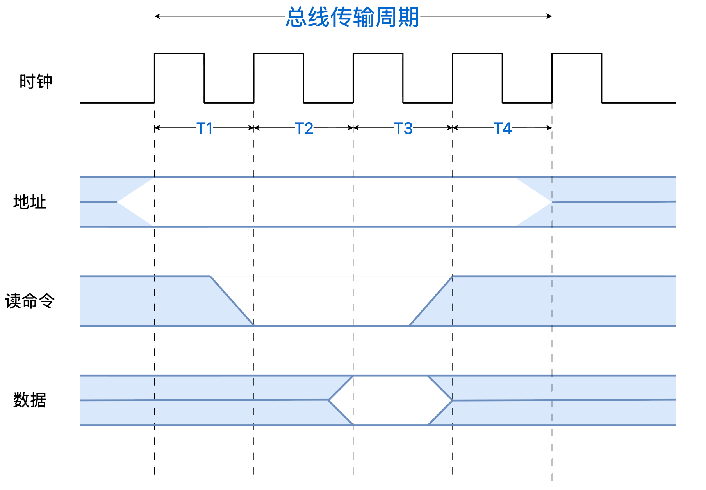

- *T*1 的上升沿到来时，主模块向从模块发送地址
- *T*2 的上升沿到来时，主模块发送读命令
- *T*3 的上升沿到来时，从模块提供数据
- *T*4 的上升沿到来时，主模块撤销读命令，从模块撤销数据

同步通信适用于总线长度较短（出现信息错误的概率小）及总线所接部件的存取时间比较接近的系统。
如果有的从设备速度较慢，就会跟不上总线的节奏，进而拖慢了主设备的速度。

#### 9.2 异步定时方式

在 **异步定时方式** 中，数据传输的时钟信号不是由中央时钟源统一控制，而是由每个设备自己的时钟信号驱动。完全依靠传送双方相互制约的“握手”信号来实现定时控制，通常我们将交换信息的两个设备称为主设备和从设备，主设备发送“请求”，从设备接收到后回复“回答”。

**异步定时** 根据“请求”和“回答”的类型，可以分为三种类型：

- **不互锁** ：主设备持续发送请求一段时间，默认从设备接收到请求。
- **半互锁** ：主设备接收到来自从设备的回答后停止发送请求，从设备发送回答一段时间，默认主设备接收到回答。
- **全互锁** ：从 **半互锁** 的基础上，从设备接收到来自于主设备的回答后停止发送回答。

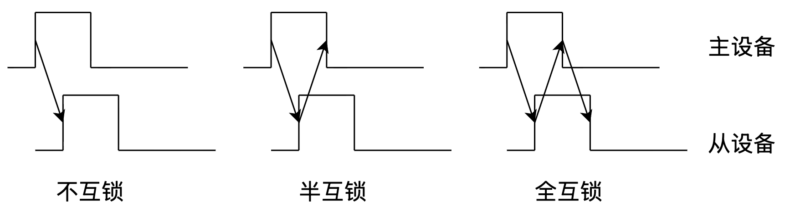

---

## I/O系统

### 一、输入/输出系统

**以主机为中心** 来看，将信息从外部设备传送到 **主机** 的过程称为 **输入**；将信息从 **主机** 传送到外部设备的过程称为 **输出**。

#### 1.1 简单架构

让我们首先来看一个早期简易 **I/O** 系统的架构（一般考查的也就是这种架构）：

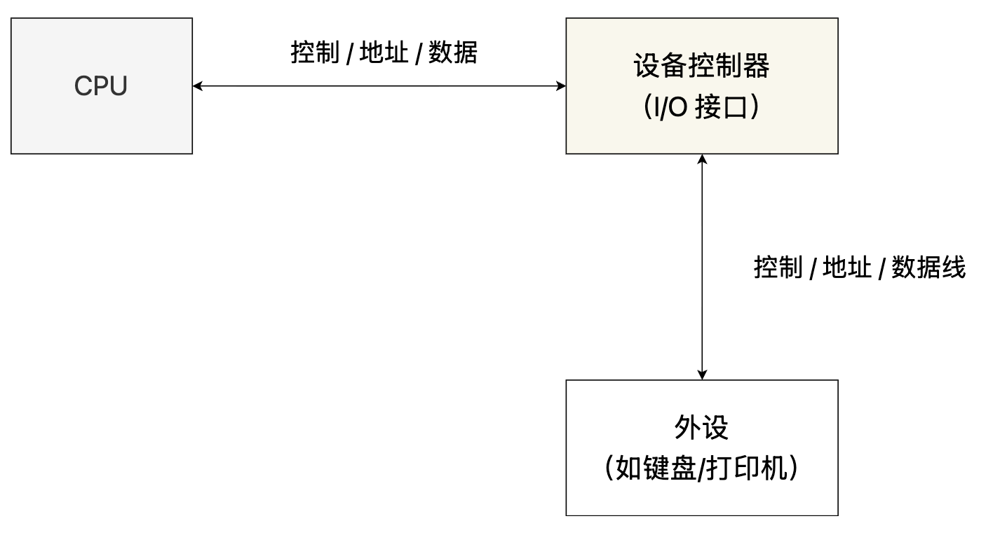

在这个架构中，各部分的基本功能如下：

🔹 **CPU** 是整个计算机系统的控制和运算核心，它负责：**发出控制命令**（如读/写指令）以驱动外设；通过 **I/O** 总线 **访问设备控制器**，进行地址寻址、数据传输和状态监测；与 **内存** 协同，**完成数据的读取、处理与存储**。

🔹 **外设** 是计算机与外部世界交互的工具，例如键盘、打印机和磁盘等。它们接收来自 CPU 的输出（如打印任务），也能将物理信号（如按键动作）转换为数字信号传递给 CPU。

🔹 **I/O 接口** 是连接 **主机** 与 **外设** 之间信息传输的桥梁，负责协调两者之间的同步、速度匹配和数据格式转换等问题。它在结构上包含两个部分：

- 主机侧接口：作为内部接口，通过系统总线与CPU和主存（内存）连接；
  - CPU ↔ 设备控制器：通过系统内部总线（如 PCI、PCIe）进行连接
- 外设侧接口：作为外部接口，通过 USB、串口、并口等电缆与具体外设连接。
  - 设备控制器 ↔ 外设：通过各种外部接口标准（如 USB、SATA、HDMI、VGA 等）进行连接

通过 **I/O 接口**，系统在 **CPU**、**内存** 和 **外设** 之间建立了一条高效的信息传输通路。这个通路大致如下：

```
 CPU 与内存
     ↓
  I/O 总线
     ↓
I/O 接口（设备控制器 + 接口插座）
     ↓
接口电缆（USB/SATA等）
     ↓
   外设
```

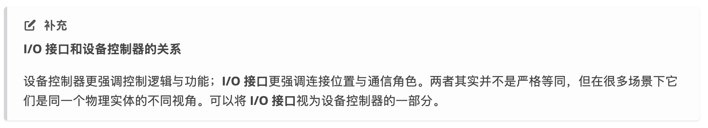

#### 1.2 现代架构

现代 **I/O** 硬件系统的架构更加复杂，这节不会直接考查，了解即可：

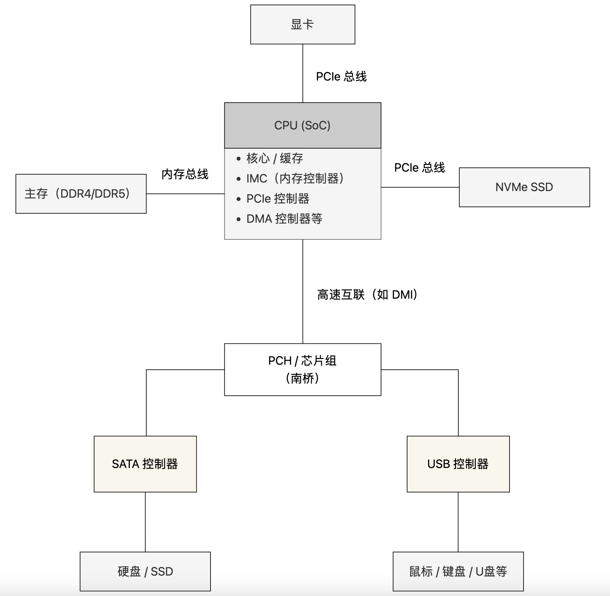

在现代系统中，**CPU** 本身集成了部分高速 **I/O** 控制逻辑（如 **内存控制器**、**PCIe 控制器**、**DMI 接口**等），而非核心的 **I/O** 控制被下放至 **芯片组**（PCH），也就是过去所谓的“南桥”。这将 **CPU** 从大量外围管理工作中解放出来，提升性能并降低功耗。

🔹 **CPU** 内部

- 包含 **内存控制器** 和部分 **PCIe 控制器**
- 与 **PCH** 之间通过高速互连（如 **DMI** / Direct Media Interface）通信

🔹 **PCH**（Platform Controller Hub）

- 管理几乎所有非高速设备（如 USB、SATA、音频、网卡等）
- 是现代主板上的中心管理芯片，连接大量外设控制器

#### 1.3 硬件和软件层

上文提到的是 I/O 系统的 **硬件层次**，除了硬件部分，I/O 系统还包括一系列的 **软件组件**，用以管理和调度外设资源、提供抽象接口、增强设备的可用性和通用性。主要的 [软件层次](https://www.csgraduates.com/operating_system/io_device/devices/#io-软件层次) 如下：

- 用户层 I/O 软件
- 设备独立性软件
- 设备驱动程序
- 中断处理程序

软硬件协同使得 I/O 操作既可高效运行，又具有高度的可移植性和扩展性。操作系统通过抽象和分层，使得新的设备只需添加驱动程序即可兼容原有的 I/O 系统，而不需要修改上层软件。

### 二、I/O接口

#### 2.1 结构

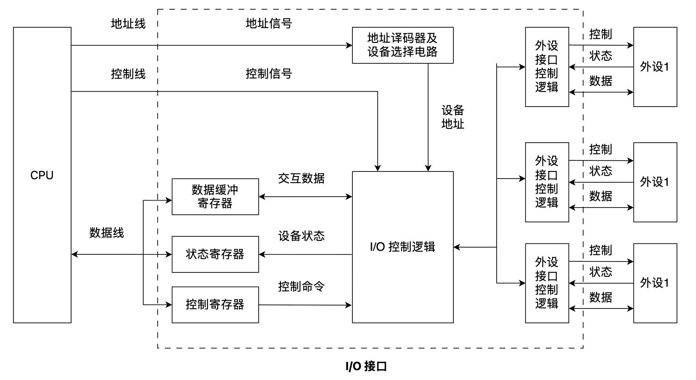

- **数据缓冲**：CPU 寄存器、主存 等主机部件的存取速度比外设快很多，因此为了速度匹配，可将数据提前存到 I/O 接口 中的数据缓冲区，用以中和高速系统组件和低速外部设备之间的速度差异
- **数据格式转换**：主机和外设的数据格式不同，I/O 接口 提供数据格式的相互转换，如串并转换、数模转换等
- **控制和定时**：为来自系统总线的控制信号和定时信号提供控制和定时逻辑，对内部资源及外设间动作的先后关系进行协调，并对数据通信过程进行控制
- **错误或状态检测**：提供可以保存各种状态信息的状态寄存器，CPU 通过读取这些寄存器来了解接口和外设的出错情况或状态
- **与主机和设备通信**：上述四个功能都必须通过主机与 I/O 接口之间和 I/O 接口 与 外设 之间的通信来完成

#### 2.2 I/O端口

**I/O 端口**（Input/Output Port）是计算机系统中用于处理器与外部设备（如键盘、鼠标、显示器、打印机等）之间进行 **数据交换的接口**。它们是硬件和软件交互的关键部分，允许处理器通过特定的地址与外设通信。

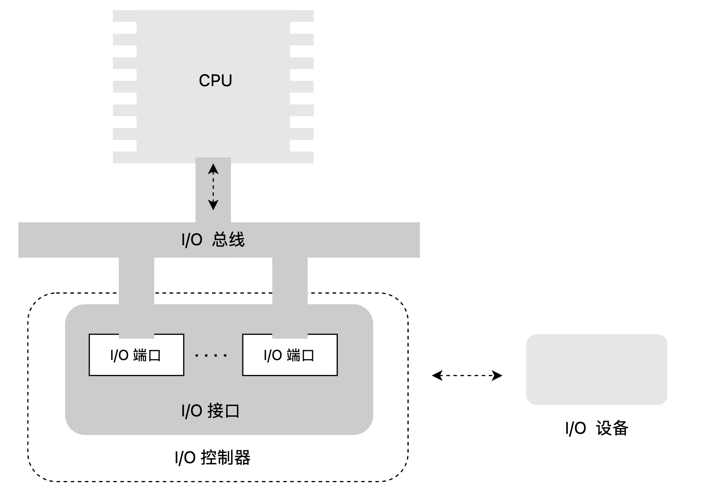

##### 组成部分

**I/O 端口** 可以根据其功能和传输的数据类型进行分类：

- 数据端口：用于传输实际的数据。
- 状态端口：用于传输外围设备的状态信息，例如设备是否准备好。
- 控制端口：用于传输控制命令，例如启动或停止设备。

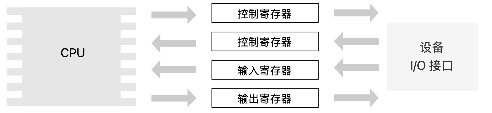

##### 编址方式

为了方便 CPU 对于 I/O 端口的访问，需要对各个端口进行编号，每个端口对应一个端口地址。

编址方式主要 **统一编址** 和 **独立编址** 两种。

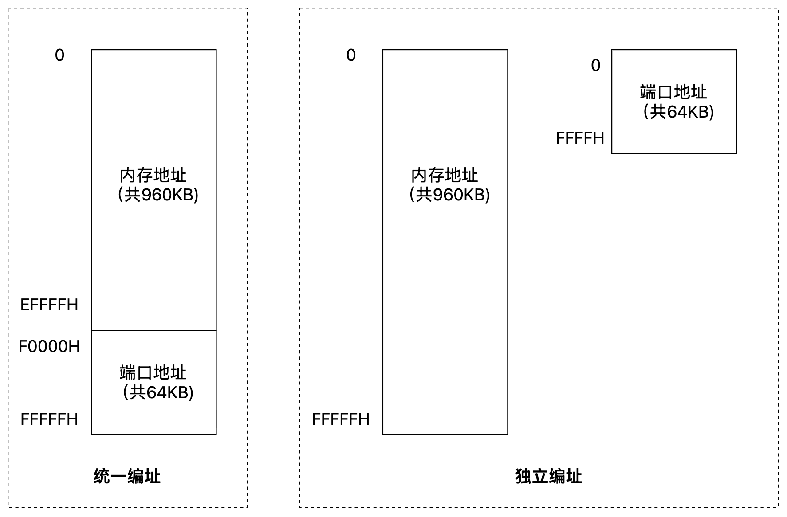

统一编址 

统一编址也叫做 **内存映射 I/O**（Memory-Mapped I/O, MMIO），具备如下特点：

- I/O 设备 **直接映射到内存地址空间**，CPU 使用普通的 MOV 指令即可访问设备寄存器。
- 优点是 **统一寻址、指令通用性强**，但可能占用部分主存地址空间。

独立编址 

独立编址也叫做 **端口映射 I/O**（Port-Mapped I/O, PMIO），具备如下特点：

- I/O 端口地址与 内存地址空间 **分离**，使用单独的 I/O 地址空间。
- 访问需使用专门的 `IN / OUT` 指令。
- 每个设备被分配一组 **固定的端口号**，如键盘控制器常用端口 `0x60`、`0x64`。

------

下表给出了 **MMIO** 和 **PMIO** 这两种方式的对比：

| 编址方式 | 别名                | 地址空间          | 访问方式           | 是否占用主存地址空间 | 是否使用 `IN/OUT` |
| -------- | ------------------- | ----------------- | ------------------ | -------------------- | ----------------- |
| 统一编址 | 内存映射 I/O (MMIO) | 与内存共享        | 普通内存读写指令   | ✅ 是                 | ❌ 否              |
| 独立编址 | 端口映射 I/O (PMIO) | 独立 I/O 地址空间 | 专用 `IN/OUT` 指令 | ❌ 否                 | ✅ 是              |

### 三、I/O方式

#### 3.1 程序查询方式

程序查询方式不断轮询设备状态以判断其是否可以进行数据传输，数据从 设备 → CPU → 主存。

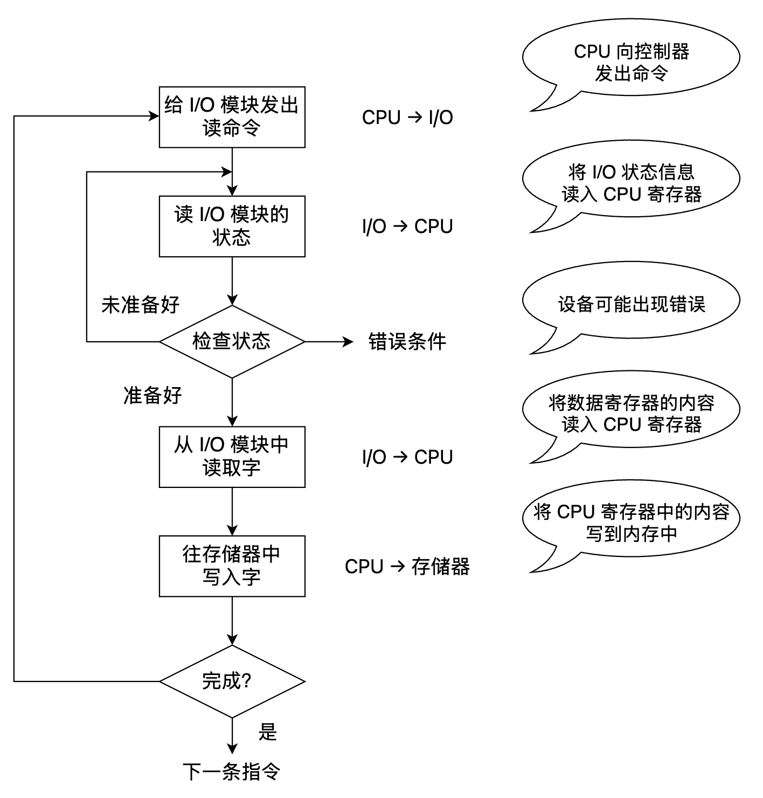

程序查询方式包含以下步骤：

1. **查询**：CPU 定期查询或检查 I/O 设备的状态寄存器，查看设备是否准备就绪。
2. **判断**：如果设备未就绪，CPU 会继续执行其他任务或持续轮询；如果设备就绪，则进行数据传输。
3. **数据传输**：CPU 直接与 I/O 设备交换数据，可以是读操作或写操作。
4. **结束**：数据传输完成后，CPU 继续执行其他任务，同时继续轮询 I/O 设备状态。

#### 3.2 程序中断方式

在程序中断方式中，当 I/O 设备 **准备好** 进行数据传输时，会触发一个 **硬件中断来通知** CPU。CPU 会暂停当前正在执行的任务，处理中断，然后恢复执行被中断的任务。

相比于轮询方式，CPU 在执行程序中断之前不需要一直检查 I/O 设备的状态，这提升了效率。

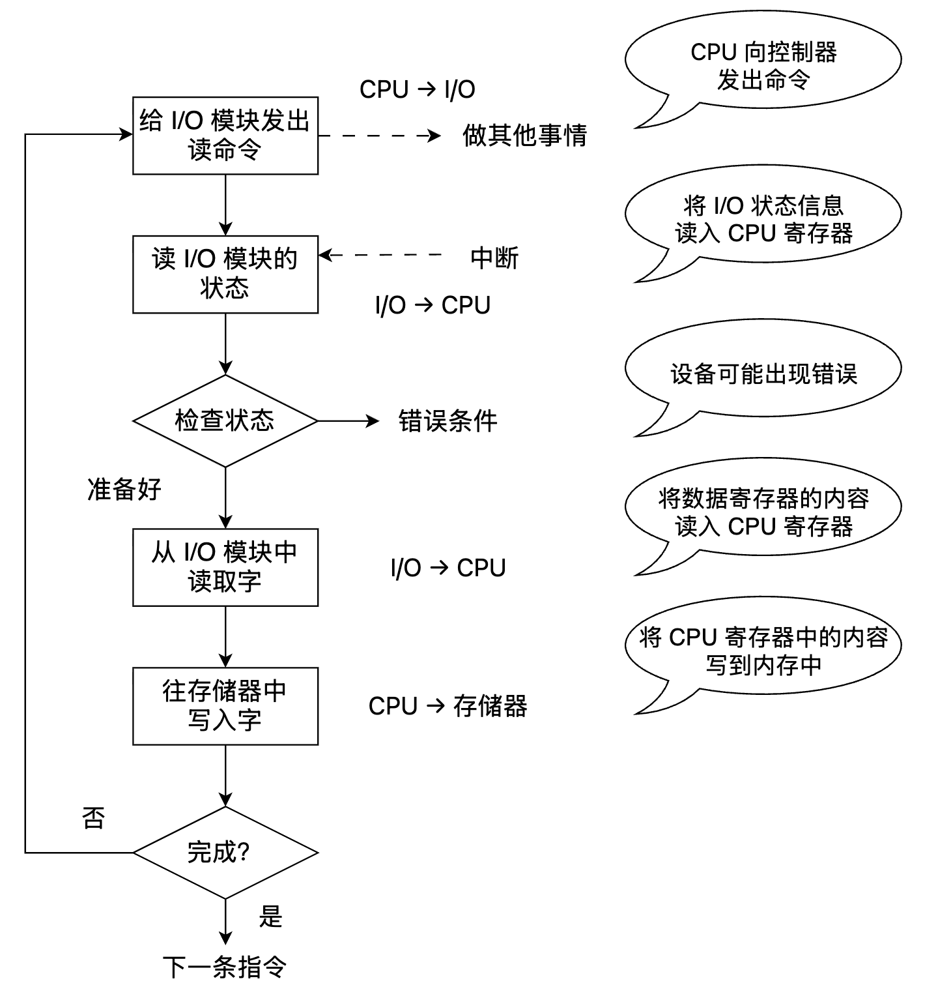

基本概念

- 系统中断向量：系统中断向量是一个指向中断处理程序入口地址的指针。
- 中断向量表（Interrupt Vector Table, IVT）：
  - IVT 是一个数据结构，它将中断号映射到中断处理程序的地址。
  - 每个中断向量都包含中断处理程序的入口地址。
- 中断服务程序（Interrupt Service Routine, ISR）：中断处理程序是一段特殊的代码，用于响应特定的中断事件。
  - 保存被中断程序的上下文（寄存器状态等）。
  - 处理中断事件，例如读取硬件设备的数据、响应软件错误等。
  - 恢复被中断程序的上下文，使程序能够从中断点继续执行。

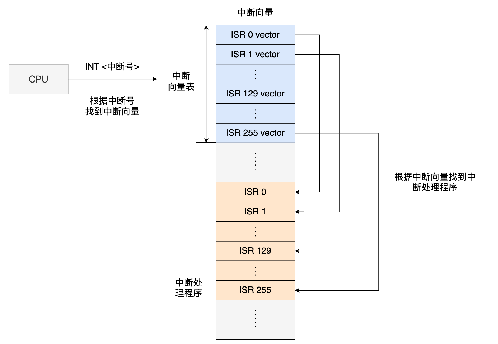

CPU 可以通过 `INT <中断号>` 指令来执行特定的中断。当中断发生时，CPU 会根据 **中断向量表基址寄存器**（IVTBR）查找中断向量表的起始地址，再使用 **中断号**（中断类型）作为表下标找到相应的中断向量。然后，CPU 会使用中断向量中的地址，跳转到对应的中断处理程序执行。

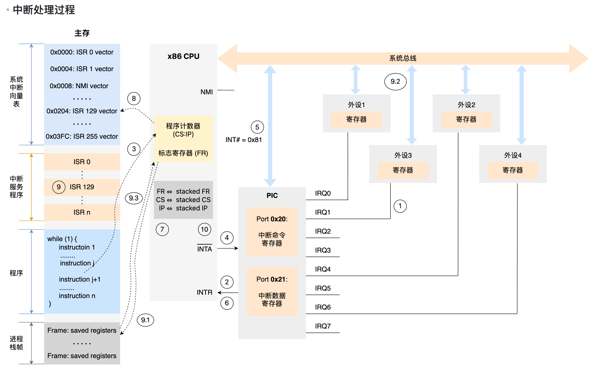

上图给出了一个详细的计算机中断处理过程的图例。不同计算机的中断处理过程不同，考察该知识点的题目也经常没有统一的标准。这里说明一个比较详细全面的过程，可以帮助大家应付绝大多数相关考题：

1. 中断触发：
   - 外设向计算机发送一个 IRQ（中断处理请求）。
2. 中断识别：
   - 处理器完成当前指令的执行，并开始中断处理过程。
   - 处理器检查确定哪个中断被触发。如果中断使能，处理器会响应这个中断信号。
3. 中断屏蔽：
   - 在执行中断服务程序之前，处理器会禁止或优先级屏蔽进一步的中断，以防止中断处理程序被其他中断打断。
     - 如果是 单级中断：直接关中断
     - 如果是 多重中断：设置中断屏蔽字，要屏蔽比当前中断优先级更低的中断
4. 保存断点：
   - **硬件** 会保存当前任务的位置和状态，通常包括程序计数器（PC）、程序状态字（PSW）和其他必要的寄存器，以便中断处理完成后能够恢复。
5. 中断服务寻址：
   - 根据中断号在 中断向量表中找到中断向量。
6. 执行中断服务程序：
   - 处理器根据中断向量跳转到相应的中断服务程序（ISR），中断服务程序包含以下内容：
     - 保存现场：程序使用的通用寄存器。
     - 处理中断事件（核心业务逻辑）
     - 恢复现场：恢复之前保存的现场来恢复中断之前执行的任务。
     - 中断返回（开中断、恢复断点）：执行一条专门的中断返回指令（比如 IRET 指令），该指令将程序计数器（PC）和程序状态字（PSW）等恢复到中断前的值，然后继续执行中断之前的程序。

对于中断处理过程，大家需要注意两点：

- 断点 和 现场 的区别。
- 哪些步骤是硬件完成的，哪些步骤是软件完成的。

下图给出了软硬件在中断处理过程中的职责，与上述过程相对应：

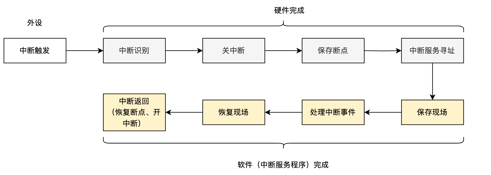

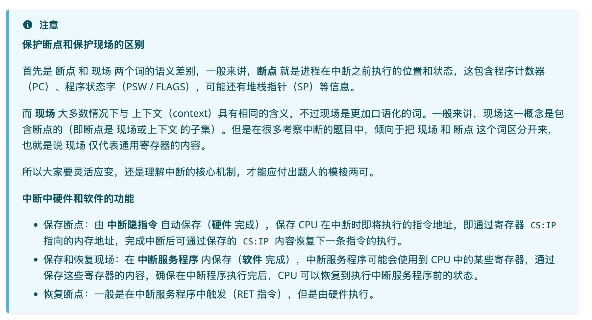

##### 单级中断

若 CPU 在执行中断服务程序的过程中，又 **出现了新的更高优先级** 的中断请求，而 CPU 对新的中断请求 **不予响应**，则这种中断称为单重中断。

上文我们提到的 中断处理过程就是以单级中断为例的。对于单级中断，中断控制非常简单，直接使用 FLAGS 寄存器中的 IF 标志位即可：

- **IF = 1**（中断使能）：**允许** CPU 响应中断请求（IRQ）。
- **IF = 0**（中断禁止）：CPU **忽略** 外设或中断源发出的中断请求。

##### 多重中断

多重中断，也称为中断嵌套，是指在 CPU 执行中断服务程序的过程中，若出现新的 **更高优先级的中断请求**，CPU 能够 **暂停** 当前的中断服务程序，转而 **处理新的中断请求**。这种机制允许系统更高效地响应高优先级事件。

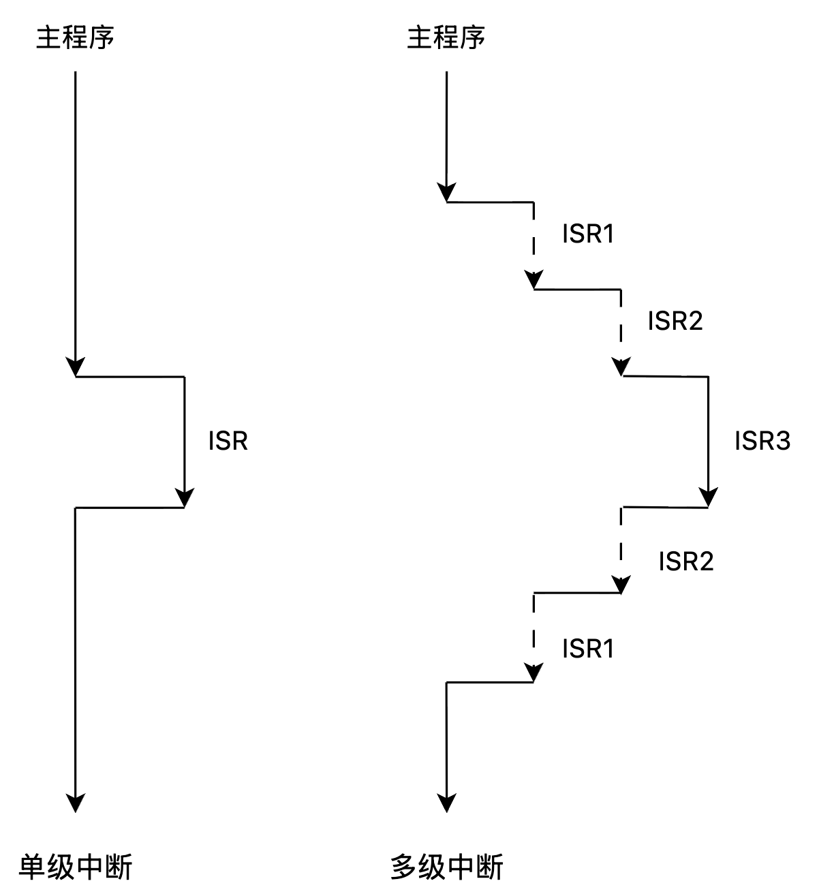

要实现多重中断，**CPU** 必须满足以下条件：

- **开中断设置**：在中断服务程序中，需提前设置开中断指令，以允许更高优先级的中断请求被响应。如果中断服务程序中未开启中断，则新的中断请求将被延迟处理。
- **优先级机制**：高优先级的中断源有权打断低优先级的中断源。系统中通常通过硬件或软件定义中断优先级，以确保关键任务优先得到处理。

##### 中断屏蔽

中断屏蔽技术用于 **动态调整中断处理的优先级**。每个中断源对应一个 **屏蔽触发器**，触发器的 **值为 1** 表示屏蔽该中断源的请求， **值为 0** 表示允许该中断源正常申请。所有屏蔽触发器组合形成一个屏蔽字，存储在屏蔽字触发器中，用于控制中断请求的接受与否。

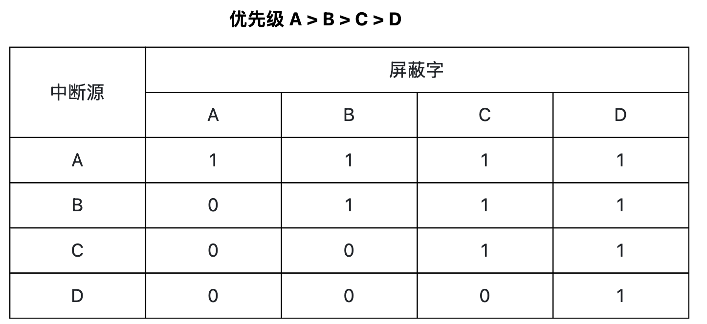

如上图所示，屏蔽字的每一位对应一个中断源，控制在执行某个中断服务程序时 **是否屏蔽其他中断源的请求**。

例如，若中断源 B 的优先级高于 C 和 D，则在处理 B 的中断时，需屏蔽 B、C、D 的中断请求，屏蔽字可能设置为 0100。这种机制确保高优先级中断的执行不被低优先级中断干扰，同时允许更高优先级的中断嵌套。

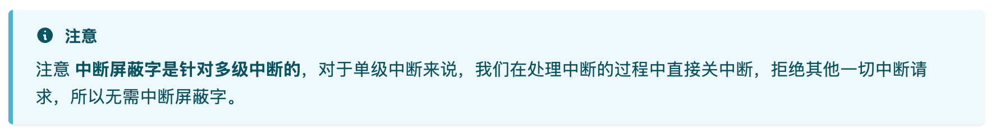

根据是否可以被屏蔽，中断分为 **可屏蔽中断**（Maskable Interrupt）和 **不可屏蔽中断**（Non-Maskable Interrupt, NMI）：

可屏蔽中断 

**可屏蔽中断** 是指可以通过设置屏蔽触发器或屏蔽字来暂时阻止其请求的中断。这类中断通常与非紧急事件相关，例如外部设备的数据传输请求。

系统可以通过屏蔽字动态调整哪些可屏蔽中断可以触发，以优化中断处理的优先级和系统资源分配。例如，在执行高优先级任务时，可以屏蔽低优先级的可屏蔽中断，以避免不必要的上下文切换。

不可屏蔽中断 

**不可屏蔽中断** 是指无法通过屏蔽字或屏蔽触发器阻止的中断，通常与系统关键事件相关，例如硬件故障、电源异常或严重错误。这类中断具有最高优先级，确保系统能够在紧急情况下立即响应。

由于其不可屏蔽的特性，NMI 的设计旨在保证系统的可靠性和安全性，但需要谨慎使用，因为它们会强制打断当前任务，包括其他中断服务程序。

在硬件设计中，可屏蔽中断和不可屏蔽中断通过 **不同的信号线** 连接到 CPU 的 **引脚** 上。以 x86 架构为例，NMI 信号通过特定的 NMI 引脚输入，而 INTR 信号由可编程中断控制器（如 8259A）管理，分别管理不同类型的中断：

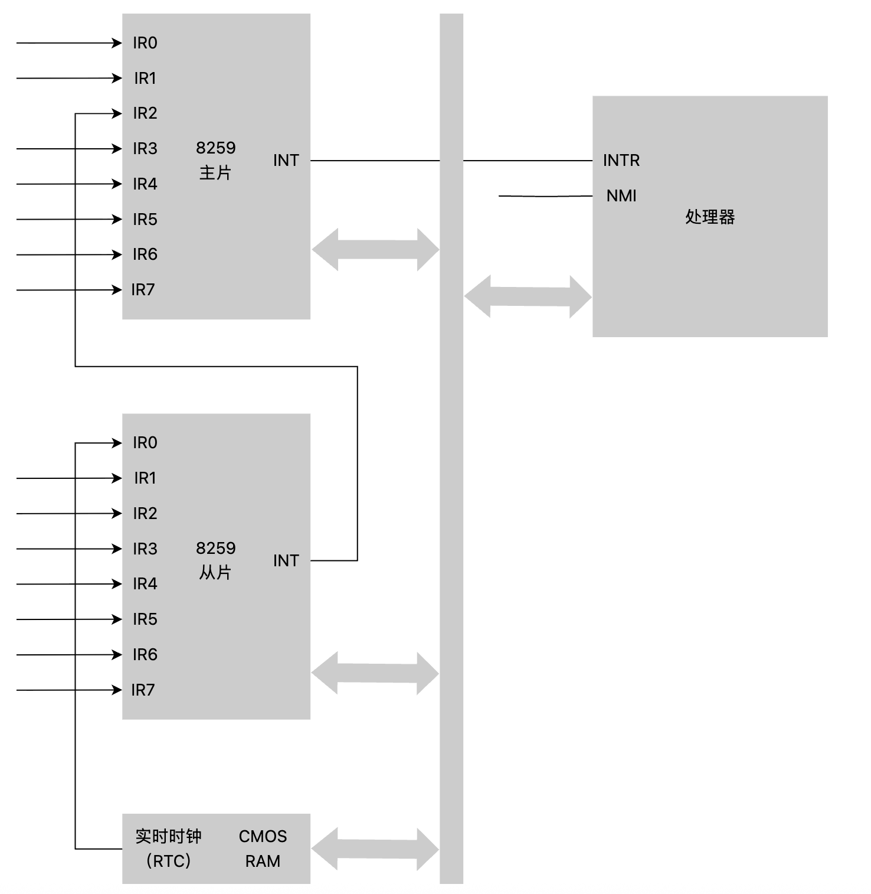

- INTR：接收 **可屏蔽** 中断，处理常规外设中断，如串口通信、USB 设备插拔或定时器中断。系统通过屏蔽字动态控制 INTR 的优先级和响应时机。
- NMI：接收 **不可屏蔽** 中断，处理严重错误，如内存校验错误、电源失效等。

#### 3.3 DMA方式

DMA（Direct Memory Access，直接内存访问）是一种计算机系统的 I/O（输入/输出）方式，它允许 **外部设备直接访问主内存** 而无需 CPU 的干预。

有了上面的 **程序中断方式**，虽然在 **一定程度上** 实现了 CPU 和外设的并行工作，但并不完全并行。CPU 只是在外设的数据准备阶段可以去执行其他程序而不需要原地等待，在执行中断服务程序传输数据时仍要全程参与。因此如果是高速 I/O 设备，CPU 仍要频繁的暂停现行程序去处理中断。

DMA 方式就是为了解决程序中断方式的这种缺陷，它增加了 **“数据传输过程与主程序并行工作”** 的特点。

##### 原理

DMA 让数据传送直接在 **外设和内存之间** 开辟一条 **数据通路**，使得数据传送期间不再需要占用 CPU 时间处理中断、保护断点和恢复 CPU 现场等繁琐操作。

在 DMA 方式中，CPU **只参与预处理**（CPU 通过初始化程序来设置 DMA 控制器的各参数寄存器的初始值，如内存首地址、字计数值等）和**后处理过程**（传送完成后 CPU 会进行数据校验等工作）。通常适用于以块读写的设备。

> 这意味着在 DMA 方式下，CPU 的核心计算资源几乎不受数据传输的影响。

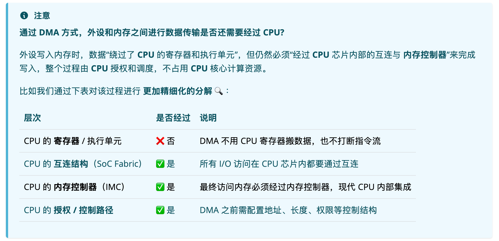

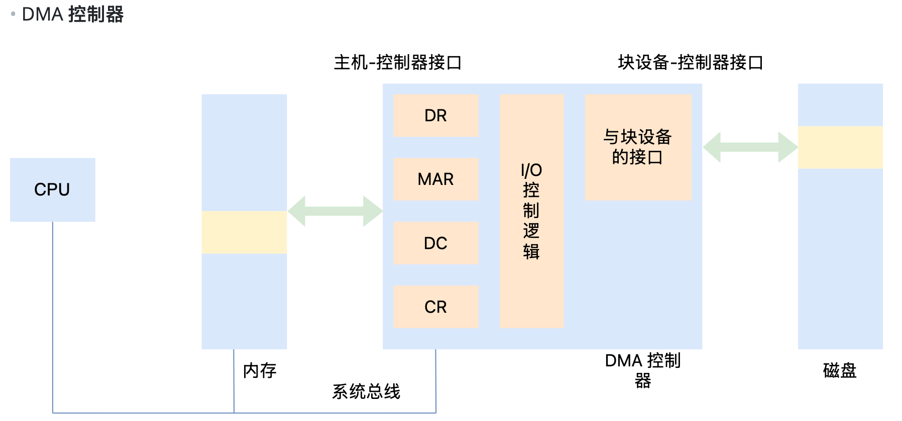

**DMA** 控制器由以下若干组件构成：

- 主机 - 控制器接口
  - **DR**（数据寄存器）：暂存从设备到内存或从内存到设备的数据。
  - **MAR**（内存地址寄存器）：暂存数据在内存中的地址。
  - **DC**（数据计数器）：表示剩余要读/写的字节数。
  - **CR**（命令/状态寄存器）：用来存放 **CPU** 发来的 I/O 命令，或设备的状态信息。
- I/O 控制逻辑
- 块设备 - 控制器接口

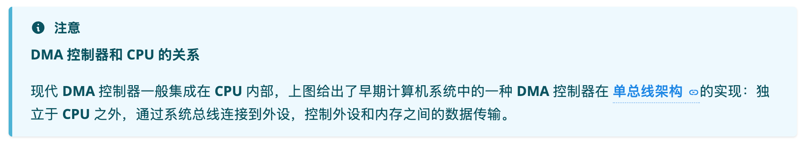

##### 步骤

DMA 方式与中断 I/O 方式一样，也是采用“请求 - 响应”的方式，只是中断 I/O 方式请求的是 **处理器的时间**，DMA 方式请求的是 **总线控制权**。如下图，为进程 P1 在磁盘和主存之间进行数据交换的过程示意图：

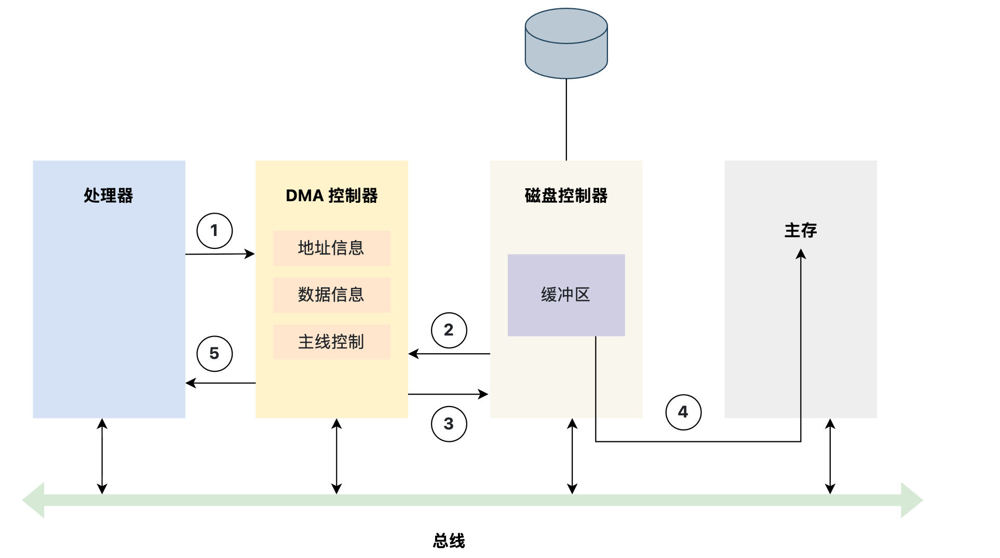

DMA 进行 I/O 传输包含如下过程：

1. **预处理**：在进行 DMA 传输之前，CPU 需要进行初始化设置，包含源地址、目标地址、数据传输长度以及数据传输方向。
2. **DMA** 请求：外设向 DMA 控制器发送 DMA 请求，并向 CPU 发送总线请求。
3. **获取总线控制权**：CPU 响应总线请求，发出总线响应信号，DMA 控制器接管总线控制权，进行 DMA 操作周期。
4. **数据传输**：DMA 控制器进行数据传输，这个过程不需要 CPU 的干预。
5. **释放总线控制权**：一旦 DMA 控制器完成数据传输，它会发出 DMA 传输完成信号，通知外设设备数据已经传输完毕。同时 DMA 控制器会释放总线控制权，使 CPU 可以继续执行其他任务。

##### 使用总线方式

在 DMA 方式中，DMA 接口和 CPU 共享主存，因此它们同时访问主存时，会出现总线的争用问题，为了实现主存的分时复用，有以下三种方法：

1. 总线独占（Bus Mastering）:
   - 在这种模式下，DMA 控制器会取得对总线的 **独占控制权**。在传输期间，CPU 将无法访问内存，因为总线已经被 DMA 控制器占用了。
   - 在独占期间，CPU 通常会执行不涉及内存访问的指令，如计算或寄存器操作，或者进入等待状态直到 DMA 操作完成。
2. 周期挪用（Cycle Stealing，也叫做循环窃取）:
   - 在循环窃取模式下，DMA 控制器会 **逐个窃取总线周期** 来进行数据传输，而不是一次性占据所有的总线周期。
   - 这意味着 CPU 在 DMA 控制器未使用总线时仍然可以访问内存。因此，DMA 和 CPU 会交替使用总线，通常不会显著影响 CPU 的操作。
3. 分时多路复用（Time-Division Multiplexing）:
   - 在分时多路复用模式下，DMA 控制器和 CPU 会在 **预定的时钟周期内轮流使用总线**。
   - 这种方式确保了 CPU 和 DMA 控制器都可以在它们的时隙内访问内存，但都无法全时段访问。

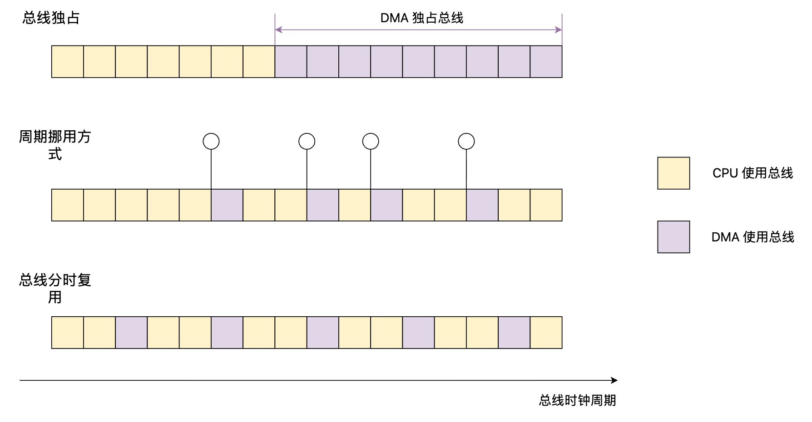

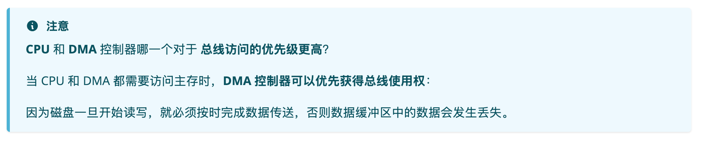


