# 操作系统概述

## 操作系统概念

### 一、概念

**操作系统** 是计算机系统中的一个核心软件组件，负责管理和控制计算机硬件，为用户和应用程序提供服务。

#### 1.1 操作系统特征

1. **并发**（Concurrence）：**操作系统** 具备同时处理和调度多个程序的能力。
2. **共享**（Sharing）：系统中的资源可供内存中多个并发的进程共同使用。
3. **虚拟**（Virtual）：将物理的实物虚拟为逻辑上的对应物。
4. **异步**（Asynchronism）：任务可以不按固定的顺序执行，因此同一操作的结果可能因执行的时序而异。

#### 1.2 目标和功能

- 作为用户语句计算机硬件系统之间的接口。
- 作为计算机系统资源的管理者。
- 实现了对计算机资源的抽象。

### 二、发展历程

**操作系统** 的发展历程经历了 手工操作、批处理操作、分时操作、实时操作 这四个阶段：

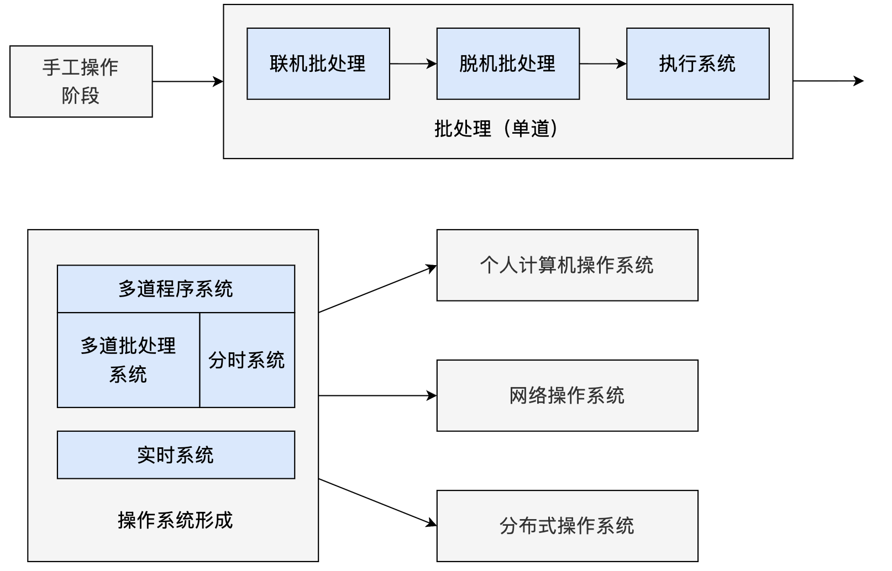

1. 手工操作阶段：
   - 时间背景：计算机的早期阶段。
   - 特点：没有 **操作系统**，用户直接使用计算机硬件。
   - 操作方式：用户在一个时刻将自己的程序载入计算机，然后执行。执行完毕后，将结果记录并释放计算机。
   - 问题：效率低，**CPU** 大部分时间处于空闲状态。
2. 批处理操作系统：
   - 单道批处理系统：
     - 特点：系统一次只执行一个任务。完成后再执行下一个。
     - 操作方式：用户的多个作业被收集到一个作业队列中，**操作系统** 按照队列的顺序逐一执行。
     - 问题：**CPU** 利用率仍然不高，因为在 I/O 操作时，**CPU** 仍然处于空闲状态。
   - 多道批处理系统：
     - 特点：在内存中同时加载多个作业，并使它们共享 **CPU**。
     - 操作方式：当一个作业进行 I/O 操作时，**CPU** 可以切换到另一个作业，从而提高了 **CPU** 的利用率。
     - 优势：提高了系统吞吐量和 **CPU** 利用率。

3. 分时操作系统：

- 时间背景：20 世纪 60 年代。
- 特点：允许多个用户通过终端同时访问计算机。
- 操作方式：**操作系统** 为每个用户提供了一个“虚拟机”的概念，使每个用户感觉自己独占了整个系统。实际上，系统在用户之间快速切换，为每个用户提供少量的 **CPU** 时间。
- 优势：提高了交互性和多用户并发访问的能力。
- 示例：**Unix** 操作系统在其初期就是一个分时系统。

4. 实时操作系统：

- 特点：系统必须在严格的时间限制内响应外部输入。
- 分类：
  - **硬实时系统**：不满足时限会导致严重的后果，如飞行控制系统。
  - **软实时系统**：不满足时限可能会降低系统的性能，但不会导致灾难，如多媒体播放器。
- 操作方式：实时 **操作系统** 的任务调度是基于优先级的，且通常会预先定义每个任务的执行时间。
- 优势：满足特定应用场景的实时需求，如嵌入式系统和工业控制系统。

### 三、操作系统引导

### 3.1 引到流程

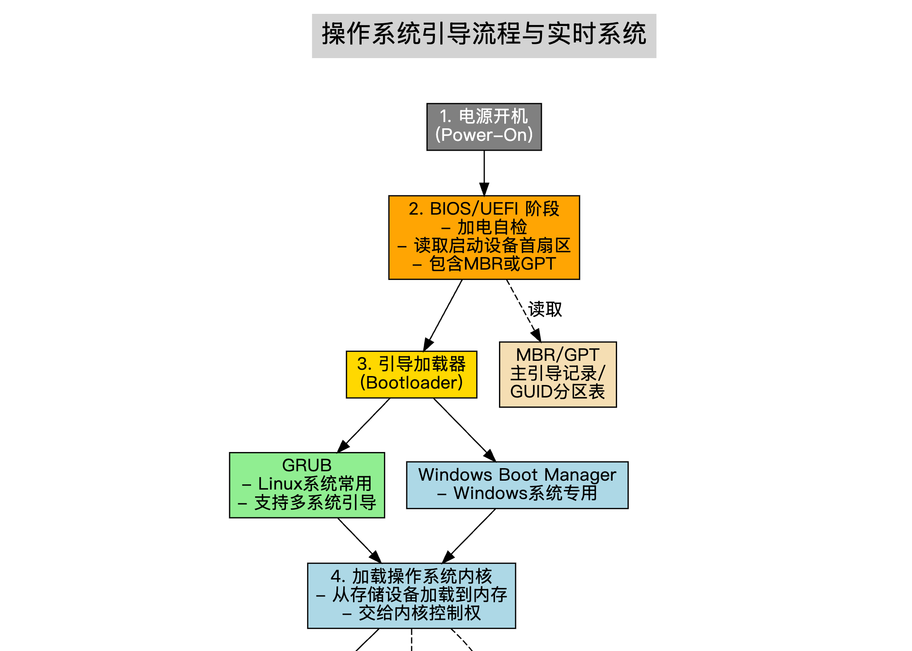

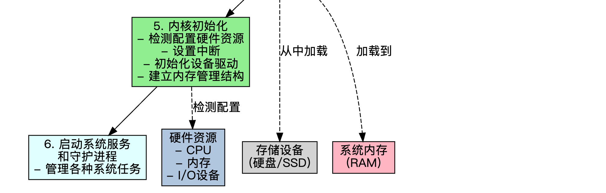

**操作系统** 引导的具体流程如下：

1. 电源开机（Power-On）：
   - 当你按下计算机的电源键时，电源开始向主板和各个硬件供电。此时，系统首先进行加电自检。这个过程是由存储在主板 **ROM** 芯片中的基本输入/输出系统（**BIOS**）或统一可扩展固件接口（**UEFI**）固件执行的。
2. BIOS/UEFI 阶段：
   - **BIOS/UEFI** 会读取启动设备的首扇区（**MBR** 或 **GPT**），其中包含 **引导加载器**（Bootloader）的代码。
3. 引导加载器（Bootloader）：
   - **引导加载器** 是一小段程序，它的主要任务是加载 **操作系统** 内核。
   - 常见的bootloader有
     - **GRUB**（Grand Unified Bootloader）：常用于 **Linux** 系统，功能强大，支持多系统引导。
     - **Windows Boot Manager**：**Windows** 操作系统的引导管理器。
   - **引导加载器** 会将 **操作系统** 内核从存储设备（通常是硬盘）加载到内存中。
4. 加载操作系统内核：
   - **操作系统** 内核是 **操作系统** 的核心部分，负责管理系统的各种资源，如内存、进程、设备等。**引导加载器** 将内核加载到内存后，会将控制权交给内核。
5. 内核初始化：
   - **操作系统** 内核开始运行并进行自我初始化。它会检测和配置系统上的硬件资源，例如设置中断、初始化设备驱动、建立内存管理结构等。
6. 启动系统服务和守护进程：
   - 在内核初始化后，它会启动一系列的系统进程或服务来管理各种系统任务。

---

## 程序运行环境

### 一、CPU运行模式

CPU的两种 **运行模式**：**内核模式**（又称为特权模式、系统模式或超级用户模式）和 **用户模式** 是操作系统设计中用于隔离系统关键任务与普通任务的机制，以提高系统的安全性和稳定性。

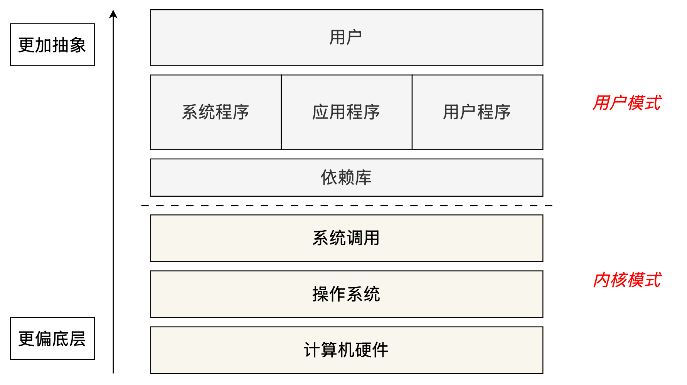

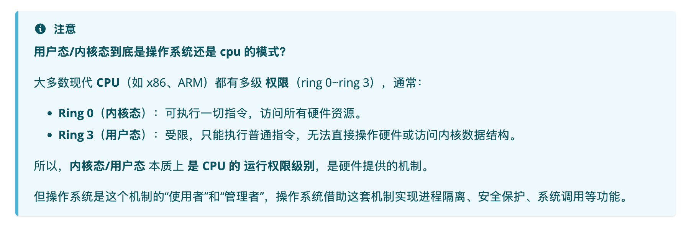

#### 1.1 内核模式

内核模式（Kernel Mode）是操作系统内核运行的环境，具有 **最高权限**，能够直接访问硬件和所有系统资源。

**特点**

- **完全权限**：内核模式下的代码可以直接操作硬件（如CPU、内存、I/O 设备等），执行特权指令。
- **核心功能**：操作系统内核负责管理进程、内存、文件系统和设备驱动等核心功能，这些都在内核模式下完成。
- **上下文切换**：用户模式程序通过系统调用进入内核模式，完成操作后返回用户模式。
- **高风险**：内核模式的错误可能导致系统崩溃，因此需要极高的稳定性。

特权指令 

**特权指令**（Privileged Instruction）是指在计算机系统中只能由操作系统 **内核态下** 的程序执行的特殊指令。这些指令通常涉及对硬件资源或系统关键功能的直接控制，具有较高的权限，常见的特权指令包含如下类型：

- **硬件控制**：如设置中断使能、修改处理器状态寄存器。
- **内存管理**：如修改页表、设置内存保护。
- **进程管理**：如创建或终止进程、更改进程优先级。
- **I/O 操作**：直接访问硬件设备或端口。
- **系统调用相关**：如切换到内核态以执行系统服务。

#### 1.2 用户模式

**用户模式**（User Mode）是普通 **应用程序** 运行的环境，运行在 **受限的权限级别**。用户程序（如浏览器、文本编辑器等）通常在此模式下运行。

**特点**

- **权限受限**：用户模式下的程序无法直接访问硬件或核心系统资源（如内存、CPU 寄存器等），需要通过系统调用（System Call）请求操作系统服务。
- **隔离性**：每个用户程序运行在自己的地址空间，相互隔离，防止程序直接干扰其他程序或系统。
- **安全性**：由于权限受限，用户程序的错误（如崩溃）通常不会直接影响操作系统。
- **执行方式**：用户程序通过调用库函数或API间接与操作系统交互。

用户模式和内核模式是操作系统实现安全性和稳定性的核心机制。用户模式提供隔离和安全的环境运行应用程序，而内核模式负责核心资源管理和特权操作。两者通过系统调用等机制协作，共同完成计算任务。

### 二、系统调用

**系统调用**（system call）是运行在用户模式的应用程序与操作系统内核之间的 **接口**。当应用程序需要执行一些它在用户模式下不能直接完成的任务（如文件操作、网络通信、创建进程等）时，它可以通过系统调用来请求操作系统内核在内核模式下为其执行这些操作。

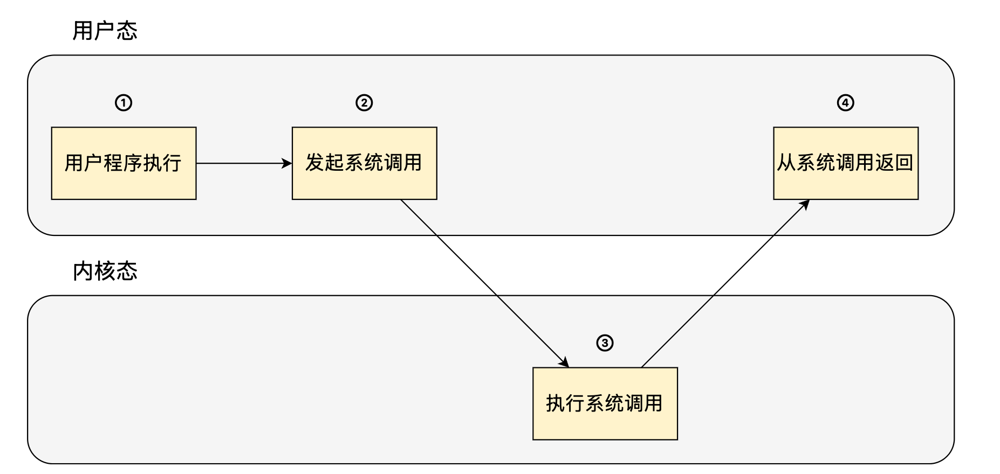

系统调用的过程如上图所示，从用户态进入内核态，完成后再返回用户态：

- 当用户程序执行系统调用（或触发中断）时，CPU 会自动 **切换到内核态**，这时控制权就交给了操作系统。
- 操作系统执行完后，再通过特定指令（如iret, sysret, eret）**切回用户态**。

**特点**

- **特权级的转换**：应用程序通常在用户模式下运行，而操作系统内核在内核模式下运行。系统调用提供了从用户模式到内核模式的一种安全的转换机制，这样内核可以代表应用程序执行特权操作。
- **系统调用的类型**：常见的系统调用类型包括进程管理（如创建、终止进程）、文件操作（如打开、读取、写入、关闭文件）、网络通信、设备控制、内存管理等。
- **性能开销**：执行系统调用涉及上下文切换，从用户模式到内核模式，然后再返回。这会带来一定的性能开销。因此，频繁地进行系统调用可能会影响应用程序的性能。

**举个实际的 x86 例子**

1. 用户程序执行 `int 0x80`（系统调用指令）；
2. CPU 自动：
   - 切换到 **Ring 0**（即内核态）；
   - 跳转到操作系统设定的系统调用处理函数；
3. 操作系统执行相关服务；
4. 执行 `iret` 返回用户程序；
5. CPU 自动：
   - 切回 **Ring 3**（即用户态）；
   - 恢复用户程序继续运行。

### 三、程序的链接

程序的链接是将编译后的代码模块（通常是目标文件）和其他所需的库组合在一起，生成一个可以执行的程序或库的过程。链接过程由 **链接器**（linker）完成。

根据所使用的库的链接方式，链接可以分为 **静态链接** 和 **动态链接**。

- 静态链接：
  - 当使用静态链接时，外部代码和库在链接阶段被 **整合到最终的可执行文件中**。这意味着，如果程序使用了某个库的函数，那么这些函数的代码会被复制到最终的二进制文件中。
  - 结果是一个较大的可执行文件，因为它包含了所有必要的代码以独立运行。
- 动态链接：
  - 使用动态链接时，外部库不会被直接嵌入到最终的可执行文件中。相反，程序包含了对动态链接库（如 Linux 中的.so 文件或 Windows 中的.dll 文件）的引用。当程序启动时，这些库会被 **动态加载** 到内存中供程序使用。
  - 动态链接的库通常称为动态链接库（Dynamic Link Libraries，DLL）或共享对象（Shared Object）。

#### 3.1 静态链接

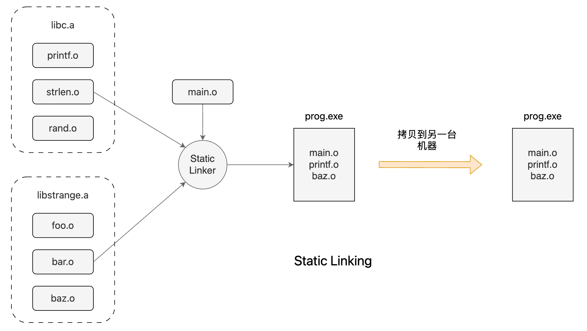

简单来说，对于 **静态链接**，**依赖** 直接作为 **二进制** 被打包进最后的 **可执行程序** 中，所以可以直接 **跨机器运行**（当然操作系统得一样）。

#### 3.2 动态链接

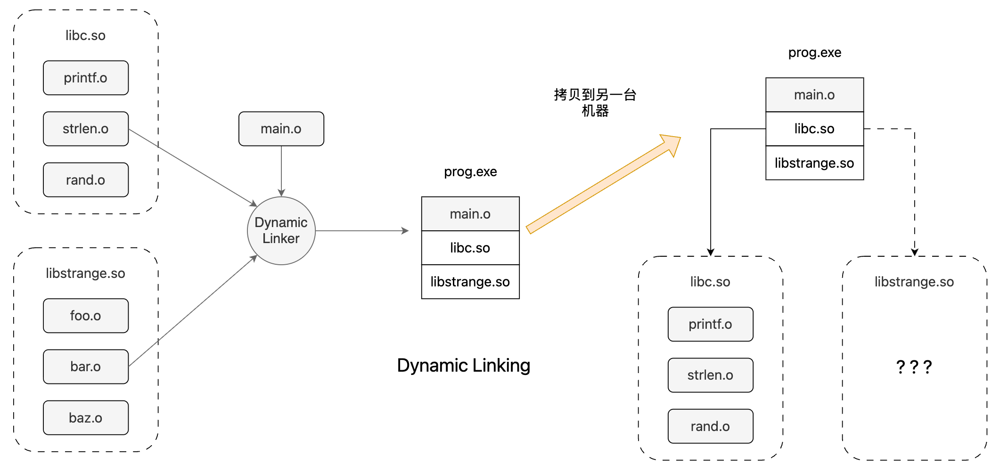

对于 **动态链接**，程序只保存依赖的库地址，依赖与可执行程序 **分开保存**，当程序执行时再去 **动态地加载依赖库**。对于动态链接，拷贝可执行程序到另一台机器不一定能直接运行，这需要另外一台机器也保存有相应依赖。

两者的区别如下表所示：

| 特点/链接方式    | 静态链接                                 | 动态链接                               |
| ---------------- | ---------------------------------------- | -------------------------------------- |
| **文件大小**     | 通常较大，因为库代码被整合到可执行文件中 | 通常较小，只包含对库的引用             |
| **运行依赖**     | 不需要外部库文件                         | 需要相应版本的动态链接库文件           |
| **存储效率**     | 较低，每个程序都有库的一个副本           | 较高，多个程序共享同一个库文件         |
| **更新便利性**   | 较差，更新库需要重新链接和分发程序       | 较好，只需更新库文件                   |
| **启动性能**     | 通常更快，无需加载外部库                 | 可能稍慢，需要加载外部库               |
| **跨版本兼容性** | 较好，因为程序包含了特定版本的库代码     | 可能出现问题，特别是当库接口发生变化时 |

### 四、程序的装入

程序的装入是指将程序或进程的代码和数据从磁盘加载到主存（RAM）中的过程，使其准备好被 CPU 执行。装入过程在程序执行周期中是必不可少的一部分，通常由操作系统中的 **装入器**（loader）完成。

#### 4.1 绝对装入

适用于 **单道程序环境**。在编译时，若知道程序驻留在内存的某个位置，则编译程序将产生绝对地址的目标地址。绝对装入程序按照装入模块的地址，将程序和数据装入内存。由于程序中的逻辑地址与实际地址完全相同，因此不需要对程序和数据的地址进行修改。

另外，程序中所用的绝对地址，可在编译或汇编时给出，也可由程序员直接赋予。而通常情况下在程序中采用的是符号地址，编译或汇编时在转换为绝对地址。

#### 4.2 可重定位装入

在 **多道程序环境** 下，多个目标模块的起始地址通常都从 0 开始，程序中的其他地址都是相对于起始地址的，此时应采用可重定位装入方式。根据内存的当前情况，将装入模块装入内存的适当位置。在装入时对目标程序中指令和数据地址的修改过程称为 **重定位**，又因为地位变换通常是在进程装入时一次完成的，故称为 **静态重定位**。

当一个作业装入内存时，必须给它分配要求的全部内存空间，若没有足够的内存，则无法装入。此外，作业一旦装入内存，整个运行期间就不能在内存中移动，也不能再申请内存空间。

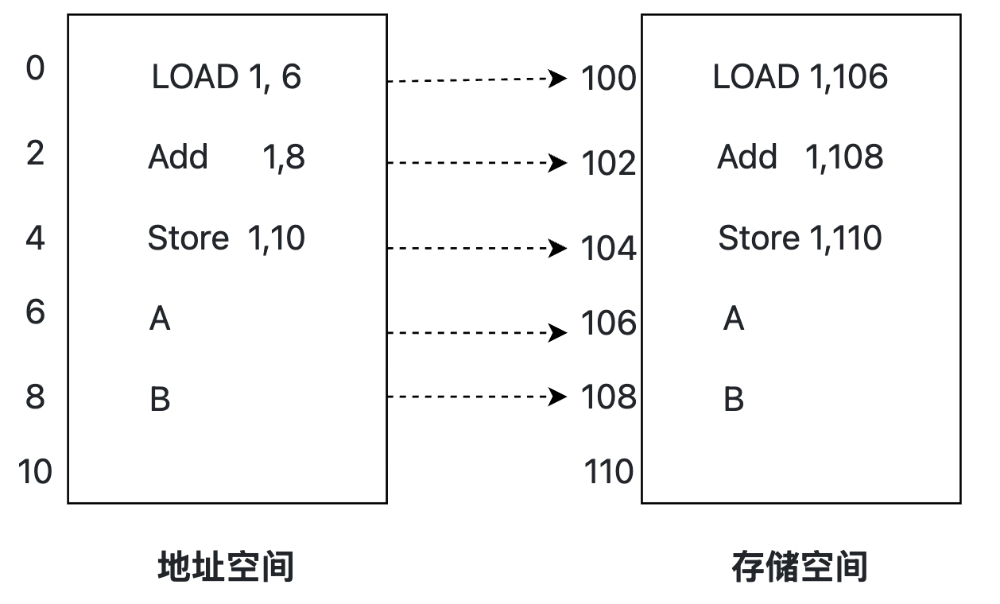

#### 4.3 动态运行时装入

也称为 **动态重定位**。装入程序把装入模块装入内存后，并不立即把装入模块的相对地址转换为绝对地址，而是把这种地址转换推迟到程序真正要执行时进行。因此，装入内存后的所有地址都是相对地址。这种地址需要一个重定位寄存器的支持。

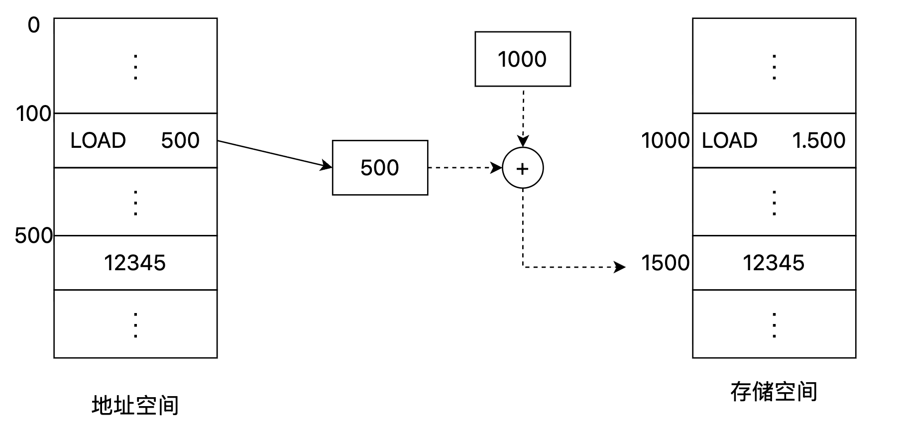

动态重定位的优点在于可以将程序分配到不连续的存储区；在程序运行之前可以只装入部分代码即可运行，然后在程序运行期间，根据需要动态申请分配内存。

---

## 操作系统结构

### 一、分层和模块化

操作系统的设计和结构在历史上经历了多种不同的方法和技巧，为了增加 **可维护性**、**灵活性** 和 **可扩展性**。**分层** 和 **模块化** 是操作系统设计中两种主要的技术方法。

- 分层结构：
  - **概念**：在分层的操作系统中，系统被划分为多个层次或“层”，每层都为其上的层提供服务，并依赖于其下的层。
  - 优点：
    - 每层只需与其直接的上下层进行交互，简化了设计和调试。
    - 提高了灵活性，因为改变某一层的实现不会影响到其他层。
    - 有助于保护和安全性，因为较低的层（如硬件访问层）被封装起来，上层代码不能直接访问。

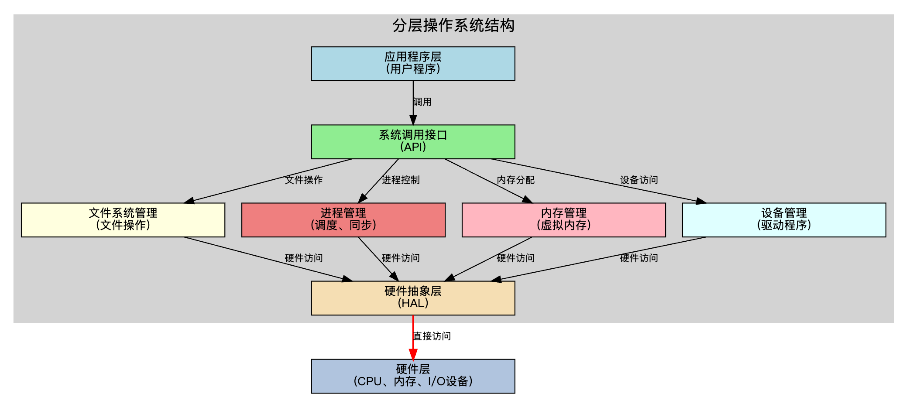

- 模块化结构：
  - **概念**：模块化操作系统基于模块的概念，每个模块都有一个特定的功能，各个模块之间的交互通过定义良好的接口进行。模块化与面向对象编程中的封装和抽象概念类似。
  - 优点：
    - 易于维护和更新。如果某个模块需要更改或修复，可以独立于其他模块进行。
    - 提高了可扩展性。新的功能或模块可以相对容易地添加到系统中。
    - 增加了系统的可靠性和稳定性，因为每个模块的功能都被限定在明确的边界内。

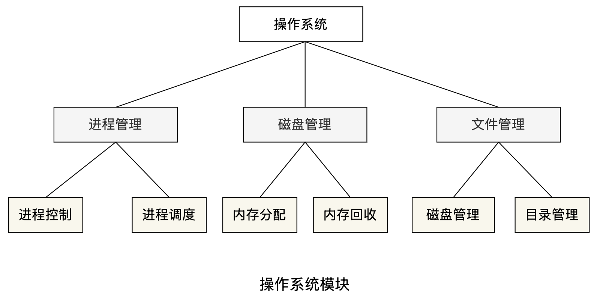

### 二、内核架构

#### 2.1 微内核

微内核（microkernel）是一种最小化的内核设计，只保留最核心的功能（如线程管理、虚拟内存、进程间通信等）在内核态运行，其他功能（如文件系统、设备驱动、网络协议栈等）以用户态服务的形式运行。

- 特点：
  - 只有最基本的服务（如基本的进程和线程管理、地址空间和 IPC）运行在 **内核态**。
  - 其他服务，如设备驱动、文件系统等，作为 **用户空间** 的独立进程运行。
  - 内核和服务间通过消息传递进行通信。
- 优点：
  - *更高的系统稳定性*。用户空间的服务（如驱动程序）如果崩溃，不会影响整个系统。
  - 更加灵活，允许在运行时更改或添加服务。
  - 更容易扩展和维护。
- 缺点：
  - 由于需要频繁的上下文切换和消息传递，通常 **性能会稍逊于宏内核**。
- **示例**：IOS 是基于微内核的系统。

#### 2.2 宏内核

宏内核（monolithic kernel）将所有操作系统功能集成在一个大的内核程序中，运行在内核态。

- 特点：
  - 在单一的地址空间中运行大部分系统服务，如设备驱动、文件系统、网络协议等。
  - 所有的内核服务都运行在 **内核态**。
- 优点：
  - 由于所有的服务都在同一个地址空间中运行，因此服务间的通信较快。
  - 传统上，宏内核系统比微内核系统性能更高。
- 缺点：
  - *如果内核中的一个部分失败，整个系统都可能崩溃*。
  - 随着功能的增加，内核可能会变得臃肿，导致维护困难。
- **示例**：传统的 UNIX 系统、Linux 都是基于宏内核的。

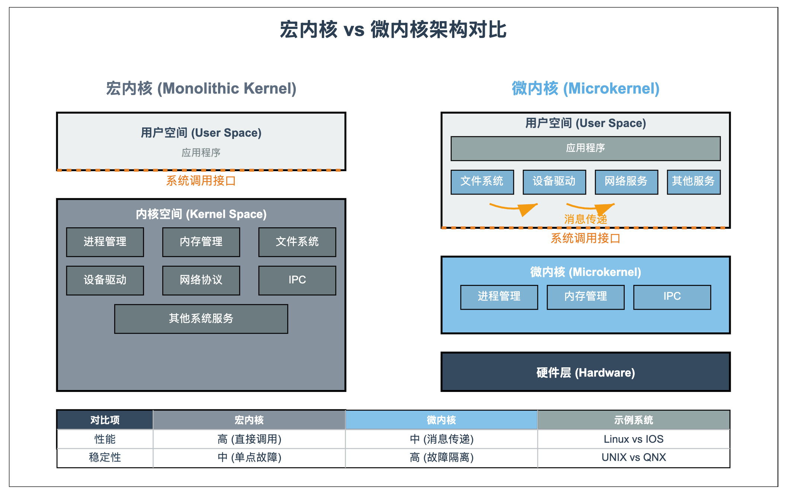

### 三、虚拟机

虚拟机（Virtual Machine, VM）是一种通过软件模拟真实计算机功能的 **虚拟化技术**，能够在一台物理主机上创建多个独立的虚拟计算机环境。每个虚拟机都具备与真实硬件相似的运行环境，可以运行独立的操作系统和应用程序，仿佛它们运行在专属的物理设备上。这种技术广泛应用于服务器整合、测试开发、跨平台应用等场景。

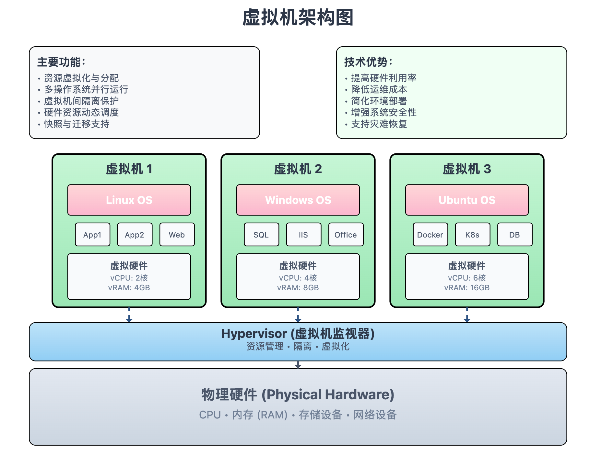

#### 3.1 虚拟机监视器

Hypervisor，也称为虚拟机监视器（Virtual Machine Monitor, VMM），是 **虚拟化技术** 的核心组件，运行在物理主机和虚拟机之间的中间软件层。它负责协调和管理多个虚拟机，使它们能够共享底层 **物理硬件资源**，同时保持彼此 **隔离**。Hypervisor 的主要职责包括：

1. **创建与管理虚拟机**：为每个虚拟机分配独立的 **虚拟化硬件资源**（如 CPU、内存、存储和网络）。
2. **硬件资源抽象**：通过虚拟化技术，Hypervisor 将 **物理硬件资源抽象化**，使每个虚拟机认为自己独占硬件资源，从而运行独立的操作系统。
3. **隔离与安全**：确保虚拟机之间的运行互不干扰，增强系统安全性。

**Hypervisor 的特权级**

Hypervisor 通常运行在比操作系统更高的 **特权级**（如硬件虚拟化支持的 **VMX root mode** 或 **Ring -1**），以便有效管理虚拟机及其资源。相比之下，虚拟机中的操作系统通常运行在较低的特权级（如 **Ring 0**）。这种特权级差异确保 Hypervisor 能够完全控制硬件资源并协调多个虚拟机的运行，而不会与虚拟机中的操作系统发生冲突。

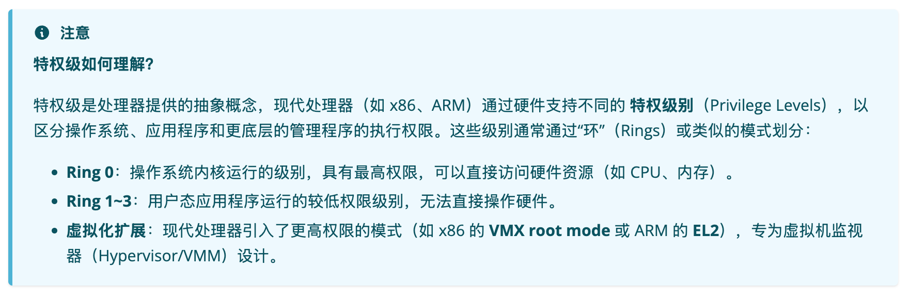
