# 内存管理

## 内存管理概念

### 一、内存管理

#### 1.1 基本概念

- [**虚拟地址** 和 **物理地址** 空间](https://www.csgraduates.com/constitution_principle/storage/virtual/#虚拟内存和物理内存)

虚拟地址（VA, Virtual Address）由指令中的 **地址字段** 给出，进程看到的都是虚拟地址。物理地址是内存单元在 实际内存硬件 中的真实位置。

- [**地址翻译**](https://www.csgraduates.com/constitution_principle/storage/virtual/#地址翻译机构)

地址翻译指的是在程序执行的过程中 **将虚拟地址翻译为物理地址**，地址变换由 内存管理单元（MMU, Memory Management Unit） 在硬件中完成，速度非常快。

- **内存共享**

共享内存（Shared Memory）是多个 **进程** 共享的 **内存区域**。它是最快的 **IPC**（进程间通信）机制之一，因为进程直接读写内存，无需进入内核态。但是，因为多个进程可以同时访问这些内存，所以可能需要某种 **同步机制**（如信号量）来防止竞态条件。

- **内存保护**

内存保护是现代操作系统中的一个 **核心功能**，用于防止一个进程访问另一个进程的 **内存空间**。这不仅保障了系统的稳定性，而且提高了安全性，因为它可以防止恶意软件损害其他进程或篡改其数据。

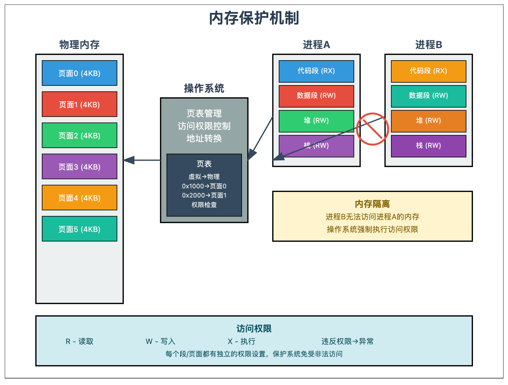

可以通过如下机制实现内存保护机制：

1. 分段与分页：
   - **分段**：内存被划分为不同的 **段**，每个段都有其起始地址和长度。段常常用于表示高级的数据结构，如函数或对象。
   - **分页**：内存被划分为固定大小的 **页面**，例如 4KB。操作系统为每个进程维护一个 **页表**，来映射其虚拟地址到物理地址。
2. **访问权限**：每个段或页面都有与之相关的访问权限。例如，一个页面可能被标记为只读，这意味着任何尝试写入该页面的操作都会引发一个异常。
3. **隔离**：由于每个进程都有其独立的地址空间，所以一个进程不能直接访问另一个进程的内存。这为每个进程提供了一种形式的 **隔离**，确保了一个出错的进程不会影响其他进程。

#### 1.2 管理方式分类

在现代操作系统中，**内存管理方式** 大体可以归纳为两类：**连续分配** 和 **离散分配**。所谓 **连续分配**，是指操作系统为进程分配一整段连续的内存区域。这种方式实现简单、开销较小，但灵活性不足。典型的连续分配方式包括三种：单一连续分配、固定分区分配 以及 动态分区分配。

相比之下，**离散分配** 方式允许进程占用的内存空间是 **不连续的**，这使得内存利用率和管理灵活性显著提高。典型的离散分配方式也包含三种：页式、段式、段页式。

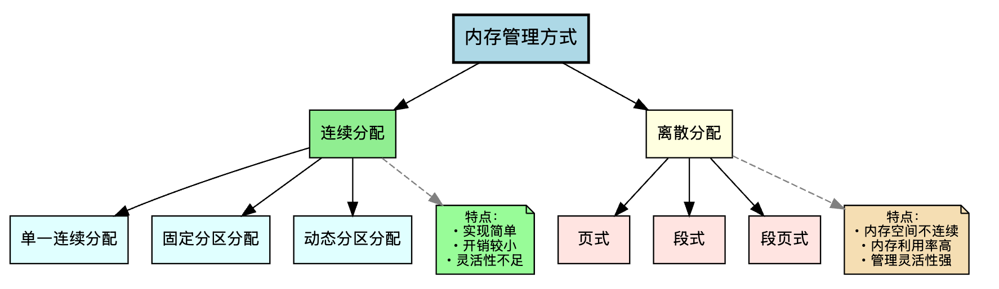

后文会具体介绍这几种内存管理方式的细节。

### 二、连续分类管理方式

#### 2.1 单一连续分配

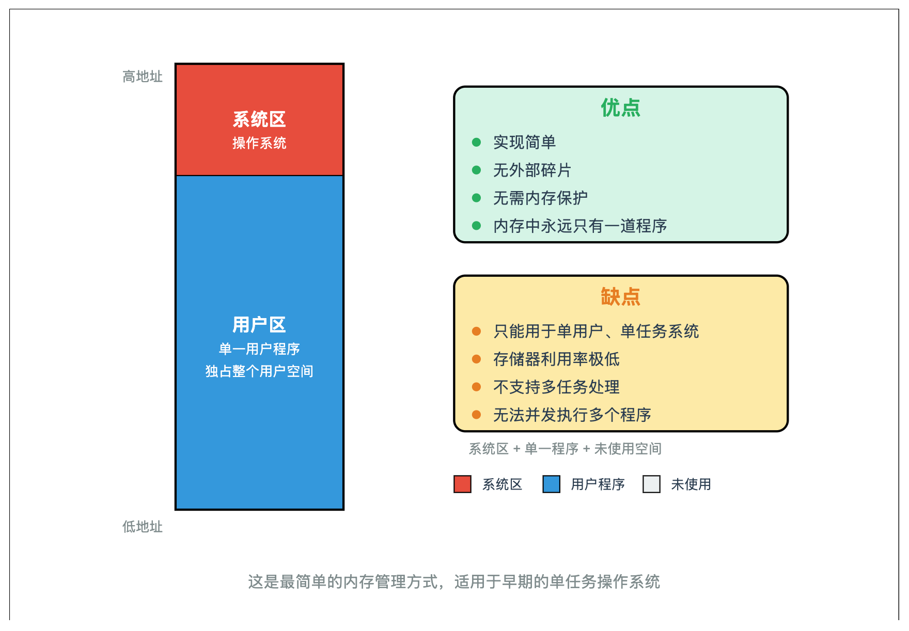

内存在此方式下分为 **系统区** 和 **用户区**，系统区仅供操作系统使用，通常在高地址部分；在用户区内存中，仅有一道用户程序，即整个内存的用户空间都由该程序独占。

这种方式的优点是 **简单、无外部碎片**，无需进行内存保护，因为内存中永远只有一道程序。缺点是只能用于 **单用户、单任务** 的操作系统中，存储器的利用率极低。

#### 2.2 固定分区分配

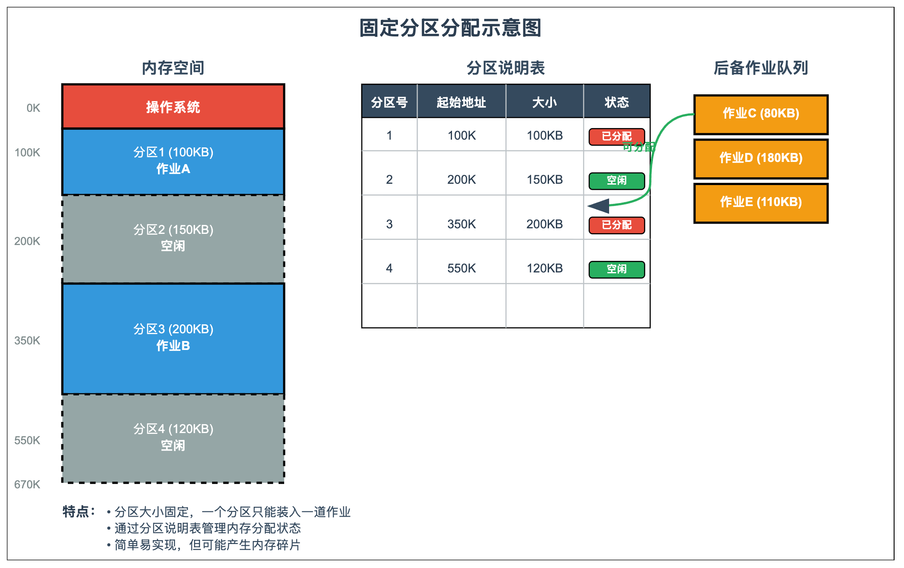

固定分区分配是最简单的一种 **多道程序存储管理** 方式，它将用户内存空间划分为若干 **固定大小的区域**，每个分区只装入一道作业。当有空闲分区时，便可再从外存的后备作业队列中选择适当大小的作业装入该内存，如此循环。

为了方便内存分配，通常将分区按大小排队，并为之建立一张 **分区说明表**，其中各表项包含每个分区的起始地址、大小和状态。当有用户程序需要装入时，便检索该表，以找到合适的分区基于分配并将其状态设置为“已分配”；未找到合适分区时，则拒绝为给程序分配内存。

#### 2.3 动态分区分配

在 **固定分区分配** 中，内存被预先划分为若干大小固定的区域。 这种方式实现简单，但也带来了一个明显问题：**分区大小是静态的，而作业大小是动态的**。

为了解决固定分区“尺寸僵化、内存利用率低”的问题，操作系统引入了 **动态分区分配**。

动态分区分配的基本思想是： **不再事先划分固定大小的分区**，而是将整个用户内存空间视为一块 **连续的可分配区域**，在程序装入时才根据其实际需要动态地划分内存。

当进程请求内存时，操作系统从当前的空闲内存中划出一块连续区域分配给该进程； 当进程结束或释放内存时，该区域重新成为空闲内存，可供后续进程再次使用。

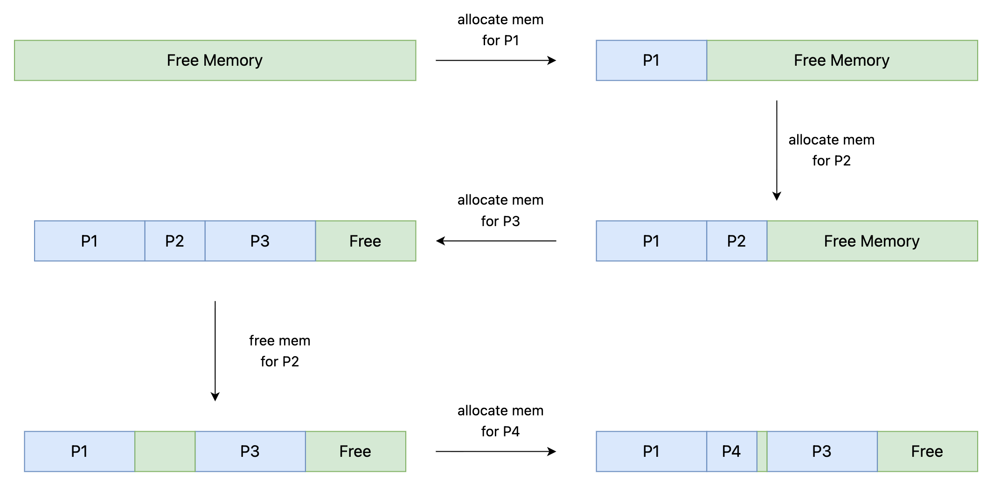

通过这种 **动态、按需分配** 的方式，内存从逻辑上被划分为两类区域：

- **已分配区**：正在被内核或进程占用的内存
- **空闲区**：尚未分配、可供后续进程使用的内存

如下图所示，其中 **内核内存（kernel memory）** 和 **进程内存（process memory）** 属于已分配区域，其余部分为系统当前的空闲内存。

为了管理这些不断变化的空闲区域，操作系统通常维护一张 **空闲分区表**（或空闲链表），用于记录每一块空闲内存的：

- 起始地址
- 大小

示意如下：

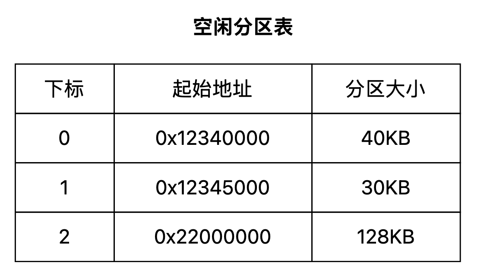

当进程申请内存时，操作系统会遍历 **空闲分区表**，按照预定的 **[适应算法](https://www.csgraduates.com/operating_system/memory/concepts/#适应算法)**（如首次适应、最佳适应等），从中选择一块满足需求的空闲区域，并完成内存分配。

> 不同适应算法的选择，会直接影响系统中 **外部碎片** 的产生情况，这一点将在后续章节中详细讨论。

##### 内存碎片

动态分区分配相比固定分区分配，提高了内存使用率，但是仍然无法避免内存碎片的问题，下图以一个实例说明了在动态分区分配过程中内存碎片产生的过程：

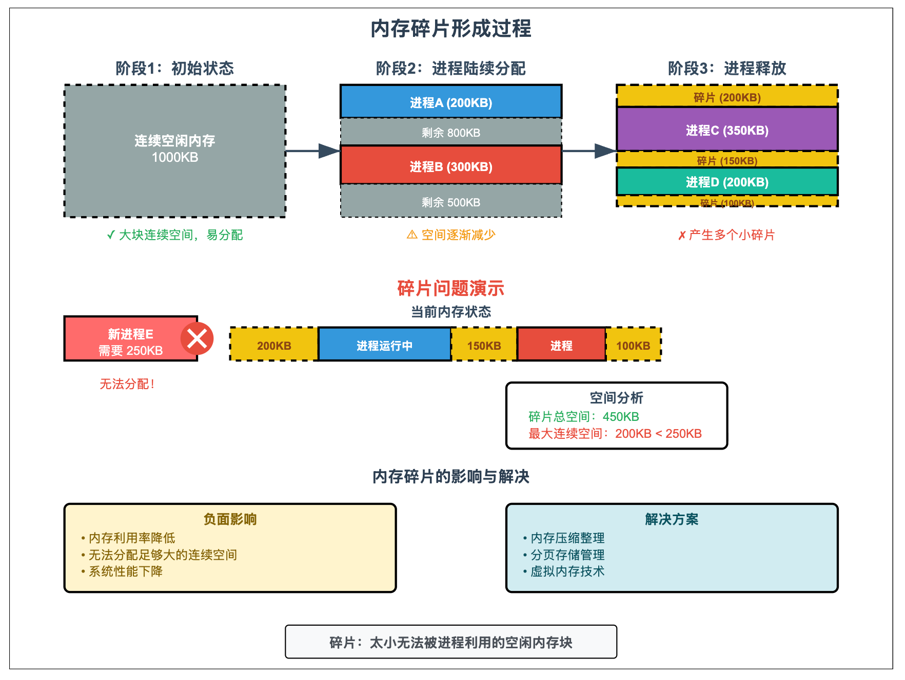

由于各进程所需的内存大小各不相同，在进行内存分配时经常会在已分配的块之间留下 **内存碎片**。

所谓内存碎片，指的是那些 **尺寸过小、无法满足任何进程实际需求** 的空闲内存块。因为进程的内存申请往往大于等于某个最小阈值，这些零散且容量不足的碎片就无法被再次利用，导致可用内存实际被浪费。

##### 适应算法

内存空间中的空闲区域可能大小不一，且分布在内存中不同的位置，操作系统使用 **空闲块表** 来记录这些空闲区域的信息。

当进程申请一块新的内存时，必须从已有的空闲空间中选出一块分配给进程。动态分区的分配策略主要包含四种算法：**首次适应**（First Fit）、**临近适应**（Next Fit）、**最佳适应**（Best Fit）、**最坏适应**（Worst Fit）。

- First Fit（首次适应）：从头遍历空闲块表，**找到第一个足够的空闲块** 分配给进程。
- Next Fit（临近适应）：**从上次分配的位置的下一个位置开始查找**，找到的第一个足够大的分区分配给进程。如果到了表尾没找到，就从头循环，直到找到或遍历一圈失败。
- Best Fit（最佳适应）：遍历整个空闲块表，找到一个 **利用率最高** 的空闲块给进程。
- Worst Fit（最坏适应）：与最佳适应的目标相反，找到一个 **利用率最低** 的空闲块给进程。

适应算法中的利用率计算 

假设进程申请的内存大小为 **P**，空闲块大小为 **F**，则利用率为：

举个实例例子，假设空闲块序列 `[8, 22, 20, 14, 10, 24]`，请求大小 **P = 16**。则四种分配算法会得到不同的结果：

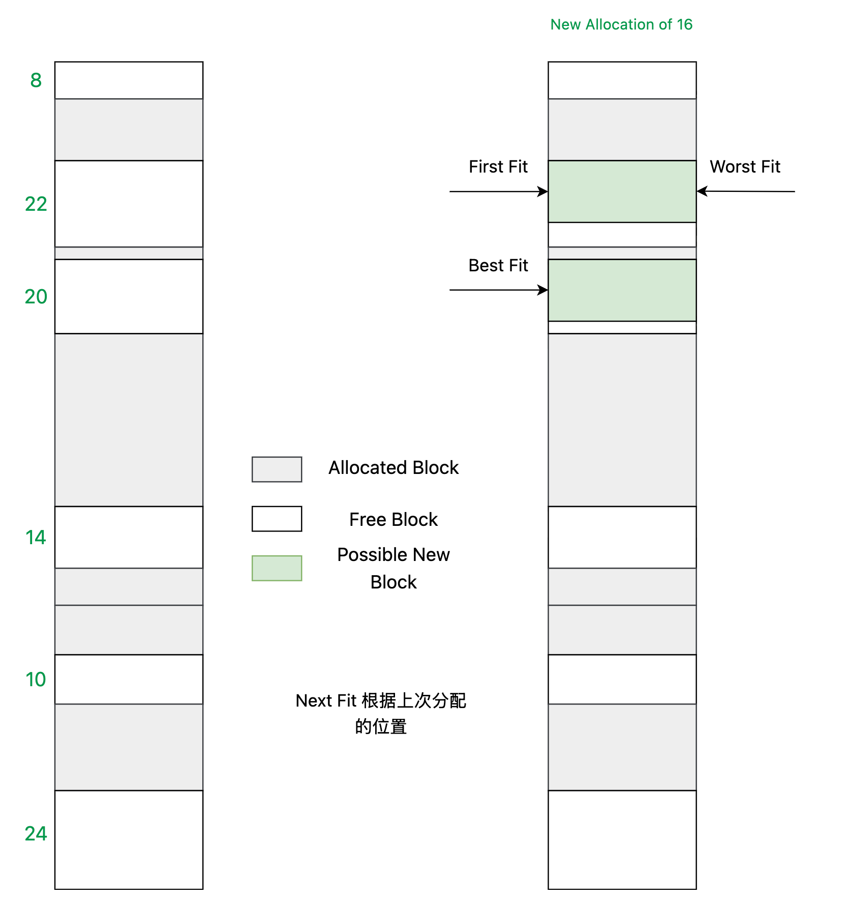

四种适应算法在该例子的对比如下表所示：

| 算法                      | 查找方式                                                     | 本例选择结果                                                 |
| ------------------------- | ------------------------------------------------------------ | ------------------------------------------------------------ |
| **First Fit（首次适应）** | 从空闲块表的头开始，找到第一个 ≥ P 的分区。                  | `22`（第一个 ≥16 的块）                                      |
| **Next Fit（邻近适应）**  | 从**上一次查找结束时的游标位置的下一个空闲块**开始顺序查找，找到第一个 ≥ P 的分区；若查到表尾仍未找到，则从表头继续查找一轮。 | 结果取决于“上一次查找游标”的位置： • 游标在 `8` 处 → 选 `22` • 游标在 `22` 处 → 选 `20` • 游标在 `20` 处 → 选 `24` |
| **Best Fit（最佳适应）**  | 遍历整个空闲块表，找到能容纳 P 且**最小的**分区（利用率最高）。 | `20`（最小的 ≥16 的块，利用率 16/20=80%）                    |
| **Worst Fit（最坏适应）** | 遍历整个空闲块表，找到能容纳 P 且**最大的**分区（利用率最低）。 | `24`（最大的 ≥16 的块，利用率 16/24≈66.7%）                  |

内存回收过程 

当对 **动态内存** 进行回收时，需要检查是否可以有相邻 **空闲块** 合并，如果可以合并的话，合并后需要更新起始地址和大小。

如果没有相邻的空闲块需要合并，直接将释放的内存块作为 **独立空闲块** 插入空闲块表。

##### 堆内存分配

动态分区分配最初用于操作系统在物理内存中为进程分配连续空间；随着虚拟内存的引入，进程不再需要连续的物理内存，该机制在 OS 层面被分页取代；但其在连续地址空间中按需划分和回收内存的思想，被继承并演化为进程堆内存的分配机制。

1. **早期 OS（无虚拟内存）** 动态分区用于在**物理内存**中为进程分配连续空间。
2. **引入虚拟内存** 分页机制消除了进程对连续物理内存的需求，OS 层面的动态分区逐渐退出。
3. **思想下沉到用户态** 动态划分、回收连续空间的思想，被用于管理进程的**堆内存**，形成现代内存分配器。

参考 [进程内存空间](https://www.csgraduates.com/operating_system/process/process_thread/#进程内存空间)，当一个进程使用操作系统提供的 `malloc` 接口时，它实际上是在向进程的堆（heap）区域请求一块连续可用的虚拟地址空间，当进程使用 `free` 接口时，实际上是在堆上释放刚刚申请的动态空间。操作系统或运行时库会负责管理堆空间，其底层机制正是动态分区分配思想的延续。

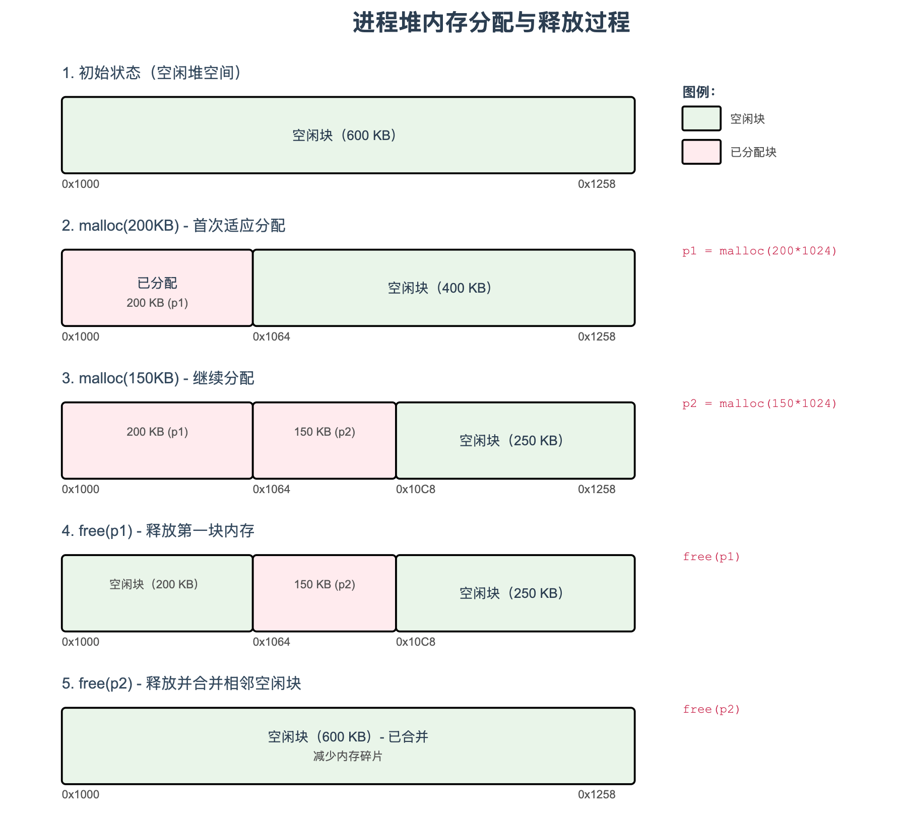

具体来说，堆内存管理器维护着一个空闲内存块的列表（或类似数据结构），当进程申请内存时，管理器会根据 [适应算法](https://www.csgraduates.com/operating_system/memory/concepts/#适应算法) 寻找足够大的空闲块，将其一部分分配给请求，剩余部分可能仍作为空闲块保留。当进程释放内存时，该内存块会被回收并合并相邻的空闲块，以减少碎片。

##### 伙伴算法

伙伴算法（Buddy Algorithm）将内存分为大小为 2 的幂次方的块（例如，1KB、2KB、4KB、8KB 等）。当需要分配内存时，算法寻找合适的块；如果没有合适的块，就将更大的块一分为二，直到满足需求。释放内存时，算法尝试将相邻的“伙伴”块合并为更大的块，以减少 **内存碎片**。

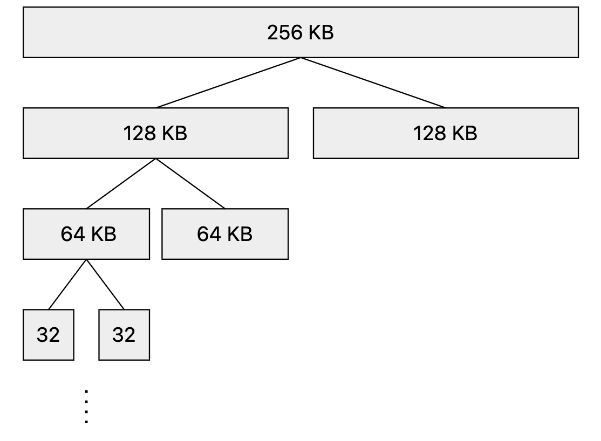

**内存分配过程**

- 假设需要分配大小为*S*的内存，算法找到最小的大小为2^*n*（n 为正整数）块，使得2^*n*≥*S*。
  - 如果有，直接分配该块。
  - 如果没有，查找更大一级（2^(*n*+1)）的空闲块，将其一分为二，生成两个2*n*的伙伴块：
    - 一个用于分配。
    - 另一个加入 2^*n* 的空闲链表。
  - 如果 2^(*n*+1) 也没有空闲块，继续向上查找，直到找到合适大小的块或失败。
    分配后更新空闲链表。

下图包含一个使用伙伴算法的 **内存分配实例**：

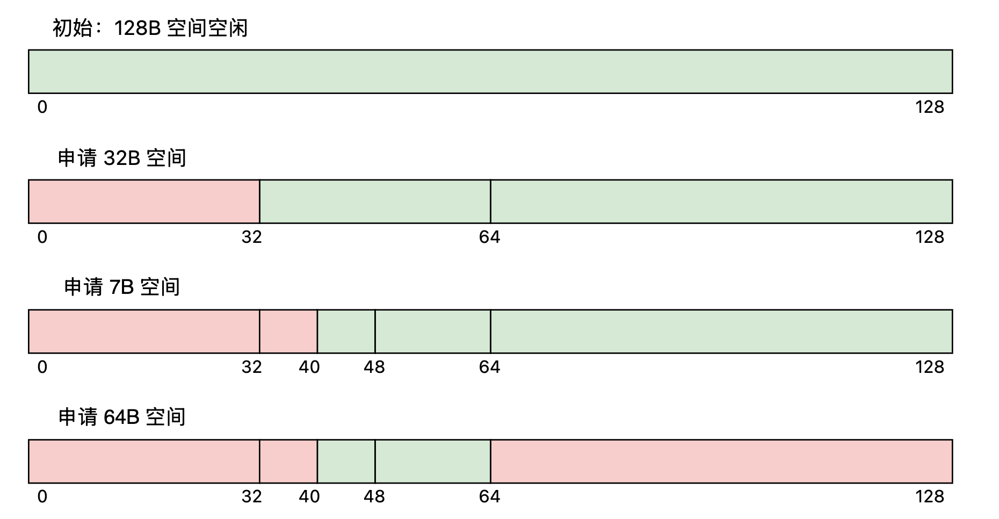

**内存释放过程**

- 释放一块内存时，检查其“伙伴”块是否也空闲：
  - 伙伴块是指与当前块大小相同、地址相邻、且由同一父块分割而来的块。
  - 例如，地址为 *A* 的 2^*n* 块，其伙伴地址为 *A*±2^*n* （具体取决于地址对齐）。
- 如果伙伴块空闲，合并为一个 2^(*n*+1) 的块，并加入更高一级的空闲链表。
- 重复检查合并，直到无法合并（伙伴不空闲或达到最大块大小）。

**伙伴关系**

伙伴块的地址满足特定关系。例如，假设内存起始地址为 0，块大小为 2^*n* ，则地址 *A* 的伙伴地址为 *A*⊕2^*n* （按位异或）。通过这种关系，算法可以快速定位伙伴块。

### 三、离散分配管理方式

#### 3.1 页式管理

页式管理的细节详见 [组成原理中的对应章](https://www.csgraduates.com/constitution_principle/storage/virtual/#请求页式管理)，这里仅给出基本的思想以与 **段式管理** 和 **段页式管理** 进行对比。

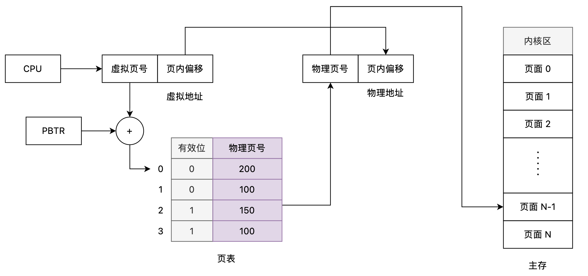

页式内存管理的基本思想是将 **虚拟内存** 和 **物理内存** 分为若干个大小固定的 **页面**，然后通过 **页表** 建立从虚拟页面到物理页面的映射，这样进程就可以离散地使用物理内存中的不同页面。

#### 3.2 段式管理

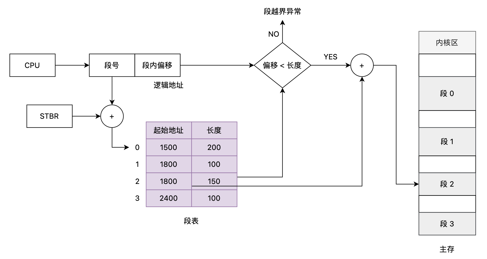

段式内存管理将程序的不同部分（例如 **代码、数据和堆栈**）划分为不同的 **段**（segments）。每个段在物理内存中可以不连续，但在逻辑上都被视为连续的。

段式管理的主要优点是它比较简单，有助于提供更好的 **保护** 和 **共享机制**，在 8086 CPU 中使用的内存管理策略就是段式管理。

下文介绍一下段式内存管理中的三个关键概念：**段**、**段表** 以及 **地址转化**。

##### 段概念

- 每个段都有一个明确的角色，例如 **代码段**、**数据段** 或 **堆栈段**。
- 每个段都有一个 **起始地址** 和 **长度**。
- 段内的地址是连续的，但不同段之间的地址可以不连续。

##### 段表

- 段表是一种数据结构，用于存储每个段的 **基地址**（在物理内存中的起始地址）和 **限制**（段的长度或末尾地址）。
- 当一个程序需要访问其内存段时，会使用 **段号** 和 **段内偏移** 作为地址。这个地址被称为 **逻辑地址** 或 **段地址**。
- 逻辑地址通过段表转换为 **物理地址**。

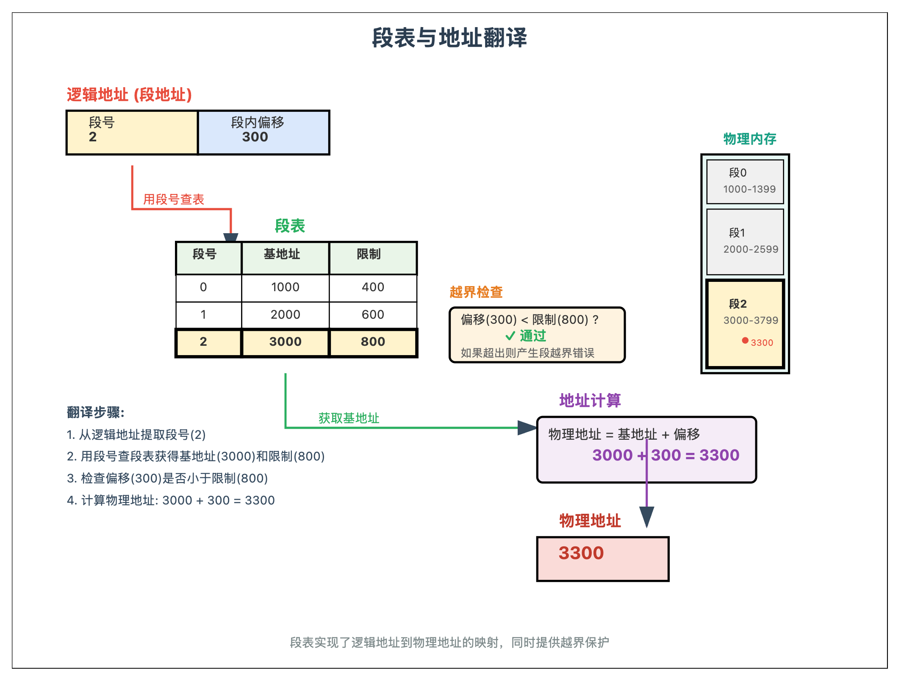

##### 地址翻译

- 为了从逻辑地址获取物理地址，首先需要从逻辑地址中提取 **段号**，然后使用段号在段表中查找相应的基地址和限制。
- 然后，检查逻辑地址中的 **偏移量** 是否小于该段的限制。如果偏移量超出限制，则产生 **段越界错误**。
- 如果偏移量有效，则将偏移量加到段的基地址上，得到 **物理地址**。

#### 3.3 段页式管理

段页式管理（paged segmentation）是一种将 **段式内存管理** 与 **分页式内存管理** 相结合的策略。
在段页式管理中，程序首先被划分为逻辑上的 **段**，然后每个段进一步被划分为固定大小的 **页**。
首先，操作系统通过 **段表** 对不同的段进行管理。
在每一个段的内部，采用 **分页** 的方式将段分为不同的页，实现虚拟页面到物理页面的映射。

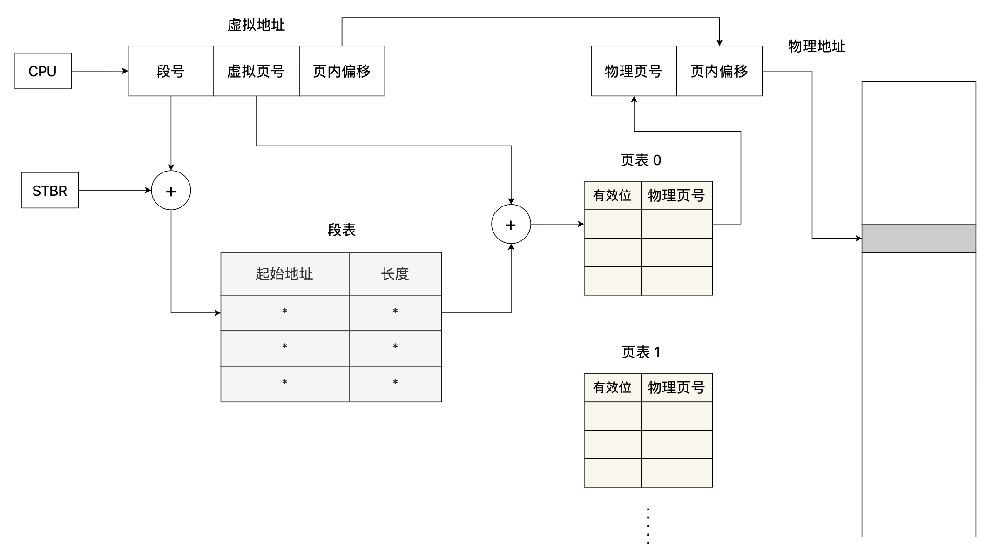

在使用段页式内存管理的策略时，虚拟地址可以拆分为三个部分：**段号**（Segment No）、**页号**（Page No）、**页内偏移**（Offset）。

在地址翻译的过程中，首先通过虚拟地址中的 **段号** 在段表中找到 **页表的起始地址**，接下来再通过 **页号** 在页表中找到该地址对应的 **物理页面号**。

它结合了两者的优势，旨在提供 **灵活性** 和 **减少内存碎片**。

---

## 虚拟内存管理

### 一、页框分配

在 **虚拟内存管理** 中，**页框分配** 是操作系统为进程分配物理内存（页框）的过程。
它直接影响着系统的性能，因为分配的页框数量会影响进程的 **缺页率** 和系统的整体吞吐量。

#### 1.1 驻留表

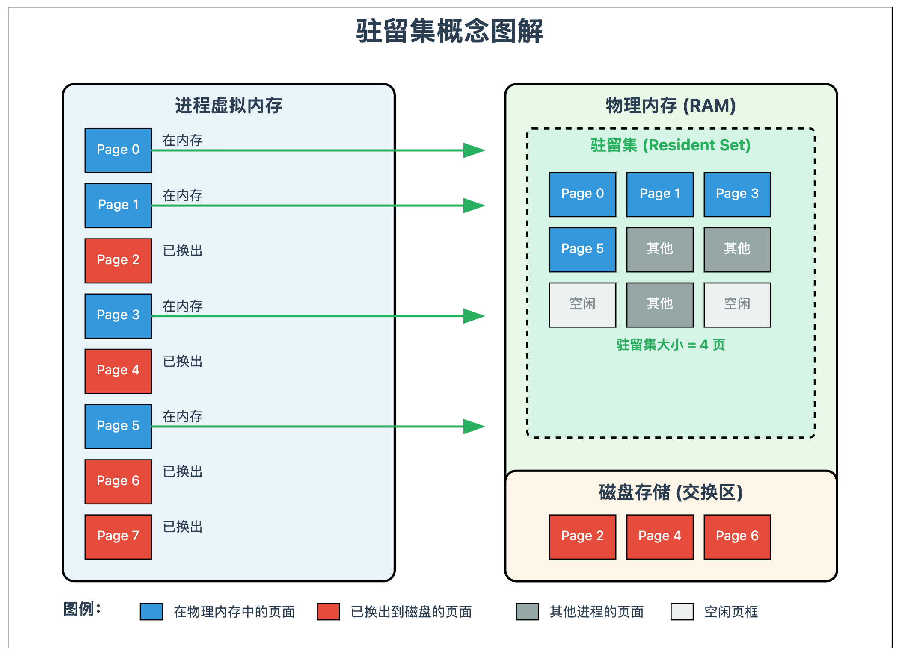

**驻留集（Resident Set）** 是指某个进程在执行过程中，当前实际存放在物理内存中的页面集合。换句话说，它反映了该进程在某一时刻真正占用并可直接访问的物理页。由于进程的地址空间往往远大于物理内存，操作系统通过 **虚拟存储管理** 来实现“用部分物理内存支撑完整逻辑地址空间”，而驻留集正是这个机制下进程能够被立即访问的 **物理页子集**。

**驻留集大小（Resident Set Size, RSS）** 则是度量该集合规模的指标，通常以页框（page frame）的数量来表示。它决定了进程可直接利用的物理内存范围，从而影响其运行效率。

合理设置驻留集大小对于系统性能至关重要：

- **过小**：如果驻留集太小，进程运行时所需的工作集页面无法完全驻留，会频繁发生页面置换，导致 **缺页中断** 激增，系统性能显著下降。
- **过大**：如果驻留集太大，则会占用过多物理内存，可能挤压其他进程的生存空间，降低系统整体吞吐率。

因此，操作系统往往需要通过 **页面置换算法** 或 **局部/全局分配策略** 来动态调整驻留集大小，以在单个进程性能与系统整体资源利用之间取得平衡。

#### 1.2 抖动

**抖动**（Thrashing）是指操作系统中频繁发生的页面置换现象，即刚被换出的页面马上又要被换入内存，刚被换入的页面马上又要被换出外存，导致系统大部分时间都用于页面的换入换出，而真正用于进程运行的时间很少。

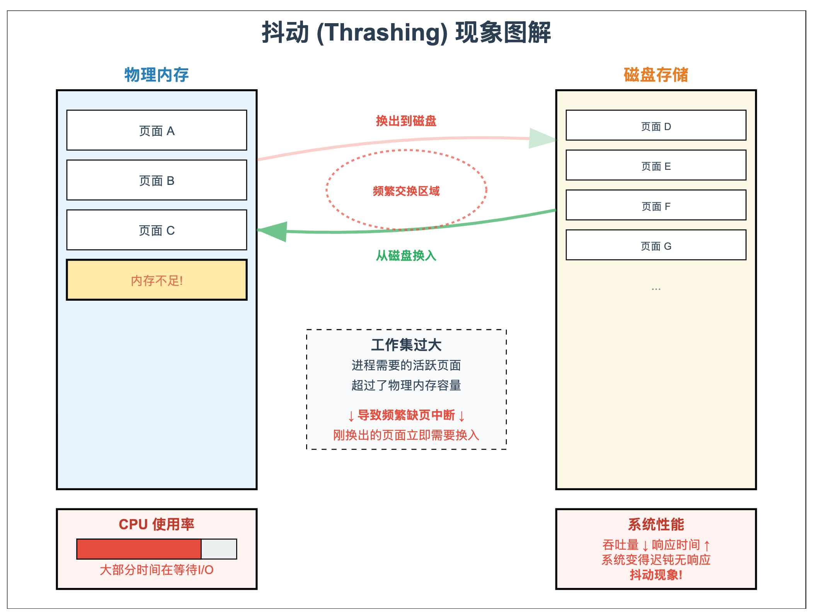

当系统为一个进程分配的物理内存不足以满足其 **工作集**（当前活跃的页面集合）的需求时，就会频繁发生 **缺页中断**。操作系统必须不停地从磁盘读取所需的页面到内存中，同时写出其他页面以释放空间。因为磁盘访问速度远慢于内存访问，这种频繁的磁盘 I/O 活动显著减慢了系统性能。

**抖动** 的直接后果是 **CPU 使用率** 下降，因为 CPU 在等待必要的页面从磁盘加载时处于空闲状态。系统资源被过多地用于管理内存和磁盘之间的数据交换，而非执行用户程序。**抖动** 严重时，系统的 **吞吐量** 下降，响应时间增加，用户和应用程序都会感受到系统变得迟钝和无响应。

#### 1.3 内存分配策略

**内存分配策略** 包含 **固定分配** 和 **可变分配** 两种方式：

- 固定分配
  - 内存被划分为固定大小的区块。
  - 每个程序或进程被分配一个或多个这样的区块，不管它们实际上需要多少内存。
- 可变分配
  - 内存不是被划分为固定大小的区块，而是根据每个程序的需求动态分配。
  - 当一个程序请求内存时，操作系统查看可用内存并分配足够的空间给该程序，这个空间刚好满足其需求。

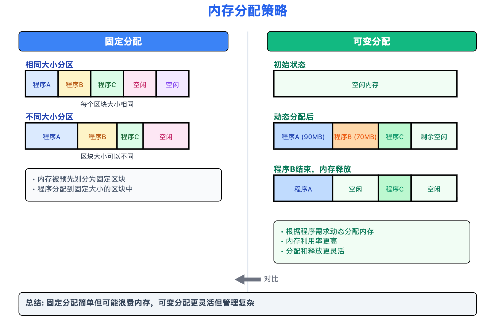

**固定分配** 中可以分为两种方式，一种是将内存分为若干大小相同的分区，另一种是将内存分为大小不同的分区。

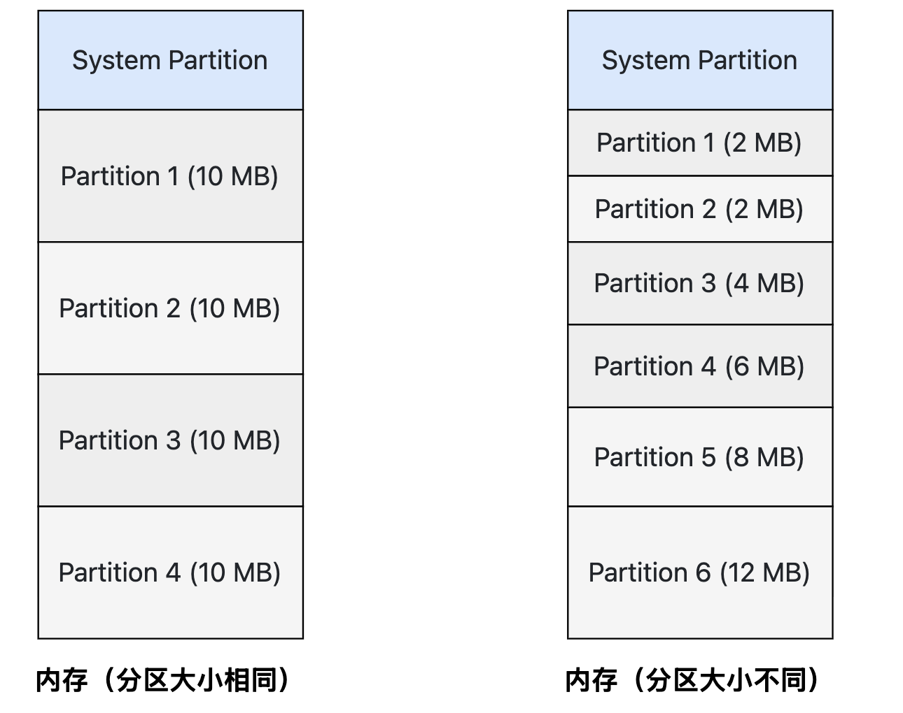

**可变分配** 也包含两种分配方式，一种就是将 [内存分为若干页面](https://www.csgraduates.com/constitution_principle/storage/virtual/#请求页式管理)，然后根据进程的需求为其动态地分配内存页面。另一种思路与 [动态分区分配](https://www.csgraduates.com/operating_system/memory/concepts/#动态分区分配) 一致，在一块连续的内存上动态地申请连续的某个长度的存储空间。

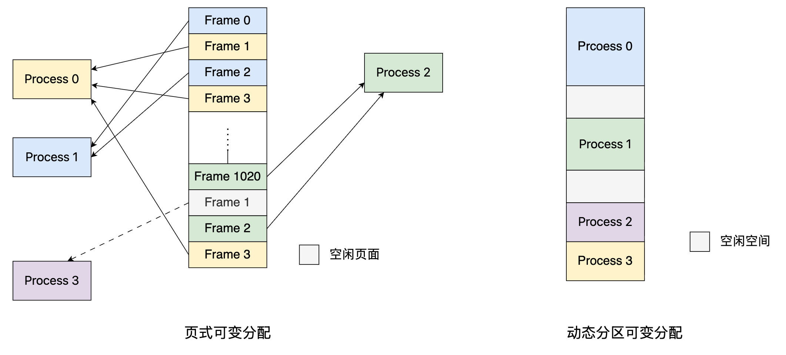

#### 1.4 内存置换策略

当我们谈论 **内存置换策略时**，一般都是建立在 **页式虚拟存储管理** 基础之上的。在 连续分配（分区管理） 中是不存在“页面置换”概念的，在 段式存储管理 中可以有段置换，但考研语境通常默认讨论页式系统。

**内存置换策略** 分为 **局部置换** 和 **全局置换** 两种。

- **局部置换** 策略是指在选择要换出的页面时，仅限于该进程自身所拥有的内存页面范围内进行选择。也就是说，一个进程的 **缺页** 不会影响到其他进程的内存页面。
- **全局置换** 策略是指在选择要换出的页面时，可以在整个系统的内存页面范围内进行选择。也就是说，一个进程的 **缺页** 可能会导致其他进程的内存页面被换出。

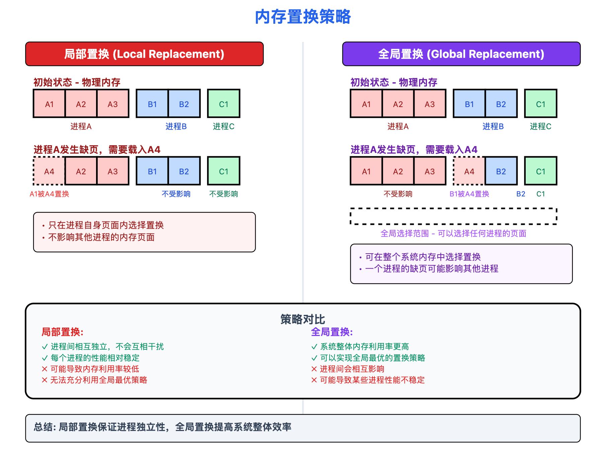

### 二、页置换算法

在操作系统中，进程运行时，如果它要访问的页面不在内存中，就会产生 **缺页中断**。这时，操作系统需要从磁盘中将该页面调入内存。但如果此时内存已满，操作系统就需要选择一个页面将其移出内存，以便为新页面腾出空间。这个选择要移出哪个页面的算法，就叫做 **页面置换算法**。

#### 2.1 FIFO

**FIFO**（First-In-First-Out）页面置换算这是最简单的页面置换算法。它总是淘汰最先进入内存的页面，即选择在内存中驻留时间最久的页面。

**FIFO** 的实现方法是把调入内存的页面按先后顺序放入队列中，当需要置换页面时，选择队头的页面即可。

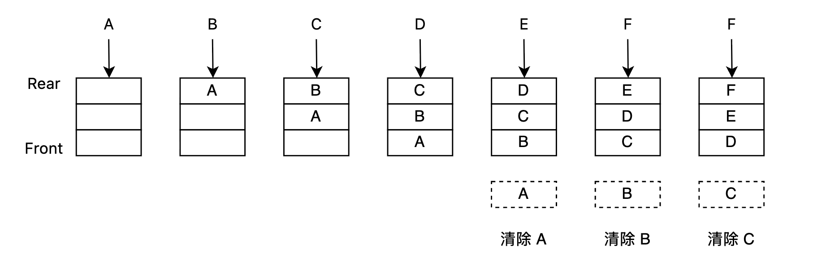

Belady 异常 

在某些页面置换算法（特别是 **FIFO**，先入先出算法）中，增加页面的数量反而导致页面错误（page fault）次数增加，这种情况违背了直觉，因为通常认为更多的内存框架应该减少页面错误，这种异常情况叫做 **Belady 异常**。

举个实际例子，假设页面访问序列为：1, 2, 3, 4, 1, 2, 5, 1, 2, 3, 4, 5

- 使用 3 个页面框架，**FIFO** 算法可能产生 9 次页面错误。
- 使用 4 个页面框架，**FIFO** 算法可能产生 10 次页面错误。 这种页面错误次数随着框架增加而增加的现象就是 **Belady 异常**。

所以这也是 **FIFO** 算法的缺点，使用其他算法可以解决这个问题。

#### 2.2 OPT

**OPT**（Optimal）页面置换算法，也称为最佳页面置换算法，是一种理论上的页面置换算法，其目标是选择最佳的页面来置换，以最大程度地减少未来的页面访问次数。

那么什么叫做最佳的置换页面呢？**OPT** 算法假设你可以预知未来，即你可以知道当前进程驻留集中的哪个页面是在将来最早会被替换的（在驻留集中停留的时间最短），也就是说，你需要知道未来的页面访问序列。

但这在实际情况下是不可能的，因而 **OPT** 算法通常用于理论研究和性能评估，以作为其他页面置换算法的性能上限的比较基准。

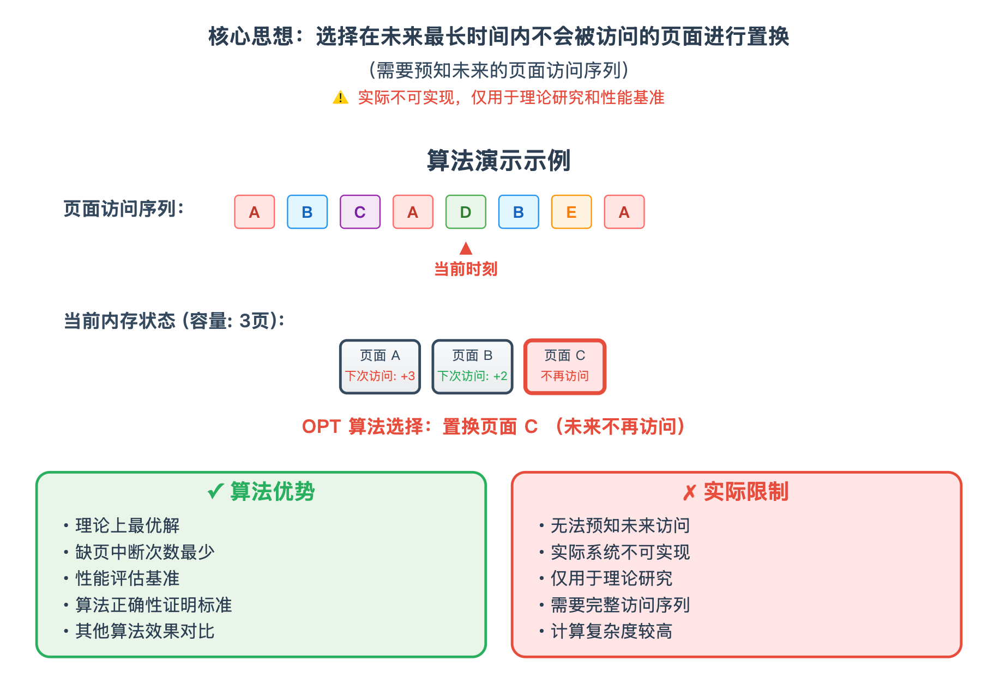

举个 **实际例子** 来说明一下 OPT 页面置换算法的运行过程：

加入内存系统中有 3 个页框，页面引用序列为`7, 0, 1, 2, 0, 3, 0, 4, 2, 3, 0, 2`，则置换页面如下：

| 页面引用 | 引用后内存状态 | 置换页面 | 未来页面引用                    |
| -------- | -------------- | -------- | ------------------------------- |
| 7        | 7              |          | 0, 1, 2, 0, 3, 0, 4, 2, 3, 0, 2 |
| 0        | 7, 0           |          | 1, 2, 0, 3, 0, 4, 2, 3, 0, 2    |
| 1        | 7, 0, 1        |          | 2, 0, 3, 0, 4, 2, 3, 0, 2       |
| 2        | 2, 0, 1        | 7        | 0, 3, 0, 4, 2, 3, 0, 2          |
| 0        | 2, 0, 1        |          | 3, 0, 4, 2, 3, 0, 2             |
| 3        | 2, 0, 3        | 1        | 0, 4, 2, 3, 0, 2                |
| 0        | 2, 0, 3        |          | 4, 2, 3, 0, 2                   |
| 4        | 2, 4, 3        | 0        | 2, 3, 0, 2                      |
| 2        | 2, 4, 3        |          | 3, 0, 2                         |
| 3        | 2, 4, 3        |          | 0, 2                            |
| 0        | 2, 0, 3        | 4        | 2                               |
| 2        | 2, 0, 3        |          |                                 |

内存置换次数为 4，缺页率为 4/12 = 1/3

#### 2.3 LRU

**LRU**（Least Recently Used）基于最近的页面访问历史来决定哪个页面应该被置换出内存。

**LRU** 算法是基于时间局部性思想：如果一个页面在最近被使用的话，那么这个页面在将来很可能被再次使用。
所以 **LRU** 算法会选择 **最近一直没有被使用的页面** 进行替换。

如果内存中包含 3 个页面，A 页面在 1 分钟前被使用过，B 页面在 2 分钟前被使用过，C 页面在 3 分钟前被使用过。
那么在这种情况下，**LRU** 算法会优先替换 C 页面，因为该页面上次使用的时间距离现在最远。

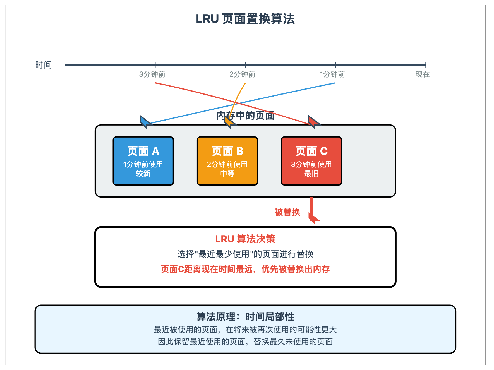

我们可以使用一个队列来保存内存中的页面，**最近被使用过** 的页面放在 **队列尾部**，表示这些页面不会优先被替换。**最近没使用过** 的页面会放在 **队列头部**，表示这些页面会优先被替换。基于这种思路，**LRU** 算法可以用如下过程进行描述：

假设内存中 **Mem** 最多可以容纳 N 个页面（将其看成一个长度最大为 N 的队列），当访问一个页面 **P** 时：

- 如果P在队列中出现
  - 将 **P** 移动到队列末尾
- 如果P不在队列中
  - 如果队列没有满的话，将 **P** 加入队列末尾
  - 如果队列满的话，将队列头部的页面淘汰，并且将 **P** 加入队列末尾

举个例子，在下图中，当进程访问 C 页面时，发现 C 页面出现在其驻留集中，所以需要将 C 移动到队列尾部，这样刚刚访问过的 C 页面的淘汰优先级就会降到最低。

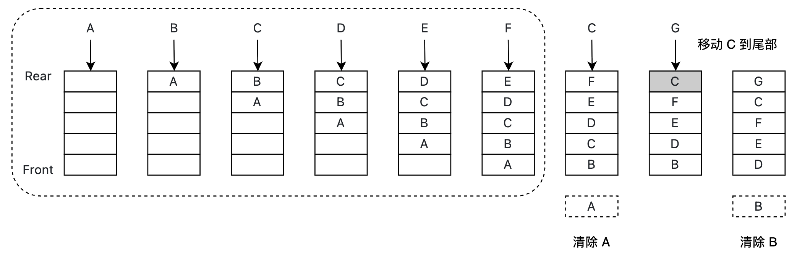

LRU 的 **执行流程** 可以通过以下流程图理解：

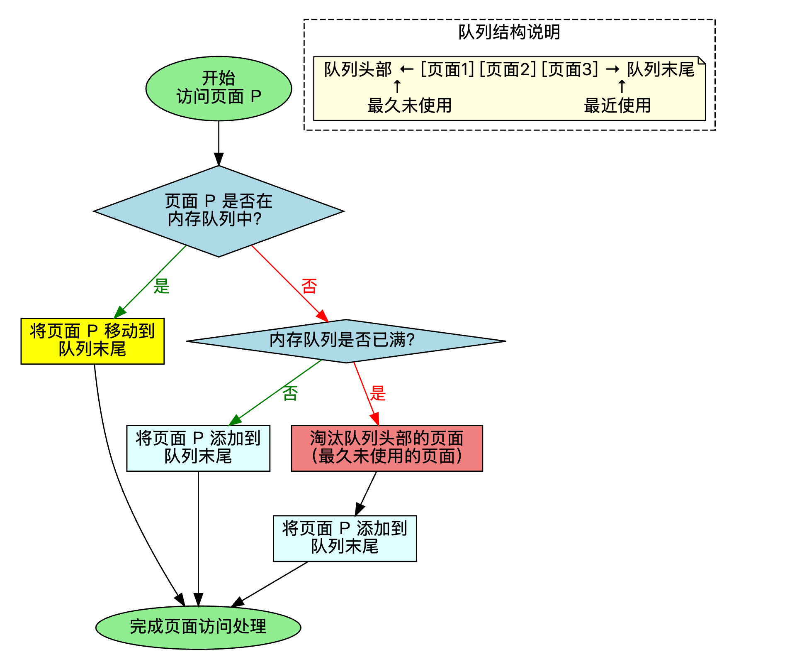

**LRU 算法的例子：**

加入内存系统中有 3 个页框，页面引用序列为`7, 0, 1, 2, 0, 3, 0, 4, 2, 3, 0, 2`，则置换页面如下：

| 页面引用 | 引用后内存状态 | 置换页面 | 页面引用 | 引用后内存状态 | 置换页面 |
| -------- | -------------- | -------- | -------- | -------------- | -------- |
| 7        | 7              |          | 0        | 7, 0           |          |
| 1        | 7, 0, 1        |          | 2        | 0, 1, 2        | 7        |
| 0        | 1, 2, 0        |          | 3        | 2, 0, 3        | 1        |
| 0        | 2, 3, 0        |          | 4        | 3, 0, 4        | 2        |
| 2        | 0, 4, 2        | 3        | 3        | 4, 2, 3        | 0        |
| 0        | 2, 3, 0        | 4        | 2        | 3, 0, 2        |          |

内存置换次数为 6，缺页率为 6/12 = 1/2

#### 2.4 Clock

根据 [LRU 代码实现](https://www.csgraduates.com/code/lru/) 可知，用代码实现一个高效的 **LRU** 算法需要用到一个散列表和一个基于链表的队列，这从软件层面实现不算特别复杂，但若是要用硬件实现相应的逻辑则不大容易。

Clock 算法的提出是为了解决 LRU 算法在硬件实现上的复杂性，该算法流程相比 LRU 更加简单，可以更高效地使用硬件电路进行实现。

此外，Clock 算法的目的与 LRU 算法类似：**保证最近刚访问过的页面可以在将来尽量晚被淘汰。**

##### 简单 Clock

CLOCK 算法的核心思想是使用一个类似时钟的数据结构，以跟踪每个页面的访问状态。

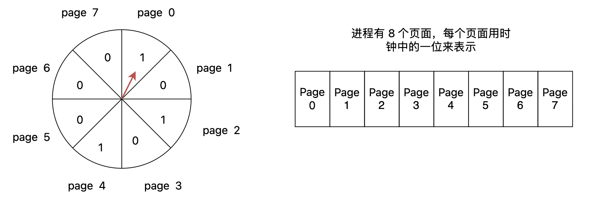

页面的访问状态用一个比特位（访问位）来表示：

- **0** 表示该页面 **未分配** 或者 **已分配但可以被替换**
- **1** 表示该页面 **已分配** 但 **不可被替换**

初始情况下进程的所有页面都未被分配，所有页面的访问位都为 0。

当一个新页面被添加时，时钟中的指针会不断旋转，直到找到一个访问位为 0 的页面将其替换。若当前页面的访问位为 1，则将其设置为 0，并移动到下一个位置进行查找。

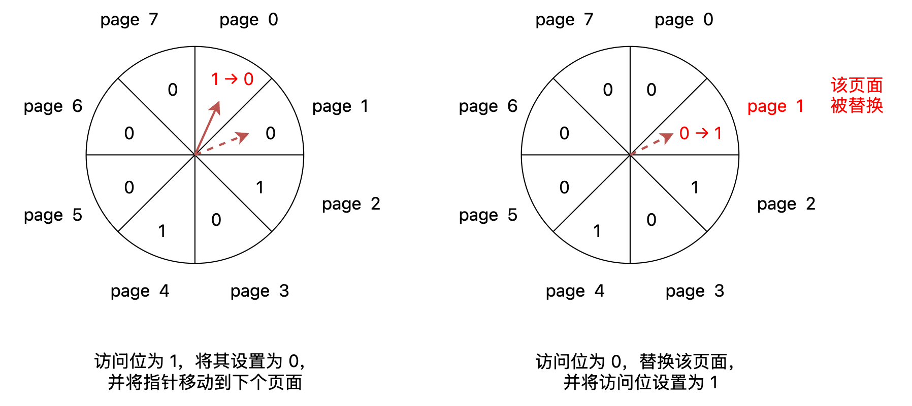

在实际的 **Clock** 算法实现中，我们需要使用一种可以循环遍历的数据结构来模拟时钟结构。常用的选择是数组或循环链表。数组和链表中的每个元素都需要记录 **访问位** 和 **页面号**。

Clock **替换策略** 如下：

假设内存最多可以容纳 N 个页面，我们可以用一个长度为 N 的数组来作为数据结构模拟时钟，当访问一个页面 P 时：

- 如果 P 在数组中出现
  - 将 P 的引用标记为 1
- 如果 P不在数组中，判断指针指向的页面访问位的数值
  - 如果访问位为 0，则替换该页面，并将指针移动到下一个位置
  - 如果访问位为 1，将该页面的访问位置为 0，将指针移动到下一个位置继续判定

Clock 替换策略可以通过以下流程图理解：

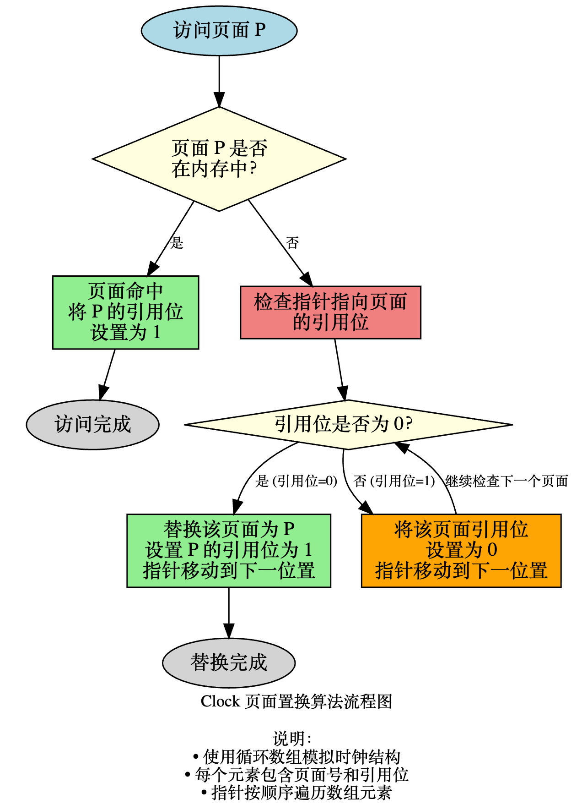

以下图为例，当首先访问页面 A、B、C 时，可以找到访问位为 0 的页面，直接替换页面；接下来访问页面 D，由于此时页面已满且访问位都为 1，指针会移动一个循环并且将所有页面的访问位都设置为 0，最后替换页面 A；然后访问页面 C 时，发现页面 C 已经存在，将对应的访问位设置为 1，指针位置不动；最后访问页面 E，发现指针指向的页面 B 访问位为 0，替换该页面，然后将指针后移一个位置。

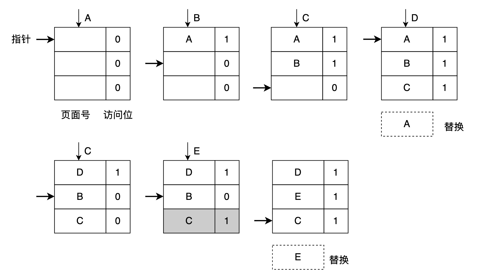

那么 **Clock** 算法是如何保证最近访问过的页面尽量晚被淘汰呢？这主要包含两点：

1. 若访问的页面在时钟中存在，则将该页面的访问位设置为 1，这可以保证这个页面尽量晚被淘汰。
2. 若访问的是新页面（在时钟中不存在），找到一个可替换的页面，将新页面加载到这个位置，并将新页面的访问位设置为 1，这可以保证新页面尽量晚被淘汰。

**简单 Clock 算法的例子：**

加入内存系统中有 3 个页框，页面引用序列为`7, 0, 1, 2, 0, 3, 0, 4, 2, 3, 0, 2`，内存页框初始状态为 **-1:0**, -1:0, -1:0（粗体表示时钟指针指向的位置，引号前面的 -1 表示当前页面为空，引号后面的表示访问位的值）

置换页面过程如下：

| 页面引用 | 引用后内存状态    | 置换页面 | 页面引用 | 引用后内存状态   | 置换页面 |
| -------- | ----------------- | -------- | -------- | ---------------- | -------- |
| 7        | 7:1 **-1:0** -1:0 |          | 0        | 7:1 0:1 **-1:0** |          |
| 1        | **7:1** 0:1 1:1   |          | 2        | 2:1 **0:0** 1:0  | 7        |
| 0        | **2:1** 0:1 1:0   |          | 3        | **2:1** 0:0 3:1  | 1        |
| 0        | **2:1** 0:1 3:1   |          | 4        | 4:1 **0:0** 3:0  | 2        |
| 2        | 4:1 2:1 **3:0**   | 0        | 3        | 4:1 2:1 **3:1**  |          |
| 0        | **4:0** 2:0 0:1   | 3        | 2        | **4:0** 2:1 0:1  |          |

内存置换次数为 5，缺页率为 ***5/12\***

##### 改进型 Clock

**简单 Clock** 算法仅使用一个“访问位”来记录页面是否被访问过。当发生缺页中断时，算法从时钟指针的当前位置开始扫描内存中的页面，寻找第一个访问位为 0 的页面进行淘汰。这种算法虽然实现简单，但存在一个明显的缺陷：它没有考虑页面是否被 **修改** 过。

为了解决 **简单 Clock** 算法的缺陷，**改进型 Clock** 算法引入了“**修改位**”的概念。每个页面都有两个状态位：

- **访问位**（R）：表示页面是否被访问过。
- **修改位**（M）：表示页面是否被修改过。

根据这两个状态位，页面可以按照 **淘汰优先级** 分为四种类型：

- `(0, 0)`：最近既没有被访问，也没有被修改。
- `(0, 1)`：最近没有被访问，但是被修改了。
- `(1, 0)`：最近被访问了，但是没有被修改。
- `(1, 1)`：最近被访问了，也被修改了。

当访问一个新页面时，**改进型 Clock** 算法的运行过程如下：

- 算法首先尝试寻找 **(0, 0)** 类型的页面，如果找到，则立即替换。
- 如果第一轮扫描没有找到 **(0, 0)** 类型的页面，则进行第二轮扫描，寻找 **(0, 1)** 类型的页面。
- 如果前两轮都没有找到，那么会将所有访问位设置为 0 然后重复前两轮扫描。

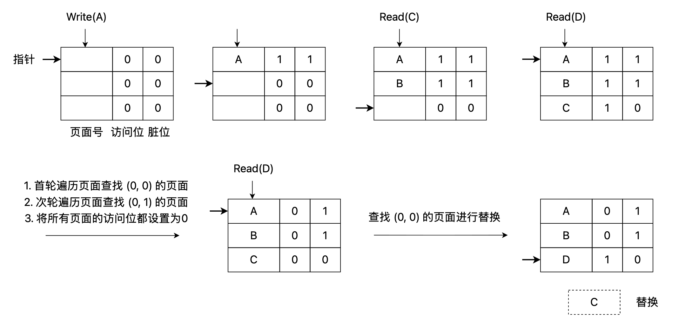

#### 2.5 LFU

**LFU**（Least Frequently Used）算法的核心思想是：当主存没有足够的空间加载新的页面时，系统会选择那些在 **过去使用次数最少的页面** 进行置换。

基本步骤：

1. **初始化**：当一个页面首次加载到内存中时，为其分配一个计数器并将其设置为 1（表示该页面被访问过一次）。
2. **页面命中**：如果要访问的页面已经在内存中，则增加该页面的访问计数。
3. **页面置换**：当需要为新的页面腾出空间时（也就是说，当内存中的页面已满并且需要加载一个新页面时），系统会查看所有当前在内存中的页面的访问计数，选择访问次数最少的那个页面进行置换。

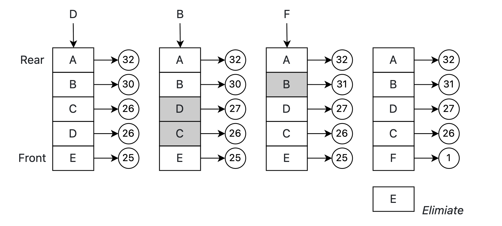

### 三、内存映射文件

**内存映射文件** 通过 `mmap` 系统调用，将文件的全部或部分内容 **映射到进程的虚拟地址空间**。映射后，文件内容可以像操作普通内存一样被直接读写，而无需通过显式的文件 I/O 操作（如 `read` 或 `write`）。操作系统负责将虚拟地址的访问转换为对底层物理存储设备（通常是磁盘）的操作。

**映射过程** 如下：

- 进程调用 `mmap`，指定要映射的文件、偏移量、长度以及访问权限（如读、写）。
- 操作系统在进程的虚拟地址空间中分配一段连续的虚拟内存，并建立虚拟地址与文件内容的映射关系。
- 当进程访问这部分虚拟地址时，操作系统通过分页机制将文件内容加载到物理内存，并同步更新文件内容到磁盘。

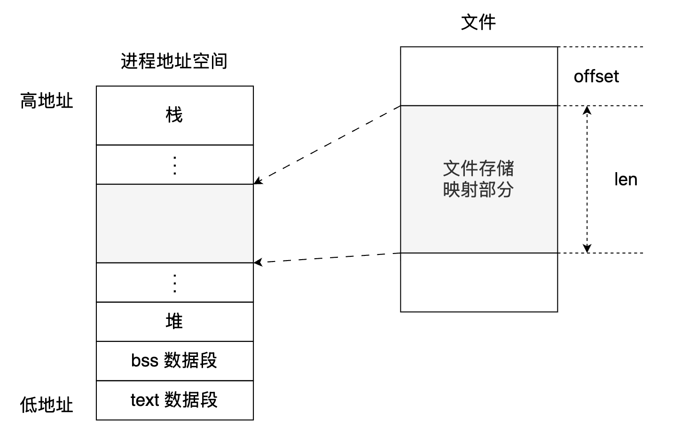

**那么 mmap 相对于常规文件的优势在哪里呢？**（了解）

常规文件操作（如使用 `read` 或 `write` 系统调用）依赖页缓存机制来提高效率并保护磁盘，但这引入了 **两次数据拷贝** 的过程：

1. **从磁盘到页缓存**：当进程发起读文件请求时，内核通过文件的 inode 查找文件内容。如果文件页不在页缓存中，内核会从磁盘将数据拷贝到内核空间的页缓存中。
2. **从页缓存到用户主存**：页缓存位于内核空间，用户进程无法直接访问。因此，内核需要将页缓存中的数据再次拷贝到用户进程的内存空间（用户主存）。写操作类似，用户进程的写缓冲区先拷贝到内核空间的页缓存，再延迟写回磁盘。

这两次数据拷贝（磁盘 → 页缓存 → 用户主存）增加了系统开销，尤其是在处理大文件或高频 I/O 操作时，效率较低。

`mmap` 通过将文件直接映射到进程的虚拟地址空间，消除了从页缓存到用户主存的拷贝步骤，仅需一次数据拷贝：

- **从磁盘到用户主存**：当进程访问映射的虚拟地址时，操作系统通过分页机制按需从磁盘加载文件内容到物理内存，并将其映射到进程的虚拟地址空间。进程可以直接操作这部分内存，无需额外的内核到用户空间的拷贝。
- **写操作同步**：对于可写映射，进程对映射内存的修改会由操作系统自动同步到磁盘（或通过 `msync` 显式同步），无需用户态到内核态的缓冲区拷贝。

通过以上讲解可知，`mmap` 具备以下优势：

- **减少数据拷贝**：`mmap` 只需要从磁盘到物理内存的一次拷贝，消除了页缓存到用户主存的额外拷贝，降低了 CPU 和内存开销。
- **高效内存访问**：文件内容直接映射到虚拟地址空间，进程像操作内存一样读写文件，简化了编程模型并提高了性能。
- **延迟加载**：`mmap` 支持按需加载，只有实际访问的文件页面才会被加载到内存，优化了内存使用效率。
- **支持进程间通信**：多个进程可以映射同一文件，共享内存区域，实现高效的数据共享。

