# 文件管理

## 文件

### 一、文件元信息

在 **UNIX** 和类 **UNIX** 操作系统中，inode（索引节点）用于存储 **文件的元数据**，它包含了关于该文件的大部分 **元数据**，但不包括 **文件名** 和 **文件实际内容**。

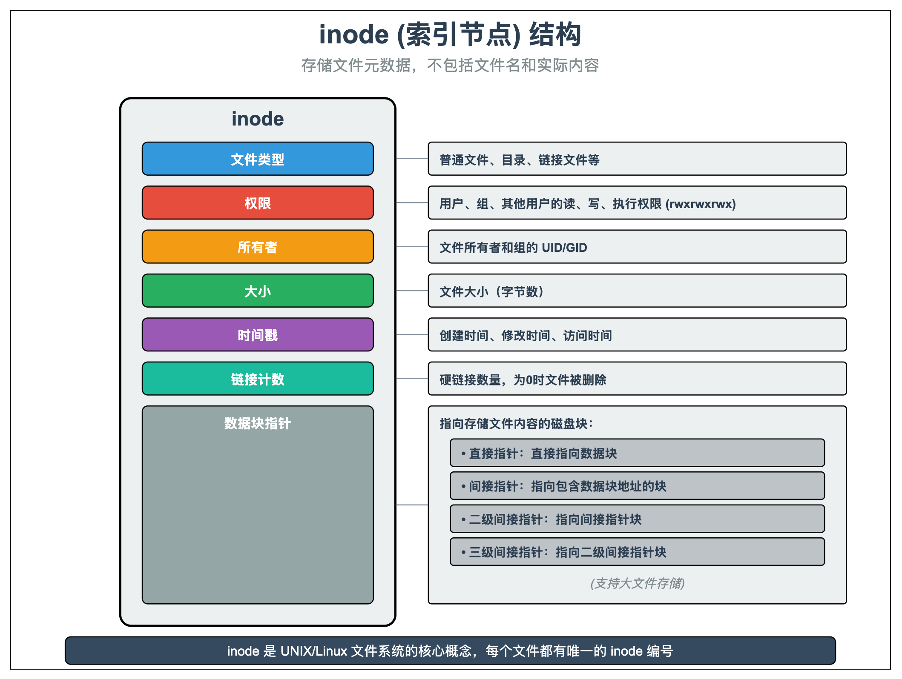

inode 中包含如下信息：

- **文件类型**：文件是普通文件、目录还是链接文件等。
- **权限**：文件的访问控制信息，如用户、组和其他用户的读、写、执行权限。
- **所有者**：文件的所有者和组 ID。
- **大小**：文件的大小（字节数）。
- **时间戳**：文件的创建时间、最后修改时间和最后访问时间。
- **链接计数**：指向该文件的硬链接数量。当计数为 0 时，文件会被删除。
- **数据块指针**：文件内容所在的数据块（block）的位置信息。这包括直接指针、间接指针、二级间接指针和三级间接指针，用于指向存储文件内容的磁盘块。

### 二、进程文件管理

在进程中可能会打开若干文件，操作系统需要以某种方式对进程打开的文件信息进行记录。这就需要用到三个数据结构：**文件描述符表**、**文件表**、**inode 表**。

- **文件描述符表**（File Descriptor Table）：每个进程都有自己的 **文件描述符表**，这个表对应于该进程打开的文件描述符。文件描述符是进程范围内的一个小的非负整数。
- **文件打开表**（Open File Table）：操作系统维护一个 **全局的** 文件打开表，该表记录了所有打开文件的状态信息。每次 `open` 调用成功时，都会创建一个新的 **文件打开表条目**。
- **INode 表**（INode Table）：系统还维护了一个 **inode 表**，该表包含了文件的元数据和指向文件实际数据的指针。如果多个进程打开同一个文件，它们的 **文件打开表条目** 将指向 **inode 表** 中的同一 **inode**。

#### 2.1 inode表

**inode 表**（inode table）是一个固定的、专门的区域，用来存储文件系统中所有文件和目录的 **inode** 结构。每个 **inode** 占用一个表项，表中的每个 **inode** 编号（inode number）对应一个唯一的文件或目录。

注意 **inode 表是存储所有 inode 的唯一容器**：

- 每个文件/目录都有一个唯一的 **inode 编号**
- 文件系统通过该编号在 **inode 表** 中找到对应的 **inode**

下表给出了一个简化的 **inode 表**示例：

| inode 编号 | 文件类型 | 权限       | 所有者 | 文件大小 (字节) | 数据块指针（简略）       | 创建时间         | 修改时间         |
| ---------- | -------- | ---------- | ------ | --------------- | ------------------------ | ---------------- | ---------------- |
| 1          | 目录     | drwxr-xr-x | root   | 4096            | [100, 101, 102]          | 2024-01-01 10:00 | 2024-01-02 10:00 |
| 2          | 文件     | -rw-r–r–   | user   | 1024            | [200, 201]               | 2024-01-01 11:00 | 2024-01-01 12:00 |
| 3          | 符号链接 | lrwxrwxrwx | user   | 14              | [路径字符串: “/etc/abc”] | 2024-01-01 13:00 | 2024-01-01 13:00 |
| 4          | 文件     | -rwxr-xr-x | user   | 8192            | [300, 301, 302, 303]     | 2024-01-02 08:00 | 2024-01-02 08:00 |
| …          | …        | …          | …      | …               | …                        | …                | …                |

**inode 表**中的每一行就是一个 **inode**。

#### 2.2 系统打开文件表

**系统打开文件表**（System-wide Open File Table）是整个操作系统内核维护的一个全局结构，它记录了所有进程当前打开的文件的状态信息。

每当一个进程调用 `open()` 打开一个文件时，系统会：

1. 创建一项“**系统打开文件表**”记录（如果该文件尚未打开，或者是独立打开的）
2. 创建/更新该进程的“**文件描述符表**”项，让它指向这条系统表项

举个例子：

```c
int fd = open("file.txt", O_RDWR);  // 进程 A 打开
write(fd, "Hello", 5);              // offset 从 0 到 5
```

这次 `open` 会创建一个 **系统文件表** 项：

- 偏移量 0 → 写入 5 字节后变成 5
- 文件模式：O_RDWR
- **inode** 指针：指向 `file.txt` 的 **inode**

📊 下表给出了一个 **系统文件打开表** 实例：

| 表项编号（索引） | inode 编号 | 打开模式  | 当前偏移量 | 状态标志 | 引用计数     | 指向的文件路径     |
| ---------------- | ---------- | --------- | ---------- | -------- | ------------ | ------------------ |
| 0                | 1024       | 读写 (rw) | 120        | 无       | 2            | `/home/user/a.txt` |
| 1                | 1050       | 只读 (r)  | 0          | 非阻塞   | 1            | `/etc/hosts`       |
| 2                | 1024       | 读写 (rw) | 120        | 无       | 共享同表项 0 | `/home/user/a.txt` |
| 3                | 2001       | 只写 (w)  | 45         | O_APPEND | 1            | `/var/log/sys.log` |

#### 2.3 文件描述符表

**文件描述符表**（File Descriptor Table）是进程级别的表，它将整数类型的“**文件描述符**”（如 0, 1, 2, 3, …）映射到 **系统打开文件表** 的条目上。

每个进程在内核中有自己的 **文件描述符表**。当你调用 `open()` 打开一个文件时，操作系统：

- 在 **系统打开文件表** 中新建或复用一项（记录 **inode**、偏移等）
- 在该进程的 **文件描述符表** 中添加一个条目（索引号）

📊 下表给出了一个进程的 **文件描述符表** 实例：

| 文件描述符（fd） | 指向系统文件表项编号 |
| :--------------: | :------------------: |
|        0         |          5           |
|        1         |          6           |
|        2         |          7           |
|        3         |          9           |
|        4         |          10          |

#### 2.4 总体视角

在进程 1 中执行 `fdA1 = open("fileA.txt", O_RDONLY)` 和 `fdAdup = dup(fdA)` 系统调用，在进程 2 中执行 `fdA2 = open("fileA.txt", O_RDONLY)`，系统中的三种用于进程文件管理的表如下图所示：

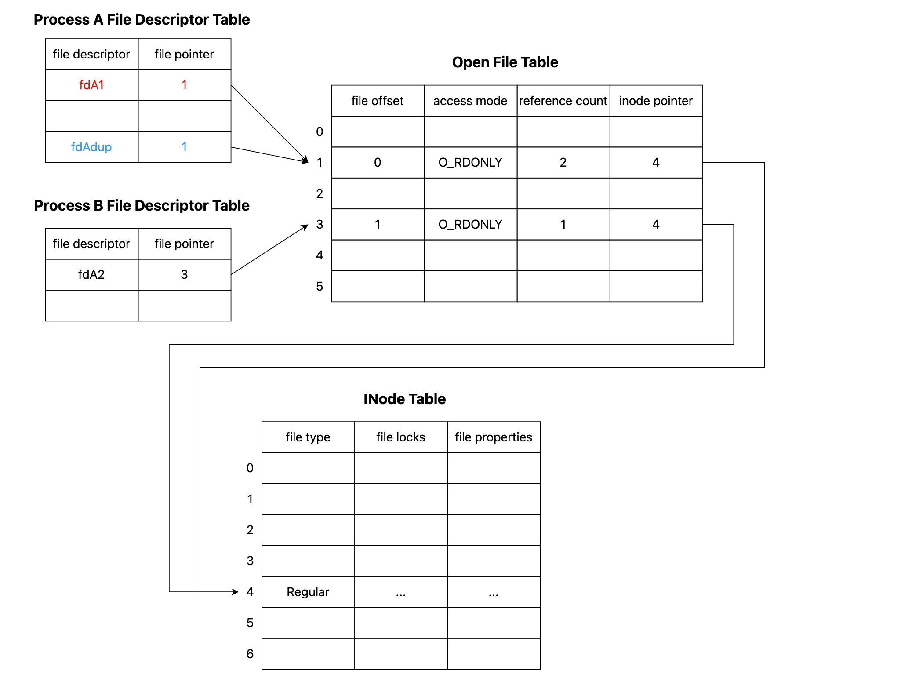

三张表的逻辑关系可以理解为：**进程描述符表**（进程级） → **系统文件打开表**（系统级） → **inode 表**（系统级）

每个进程有自己的 **文件描述符表**，记录 **文件描述符**（如 3、4 等）指向 **系统打开文件表** 中的某一项；**系统打开文件表** 是全局共享的，记录当前文件的读写偏移量、打开模式，并指向对应的 **inode**；**inode 表** 保存了所有文件的 **元数据** 和数据块地址，是文件的最终物理信息所在。通过这三层结构，系统实现了多个进程共享文件、独立管理偏移量和统一访问底层文件的能力。

#### 2.5 系统调用

在 **Unix** 操作系统中，“**一切皆文件**”是一项核心设计哲学。无论是普通文件、设备文件，还是网络连接，操作系统都通过统一的机制进行管理——这套机制的核心，就是一组用于文件管理的 **系统调用**。

其中，`open`、`close`、`read`、`write` 和 `lseek` 是最基本、最常用的五个调用，很多考试题目都会以间接形式考查它们的工作原理与使用方式。

打开和关闭 

所谓“打开一个文件”，并不仅仅是打开字面上的内容，而是操作系统在后台完成了两个关键步骤：

1. 检查文件是否存在、权限是否允许访问
2. 在内核中创建一个 **文件描述符**，用于追踪该文件的使用状态

因此，`open` 实际上是一次向内核“申请访问权限”的操作，它返回 **文件描述符**（file descriptor），**文件描述符**会被存储到进程的 [文件描述符表](https://www.csgraduates.com/operating_system/files/file/#文件描述符表) 中，并将 [系统文件打开表](https://www.csgraduates.com/operating_system/files/file/#系统打开文件表) 中的引用计数 +1。此外，如果文件是第一次被打开时，该文件的 [inode](https://www.csgraduates.com/operating_system/files/file/#文件元信息) 也会从外存中被加载到内存中。

相对应的，`close` 的作用是通知内核：该文件不再使用，可以释放相关资源。若程序未正确调用 `close`，**文件描述符**将无法释放，可能导致资源泄露，最终耗尽进程可用的 **文件句柄**。`close` 可以理解为 `open` 的反向操作：从 **文件描述符表** 中删除 **文件描述符**；将 **系统文件打开表** 中的引用计数 -1；如果引用计数为 0 时，内存中的 **inode** 会被释放。

读写 

文件一旦成功打开，程序即可通过 `read` 和 `write` 系统调用与其进行交互：

- `read(fd, buf, count)`：将 **文件内容**从内核空间**读取到用户缓冲区**
- `write(fd, buf, count)`：将用户缓冲区的内容**写入内核缓存区**

每次读写操作结束后，系统会自动更新当前的读写偏移量（文件偏移指针），下一次操作会从上次结束的地方继续。

为提高读写效率，现代操作系统在 `read` 和 `write` 调用背后引入了多种 **缓存与优化策略**，常见包括：

**1. 延迟写**

在 **Unix** 系统中，`write` 系统调用并不会立即将数据写入磁盘，而是将其暂存在内核的 **页缓存**（page cache）中。只有在特定时机——如缓存空间不足、文件被关闭，或系统周期性同步——才会将缓存中的数据统一刷新到磁盘（思路与 **cache** 中的 [回写法](https://www.csgraduates.com/constitution_principle/storage/cache/#回写法) 一致，需要使用到脏位）。

这种设计 **显著减少了磁盘 I/O 操作**，提高了写入效率，尤其是在对同一数据区域频繁写入的场景下，还能合并多次写操作，从而进一步降低成本。

然而，这种 “**延迟写**” 机制也带来了风险：如果在数据尚未刷盘前系统发生异常（如断电或崩溃），这些暂存在内存中的数据可能会丢失。为此，如果应用场景对数据持久性要求较高，可以使用 `fsync(fd)` 显式触发缓存刷盘，确保数据安全地写入磁盘。

1. **预读取**

与写入类似，`read` 操作在内核层面也进行了性能优化。当系统识别到程序正在顺序读取文件时，会自动启用“**预读取**”机制，提前将后续的多个页加载到 **页缓存** 中，即使用户当前并未发出读取请求。

这样一来，后续的读取请求很可能直接命中缓存，从而避免了等待磁盘 I/O 的开销。这一机制充分利用了磁盘的顺序读取特性，在处理大文件或进行流式读取时，能够**显著提升整体读性能**。

定位 

在某些情况下，程序需要跳过部分内容、从文件中任意位置读取或写入数据，这就涉及到了 `lseek` 系统调用。

`lseek` 允许显式地移动文件的读写位置，从而实现“**随机访问**”。常见用途包括：

- 跳过文件前面的若干字节
- 返回文件开头重新读取
- 移动到文件末尾以进行追加写入

`lseek` 为文件操作提供了更高的灵活性，使得程序不仅能顺序处理数据，也能高效地实现定位和修改。

### 三、文件的逻辑结构

文件的 **逻辑结构** 指的是文件内部数据的组织方式，是用户和程序员所看到和使用的数据排列形式。根据记录的排列和访问方式，逻辑结构通常分为以下两种：

**顺序文件** 是将记录按一定顺序依次存储的一种 **文件逻辑结构**，每条记录紧跟在前一条之后。在访问时，通常采用顺序读取的方式，即从文件的开头开始，依次读取每条记录，直到找到目标记录或读完整个文件。

**随机文件**（也称为直接文件）则不要求记录按固定顺序排列，记录可以以任意顺序存放在文件中。其显著特点是支持 **随机访问**，程序可以依据记录号、关键字等定位信息直接访问某条记录，而无需逐条读取。

### 四、文件的物理结构

文件的 **物理结构**（或称 **存储结构**）是指文件在物理存储介质（如磁盘、SSD）上的实际存放方式。它关注的是操作系统如何管理文件的块（block）或簇（cluster）等单位，并将逻辑上的文件映射到磁盘上的物理地址空间。

与逻辑结构面向用户和程序不同，物理结构更多反映了操作系统和文件系统层面的实现细节，决定了文件的实际读写效率、空间利用率以及文件访问策略的复杂性。

文件的物理结构和逻辑结果的 **对应关系** 如下图所示：

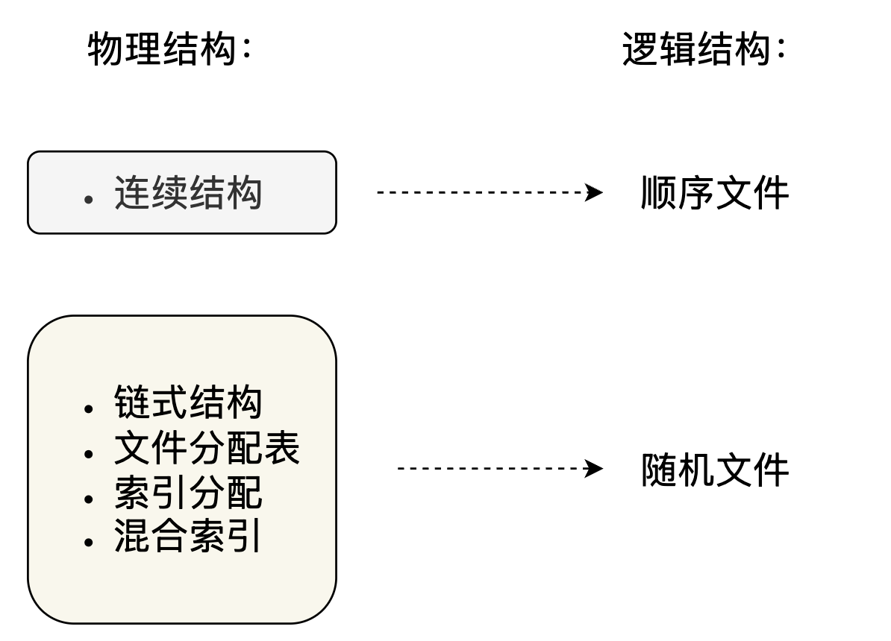

#### 4.1 连续分配

**连续分配** 方案中，每个文件占用磁盘上一个 **连续的块集**。例如，如果一个文件需要 n 个块，并且给定一个块 b 作为起始位置，那么分配给该文件的块将是 b, b+1, b+2，……b+n-1。这意味着给定起始块地址和文件的长度，我们可以确定文件占用的块。

连续分配方案对应的目录包含如下信息：

- **文件的起始地址**
- **分配块数量**

下图中的文件 “file3” 从区块 19 开始，长度为 6 个区块。因此，它占用 19、20、21、22、23、24 个块。

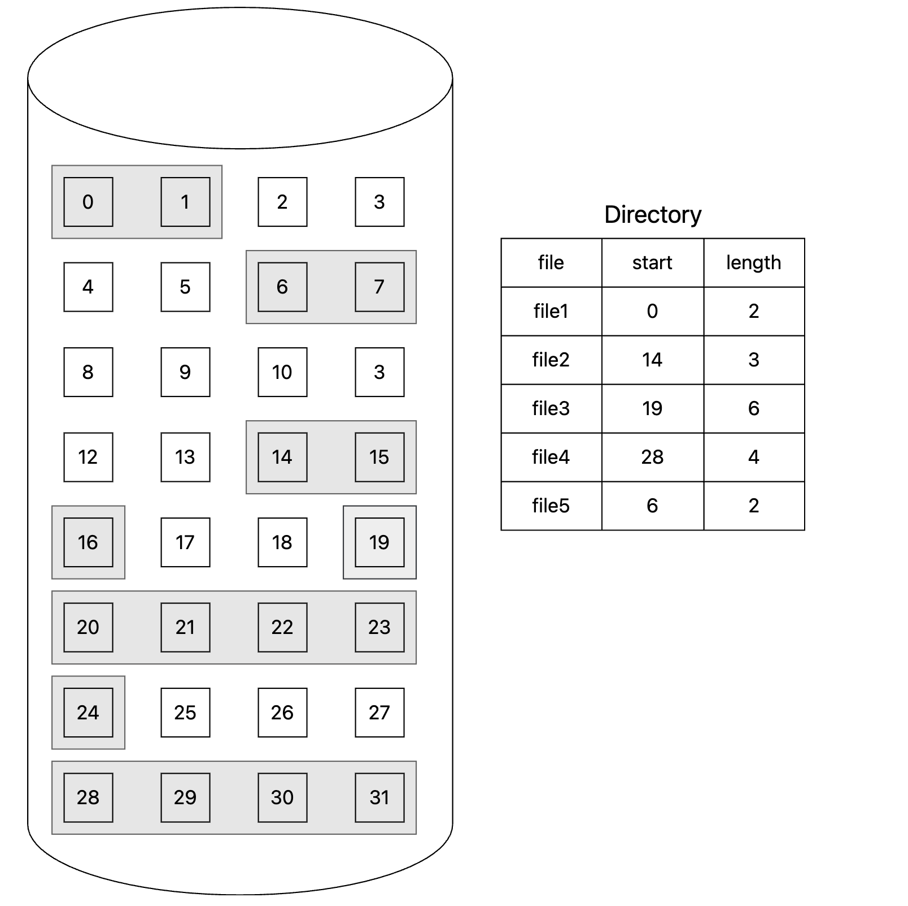

- **优点**：因为文件块的连续分配，查找的次数很少，**访问速度非常快**。
- **缺点**：存在内部和外部 **碎片化** 的问题，使得内存利用效率低下。增加文件大小困难，因为它取决于特定实例中连续内存的可用性。

#### 4.2 链式分配

在 **链式分配** 方案中，每个文件都是一个 **不需要连续的磁盘块链表**。磁盘块可以分散在磁盘上的任何地方。目录项包含指向起始和结束文件块的指针。每个块包含一个指针，指向文件所占用的下一个块。

目录项包含指向起始和结束文件块的指针。每个块包含一个指针，指向文件所占用的下一个块。

下图中的文件 “file1” 显示了块是如何随机分布的。最后一个块 (25) 包含 **-1**，表示空指针，不指向任何其他块。

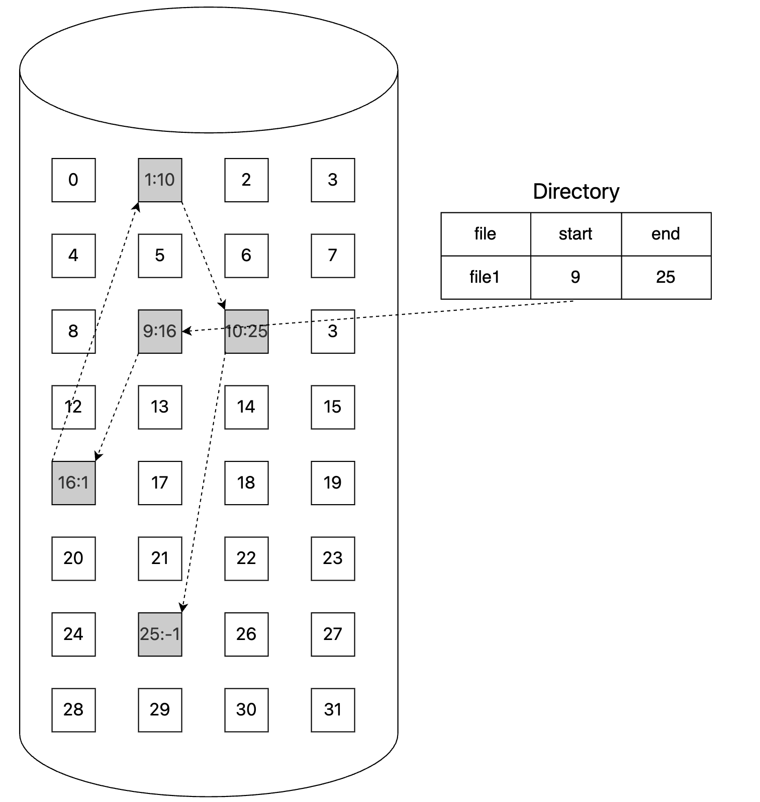

- **优点**：可以 **充分利用磁盘空间**，不会遭遇到碎片的问题。
- **缺点**：因为文件是在磁盘上随机分配的，所以访问一个文件的过程需要经历多次磁盘的检索，这使得文件读取的 **速度变慢**。

#### 4.3 文件分配表

基于链表的链接为 **隐式链接**，每个磁盘块的末尾包含文件的下一个盘块号。

**文件分配表** FAT 也是基于链接的方式，不过文件的 **链接方式是存储在一个表格当中**，表格包含两列，一列是 **盘块号**，另一列是在该文件盘块之后的 **下一个盘块号**，这种方式也叫做 **显式链接**。

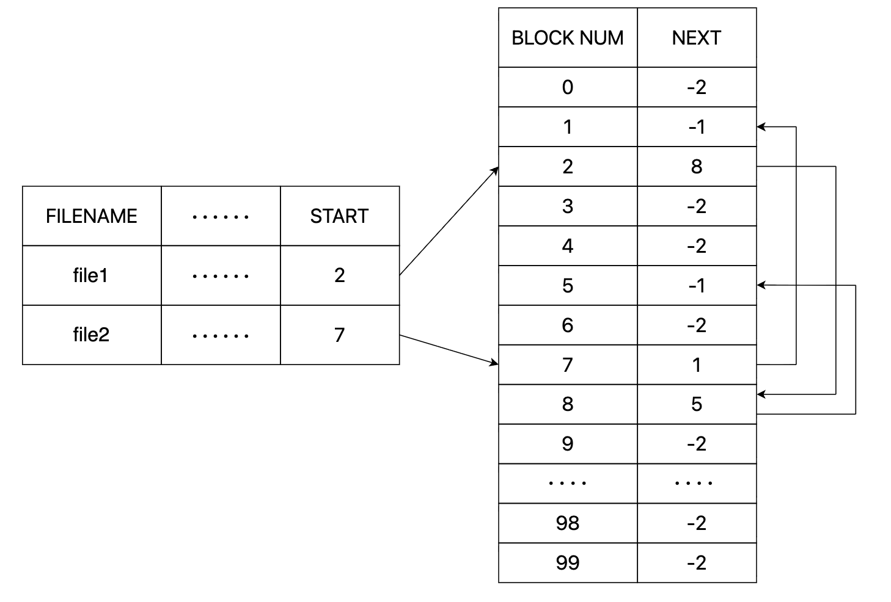

#### 4.4 索引分配

在 **索引分配** 中，一个文件所占用的所有盘块号被存储在另一个盘块中，这个盘块叫做 **索引块**（Index Block）。

假设一个文件的大小是 4MB，一个 **盘块的大小** 为 4KB，**盘块编号的大小** 为 4B（32 位）。 在这种情况下，文件需要用 1K 个盘块存储，**索引块** 的内容如下图所示：

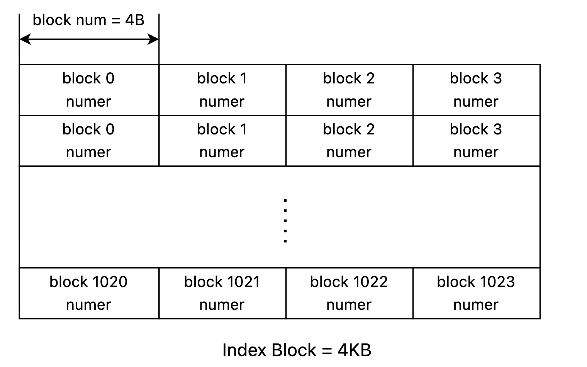

4KB 的盘块刚好可以存储下 1K 个盘块号作为索引，在读取文件时，操作系统先读取 **索引块**，确定存储文件的所有盘块号，再去读取所有存储有文件数据的盘块，如下图所示：

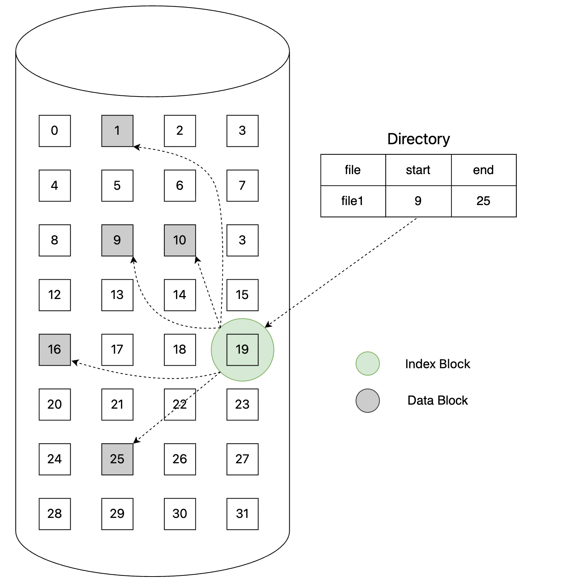

上图给出的索引是 **一级索引**，索引块的层级只有一层，索引块中直接存储数据块的盘块号。

在实践中还有 **多级索引**，其思路与 [多级页表](https://www.csgraduates.com/constitution_principle/storage/virtual/#多级页表) 一致。一级索引块中存储的是二级索引块的盘块号，最后一级索引块中才存储有数据块的盘块号。

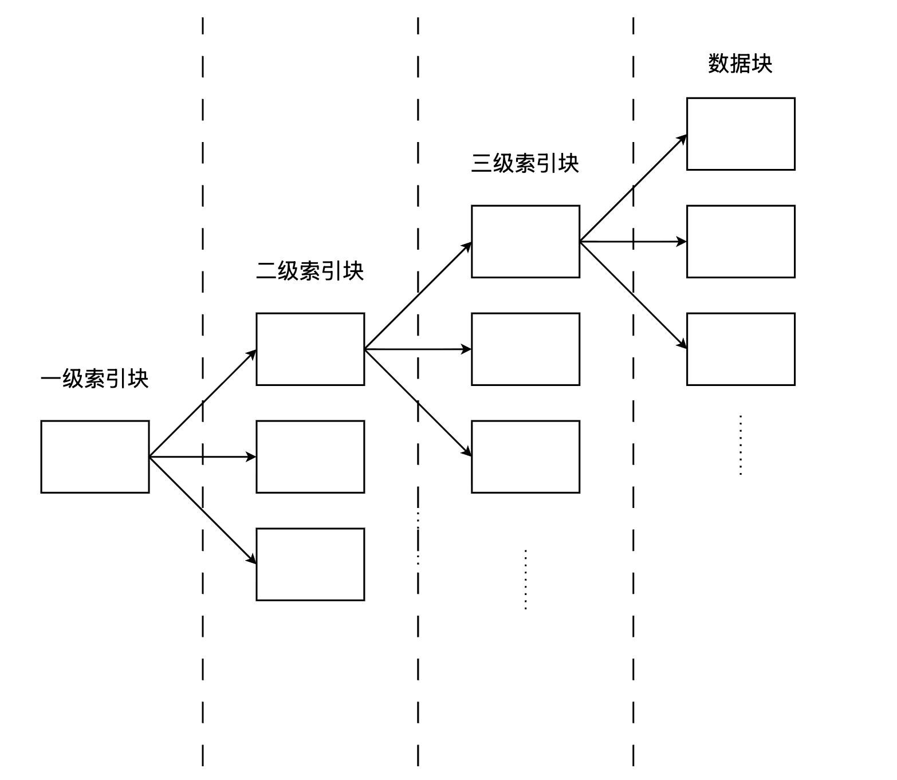

#### 4.5 混合索引

**N 级索引** 的一个显著缺点是：即使是只有两三个盘块的极小文件，也必须为其分配一个完整的 **索引块** 来保存这些数据块的盘块号。由于索引块的容量远大于实际需要，导致大量空间闲置，磁盘块的利用率极低。

为了解决这一问题，可以采用 **混合索引（combined allocation）** 的方式。该方式根据文件大小采用不同的存储策略：

- **小文件**（仅占少数盘块）直接使用 **直接块（direct blocks）**，把数据块的盘块号写入 inode 中的几个固定条目；
- **大文件** 则借助 **单级**、**双级** 或 **三级** 索引块进行间接寻址，以支持更大的文件规模。

**UNIX** 系统正是采用了这种混合索引结构。其 **inode**（如下图）由以下几部分组成：

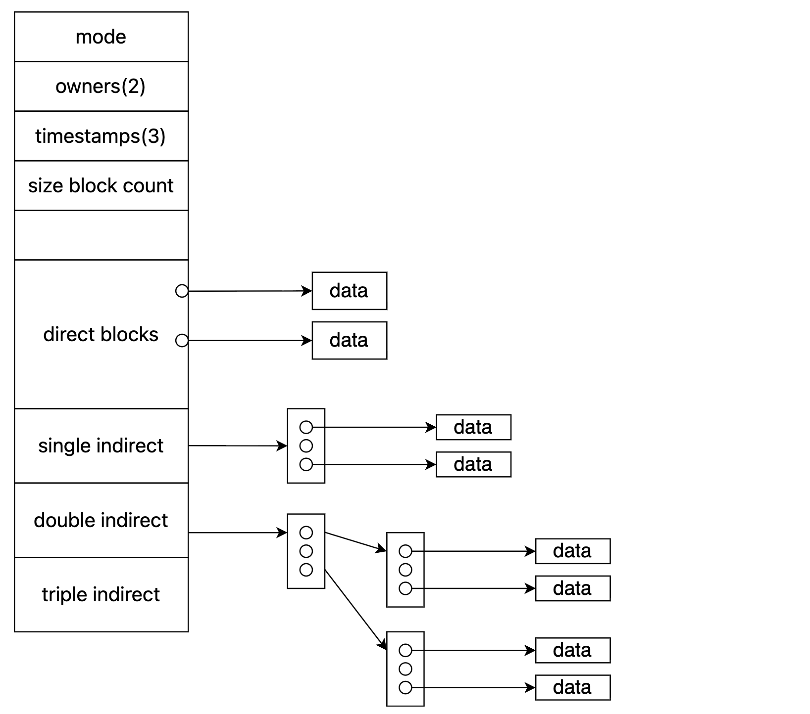

- **直接块**（Direct blocks）：若文件只有几块数据，则直接在这些条目中存放相应的盘块号，无需额外的索引块。
- **一级间接索引块**（Single indirect）：指向一个仅存放数据块号的块数组；
- **二级间接索引块**（Double indirect）：先指向若干一级索引块，再由这些一级索引块指向实际的数据块号；
- **三级间接索引块**（Triple indirect）：层层递进，最终定位到数据块号。

通过这种 **直接块 + 多级间接块** 的混合方案，系统能够在保证大文件可用的同时，避免小文件因占用完整索引块而造成的磁盘空间浪费，从而显著提升磁盘块的利用率并减少文件碎片的产生。

---

## 目录

### 一、目录概念

目录是计算机文件系统中用于组织和存储文件和其他目录的一种 **重要概念**。目录也被称为文件夹，它是文件系统中的一个 **关键组成部分**，用于创建层次结构，方便用户管理和浏览文件。

#### 1.1 树形目录

树形目录是一种 **层次化** 的文件组织结构，就像一棵倒置的树：

- **根目录（Root）** 是整个目录结构的起点，通常记为 `/`。
- **根目录** 下可以包含多个 **子目录** 和 **文件**，每个 **子目录** 下又可以包含更多的目录或文件，以此类推。
- 每个目录都可以看作是一个 **节点**，通过 **路径** 连接起来，形成一棵树。

举例目录结构如下（见图）：

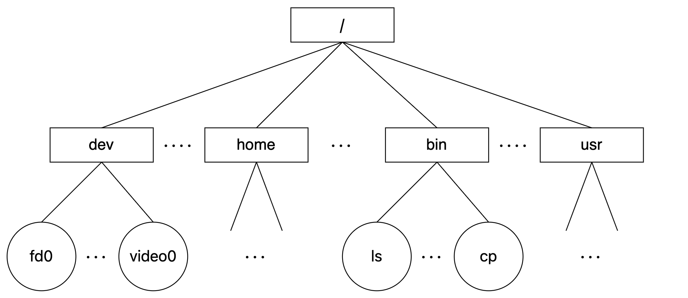

示例路径：

- `/docs/report.txt`：表示在 **根目录** 下的 `docs` **子目录** 中存在一个名为 `report.txt` 的 **文件**。
- `/img/photos/summer.jpg`：表示 **文件** `summer.jpg` 位于 `img/photos/` **目录** 下。

这种结构具备以下特点：

- **层次清晰**：便于用户查找和管理文件
- **路径唯一性**：每个文件或目录都有 *唯一的绝对路径*
- **支持相对路径**：可使用 `.` 表示当前目录，`..` 表示上级目录

#### 1.2 存储结构

在文件系统中，目录本质上就是一个 **特殊类型的文件**，它的“内容”是一个个 **目录项**（directory entry），用于记录当前目录下的 **文件** 和 **子目录** 的名字，以及它们对应的 **inode** 编号。

下图给出了目录的核心简化结构🧩：

```c
目录文件内容（一个个目录项）：
┌────────────────────────────┐
│ 文件名：.       → inode 100 │ ← 当前目录
│ 文件名：..      → inode  99 │ ← 父目录
│ 文件名：a.txt   → inode 123 │
│ 文件名：docs/   → inode 200 │
│ 文件名：img.jpg → inode 150 │
└────────────────────────────┘
```

每个 **目录项** 包括：

- 文件名（如 “a.txt”）
- 对应的 **inode** 编号（如 123），通过 **inode** 号查询 [inode表](https://www.csgraduates.com/operating_system/files/file/#inode-表) 可以获取文件的元信息。

这些信息保存在磁盘上的 **目录文件** 中，文件系统通过这些记录来解析 **路径**。

#### 1.3 操作

树形目录不仅提供了结构化的存储方式，用户还可以通过命令行对 **目录** 和 **文件** 进行多种操作：

```bash
// 1.目录操作
mkdir dir_name        # 创建新 目录
mv old_dir new_dir    # 移动或重命名 目录
rm -r dir_name        # 递归删除 目录 及其内容
ls -l dir_name        # 列出 目录 内容（详细信息）

// 2.文件操作
touch filename        # 创建一个空 文件
rm filename           # 删除 文件
mv old new            # 重命名或移动 文件
cp src dest           # 复制 文件
cat filename          # 显示 文件 内容

// 3.路径导航命令
cd /path/to/dir       # 进入指定 目录（绝对路径）
cd ..                 # 返回上级 目录
cd                    # 回到当前用户的主 目录
pwd                   # 显示当前 路径
```

### 二、文件链接

在 Linux 文件系统中，一个文件的 “名字” 其实只是 **目录项** 中的一个 **链接**（link）。文件的实际内容和元信息是保存在 **inode** 中的，而 **文件名** 只是“指向这个 **inode** 的引用”。基于这一设计，系统允许我们为同一个文件创建多个“名字”，这些名字就是所谓的 **文件链接**。

**文件链接** 分为两种：**硬链接** 和 **软链接**，它们实现方式不同，行为也有所差异。

#### 2.1 硬链接

硬链接（hard link）的本质，是在文件系统的目录存储结构中，为同一个 **索引节点**（inode）**创建多个目录项**。这些目录项分别对应不同的 **文件名**，但它们都指向同一个 **inode**，从而共享同一份 **文件数据**。

在 Linux 中你可以使用命令 `ln A D` 创建 `A` 的硬链接 `D`，它的含义是：在当前目录下创建一个名为 `D` 的 **新目录项**，该目录项与 `A` 指向同一个 inode ，从而实现两个文件名共享同一份文件内容。

```bash
$ echo "hello" > A
$ ln A B
$ ls -li A D
123456 -rw-r--r-- 2 user group 6 Jul 2  A
123456 -rw-r--r-- 2 user group 6 Jul 2  D
```

执行上述创建硬链接的命令后，系统中的目录会变为如下结构（简化）：

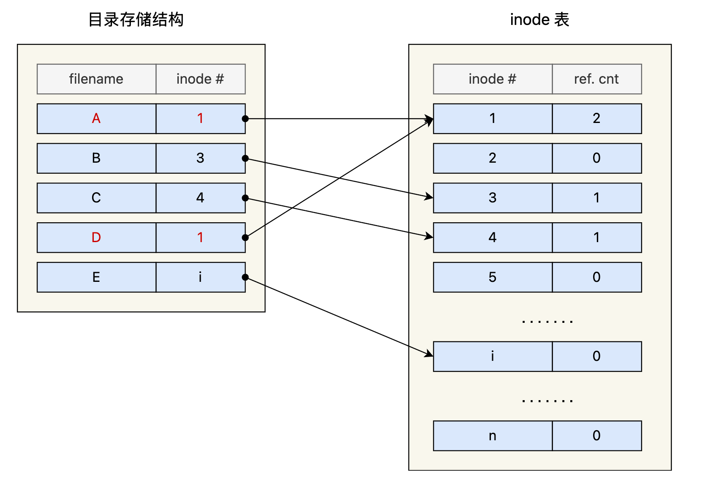

因此，硬链接实现了 **多个文件名访问同一个文件内容** 的效果：

- 所有硬链接文件 **共享同一个 inode 号**，指向同一个数据块，不会创建数据副本；
- 删除某一个硬链接，只是移除了对应的 **目录项**，并减少 inode 的 **链接计数**，不会影响其他链接；
- 只有当所有指向该 **inode** 的 **目录项** 都被删除时，该 **inode** 所占的数据块才会真正被释放；
- 出于文件系统一致性考虑，硬链接 **不能用于目录**，以防目录结构形成环；
- 硬链接 **仅限于同一个文件系统内部**，不能跨越挂载点或磁盘分区。

#### 2.2 软链接

软链接（也叫做 **符号链接**，symbolic link）的本质，是在文件系统中 **创建一个特殊类型的文件**，其内容是 **指向目标文件路径的字符串**。软链接自身拥有独立的 inode 和数据块，但并不直接指向目标文件的 inode，而是通过路径进行间接访问。

在 Linux 中你可以使用命令 `ln -s A L` 创建 `A` 的软链接 `L`，它的含义是：在当前目录下创建一个名为 `L` 的链接文件，其内容是 `"A"`，即指向 **文件** `A` 的路径。

```bash
$ echo "hello" > A
$ ln -s A L
$ ls -li A L
123456 -rw-r--r-- 1 user group 6 Jul 2  A
234567 lrwxrwxrwx 1 user group 1 Jul 2  L -> A
```

执行上述创建软链接的命令后，系统中的 **目录结构** 会变为如下形式（简化）：

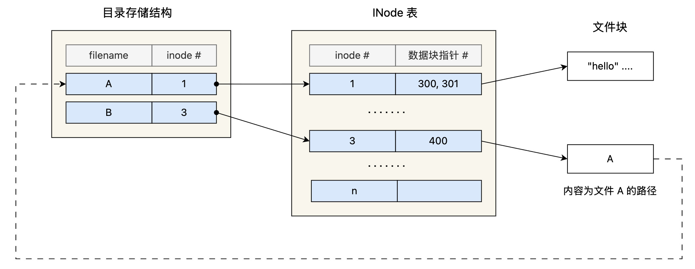

因此，软链接实现了 **路径级别的引用关系**，其行为特性如下：

- 软链接是一个 **独立的文件**，拥有自己的 **inode** 和数据块，数据块中存储的是目标路径（如 `"A"`）；
- 删除原文件后，软链接不会失效为独立文件，但会变成 **悬挂链接**（dangling link），无法再访问目标内容；
- 软链接 **可以跨文件系统使用**，也可以链接 **目录**，灵活性更高；
- 访问软链接时，系统会先读取其 **路径内容**，再根据该路径查找目标文件；
- **文件属性** 显示中，软链接使用 `l` 类型标识，显示类似 `L -> A` 的引用关系。

---

## 文件系统

### 一、功能

文件系统（**File System**）作为操作系统与存储设备之间的桥梁，负责数据的存储、访问、管理和保护。简单来说，文件系统主要包含以下功能：

1. 数据存储与组织
   - 文件系统以 **文件** 和 **目录** 的形式组织数据，将存储设备的物理空间划分为 **逻辑单元**（如文件、文件夹），便于用户和应用程序访问与管理数据。
2. 空间管理
   - 通过 **空闲块管理**（分配、回收、组织），文件系统高效利用存储空间，减少碎片，支持文件的创建、扩展和删除。常见方法包括 **连续分配**、**链接分配** 和 **索引分配**。
3. 数据访问与操作
   - 提供标准接口（如 **读**、**写**、**打开**、**关闭**）支持对文件的访问和操作，确保数据的高效检索和修改，同时支持 **随机访问** 和 **顺序访问**。
4. 数据保护和安全
   - 权限管理
   - 数据完整性校验


### 二、全局结构

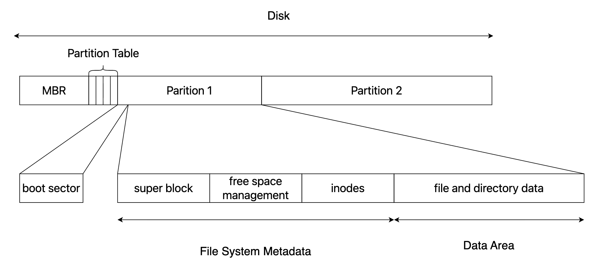

如上图所示，磁盘从逻辑上分为如下部分：

1. **引导区**（Master Boot Sector，**MBR**）：引导区位于磁盘的起始位置，通常是磁盘的第一个 **扇区**。它包含 **引导加载程序**（boot loader），用于引导操作系统。引导加载程序负责启动计算机并加载操作系统内核。
2. **分区表**（Partition Table）：分区表通常存储在磁盘的第一个扇区之后，用于记录磁盘上的 **分区信息**。分区表指示了磁盘上每个分区的起始位置、大小和文件系统类型。不同操作系统使用不同的分区表格式，如 MBR（Master Boot Record）和 GPT（GUID Partition Table）。
3. 分区（Partition）：分区中存储有文件系统，文件系统中包含元数据和数据区这两个部分。
   - 元数据：
     - **超级块**（Superblock）：包含文件系统的关键信息，在计算机启动时，超级块会被载入内存。超级块中包含的典型信息包括分区的块的数量、块的大小、空闲空间的管理方式等。
     - **空闲块信息**：管理磁盘中空闲块的存储数据，具体方法见下文空闲空间管理方法
     - **inodes**：管理文件的元数据
   - **数据区**：文件系统的 **数据区** 存储了实际的文件数据。这是存储文件内容的地方。文件系统会将文件数据分为一个或多个 **块** 或 **簇**，并将这些块分布在磁盘上的不同位置。文件系统的 **数据区** 通常占据了磁盘上的大部分空间。

下图是一个 **文件系统** 在 **分区**（Partition）上的存储示例，文件系统的 **元数据** 由 **superblock**、**inode 位图区**（inode bmap）、**数据块位图区**（data bmap）、**inode 存储区**（inode region）这四个部分构成。

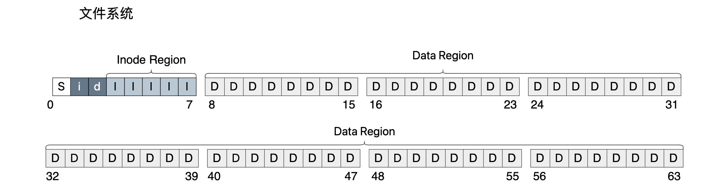

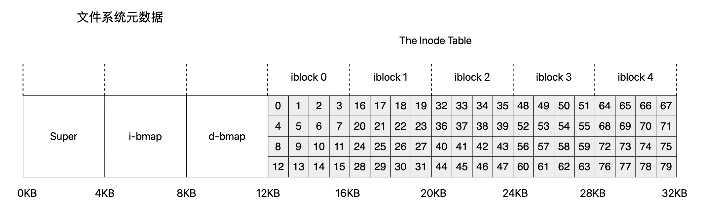


### 三、外存空闲管理

文件存储设备（如硬盘、SSD）将存储空间划分为多个大小相同的 **物理块**（通常为 *512字节*、*4KB* 或更大），以块为单位进行数据的读写和交换。因此，文件系统的外存管理实质上是对这些 **物理块**（特别是 **空闲块**）的组织、分配与回收的管理。以下详细说明空闲块管理的关键问题和方法：

#### 3.1 空闲表法

再该方法中，系统需要维护一张 **空闲块表**，用以记录磁盘上尚未分配的连续空闲块的所在位置和大小。表格的每一行描述一个空闲区段。

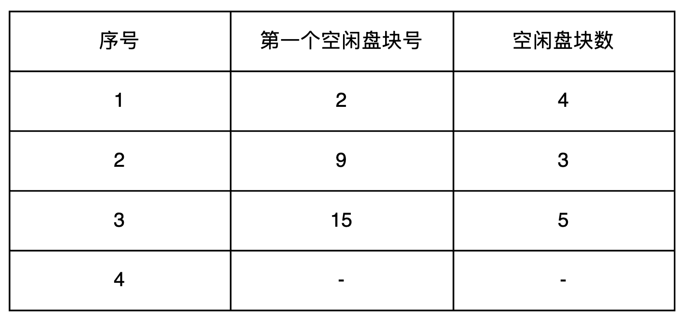

空闲块表应包含以下两个字段：

- **起始空闲盘块号**：该空闲区段的第一个盘块编号
- **空闲盘块数**：该区段中连续空闲盘块的数量

这样，空闲块表就能够清晰、完整地反映磁盘空间的空闲情况，为后续的块分配和回收提供可靠依据。

#### 3.2 空闲链表法

在本方法中，采用 **链表** 结构来组织和管理磁盘上的空闲数据块。链表的每个节点对应一个空闲块，并在节点中记录该块所在的磁盘块号（或块标识）。链表的头节点保存第一个空闲块的位置，随后每个节点的 **next** 指针指向 **下一个空闲块**，形成一条从头到尾依次链接的空闲块序列。

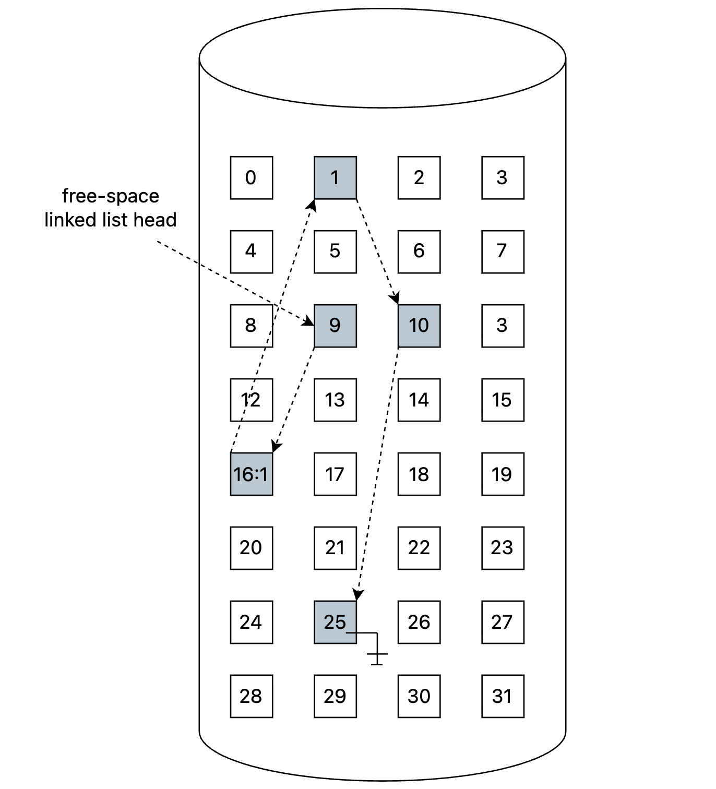

这样，所有空闲块就被构建成一条有序的链表：

- **分配时**：系统只需从链表头部取出一个节点，即可得到一个可用的磁盘块；随后将头指针移动到下一个节点，完成快速分配。
- **回收时**：释放的磁盘块会被重新包装成一个节点，插入到链表的适当位置（常见做法是插入链表头），从而实现 O(1) 的回收操作。
- **遍历和合并**：在需要对空闲块进行合并或统计时，只需顺序遍历链表即可，所有空闲块的位置信息都已在节点中明确记录，避免了额外的查找开销。

因此，使用链表来管理空闲块既能保证在高频的分配/回收场景下保持低时间复杂度，又能通过一次遍历轻松实现空闲空间的统计与碎片整理，提升整体存储系统的效率和可靠性。

#### 3.3 位图法

**位图**（Bitmap）是一种用二进制位数组来管理磁盘块的技术。位图中的每一位（bit）对应磁盘上一个固定大小的数据块（通常为 4 KB、8 KB 等），通过该位的取值即可快速判断该块的使用状态。

- **0**：对应的数据块为空闲块，意味着它尚未被分配，可以用于存放新文件的数据。
- **1**：对应的数据块已被占用，已经分配给某个文件，不能再被其他文件使用。

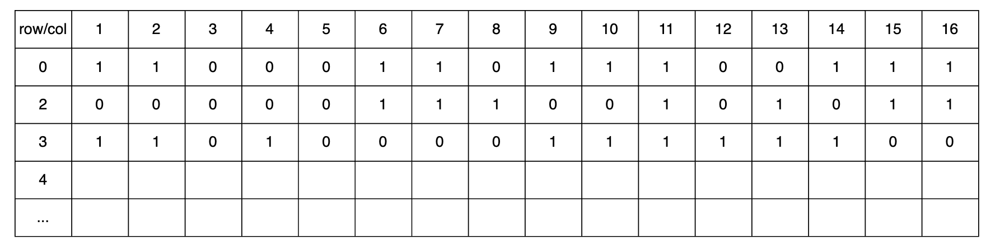

位图 **使用流程**

1. **初始化**：在文件系统创建时为整个磁盘块集合生成位图，初始全部置为 0（空闲）。
2. **分配块**：当文件需要写入数据时，系统在位图中搜索第一个 0 位，找到后将该位改为 1，并返回对应的块号给文件系统。
3. **回收块**：文件被删除或其数据块被释放时，系统把对应的位恢复为 0，表示该块重新进入空闲池。
4. **持久化**：位图通常被写入磁盘的固定位置（例如超级块或专门的位图块），以保证系统重启后仍能恢复块的使用状态。

#### 3.4 成组链接法

**成组链接法** 的实现细节相对繁琐，这里只要求掌握其核心思想（在选择题中出现的概率较低，但仍值得了解）。

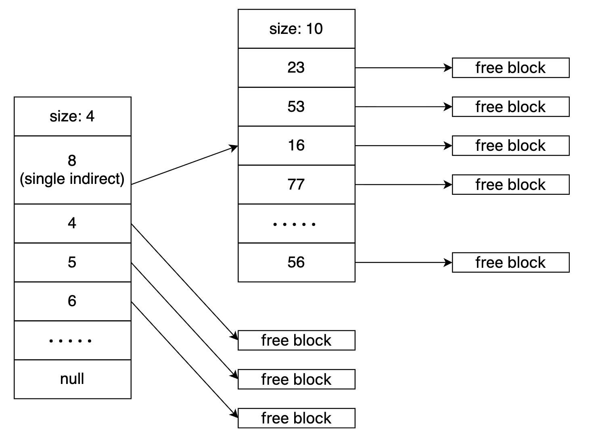

其基本思路与[文件混合索引分配方式](https://www.csgraduates.com/operating_system/files/file/#5-混合索引)相似：**使用一个磁盘块来保存若干空闲盘块号**，并通过链表把这些块组织起来。具体做法如下：

1. 建立第一个空闲块组
   - 选取一个磁盘块 **A** 作为“空闲块组”。
   - 在 **A** 中依次记录一定数量（如 10 ~ 20）个空闲盘块的盘号。
   - 当 **A** 中的记录已满时，说明当前组已经没有预留的空闲盘号。
2. 扩展空闲块组
   - 为了继续记录后续的空闲盘块，需要再分配一个新的磁盘块 **B**。
   - **B** 同样用来保存若干空闲盘号。
   - 为实现组之间的连接，在 **B** 中的某个位置（通常是第一个记录位）存放 **A** 的盘块号，这个盘号充当“一阶间址”，即指向前一组的头结点。
   - 同时，**A** 需要保存 **B** 的盘块号，以便在遍历空闲块链时能够顺利跳到下一组。
3. 空闲块的分配与回收
   - 当需要分配空闲盘块时，直接从当前组（如 **A**）的记录列表中取出一个盘号即可。
   - 如果取完后该组的记录为空，则将指向下一组 **B** 的指针提升为新的当前组，继续从 **B** 中取号。
   - 回收空闲盘块时，只需把盘号重新写入当前组的记录列表；若当前组已满，则按上述方式再申请一个新组并把该盘号写入新组的首位。

成组链接法通过“块内多址+块间链表”的组合方式，兼顾了存储密度和访问效率，是一种在文件系统中常用的空闲空间管理策略。

### 四、虚拟文件系统

**虚拟文件系统**（**Virtual File System**，简称 **VFS**）是一种位于操作系统内核中的抽象层，它为各种底层文件系统提供统一的访问入口。通过 VFS，操作系统能够把不同存储介质（本地磁盘、网络共享、光盘等）和各类文件系统的实现细节屏蔽掉，使上层的系统调用和用户程序只需要面对一套一致的接口，而无需关心文件实际存放在哪里、采用何种组织方式。

VFS 的核心目标有三点：

1. **统一接口**：为所有文件系统提供统一的 API（如 `open`、`read`、`write`、`close` 等），保证应用程序在对文件进行操作时的代码始终相同。
2. **提升可扩展性**：只要新的文件系统实现了 VFS 定义的接口，就可以通过注册驱动或模块的方式无缝加入系统，而无需修改内核其它部分。
3. **增强可移植性**：同一套系统调用在不同硬件平台或不同底层文件系统上均能工作，从而简化了跨平台软件的开发。

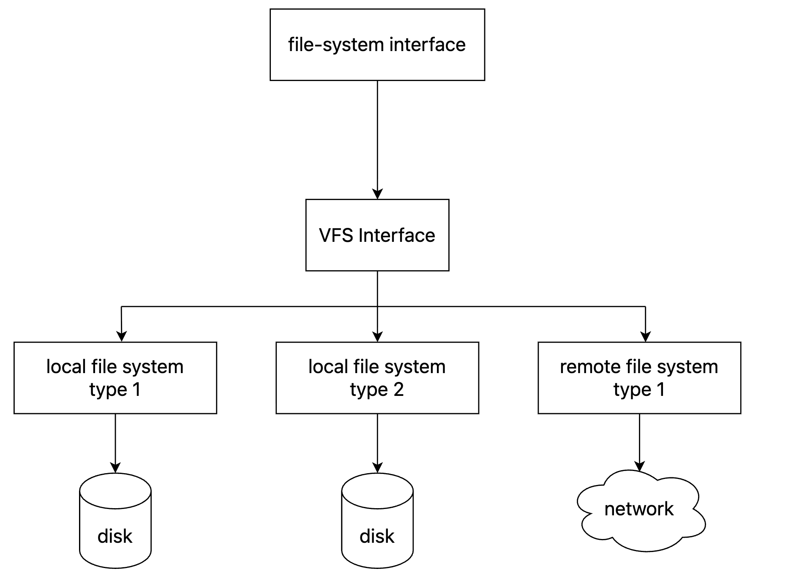

在 VFS 的架构中，每一种具体的文件系统（例如 ext4、NTFS、NFS、ISO 9660 等）都会实现一套内部的操作函数，并在启动时向 VFS 注册自己的驱动或模块。当应用程序发起文件操作时，流程大致如下：

1. **系统调用入口**：用户态程序调用如 `open()`、`read()` 等系统调用。
2. **VFS 调度**：VFS 接收到请求后，根据文件路径解析出对应的挂载点（mount point），进而确定使用哪一个底层文件系统。
3. **转发到具体实现**：VFS 将请求转交给已注册的文件系统驱动，由它完成实际的磁盘读取、网络通信或光盘访问等操作。
4. **结果返回**：底层文件系统返回操作结果，VFS 再把结果封装回系统调用的返回值，交给用户程序。

通过上述机制，应用程序能够实现 **跨文件系统的透明访问**，即无论文件位于本地硬盘、远程服务器还是光盘上，使用的代码完全相同。这种抽象不仅简化了软件开发，还为操作系统的模块化设计提供了坚实的基础。

### 五、文件系统挂载

**文件系统挂载** 是指把一个独立的文件系统与操作系统的目录结构（即文件树）关联起来，使得该文件系统中的文件和目录能够被正常访问和管理。简而言之，挂载的过程就是把存储介质（如硬盘分区、U 盘、光盘、网络共享等）上的文件系统“接入”到操作系统的统一命名空间中。

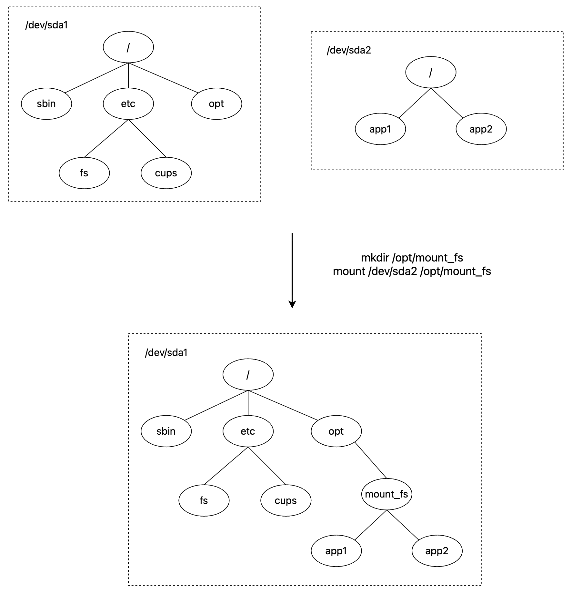

在大多数现代操作系统，文件系统挂载是一个必不可少的步骤，具体表现为：

1. **识别存储设备**
   系统先检测到设备的出现（如插入 U 盘、插入光驱、网络共享被建立），并确定该设备所使用的文件系统类型（ext4、NTFS、FAT32、ISO 9660、NFS、SMB 等）。
2. **选择挂载点**
   挂载点是文件树中的一个目录，系统会在该目录下“挂上”外部文件系统。挂载点本身必须是一个已存在且为空的目录（在 Linux/Unix 中常见的挂载点有 `/mnt`、`/media`、`/boot` 等），而在 Windows 中则对应于盘符（如 `D:`、`E:`）。
3. **执行挂载操作**
   操作系统调用相应的挂载函数，将外部文件系统的根目录映射到挂载点。挂载完成后，用户和应用程序通过访问挂载点即可透明地读取、写入该文件系统中的文件，就好像这些文件本来就在本地目录一样。
4. 管理与维护
   - **挂载选项**：可以在挂载时指定只读、只写、用户权限、同步/异步等选项，以满足安全性或性能需求。
   - **自动挂载**：在 Linux 中，`/etc/fstab` 文件或 `systemd` 的 `automount` 单元可以实现系统启动时自动挂载；在 Windows 中，使用 “磁盘管理” 或组策略设置网络驱动器的自动映射。
   - **卸载**：使用 `umount`（Linux/Unix）或 “安全移除硬件”（Windows）将文件系统从挂载点分离，以防止数据丢失。

挂载可以提供以下优势：

- **统一命名空间**：无论底层是本地磁盘、光盘还是远程网络共享，所有资源都在同一棵目录树下呈现，简化了路径管理。
- **跨文件系统协同**：不同类型的文件系统（如 ext4 与 NTFS）可以并存，用户无需关心底层格式，只需通过统一的路径访问即可。
- **资源隔离与安全**：通过挂载选项可以限制对特定文件系统的读写权限，保护敏感数据不被意外修改。


