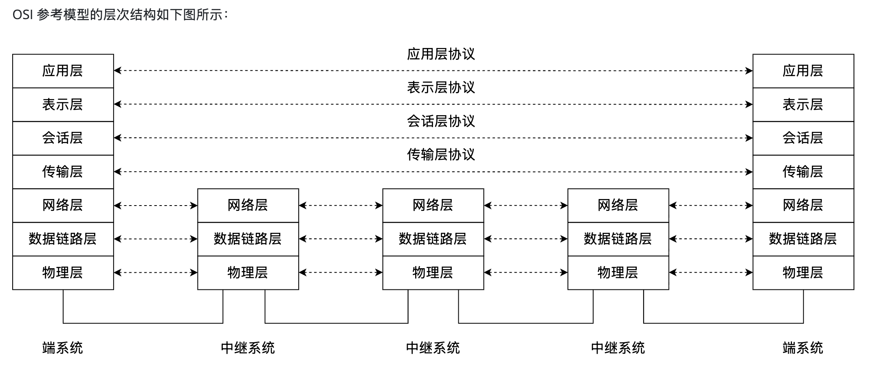
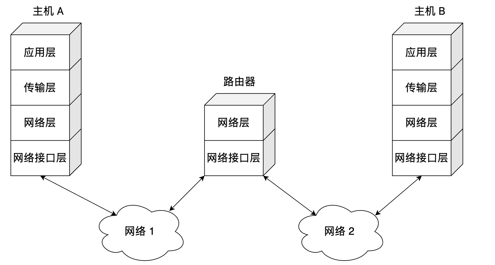
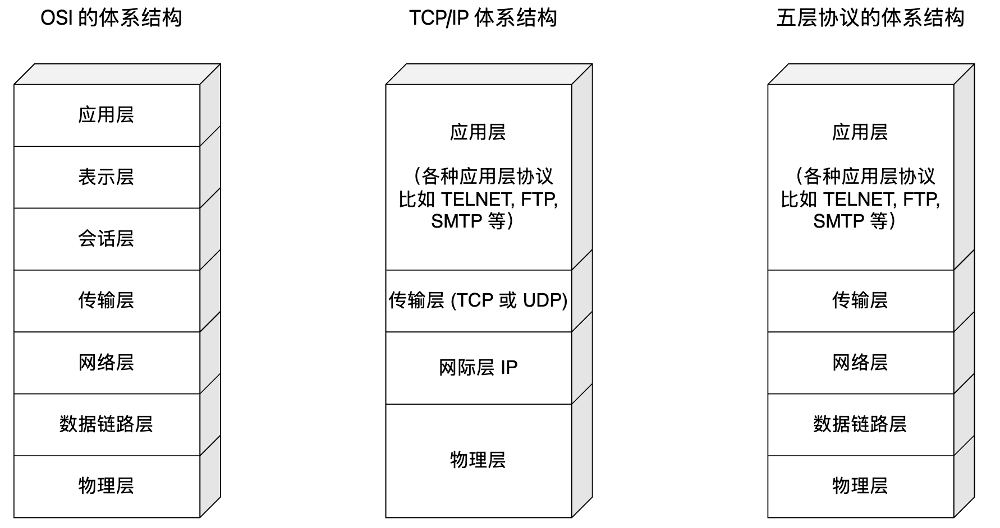
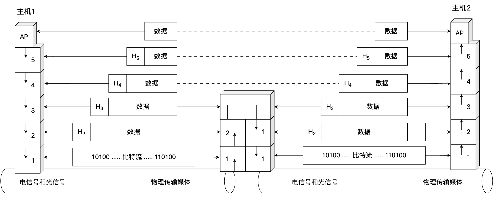
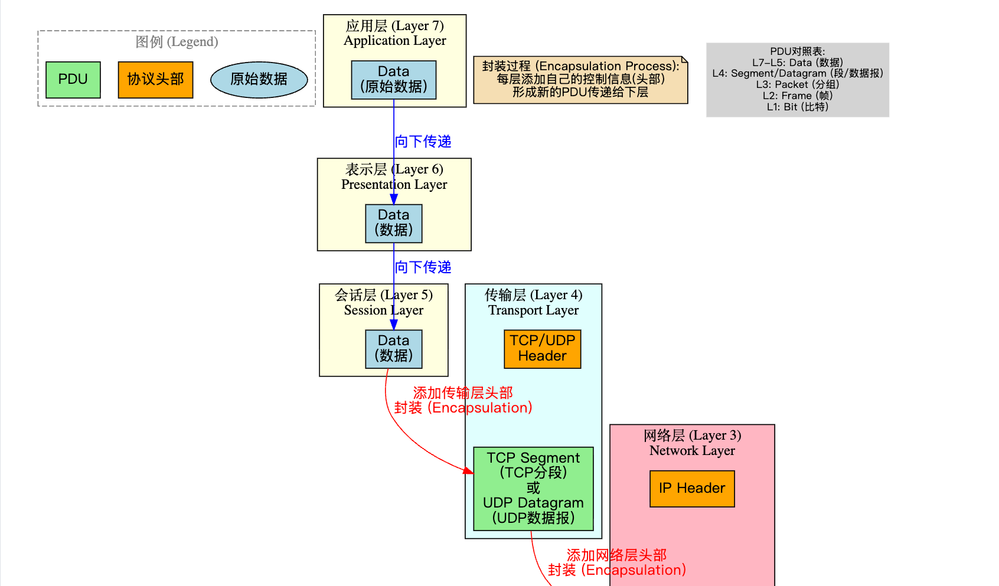
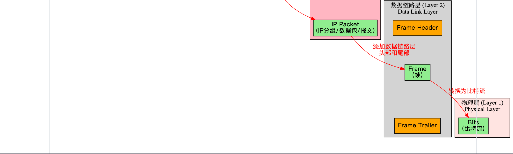
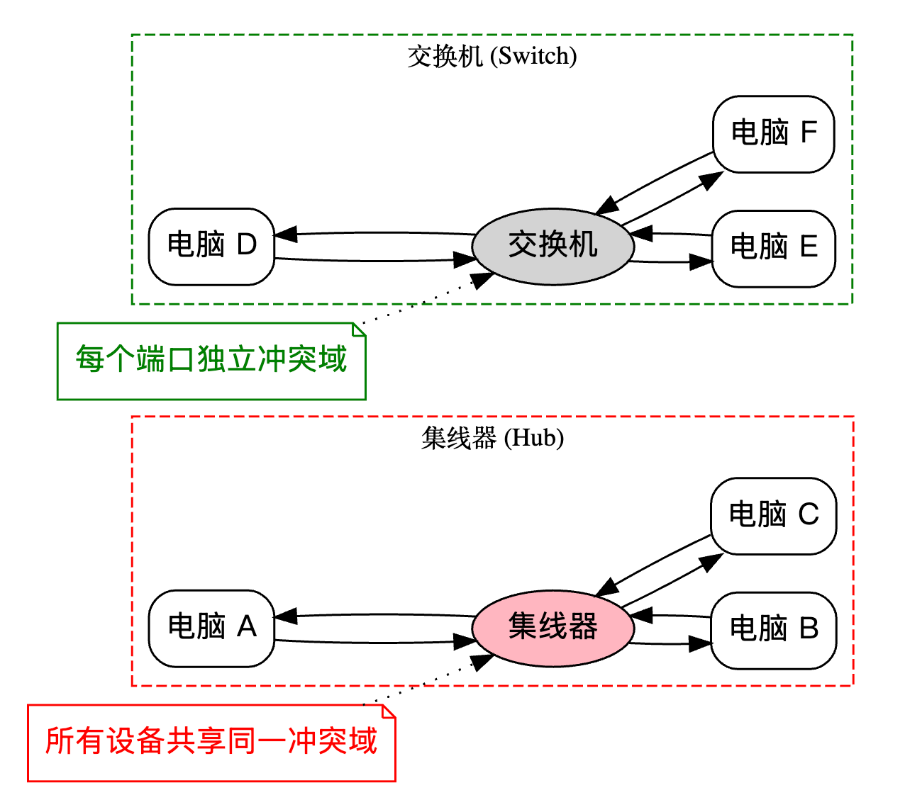
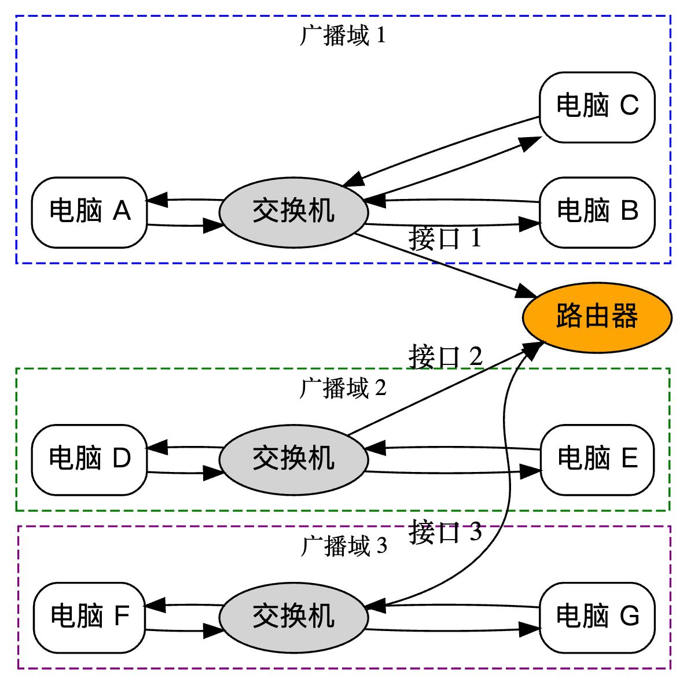
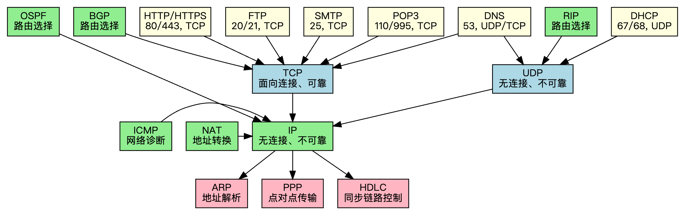

# 计算机网络体系结构

## 分层结构

### 一、ISO/OSI模型

**OSI 参考模型** 有 *7 层*，自下而上依次为：物理层、数据链路层、网络层、传输层、会话层、表示层、应用层（记忆：物链网输会示用）

低三层统称为 **通信子网**，它是为了联网而附加的通信设备，完成数据的传输功能

**传输层** 承上启下

高三层统称为 **资源子网**，它相当于计算机系统，完成数据的处理等功能。

#### 1.1 物理层

物理层的传输单位是 **比特**，功能是在物理媒体上为数据端设备透明地传输原始比特流，不用参与数据封装工作。为了实现该功能，物理层需要定义 **硬件设备标准**，如电缆类型、接口类型、电压标准等。

#### 1.2 数据链路层

数据链路层的传输单位是 **帧**，两台主机之间的数据传输总是在一段一段的链路上传送的，这就需要使用专门的链路层协议。

数据链路层将网络层交来的 IP 分组封装成帧，并且可靠地传输到相邻结点的网络层。主要作用是加强物理层传输原始比特流的功能，将物理层提供的可能出错的物理连接改造为尽可能可靠的 **数据链路**。数据链路层的功能可以概括为：**物理寻址**、**组帧**、**差错控制**、点对点流量控制、数据重发和传输管理等。

#### 1.3 网络层

**网络层**（Netweork Layer）的传输单位是 **数据报**，它关心的是通信子网的运行控制，主要任务是把网络层的 **协议数据单元**（分组）从源端传到目的端，为分组交换网上的不同主机提供通信服务。关键问题是对分组进行 **路由选择**，并实现整个网络的流量控制。

#### 1.4 传输层

**传输层**（Transport Layer）的传输单位是报文段或用户数据报，传输层负责主机中两个进程之间的通信，功能是为 **端到端** 连接提供可靠的传输服务，为 **端到端** 连接提供流量控制（端到端）、差错控制、服务质量、数据传输管理等服务。

数据链路层提供的是 **点到点** 的通信，传输层提供的是 **端到端** 的通信，两者不同。点到点 可以理解为主机到主机之间的通信；端到端的通信是指运行在 **不同主机内的两个进程之间的通信**，只有传输层及以上各层的通信才能称为端到端。

#### 1.5 会话层

**会话层**（Session Layer）允许不同主机上的各个进程之间进行会话。这 **会话** 这种服务主要为用户进程建立连接，并在连接上有序地传输数据，这就是 会话。

会话层负责管理主机间的会话进程，包括建立、管理及终止进程间的 **检查点** 机制来维持可靠会话，使通信会话在通信失效时从检查点继续恢复通信，即断点下载的原理。

#### 1.6 表示层

**表示层** 主要处理在两个通信系统中交换信息的表示方式。不同机器采用的 **编码** 和表示方法不同，使用的数据结构也不同。为了使不同表示方法的数据和信息之间能互相交换，表示层采用抽象的标准方法定义数据结构，并采用标准的 **编码** 形式。此外，**数据压缩**、加密和解密 也是表示层的功能。

#### 1.7 应用层

应用层是 OSI 参考模型的最高层，是用户与网络的接口。应用层为特定类型的网络应用提供访问 OSI 参考模型环境的手段。因为用户的实际应用多种多样，这就要求 **应用层** 采用不同的应用 **协议** 来解决不同类型的应用要求，因此 **应用层** 是最复杂的一层，使用的 **协议** 也最多

### 二、TCP/IP模型

**TCP/IP 模型** 有4层 ，从低到高依次为：网络接口层、网际层、传输层、应用层

- **网络接口层**：对应 **OSI 参考模型** 中的物理层和数据链路层
- **网际层**、**传输层** 和 **应用层**：对应 **OSI 参考模型** 中的会话层、表示层和应用层）
- **TCP/IP** 由于得到广泛应用而成为事实上的国际标准

**TCP/IP 模型** 的层次结构如下图所示：

**TCP/IP 模型** 与 **OSI 模型** 的不同点在于 **网络接口层** 和 **应用层**，可以理解为 **TCP/IP 模型** 中这两层涵盖了 **OSI 协议** 中多层的功能：

学习计算机网络时，我们往往采取折中的办法，即综合 **OSI 参考模型** 和 **TCP/IP 模型** 的优点，采用一种如下图所示的只有 **5 层协议** 的体系结构，即我们所熟知的【物理层、数据链路层、网络层、传输层和应用层】。

### 三、协议数据单元

在网络中，**协议数据单元**（**PDU**，Protocol Data Unit）是指在某一层协议中传输的数据单元。每一层在接收来自上一层的数据时，都会在其头部添加控制信息（称为首部 Header），然后将其当作一个新的 PDU 交给下一层处理。这就是所谓的 **封装** 过程。

| OSI 层级     | PDU 名称                                                     |
| ------------ | ------------------------------------------------------------ |
| 7 应用层     | Data（数据）                                                 |
| 6 表示层     | Data（数据）                                                 |
| 5 会话层     | Data（数据）                                                 |
| 4 传输层     | UDP Datagram（UDP 数据报） TCP Segment（TCP 数据段、TCP 分段） |
| 3 网络层     | IP Packet（IP 分组，IP 数据包，IP 报文）                     |
| 2 数据链路层 | 帧（Frame）                                                  |
| 1 物理层     | 比特（Bit）                                                  |

---

## 网络设备总结

### 一、冲突域

**冲突域** 是指在以太网中，当两个设备同时发送数据时，**可能发生冲突的一组网络设备所组成的区域**。在这个区域内，如果两个或多个设备同时发送帧，由于 **共享介质** ，就会产生数据冲突，导致通信失败，需要重新发送。

📌 **冲突发生的根本原因：**

以太网（尤其是早期使用 **共享总线** 或 **集线器** 的方式）采用了 [**CSMA/CD 协议**](https://www.csgraduates.com/computer_network/datalink/mac/#csmacd-协议)（载波监听多路访问/冲突检测） 协议：

1. 每个设备发送前先监听是否有信号；
2. 如果发现没人发，就开始发；
3. 如果两个设备几乎同时监听到空闲并发送，就会发生 **冲突** 。

冲突域的边界由 **二层设备（如集线器和交换机）** 决定：

- **集线器**（Hub）：所有端口共享同一个冲突域。连接在集线器上的设备同时发送数据会发生碰撞，因此无法隔离冲突域。
- **交换机**（Switch）：每个端口形成独立冲突域，设备之间的发送不会互相干扰，从而有效隔离冲突。

### 二、广播域

**广播域** 指通过广播方式发送的数据包能够到达的所有主机组成的网络范围。通常，我们讨论的是 **IP 层的广播域**（ARP 广播也属于此类）。

在同一个 IP 广播域内，设备可以相互接收广播消息。举例来说：如果电脑 A 发送一个广播报文（例如 `192.168.1.255`），同一广播域内的电脑 B 和电脑 C 都能够接收到该消息。

广播域的边界由 **三层设备（如路由器）** 决定：

- **交换机（Switch）**：仅在二层转发帧，不会阻止广播，广播帧会发送到除来源端口以外的所有端口。
- **路由器（Router）**：在三层划分网络，会阻止广播，因此每个路由器接口形成一个独立的广播域。

### 三、设备功能

下表给出了不同设备的层次以及是否能够隔离冲突域和广播域：

| 设备                                                         | 功能描述                           | 设备位于哪一层 | 隔离 **冲突域** ？ | 隔离 **广播域** ？ |
| ------------------------------------------------------------ | ---------------------------------- | -------------- | ------------------ | ------------------ |
| [中继器](https://www.csgraduates.com/computer_network/physical/dev/#中继器) | 放大或再生数字信号                 | 物理层         | ❌                  | ❌                  |
| [集线器](https://www.csgraduates.com/computer_network/physical/dev/#集线器) | 多个设备的连接，广播所有传入的数据 | 物理层         | ❌                  | ❌                  |
| [网桥](https://www.csgraduates.com/computer_network/datalink/dev/#网桥) | 连接并分隔局域网的段落，减少冲突   | 数据链路层     | ✅                  | ❌                  |
| [交换机](https://www.csgraduates.com/computer_network/datalink/dev/#交换机) | 连接多个设备，仅向目标设备转发数据 | 数据链路层     | ✅                  | ❌                  |
| [路由器](https://www.csgraduates.com/computer_network/network/dev/#路由器) | 连接不同的网络并路由数据           | 网络层         | ✅                  | ✅                  |

---

## 各层协议总结

### 一、网络协议要素

网络协议规定了通信双方交互的规则，主要包括以下三要素：

- **语法** ：定义信息的格式和结构（如报文结构、编码方式等）
- **语义** ：规定控制信息的含义和需要完成的操作
- **时序** ：定义事件的发生顺序和通信双方的协同工作方式（如请求与响应的先后顺序）

### 二、应用层协议

应用层协议直接面向用户，为应用程序之间的通信提供服务：

| 协议           | 端口号                         | 依赖协议                | 简要说明                                                     |
| -------------- | ------------------------------ | ----------------------- | ------------------------------------------------------------ |
| **HTTP/HTTPS** | *80* / *443*                   | **TCP**                 | 超文本传输协议，用于网页浏览。HTTPS 是加密版本，基于 TLS/SSL。 |
| **FTP**        | *20* / *21*                    | **TCP**                 | 文件传输协议，用于文件上传与下载。20 为数据通道，21 为控制通道。 |
| **SMTP**       | *25*                           | **TCP**                 | 简单邮件传输协议，用于邮件的发送。                           |
| **POP3**       | *110* / *995*                  | **TCP**                 | 邮局协议，用于从邮件服务器接收邮件。995 是加密版本（POP3S）。 |
| **DNS**        | *53*                           | **UDP**（部分 **TCP**） | 域名系统，将域名解析为 IP 地址。较大响应或区域传输时使用 **TCP**。 |
| **DHCP**       | *67*（服务器）/ *68*（客户端） | **UDP**                 | 动态主机配置协议，用于自动分配 IP 地址及其他网络参数。       |

### 三、传输层协议

传输层为应用进程间提供可靠或不可靠的数据传输服务：

- **TCP** （Transmission Control Protocol） ：面向连接，提供可靠的字节流服务，适用于要求高可靠性的应用（如 **HTTP**、**FTP**）。
- **UDP** （User Datagram Protocol） ：无连接，不保证可靠性，但开销小、速度快，适用于实时性要求高的场景（如 **DNS**、视频流）。

### 四、网络层协议

网络层负责实现数据包从源主机到目标主机的传输：

- **IP** （Internet Protocol） ：不可靠的无连接协议，提供数据报服务，是整个互联网的核心协议。
- **ICMP** （Internet Control Message Protocol） ：用于发送错误报告与网络诊断信息（如 ping 命令使用的就是 **ICMP** 回显请求）。
- **RIP / OSPF / BGP** ：路由选择协议，主要用于自治系统内部（RIP、OSPF）或之间（BGP）的路由计算
- **NAT** （Network Address ）：网络地址转换，在私网和公网之间转换 IP 地址

### 五、数据链路层协议

数据链路层负责将网络层传来的数据组装成帧，在链路上传输并进行差错控制：

- **ARP** （Address Resolution Protocol） ：地址解析协议，用于将 IP 地址解析为对应的 MAC 地址。
- **PPP** （Point-to-Point Protocol） ：点对点协议，用于点对点链路的数据传输，常用于拨号上网。
- **HDLC** （High-Level Data Link Control） ：高级数据链路控制协议，用于同步链路的帧传输，支持面向比特流的通信。