# 物理层

## 通信概念

### 一、接口特性

物理层定义了设备之间如何通过电缆、无线等物理媒介进行通信。物理层具有以下四种 **接口特性**：

- 机械特性：描述物理连接设备的外部物理形态和接口规范，主要包括：
  - 接口的形状（如RJ45、USB等）
  - 接口的引脚数量和排列顺序
  - 电缆的类型（双绞线、光纤、同轴电缆等）
- 功能特性：说明各个接口引脚具体的功能，例如：
  - 哪个引脚负责发送数据（Tx）
  - 哪个引脚负责接收数据（Rx）
  - 哪些引脚用于控制信号，如握手（RTS/CTS）
- 过程特性：定义了在数据传输过程中，各种物理信号是如何协作完成数据通信的过程，例如：
  - 传输起始与终止的方式
  - 信号同步的机制
  - 比特之间如何区分（串行或并行）
- 电气特性：规定了物理层信号的 电气属性，包括：
  - 电压的幅值（高电平/低电平）
  - 电流大小
  - 信号的传输速率和传输距离
  - 信号的上升沿、下降沿

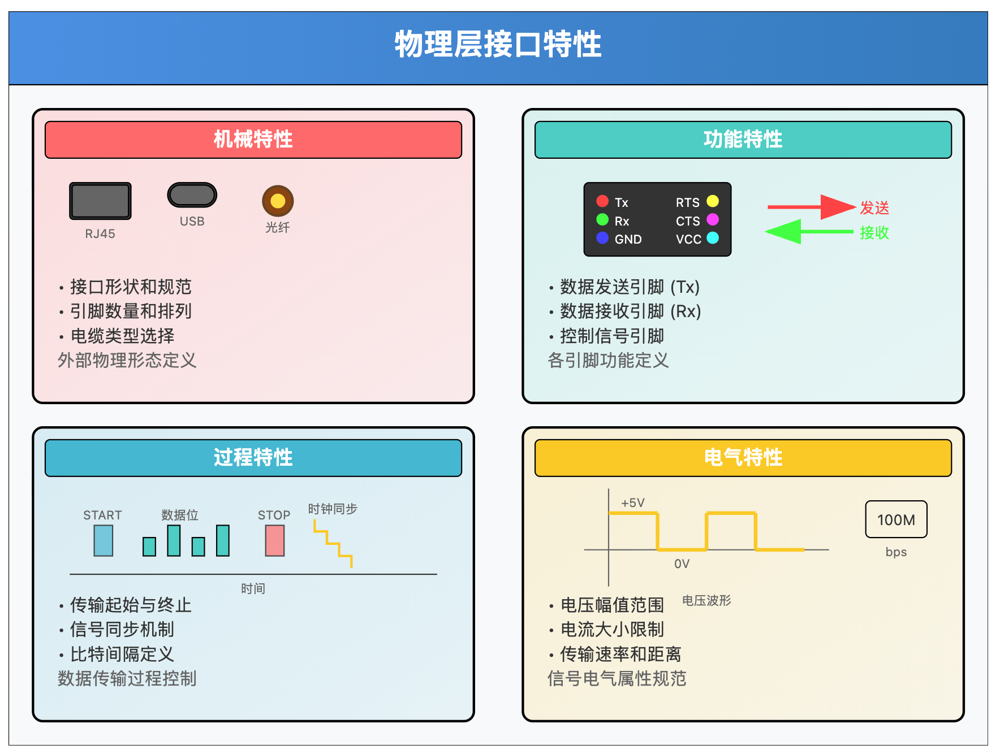

### 二、通信指标

#### 2.1 信道

与 **信道** 相关的概念有四个，需要能够辨别这几个名词：

- **信道 (Channel)**：是指进行信息传输的媒介或路径。这可能是一个物理的媒介，例如电缆，或者是无线的，如无线电波。
- **信号 (Signal)**：是载有信息的物理现象。例如，电信号、光信号或无线电波。
- **信源 (Source)**：产生或发送信息的设备或实体。
- **信宿 (Sink or Destination)**：是指接收信息的设备或实体。

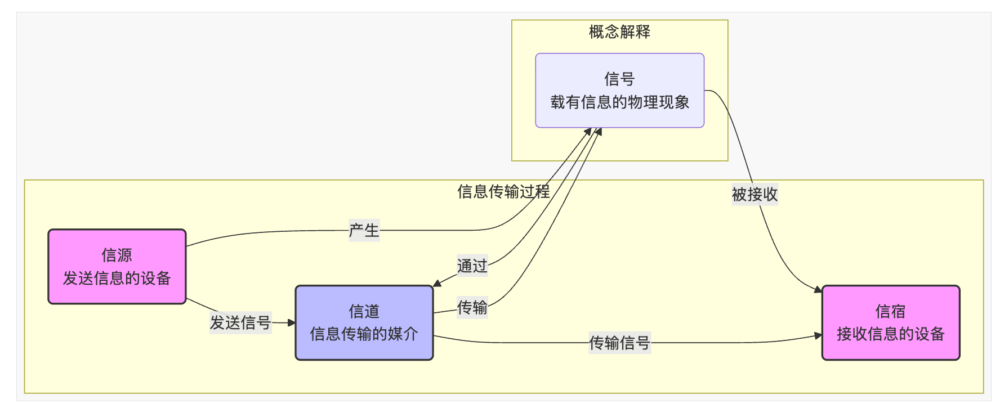

#### 2.2 码元

一个 **码元**（symbol）就是一个脉冲信号，一个脉冲信号有可能携带 1bit 数据，也有可能携带 2bit 数据、4bit 数据。

那么怎么实现一个脉冲信号就能携带多个 bit 数据呢？我们可以通过 **调制技术** 来实现，比如设置模拟信号中信号的频率、相位、**振幅** 等。

举个例子：把 **振幅** 分成四种，低（00）、中（01）、高（10）、很高（11），这样我发一个脉冲信号，它的振幅是低，那就说明发送的是 00（也就是 2bit），它的振幅是中（01），发送的就是 01（也就是 2bit）… 以此类推

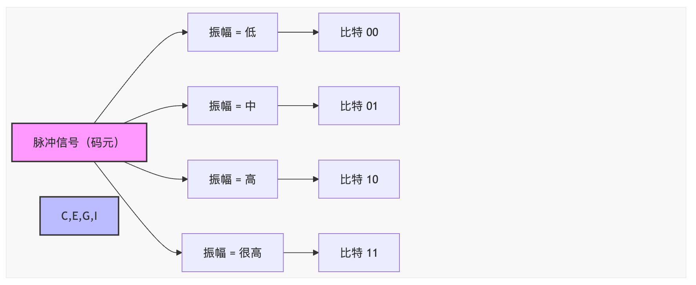

#### 2.3 波特

波特（Baud）是数据通信中的一个术语，用来表示符号（或码元）传输速率。具体来说，**波特率**（Baud rate）指的是每秒钟传输的码元（symbol）的数量。

码元和 **波特率**：一个码元可以携带一个或多个比特的信息。**波特率**是指每秒钟传输多少个这样的码元。例如，如果 **波特率** 为 1000 波特，这意味着每秒可以传输 1000 个码元。

**波特率** 与 **比特率**：**波特率**和**比特率**的关系取决于每个码元携带的比特数。

- 一个码元能携带 1bit 数据，那么 **比特率** = **波特率**。
- 一个码元能携带 2bit 数据，那么 **比特率** = 2 倍的 **波特率**。
- 一个码元能携带 4bit 数据，那么 **比特率** = 4 倍的 **波特率**。

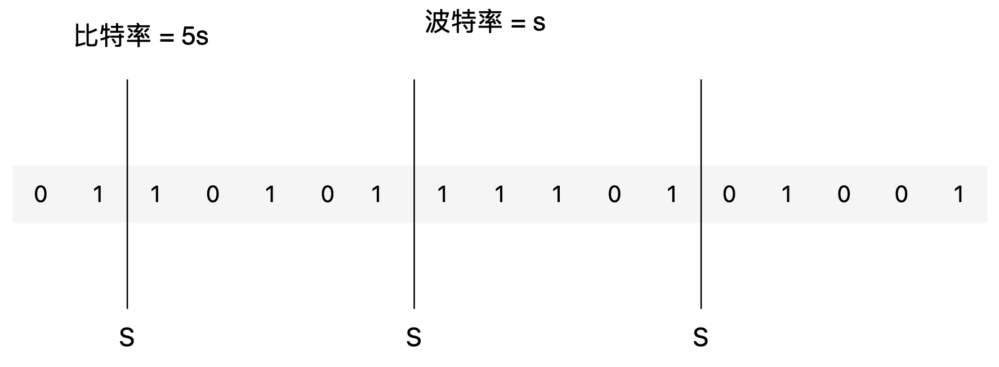

#### 2.4 速率

**速率**（Rate）是指连接到计算机网络上的节点在数字信道上传送数据的速率，也称数据传输速率、数据率或比特率，单位为 b/s（比特／秒）或 bit/s（有时也写为 bps )。

当数据率较高时，可用 kb/s（k = 103 ）、Mb/s（M = 106 ）或 Gb/s（G = 109 ）表示。通常把最高数据传输速率称为 **带宽**。

**速率**可以用两种指标来衡量：

- **比特率**：每秒传输的比特数量
- **波特率**：每秒传输的波特数量

一个码元可以包含多个比特，如果一个码元携带 *n* 比特的信息量，则 **波特率** M 对应的 **比特率** 为 *M**n* bit/s

#### 2.5 带宽

**带宽**（Bandwidth）在通信领域中，指通信线路能够通过的信号频率范围，单位为赫兹（Hz）。 在计算机网络中，**带宽**通常被引申为通信线路的数据传输能力，即数字信道所能达到的 **最大数据传输速率**，其单位为比特每秒（b/s）。

**例子**：如果家里的宽带带宽是 **100Mb/s**，表示网络在理想情况下，每秒最多可以传输 **100兆比特** 的数据，相当于大约 **12.5MB/s** 的下载速度。

在考题中偶尔涉及到带宽和吞吐量的区别：

- **带宽**：理论上的最大传输速率，就像是一条高速公路的最大车道数。
- **吞吐量**：实际传输速率，受到网络拥塞、协议开销、设备性能等因素影响，往往低于带宽。

**举例**：虽然网络带宽是 100Mb/s，但在高峰时段可能只能达到 70Mb/s，这 70Mb/s 就是实际的吞吐量。

#### 2.6 时延

**时延**（Delay）指数据（一个报文或分组）从网络（或链路）的一端传送到另一端所需要的总时间，它由 4 个部分构成，分别为：发送时延、传播时延、处理时延和排队时延。

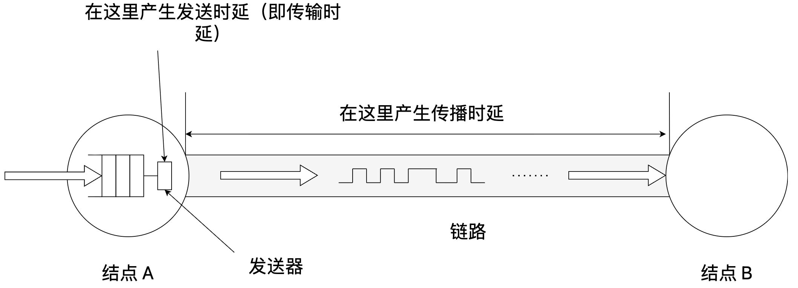

1. **发送时延**：也称 **传输时延**。节点将分组的所有比特推向（传输）链路所需的时间，即从发送分组的第一个比特算起，到该分组的最后一个比特发送完毕所需的时间。
   - 发送时延 = 分组长度 (bit) / 发送速率 (bit/s)
2. **传播时延**：电磁波在信道（传输介质）中传播一定的距离需要花费的时间，即一个比特从链路的一端传播到另一端所需的时间。
   - 传播时延 = 信道长度 (m) / 电磁波在信道上的传播速率 (m/s)

3. **处理时延**：数据在交换结点为存储转发而进行的一些必要的处理所花费的时间。例如，分析分组的首部、从分组中提取数据部分、进行差错检验或查找适当的路由等。

4. **排队时延**：分组在进入路由器后要先在输入队列中排队等待处理。路由器确定转发端口后，还要在输出队列中排队等待转发，这就产生了 **排队时延**。

因此，数据在网络中经历的总时延就是以上 4 部分时延之和：总时延＝发送时延＋传播时延＋处理时延＋排队时延。

注意：需要区分 **传输时延** 和 **传播时延**。**传输时延**是路由器将分组推出所需的时间，是分组长度和链路传输速率的函数。**传播时延**是一个比特从一台路由器传播至另一台路由器所需的时间，是两台路由器之间距离的函数，而与分组长度或链路传输速率无关。

#### 2.7 时延带宽积

**时延带宽积**（Bandwidth-Delay Product，简称 BDP）指发送端发送的第一个比特即将到达终点时，发送端已经发出了多少个比特，因此又称以比特为单位的链路长度，即：**时延带宽积=传播时延×信道带宽**

如下图所示，考虑一个代表链路的圆柱形管道，其长度表示链路的传播时延，横截面积表示链路带宽，则 **时延带宽积** 表示该管道可以容纳的比特数量。

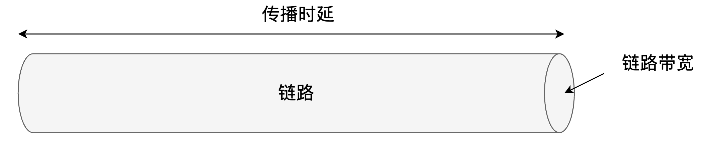

### 三、奈奎斯特定理

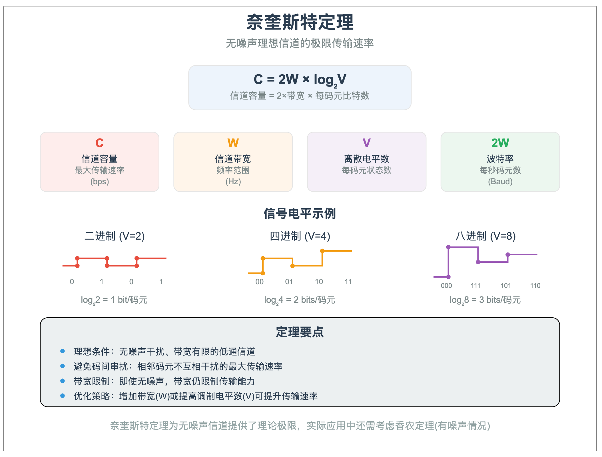

**奈奎斯特定理** 说明了在 **无噪声干扰、带宽有限** 的理想低通信道中的数据极限传输速率。当实际传输速率小于等于该速率时，可以实现无码间串扰的数据传输。

奈奎斯特定理的 **核心思想** 是： 即使在没有噪声的理想信道中，信道的带宽仍然限制了其数据传输能力。为了避免相邻码元之间的干扰（即码间串扰），每秒钟最多只能传输有限数量的码元，这个数量与带宽直接相关。

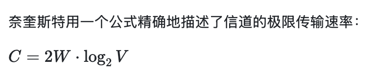

其中：

- *C* 是信道容量，单位是比特每秒 (bps)，表示无噪声条件下的最大传输速率；
- *W* 是信道带宽，单位是赫兹 (Hz)，表示信道允许通过的最高频率范围；
- *V* 是每个码元可采用的不同离散电平数量；
- log2 *V* 表示每个码元可以携带的比特数（因为 *V* 种电平可以表示 log2*V* 比特信息）；
- 2*W* 表示每秒最多传输的码元数（波特率，baud/s）。

公式中的含义：

1. 带宽 (*W*) 越大，单位时间内可传输的码元数越多；
2. 每个码元的电平数 (*V*) 越多，所携带的信息量越大。

*因此，在理想无噪声信道中，**极限传输速率取决于带宽和码元的离散电平数**。*

### 四、香浓定理

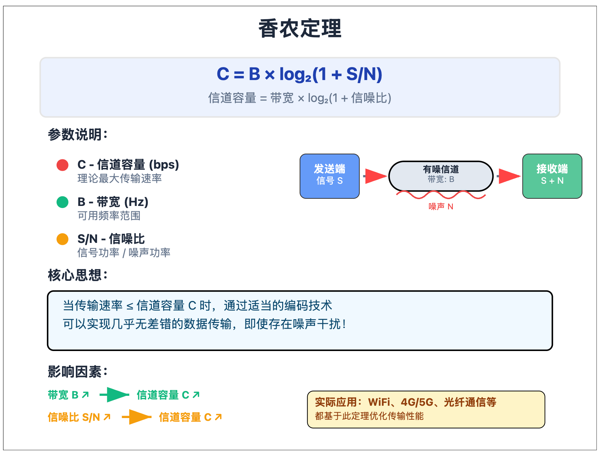

**香农定理** 说明了在 **有噪音干扰、带宽有限** 的信道中的数据极限传输速率，当实际传输速率小于等于改速率时，可以做到不产生误差。

香农定理的 **核心思想** 是： 即使信道中存在噪声，只要信息传输速率低于某个极限值（即信道容量），就一定可以通过某种编码方式实现几乎无差错的传输。这个极限值取决于信道的带宽和 **信噪比**。

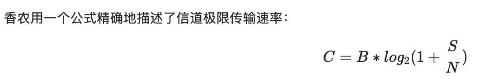

其中：

- *C* 是信道容量，单位是比特每秒 (bps)，表示信道理论上的最大传输速率。
- *B* 是信道带宽，单位是赫兹 (Hz)，表示信道可用的频率范围。
- *S* 是信号功率，表示信号的强度。
- *N* 是噪声功率，表示信道中噪声的强度。
- *N*/*S* 是 **信噪比**（Signal-to-Noise Ratio, SNR），通常以线性形式表示（不是分贝 dB）。

公式中的含义：

1. 带宽 ( *B* ) 越大，信道容量 ( *C* ) 越大：这意味着更宽的信道可以传输更多的数据。
2. **信噪比** ( *N*/*S* ) 越大，信道容量 ( *C* ) 越大：这意味着信号相对于噪声越强，传输速率就越高。

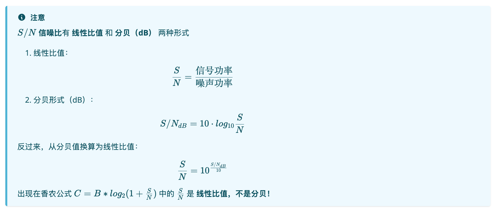

---

## 编码和调制

在计算机网络中，**编码** 和 **调制** 是数据传输的两个关键过程，它们的目标都是为了让 **数字信息**（如二进制的 0 和 1）能够有效、准确地在 **物理介质**（如双绞线、光纤、无线电波等）上传输

### 一、编码类型

**编码**（encoding）指的是把 **数字信号**（0 和 1）转换成适合在 **传输介质** 上传输的电信号或光信号。常见的编码方式有以下几种：

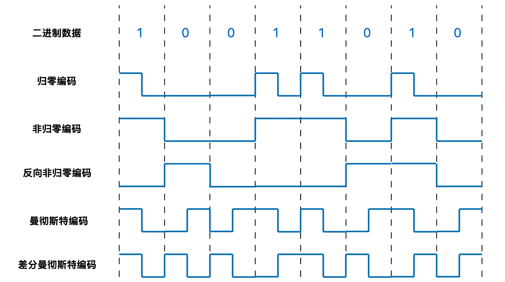

| 编码方法                                                 | 1 的表示                       | 0 的表示                       |
| -------------------------------------------------------- | ------------------------------ | ------------------------------ |
| **归零编码**（RZ）                                       | 在时钟周期内由高电平跳到低电平 | 在时钟周期中保持低电平         |
| **非归零编码**（NRZ）                                    | 时钟周期内保持高电平           | 时钟周期内保持低电平           |
| **反向不归零编码**（NRZI）                               | 电平与上一个时钟周期保持一致   | 电平相比上一个时钟周期发生跳变 |
| **曼彻斯特编码**（Manchester Encoding）                  | 在时钟周期内由高电平跳到低电平 | 在时钟周期中由低电平跳到高电平 |
| **差分曼彻斯特编码**（Differential Manchester Encoding） | 电平变化与上一个时钟周期相反   | 电平变化相比上一个时钟周期一致 |

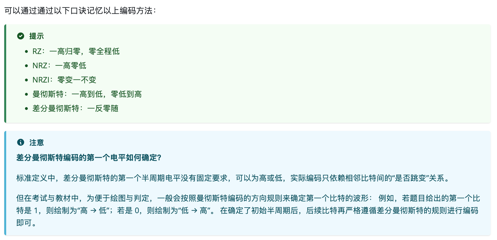

### 二、调制方法

**调制方法** 指的是把 **编码后** 的 **数字信号** 转换为 **模拟信号**（如正弦波），以适应 **物理信道**（如无线电波）的传输。

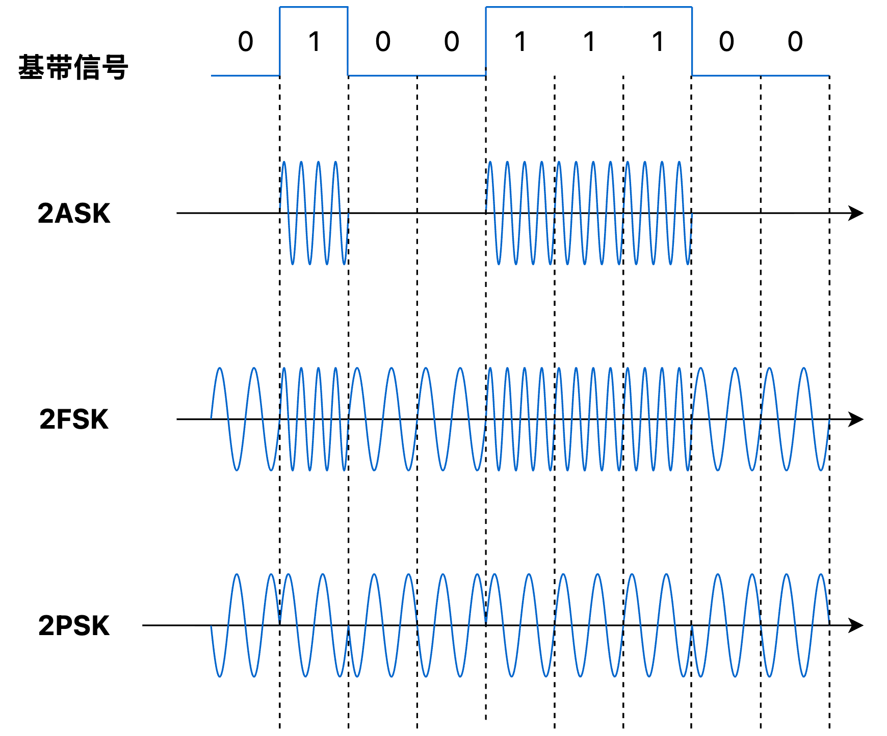

调制方法主要了解以下四种：

1. **ASK** (幅度偏移键控 - Amplitude Shift Keying)
2. **FSK** (频率偏移键控 - Frequency Shift Keying)
3. **PSK** (相位偏移键控 - Phase Shift Keying)
4. **QAM** (象限幅度调制 - Quadrature Amplitude Modulation)

| **调制技术** | 基本思想                               | 表示方法例子                   | 常见应用                            |
| ------------ | -------------------------------------- | ------------------------------ | ----------------------------------- |
| **ASK**      | 通过改变载波的 **幅度** 表示数据       | *0: 无信号；1: 最大幅度的信号* | 光纤通信                            |
| **FSK**      | 通过改变载波的 **频率** 表示数据       | *0: 900 Hz；1: 901 Hz*         | 低速无线通信、电话系统              |
| **PSK**      | 通过改变载波的 **相位** 表示数据       | *0: 0°相位；1: 180°相位*       | 高速无线通信，例如 Wi-Fi            |
| **QAM**      | 同时改变载波的 **幅度和相位** 表示数据 | *16 种不同的幅度和相位组合*    | 数字电视、Wi-Fi、有线和无线通信系统 |

---

## 交换方法

### 一、交换

**交换方式** 是指在通信网络中，数据从发送方传输到接收方时，网络节点（如交换机、路由器）处理和转发数据的方式。它决定了数据传输的路径、资源分配和效率。交换方式是通信网络设计的核心，直接影响网络的性能、时延和资源利用率。

**电路交换**、**报文交换** 和 **分组交换** 是三种主要方式，其中分组交换又可以进一步分为 [数据报和虚电路](https://www.csgraduates.com/computer_network/physical/switching/#数据报和虚电路) 两种方式：

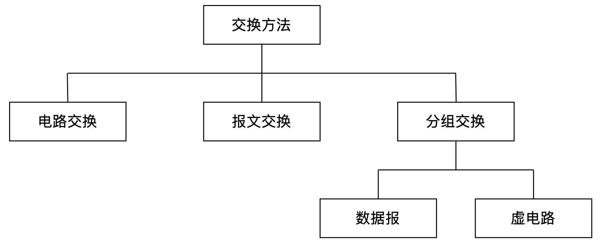

#### 1.1 电路交换

**电路交换**（Circuit Switching）是一种传统的通信方法，其中在发送方和接收方之间建立一个专用的通信路径（电路），该路径在整个通信过程中保持不变，其过程如下：

1. **连接建立**：发送方发起请求，通过交换设备（如电话交换机）在网络中为通信双方寻找并分配一条固定路径，建立端到端的专用电路。这需要信令系统协调。
2. **数据传输**：电路建立后，数据（语音、视频等）通过这条固定路径连续传输。整个通信期间，路径保持独占，即使没有数据传输，资源也不会释放。
3. **连接释放**：通信结束后，发送方或接收方发出终止信号，交换设备拆除电路，释放占用的资源（如带宽、端口）供其他用户使用。

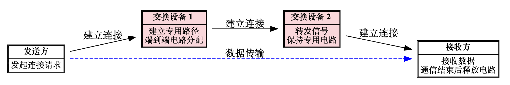

电路交换的典型应用是 **传统电话网络**（PSTN）。其优缺点如下：

- 优点：
  - 稳定性：一旦建立连接，通信是连续且稳定的。
  - 低延迟：由于路径是专用的，数据传输没有竞争，延迟较低。
- 缺点：
  - 资源浪费：路径在整个通信过程中被独占，即使没有数据传输时，资源仍然占用。
  - 建立时延：建立连接需要时间，初始延迟较高。

#### 1.2 报文交换

**报文交换**（Message Switching）不需要建立专用路径，整个报文作为一个单元传输，节点存储并转发整个报文。其过程如下：

1. **报文发送**：发送方将完整的数据消息（大小可变，可能包含文本、文件等）发送到网络中的第一个节点（通常是交换机或路由器）。
2. **存储转发**：每个节点接收整个报文，存储在缓冲区，检查目标地址后，选择下一跳节点转发。报文在网络中逐跳传输，直到到达接收方。
3. **接收与处理**：接收方收到完整报文后，进行处理或存储。

报文交换主要用于早期的电报和一些数据网络中。报文交换的优缺点如下：

- 优点：
  - 灵活性：不需要建立专用线路，可以动态选择路径。
  - 适应性：适合于突发性的数据传输。
- 缺点：
  - 高延迟：每个节点都需要存储和转发整个报文，增加了延迟。
  - 资源占用：大报文可能占用较多的存储资源。

#### 1.3 分组交换

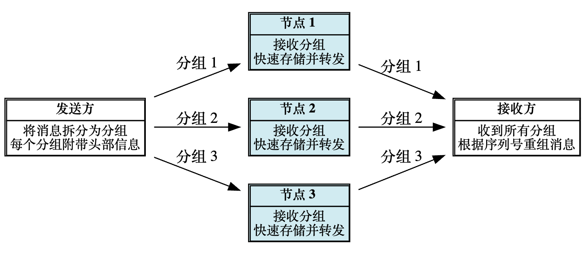

**分组交换**（Packet Switching）将数据分成小的分组（或数据包），每个分组独立传输，并可能通过不同路径到达目的地。其过程如下：

1. **数据分割**：发送方将消息拆分为多个分组，每个分组附带头部信息（如源地址、目标地址、序列号）。
2. **分组传输**：每个分组独立在网络中传输，节点（路由器）根据头部信息选择最佳路径，分组可能走不同路径到达目的地（动态路由）。
3. **存储转发**：每个节点接收分组，存储后快速转发到下一跳，分组大小小，处理速度快。
4. **重组与接收**：接收方收到所有分组后，根据序列号重新组装成原始消息。如果有分组丢失，可请求重传。

分组交换已经广泛应用于互联网，比如当前的 IP 协议就是分组交换的一种实现。

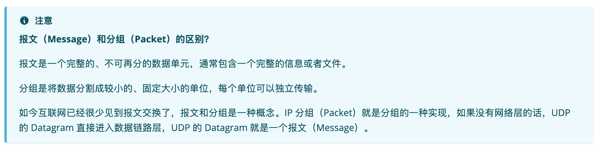

分组交换是对报文交换的一种改进，它具备如下优点：

- **高效性**：网络资源按需分配，多个通信可以共享同一物理路径。
- **鲁棒性**：分组可以通过不同路径传输，网络故障时能自动选择替代路径。
- **适应性强**：适合于多种类型的数据传输（语音、视频、数据等）。

其缺点与报文交换类似，由于分组可能通过不同路径到达，可能导致抖动和延迟。

#### 1.4 对比

- **电路交换** 通过建立专用物理电路实现连续数据传输，资源独占但效率低，适合实时通信如电话；
- **报文交换** 以整个消息为单位存储转发，无需预连接但时延高，适合低频大数据传输；
- **分组交换** 将数据拆分为小分组独立传输，资源共享且效率高，适合现代互联网，但需处理分组丢失或乱序问题。

下图包含三种交换方式传输的时空图，横向表示距离，纵向表示时间：

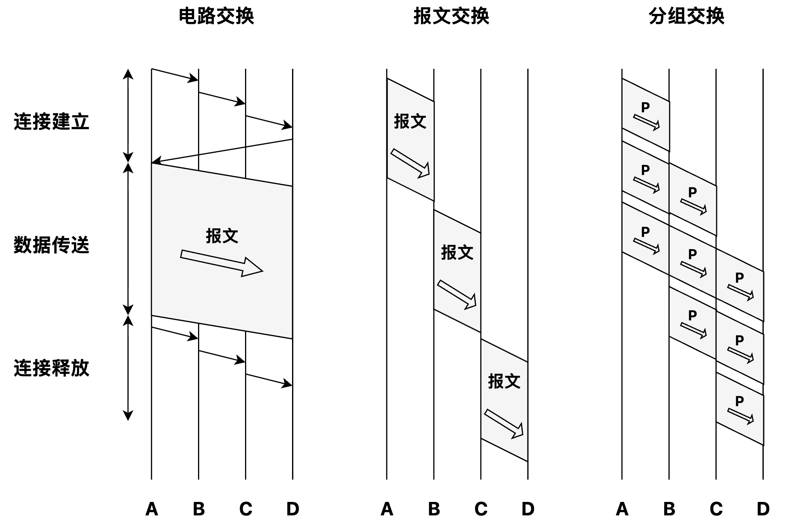

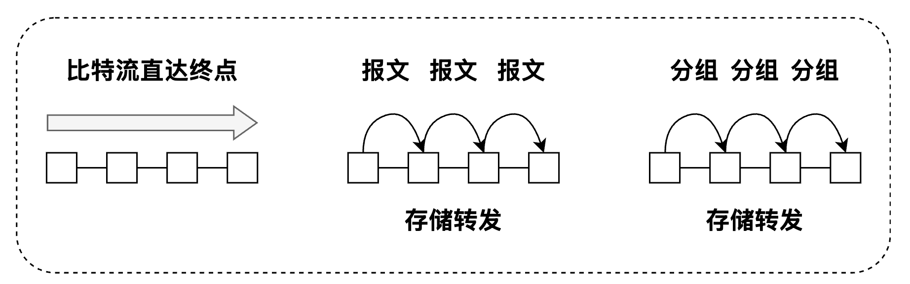

需要能够图中的那一部分是 **传播时间**，哪一部分是 **传输时间**，这一部分内容可以和 [数据链路层信道利用率](https://www.csgraduates.com/computer_network/datalink/flow_control/#信道利用率) 对比学习。

#### 1.5 传输时间计算

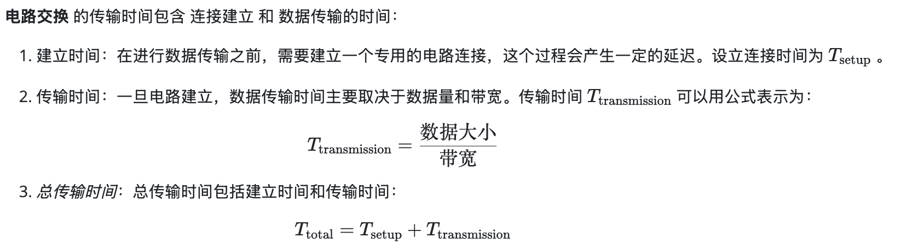

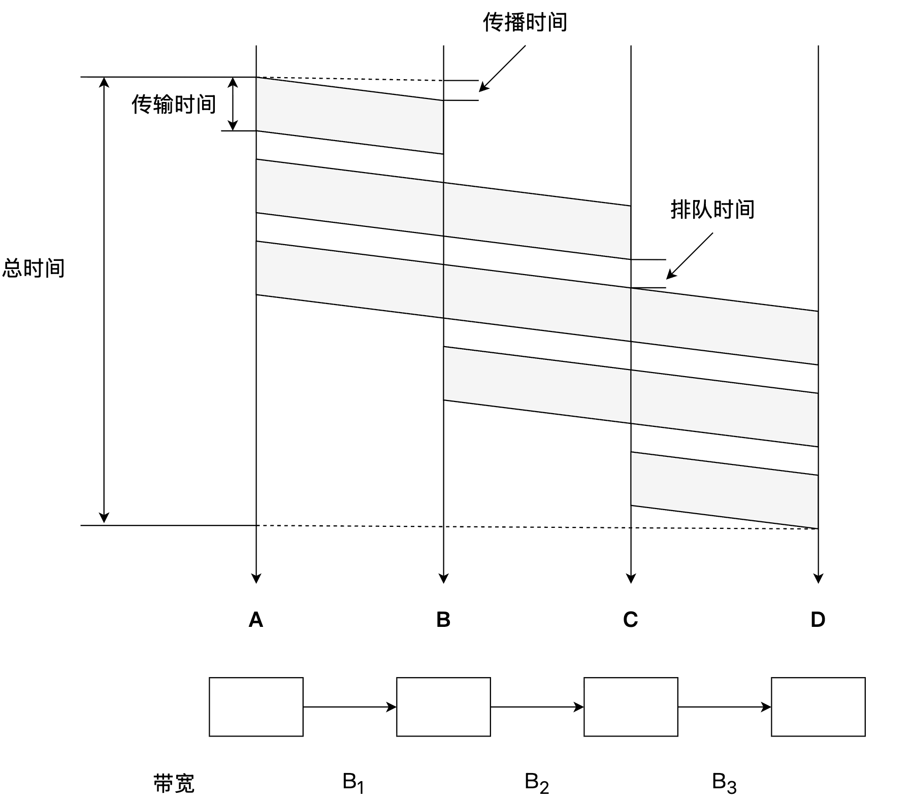

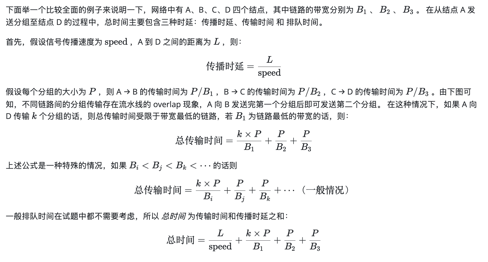

### 二、数据报和虚电路

在 [分组交换](https://www.csgraduates.com/computer_network/physical/switching/#分组交换) 中，根据分组的路由和连接方式，分组交换分为数据报（Datagram）和虚电路（Virutal Circiut）两种模式：

- 数据报：一种 **无连接** 的分组交换方式，每个分组（数据报）独立传输，包含完整的源地址和目标地址，网络根据每个分组的头部信息动态选择路由路径。
- 虚电路：一种 **面向连接** 的分组交换方式，在通信开始前建立一条逻辑路径（虚电路），所有分组沿此路径传输，模拟电路交换的稳定连接。

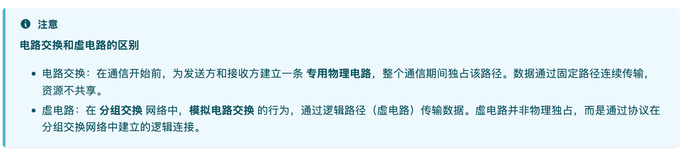

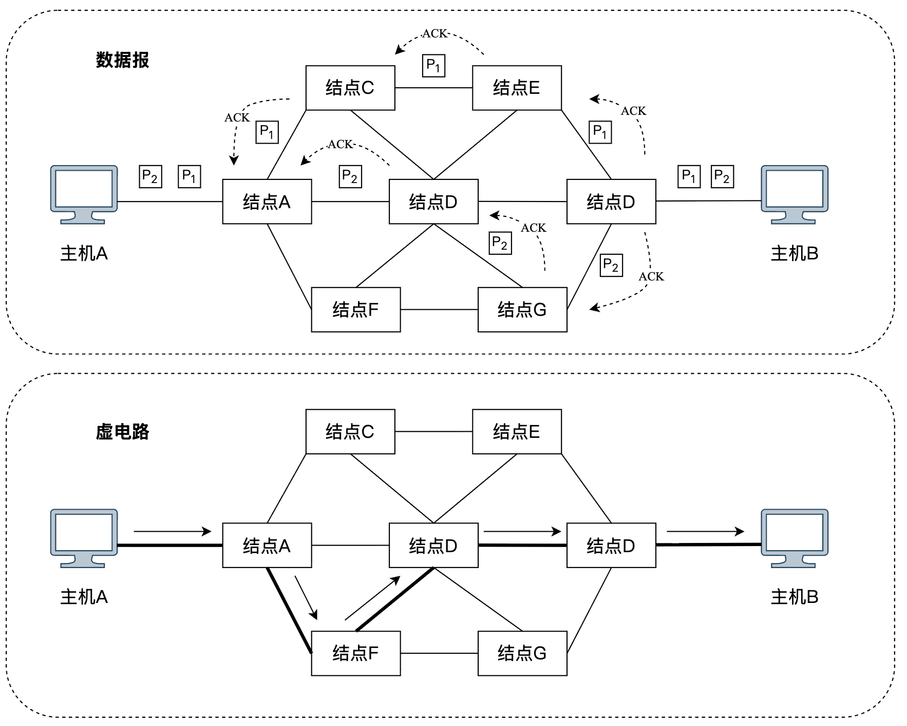

下表对比了数据报和虚电路的特性：

| 特性         | 数据报                             | 虚电路                         |
| ------------ | ---------------------------------- | ------------------------------ |
| 连接性       | 无连接，每个分组独立处理           | 有连接，建立虚电路后传输分组   |
| 路由         | 每个分组独立路由                   | 虚电路建立后，沿着相同路径路由 |
| 通信开销     | 较低，不需要建立和维护连接         | 较高，建立连接需要额外开销     |
| 分组到达顺序 | 不保证分组到达的顺序               | 保证分组按照发送顺序到达       |
| 分组丢失     | 可能出现分组丢失，需要上层协议处理 | 较低的丢包率，可靠传输         |
| 带宽利用率   | 不需要预留带宽，按需使用           | 预留带宽，可能造成资源浪费     |
| 适用场景     | Internet 中的 IP 数据包            | 电路交换、ATM 等有连接通信     |
| 例子         | Internet 中的 IP 分组              | 早期电话网络、ATM 网络         |

数据报和虚电路是两种不同的通信服务模型，适用于不同的通信需求和网络类型。数据报适合于互联网等不保证可靠传输的环境，而虚电路适合于对可靠性要求较高的电路交换和 ATM 等网络。选择合适的通信模型取决于应用需求和网络设计。

---

## 物理层设备

### 一、集线器

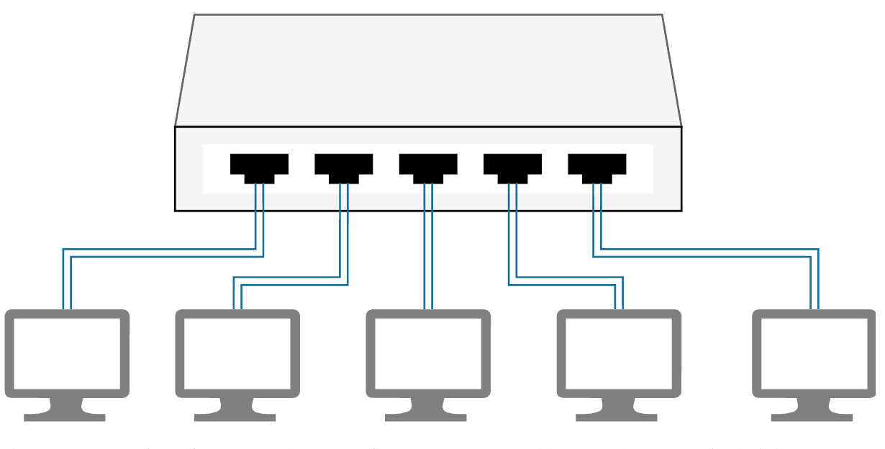

定义：集线器（Hub）是一个 **物理层设备**，用于将多台计算机或其他网络设备连接在一起，从而形成一个单一的网络段。

**工作方式**：当一个设备通过集线器发送数据时，数据会被 **广播到** 集线器的所有其他端口。每个连接到集线器的设备都会收到这些数据，但只有目标设备才会处理它。集线器本身不会分析或查看传输的数据。

局限性: 由于集线器将数据广播到所有设备，所以它可能导致 **网络拥塞**。因此，在大型或流量较大的网络中，集线器已经被交换机所取代，交换机能够智能地将数据转发到目标设备。

### 二、中继器

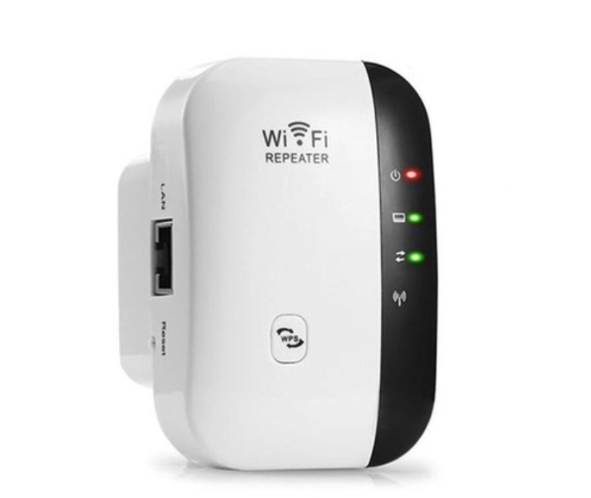

**定义**：中继器是一个 **物理层设备**，用于 **放大** 或 **再生** 数字 **信号**。

**工作方式**：在以太网或其他类型的网络中，数据在电缆上只能传输一定的距离，超过这个距离，信号会减弱或退化。中继器放置在这种距离的两端，用于接收退化的信号，放大或再生它，然后将它传输到下一段电缆。

**应用**：中继器被用于 **扩展网络** 的物理范围，超出了单一段 **电缆** 或 **物理媒体** 的限制。

### 三、网络适配器

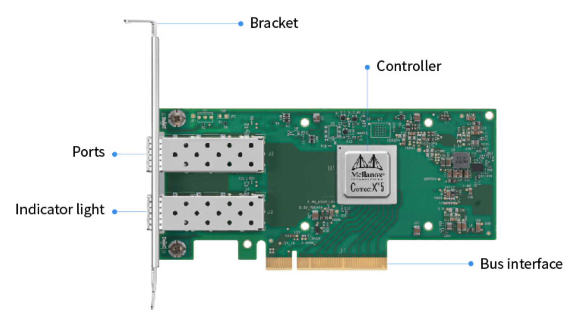

**定义**：网络适配器 (Network Adapter)，也称为网络接口卡（NIC）或简称 **网卡**，是一种硬件组件，用于 **连接计算机到一个网络**。

**工作方式**：网络适配器为计算机提供了一个或多个网络连接端口，它将计算机的 **数字数据** 转换为可以在物理媒体（例如双绞线、光纤或无线电波）上传输的 **信号**。同样，当信号从网络到达网络适配器时，它会将这些信号转换回计算机可以理解的数字数据。

**物理地址**：每个网络适配器都有一个唯一的 **物理地址**，称为 **MAC 地址**。这个地址在生产时被烧录到设备中，用于在局域网内唯一地识别设备。

###  四、电缆

- **双绞线** (Twisted Pair)：双绞线由一对绝缘的铜线组成，两线之间呈螺旋形地绞在一起。
- **光纤** (Fiber Optic)：光纤是由极细的玻璃或塑料纤维制成的，用于传输光信号。
- **同轴电缆** (Coaxial Cable)：同轴电缆由一个中心铜导线、一个绝缘层、一个金属屏蔽和一个外部的塑料或橡胶覆盖层组成。

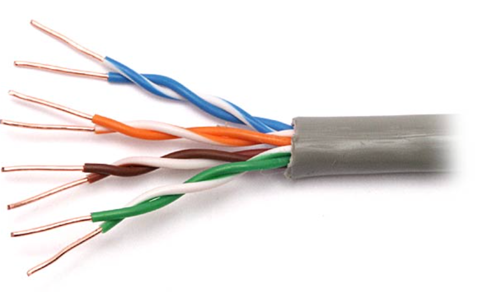

**双绞线**（twisted pair cable）的结构如上图所示，“双绞线”之所以叫“双绞线”，是因为它的结构真的就是两根 **绝缘铜线** 按照一定方式互相“绞”在一起。 这种“绞合”结构是为了 **抗干扰**，让数据传输更加 **稳定可靠**

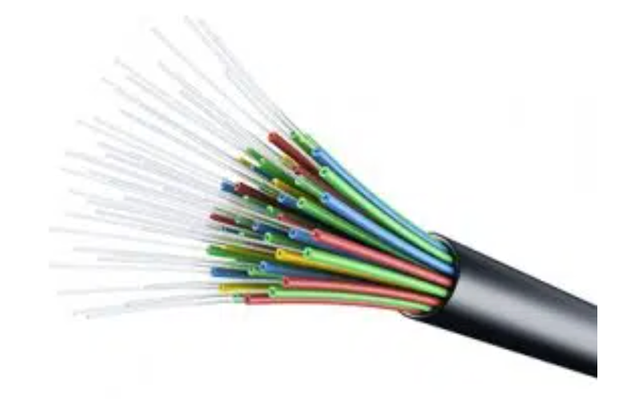

**光纤**（fiber optic）的结构如上图所示，光纤利用光在里面的 **反射** 来传输数据。相比电信号，它的 **抗干扰能力** 更强、**传输速度** 更快、**距离** 也更远，非常适合 **高速** 的数据通信

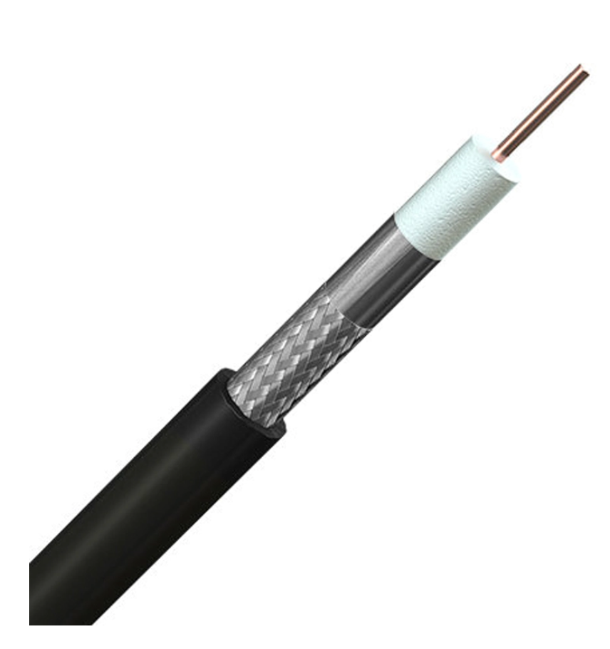

**同轴电缆**（coaxial cable）的结构如上图所示，它由 **中心铜导体**、**绝缘层**、**金属屏蔽层** 和 **外护套** 组成。 其中，金属屏蔽层可以有效减少外界电磁干扰，同时也防止信号向外泄漏。

同轴电缆常用于有线电视、宽带接入和一些局域网连接，具有抗干扰能力强、传输稳定的特点。