# 数据链路层

## 组帧

数据链路层的主要功能之一就是 **组帧**。

帧（frame）代表数据链路层的数据发送单位，在接收到来自于网络层的报文（packet）时如何为其添加帧头和帧尾，并且以何种方式进行 **帧定界**（接收方区别连续不同的帧）。

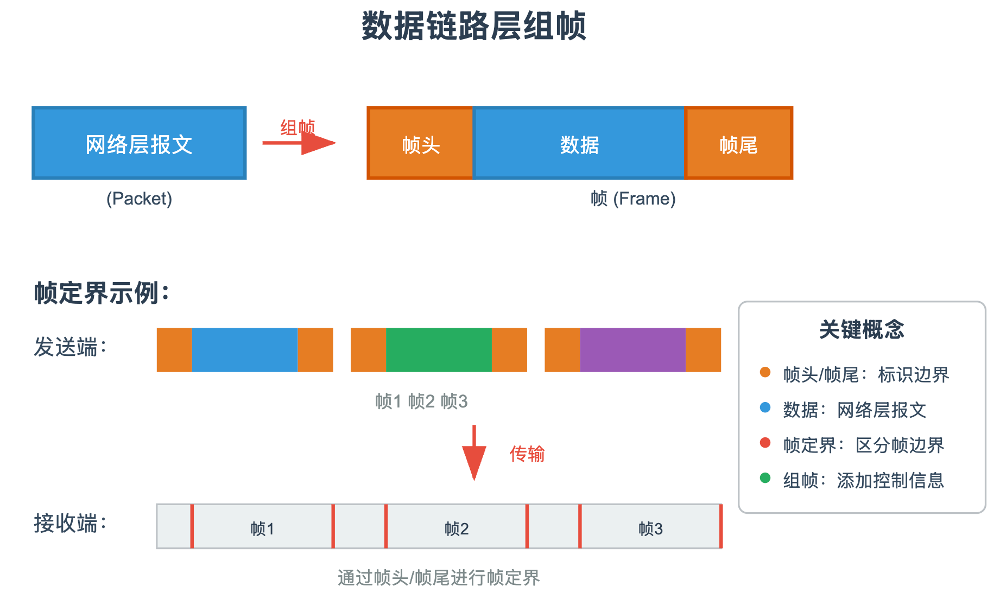

**组帧**的关键就在于 **帧定界**，也就是对于接收方来说，它能够以某种方式区分连续收到的不同帧。
从这个角度出发，**组帧** 方式可以被分为以下几种：

### 一、字符计数法

**字符计数法** 是在帧的首部设置一个计数字段，用来指示该帧中包含的字符（或字节）数量。

当接收方开始读取一帧时，首先读取位于 **帧首部的计数字段**。通过该字段的数值，接收方即可知道该 **帧的总长度**（即后续应读取的字符数）。随后，接收方按照得到的长度继续读取剩余的数据，直至完整地接收完本帧。

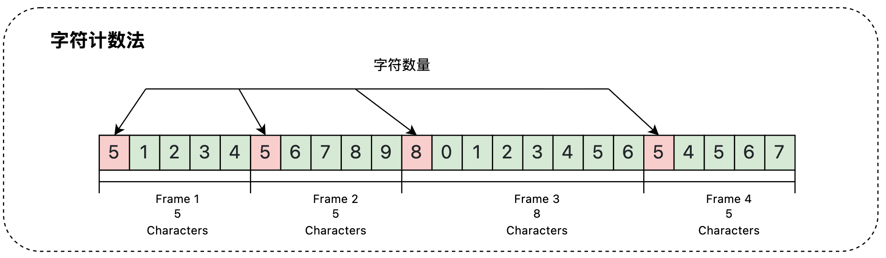

### 二、首位定界字符法

首位定界字符法即 **使用特殊控制字符标志帧的开始和结束**。

但是使用这种方式可能出现如下问题：就是 **首位定界字符** 可能会在帧内部出现，这个时候就会造成歧义。

所以当特殊字符出现在帧的数据部分时，需要用 **转义字符** `ESC` 来对特殊字符进行转义，同样，`ESC` 出现在数据部分同样需要转义。

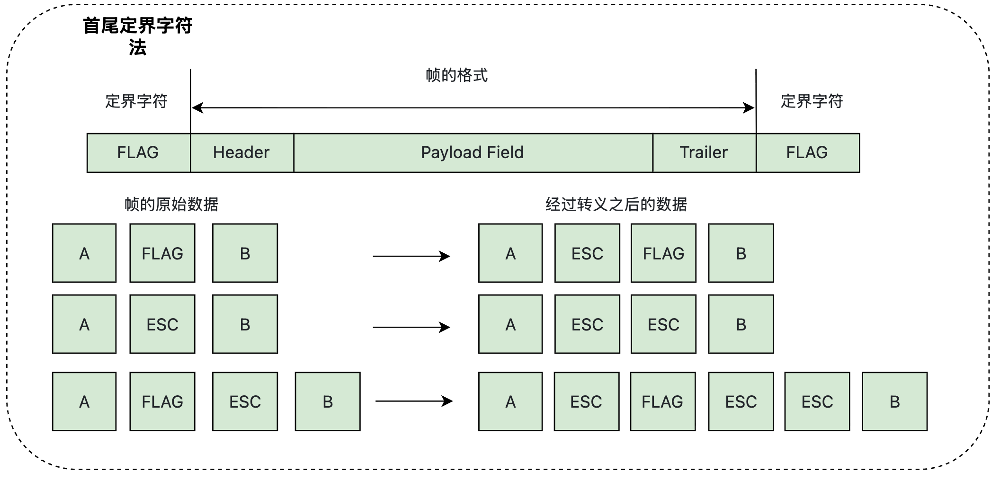

以上图为例，假设我们使用 **FLAG** 作为 **首位定界字符** 的话（注意这里 FLAG 只是字符名称，不是表示字符是 FLAG），那么当 FLAG 出现在数据部分时，我们需要对 FLAG 进行转义，需要注意的是，因为我们使用 **ESC** 作为转义字符，所以当数据中出现 **ESC** 时，我们也需要对转义字符自己进行转义。

### 三、零比特填充法

**零比特填充法**（Bit Stuffing）与首位定界字符法思路类似。

用 `01111110` 作为一个新的数据帧的开头，这里的关键在于要对数据帧内容中与 `01111110` 相同的部分进行转义，转义的方式如下：

- 在发送方：
  - 每当数据中出现 连续 5 个 `'1'` 时，
  - 就自动插入一个 `'0'`，避免形成 6 个连续的 `'1'`（即避免形成 `01111110`）。
- 在接收方：
  - 每当检测到 连续 5 个 `'1'` 后跟着一个 `'0'`，就去掉这个 `'0'`，还原原始数据。
  - 在传送的比特流中可以传送任意比特组合，而不会引起对帧边界的判断错误。**零比特填充法** 很容易由硬件来实现，*性能优于字符填充法*。

对于 **零比特填充法**，需要记住 `01111110` 这种开头的比特填充方式以及具体如何进行转义。

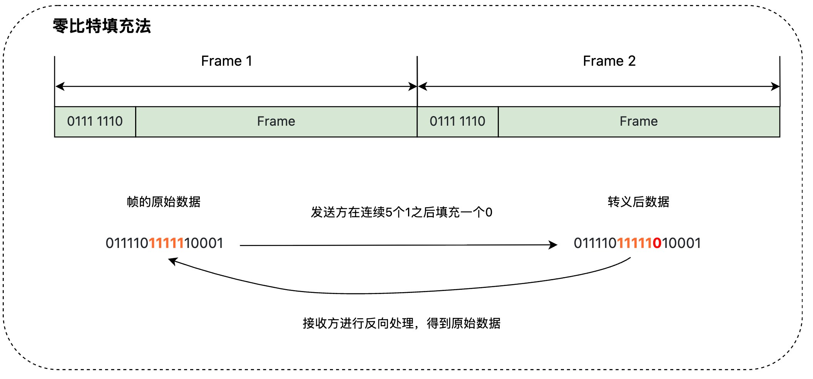

### 四、违规编码法

**违规编码法**（Physcial Layer Coding Violations）使用特殊电平进行定界。比如，[**曼彻斯特编码**](https://www.csgraduates.com/computer_network/physical/encoding/) 将数据比特“1”编码为“高 - 低”电平，将比特“0”编码为 “低-高” 电平对，而 “高-高” 电平对和 “低-低” 电平对是没有被使用的，所以可以用这两个电平进行帧定界。

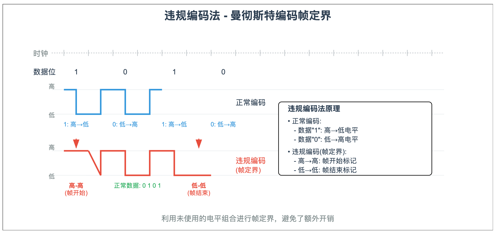

---

## 差错控制

### 一、分类

- **检错编码**：奇偶校验码、循环冗余码
- **纠错编码**：海明码

### 二、奇偶校验码

奇偶校验码（Parity Check Code）是一种 **简单高效** 的错误检测机制，广泛应用于数据传输和存储系统中，用于发现 **单比特错误**。其核心思想是通过添加一个 **校验比特**（parity bit），确保数据中“1”的总数符合特定的奇偶规则。

奇偶校验码有两种常见的类型：**奇校验** 和 **偶校验**。

1. 奇校验

   （Odd Parity）：

   - 校验比特的值使数据（包括校验比特）中“1”的总数为 **奇数**。
   - 例如，若原始数据“1”的个数为 **偶数**，校验比特设为 **1**；若为 **奇数**，设为 **0**。
   - 若接收端检测到“1”的总数为 **偶数**，则说明传输中存在错误。

2. 偶校验

   （Even Parity）：

   - 校验比特确保数据中“1”的总数为 **偶数**。
   - 例如，若原始数据“1”的个数为 **奇数**，校验比特设为 **1**；若为 **偶数**，设为 **0**。
   - 若接收端检测到“1”的总数为 **奇数**，则表明数据出错。

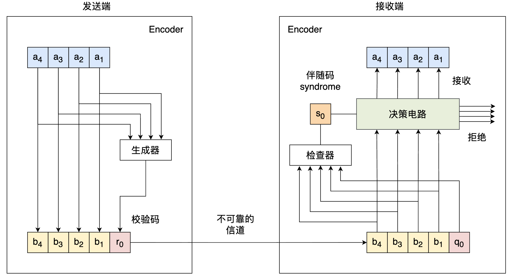

奇偶校验码的 **工作原理** 如下：

- **发送端**：根据奇校验或偶校验规则，计算原始数据中 “1” 的个数，设置校验比特，并将数据连同校验比特一起发送。
- **接收端**：检查接收到的数据（包括校验比特）中 “1” 的总数是否符合预设的奇偶规则。若不符合，说明传输过程中可能发生了单比特错误。

奇偶校验的工作原理是发送端计算数据中所有比特的总数，并根据所选的奇偶性规则设置校验比特的值。接收端在接收数据后再次计算所有比特的总数，包括校验比特，然后检查总数是否满足所选的奇偶性规则。如果总数不符合规则，接收端将检测到错误。

### 三、循环冗余码

**循环冗余校验**（CRC, Cyclic Redundancy Check）是一种常用的数据完整性校验方法，广泛应用于数据传输和存储系统中，用于检测数据在传输过程中是否发生了错误。其核心思想是将数据视为一个二进制多项式，并使用特定的 **生成多项式** 对其进行 **模 2 除法**，最终所得的余数即为 CRC 校验值。

#### 3.1 校验流程

CRC 的基本校验过程包括以下几个步骤：

- **生成多项式**
  CRC 的关键是一个预先定义好的 **生成多项式**，通常用二进制数表示。该多项式必须在发送端和接收端之间事先达成一致。
- **计算校验码（发送端）**
  发送端将待发送的数据帧看作一个二进制多项式，然后在数据末尾附加 `k-1` 个 0（其中 `k` 是生成多项式的位数），得到 **扩展数据**。将这组数据用 **模 2 除法** 除以生成多项式，得到的余数即为 **CRC 校验码**。
- **附加并发送**
  将上述余数作为 CRC 校验码，附加在原始数据帧之后，组成完整的传输数据帧并发送。
- **校验（接收端）**
  接收端收到数据后，以相同方式使用 **生成多项式** 进行 **模 2 除法**。如果计算结果的余数为 **零**，则说明数据在传输过程中未发生错误；否则表示数据已损坏。

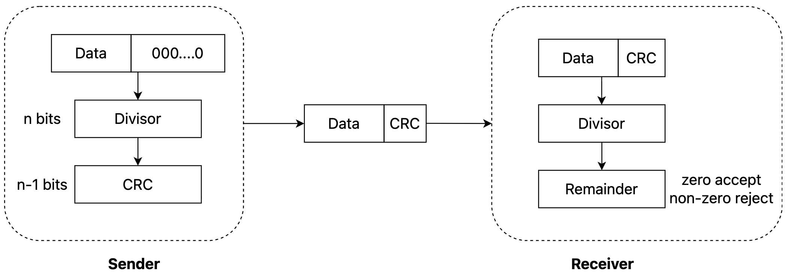

#### 3.2 发送方

假设原始数据为：`1010001101`，选用的生成多项式为：`110101`，则对应多项式形式为：x5+x4+x2+1*x*5+*x*4+*x*2+1。

发送方计算 CRC 校验码的操作流程如下：

1. **扩展数据**：生成多项式是 6 位，因此我们在数据尾部补上 `6-1 = 5` 个零，得到扩展数据：`101000110100000`
2. **模 2 除法计算 CRC（使用异或操作）**：

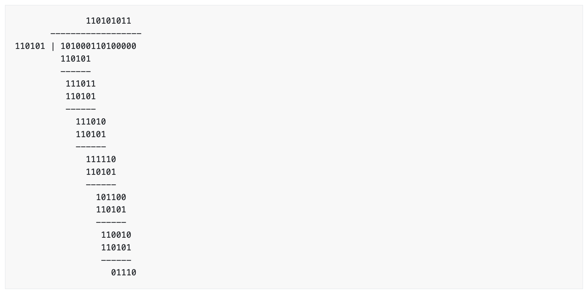

最终余数为：`01110`，所以完整的数据帧为：`1010001101 01110`。

#### 3.3 接收方

继续以上述例子进行说明，接收方收到的数据为：`101000110101110`

同样使用生成多项式 `110101` 进行 **模 2 除法**：

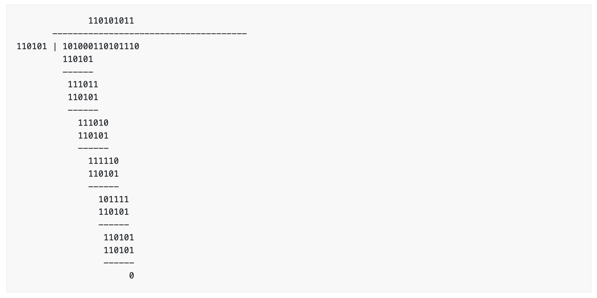

余数为 `0`，表示数据帧未被破坏，**校验通过**。

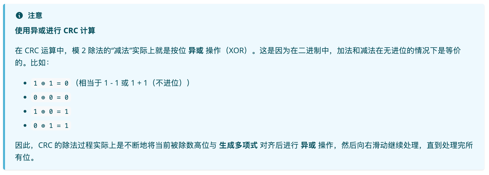

### 四、海明码

海明码（Hamming Code）是一种用于 **错误检测** 和 **纠正** 的编码方案，通常用于数据传输和存储系统中。它的主要目标是检测和纠正数据中的 **单比特错误**。

海明码的核心思想是在 **数据位** 之间插入一定数量的 **校验位**（也称为奇偶校验位），使得每个校验位都负责检查一组特定的位。校验位的数量取决于数据位的数量，并且它们的位置通常是 2 的幂次（即第 1 位、第 2 位、第 4 位……）。

#### 4.1 生成过程

- **步骤 1：确定校验位数量**

假如我们的数据是 1011 ，也就是 4 位。根据海明码的原则，我们需要确定足够的校验位 *r* 来满足以下条件：

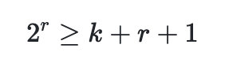

对于 *k*=4 （数据位），我们找到最小的 *r* 为 **3**。

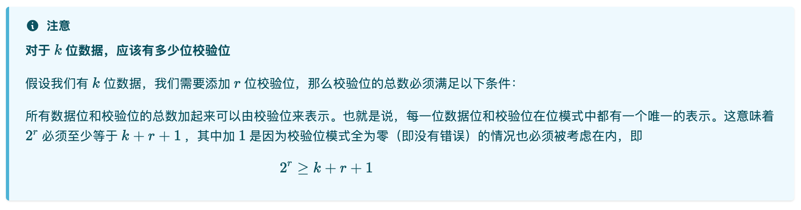

- **步骤 2：放置校验位和数据位**

首先将校验位（ *p* ）插入到数据位中的适当位置。校验位下标是 2 的幂（ 1,2,4,8,... ）。

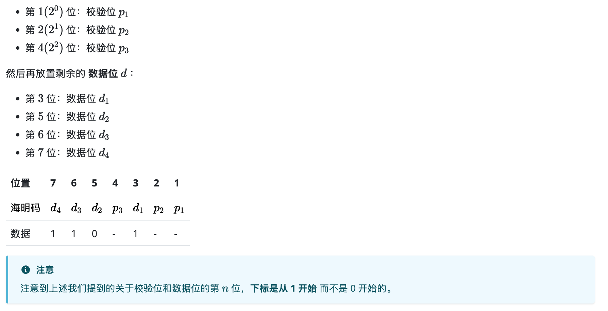

- **步骤 3：计算校验位**

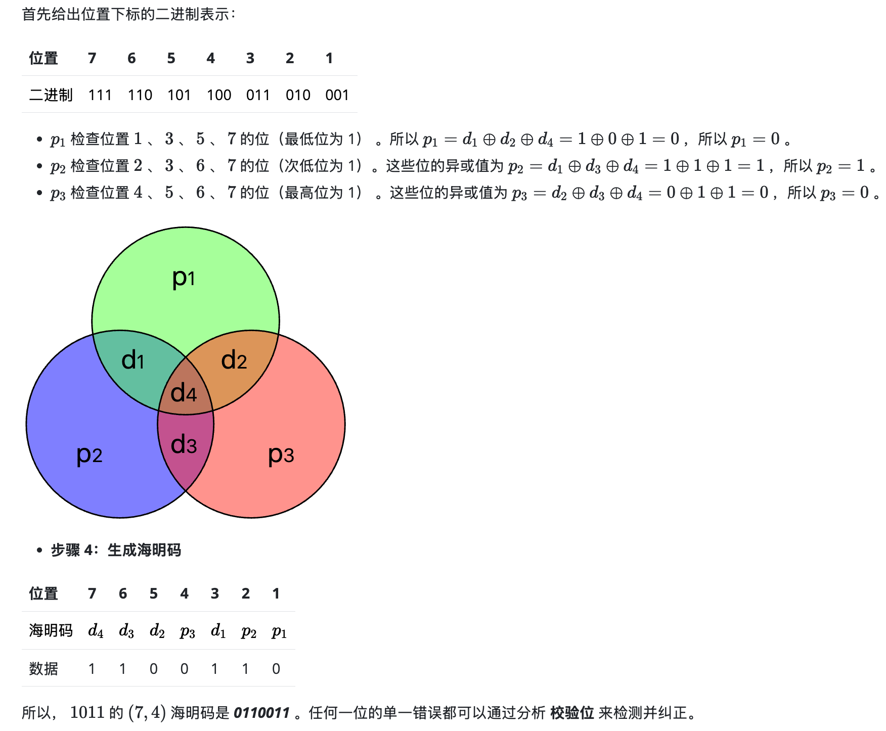

#### 4.2 检测和纠错

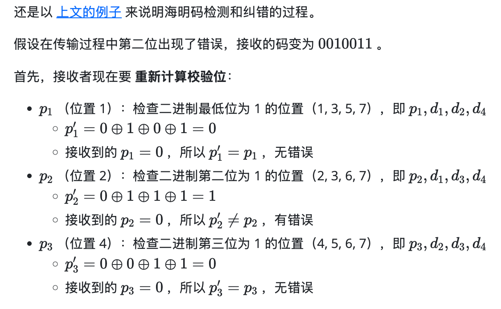

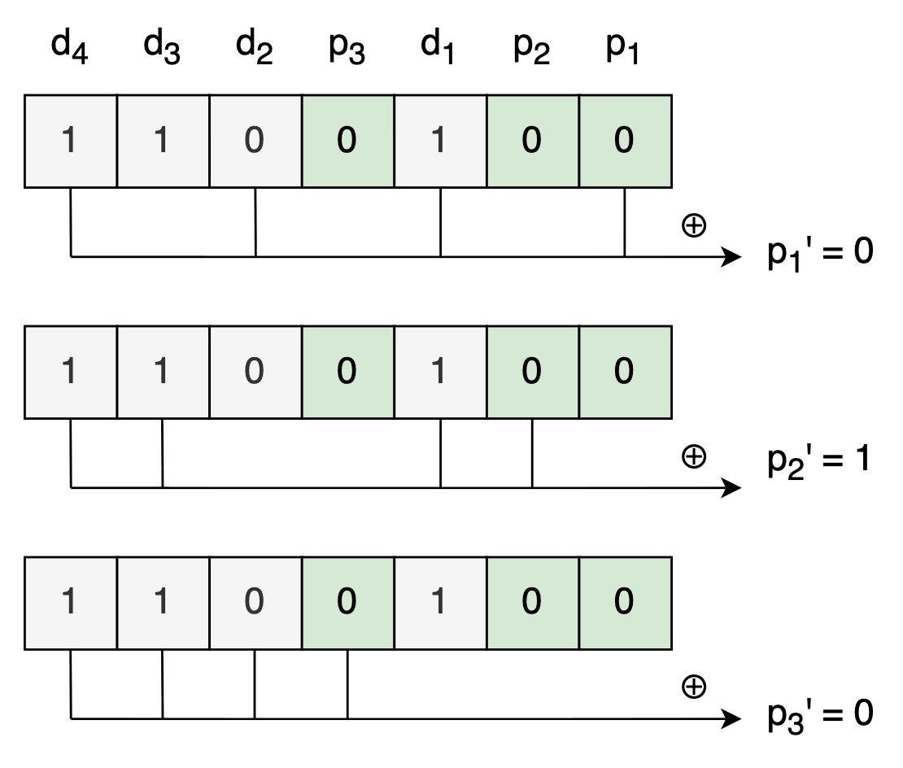

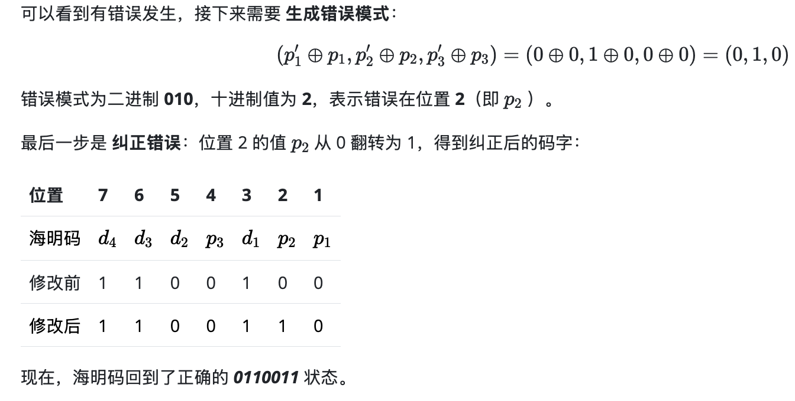

### 五、海明距离

海明距离是指两个等长的比特序列（也称为码字）在对应位置上不相同的比特个数。它是衡量两个码字之间差异程度的重要指标，广泛应用于 **编码理论** 中，用于分析 **错误检测** 和 **错误纠正** 能力。

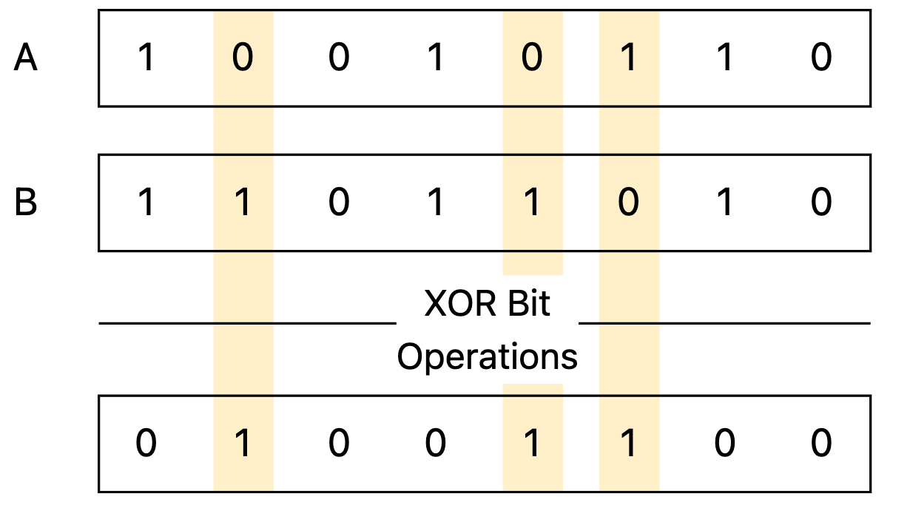

#### 5.1 编码集

在通信或存储系统中，**编码集**是指用于表示信息的一组码字。每个码字通常是一个固定长度的比特串，通过引入**冗余位**，编码集可以在传输过程中检测或纠正一定数量的错误。

编码集的关键属性之一是其**最小海明距离**（记作 d*d*）——即任意两个不同码字之间海明距离的最小值。它直接决定了该编码集的 **容错能力**：


最小海明距离越大，意味着码字之间越“分散”，在信道中被干扰后仍然能区分开来，因此检测和纠错能力更强。

举个实际例子，设有一个编码集，其中包含以下三个 4 位码字：

```
0000, 0110, 1011
```

我们计算这三组码字之间的海明距离：

- `0000` 与 `0110` 的海明距离为 **2**（第2、3位不同）；
- `0000` 与 `1011` 的海明距离为 **3**；
- `0110` 与 `1011` 的海明距离为 **3**。

因此，该编码集的**最小海明距离**为 ***d\*=2** 。

根据公式，该编码集最多可以：

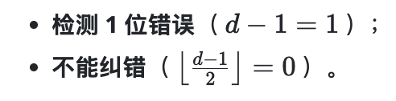

如果我们想要具备**1 位纠错能力**，最小海明距离至少要达到 **3**。

#### 5.2 海明码示例

**海明码（Hamming Code）** 是一种经典的线性分组码，其最小海明距离为 ***d\*=3** 。这意味着：

- 可以 **检测最多 2 位错误**。
- 可以 **纠正 1 位错误**。

接收端在解码过程中，会计算出一个称为 **伴随式（syndrome）** 的比特序列，用于判断是否发生了错误，以及错误的位置：

- 若伴随式为全零，说明数据未被破坏；
- 若伴随式为非零，且对应某个位的错误模式，则可准确定位并纠正该位；
- 若发生 **2 位错误**，伴随式可能不唯一，**可检测但不可纠正**，因为错误位置无法唯一确定。

---

## 流量控制

### 一、ARQ协议

ARQ 协议是一类 **可靠数据传输协议**，用于在 **不可靠的信道**（比如可能出错或丢包的网络链路）上实现 **可靠通信**。

ARQ 协议的 **核心思想** 是：

- 发送方在发送数据后，必须等待接收方的确认（ACK）。
- 如果在规定时间内没有收到确认，就认为数据丢失或出错，需要重传。

ARQ 协议主要包括三种形式：**停等**（Stop‑and‑Wait）、**回退 N 帧**（Go‑Back‑N）以及 **选择性重传**（Selective Repeat）。其中，回退 N 帧和选择性重传统称为 **连续 ARQ 协议**。

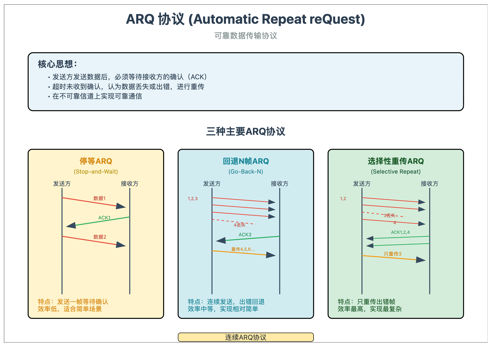

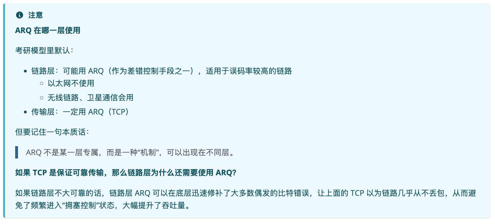

#### 1.1 停等协议

停等（Stop‑and‑Wait）是一种最基本的 **自动重传请求**（ARQ）协议。其核心思想是：发送方在发送完每一个数据帧后立即停止发送，并 **等待** 接收方的 **确认**（ACK）。只有在收到确认后，发送方才会继续发送下一个帧。由于任意时刻网络中只会有**一个**帧在传输，所以该协议也被称为“停等”。

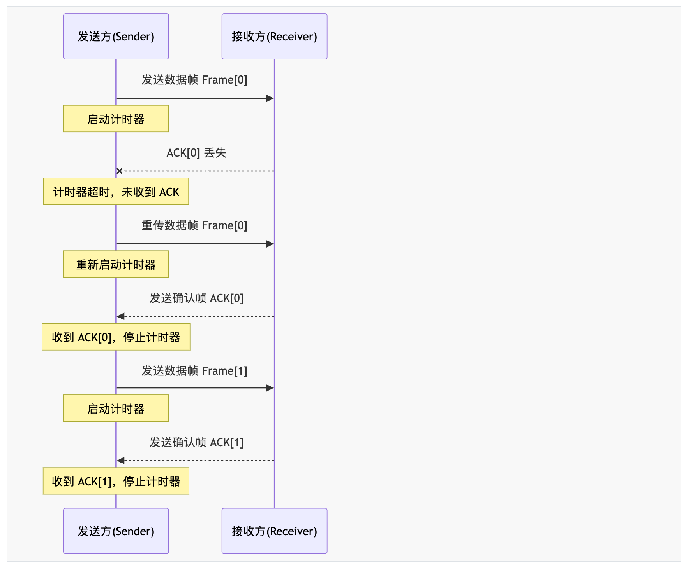

停等协议的 **工作过程** 如下：

1. 发送数据
   - 发送方将一个数据帧发送给接收方。
   - 同时启动 **计时器**，用于监控该帧的确认是否在规定时间内到达。
2. 等待确认
   - 在计时器超时之前，发送方保持在“等待”状态。
   - 此期间若收到 **确认帧**（ACK），则说明该帧已成功到达并被正确接收。
3. 确认的接收
   - 接收方收到数据帧后，首先检验其完整性（如校验和、序号等）。
   - 若数据帧无误，接收方立即发送 **确认帧**（ACK）回给发送方；若检测到错误，则不发送 ACK，导致发送方超时后重传。
4. 计时器到期
   - 若计时器在收到确认之前到期，发送方认为该帧或其确认已丢失。
   - 发送方随后 **重新发送** 同一数据帧，并重新启动计时器，重复上述过程直至收到有效的确认。

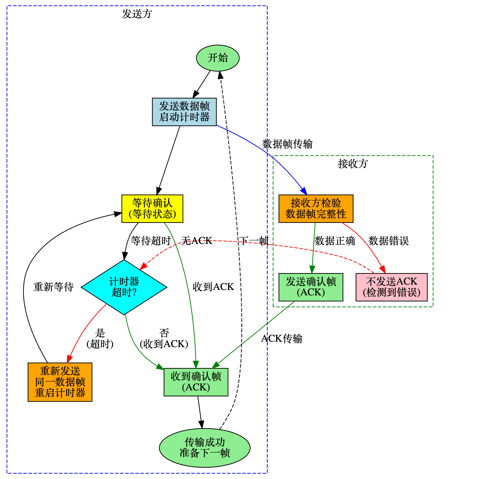

通过上述四个步骤，停等协议实现了可靠的点对点数据传输，尽管其效率受限于 “每次只能发送一个帧” 的特性。

#### 1.2 回退N帧

在 **回退 N 帧**（GBN，Go‑Back‑N）协议中，**发送窗口** 指的是发送方在未收到确认的情况下，最多可以连续发送的数据帧数量。它像一个滑动窗口，控制着数据的发送节奏。

发送方可以在等待确认的过程中，连续发送多个帧，但总数不能超出发送窗口的大小。当窗口被填满时，发送方必须停下来等待确认，收到确认后窗口才能向后滑动，从而腾出空间发送新的帧。

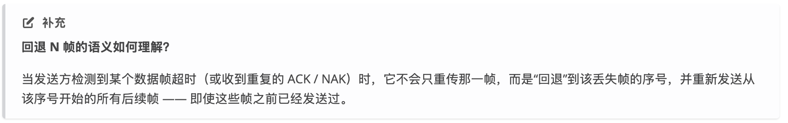

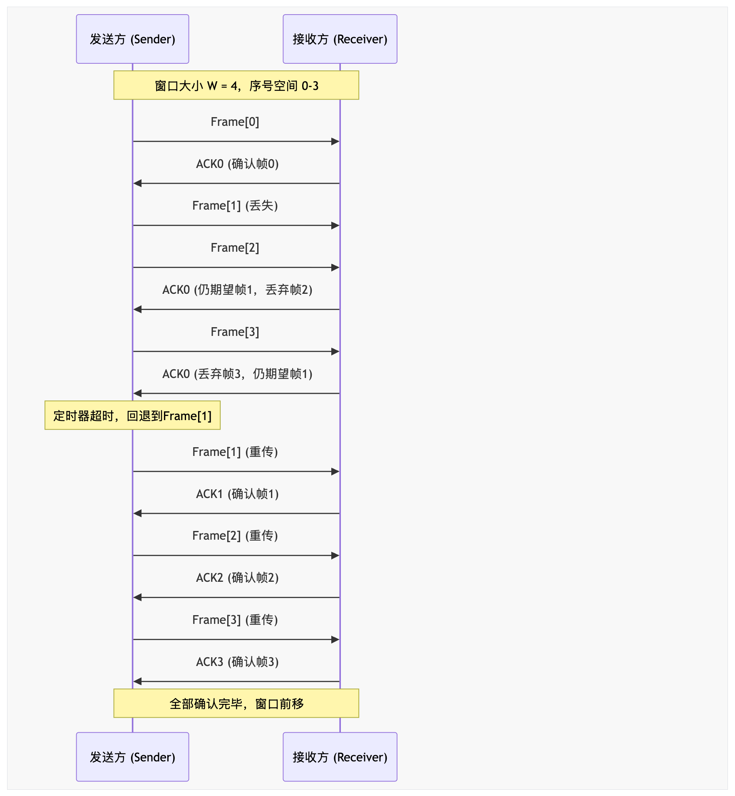

回退 N 帧的 **核心要点** 如下：

1. 窗口大小
   - 若帧序号使用 *n* 位二进制，则序号空间大小为 2*n* 。
   - 为保证不产生歧义，GBN 的发送窗口大小 *W* 必须满足 *W*≤2*n*−1 ，因此 **最大窗口大小** 为 2*n*−1 。
   - 接收窗口的大小固定为 **1**，即接收方只能一次接受并确认期望的序号。
2. 发送过程
   - 只要发送窗口未满，发送方就可以把窗口内的帧依次发送出去。
   - 对于 **最早发送且尚未被确认的帧**（即窗口中的第一个未确认帧），发送方启动 **单一的超时计时器**。
   - 其余已发送但尚未确认的帧不再单独维护计时器，而是共享这一个计时器。
3. 接收过程
   - 接收方维护一个 **期望序号**（expected sequence number）。
   - 当收到的帧序号等于期望序号时，接收方接受该帧并发送 **累计确认 ACK**（确认该帧及其之前的所有帧）。随后期望序号加 1。
   - 若收到的帧序号不是期望序号（说明前面的某帧丢失），接收方直接 **丢弃该帧**，并 **重新发送最近一次正确接收的帧的 ACK**。由于接收窗口为 1，后续已到达但序号不连续的帧都会被丢弃。
4. 超时与重传
   - 当 **超时计时器** 触发时，发送方认为窗口中最早的未确认帧已丢失。按照 GBN 的工作原理，发送方会 **从该帧开始**，把窗口内的所有帧全部 **重新发送**。
   - 这样做的原因是：即使后面的帧已经到达接收方，由于接收窗口仅能接受连续的序号，这些帧会在接收方被丢弃，只有最早丢失的帧被重新发送后，后续帧才能被顺利接收。

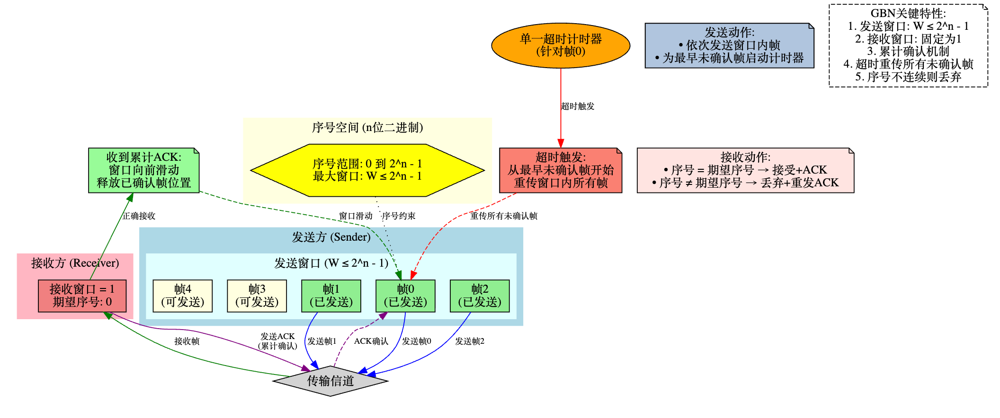

通过 [GBN、SR 交互演示](https://www.tkn.tu-berlin.de/teaching/rn/animations/gbn_sr/) 可以直观地了解 Go‑Back‑N 与 Selective Repeat 的工作流程，加深对上述概念的理解。

#### 1.3 选择性重传

**选择性重传**（SR，Selective Repeat）是一种 **自动重传请求**（**ARQ**）协议，专门用于克服回退 N 帧（Go‑Back‑N）在高误码率环境下的效率低下。与 Go‑Back‑N 不同，SR 只 **重传** 那些真正丢失或出错的帧，而不必重新发送随后所有的帧，从而在误码率较高的链路上表现得更为高效。

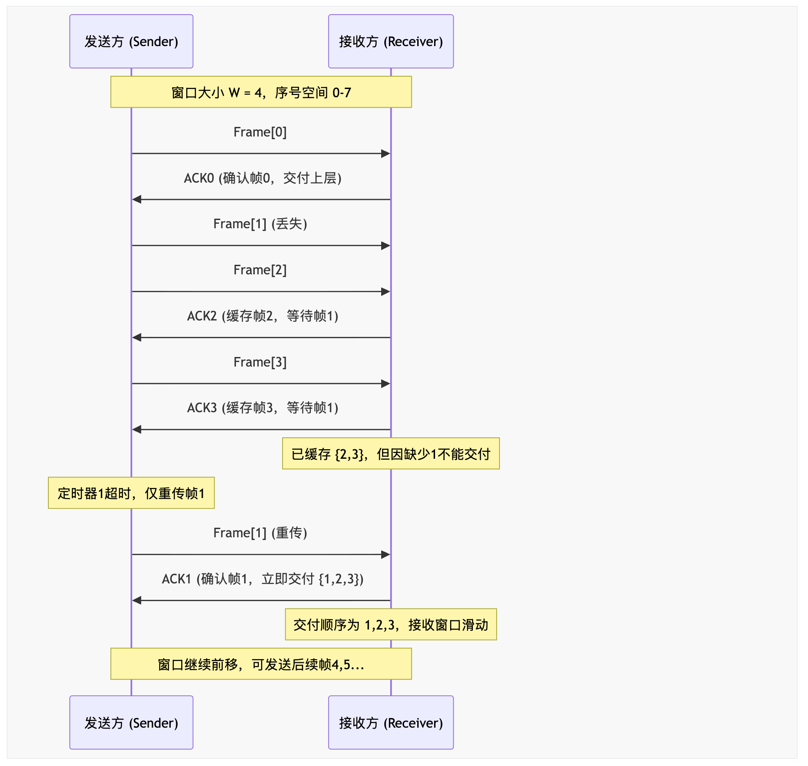

选择性重传的 **核心要点** 如下：

1. 窗口大小
   - 在 SR 中，发送窗口和接收窗口的大小保持一致。
   - 若帧序号采用 *n* 位二进制表示，则窗口的最大取值为 **2\*n\*−1** （即序号空间的半数），以避免发送方和接收方窗口的重叠产生歧义。
2. 发送过程
   - 发送方在其发送窗口范围内连续发帧。
   - 每发送一帧，就为该帧启动一个 **计时器**；计时器独立于其他帧，超时后仅针对该帧进行重传。
3. 接收过程
   - 接收方接受所有落在接收窗口中的帧，即使这些帧顺序错乱。
   - 对于每一正确收到的帧，接收方立即发送 **确认**（ACK）。
   - 乱序到达的帧会被 **缓存**，待窗口前面的缺失帧补齐后，按正确顺序交付给上层。
4. 超时与重传
   - 当某帧的计时器到期，发送方只 **重传** 该帧，而不是窗口内的全部帧。这一点是 SR 与 GBN 的根本区别，也是 SR 在高误码率下保持高吞吐量的关键。
5. 滑动窗口机制
   - **发送方**：收到帧的确认后，窗口左边界向前移动，释放已确认的帧槽位，随后可以发送新的帧。
   - **接收方**：当缓存的帧已能够连续组成一个完整序列并交付给上层后，接收窗口也向前滑动，腾出空间接收后续帧。
6. 冲突确认的处理
   - 由于网络延迟，发送方可能在重传帧后才收到该帧的早期确认。
   - 为避免误判，SR 协议必须具备 **识别并丢弃重复确认**（duplicate ACK）的机制，只对最新、有效的确认作出响应。

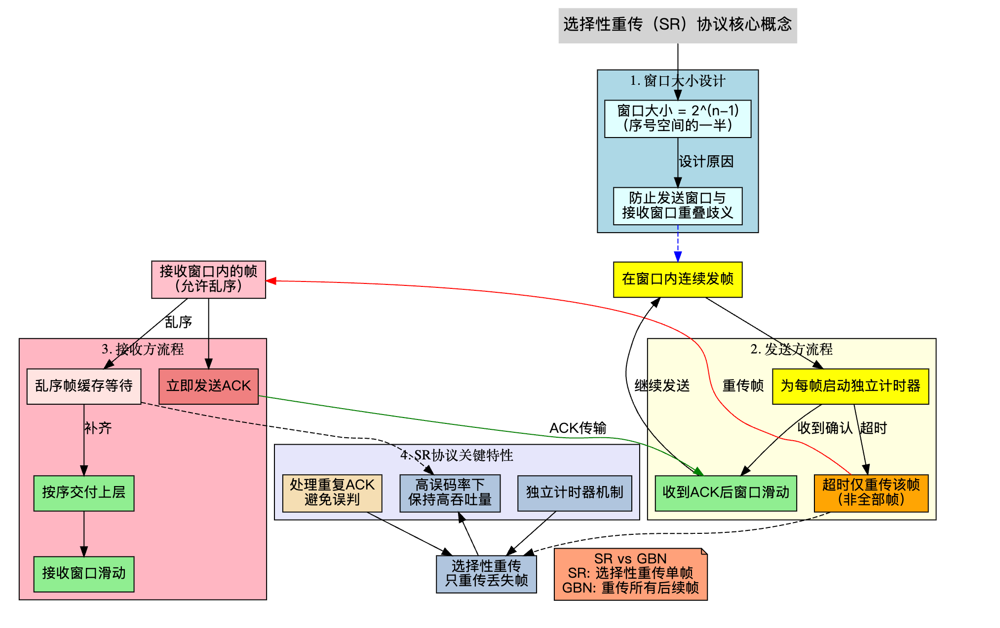

#### 1.4 协议对比

几种 ARQ 协议的主要区别是通过发送和接收窗口体现的：

发送窗口 

- **定义**：发送方在未收到对方确认（ACK）的情况下，允许连续发送的最大帧数量（或数据单元数量）。
- **作用**：控制发送方的数据发送速率，避免因发送过快导致网络拥塞或接收方处理不过来。

接收窗口 

- **定义**：接收方允许接收并缓存（或直接交付）的帧的最大数量，通常决定了接收方可以接受乱序或非连续帧的能力。
- **作用**：明确接收方能够处理的数据范围（包括按序和乱序数据），超出窗口的数据会被丢弃。

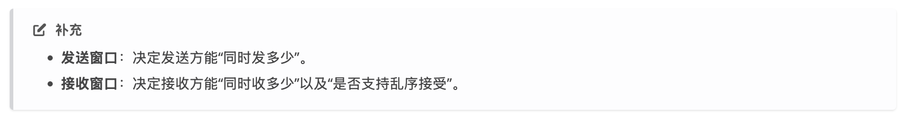

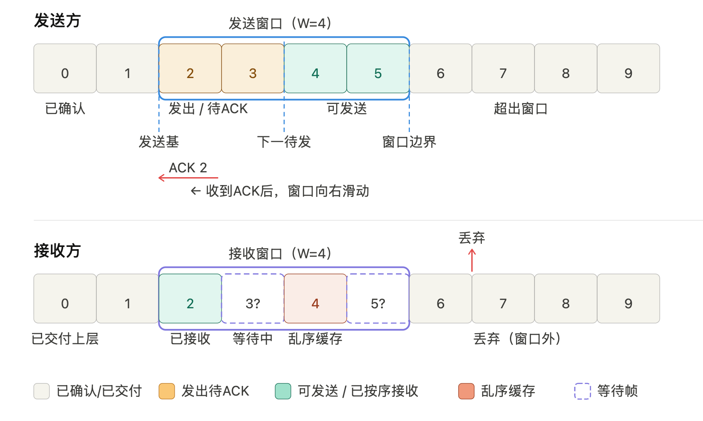

三个 ARQ 协议的具体区别如下：

| 特性                               | 停等协议                   | GBN（Go‑Back‑N）协议             | SR（Selective‑Repeat）协议                 |
| ---------------------------------- | -------------------------- | -------------------------------- | ------------------------------------------ |
| **发送方窗口大小（序号位数为 n）** | 1（一次只能发送一帧）      | 最多 2*n*−1 （可并发发送多帧）   | 最多 2*n*−1 （可并发发送多帧）             |
| **接收方窗口大小（序号位数为 n）** | 1（只接受一帧）            | 1（只能接受按序的下一帧）        | 与发送方窗口大小相同（可接受乱序帧）       |
| **超时重传单位**                   | 单个数据帧即整个发送窗口   | 整个发送窗口                     | 单个数据帧                                 |
| **发送方效率**                     | 低——每发送一帧必须等待确认 | 高——在确认到达前可连续发送多帧   | 高——仅对出错帧进行重传，其他帧不受影响     |
| **接收方效率**                     | 高——无需缓存，按序直接交付 | 低——必须按照顺序接收             | 高——可以缓存并按序交付已收到的乱序帧       |
| **错误处理方式**                   | 只重传丢失的那一帧         | 从第一个出错帧起，全部帧都要重传 | 只重传出错或乱序的那一帧（或若干孤立的帧） |
| **带宽利用率**                     | 低——大量空闲时间           | 高——大多数时间都在利用链路带宽   | 高——仅在必要时占用带宽进行重传             |

### 二、窗口大小限制

在说明窗口大小限制之前，必须先区分三种不同的“编号”概念：

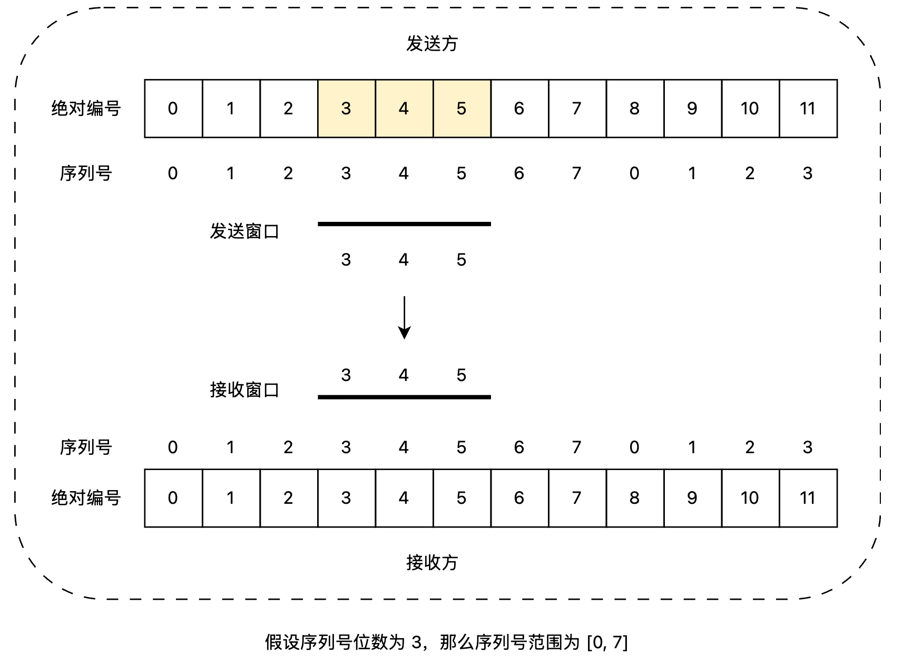

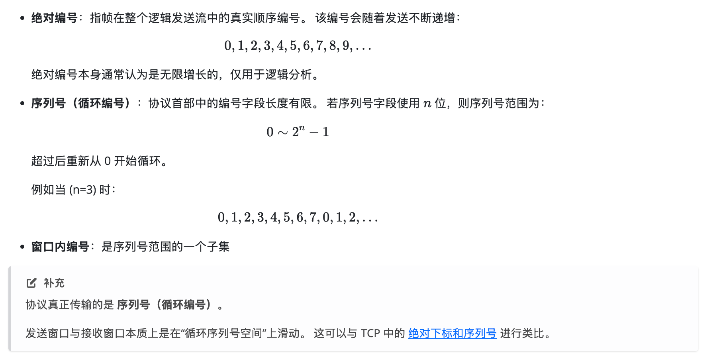

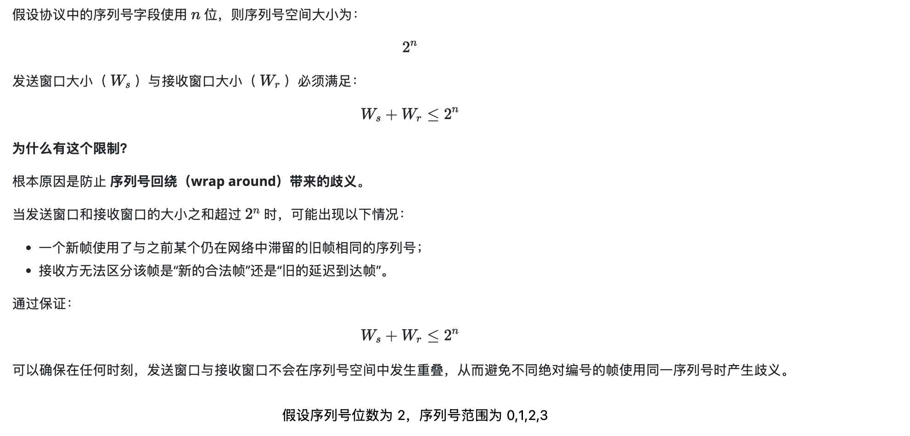

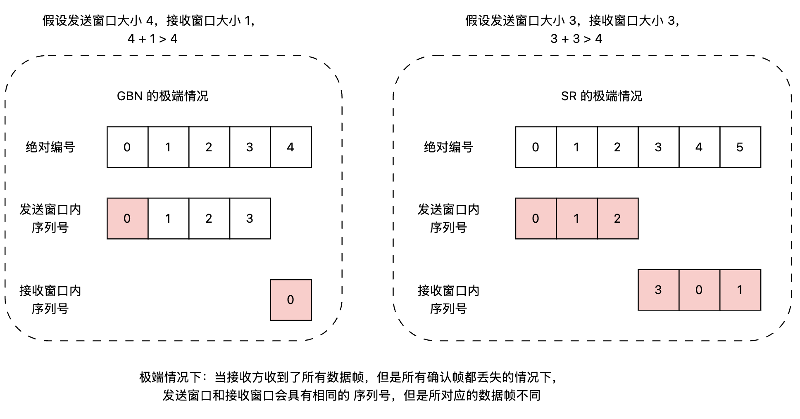

### 三、信道利用率

在 ARQ 协议中，**信道利用率**（也叫做链路利用率）是指信道用于传输有效数据的效率，通常定义为 **成功传输数据的时间占总传输时间的比例**。它反映了协议在给定信道条件下的性能，是评估 ARQ 协议效率的重要指标。

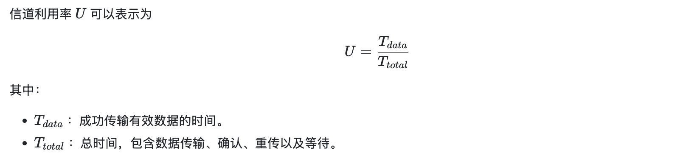

#### 3.1 计算方法

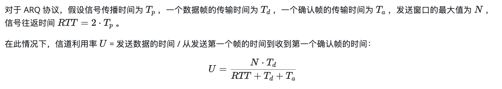

#### 3.2 停等协议

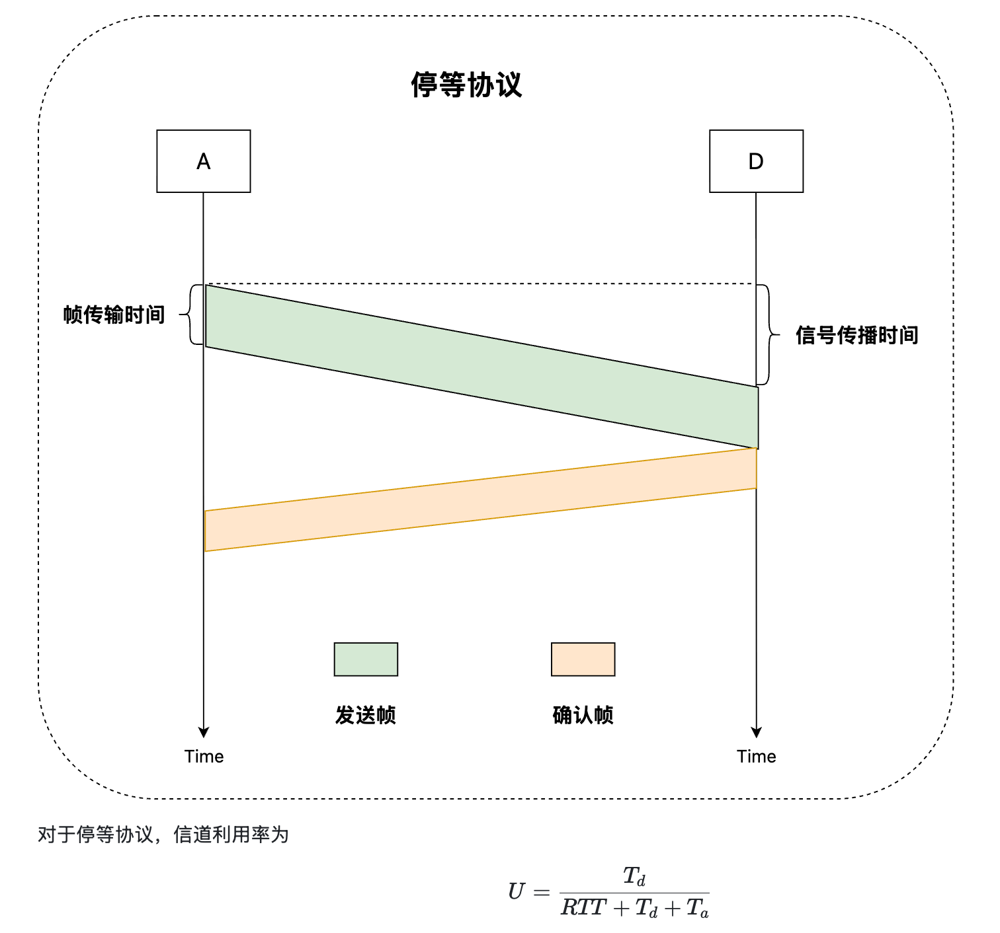

#### 3.3 连续ARQ协议

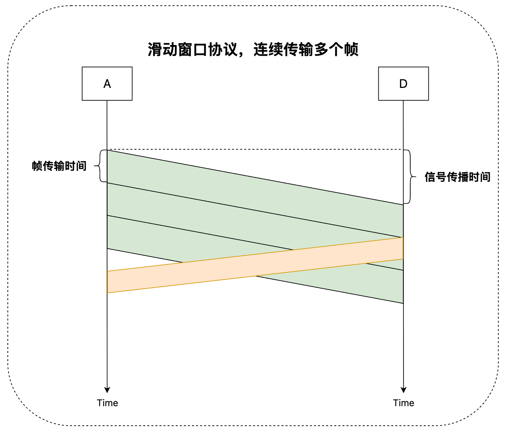

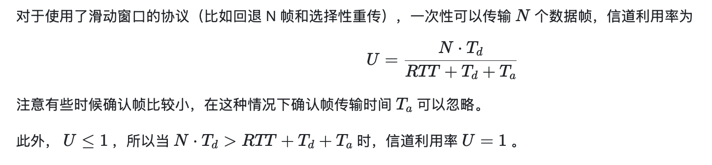

---

## 介质访问控制

### 一、共享介质

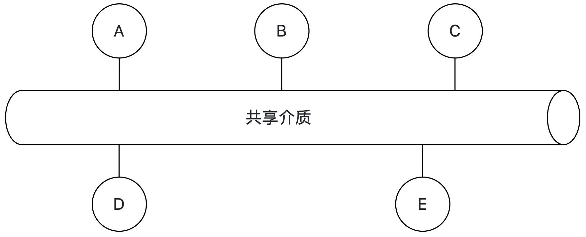

在介绍 MAC 概念之前，必须要说明一下 **共享介质** 的概念。

在一个网络环境中，多个设备可能需要同时访问同一个 **物理介质** 来发送数据，这个介质可以是 **电缆**、**光纤** 或者 **无线信道**。

当设备发送数据时，数据包会在整个介质上传播，所有连接到该介质的设备都可以接收到数据包。

如果多个设备同时发送数据，介质上的数据信号就会相互 **冲突** 进而导致错误。

所以 MAC 协议确保了 **共享介质** 上的有效、公正且有序的数据传输。

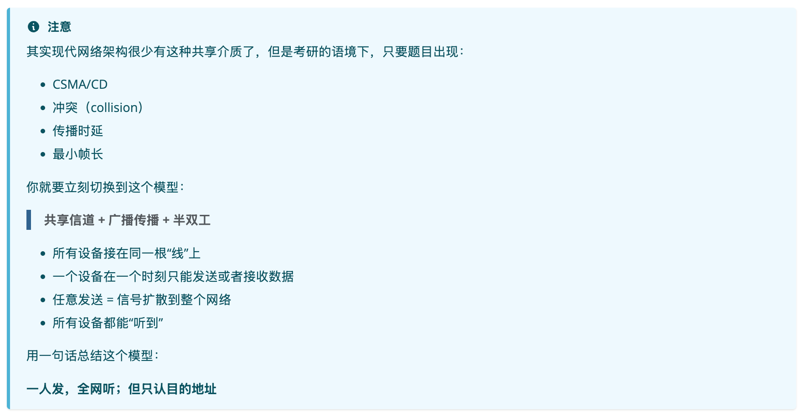

### 二、MAC方式总结

介质访问控制（MAC，Media Access Control）可以分为 **信道划分** 以及 **随机访问** 两种大方向。

信道划分介质访问控制：也叫做 **多路复用**，在一条传输介质上同时传输 **多个不同种类的信号**（种类可以根据不同的参数进行划分），这样不同的设备可以发送特定类型的信号，并且不同信号之间相互不干扰，信道划分 访问控制可以分为以下几种：

- FDM：频分多路复用
- TDM：时分多路复用
- WDM：波分多路复用
- CDM：码分多路复用

随机访问介质访问控制：指多台设备共享同一个 **通信介质** 时，它们可以随机地尝试发送数据，而不需要事先协调，当发生冲突后再做后续的协调，以保证不会接收到错误的数据。

- ALOHA
- CSMA
- CSMA/CD
- CSMA/CA

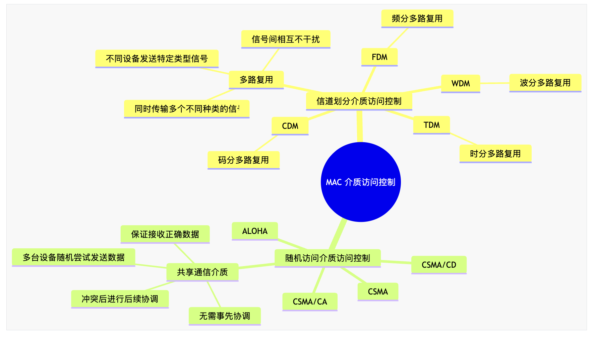

### 三、多路复用

多路复用（Multiplexing）是一种技术，用于在同一 **传输介质** 上同时传输 **多个信号**，包含频分多路复用（FDM）、时分多路复用（TDM）、波分多路复用（WDM）和码分多路复用（CDM）四种。

#### 3.1 FDM

频分多路复用（FDM）将可用带宽划分为若干个不重叠的 **频段**，每个 **信号** 占用一个频段。各个信号可以同时传输，但彼此之间不会干扰，因为它们占用不同的频率。

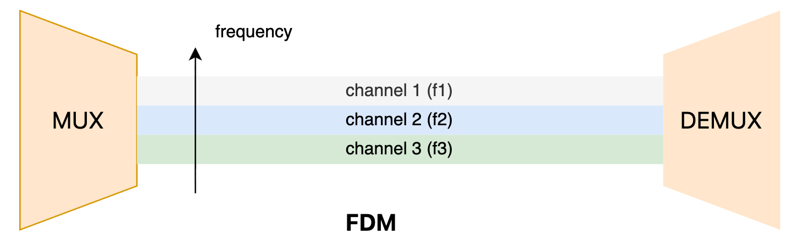

FDM 在传统的模拟电话系统和广播中广泛使用。

#### 3.2 TDM

时分多路复用（TDM）将 **时间** 划分成若干个 **时隙**，每个 **信号** 在不同的时隙中传输。所有信号在时间上轮流使用同一传输介质。

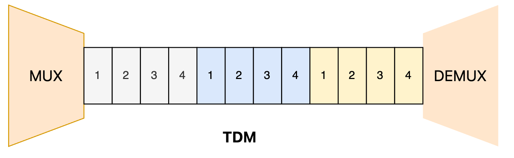

TDM 常用于数字通信系统，如数字电话网络。

#### 3.3 WDM

波分多路复用（WDM）是 FDM 的一种应用，主要用于 **光纤通信**。它将光纤的可用带宽划分为多个 **波长**（颜色），每个 **信号** 占用一个波长。

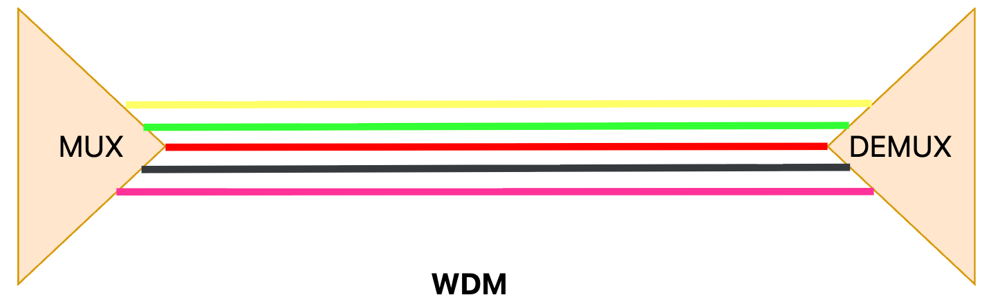

WDM 技术可以大幅增加光纤的通信容量，广泛应用于长距离和高速光纤网络。

#### 3.4 CDM

码分多路复用（CDM）使用不同的 **编码** 来区分各个 **信号**。所有信号可以在同一 **频带** 上同时传输，但通过使用不同的编码序列来避免相互干扰。

虽然 CDM 的概念可以用在许多不同的传输系统中，但在实践中，它主要作为 **码分多址**（**CDMA**，Code Division Multiple Access）的基础技术。

**CMDA：** 

在 CDMA 中，每一个 **比特时间** 划分为 m 个短的 **时间槽**，称为 **码片**（chip），每个站被指派一个惟一的 m bit 码片序列 (chip sequence) 。

- 如果发送比特 1，则发送自己的 m 位码片序列。
- 如果发送比特 0，则发送该码片序列的二进制反码。

简单理解就是，A 站向 C 站发出的信号用一个向量来表示，B 站向 C 站发出的信号用另一个向量来表示，两个向量要求相互 **正交**。向量中的分量，就是所谓的码片。

当两个或多个站点同时发送时，各路数据在信道中线性相加。为了从信道中分离出各路信号，要求各个站点的码片序列相互 **正交**。

令向量 *S* 表示站 S 的码片向量，令 *T* 表示其他任何站的码片向量。两个不同站的码片序列正交，就是向量 *S* 和 *T* 的规格化内积（inner product）都是 0：


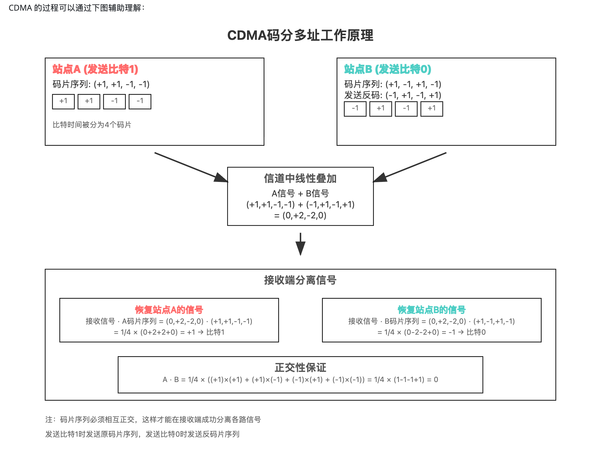

上图以一个实例展示了 CDMA 的过程：

1. **站点A**：码片序列S = (-1,-1,-1,+1,+1,-1,+1,+1)，发送比特1，所以发送原序列S

2. **站点B**：码片序列T = (-1,-1,+1,-1,+1,+1,+1,-1)，但在这个例子中发送的是T̄（反码），这意味着B站实际发送的是比特0

3. **信道叠加**：S + T̄ = (0,0,-2,+2,0,-2,0,+2)

4. 信号分离

   ：

   - 恢复A的信号：接收信号·S = +1 → 比特1 ✓
   - 恢复B的信号：接收信号·T = -1 → 比特0 ✓

5. **正交性**：S·T = 0，保证了两个信号可以完全分离

### 四、ALOHA协议

ALOHA 协议是一种早期开发的 **随机访问协议**，用于在 **共享信道** 上传输数据。ALOHA 有两种基本类型：纯 ALOHA 和时隙 ALOHA。

- 纯 ALOHA：用户可以在 **任何时间** 发送数据包。由于没有时间同步，数据包之间容易发生 **冲突**。
- 时隙 ALOHA：时间被分成离散的 **时隙**，用户只能在时隙的开始发送数据包。这种方法通过同步发送时间，减少了 **冲突** 的概率。

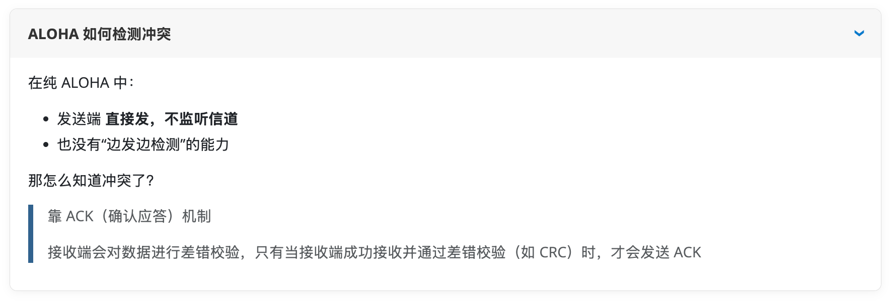

#### 4.1 纯ALOHA协议

纯 ALOHA（Pure ALOHA）是一种简单的 **随机接入协议**，允许用户在 **任意时刻** 发送数据包，而无需对时间进行任何同步或分时。

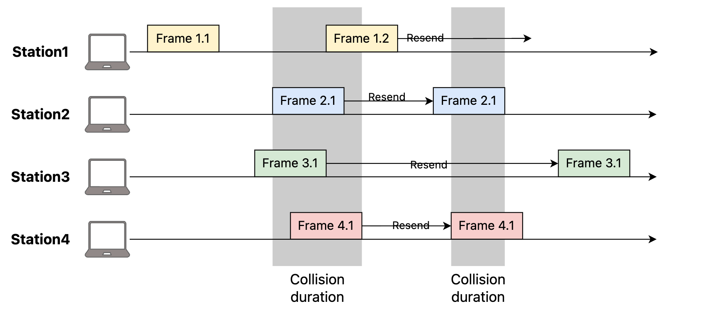

工作原理：

- 用户 **随时** 发送数据包。
- 如果数据包成功到达接收端，则传输完成。
- 如果发生 **冲突**（即两个或多个用户同时发送数据包），相关用户需要等待随机的时间后重传。

#### 4.2 时隙ALOHA

时隙 ALOHA（Slotted ALOHA）在纯 ALOHA 的基础上引入了 **时间同步**，将时间划分为一系列等长的 **时隙**。用户只能在 **时隙的开始** 发送数据包。

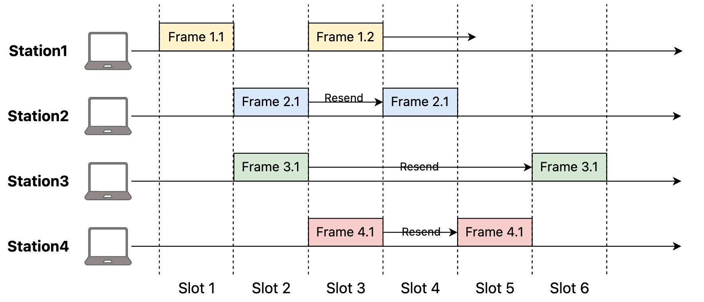

工作原理：

- 时间被划分为 **等长的时隙**。
- 用户在 **时隙的开始** 时发送数据包。
- 如果一个时隙内 **只有一个用户** 发送数据包，则传输成功。
- 如果多个用户在同一时隙发送数据包，发生 **冲突**，相关用户等待随机时间后重传。

### 五、CSMA协议

CSMA（Carrier Sense Multiple Access）的中文叫做 **载波监听多路访问**，理解 CSMA 的关键在于理解它的名称中的两个部分：**载波监听** 以及 **多路访问**：

- **载波监听**（Carrier Sense）：因为 CSMA 是随机访问介质控制的一种方式，所以在发送数据前，必须确定当前 **通信介质** 中没有其他设备正在发送数据。所以 **载波监听** 可以被理解为以太网口内部芯片自带的一种功能，具体而言就是一种可以监听 **信道** 在当前位置是否有数据传输的功能。
- **多路访问**（Multiple Access）：多个设备可以访问同一个 **通信介质**。这意味着在任何给定时间，任何设备都可以尝试发送数据。

所以 CSMA 可以理解为 通过 **载波监听** 避免 **冲突**，进而实现共享介质上的 **多路访问**。

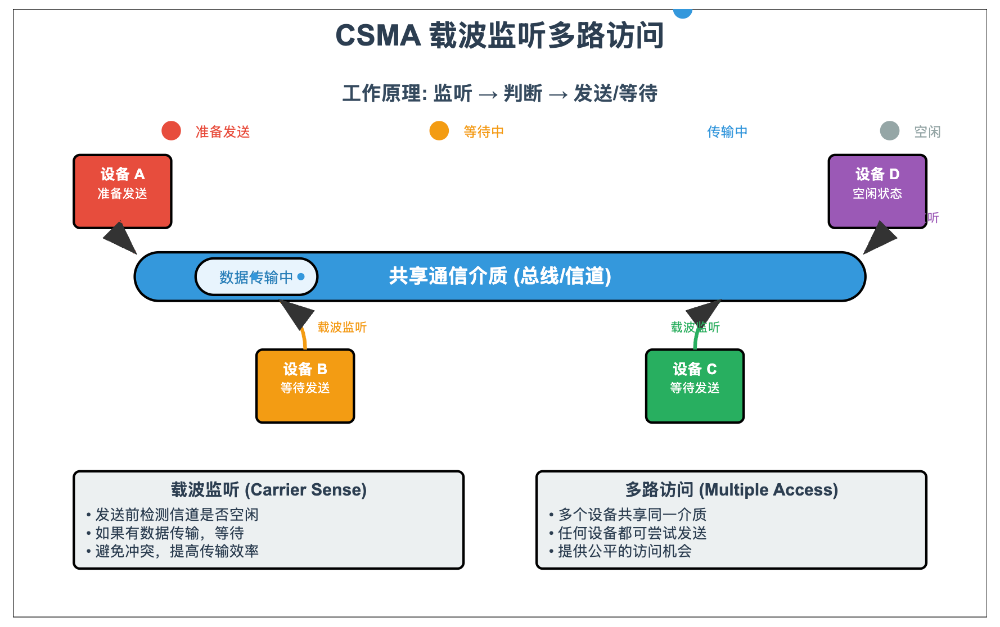

这里需要深入理解传播时延和传输时间这两个概念：

- **传播时延**（*propogation time*） = 距离 / 信号传播速度
- **传输时间**（*transmission time*） = 数据大小 / 数据传输速率

CSMA 的问题在于它无法处理 **碰撞**，当一个设备监听到当前介质中无信号时，它就可以发送数据，但监听得到的结果可能是 **“假结果”**。因为有可能其他设备已经发送信号了，只是信号由于传播时延还没有到达当前设备。

所以假设当前设备监听得到了“假结果”，那么此时发送数据后介质上就会发生 **冲突**。


CSMA 协议不会直接考查，但是作为 CSMA/CD 的基础，还是需要熟悉下。

#### 5.1 三种类型

CSMA 也 根据其在 **信道空闲** 时的行为分为三种类型，如下所示：

| 特征                 | 1-persistent CSMA                                            | Non-persistent CSMA                                        | p-persistent CSMA                                            |
| :------------------- | :----------------------------------------------------------- | :--------------------------------------------------------- | :----------------------------------------------------------- |
| **信道空闲时的行为** | 立即以发送数据                                               | 立即开始传输数据                                           | 在下一个时隙以概率 `p` 发送数据；以概率 `1-p` 推迟到下一个时隙 |
| **信道忙时的行为**   | 持续监听，直到信道空闲                                       | 等待一个随机时间后，重新监听信道                           | 持续监听，直到信道空闲（进入空闲后的行为见上一条）           |
| **碰撞的可能性**     | 最高（多个站点同时等待，一旦空闲必然冲突）                   | 低（随机等待减少了竞争）                                   | 中等（通过概率 `p` 分散了发送时机）                          |
| **延迟特性**         | 信道空闲时，发送延迟最小；但发生碰撞时，延迟会很大。         | 避免了多个站点的持续竞争，减少了碰撞，但可能增加平均延迟。 | 在减少碰撞和控制延迟之间取得平衡。                           |
| **适用性**           | 实际上很少用于纯ALOHA或CSMA，因为碰撞概率太高。 更像是一个理论参考。 | 适用于非持续型流量、碰撞概率较高的网络（如早期的以太网）   | 适用于时隙化信道，是前两种策略的一个很好折中，常用于Wi-Fi等网络。 |

### 六、CSMA/CD协议

CSMA/CD（CSMA with **Collision Detection**，载波监听多路访问/**碰撞检测**）是 CSMA 的一种拓展，在了解这个知识之前，请确保你已经理解了什么是 CSMA 中的 CS（Carrier Sense 即 **载波监听**），以及什么是 CSMA 中的 MA（Multiple Access 即 **多路访问**）。

CSMA/CD 比 CSMA 多出一个 **CD**（Collision Detection 即 **碰撞检测**）的功能。

在上文中我们提到，CSMA 中监听到信道空闲可能是“**虚假**”，所以在 CSMA 发送数据后介质中也许会发生冲突，但 CSMA 只能依靠非常原始的方案处理冲突。

CSMA/CD 就高级一些，在发送数据期间，我们刚刚提到的 **监测器件**（Carrier，就是 CSMA 中 C 的简称）会 **一直监听有没有冲突发生**


以下图为例，假设 A 向 D 发送一段数据，C 向 A 发送一段数据，我们可以观察到：**冲突发生** 的时间点 和 **设备检测到** 冲突的时间点是不同的。


当 A 和 C 检测到冲突发生时，它们会立即停止发送，并且发送信号通知其他设备该次碰撞。

#### 6.1 流程

CSMA/CD 的工作流程如下：

1. **准备发送**：适配器从网络层获得一个分组，封装成帧，放入网络适配器缓存准备发送。
2. **检测信道**：监听信道是否空闲，若信道空闲，则开始发送该帧；若信道忙，则持续检测直至信道空闲。
3. 在发送过程中，适配器仍然持续检测信道。这里只有如下两种可能。
   - **发送成功**：在争用期内一直未检测到冲突，该帧肯定能发送成功。
   - **发送失败**：在争用期内检测到冲突，此时立即停止发送，并且广播 **碰撞通知信号**。接着适配器执行 **指数退避算法**，等待一段随机时间后返回到步骤 2。若重传 16 次仍不能成功，则停止重传并向上报错。


#### 6.2 指数退避算法


#### 6.3 限制条件

CSMA/CD 能够正常工作的 **限制条件** 是：

> **帧的传输时间至少要两倍于信号在总线上最长的传播时延**（即两倍于总线端到端的单向传播时延）。

要在帧的发送过程中及时发现冲突，**发送站必须在整个帧发送完毕之前收到冲突信号**。如果发送站只有在帧全部发送完之后才能检测到冲突，那么冲突产生的数据已经完整地传输到了网络上，无法避免数据损坏。

因此，**最小帧长** 就是由这个时间条件决定的。对于给定的网络速率和传播时延，必须保证帧的发送时间足够长，从而在冲突发生时，发送站仍处于发送状态，能够及时检测到冲突并执行退避机制。如果帧太短，就会在冲突信号返回之前发送完毕，导致冲突无法被检测，进而破坏CSMA/CD的正常工作。


### 七、CSMA/CA协议

CSMA/CD 适用于 **以太网**（使用有线连接的局域网），但在 **无线局域网**（WLAN，Wireless LAN）中无法直接使用 CSMA/CD，主要有以下原因：

1. **无线设备** 不能同时“听”和“说”：无线收发器在发送数据时，无法同时监听信道来判断是否发生碰撞。
2. **信道干扰** 比有线环境严重：无线信号受环境干扰更大，误判空闲或碰撞的概率更高。
3. **隐藏节点问题**（隐蔽站）：假设 A 和 C 两台无线设备都想给 B 发送数据，但 A 和 C 彼此“看不到”，只看到 B 是空闲的。结果就是 A 和 C 同时给 B 发送，发生碰撞，但它们却以为没事。

为此，802.11 标准定义了广泛用于无线局域网的 CSMA/CA 协议，它对 CSMA/CD 协议进行修改，将 **冲突检测** 改为 **冲突避免** (Collision Avoidance,.CA)。“**冲突避免**” 并不是指协议可以完全避免冲突，而是指协议的设计要尽量降低冲突发生的概率。

#### 7.1 流程


1. 侦听信道

   （Carrier Sense）

   - 设备在发送数据前通过物理侦听（检查信道电信号）和虚拟侦听（NAV，网络分配向量，记录信道占用时间）判断信道是否空闲。若信道忙碌，设备进入退避机制，等待随机时间后再次侦听，以降低碰撞风险。

2. 发送请求

   （RTS，Request to Send）

   - 若信道空闲超过特定时间（DIFS，分布式帧间间隔），设备可发送 **RTS** 帧，通知其他设备其传输意图及所需时间。RTS 帧是可选的，主要用于较大数据包或高干扰环境。

3. 清除发送请求

   （CTS，Clear to Send）

   - 接收设备在确认信道空闲后（等待 SIFS，短帧间间隔），回复 **CTS** 帧，确认传输许可并通知附近设备保持沉默。CTS 帧增强了信道保护，减少隐藏节点问题。

4. 数据传输

   - 发送设备收到 **CTS** 帧后（等待 SIFS），开始传输数据帧。其他设备通过 **NAV** 设置避免干扰，确保信道专用于当前传输。

5. 确认帧

   （ACK，Acknowledgment）

   - 接收设备成功接收数据后（等待 SIFS），发送 **ACK** 帧确认。若发送端未收到 **ACK**（可能因 **碰撞** 或干扰），启动重传机制，重新执行上述步骤。

根据以上过程我们可以观察到 CSMA/CA 的一些 **关键特点**：

- **碰撞避免**：CSMA/CA 通过侦听、RTS/CTS、退避机制预测和确认机制并避免碰撞，而非像 CSMA/CD（以太网）那样检测碰撞后处理，适合无线网络因其难以实时检测碰撞。
- **隐藏节点问题**：两设备因距离远无法互相侦听，可能同时发送数据导致碰撞。RTS/CTS 机制通过通知附近设备解决此问题。

#### 7.2 IFS

由于无线信道的可靠程度不如有线网络，802.11 标准使用 [**停等方案**](https://www.csgraduates.com/computer_network/datalink/flow_control/#停等协议)，即站点每通过无线局域网发送完一帧，就要在收到对方的确认帧后才能继续发送下一帧。

为了尽量避免冲突，802.11 标准规定：所有站在完成一次发送后，必须先等待一个极短的时间（期间继续监听信道）才能发送下一帧。这段等待时间称为 **帧间间隔**（InterFrame Space，**IFS**）。不同类型的帧对应的 IFS 长度不同，IFS 的长短用来实现优先级管理，从而保证关键帧能够在竞争激烈的信道中优先获得发送机会。

802.11 标准使用了下列三种 IFS：

- SIFS

  （Short IFS）：最短的帧间隔，优先级最高。用于：

  - 接收方回复 CTS 或 ACK；
  - 源站发送连续帧（如 DATA → ACK）。
  - 示例：AP 接收到 RTS 后，等待 SIFS 时间发送 CTS，之后接收到数据后，再等待 SIFS 时间发送 ACK。

- DIFS

  （Distributed IFS）：普通数据帧的发送间隔。用于：

  - 一个站点在发现信道空闲后，准备发起新的通信前等待的时间。
  - 示例：A 想要发起通信，必须先监听信道空闲，并等待 DIFS 才能发送 RTS。

- **PIFS**（Point Coordination IFS）：比 DIFS 短、但比 SIFS 长。仅用于中心协调器（AP）抢占信道，用于轮询控制（PCF 模式）。


等待 IFS 序列过程如下：

```
A: 监听信道空闲 → 等待 DIFS → 发送 RTS
AP: 等待 SIFS → 回复 CTS
A: 等待 SIFS → 发送 DATA
AP: 等待 SIFS → 回复 ACK
```

#### 7.3 NAV

为了应对无线网络中的 “隐蔽节点” 问题，802.11 引入了 **NAV**（Network Allocation Vector） 概念，作为一种 “**虚拟载波侦听机制**”。

NAV 是一种 **倒计时定时器**，它告诉站点：接下来的多长时间内，信道将被其他设备占用。具体过程如下：

- A 发送 **RTS** 帧，并在其中声明：从 RTS 发送起，直到收到 ACK，通信将持续多久。
- AP 回复 **CTS** 帧，在 CTS 中再次包含整个传输剩余所需时间（包括 DATA 和 ACK）。
- 所有收到 **RTS** 或 **CTS** 的站点，都会根据帧中的时间字段，设置自己的 NAV 计时器，并保持沉默，避免冲突。

在上图中：

- **B 是隐蔽站**，可能听不到 A 的 RTS，但能听到 AP 的 CTS → 会根据 CTS 设置 NAV。
- 其他站点即使未直接收到数据（例如 DATA），也会因为事先通过 RTS/CTS 设置了 NAV，在期间不会发起竞争。

简单来说，NAV 就像设备内部的一个“占用表”，告诉自己：别人正在用，等一会再发。

---

## 局域网和广域网

### 一、局域网

局域网（Local Area Network，LAN）是一种覆盖范围较小、用于连接同一物理地点（如家庭、办公室、学校或企业内）的计算机和其他设备的计算机网络。

#### 1.1 特性

局域网的特性主要由三个要素决定：**拓扑结构**、**传输介质** 和 **介质访问控制方式**，其中 **介质访问控制方式** 是最关键的因素，它决定了局域网的主要技术特性。

常见的局域网 **拓扑结构** 主要包括以下四类：

- 星形结构
- 环形结构
- 总线形结构
- 星形与总线形结合的复合型结构


在 **传输介质** 方面，局域网可以采用铜缆、双绞线和光纤等多种介质，其中 **双绞线** 是当前的主流传输介质。

局域网常用的 **介质访问控制方法** 包括 **CSMA/CD 协议**、**令牌总线协议** 和 **令牌环协议**。其中，CSMA/CD 协议和令牌总线协议主要应用于总线形局域网，而令牌环协议则主要用于环形局域网。

#### 1.2 实现

局域网主要包含三种实现：

- **以太网**（目前使用范围最广）。逻辑拓扑是总线形结构，物理拓扑是星形结构。
- **令牌环**（Token Ring，IEEE802.5）。逻辑拓扑是环形结构，物理拓扑是星形结构。
- **FDDI**（光纤分布数字接口，IEE802.8）。逻辑拓扑是环形结构，物理拓扑是双环结构。

#### 1.3 以太网

在实际的局域网应用中，由于 **以太网** 占据垄断地位，所以基本上成为了局域网的代名词，需要对局域网的概念有深入了解。

**传输介质：**

以太网常用的传输介质有 4 种：粗缆、细缆、双绞线和光纤，这里需要熟练掌握它们的英文名，常在选择题中出现：

| 参数       | 10BASE5      | 10BASE2      | 10BASE-T     | 10BASE-FL    |
| ---------- | ------------ | ------------ | ------------ | ------------ |
| 传输媒体   | 粗缆         | 细缆         | 双绞线       | 光纤对       |
| 编码       | 曼彻斯特编码 | 曼彻斯特编码 | 曼彻斯特编码 | 曼彻斯特编码 |
| 拓扑结构   | 总线形       | 总线形       | 星形         | 点对点       |
| 网络适配器 | 早期以太网   | 早期以太网   | 现代以太网   | 现代以太网   |

**注意上述传输介质的英文名称其实是挺有讲究的：**

首先是前缀的数字，代表的是传输介质的速率， **10** 代表 *10 Mbps*，**100** 代表 *100 Mbps*，注意这里是 **Mbps** 而不是 **MB/s**。

其次是中间的 **base**，代表基带传输（Baseband），基带与宽带（broadband）相对应。基带表示直接传输原始数字信号，不调制；宽带代表使用模拟调制技术传输多个频道信号，常见于有线电视等。

最后是后缀的英文字母，代表的传输介质的类型：

- 注意字母 `T` 是 `twisted pair` 的首字母，含义是 [**双绞线**](https://www.csgraduates.com/computer_network/physical/dev/#电缆)。
- `FL` 是 `Fiber optic` 的缩写，含义是 [**光纤**](https://www.csgraduates.com/computer_network/physical/dev/#电缆)。


如上图所示，以太网帧格式从逻辑上可以分为物理层控制字段、帧首部、数据负载、差错校验字段这四个部分，每个字段的具体说明如下所示：

- 物理层控制字段
  - 前导码（Preamble）：7B
    - 由 7 字节的交替的 1 和 0 位组成，用于同步接收方的时钟。
  - 帧开始分隔符（Start of Frame Delimiter, SFD）：1B
    - 通常为 10101011，标志帧的开始。
- 帧首部：固定为 14B
  1. 目的地址（Destination MAC Address）：6B
     - 指定帧的接收者的物理 MAC 地址。
  2. 源地址（Source MAC Address）：6B
     - 指定帧发送者的物理 MAC 地址。
  3. 类型/长度字段（Type/Length）：2B
     - 如果值大于或等于 0x0600（1536），则表示帧携带的数据的类型（例如 IPv4、IPv6、ARP 等）。
     - 如果值小于或等于 0x05DC（1500），则表示数据字段的长度。
- 负载
  - 数据和填充（Data and Padding）：范围为 46-1500B
    - 携带帧的有效载荷，即要传输的数据。
    - 如果数据少于 46 字节，则需要填充，确保数据字段的最小长度为 46 字节。
- 差错校验字段
  - 帧校验序列（Frame Check Sequence, FCS）：4 字节
    - 一个循环冗余校验（CRC）值，用于错误检测。接收方计算帧的 CRC，并与这个字段进行比较，以确定帧是否在传输过程中被损坏。


#### 1.4 无线局域网

**帧格式：**802.11 帧共有三种类型，即数据帧、控制帧和管理帧。数据帧的格式如图 3.28 所示。


802.11 数据帧由以下三部分组成：

- MAC 首部，共 **30 字节**。帧的复杂性都在 MAC 首部。
- 帧主体，即帧的数据部分，不超过 **2312 字节**。
- 帧检验序列 FCS 是 MAC 尾部，共 **4 字节**。

可以观察到，802.11 帧首部中字段很多，但是其实主要考察的就是个别字段。

其中最重要的是 **4 个地址字段**（都是 MAC 地址）。这里仅讨论前三个地址（地址 4 用于自组网络）。这三个地址的内容取决于帧控制字段中的“去往 AP”和“来自 AP”这两个字段的数值，如下表所示：

| 去往 AP | 来自 AP | 地址 1              | 地址 2             | 地址 3   | 地址 4 |
| ------- | ------- | ------------------- | ------------------ | -------- | ------ |
| 0       | 1       | 接收地址 = 目的地址 | 发送地址 = AP 地址 | 源地址   | ——     |
| 1       | 0       | 接收地址 = AP 地址  | 发送地址 = 源地址  | 目的地址 | ——     |

💡核心记忆点：

- 地址 1：谁接收这帧（无线信号的接收者）
- 地址 2：谁发的这帧（无线信号的发送者）
- 地址 3：通信的最终目标或源（真实的目的地或来源）

#### 1.5 VLAN

VLAN（Virtual Local Area Network）虚拟局域网，是通过 **逻辑划分** 的方式，把一个物理局域网拆分成多个独立的子网。

打个比方：一家公司只有一个办公室（一个交换机），但希望让财务部、技术部和人事部各自的数据隔离，互不干扰。VLAN 就像是在这一个办公室里，用“看不见的墙”把它们隔开，互相听不到对方说话。

⚙️ **那么 VLAN 是如何实现的呢？**

VLAN 是通过 **交换机** 和 **VLAN 标签（Tag）** 实现的。简单来说：

- 普通交换机：看网线在哪个口（port）来转发数据。
- 支持 VLAN 的交换机：会在数据包中加上 **VLAN 标签**，按“部门”来转发。

802.3c 标准定义了支持 VLAN 的以太网帧格式的扩展。它在以太网帧中插入一个 **4 字节** 的标识符（插在源地址字段和类型字段之间），称为 **VLAN 标签**，用来指明发送该帧的计算机属于哪个虚拟局域网。插入 VLAN 标签的帧称为 **802.1Q 帧**，如下图所示。


其中 **VID（VLAN ID）** 为 **12 位**，一个 VLAN 交换机最多支持 **4096 个 VLAN**。

📦 VLAN 示例： 假设有三台电脑：

- PC1：财务部，接在 **VLAN 10**
- PC2：技术部，接在 **VLAN 20**
- PC3：人事部，接在 **VLAN 30**

它们都连在一台交换机上，如果没有 VLAN，三者可以互相通信。如果配置了 VLAN：

- PC1 发的广播，只有 **VLAN 10** 内的设备能收到。
- PC2 和 PC3 不会收到 PC1 的数据，除非通过路由器（或者三层交换机）跨 VLAN 通信。

### 二、广域网

#### 2.1 HDLC协议

HDLC（High-Level Data Link Control，高级数据链路控制）是一种 **面向比特**（bit-oriented） 的 **数据链路层协议**，用于在点对点或点对多点通信中提供可靠的数据传输。

HDLC 几个特点可以被简单总结为：面向比特、面向连接、提供可靠传输。

需要注意的是 HDLC 使用 [**零比特填充法**](https://www.csgraduates.com/computer_network/datalink/framing/#零比特填充法) 来组帧。

#### 2.2 PPP协议

PPP（Point-to-Point Protocol）是一种数据链路层协议，用于在两个点对点连接的网络之间传输数据。PPP 最初是为拨号连接设计的，但它后来被广泛用于建立各种类型的点对点连接，包括 **DSL（数字用户线路）**、**ISDN（综合业务数字网）** 和串口连接等。

---

## 数据链路层

### 一、交换机

交换机（Switch）是网络中用于连接设备并转发数据帧的二层设备。它通过分析数据帧中的 MAC 地址，将数据帧从接收端口精准转发到 **目标设备所在的端口**。相比 [**集线器**](https://www.csgraduates.com/computer_network/physical/dev/#集线器)，交换机只将数据帧发送到必要端口，避免广播到整个网络，**显著降低碰撞域**，提升带宽利用率和传输速度。

#### 1.1 转发表

转发表（也称 **MAC 地址表**）是交换机内部维护的一张记录表，存储了网络设备 **MAC 地址** 与其 **连接端口** 的对应关系。每条记录通常包含以下信息：

- **MAC 地址**：网络设备的唯一标识。
- **端口号**：设备连接的交换机端口。
- **附加信息**（可选）：如 **VLAN** 标识或条目有效时间。


如上图所示，交换机 A 和 B 分别通过 **转发表** 记录了通往每个 **MAC 地址** 的端口。

####  1.2 转发流程

当交换机收到数据帧后，会根据 **转发表（MAC 地址表）** 执行以下步骤：

1. 检查目标 MAC 地址
   - 从数据帧的头部提取目标 MAC 地址。
2. 查询转发表（MAC 地址表）
   - **命中（已学习）**：如果表中有该 MAC 地址 → 将帧转发到对应端口（单播）。
   - **未命中（未知 MAC）**：如果表中没有记录 → 交换机将帧 **泛洪（Flooding）**，即复制该帧并发送到除接收端口以外的所有端口。
3. 转发数据帧
   - 目标设备收到帧后应答，交换机会根据 **源 MAC 地址** 学习到该设备所在端口，并更新转发表。


#### 1.3 交换方法

交换机的 **交换方式** 决定了 交换机在接收到数据帧后，决定如何以及何时将该帧转发到目标端口，**交换方式** 有如下三种：

- 直通交换：交换机在接收到数据帧的前6个字节（即目的 **MAC 地址**）后，立即根据 **MAC 地址表** 查找目标端口并开始转发，无需等待整个数据帧接收完成。
- 存储转发：交换机接收完整数据帧后，存储在缓冲区中，进行 **CRC**（循环冗余校验）检查，确认数据帧无误后再根据 **MAC 地址表** 转发。
- **碎片隔离**：介于直通交换和存储转发之间，检查数据帧的前64字节（以太网最小帧长），若帧长不足64字节（碎片），则丢弃；若正常，则转发。


### 二、网桥

网桥（Bridge）的功能和 **交换机** 基本一致，两者都是二层网络设备，用于转发数据帧。网桥中也有 **转发表** 的概念，转发过程和 **交换机** 一致，这里不再赘述。


那么 网桥和交换机区别 在哪里呢？

网桥是比较早期计算机网络使用的设备，现在已经渐渐被 **交换机** 替代，两者的重要区别如下表：

| 方面         | 网桥（Bridge）                   | 交换机（Switch）                            |
| ------------ | -------------------------------- | ------------------------------------------- |
| **端口数量** | 通常较少（2～4 个）              | 通常很多（几十个甚至上百个）                |
| **性能**     | 软件转发，处理能力较弱           | 硬件转发（ASIC 芯片），转发速度更快         |
| **功能**     | 简单地转发帧，适合小型或实验网络 | 支持 **VLAN**、端口镜像、链路聚合等高级功能 |
| **使用场景** | 用于连接两个小型网络             | 用于构建现代企业内部网络（LAN）             |


