# 传输层

## TCP

### 一、TCP特点

- **面向连接**：发送数据前后需要分别通过三次握手和四次挥手进行连接的建立和断开。
- **可靠交付**：保证数据传输的无差错、不丢失、不重复、有序。
- **面向字节流**：以滑动窗口的形式对字节按照顺序进行发送和接收。
- **全双工**：通信双方在一个 TCP 连接中都可以发送和接收数据。

### 二、TCP首部

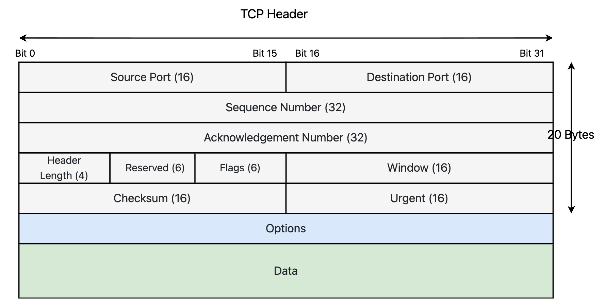

1. **源端口号**（Source Port）：16 位字段，指示发送端的端口号。

2. **目标端口号**（Destination Port）：16 位字段，指示接收端的端口号。

3. **序列号**（Sequence Number）：32 位字段，用于标识 TCP 报文段中第一个数据字节的序列号。这个字段用于实现 TCP 的可靠性机制，如数据的按序传递和重传。

4. **确认号**（Acknowledgment Number）：32 位字段，如果设置了 **ACK** 标志位，该字段包含了期望接收的下一个数据字节的序列号。这个字段用于确认已经成功接收的数据。

5. **首部长度**（Header Length）：4 位字段，指示 TCP 首部的长度，以 32 位字为单位。这个字段用于指示首部的长度，因为 TCP 首部长度可以变化，根据选项的存在而变化。

6. **保留**（Reserved）：6 位字段，保留供未来使用，目前必须设置为 0。

7. 控制标志位

   （Flags）：TCP 报文段的控制标志，共有 6 个标志位，它们分别是：

   - **URG**（紧急指针有效位）：用于指示紧急数据。
   - **ACK**（确认位）：用于指示确认号字段有效。
   - **PSH**（推送位）：用于指示接收端应立即交付数据给应用层，而不需要等待缓冲区满。
   - **RST**（复位位）：用于强制释放连接，重置连接状态。
   - **SYN**（同步位）：用于建立连接，用于初始化序列号。
   - **FIN**（终止位）：用于关闭连接。

8. **窗口大小**（Window Size）：16 位字段，指示发送端的可用接收窗口大小。接收端可以根据这个字段的值来告诉发送端可以发送多少数据而不会导致拥塞。

9. **校验和**（Checksum）：16 位字段，用于检测 TCP 首部和数据部分的传输中的错误。

10. **紧急指针**（Urgent Pointer）：16 位字段，仅当 **URG** 标志位设置时才有效。用于指示紧急数据的末尾位置。

11. **选项**（Options）：可选字段，用于包含一些额外的控制信息，如最大报文段长度、时间戳等。长度可变，最长可达 40 字节。

12. **填充**（Padding）：根据选项字段的长度而变化，用于确保 TCP 首部的总长度是 32 位的倍数。

### 三、三次握手

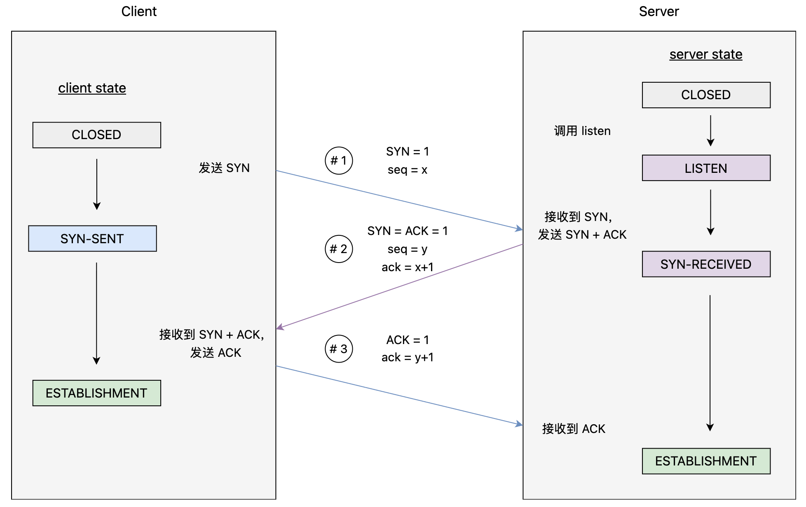

TCP 通过 **三次握手** 建立连接，其具体过程如上图所示，每次握手的状态变化和字段解释如下：

**第一次握手（客户端 → 服务端）**

- 客户端状态变化： `CLOSED` → `SYN-SENT`
- 客户端发送： 一个带有 `SYN=1` 的包，请求建立连接，并选择一个初始 **序列号** `seq = x`
- 服务端状态： `LISTEN`，等待连接

**第二次握手（服务端 → 客户端）**

- 服务端状态变化： `LISTEN` → `SYN-RECEIVED`
- 服务端收到SYN包后，回应一个 SYN + ACK包：
  - `SYN = 1`：表示服务端也同意建立连接
  - `ACK = 1`：确认客户端的 **SYN**
  - `seq = y`：服务端自己的初始 **序列号**
  - `ack = x+1`：确认号是客户端 **序列号** + 1

**第三次握手（客户端 → 服务端）**

- 客户端状态变化： `SYN-SENT` → `ESTABLISHMENT`
- 客户端收到服务端的SYN + ACK后，回应一个ACK包：
  - `ACK = 1`：确认服务端的 **SYN**
  - `ack = y+1`：确认号是服务端 **序列号 + 1**

这三次握手的 **主要目的** 是：

1. 客户端确认服务端可达（第一次握手）
2. 服务端确认客户端可达，并携带自己的 **序列号**（第二次握手）
3. 客户端再次确认服务端的响应，确保双向通信建立（第三次握手）

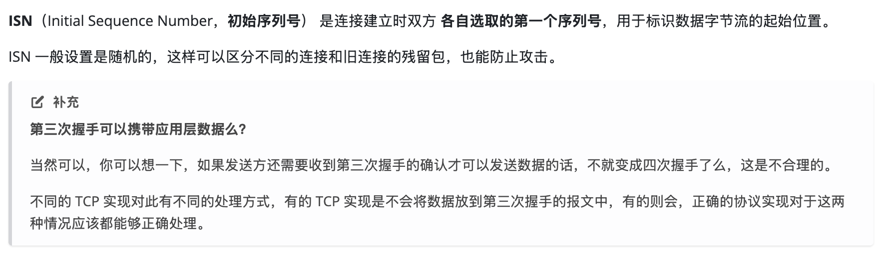

### 四、四次挥手

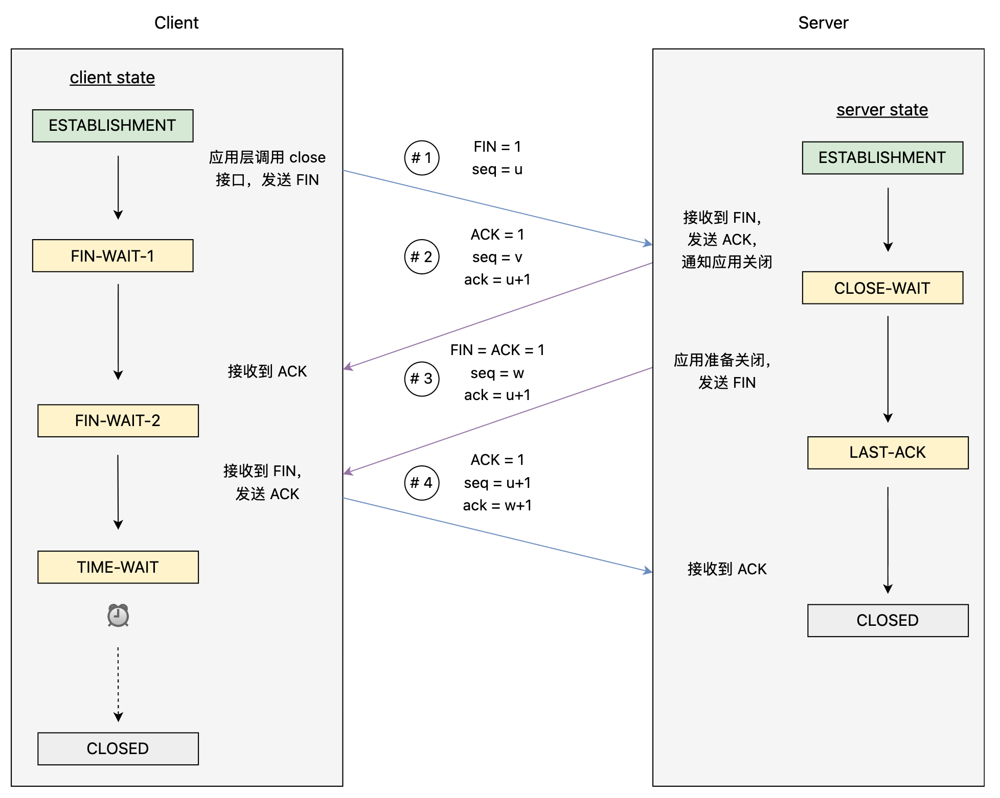

**第一次挥手：客户端发起关闭请求**

- 客户端状态变化： `ESTABLISHMENT` → `FIN-WAIT-1`
- 客户端动作： 应用层调用 `close()`，客户端发送 `FIN=1, seq=u`，表示不再发送数据了，但仍可以接收数据

**第二次挥手：服务端确认关闭请求**

- 服务端状态变化： `ESTABLISHMENT` → `CLOSE-WAIT`
- 服务端动作：
  - 收到 `FIN` 后，发送 `ACK=1, seq=v, ack=u+1` 表示确认
  - 通知上层应用准备关闭
- 客户端状态变化： `FIN-WAIT-1` → `FIN-WAIT-2`

**第三次挥手：服务端发起关闭请求**

- 服务端动作：
  - 应用层处理完毕，发送 `FIN=1, ACK=1, seq=w, ack=u+1`
- 服务端状态变化： `CLOSE-WAIT` → `LAST-ACK`
- 客户端动作： 收到该 `FIN` 报文后，进入 `TIME-WAIT` 状态

**第四次挥手：客户端确认服务端关闭**

- 客户端动作： 发送 `ACK=1, seq=u+1, ack=w+1`
- 客户端状态变化： `TIME-WAIT` → **等待 2 个最大报文生存时间**（**2×MSL**）后 → `CLOSED`
- 服务端状态变化： 收到 ACK 后 → `CLOSED`

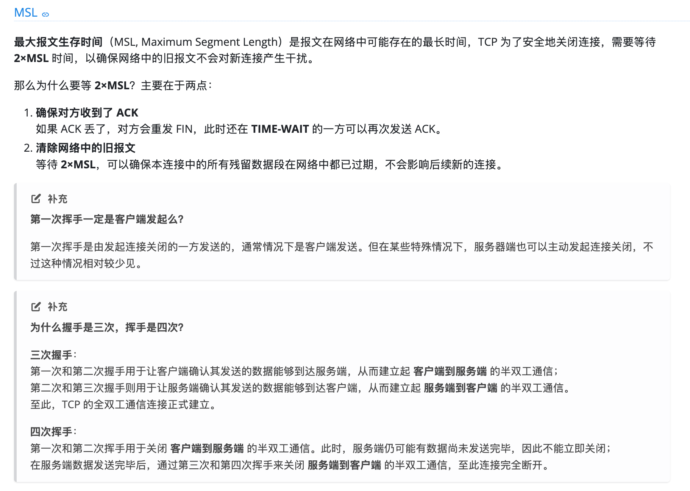

### 五、滑动窗口机制

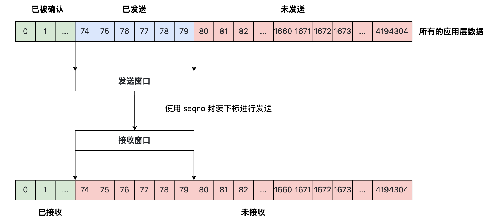

上图展示了 **滑动窗口** 的基本结构。滑动窗口其实是一个“移动的视口”，它同时描述了 **发送方** 正在等待确认的已发送数据，以及 **接收方** 已经接收并准备好继续接收的空闲空间。换句话说，窗口中的每一个字节都是**当前正在传输**的字节，它们在整个数据流中占据一个连续的区段。

1. **发送方** 根据窗口大小，将窗口范围内的数据一次性发送出去，而不必等到每个报文段的确认返回。
2. 接收方在收到这些报文段后，会向发送方发送ACK（确认）报文。该 ACK 包含两个重要信息：
   - 已成功接收的序列号（用来让发送方确认哪些数据已经安全到达）。
   - **接收窗口大小**（即接收方当前还能接收的字节数），该值写在 ACK 报文的窗口字段中。
3. **发送方** 在收到 ACK 后，滑动窗口向前移动，窗口左端排除已确认的数据，右端随即腾出新的空间。此时，发送方就可以继续发送后续的数据。

#### 5.1 绝对下标和序列号

可以把 TCP 发送的数据想象成一条**无限长的字节流**，每个字节在这条流中都有一个唯一的位置，这个位置就是**绝对下标（absolute index）**。它从连接开始不断递增，本质上是一个“不会回绕的理想编号”。

但 TCP 报文头部的 **Sequence Number（seqno）** 只有 **32 位**，因此它不可能直接表示这个无限增长的绝对位置，而是采用了一个**取模映射**的方式。

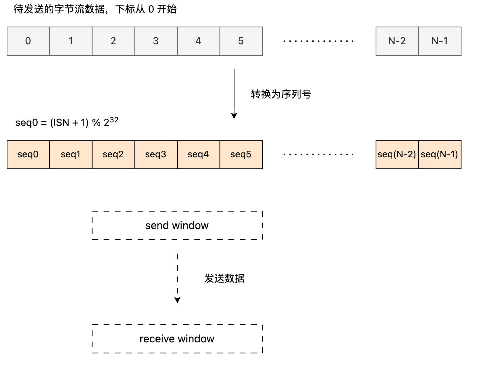

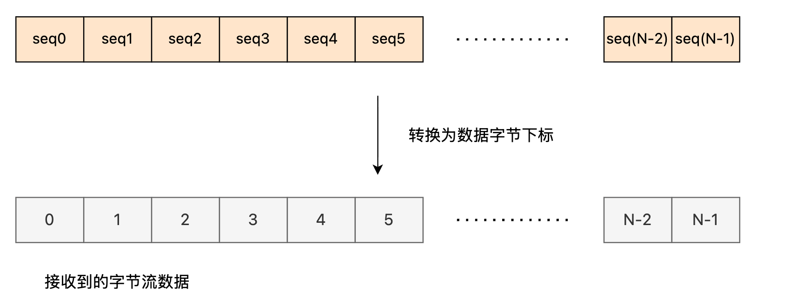

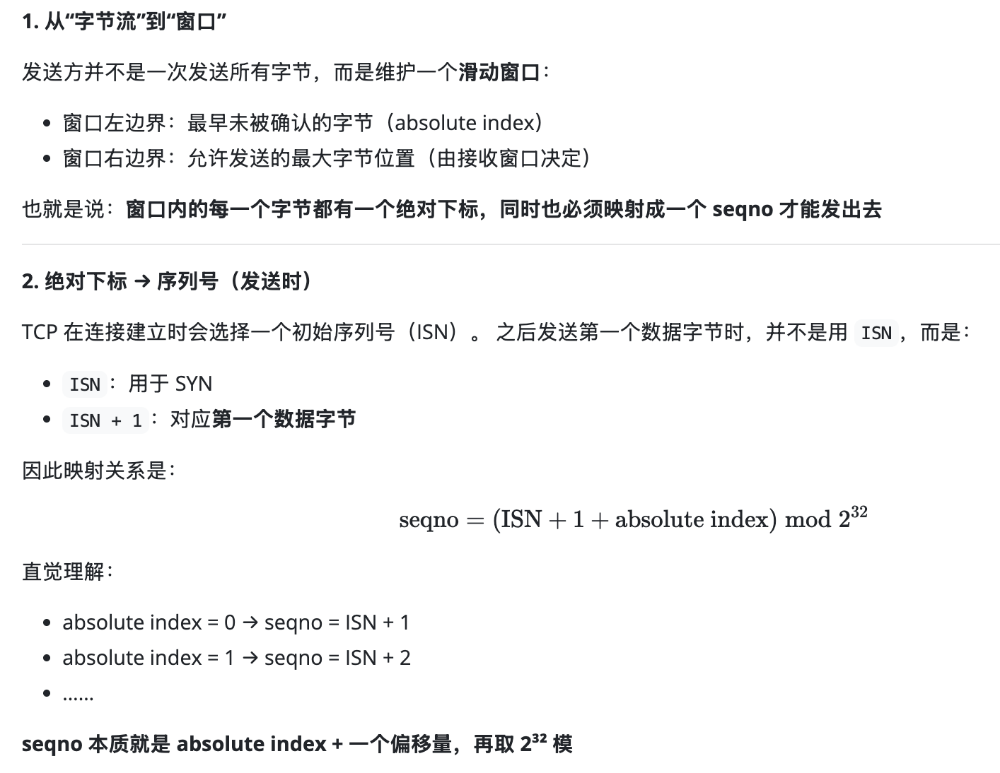

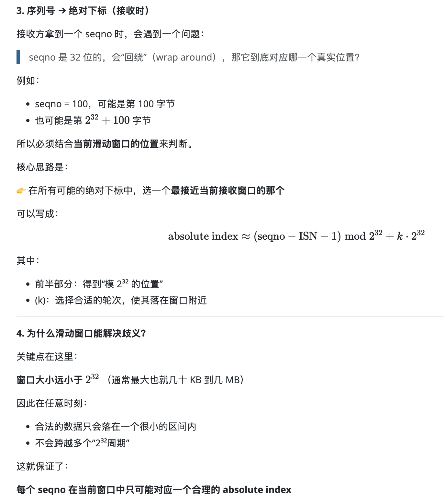

可以用一句话总结整个机制：

> TCP 用 **absolute index** 管理真实的数据流顺序，用 **seqno（32位）** 在网络上传输，通过 **滑动窗口的位置** 消除回绕带来的歧义。

更具体地：

- 发送方
  - 用 absolute index 组织数据
  - 映射成 seqno 发出去
  - 维护发送窗口（哪些还没被 ACK）
- 接收方
  - 收到 seqno
  - 根据窗口位置还原 absolute index
  - 决定是否接收、缓存、ACK

#### 5.2 发送和接收窗口

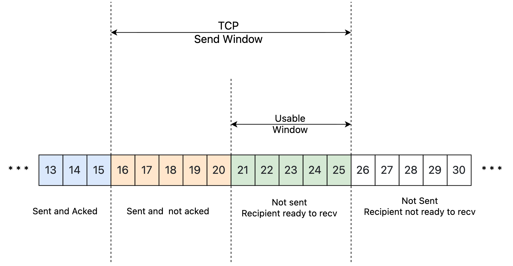

TCP 的 **发送窗口** 可以按照逻辑划分为四个部分：

1. 已经发送并且被确认的数据（字节流）
2. 已经发送但还没有被确认
3. 尚且还没有发送
4. 暂时不可以发送

其中第 2、3 个部分构成 TCP 的发送窗口，当发送方收到 **ackno** 在第 2 个部分内的确认报文时，调整滑动窗口的大小后向前移动滑动窗口，并且发送接下来可以发送的数据。

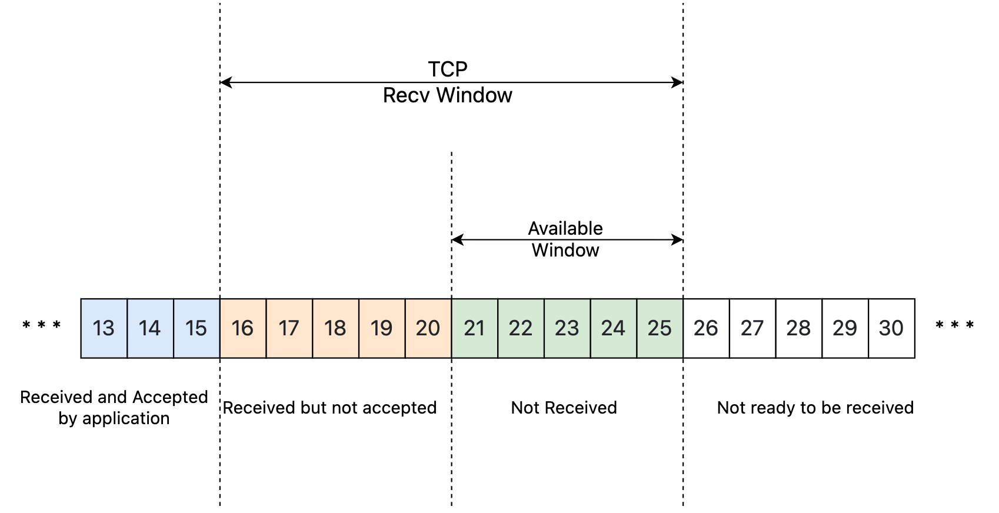

TCP 的 **接收窗口** 可以按照逻辑划分为四个部分：

1. 已经被应用层接收的数据
2. 已经被 TCP 接收，但是还没有被应用层接收的数据
3. 还没有接收到的数据
4. 还不可以接收到的数据

#### 5.3 窗口大小

在 TCP 传输过程中，窗口的概念决定了发送方能够“在等待确认之前”一次性发送多少数据。常见的窗口有三类：

- **发送窗口（swnd，send window）**
- **接收窗口（rwnd，receive window）**
- **拥塞窗口（cwnd，congestion window）**

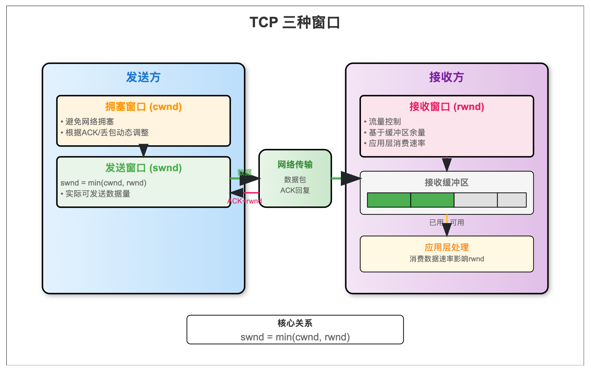

下面分别说明这三种窗口的含义、它们是如何相互影响的，以及在 TCP 运行期间会受到哪些因素的调节。

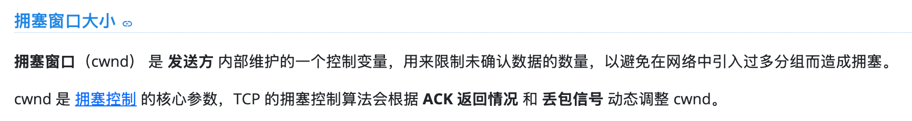

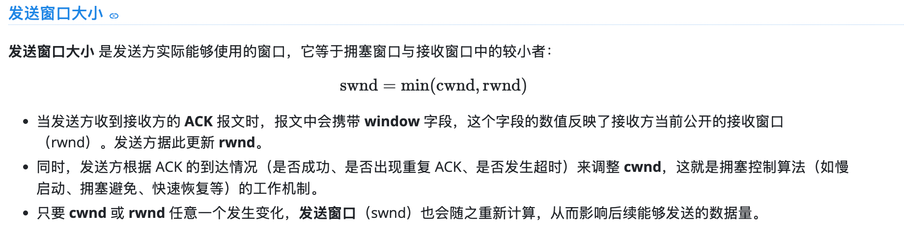

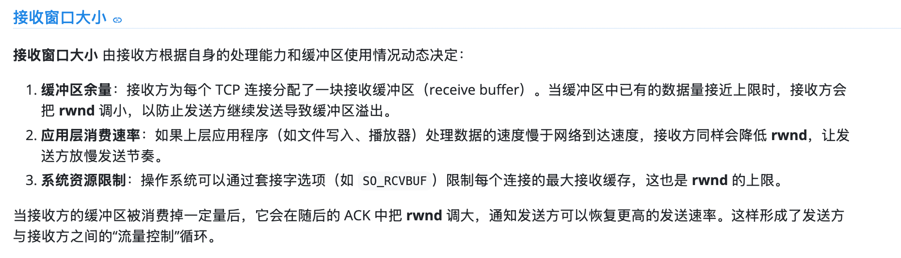

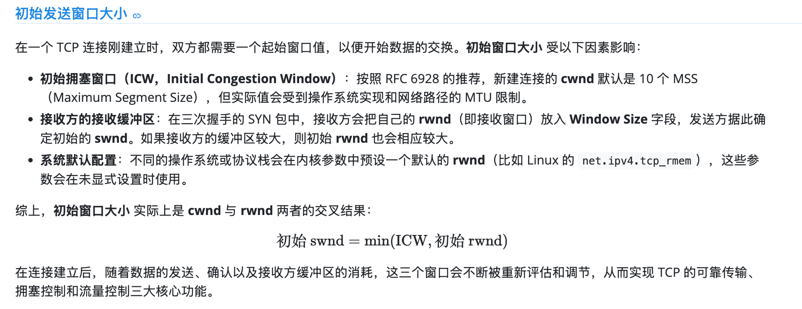

#### 5.4 窗口移动过程

TCP 可以看成在一条连续的**字节流**上维护一个“滑动窗口”，窗口表示**当前允许发送且尚未确认的数据范围**。

- **初始状态**： 发送方根据接收方通告的窗口大小，确定一个发送窗口 `[左边界, 右边界)`，并一次性发送窗口内的数据（按序列号对应的字节序列）。
- **收到 ACK**： 接收方确认已正确接收的数据（ACK = 下一个期望字节的序列号）。
- 窗口右移（滑动）： 发送方收到 ACK 后：
  - 将窗口左边界移动到 ACK 指示的位置（已确认的数据被“移出窗口”）
  - 窗口整体向前滑动
  - 右边界随之扩展（如果接收窗口允许）
- **继续发送**： 新进入窗口的字节可以继续发送，实现“流水线式”传输，而无需逐个等待确认。

本质就是一句话：

> **ACK 推动窗口向前滑动，释放发送空间，从而实现连续高效的数据传输。**

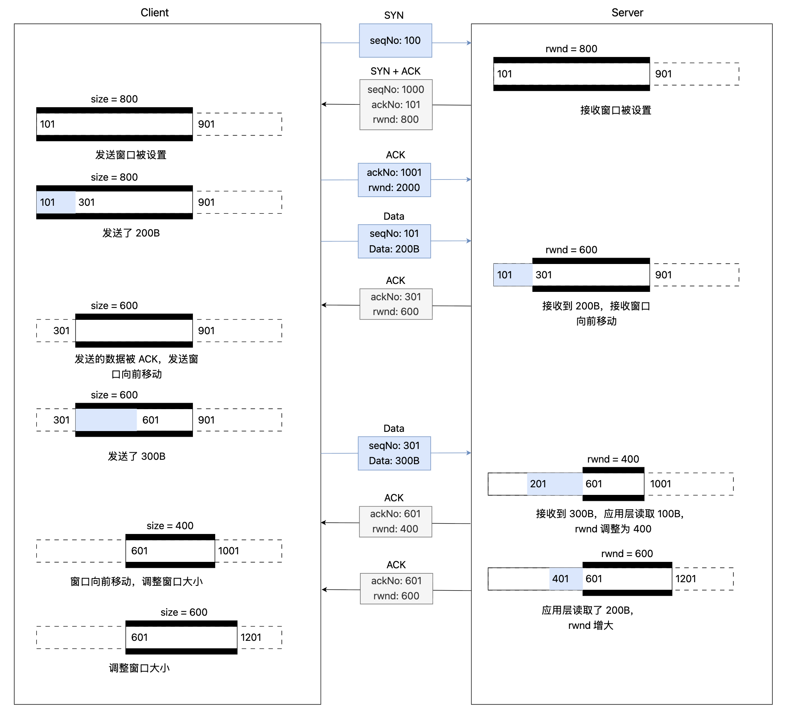

#### 5.5 流量控制

**流量控制**（TCP Transmission Control Protocol）是一种端到端的机制，旨在协调发送方和接收方之间的数据传输速率，防止接收方因处理能力或缓冲区限制而被压垮，从而避免数据包的丢失和重传。流量控制的核心目标是保证数据的可靠交付，同时尽可能高效地利用可用的网络带宽。

在 TCP 中，流量控制通过 **滑动窗口机制** 实现，具体过程如下：

1. **接收方通告窗口大小**
   接收方根据自身的处理速度、可用缓存空间以及当前的负载，计算出一个 **窗口大小**（Receiver Window），并在每个 ACK 报文中将该值告知发送方。窗口大小代表接收方在收到下一个 ACK 之前，能够接受的最大未确认字节数。
2. **发送方依据窗口限制发送数据**
   发送方在发送数据时，必须确保已发送且尚未被确认的字节总量不超过接收方通告的窗口大小。若窗口为零，发送方会暂停发送新数据，只等待接收方释放缓冲区并更新窗口；此时若仍需要保持连接活跃，发送方会周期性发送 **Zero‑Window Probe**（零窗口探测）报文，以探测对方是否已恢复接收能力。
3. **窗口的动态调整**
   随着接收方处理数据并释放缓存，窗口大小会在后续的 ACK 中被重新通告，发送方随即可以利用增加的窗口发送更多数据。这个过程在整个连接期间持续循环，使得发送速率始终与接收方的实际承载能力保持同步。

需要注意的是，**流量控制** 关注的是单个连接内部的发送/接收平衡，而**拥塞控制** 则针对网络整体的拥塞状态（例如链路容量、路径上的竞争）进行调节，两者相互独立但常常协同工作，以实现端到端的可靠与高效传输。

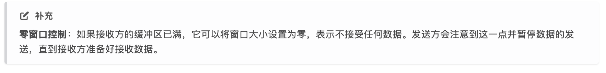

### 六、可靠传输机制

TCP 的 **可靠传输** 通过多种机制共同实现，下文将对三个关键机制进行介绍。

#### 6.1 序列号和确认号

**序列号**（seqno, sequence number）和 **确认号**（ackno, acknowledge number）是 TCP 首部的两个字段，TCP 协议通过 **序列号** 来记录目前已经发送了哪些数据，通过 **确认号** 记录哪些数据已经被接收方所接收。

发送方发送 **序列号** 和 接收方返回 **确认号** 的交互可能存在以下几种情况：

- 如果发送的数据段丢失了，接收方不会发送更新的 **确认号**，这会最终导致发送方超时并重传丢失的数据段。
- 如果数据段到达了接收方，但是是乱序的，接收方将持续发送最后一个正确 **序列号** 的 **确认号**，提示发送方其中有数据段需要重新传输。
- 如果数据段到达了接收方，并且是按顺序的，接收方发送一个新的 **确认号**，提示发送方到目前为止的所有数据都已正确接收。

#### 6.2 超时重传

TCP 是一种 **可靠传输协议**，它要确保发送的数据 **被对方接收并确认**。但网络中可能发生：

- 包丢失（网络拥堵）
- ACK 丢失（确认丢了）
- 延迟很大（RTT 不稳定）

为了应对这些情况，TCP 协议在发送一个 **数据段**（segment）时，会为每一个发送的 segment 设置一个 **重传定时器**。

如果某个 segment 的定时器超时了，就说明发送方在 **超时时间阈值** 内没有接收到该 segment 的确认，发送方就会触发 **超时重传**（Retransmission Timeout），重新发送超时的 segment。

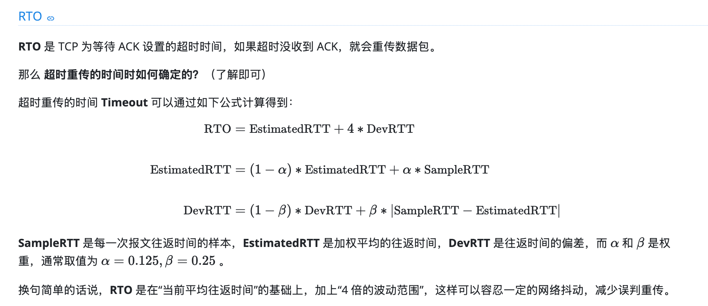

#### 6.3 校验和

TCP 首部包含一个 **校验和**（Checksum）字段，用于检测数据在传输过程中的任何变化。如果 **接收方** 检测到校验和错误，该数据段会被 **丢弃**，然后接收方会要求发送方 **重传** 该数据段。

TCP 的校验和计算方法和 [IP 校验和计算方法](https://www.csgraduates.com/computer_network/network/ip/#差错校验字段) 一致，不过两者校验的范围和目的有所不同。

其 IP 校验和只针对 IP 头部进行校验，主要用于检测数据在传输过程中由于网络故障等原因造成的错误。
而 TCP 校验和不仅要校验 TCP 头部，还要校验 TCP 载荷（即数据部分）。因此，TCP 校验和能提供 **更全面的错误检测**。

### 七、拥塞控制

**拥塞控制**（tcp）指的是 tcp 限制传输数据的速率，进而防止注入过多的数据到网络中，进而造成网络链路过载。

大家需要了解，tcp 不是一个 “自私” 的算法，一段链路上可以同时包含很多 tcp 连接，tcp 的拥塞控制的目的是尽量去实现一个 **总体的最优**，而不是个体的最优。当 tcp 检测到数据传输出现拥塞之时，即一段时间内没有接收到一些确认，它就会降低自己传输数据的速率。

#### 7.1 慢开始

**慢开始** 是 TCP 连接开始时的一个阶段，相较于直接以较高的速率发送数据，慢开始会以一个较低的速率开始，然后 **逐步试探** 当前网络传输的能力，以指数的速率增加发送速率。慢开始的流程如下：

- **初始化**：当一个 TCP 连接开始时，拥塞窗口 `cwnd` 设置为一个很小的值，通常是 `1MSS` （最大段大小）。
- **指数增长**：对于每个收到的 `ACK`，`cwnd` 会增加一个 `MSS`。这意味着每个 `RTT`（往返时间）`cwnd` 都会翻倍，导致了指数增长。
- **转换阈值**：当 `cwnd` 达到 `ssthresh`（慢开始阈值）时，TCP 会从慢开始模式转换到拥塞避免模式。

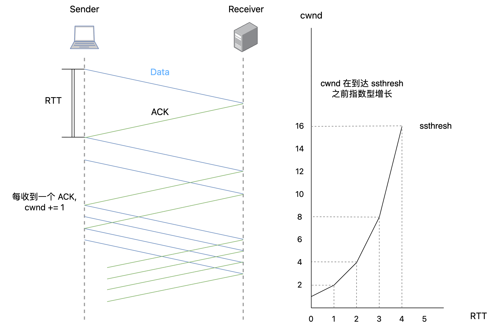

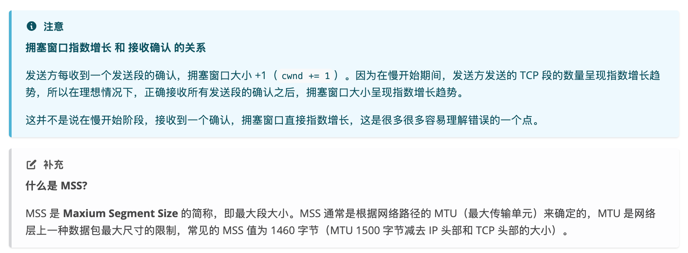

#### 7.2 拥塞避免

当 TCP 进入拥塞避免（Congestion Avoidance）阶段后，拥塞窗口（`cwnd`）的增长方式从慢启动的指数增长改为 **线性增长**。

具体来说：每收到一个 ACK，`cwnd` 增加 `1/cwnd` 个 MSS（最大报文段长度）。由于在一个往返时间（RTT）内会收到大约 `cwnd` 个 ACK，这等价于在每个 RTT 结束时 `cwnd` 只增长约 **1 MSS**。这种“每 RTT 加 1 MSS”的线性增长可以避免窗口迅速膨胀，引起网络拥塞。

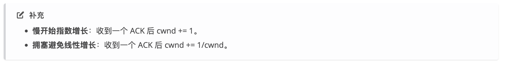

TCP 通过两种方式 **检测网络是否出现拥塞**：

1. **超时（Timeout）**：发送的数据在预期的时间内没有收到相应的 ACK，说明该段可能已经丢失。
2. **三个冗余 ACK（Triple Duplicate ACK）**：连续收到三个冗余的 ACK，表明网络中有数据段在传输过程中被丢弃，但后续的 ACK 仍然能够到达。

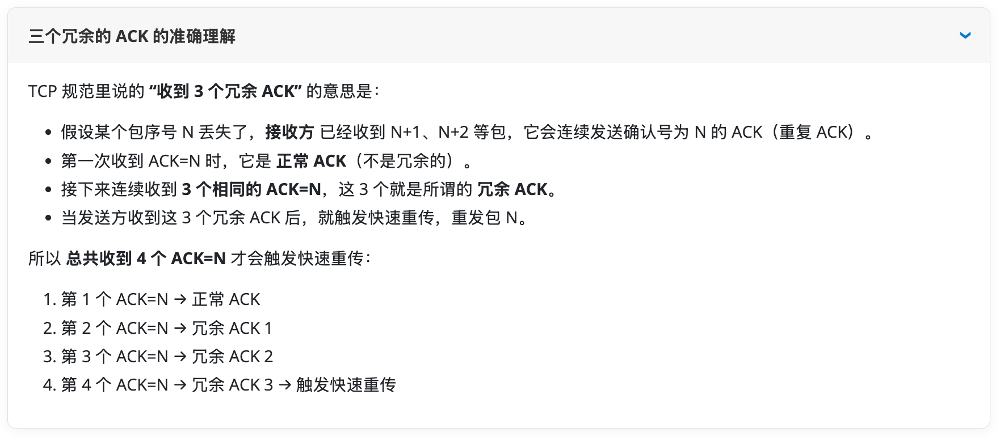

一旦检测到上述任意一种情况，TCP 认为网络已经发生拥塞，并执行如下处理：

- 将慢启动阈值（`ssthresh`）设置为当前 `cwnd` 的 **一半**（`ssthresh = cwnd / 2`），以限制后续的窗口增长速度。
- 将拥塞窗口 `cwnd` 重新设为 **1 MSS**，相当于回到最保守的状态。
- 随后进入 **慢启动（Slow Start）** 阶段，重新探测网络的可用带宽。

通过上述线性增长与灵活的拥塞检测/恢复机制，TCP 能够在保持高吞吐量的同时，尽可能避免网络过载，从而实现可靠且高效的端到端传输。

#### 7.3 快速重传

在传统的 TCP 实现中，**重传计时器**负责触发超时重传：只要计时器到期而仍未收到对应的数据段的 ACK，发送方就会重新发送该段。在高带宽‑低时延的网络环境下，这种“等计时器”的方式往往效率低下，因为计时器的超时时间往往远大于实际的往返时延（RTT），导致数据恢复延迟。

在 **快速重传**（Fast Retransmission），当发送方 **连续收到三个冗余的 ACK** 时，说明网络中已经有一个 **数据段丢失**，而后续的 ACK 只能确认已经成功到达的后续段。此时，TCP 就会 **立即重传** 那个被认定为丢失的段，而不必等到重传计时器超时，这一过程被称为快速重传。

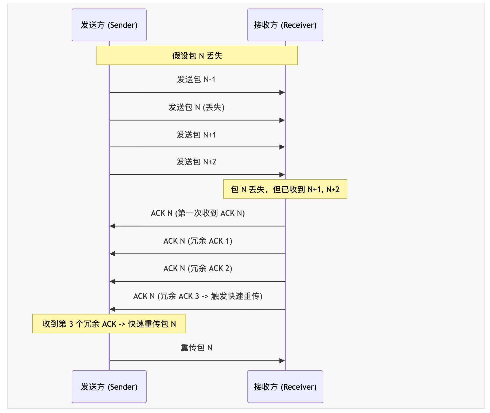

触发快速重传后，TCP 会切换到 **快速恢复**（Fast Recovery）阶段。该阶段的核心目标是：

1. **防止拥塞窗口（cwnd）骤降到 1 MSS**，从而避免吞吐量剧烈下降；
2. **利用已经收到的重复 ACK** 来“填补”因丢包而空出的窗口，保持管道尽可能饱和。

在快速重传和快速恢复中，**cwnd 的变化过程** 如下：

1. 快速重传触发后

   - `ssthresh ← cwnd / 2`
   - `cwnd ← ssthresh + 3·MSS`

2. 快速恢复期间

   （每收到一个重复 ACK）

   - `cwnd ← cwnd + MSS`
   - 这种线性增长相当于“用已经确认的 ACK 为窗口“买票”，使得发送方能够继续发送新数据，而不会因为单个丢包而立刻停滞。

3. 退出快速恢复

   （收到一个新的、非重复的 ACK）

   - 该 ACK 表明丢失的数据段已经被成功重传并得到确认。
   - `cwnd ← ssthresh`（即把窗口恢复到慢启动阈值）
   - 随后进入 **拥塞避免**（Congestion Avoidance）阶段，cwnd 以后将以 **每 RTT 增加 1 MSS** 的速度线性增长。

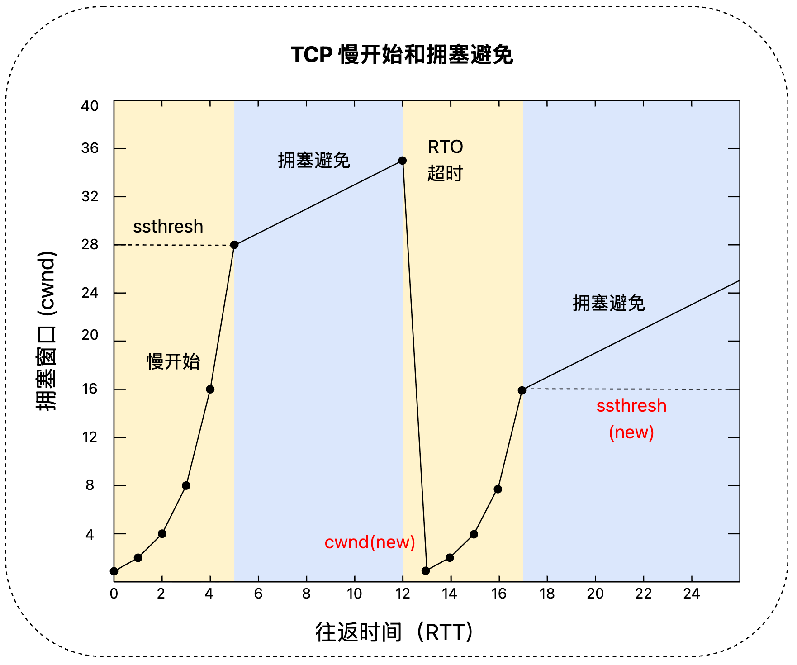

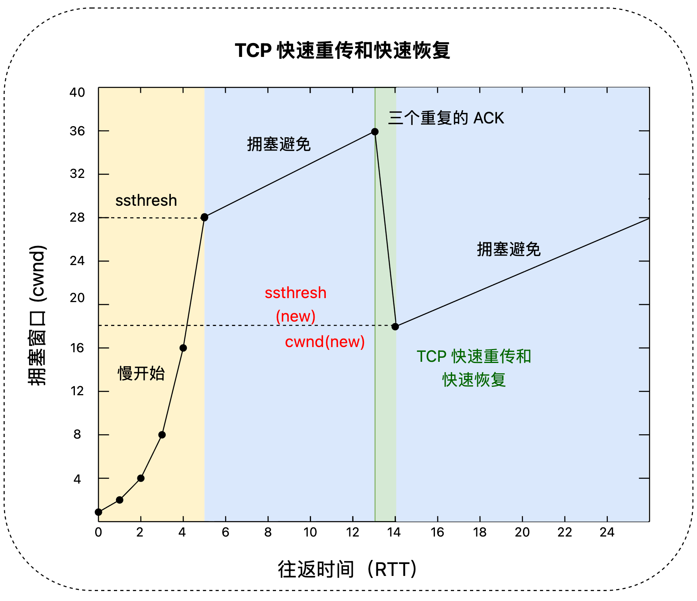

**总结**：

- 当 `cwnd < ssthresh` 时，使用 **慢开始** 算法，`cwnd` 以指数增长
- 当 `cwnd >= ssthresh` 时，使用 **拥塞避免** 算法，`cwnd` 线性增长
- 当在 RTO内没有收到发送的某个分组的确认时
  - 如果启动了快速恢复，则设置 `cwnd = ssthresh = cwnd / 2`，开始使用拥塞控制算法
  - 如果没有启动快速恢复，则设置 `ssthresh = cwnd / 2`, `cwnd = 1`，开始使用 **慢开始** 算法
- 如果启用了快速重传，并且收到 3 个与先前重复的 ACK（总共收到 4 个相同的 ACK），则不用等待超时器 **RTO** 结束，可以马上重传该数据包，`cwnd` 可能会减少（这里不考察）

---

## UDP

### 一、UDP数据报

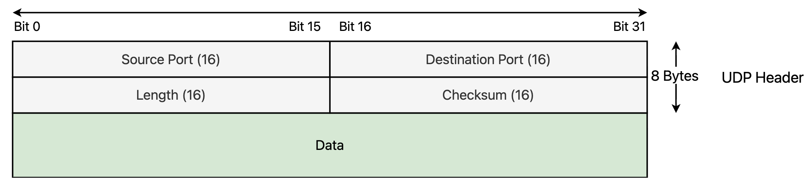

**UDP**（User Datagram Protocol）首部的长度固定为 **8 个字节**（64 位），不论 UDP 携带的数据量大小如何，其首部都保持不变。UDP 首部的各个字段如下：

- **源端口**（Source Port）：占用 2 个字节（16 位），用于标识发送方应用程序的端口号。
- **目标端口**（Destination Port）：占用 2 个字节（16 位），用于标识接收方应用程序的端口号。
- **长度**（Length）：占用 2 个字节（16 位），指示 UDP 数据报的总长度，包括首部和数据。因此，最小长度为 **8 字节**。
- **校验和**（Checksum）：占用 2 个字节（16 位），用于检测 UDP 数据报在传输过程中是否受到损坏。

当传输层从 IP 层收到 UDP 数据报时，就根据首部中的 **目的端口**，把 UDP 数据报通过相应的端口，上交最后的终点——应用进程，如下图所示：

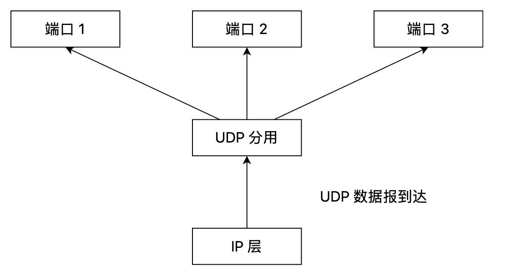

若接收方 UDP 发现收到的报文中的 **目的端口号** 不正确（即不存在对应于端口号的应用进程），则就丢弃该报文，并由 **ICMP** 发送“端口不可达”差错报文给发送方。

### 二、UDP校验

**UDP** 的 **校验和**（checksum）用于检测数据在传输过程中是否发生错误。它覆盖 **UDP 头部、数据部分以及部分 IP 头部信息（伪头部）**，确保数据的完整性。

这种简单的差错检验方法的校错能力并不强，但它的好处是 **简单、处理速度快**。

#### 2.1 发送端

**UDP** 的发送方需要计算 **checksum** 字段的值，并且填充进 **UDP** 首部相应字段中。发送方计算 **checksum** 包含 **构造伪首部、组合校验数据、计算 16 位和、按位取反** 四个步骤。

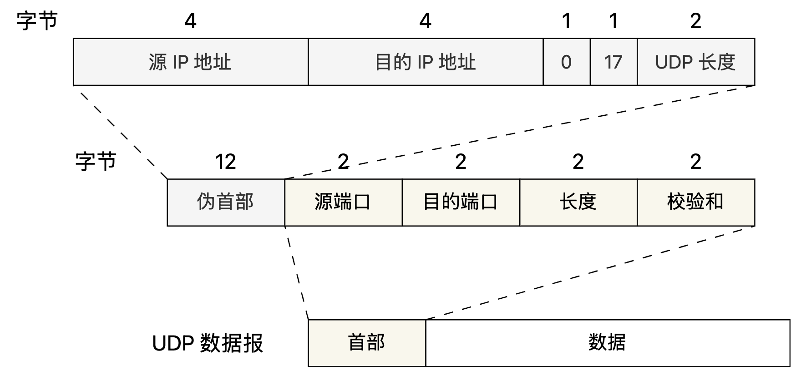

1. 构造伪头部：为了确保源和目的地址的正确性，UDP 校验和包含一个伪头部（不实际传输，仅用于计算）。伪头部包括：
   - **源 IP 地址**（32 位，IPv4）
   - **目的 IP 地址**（32 位，IPv4）
   - **协议字段**（8 位，UDP 为 17）
   - **UDP 长度**（16 位，UDP 头部 + 数据的总字节数）
   - **填充位**（8 位，通常为 0，确保伪头部长度为 12 字节）
2. 组合校验数据：将以下内容按 16 位分组
   - **伪头部**
   - **UDP 头部**（包括源端口、目的端口、长度、校验和字段，校验和字段初始置 0）
   - **数据部分**（若数据长度为奇数字节，末尾补 0 凑成 16 位）
3. 计算 16 位和
   - 将所有 16 位数逐一相加，记录进位。
   - 如果有进位（和超过 16 位），将进位加到低 16 位（称为 **回卷**）。
   - 例如：若两个 16 位数相加得 `1 0000 0000 0000 0001`，则取低 16 位 `0000 0000 0000 0001` 并加 1，得 `0000 0000 0000 0010`。
4. 按位取反
   - 对最终的 16 位和按位取反（0 变 1，1 变 0），得到 **校验和**。
   - 将此 **校验和** 填入 **UDP** 头部的校验和字段。
5. 特殊情况
   - 如果 **校验和** 计算结果为全 0，则发送 `1111 1111 1111 1111`（全 1），以避免与“校验和禁用”（全 0）混淆。
   - **UDP** 校验和是可选的，若不使用，校验和字段置为全 0。

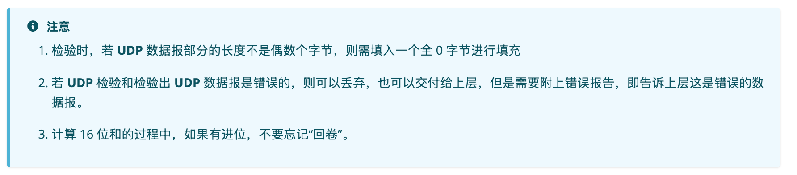

#### 2.2 接收端

接收端通过以下步骤验证数据完整性：

1. **提取校验数据**：接收端同样构造 **伪头部**（使用接收到的 IP 头部信息），并提取 **伪首部、UDP 首部**（包括接收到的校验和）、**数据部分**。
2. **计算 16 位和**：将所有 16 位数（包括接收到的校验和）相加，记录并回卷进位。如果数据无误，和的结果应为 `1111 1111 1111 1111`（全 1）。
3. 验证结果
   - 如果最终和为全 1，说明数据正确，无错误。
   - 如果和不为全 1，说明数据在传输中发生错误，接收端通常丢弃该数据报（**UDP** 不负责重传）。
4. 处理特殊情况
   - 如果接收到校验和为全 0，表示发送端禁用了校验和，接收端可直接接受数据（不校验）。
   - 如果校验和为全 1，需按上述步骤验证。

#### 2.3 实例

假设我们要发送一个 **UDP** 数据报，相关信息如下：

- **源 IP 地址**：192.168.1.1（二进制：11000000 10101000 00000001 00000001）
- **目的 IP 地址**：192.168.1.2（二进制：11000000 10101000 00000001 00000010）
- **源端口**：1024（二进制：00000100 00000000）
- **目的端口**：2048（二进制：00001000 00000000）
- **数据**：0x48656C（3 字节，“Hel”）

则得到 16 位组合数据和校验和计算过程如下所示：

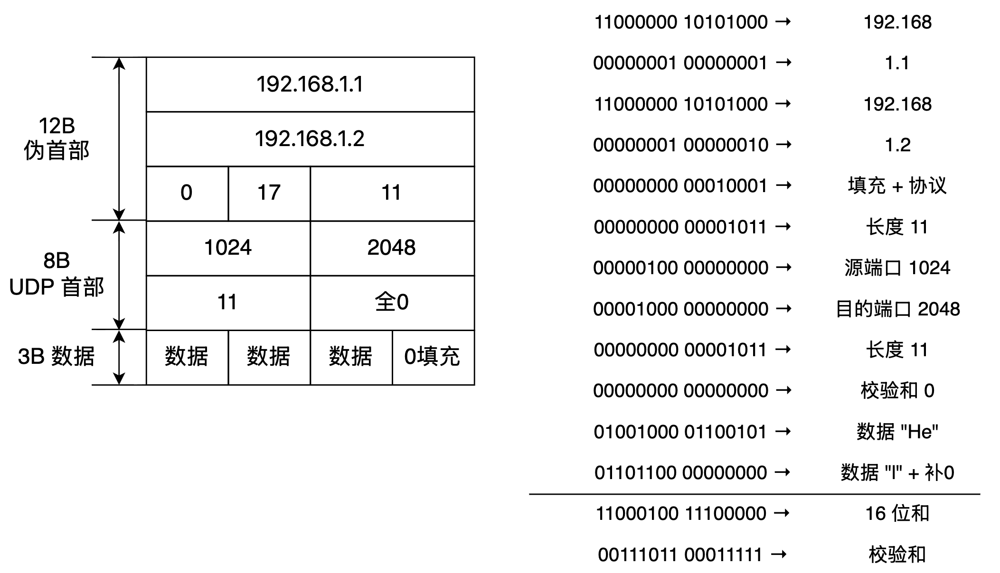

计算得到的 **校验和** 为：*00111011 00011111*（十六进制：**0x3B1F**）。

当接收端接收到 **UDP** 数据报时，接收端将所有 16 位数（包括校验和 *00111011 00011111*）相加：

重复上述加法，最后一步加上校验和：`11000100 11100000` + `00111011 00011111` = `11111111 11111111`（全 1）

### 三、UDP特点

- **无连接性**：UDP 是一种 **无连接** 的协议，这意味着在发送数据之前，发送方和接收方之间不建立连接。每个 **UDP** 数据报都是独立的，没有先后顺序的要求。
- **轻量级**：UDP 非常 **轻量级**，因为它不涉及连接建立和维护，也不包括复杂的拥塞控制算法。这使得 UDP 非常适用于 **低延迟** 和 **高吞吐量** 的应用。
- **无序性**：UDP 数据报在传输过程中 **不保持顺序**。这意味着发送方发送的多个 UDP 数据报可能以不同的顺序到达接收方，并且接收方需要自行处理数据的顺序问题。
- **不可靠性**：UDP 不提供可靠性。它不保证数据的传输成功，也不负责重新发送丢失的数据。如果数据在传输过程中丢失或损坏，接收方将不会收到任何通知，并且需要根据应用程序的要求自行处理这些问题。
- **广播和多播**：UDP 支持 **广播和多播**，允许一个 UDP 数据报同时发送到多个接收方。

#### 3.1 应用场景

UDP 常用于 **一次性传输较少数据** 的网络应用，如 **DNS、SNMP** 等，因为对于这些应用，若采用 TCP，则将为连接创建、维护和拆除带来不小的开销。

UDP 也常用于 **对延迟敏感** 的多媒体应用（如 **电子游戏、实时视频会议、流媒体** 等），显然，可靠数据传输对这些应用来说并不是最重要的，但 TCP 的拥塞控制会导致数据出现较大的延迟，这是它们不可容忍的。

UDP **不保证可靠交付**，但这并不意味着应用对数据的要求是不可靠的，所有维护可靠性的工作可由用户在 **应用层** 来完成。应用开发者可根据应用的需求来灵活设计自己的可靠性机制。

比如 **HTTP3** 中使用的 **QUIC** 就是在 **UDP** 的基础上实现的一种可靠传输协议。

