# 应用层

## 网络应用模型

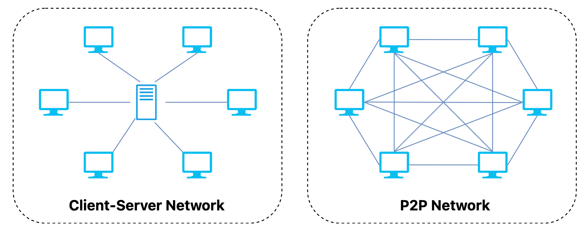

### 一、C/S模型

C/S（Client Server）模型：中心化、依赖服务器，适合稳定服务场景。

- 核心特点：**客户端** （用户设备，如电脑、手机）向 **服务器** （提供服务的专用设备）请求资源或服务，服务器响应并提供支持。
- 通信方式：基于 **“请求-响应”**，客户端主动发起，服务器被动应答。
- 架构：**中心化**，服务器是核心枢纽，客户端依赖服务器获取服务。
- **典型例子**：浏览网页（浏览器与 Web 服务器）、收发邮件（邮件客户端与邮件服务器）。

### 二、P2P模型

P2P（Peer to Peer）：分布式、节点平等，适合资源共享和去中心化场景。

- 核心特点：网络中 **设备对等**，既是客户端又可作服务器，共同协作共享资源。
- 通信方式：设备直接互联，**点对点通信**，无需中心服务器。
- 架构：**分布式，去中心化**，资源分散在各节点，网络更灵活。
- **典型例子**：文件共享（如 BitTorrent）、音视频通话（如 Skype）、区块链（如比特币）。

---

## DNS

### 一、层次域名空间

**DNS** 使用 **层次域名空间** 来组织域名，将域名划分为多个级别，每个级别之间以点（.）分隔。域名从右到左逐级递增，最右边是 **顶级域名**（TLD），然后是 **二级域名**， **三级域名**，以此类推。

例如， `www.example.com` 中， `.com` 是顶级域名， `example.com` 是二级域名， `www.example.com` 是子域名。

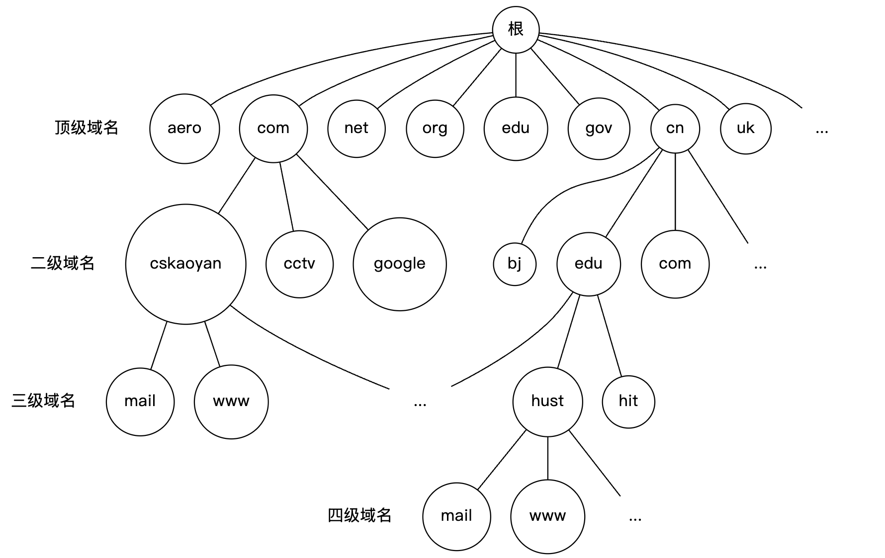

**DNS** **层次域名空间** 的设计使得域名分布在不同的管理区域中，每个管理区域负责管理其自己的域名空间。这种分层结构有助于提高可扩展性和效率。

### 二、域名服务器

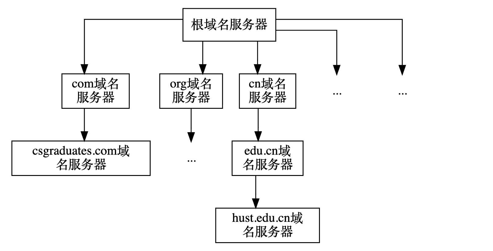

在 DNS 体系结构中，服务器按照层级划分，每一层负责不同的职责。下面按照从最高层到最低层的顺序，对四类常见的域名服务器进行说明：

1. 根域名服务器 ( Root Name Servers):
   - 这些服务器位于 DNS 解析的最顶端。它们不直接回答关于哪个域名映射到哪个 IP 地址的查询，而是告诉查询者下一步应该询问哪个顶级域名（TLD）服务器。
   - 根服务器的数量是有限的，并且它们的位置在全球都是已知的。
2. 顶级域名服务器 (Top-Level Domain Name Servers, TLD):
   - 这些服务器负责特定的顶级域名（如 `.com`, `.org`, `.net` 等）。它们为下一级的域名（如 `example.com`）提供有关权威名称服务器的信息。
3. 权威域名服务器 (Authoritative Name Servers):
   - 这些服务器为特定的域名（如 `example.com`）提供详细的 DNS 记录信息（例如 A 记录、MX 记录等）。只有权威服务器才能为其负责的域名提供这些信息。
   - 大多数组织拥有权威 DNS服务器来为他们的域名提供解析服务。
4. 本地域名服务器 (Local Name Server)
   - 是在本地网络环境中运行的DNS服务器，它为该网络中的设备提供域名解析服务。
   - 每个 **ISP** 或一所大学都可以有一个本地域名服务器。

### 三、域名解析过程

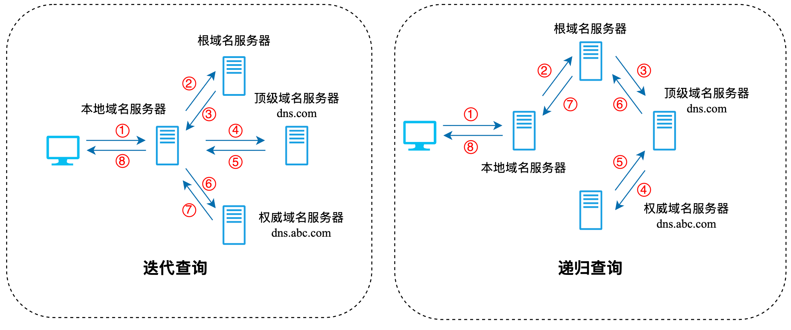

域名解析分为 **递归查询** 和 **迭代查询** 两种。

- 递归查询：请求方（本地 DNS 服务器）把解析任务 完全交给 对方。
- 迭代查询：请求方会得到一个“指引”，然后自己去问下一层。

#### 3.1 迭代查询

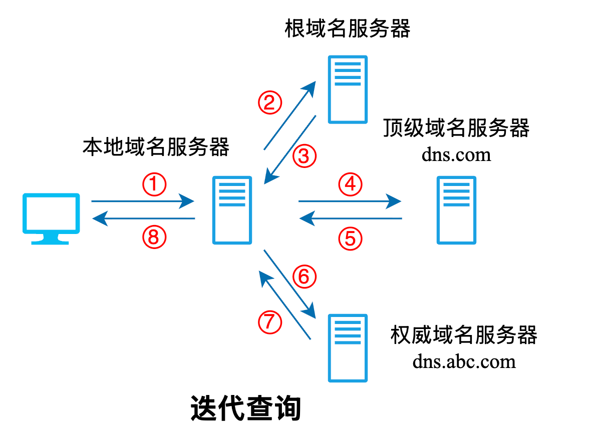

在域名解析过程中，**本地域名服务器** 向根域名服务器发送的通常是迭代查询。

当 **根域名服务器** 收到查询请求后，不会代替本地域名服务器继续查询，而是返回结果中的两种情况之一：

- 若能解析出所需的 IP 地址，则直接返回；
- 若不能解析，则告知本地域名服务器应当联系的下一级顶级域名服务器。

随后，本地域名服务器根据指引，向对应的 **顶级域名服务器** 继续查询。顶级域名服务器的处理方式类似：

- 若能解析出所需的 IP 地址，则返回结果；
- 否则告知本地域名服务器应当访问的下一步权限域名服务器。

权限域名服务器的处理流程类似，这里不赘述了。最终，当本地域名服务器获得目标域名对应的 IP 地址后，会将结果返回给最初发起请求的主机。

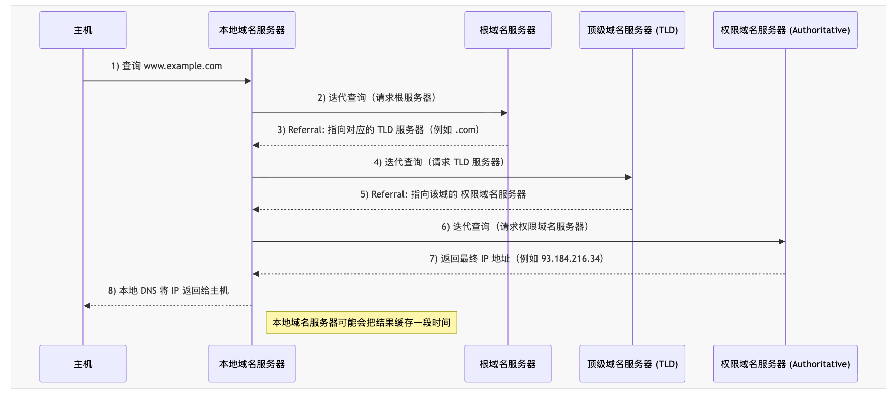

#### 3.2 递归查询

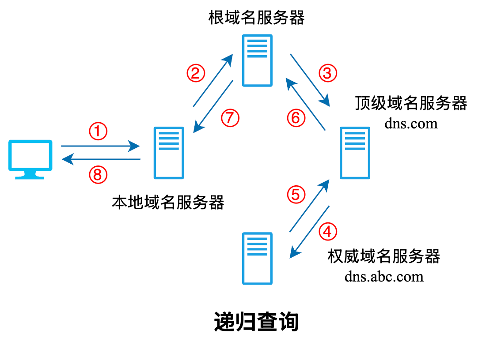

递归查询的过程如上图所示，本地域名服务器只需向 **根域名服务器查询一次**（步骤 2），后面的几次查询都是 **递归地** 在其他几个域名服务器之间进行的（步骤 3-7）。在步骤 7 中，本地域名服务器从根域名服务器得到了所需的 IP 地址，最后在步骤 8 中，本地域名服务器把查询结果告诉发起查询的主机。

因为该方法给根域名服务器造成的负载过大，所以实际中几乎不使用。

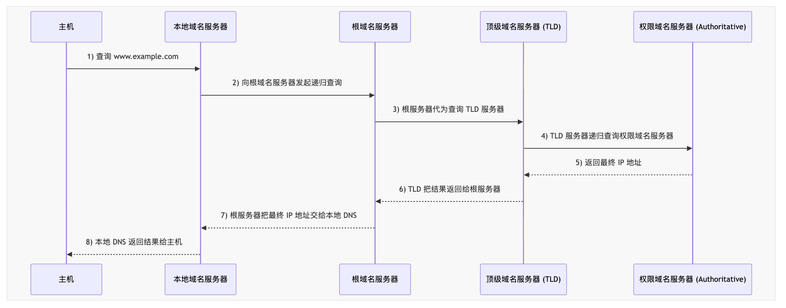

DNS 递归查询 和 迭代查询的不同点如下表所示：

| **特点**       | **递归查询**                 | **迭代查询**             |
| -------------- | ---------------------------- | ------------------------ |
| **查询责任**   | DNS 服务器负责查询所有结果   | 客户端逐级查询           |
| **查询复杂度** | 客户端简单，只需发起一次请求 | 客户端复杂，需要多次查询 |
| **使用场景**   | 用户设备、本地 DNS 服务器    | DNS 服务器之间的交互     |
| **性能**       | 服务器负担较大               | 服务器负担较小           |

### 四、DNS缓存

无论是浏览器、操作系统，还是本地的递归 DNS 服务器，在接收到域名解析结果之后，都会将其暂时保存在本地 **缓存** 中。这样，如果同一个域名在短时间内被多次请求，就可以直接从 **缓存** 中获取结果，而不需要再次向外部服务器发送查询请求。

**DNS** 记录中包含一个名为 **TTL**（Time to Live）的字段，用于指定这条记录可以在缓存中 **保存多久**。比如 **TTL** 为 ***3600\*** 表示记录在缓存中可保留 **3600** 秒（即一小时）。在这段时间内，只要有查询，就可以直接使用缓存的结果。当 **TTL** 到期后，缓存记录会被丢弃，下一次查询将重新走完整的解析流程。

---

## FTP

### 一、工作原理

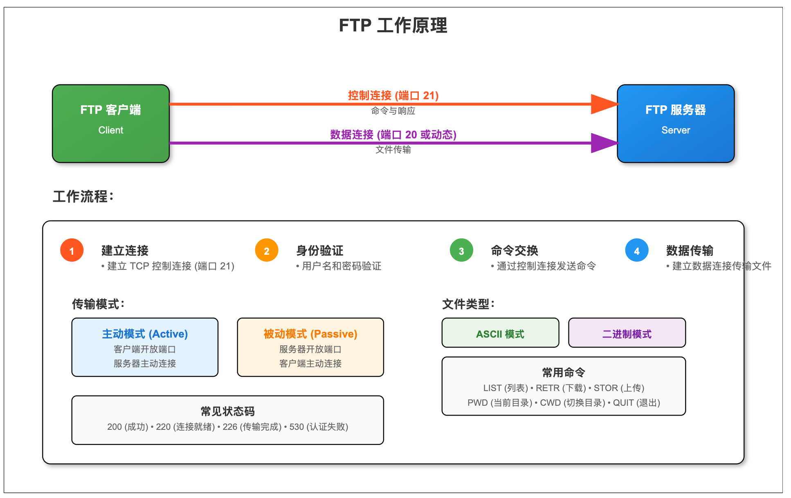

FTP 的传输流程如下：

1. 建立连接
   - FTP 基于 **TCP 协议**运行。客户端与服务器之间首先建立一条 **控制连接**（默认端口 21），用于命令与响应的传输。
   - 在实际传输数据时，还需要建立一条 **数据连接**。
2. 身份验证
   - 建立控制连接后，客户端需提供用户名和密码完成身份验证。
   - 部分服务器支持 **匿名 FTP**，允许用户以通用用户名（通常为 `anonymous`）和邮箱地址作为密码进行访问。
3. 命令与响应
   - 所有的 **命令与响应** 都通过控制连接完成。
   - 客户端发送命令（如上传、下载、列目录等），服务器返回 **状态码**（如成功、失败、权限不足），用于指示执行结果。
4. 数据连接的建立
   - 当需要传输文件或目录列表时，FTP 会额外建立数据连接。
   - 常见的两种模式：
     - **主动模式**（Active Mode）：客户端开放端口，等待服务器回连进行数据传输。
     - **被动模式**（Passive Mode）：服务器开放端口，等待客户端发起连接。
5. 文件传输
   - 数据连接建立后即可传输数据，包括文件内容或目录信息。
   - 支持两种传输模式：
     - **ASCII 模式**：适合文本文件，自动进行换行符转换。
     - **二进制模式**：适合图像、音频、压缩包等二进制文件，逐字节传输，避免数据损坏。
6. 关闭会话
   - 文件传输完成或用户退出时，客户端通过 **QUIT 命令**请求关闭会话。
   - 服务器响应后，释放控制连接与数据连接。

### 二、控制连接

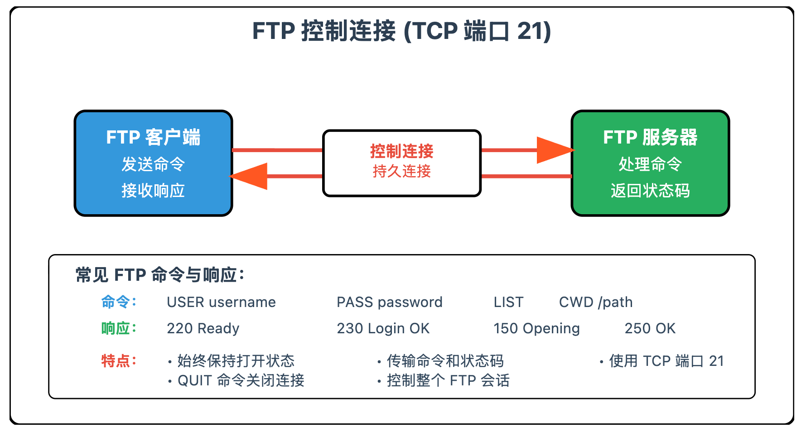

- **控制连接** 是 FTP 会话中首先建立的连接，通常使用 **TCP 端口 21**。
- 主要作用是传输命令和响应，用于控制 FTP 会话的行为。
  - 客户端通过控制连接发送命令（如登录、列目录、切换目录）。
  - 服务器通过控制连接返回 **状态码** 和响应消息，指示命令执行结果（成功、失败、权限不足等）。
- **控制连接始终保持打开**（持久连接），直到用户退出会话或发送 **QUIT** 命令。

### 三、数据连接

- **数据连接** 专用于 **文件内容和目录列表的传输**，端口号由控制连接中的命令协商确定。
- 建立方式有两种模式：
  - 主动模式（Active Mode）
    - 客户端开放一个本地端口，并通过控制连接通知服务器。
    - 服务器主动连接到客户端该端口完成数据传输。
  - 被动模式（Passive Mode）
    - 服务器开放一个本地端口，并通过控制连接告知客户端。
    - 客户端主动连接到服务器该端口完成数据传输。
  - **数据连接** 在需要时建立，用于 **上传文件**（客户端 → 服务器）或 **下载文件**（服务器 → 客户端）。

下图展示了 FTP 数据连接两种建立方式的区别：

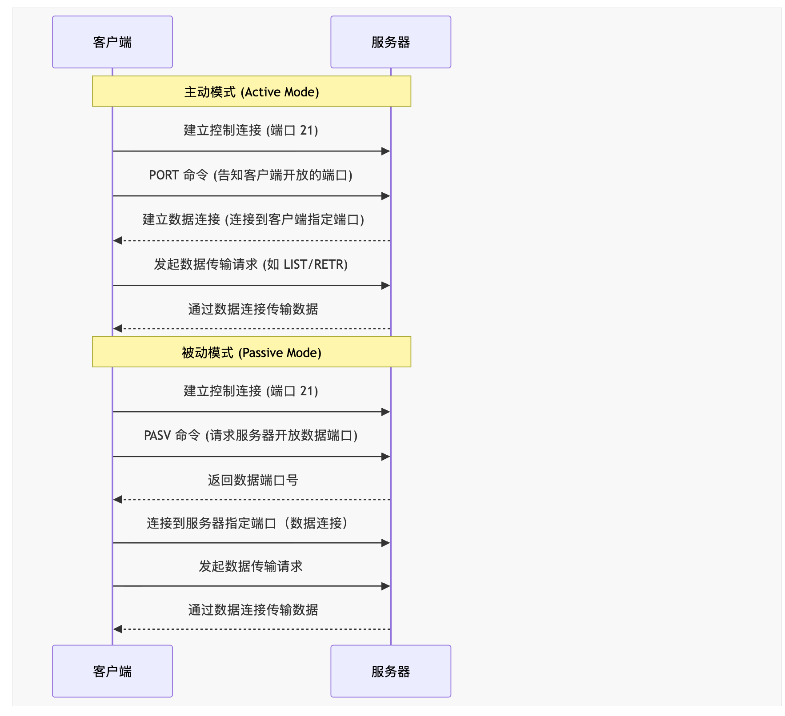

---

## 电子邮件

### 一、电子邮件系统

电子邮件系统由 **用户代理**、**邮件服务器** 以及 **电子邮件协议** 这三个核心组成部分协同工作，确保邮件的发送、接收和存储。

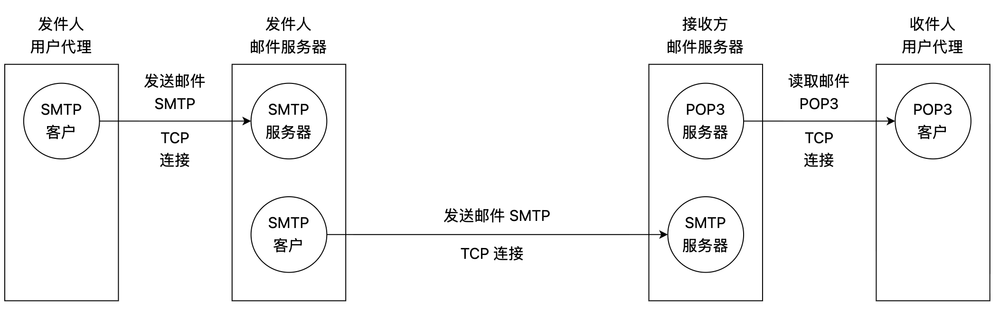

#### 1.1 用户代理

**用户代理**（UA, User Agent）是用户与电子邮件系统交互的接口，通常是邮件客户端软件（如 qq 邮箱网页界面、Outlook 等）。

功能：

- 提供用户友好的界面，用于撰写、发送、接收和阅读邮件。
- 管理邮件文件夹（如收件箱、已发送、草稿）。
- 与邮件服务器通信以发送或获取邮件。

#### 1.2 邮件服务器

**邮件服务器**（Mail Server）是电子邮件系统的核心，负责存储、转发和管理邮件。

功能：

- 接收来自用户代理的邮件并存储。
- 根据邮件的目标地址，通过 **SMTP** 协议将邮件转发到目标邮件服务器。
- 提供邮件存储功能，供用户通过 **POP3**/IMAP 协议访问。

#### 1.3 SMTP

**SMTP**（Simple Mail Transfer Protocol）是用于邮件发送的标准协议，负责在邮件服务器之间或从用户代理到邮件服务器传输邮件。

功能：

- 定义了邮件如何从发送方传递到接收方的邮件服务器。
- 工作在 TCP/IP 协议之上，通常使用端口 25（或加密端口 587）。
- **仅负责邮件的发送**，不涉及邮件的接收或存储。

工作流程：

- 用户代理通过 **SMTP** 将邮件发送到发送方的邮件服务器。
- 发送方服务器通过 **SMTP** 与接收方服务器通信，将邮件传递到目标服务器。

#### 1.4 POP3

**POP3** 是用于从邮件服务器检索邮件的协议，允许用户将邮件下载到本地设备。

功能：

- 用户代理通过 **POP3** 连接到邮件服务器，下载邮件到本地。
- 默认情况下，邮件下载后会从服务器删除（可配置保留）。
- 工作在 TCP/IP 协议之上，通常使用端口 110（或加密端口 995）。

工作流程：

- 用户代理通过 **POP3** 登录服务器。
- 下载新邮件到本地设备。
- 可选择删除服务器上的邮件副本。

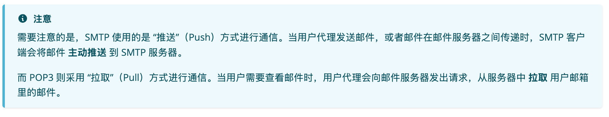

### 二、电子邮件格式

一封电子邮件由 **信封** 和 **内容** 两部分组成，其中邮件 **内容** 又可分为 **首部** 和 **主体**。
邮件的 **首部格式** 由 RFC 标准定义，而 **主体部分** 则由用户自由撰写。

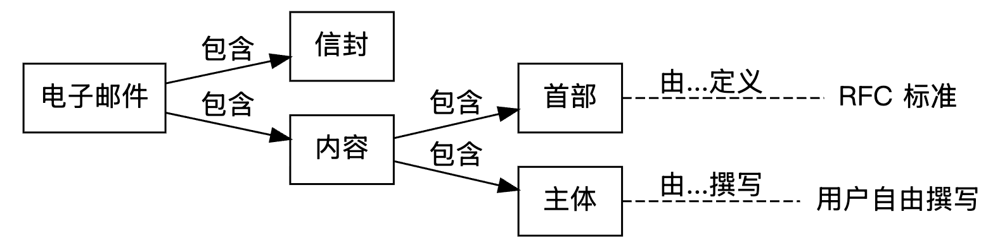

用户在填写完邮件首部后，系统会自动提取 **信封** 所需的信息，无需用户手动填写 **信封** 内容。

邮件首部由若干 **首部行** 组成，每行格式为：`关键字: 值`。其中：

- `To`：必填，指定一个或多个收件人的电子邮件地址，格式为 `用户名@域名`，如 `abc@csgraduates.com`。用户名在所属域名下必须唯一，从而保证该邮箱地址在整个互联网上唯一。
- `Subject`：可选，表示邮件主题，用于概括邮件内容。
- `From`：必填，表示发件人邮箱地址，通常由邮件系统自动填写。

首部和主体之间用一个空行分隔。以下是一个典型邮件内容示例：

```
From: sender@example.com
To: abc@cskaoyan.com
Subject: Meeting Schedule

Dear team,
Please find the meeting schedule attached.
```

### 三、MIME

**MIME**（Multipurpose Internet Mail Extensions，多用途互联网邮件扩展）是为了解决传统电子邮件格式的局限性而提出的一种扩展标准。

早期的电子邮件只能传输 **纯文本**（ASCII 码），不支持发送图片、音频、视频或非英语字符（如中文）。这严重限制了电子邮件的用途。**MIME** 的出现，就是为了解决这些问题。

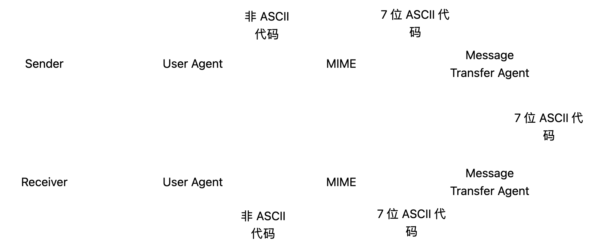

**MIME** 主要包含以下三点 **核心功能**：

1. 支持非 ASCII 字符
   - 允许使用 UTF-8 等编码发送包含中文、法语等字符的邮件内容。
2. 支持多媒体内容
   - 可以发送图像（如 JPEG、PNG）、音频、视频等多种格式的附件或内嵌内容。
3. 支持多部分内容（multipart）
   - 一封邮件可以同时包含文本和附件，甚至不同格式的内容（例如纯文本和 HTML 格式的正文）。

---

## 万维网

### 一、WWW

**WWW**，也称为 **万维网**（World Wide Web），是一个信息系统，在这个系统中，文档和其他资源通过 **统一资源标识符**（Uniform Resource Identifiers，或 **URI**，通常为 **URL**）进行标识和互相链接。用户可以使用 **网络浏览器** 访问 **万维网** 上的资源。

#### 1.1 组层结构

1. **URL** (统一资源定位符)：每个网页或资源都有一个唯一的地址，称为 **URL**，它定义了资源的位置和如何访问它。
2. **HTTP/HTTPS** (超文本传输协议/安全超文本传输协议)：这是用于从服务器传输网页到浏览器的协议。
3. **HTML** (超文本标记语言)：大多数网页使用 **HTML** 编写，它是用于描述和呈现超文本的标准标记语言。

### 二、HTTP协议

**HTTP**（超文本传输协议）*是互联网上应用最为广泛的一种网络协议*。它是一个属于 **应用层** 的协议，常基于 **TCP/IP** 协议通信。**HTTP** 用于 **客户端** 和 **服务器** 之间的数据传输，特别是在 **万维网**（WWW）中，用于传输网页（**HTML** 文件）以及与其关联的资源（如图片、音频、视频等）。

#### 2.1 无状态

**HTTP** 本身不保持 **无状态** 信息，每个请求都是独立的，服务器无法识别是不是同一个用户发送的多个请求。这一点在现实中通常通过 **Cookie** 和 **Session** 技术来弥补。

#### 2.2 组成部分

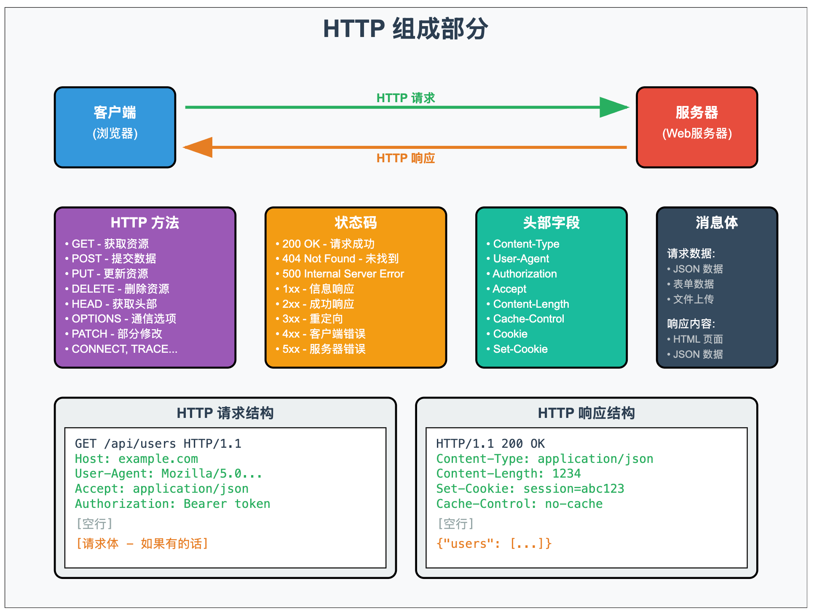

上图展示了 HTTP 协议的几个重要组成部分，对于考试而言，**重点关注** 以下字段：

1. **请求和响应**：**HTTP** 通信通常包括 **客户端** 向 **服务器** 发送 **请求**，然后 **服务器** 返回 **响应** 的过程。
2. 方法：HTTP定义了一组请求方法，用于表示对资源的不同操作：
   - **GET**：请求指定资源。
   - **POST**：提交数据以供处理。
   - **PUT**：更新指定资源。
   - **DELETE**：删除指定资源。
   - **HEAD**：与 **GET** 相似，但只请求资源的头部信息。
3. 状态码：响应返回一个状态码，用于表示请求的结果，例如：
   - **200 OK**：请求成功。
   - **404 Not Found**：资源未找到。
   - **500 Internal Server Error**：服务器内部错误。
   - 以及其他众多 **状态码**，用于表示不同的响应状态。
4. 头部字段：HTTP请求和响应都包含头部信息，提供有关请求或响应的元数据，例如Content-Type（内容类型）或User-Agent（用户代理）。
   - **消息体**：**请求** 或 **响应** 的主体部分，通常包含要传输的数据。例如，**POST** 请求的数据或 **服务器** 返回的网页内容。

#### 2.3 关键字段

以下首部字段可能在考试中被考察，需要了解一下：

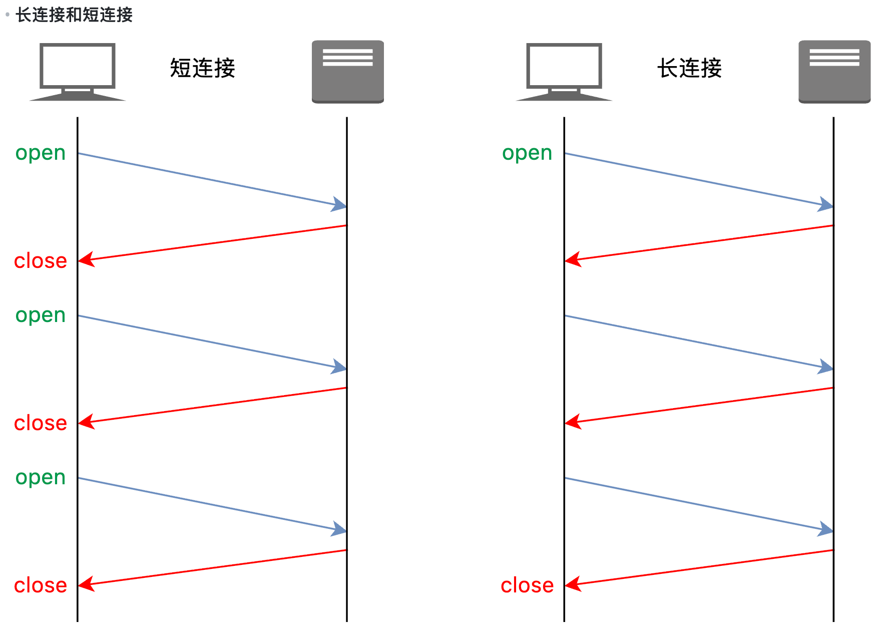

**长连接和短连接含义**

**HTTP** 根据首部的 `keepalive` 选项是否被设置被分为 **长连接** 和 **短连接**。

- **长连接**（**持久连接**，persistant connection）通过设置 `keepalive` 选项，可以在一个 **TCP 连接** 中发送多个 **HTTP** 请求。
- **短连接**（**非持久连接**，multiple connection）没有设置 `keepalive` 选项，那么每一次发送 **HTTP** 请求都必须单独建立一个 **TCP 连接**。

**HTTP 不同版本中的 keepalive**

- 在 **HTTP/1.0** 中，**持久连接** 不是默认行为。要在 **HTTP/1.0** 中启用它，必须在请求头部添加 `Connection: keep-alive` 。
- 在 **HTTP/1.1** 中及之后，**持久连接** 是默认行为。如果想关闭它，必须在请求或响应头部添加 `Connection: close` 。

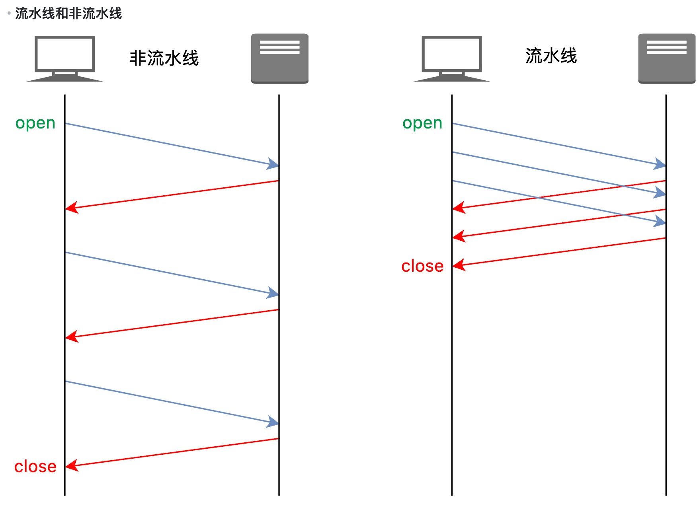

**HTTP 流水线和非流水线含义**

- **流水线**（**HTTP Pipelining**）：**HTTP** 客户端在未等待前一个请求的响应的情况下，连续发送多个 **HTTP** 请求。
- **非流水线**（**Non-pipelined**）：**HTTP** 客户端必须接收到上一个请求的响应，才能发送下一个请求。

**HTTP 不同版本中的流水线支持**

- 在 **HTTP/1.0** 中，**流水线** 的功能并不支持。
- 在 **HTTP/1.1** 中，引入了 **HTTP 流水线** 的支持，但由于使用中**队头阻塞**的问题，应用并不广泛。
- 在 **HTTP/2** 中，进一步改进了请求处理机制，允许多个请求和响应在同一个连接中并行进行，解决了**队头阻塞**的问题。

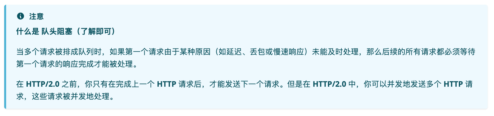

cookie：**HTTP** 协议是 **无状态** 的，这意味着每个请求都是独立的，**服务器** 默认情况下无法知道两个请求是否来自同一客户端或用户。**Cookie** 的引入使得 **服务器** 能够跨多个请求“识别”和“记住”用户。

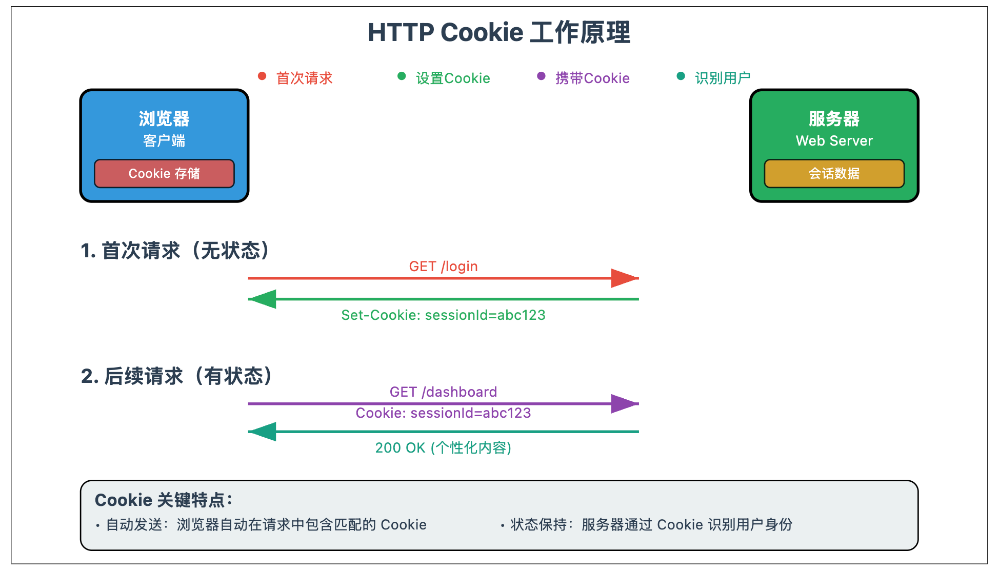

**HTTP** **服务器**通过 `Set-Cookie` 首部字段来设置每一个客户端的 **Cookie** 值，相应的 **HTTP** 响应的部分内容如下所示：

```
HTTP/1.1 200 OK
Set-Cookie: sessionId=abc123; Expires=Wed, 21 Oct 2025 07:28:00 GMT; Path=/; Secure; HttpOnly
```

当浏览器接收到带有 `Set-Cookie` 字段的 **HTTP** 响应时，就会在存储该 **Cookie** 字段，并在下次向对应的 **服务器** 发送 **HTTP** 请求时自动将 `Cookie` 字段添加在 **HTTP** 首部，之后的 **HTTP** 请求的部分内容如下所示：

```
GET /dashboard HTTP/1.1
Cookie: sessionId=abc123
```

当 **HTTP** **服务器** 接收到带有 **Cookie** 的请求时，它就可以区分这个请求是来自于那个客户端的了。


