# 软件工程图典

## 一、先选图：按岗位找图

不要问「这个项目该画哪些图」，先问「你的岗位现在要回答什么问题」。同一个项目，不同岗位看不同的图；按岗位分块查，不用从头翻到尾。

**需求/业务分析**

| 岗位 | 图名称 | 图作用 | 典型阶段 |
|---|---|---|---|
| 需求/业务分析 | 泳道图 | 看业务跨几个角色、在哪交接、哪里在等 | 需求 |
| 需求/业务分析 | 活动图 | 看一个流程内部的分支、并行、异常 | 需求/设计 |
| 需求/业务分析 | 用例图 | 看谁用系统、系统边界在哪 | 立项/需求 |
| 需求/业务分析 | DFD | 看数据从哪来、存到哪、流向谁 | 需求/安全评审 |
| 需求/业务分析 | 状态机图 + 迁移表 | 看一个单据/订单有哪些状态、怎么变 | 需求/设计 |

**设计/开发**

| 岗位 | 图名称 | 图作用 | 典型阶段 |
|---|---|---|---|
| 设计/开发 | 架构图（上下文/分层） | 看系统分几块、外部依赖是谁 | 设计 |
| 设计/开发 | 结构图 | 看模块之间谁调谁、有没有循环依赖 | 设计 |
| 设计/开发 | 类图 | 看领域对象的属性、行为和关系 | 设计 |
| 设计/开发 | 组件图 | 看哪些组件提供/消费哪些接口 | 设计 |
| 设计/开发 | 时序图 | 看一次请求按时间经过谁、失败怎么返回 | 设计 |
| 设计/开发 | 部署图 | 看制品部署到哪些节点、节点怎么连 | 设计/上线 |
| 设计/开发 | ER 图 | 看数据怎么存、表之间什么关系 | 设计 |
| 设计/开发 | 判定表 | 把多条件组合的结果列全，防漏分支 | 设计/测试 |
| 设计/开发 | 状态迁移表 | 写清每条状态迁移由谁、在什么条件下触发 | 设计 |

**测试**

| 岗位 | 图名称 | 图作用 | 典型阶段 |
|---|---|---|---|
| 测试 | 状态迁移测试表 | 保证状态机每条迁移、守卫、非法事件都测到 | 测试 |
| 测试 | 因果图 | 从原因组合推导测试用例 | 测试 |
| 测试 | 测试分层图 | 定每层测什么、写多少、谁维护 | 测试 |
| 测试 | 帕累托图 | 看先修哪类缺陷收益最大 | 测试/运维 |

**项目管理**

| 岗位 | 图名称 | 图作用 | 典型阶段 |
|---|---|---|---|
| 项目管理 | WBS | 看项目要交付什么、怎么拆到可验收 | 计划 |
| 项目管理 | 甘特图 | 看任务什么时候做、和谁重叠 | 计划 |
| 项目管理 | 关键路径网络图 | 看哪条任务链决定总工期 | 计划 |
| 项目管理 | 风险矩阵 | 排哪些风险先处理、怎么处理 | 计划/复盘 |
| 项目管理 | 燃尽图 | 看剩余工作量能否按期清零 | 执行 |
| 项目管理 | 累积流图 | 看在制品堆在哪、瓶颈是谁 | 执行 |

**运维/上线**

| 岗位 | 图名称 | 图作用 | 典型阶段 |
|---|---|---|---|
| 运维/上线 | 部署拓扑图 | 看生产环境真实节点、实例数和单点 | 上线/运维 |
| 运维/上线 | 发布/回滚流程图 | 定什么条件发、什么条件回滚、谁拍板 | 上线 |
| 运维/上线 | 回滚时序图 | 定回滚时各系统按什么顺序动 | 上线/故障 |
| 运维/上线 | 鱼骨图 | 从 5M1E 六个方向穷举故障可能原因 | 复盘 |
| 运维/上线 | 故障时间线 | 还原故障从发生到恢复的全过程，算 MTTD/MTTR | 复盘 |

### 选图三问

1. **给谁看？** 业务看边界和路径，开发看契约和依赖，测试看分支和状态，管理层看取舍和风险。给错人，图就白画。
2. **看完要做什么决定？** 批不批、怎么拆、测哪些、发不发、回不回滚。没有决定，图就是装饰。
3. **图上的信息够不够支撑这个决定？** 不够就加表，或者换图；不要在一张图上继续堆节点。

### 一张图只回答一个问题

标题写「系统架构图」，读者不知道要看什么；标题写「订单支付只经过三个模块，库存走异步」，读者一眼知道结论。**图的标题应该是结论或问题，不是图种名称。**

## 二、图与表：别让图干表的活

图擅长表达结构、路径、顺序和状态；表擅长表达精确规则、字段、责任和优先级。用错载体，读者要么看不懂，要么记不住。

| 信息类型 | 图更合适 | 表更合适 | 常见错误 |
|---|---|---|---|
| 层级与边界 | 架构图、WBS | 模块清单 | 图里塞 30 个节点 |
| 顺序与分支 | 流程图、时序图 | 步骤说明 | 用图写 20 条规则 |
| 状态与迁移 | 状态机图 | 状态迁移表 | 只画图不写条件 |
| 条件组合 | —（用表） | 判定表、规则表 | 用 if-else 文字描述 |
| 数据结构 | ER 图 | 数据字典 | ER 图里画方法 |
| 责任与优先级 | 风险矩阵 | RACI、风险登记表 | 矩阵没有 owner |
| 数量与趋势 | 帕累托、燃尽、累积流 | 指标表 | 图没有样本量和时间窗 |

### 四组固定搭配

- **状态机图 + 状态迁移表**：图看全貌，表写「谁、什么条件、失败怎么办」。
- **流程图 + 操作说明**：图看路径，说明写字段、异常、时限。
- **架构图 + 接口清单**：图看边界，清单写契约、版本、owner。
- **ER 图 + 数据字典**：图看关系，字典写类型、约束、脱敏、默认值。

### 图的四个谎言

1. **节点太多**：超过 12 个节点就不是图，是清单；拆图或改用表。
2. **箭头没有语义**：调用、数据流、依赖、时序混在一张图里，读者只能猜。
3. **没有图例和方向**：同一条线，作者想表达「调用」，读者理解成「数据流」。
4. **没有日期和版本**：半年后没人敢用，最后变成一张「历史参考图」。

## 三、需求图族

需求阶段的图只干三件事：让业务确认「是不是这样」，让开发知道「边界在哪」，让测试知道「哪些路径要测」。不是把 SRS 画一遍。

### 3.1 泳道图（跨职能流程图）

**用途**：一眼看出谁在什么时候把什么交给谁，找等待、返工和审批瓶颈。

**何时画 / 何时不画**

- 画：跨 3 个以上角色/部门、有交接和审批、要定位「为什么慢」。
- 不画：单角色线性流程、纯系统内部调用、操作步骤少于 5 步。用编号步骤或清单更快。

**元素**

| 元素 | 含义 | 画法 |
|---|---|---|
| 泳道 | 角色、部门或系统 | 一条横向/纵向分区，写角色名 |
| 开始/结束 | 流程起点和终点 | 圆角/胶囊节点 |
| 活动 | 谁做了什么 | 动词 + 宾语，如「提交报销单」 |
| 判断 | 分支条件 | 菱形，一个问题一个出口 |
| 交接物 | 单据、消息、状态 | 箭头上的名词，如「报销单」 |
| 异常路径 | 驳回、超时、取消 | 反向箭头或虚线 |

**最小样例**

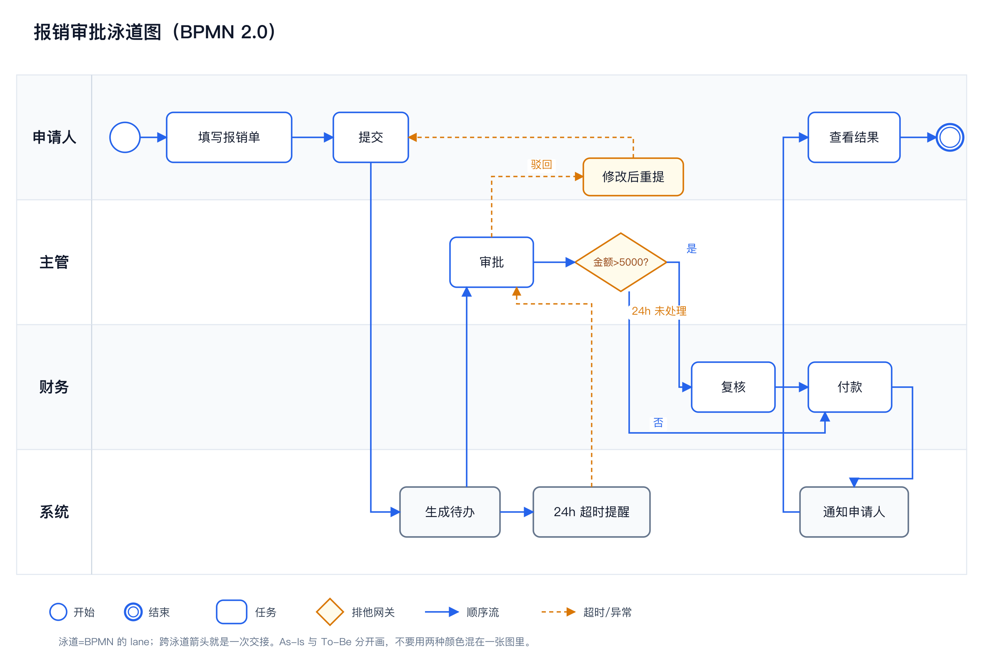

读图：每条泳道是一个角色；箭头跨道就是一次交接（提交 → 生成待办 → 审批）；菱形是金额判断分支（金额 > 5000 才进复核）；橙色虚线是异常路径（驳回回退、24 小时未处理提醒），不是主流程。

泳道图是 BPMN 的 lane 语法，Mermaid 没有专门的泳道图，只能用 `subgraph` 近似；要交付规范泳道图时用 BPMN 或 draw.io。

**画法**

1. 定起点和终点：从「谁发起」到「什么算结束」，不要从系统登录开始画。
2. 列角色：按实际执行动作的角色分道，不按组织架构分道；系统可以单独一条道。
3. 按时间顺序摆活动：一条道内从上到下/从左到右，跨道箭头尽量少。
4. 标交接物和时限：箭头写单据/消息名，超时和 SLA 写在箭头或活动上。
5. 补异常：驳回、撤回、超时、取消各画一条；正常路径用实线，异常用虚线或反向箭头。

**常见错误**

- 泳道按部门画，结果「前端」「后端」各一条，业务看不懂。
- 活动写成「处理」「审核」，没有宾语，不知道处理什么。
- 把系统弹窗、按钮点击画成活动，图变成 UI 走查。
- 只画正常路径，上线后才发现驳回没有回退路径。
- 跨道箭头太多，说明职责没切清，先改流程再画图。

**企业取舍**

As-Is 和 To-Be 各一张，不要在一张图上用两种颜色混画。超过 15 个活动就拆子流程，主图只保留阶段和交接。图配一张「时限/单据/责任人」表，比在图上堆文字有用。业务背景和报销案例见 [`04-需求分析`](./04-需求分析.md) 3.1。

### 3.2 活动图

**用途**：描述一个用例或流程的内部逻辑：顺序、分支、并行、异常出口。它关注「逻辑怎么走」，不关注「谁来做」。

**何时画 / 何时不画**

- 画：有并行、分支、异常路径，且需要开发/测试一起评审。
- 不画：纯线性步骤、纯人工操作手册、算法流程（用伪代码更清楚）。

**元素**

| 元素 | 含义 | 画法 |
|---|---|---|
| 起点/终点 | 流程开始和结束 | 实心圆/胶囊 |
| 活动 | 一个可执行步骤 | 圆角矩形，动词+宾语 |
| 判断 | 一个条件两个出口 | 菱形，出口标「是/否」 |
| 分叉/汇合 | 并行执行后合并 | 一条边分成多条，再汇到同一节点 |
| 异常出口 | 失败、超时、取消 | 虚线箭头到异常处理节点 |

**最小样例**

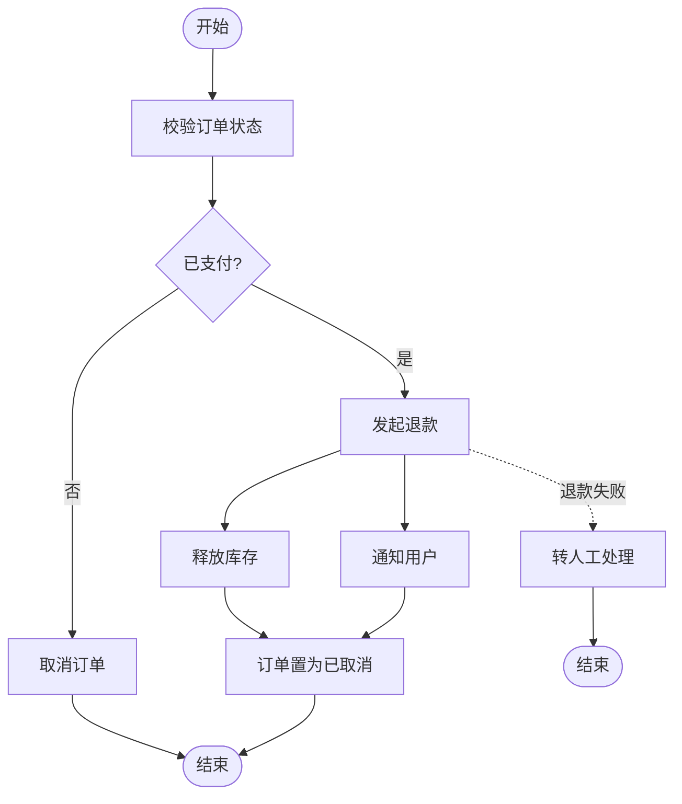

读图：`R` 之后分成「释放库存」和「通知用户」两条并行路径，最后汇到「订单置为已取消」；虚线是异常出口。上面用 Mermaid 近似表达并行（一分为多、多汇为一）；正式活动图用粗黑条（fork/join）表示并行，见下图：

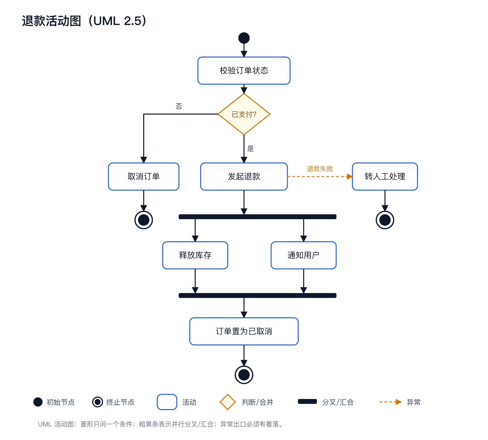

读图：UML 活动图的正式符号——实心圆是初始节点，套圈实心圆是终止节点，菱形只问一个条件，粗黑条表示并行分叉/汇合（两条分支都完成才继续）；橙色虚线是「退款失败 → 转人工处理」的异常出口，每条异常路径必须有自己的着落。

**画法**

1. 先写正常路径：从触发到结束，不超过 7 个活动。
2. 补判断：每个菱形只问一个条件，出口必须互斥且完备。
3. 标并行：哪些动作可以同时做、必须都完成后才能继续。
4. 补异常：失败、超时、取消、重试各一条，不要让它「消失」。
5. 把活动名改成动词+宾语，读一遍能否直接变成任务清单。

**常见错误**

- 一个菱形写「状态是否合法且金额正确」，两个条件混在一起。
- 没有终点，或者所有异常都指向「结束」，看不出补救动作。
- 把页面跳转当活动，图变成页面流。
- 并行没有汇合，读者不知道要不要等。
- 异常路径画了但没有处理动作。

**企业取舍**

活动图适合评审业务逻辑，不适合当操作手册；操作手册用编号步骤+截图。一张图不超过 20 个活动，超过就拆子流程。涉及资金、权限、不可逆操作的异常出口必须画出来。

### 3.3 用例图

**用途**：圈定系统边界和参与者，回答「谁用系统做什么」，不回答「怎么做」。

**何时画 / 何时不画**

- 画：项目初期对齐范围、外包验收、投标/等保、参与者多且边界不清。
- 不画：内部小迭代、需求清单已经很清楚、团队已经对范围有共识。用一张「角色-功能」表更快。

**元素**

| 元素 | 含义 | 画法 |
|---|---|---|
| 参与者 | 直接使用系统的人/外部系统 | 小人（actor 图标） |
| 用例 | 参与者主动发起的一件事 | 椭圆，动词+宾语 |
| 系统边界 | 哪些做、哪些不做 | 一个大框 |
| 关联 | 谁发起哪个用例 | 实线 |
| include | 必用的公共行为 | 虚线箭头指向被包含用例 |
| extend | 可选/条件触发的扩展 | 虚线箭头指向基础用例 |

**最小样例**

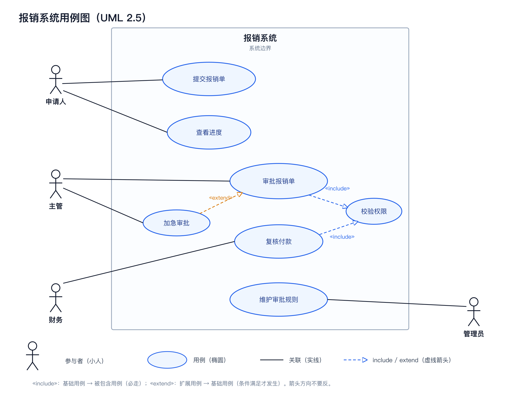

读图：框外小人是参与者，框内椭圆是用例，大框是系统边界；实线是「谁发起哪个用例」的关联；`«include»` 表示审批和复核都必须先校验权限（基础用例 → 被包含用例，必走）；`«extend»` 表示加急审批只在条件满足时扩展审批报销单（扩展用例 → 基础用例）。注意箭头方向：include 从基础指向被包含，extend 从扩展指向基础，方向反了语义就全错。

Mermaid 没有原生用例图，用胶囊节点近似会丢失「参与者小人、系统边界、include/extend 方向」三个关键信息；要画就用支持 UML 的工具（PlantUML、draw.io）。

**画法**

1. 定边界：先画系统框，框外是参与者和外部系统。
2. 列参与者：只列直接使用系统的人；不要用「管理员」这种万能角色兜底。
3. 每个参与者列 3-7 个主动发起的用例（样例为精简只列 1-2 个）；被动触发的功能不算用例。
4. 只画 include/extend 中真正复用的部分，不要把所有调用都画成 include。
5. 检查每个用例：有没有人触发、有没有可观察的结果、边界内有没有实现。

**常见错误**

- 把功能清单画成用例：「用户管理」「报表管理」不是用例，是模块。
- 参与者写成部门，而不是角色；部门会变，角色稳定。
- include/extend 滥用，图变成调用图。
- 用例没有动词，或者一个用例包含十几个动作。
- 系统内部模块当参与者。

**企业取舍**

用例图只用于范围共识，不用于详细设计。真正有价值的是用例描述（前置条件、主流程、异常、后置条件），图只是索引。内部项目用「角色-功能-验收标准」表替代，投标/外包再补图。业务背景见 [`04-需求分析`](./04-需求分析.md) 7.2。

### 3.4 DFD（数据流图）

**用途**：看数据从哪来、经过什么加工、存到哪、谁用；找数据孤岛、敏感数据流向和系统边界。

**何时画 / 何时不画**

- 画：等保/安全测评、投标、遗留系统改造、跨系统集成、数据合规评审。
- 不画：普通业务系统的日常设计，泳道图 + ER 图已经够；DFD 不表达时序，别拿它当流程图。

**元素**

| 元素 | 含义 | 画法 |
|---|---|---|
| 外部实体 | 人、外部系统、银行 | 方框，写名词 |
| 加工 | 把输入变成输出 | 圆角框/圆，编号+动词 |
| 数据存储 | 表、文件、库 | 开口矩形（Gane-Sarson），编号 |
| 数据流 | 流动的数据 | 箭头 + 名词，不写「数据」 |
| 层级 | 顶层/0 层/1 层 | 顶层一个加工，逐层展开 |

**最小样例**

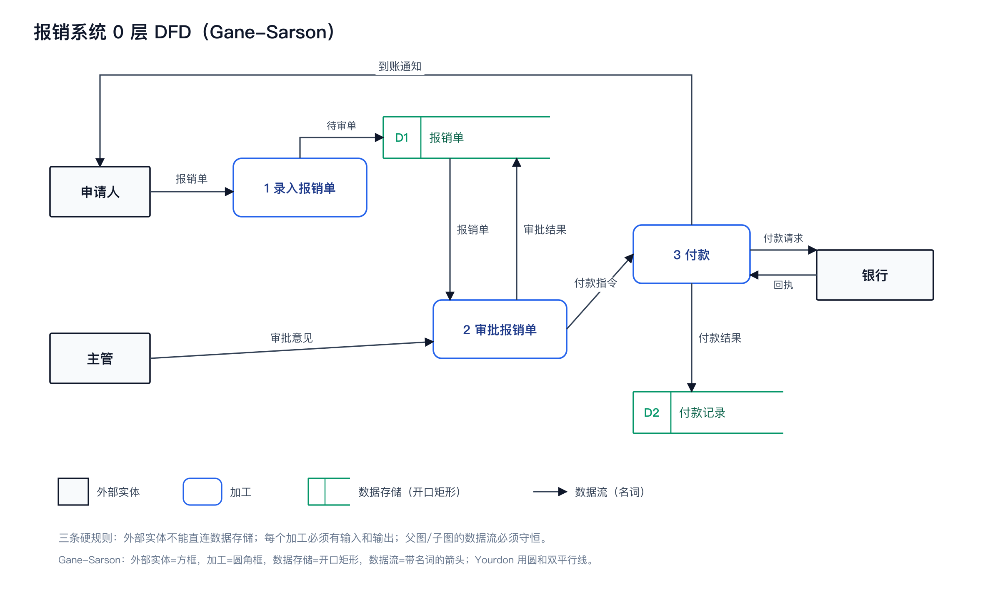

读图：方框是外部实体（申请人、主管、银行），圆角框是编号加工（1 录入、2 审批、3 付款），开口矩形是数据存储（D1 报销单、D2 付款记录），箭头上的名词是数据流。0 层只展开 3 个加工；再往下只展开关键加工到 1 层。

三条硬规则：**外部实体不能直连数据存储**（必须经过加工）；**每个加工必须有输入和输出**（只进不出或只出不进都是画错了）；**父图/子图的数据流必须守恒**（子图的输入输出等于父图对应加工的输入输出）。

符号约定：本图用 Gane-Sarson 记法（外部实体=方框，加工=圆角框，数据存储=开口矩形）；Yourdon 记法用圆和双平行线，评审时只用一种。Mermaid 没有 DFD 语法，`graph LR` 按形状近似即可内部评审用；等保/投标要正式图时导出 draw.io/Visio。

**画法**

1. 画顶层：系统作为一个加工，连所有外部实体，标输入输出。
2. 展开 0 层：拆成 3-7 个主要加工，编号 1、2、3。
3. 给每条数据流起名词名：「报销单」「付款指令」，不要写「数据」「信息」。
4. 检查守恒：每个加工的输入能不能产生输出；每个存储谁写、谁读。
5. 只展开关键加工到 1 层；安全评审标敏感字段和跨域流向。

**常见错误**

- 外部实体直连数据存储，绕过了加工，违反 DFD 第一规则。
- 把控制流当数据流：「点击提交」不是数据流。
- 加工写成「系统」「平台」，没有动词，无法判断做什么。
- 加工只有输入没有输出（黑洞），或只有输出没有输入（奇迹）。
- 数据流没有名字，或者所有箭头都叫「数据」。
- 层次混乱：0 层出现 1 层的字段细节，或者 1 层又画回顶层。
- 数据存储只画读、不画写，或者相反。

**企业取舍**

DFD 不是日常设计图，是特定场景的合规/分析图。现状 DFD 和目标 DFD 分开画，不要用目标图冒充现状。敏感系统必须标数据分类、跨境/跨域流向和脱敏点。业务背景见 [`04-需求分析`](./04-需求分析.md) 7.1。

### 3.5 状态机图

**用途**：定义一个对象「有哪些状态、什么动作能从哪到哪、什么条件不允许」。

**何时画 / 何时不画**

- 画：订单、工单、审批单、支付、订阅等有状态对象；状态 ≥3 或迁移 ≥5 时必画。
- 不画：无状态的计算/查询；状态很少且不会变的配置。

**元素**

| 元素 | 含义 | 画法 |
|---|---|---|
| 初始/终止 | 创建和归档 | `[*]` |
| 状态 | 对象当前所处阶段 | 圆角框，用「待审批/已通过」 |
| 迁移 | 事件触发的状态变化 | 箭头 + 事件名 |
| 守卫 | 迁移必须满足的条件 | 箭头上的 `[条件]` 或写进迁移表 |
| 动作 | 迁移时执行的副作用 | 迁移表里的「动作」列 |
| 复合状态 | 状态内部还有子状态 | 大框套小框，少用 |

**最小样例**

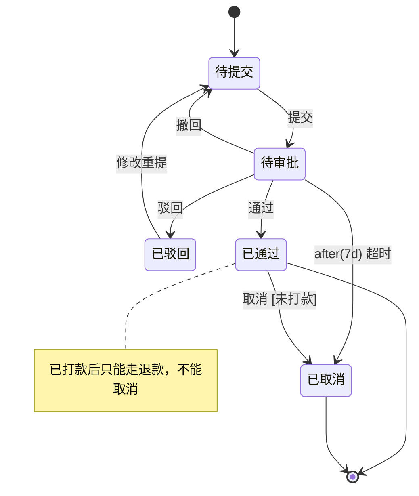

读图：`[*]` 是起点/终点，圆角框是状态，箭头是一次迁移，箭头上的字是事件。先保证除终态外每个状态都有进有出，再补守卫和动作。

**画法**

1. 列状态：用业务名词，不用表字段；状态名和代码枚举保持一致。
2. 定起点和终态：创建、归档、取消分别是什么状态。
3. 列每个状态下允许的事件，填目标状态。
4. 补异常迁移：超时、取消、重试、退款、撤回。
5. 把「谁、什么条件、什么动作、失败怎么办」落到迁移表（见 4.9）。

**常见错误**

- 把动作画成状态：「支付」是动作，「已支付」是状态。
- 漏掉超时、取消、撤回，上线第一个月就出问题。
- 一个状态两个含义，比如「处理中」既包括支付中又包括发货中。
- 迁移没有事件，读者不知道什么触发。
- 把 UI 页面当状态，页面和业务状态不是一回事。

**企业取舍**

图看全貌，表写细节，两样都要。状态超过 12 个就拆子状态机；不要为每个字段画状态。状态命名、数据库枚举、接口返回值三处必须一致。业务背景见 [`04-需求分析`](./04-需求分析.md) 4.1。

## 四、设计图族

设计图只画「不确定的部分」：模块边界、接口契约、关键流程、数据归属、异常路径。代码里已经确定的，不用再画一遍。

### 4.1 架构图（上下文/分层）

**用途**：划定系统边界、外部依赖、分层职责，让新人 5 分钟知道系统由哪几块组成。

**何时画 / 何时不画**

- 画：新系统、拆服务、跨团队集成、架构评审、重大外部依赖变更。
- 不画：单模块小改动、纯内部重构；在 ADR 里记一笔即可，不要为了「保持架构图最新」而更新。

**元素**

| 元素 | 含义 | 画法 |
|---|---|---|
| 系统/服务 | 边界内的一块职责 | 方框，模块名+一句话职责 |
| 外部系统 | 支付、短信、IdP、银行 | 方框，标「外部」 |
| 用户/角色 | 谁在用什么 | 小人或方框 |
| 数据存储 | 库、缓存、对象存储 | 圆柱 |
| 消息通道 | MQ、事件总线 | 圆角框/队列形状 |
| 边界 | 信任边界、网络边界 | 虚线框 |
| 协议 | HTTPS、gRPC、JDBC | 箭头上的标签 |

**最小样例**

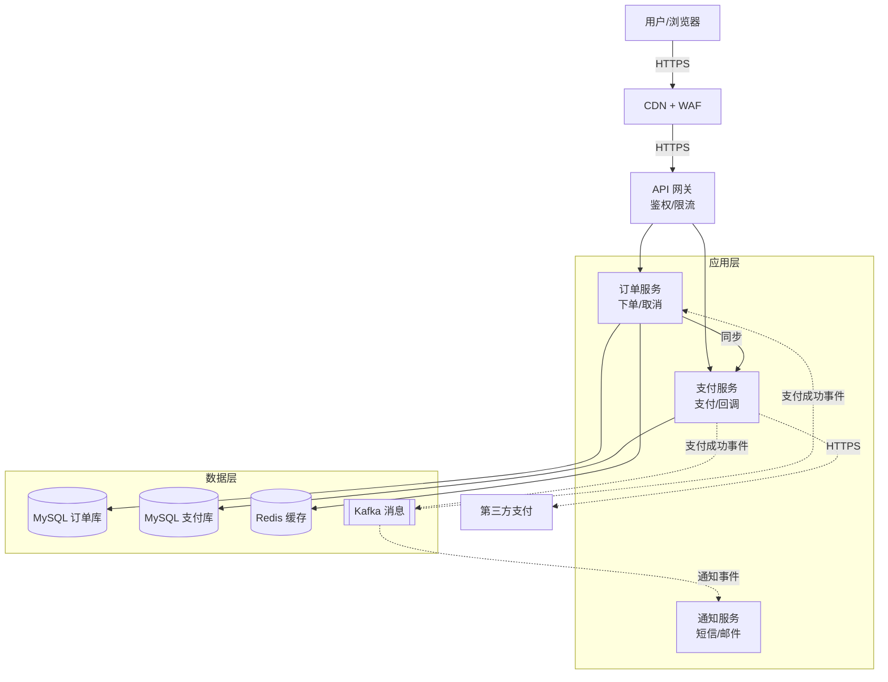

读图：从上到下是「接入 → 应用 → 数据」；关键箭头标了协议/同步异步；外部支付用虚线；数据层只画存储类型，不画表结构；订单库只有订单服务写、支付库只有支付服务写，跨服务改库要用事件（MQ → 订单服务），不要直连别人的库。

**画法**

1. 先画上下文：系统在中间，外部系统、用户、第三方在四周，标清谁调谁。
2. 再画分层：接入/应用/数据，每层 3-7 个模块，同层同色。
3. 标依赖方向：只画调用/数据方向，不要双向箭头糊弄。
4. 标协议和同步/异步：HTTP、gRPC、MQ、JDBC 写清楚。
5. 标信任边界和外部依赖；图旁列 3 条关键约束（如「订单库只允许订单服务写」）。

**常见错误**

- 把部署细节塞进架构图：K8s、Pod、端口、IP 应该去部署图。
- 箭头不标协议，读者不知道是同步还是异步。
- 所有模块都连数据库，看不出数据归属。
- 没有外部系统，仿佛系统在真空里运行。
- 图比代码更新慢，最后没人看。

**企业取舍**

一张上下文图 + 一张分层图足够。C4 的四层模型只在多人评审/大型系统里用；小团队画多了没人维护。架构图不追求完整，追求「边界和依赖方向正确」。业务背景见 [`05-系统设计`](./05-系统设计.md) 三。

### 4.2 结构图（模块依赖）

**用途**：看模块之间谁调谁、层次是否清晰、有没有循环依赖。

**何时画 / 何时不画**

- 画：模块 ≥5、跨团队开发、重构前、要定包结构时。
- 不画：单模块小项目、纯 CRUD；目录结构本身就能说明。

**元素**

| 元素 | 含义 | 画法 |
|---|---|---|
| 模块 | 一组职责 | 方框，模块名+职责 |
| 层 | 控制/业务/数据 | 从上到下排列 |
| 依赖 | 谁调谁 | 单向箭头 |
| 跨层调用 | 跳过中间层 | 虚线箭头，必须写原因 |
| 外部依赖 | 第三方 SDK/服务 | 方框，标「外部」 |

**最小样例**

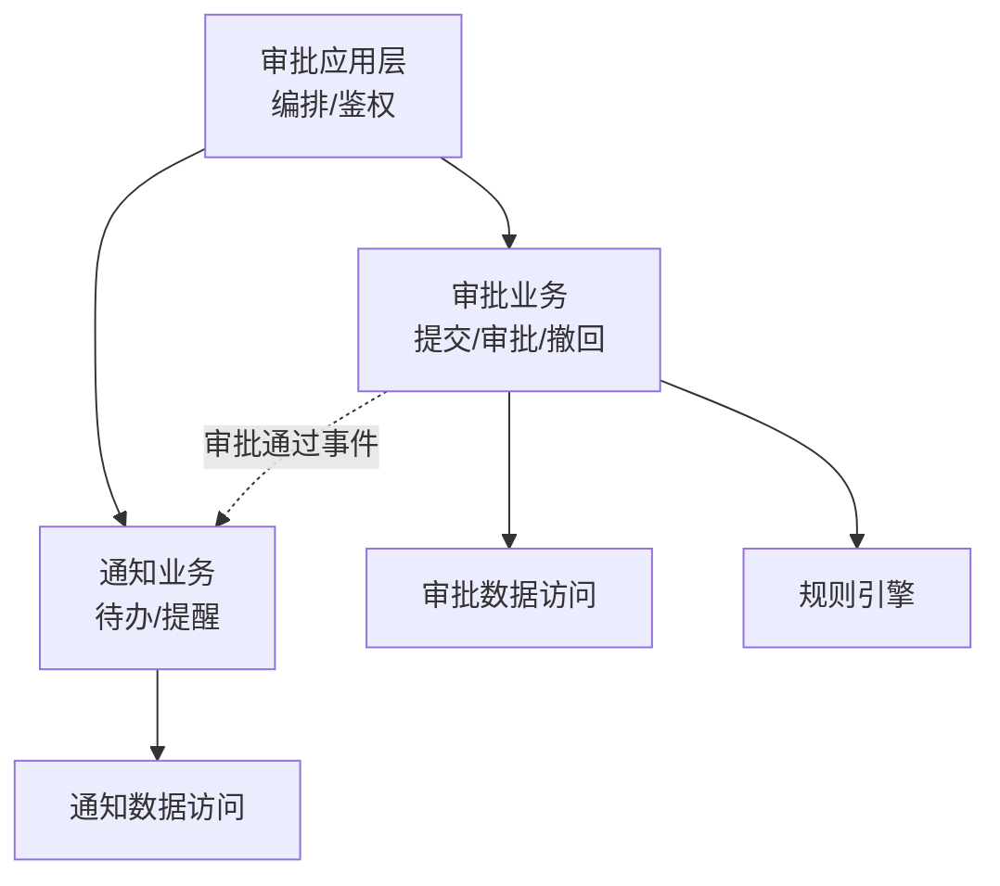

读图：节点=模块，方框里写「模块名 + 一句话职责」，不写类名；边=调用方向；虚线是事件，不是同步调用。层次固定为「应用/编排 → 业务 → 数据访问」。

**画法**

1. 按职责列模块，不按组织架构列。
2. 从上到下分层：应用/编排、业务、数据访问。
3. 只画调用方向，不标数据、不标时序。
4. 标跨层调用和事件；能用事件解耦的，不要画成同步依赖。
5. 用 IDE/依赖分析脚本检查循环依赖，图与代码目录对齐。

**常见错误**

- 按「前端/后端/测试」切模块，这是角色，不是模块。
- 箭头既表示调用又表示数据流，读者只能猜。
- 同层互相调用太多，说明边界没切好。
- 把类画进结构图，图变成类图。
- 一张图 30 个模块，没人看得清。

**企业取舍**

结构图必须和代码目录/包结构对得上，否则半年后失效。一张图最多 12 个模块；跨层调用要写原因。业务背景见 [`05-系统设计`](./05-系统设计.md) 6.1。

### 4.3 类图

**用途**：表达领域模型：实体、关键属性、行为、关系、基数；主要用于复杂业务规则和框架设计。

**何时画 / 何时不画**

- 画：领域模型复杂、需要生成代码/表、团队对概念理解不一致、设计模式/框架扩展点。
- 不画：CRUD 后台、表结构已经能说明问题、团队对模型有共识。

**元素**

| 元素 | 含义 | 画法 |
|---|---|---|
| 类 | 实体/值对象/服务 | 方框，类名 |
| 属性 | 关键状态 | `+String id`，只画关键字段 |
| 方法 | 关键行为 | `+pay()`，不画 getter/setter |
| 关联 | 对象之间的引用 | 实线 + 基数 |
| 聚合/组合 | 整体-部分 | 空心/实心菱形 |
| 继承/实现 | 泛化/接口实现 | 空心三角/虚线三角 |
| 基数 | 1、0..1、1..*、0..* | 写在连线两端 |

**最小样例**

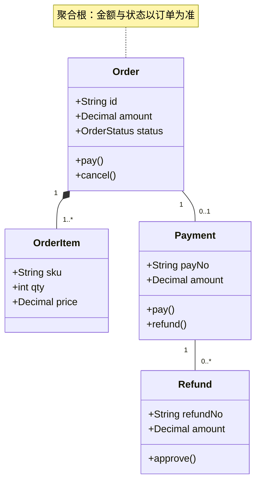

读图：`Order` 是聚合根，`OrderItem` 是组合关系（订单删除，明细一起删）；`Payment` 和 `Order` 是关联，不是组合；`Refund` 挂在支付单下。

**画法**

1. 从业务名词找实体，先画 5-7 个核心类。
2. 只画关键属性，不画数据库字段全集；方法只画业务行为。
3. 定关系：关联/聚合/组合/继承，标基数。
4. 用领域语言命名，不用表名/框架名。
5. 和 ER 图对照：类图有行为，ER 只有数据；两边实体名和关系要能对上。

**常见错误**

- 把数据库表直接画成类：字段全、方法无，这是 ER 图不是类图。
- getter/setter 占半张图，关键行为看不见。
- 关系箭头方向反，基数不标。
- 类图当表设计，开发照着画表，行为全丢。
- 一张图 30 个类，没有边界。

**企业取舍**

类图是给开发看的，不是给业务看的；业务评审用术语表 + 状态机。只画核心域，不画 DTO/VO/Controller。能自动生成就不手画；图要能指导代码，不是摆设。业务背景见 [`05-系统设计`](./05-系统设计.md) 二。

### 4.4 组件图

**用途**：表达可替换的软件单元及其接口：谁提供接口、谁消费接口、依赖方向是什么。

**何时画 / 何时不画**

- 画：微服务/插件化/多团队并行、需要定接口边界和版本兼容。
- 不画：单体内部、单团队小项目；模块结构图足够。

**元素**

| 元素 | 含义 | 画法 |
|---|---|---|
| 组件 | 可独立替换/部署的单元 | 方框，标组件名 |
| 提供接口 | 组件对外能力 | 棒棒糖符号（圆球+短线） |
| 消费接口 | 组件依赖的外部能力 | 插座符号（半圆弧） |
| 装配连接器 | 消费方插座接提供方棒棒糖 | 插座 → 棒棒糖连线 |
| 契约 | 入参/出参/错误码/版本 | 配套接口清单，不画在图里 |
| 同步/异步 | 调用方式 | 装配实线 / 事件依赖虚线 |

**最小样例**

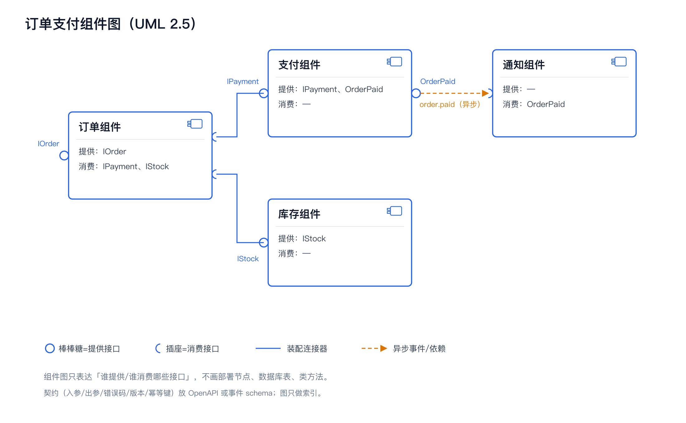

读图：**棒棒糖=提供接口**（支付组件提供 IPayment、库存组件提供 IStock、订单组件提供 IOrder）；**插座=消费接口**（订单组件右侧两个插座，消费 IPayment 和 IStock）；插座接到棒棒糖上就是装配连接器；橙色虚线是异步事件依赖（支付组件发布 order.paid，通知组件消费）。组件图只表达「谁提供/谁消费哪些接口」，不表达部署节点和数据库表；契约放 OpenAPI 或事件 schema，图只做索引。

**画法**

1. 按「可独立替换/部署」切组件，不按类切。
2. 每个组件写清提供哪些接口，接口名用动词+资源。
3. 标消费方和同步/异步；异步要标消息主题和幂等键。
4. 标版本兼容策略：新增字段兼容，删字段/改语义升版本。
5. 与接口清单一一对应，每个接口有 owner。

**常见错误**

- 棒棒糖和插座搞反：球是提供、弧是消费，方向反了接口契约就全错。
- 组件=类，图变成类图。
- 组件=数据库表，图变成 ER 图。
- 接口只写名字不写契约，开发还是靠猜。
- 循环依赖，说明组件边界没切好。
- 把部署节点画进组件图。

**企业取舍**

组件图适合多团队边界，不适合单团队内部。组件数量控制在 10 个以内；每个接口必须有 owner 和版本。图只做索引，契约放 OpenAPI/接口文档。业务背景见 [`05-系统设计`](./05-系统设计.md) 四。

### 4.5 时序图

**用途**：看一次请求/事务按时间经过谁、传什么、在哪分支、失败怎么返回。

**何时画 / 何时不画**

- 画：跨 3 个以上参与者、有异步/回调/重试/事务边界、需要评审关键路径。
- 不画：单模块内部调用、每个接口都画、纯 CRUD；用接口文档和异常清单。

**元素**

| 元素 | 含义 | 画法 |
|---|---|---|
| 参与者 | 人/服务/中间件 | 顶部方框，按调用顺序排列 |
| 生命线 | 参与者的时间线 | 垂直虚线 |
| 同步消息 | 请求/调用 | 实线箭头 |
| 异步消息 | 事件/回调 | 开放箭头 `-) ` |
| 返回 | 结果返回 | 虚线箭头 |
| 组合片段 | alt/opt/loop/par | 左上角标签 |
| 注释 | 幂等/超时/约束 | `Note over` |

**最小样例**

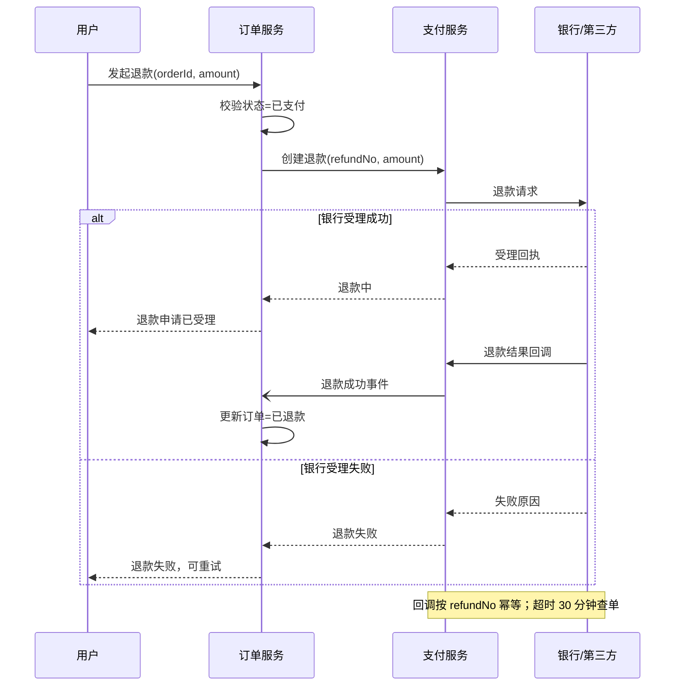

读图：竖线是参与者，实线箭头是同步请求，虚线箭头是返回，`-)` 开放箭头是异步消息（回调/事件），`alt/else` 是分支，`Note` 是约束。时间从上往下，不要用回环箭头表示重试——重试次数写进 `Note`。

**画法**

1. 定触发者和终点：谁发起、到哪算结束。
2. 按时间顺序列消息，格式「动词 + 参数」，只保留关键路径。
3. 标同步/异步/返回；异步回调单独一段。
4. 补分支和异常返回：失败、超时、重复回调。
5. 标事务边界、幂等键、超时时间；细节放异常清单。

**常见错误**

- 把每个 getter/内部调用都画出来，图比代码还长。
- 返回箭头画成请求，读者以为又调了一次。
- 没有失败分支，仿佛第三方永不超时。
- `Note` 写成长篇文档，图失去可读性。
- 参与者超过 6 个，应该拆图或先画架构。

**企业取舍**

一张图只画一条关键路径；异常细节放异常清单。时序图适合评审，不适合当 API 文档（用 OpenAPI）。涉及资金/权限/不可逆操作的分支必须画出来。业务背景见 [`05-系统设计`](./05-系统设计.md) 6.2。

### 4.6 部署图

**用途**：看软件跑到哪些节点、节点之间怎么连、网络/信任边界在哪、容量和单点在哪。

**何时画 / 何时不画**

- 画：上线前、多环境/多机房、等保/安全评审、故障演练、扩容。
- 不画：本地开发、单机脚本；部署脚本和 README 足够。

**元素**

| 元素 | 含义 | 画法 |
|---|---|---|
| 节点 | 服务器/容器/集群 | 三维框，`«device»`；执行环境 `«execution environment»` |
| 制品 | 部署到节点上的东西 | `«artifact»`，写 jar/镜像名 |
| 通信路径 | 节点之间怎么连 | 实线箭头，标协议+端口 |
| 数据库/中间件 | MySQL、Redis、MQ | 节点 `«device»` |
| 协议/端口 | HTTPS 443、JDBC 3306 | 箭头标签 |
| 单点/故障域 | 没有冗余的节点 | 红色标记 |

**最小样例**

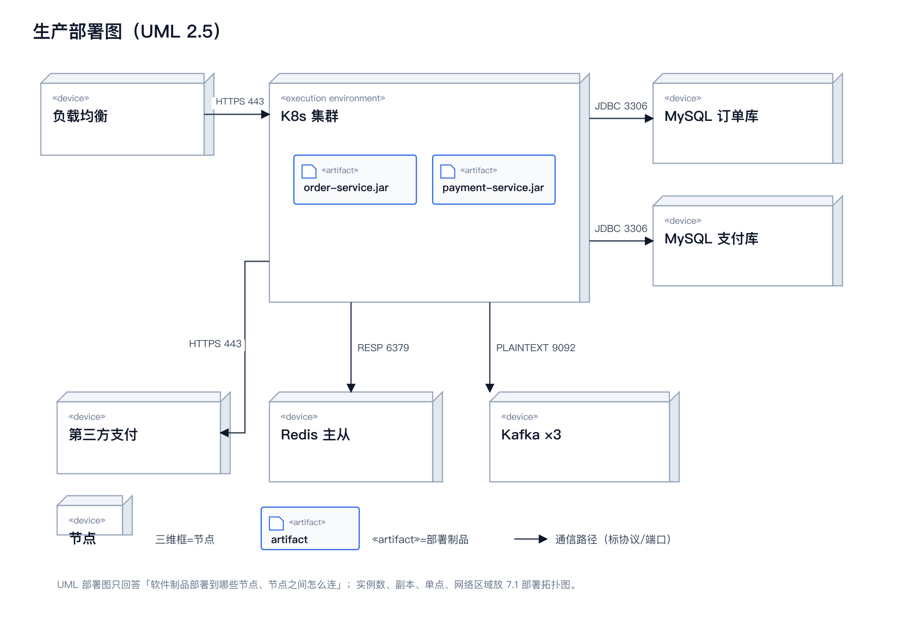

读图：三维框是节点（`«device»`），K8s 是执行环境，框里的 `«artifact»` 是部署的制品（order-service.jar、payment-service.jar），箭头标协议和端口（HTTPS 443 / JDBC 3306 / RESP 6379 / PLAINTEXT 9092）。UML 部署图只回答「制品部署到哪些节点、节点之间怎么连」；实例数、副本、网络区域、单点这些运维视角的东西归 7.1 部署拓扑图。

UML 部署图和运维拓扑图的分工：前者是设计交付物（对齐制品与节点），后者是运行视图（对齐实例数/副本/网络区域/单点）。不要把两者画成一张，评审对象不同。

**画法**

1. 先放节点：负载均衡、网关、应用集群、数据库、中间件，每个标 `«device»` 或执行环境。
2. 在节点里放制品：jar/镜像名，写清 `«artifact»`。
3. 连通信路径：标协议和端口（HTTPS 443、JDBC 3306）。
4. 涉及实例数、副本、网络区域时另画拓扑图（见 7.1），不要塞进部署图。
5. 与 CMDB/监控核对；生产现状图必须反映真实部署。

**常见错误**

- 把逻辑架构图当部署图：没有节点、没有实例数、没有网络区域。
- 不标副本数，看不出单点。
- 环境混在一张图：dev/staging/prod 画在一起，没人知道看哪张。
- 所有服务画在一个大框里，故障域不清。
- 图过期不更新，比没有图更危险。

**企业取舍**

生产环境单独一张；敏感系统标信任边界和数据流向。部署图随发布更新，过期就标「snapshot + 日期」。容量数据放表里，不塞进图。业务背景见 [`05-系统设计`](./05-系统设计.md) 8.3。

### 4.7 ER 图

**用途**：表达数据实体、关键属性、关系、基数；数据库设计的共识图。

**何时画 / 何时不画**

- 画：新库、核心表改造、多系统共享数据、数据迁移。
- 不画：单表加字段、纯查询报表；迁移脚本和数据字典足够。

**元素**

| 元素 | 含义 | 画法 |
|---|---|---|
| 实体 | 表/聚合 | 方框，单数名词 |
| 属性 | 字段 | `类型 名称 PK/FK/UK` |
| 关系 | 实体之间 | 线 + 基数 |
| 基数 | 1:1、1:N、M:N | `||--o{` 等 |
| 可选/必选 | 关系是否必须 | 内/外圈或文字 |
| 约束 | 唯一、非空、默认值 | 数据字典，不塞图里 |

**最小样例**

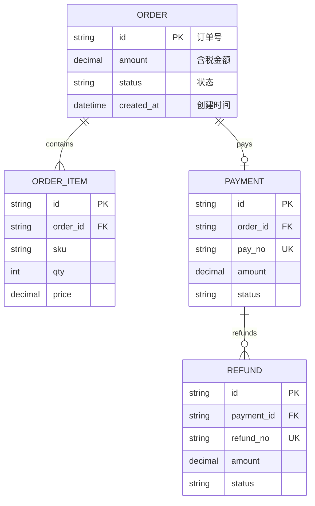

读图：`||--|{` 表示一个订单至少有一个订单项；`||--o|` 表示一个订单最多一个支付单；`PK/FK/UK` 标主键/外键/唯一键。

**画法**

1. 从业务对象找实体，先画核心 5-10 张表。
2. 定主键，再画关系与基数；M:N 检查是否需要中间表。
3. 标可选/必选：哪些关系可以为空。
4. 标唯一约束、状态字段、金额字段。
5. 与迁移脚本/数据字典对照，图和库必须一致。

**常见错误**

- 把 ER 当类图，画方法/行为。
- 不标基数，读者不知道一个订单能有几个支付单。
- 用中文当字段名，或者字段名和代码不一致。
- 忽略唯一约束，导致重复支付/重复退款。
- 多对多没有中间表，开发只能猜。
- 图与迁移脚本不一致，上线后才发现。

**企业取舍**

ER 图给开发/DBA 看，业务评审用术语表。只画核心 10-15 张表；全库图用工具生成，不手画。数据字典承载类型、默认值、脱敏、索引；图只表达关系。业务背景见 [`05-系统设计`](./05-系统设计.md) 5.2。

### 4.8 判定表

**用途**：把多条件组合和结果列全，避免 if-else 漏分支。

**何时画 / 何时不画**

- 画：条件 ≥2 且组合影响结果（折扣、费率、权限、风控、审批档位）。
- 不画：单条件判断、纯计算、条件之间完全独立；用 if 或规则表。

**元素**

| 元素 | 含义 | 画法 |
|---|---|---|
| 条件桩 | 有哪些条件 | 左上，逐行列 |
| 条件项 | 每个条件的取值 | 右上，Y/N/— |
| 动作桩 | 有哪些动作/结果 | 左下，逐行列 |
| 动作项 | 每列执行哪些动作 | 右下，Y/N |
| 规则列 | 一组条件 + 动作 | 一列 = 一条规则 |
| 合并 | 无关条件用「—」 | 合并后仍是完整规则 |

**最小样例**

| 条件 \ 规则 | R1 | R2 | R3 | R4 | R5 | R6 | R7 |
|---|---|---|---|---|---|---|---|
| 金额 ≤ 1000 | Y | N | N | N | N | N | N |
| 1000 < 金额 ≤ 5000 | — | Y | Y | N | N | N | N |
| 金额 > 5000 | — | — | — | Y | Y | Y | N |
| 风险评分 ≥ 80 | — | N | Y | — | Y | — | N |
| 黑名单 | N | N | N | N | N | Y | N |
| 自动通过 | Y | Y | N | N | N | N | N |
| 主管审批 | N | N | Y | N | Y | N | Y |
| 财务复核 | N | N | N | Y | Y | N | N |
| 总监审批 | N | N | N | N | Y | N | N |
| 拒绝 | N | N | N | N | N | Y | N |

读图：上半是条件，下半是动作，一列一条规则。R3 表示「1000-5000 + 高风险」需要主管审批；R4/R5 是大额必须财务复核，总监再叠一级；R6 表示黑名单直接拒绝，金额和风险不关心（—）；R7 是小金额兜底仍走主管，防止低风险也被漏放。七条规则覆盖三档金额、两档风险和黑名单，且任意两列都互斥。

**画法**

1. 列条件，每个条件取值互斥且完备。
2. 先按全组合列（2^n），再合并无关项；合并后检查是否覆盖原组合。
3. 每列写动作，检查同一列不能有两个冲突结果。
4. 检查规则完备：每个合法输入组合都能落到某一列。
5. 每列生成一条测试用例；规则变更时版本化。

**常见错误**

- 条件取值有遗漏，或者区间重叠。
- 用「—」掩盖必须判断的条件，导致规则交叉。
- 同一组合出现两个结果，代码只能靠顺序兜底。
- 只写正常路径，没有拒绝/异常列。
- 表和代码不一致，改规则只改代码不改表。

**企业取舍**

条件超过 4 个时先拆表（按子域/场景），不要一张表 64 列。判定表比决策树更适合审计和测试；条件少、层次浅时决策树更直观。表要能直接翻译成代码和用例。业务背景见 [`05-系统设计`](./05-系统设计.md) 6.3 和 [`07-系统测试`](./07-系统测试.md) 4.3。

### 4.9 状态迁移表

**用途**：把状态图的每条迁移写成可执行规格：当前状态、事件、目标、守卫、动作、谁。

**何时画 / 何时不画**

- 画：有状态对象、需要开发/测试/业务三方对齐；状态图之后必配。
- 不画：无状态对象、状态和迁移都很少且不会变。

**元素**

| 元素 | 含义 | 画法 |
|---|---|---|
| 当前状态 | 迁移起点 | 第一列 |
| 事件/动作 | 什么触发 | 第二列 |
| 目标状态 | 迁移终点 | 第三列 |
| 守卫 | 必须满足的条件 | 第四列 |
| 动作 | 副作用（记账/发消息/释放库存） | 第五列 |
| 谁 | 角色/系统 | 第六列 |
| 失败处理 | 拒绝/补偿/转人工 | 第七列 |

**最小样例**

| 当前 | 事件 | 目标 | 守卫 | 动作 | 谁 | 失败处理 |
|---|---|---|---|---|---|---|
| 待支付 | 支付成功 | 已支付 | 金额一致、未重复支付 | 记支付单、发事件 | 支付回调 | 金额不一致转人工 |
| 待支付 | 超时 30 分钟 | 已取消 | 未支付 | 释放库存 | 定时任务 | 重试 3 次 |
| 已支付 | 发货 | 已发货 | 有库存 | 记物流单 | 仓储 | 缺货转退款 |
| 已支付 | 申请退款 | 退款中 | 未发货 | 冻结金额 | 客服 | 已发货走退货 |
| 退款中 | 退款成功 | 已退款 | 银行回执成功 | 更新支付单 | 支付回调 | 失败回退已支付 |
| 退款中 | 退款失败 | 已支付 | 有失败原因 | 解冻金额 | 支付回调 | 转人工 |
| 已发货 | 确认收货 | 已完成 | 物流签收 | 结算 | 系统/用户 | — |
| 已完成 | 申请售后 | 售后中 | 7 天内 | 建售后单 | 客服 | 超期拒绝 |

读图：一行一条迁移；「守卫」决定能不能做，「动作」决定做完发生什么，「失败处理」决定异常怎么收。开发照着写 `switch`，测试照着列用例。

**画法**

1. 从状态图抄状态，逐状态列所有事件。
2. 填目标、守卫、动作、谁；没有动作就写「—」。
3. 标非法迁移：哪些事件在某个状态必须拒绝。
4. 标超时、重试、补偿、幂等。
5. 与代码枚举/接口返回值对照，表是唯一事实源。

**常见错误**

- 只写正常迁移，漏掉重复事件/超时/取消。
- 守卫写成「合法」「正确」，无法执行。
- 没有失败处理，异常时只能人工猜。
- 状态名和代码枚举不一致。
- 表更新了，状态图没更新；两处冲突。

**企业取舍**

表是唯一事实源，图是索引。表进版本库，变更走评审；测试按行生成用例。状态多时按子域拆表。业务背景见 [`05-系统设计`](./05-系统设计.md) 6.4。

## 五、测试图族

测试图只干一件事：把「测什么、测多少、先测哪」变成可执行的取舍。不是为了证明测试很专业。

### 5.1 状态迁移测试图/表

**用途**：保证每条迁移、每个守卫、每个非法事件都被覆盖，尤其是资金/权限/不可逆操作。

**何时画 / 何时不画**

- 画：有状态机、支付/订单/审批/退款；状态少但迁移多时尤其需要。
- 不画：无状态接口、纯查询；等价类和边界值足够。

**元素**

| 元素 | 含义 | 画法 |
|---|---|---|
| 迁移编号 | 对应迁移表的一行 | T-01… |
| 正常用例 | 合法事件 + 守卫通过 | 每行至少一条 |
| 守卫用例 | 守卫边界（刚好通过/不通过） | 每个守卫两条 |
| 非法用例 | 该状态不允许的事件 | 每个状态至少一条 |
| 异常用例 | 超时/重复/并发/补偿 | 按风险补 |
| 预期 | 目标状态 + 副作用 + 返回 | 可断言 |

**最小样例**

| 用例 | 当前 | 事件 | 守卫 | 预期 | 类型 |
|---|---|---|---|---|---|
| TC-01 | 待支付 | 支付成功 | 金额一致 | 已支付，记支付单 | 正常 |
| TC-02 | 待支付 | 支付成功 | 金额不一致 | 拒绝，保持待支付 | 守卫 |
| TC-03 | 已支付 | 支付成功 | 重复回调 | 幂等，仍为已支付 | 异常 |
| TC-04 | 待支付 | 超时 30 分钟 | 未支付 | 已取消，释放库存 | 超时 |
| TC-05 | 已支付 | 发货 | 有库存 | 已发货 | 正常 |
| TC-06 | 已支付 | 发货 | 无库存 | 转退款/失败 | 异常 |
| TC-07 | 已支付 | 申请退款 | 未发货 | 退款中 | 正常 |
| TC-08 | 已发货 | 申请退款 | — | 拒绝，走退货 | 非法 |
| TC-09 | 已退款 | 支付成功 | — | 拒绝，状态不变 | 非法 |
| TC-10 | 退款中 | 退款失败 | — | 回退已支付 | 补偿 |

读图：TC-01/02 是同一迁移的守卫正反例；TC-03 是重复事件；TC-08/09 是非法迁移；TC-10 是补偿。每行都能直接变成自动化用例。

**画法**

1. 从迁移表逐行抄，先保证每条迁移至少一个正常用例。
2. 每个守卫补边界：刚好通过、刚好不通过。
3. 每个状态补一个非法事件，验证「拒绝」而不是「静默接受」。
4. 补超时、重复、并发、补偿；标自动化层级（单测/接口/端到端）。
5. 覆盖率按「迁移 + 守卫 + 非法事件」算，不按代码行算。

**常见错误**

- 只测正常路径，非法迁移从不测。
- 不测重复事件，幂等靠运气。
- 不测超时，定时任务上线才发现。
- 用例和迁移表脱节，表改了用例没改。
- 追求 100% 覆盖，却没覆盖资金/权限链路。

**企业取舍**

状态机复杂时用模型测试/属性测试；简单流程用表。不要追求 100% 覆盖，先覆盖资金、权限、不可逆迁移。用例表进版本库，和迁移表同源。业务背景见 [`07-系统测试`](./07-系统测试.md) 四。

### 5.2 因果图

**用途**：从「原因组合」推导测试用例，适合输入条件多、输出由组合决定的场景。

**何时画 / 何时不画**

- 画：条件 3-5 个、组合影响结果、判定表不够直观、需要向非测试解释组合。
- 不画：条件独立、单条件判断、条件超过 6 个（先拆或改用 pairwise）。

**元素**

| 元素 | 含义 | 画法 |
|---|---|---|
| 原因 | 输入条件 | 左侧节点，C1/C2… |
| 结果 | 输出/动作 | 右侧节点，E1/E2… |
| 中间节点 | 组合逻辑 | 与/或节点 |
| 约束 | 互斥/包含/唯一/要求 | 旁边标注 E/I/O/R |
| 判定表 | 因果图的落地形式 | 图转表，每列一条用例 |

**最小样例**

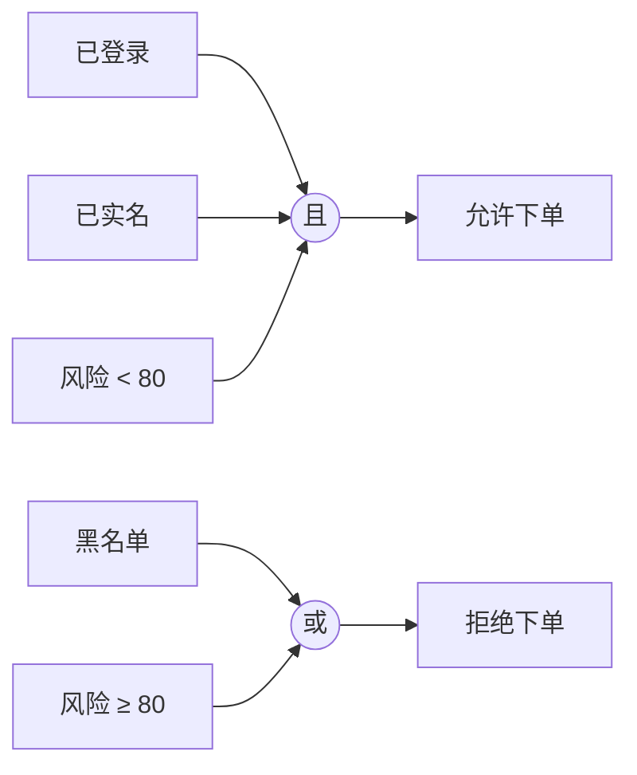

约束（图外标注，避免线太多；约束标在两个「原因」之间）：

| 约束 | 含义 | 本例 |
|---|---|---|
| E（互斥） | 两个原因最多有一个为 1（不能同时为 1） | 已登录 与 黑名单 互斥 |
| I（包含） | 两个原因至少有一个为 1（可同时为 1） | 已实名 或 已绑定手机 至少一项 |
| O（唯一） | 多个原因中恰好有一个为 1 | 风险档位只能落一档 |
| R（要求） | 一个为 1 要求另一个必须为 1 | 允许下单 要求 已实名 |

读图：因果图表达「哪些条件组合导致哪个结果」，最终要转成判定表；图本身不直接当用例。

**画法**

1. 列原因和结果，原因必须能独立取值。
2. 标约束：互斥、包含、唯一、要求；约束漏了，组合会爆炸或漏测。
3. 画因果网络，中间节点只保留必要的与/或。
4. 转判定表，每列一条用例；补边界值。
5. 条件超过 5 个时改用正交表/pairwise，不要硬画。

**常见错误**

- 把因果图和流程图混用：因果图不表达时间顺序。
- 约束漏标，导致出现不可能的组合。
- 原因不可独立取值，比如「金额」和「折扣」互相依赖。
- 图转表时丢组合，最后还是拍脑袋。
- 过度形式化，业务方看不懂。

**企业取舍**

因果图是判定表的过渡工具，最终落判定表。业务评审不用因果图；测试内部用它保证组合不漏。条件多时用 pairwise，不要追求全组合。

### 5.3 测试分层图

**用途**：决定不同层次测什么、写多少、谁来维护；避免「全压端到端」。

**何时画 / 何时不画**

- 画：建测试体系、自动化选型、团队分工、版本测试方案。
- 不画：一次性脚本、没有自动化诉求的小项目。

**元素**

| 元素 | 含义 | 画法 |
|---|---|---|
| 层次 | 单元/接口/契约/端到端/探索 | 从下到上 |
| 覆盖对象 | 每层测什么 | 标签 |
| 数量级 | 用例数/占比 | 标签 |
| 运行时间 | 反馈速度 | 标签 |
| 触发时机 | 提交/合并/发布 | 标签 |
| owner | 谁维护 | 标签 |

**最小样例**

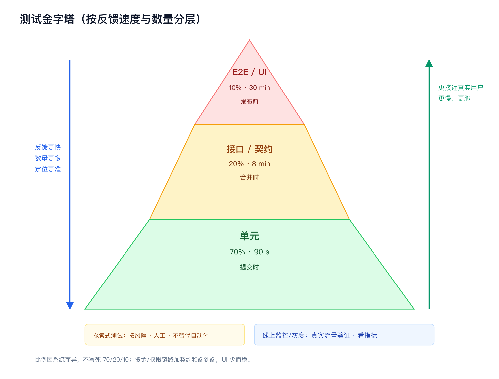

读图：越往下反馈越快、数量越多、定位越准；越往上越接近真实用户，但更慢、更脆、维护贵。左下的两块「探索式测试」和「线上监控/灰度」是金字塔之外的人工与线上验证，不替代自动化。比例是示例（70/20/10），不同系统差异很大，不要写死。

注意两种反模式：**冰淇淋筒**（端到端太多、单元太少，反馈慢、维护贵）和**沙漏**（单元和端到端厚、中间的接口/契约层缺失，服务一升级就断）。分层按「失败定位成本」压，不按工具压。

**画法**

1. 按「失败定位成本」分层：越难定位的，越往下压。
2. 定每层测什么：单元测规则，接口测契约，端到端测关键路径。
3. 定数量级和运行时间：提交 1 分钟内，合并 10 分钟内，发布前 30 分钟内。
4. 定 owner 和触发时机。
5. 定期看反模式：端到端过多（冰淇淋筒）、单元只测 getter、契约缺失。

**常见错误**

- 端到端过多，反馈慢、维护贵。
- 单元测试只测 getter/setter，没有业务规则。
- 契约测试缺失，服务一升级就断。
- 按工具分层，而不是按风险和定位成本分层。
- 把数量比例写死，不看系统类型。

**企业取舍**

分层比例因系统而异；资金/权限链路加契约和端到端；UI 少而稳；探索式测试不可省。图只表达取舍，不表达工具。业务背景见 [`07-系统测试`](./07-系统测试.md) 三。

### 5.4 帕累托图

**用途**：找「20% 的原因造成 80% 的问题」，排修复优先级。

**何时画 / 何时不画**

- 画：缺陷/故障/投诉成堆、需要说服人先修哪类、月度质量复盘。
- 不画：样本少于 20 条、分类口径不清、只看单条故障。

**元素**

| 元素 | 含义 | 画法 |
|---|---|---|
| 分类轴 | 缺陷类型/模块/根因 | 降序排列 |
| 柱 | 频次或成本 | 左轴 |
| 累计线 | 累计占比 | 右轴/同一百分比轴 |
| 80% 线 | 参考阈值 | 水平虚线 |
| 样本量/时间窗 | 数据口径 | 标题或脚注 |

**最小样例**

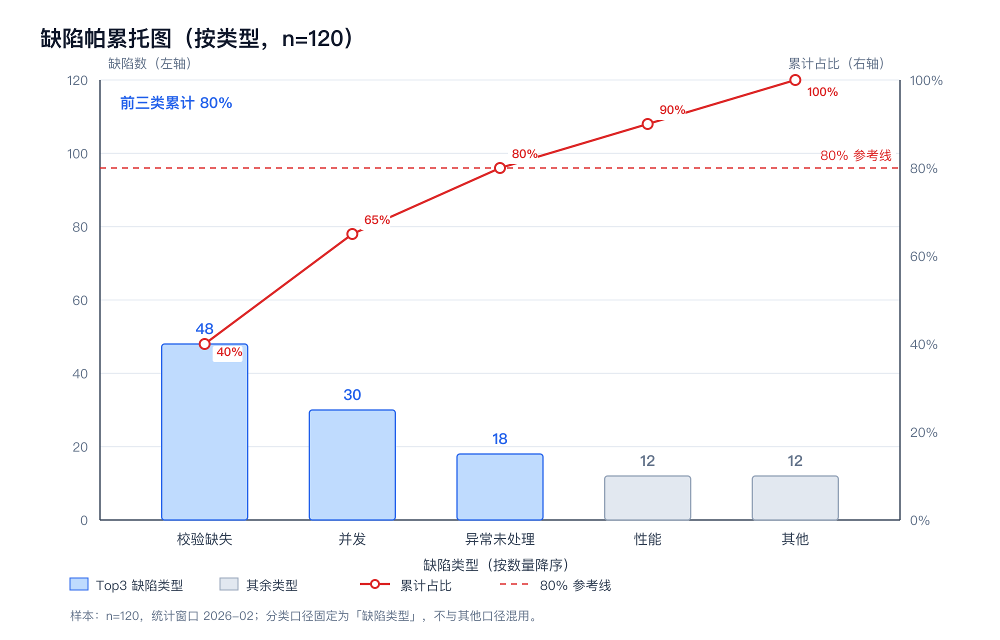

读图：柱是每类缺陷数（左轴，上限=样本总量 n=120），红色折线是累计占比（右轴 0-100%），红色虚线是 80% 参考线。第一个点 40% 正好落在第一根柱顶上——左轴上限取总量时，累计线首点与首柱顶对齐，这是标准帕累托的画法。前三类累计 80%，是本期优先修的范围。

**画法**

1. 定分类口径：按模块、类型还是根因；一张图只能一种口径。
2. 统计频次或成本，降序排列。
3. 算累计占比，画柱 + 累计线。
4. 标 80% 线和 Top3；写行动项和 owner。
5. 每月/每季度重算，看分类是否变化。

**常见错误**

- 分类口径混用：一会儿按模块，一会儿按根因。
- 样本太小，结论不可靠。
- 累计线首点与首柱顶不对齐：左轴上限要取总量，首点才落在首柱顶上。
- 只按数量不按成本，修了一堆低价值缺陷。
- 不看时间窗，把半年前的数据和本周混在一起。
- 把帕累托当根因分析：它只告诉你「哪类多」，不告诉你「为什么」。

**企业取舍**

用成本加权更能反映业务影响；Top3 之外的长尾用自动化/防御性设计。帕累托是排序工具，根因分析用鱼骨/5 Why。业务背景见 [`07-系统测试`](./07-系统测试.md) 6.4。

## 六、项目管理图族

项目管理图只干一件事：让范围、时间、资源、风险可见，并支撑取舍。图不是承诺，是当前假设。

### 6.1 WBS

**用途**：把交付物拆到可估算、可分配、可验收的工作包。

**何时画 / 何时不画**

- 画：项目启动、排期、预算、跨团队分工。
- 不画：两周以内的迭代、个人任务清单；看板足够。

**元素**

| 元素 | 含义 | 画法 |
|---|---|---|
| 项目/阶段 | 根/一级节点 | 方框，交付物名词 |
| 工作包 | 末级可交付物 | 8-80 小时，能验收 |
| 活动 | 工作包内的步骤 | 可省略，避免过细 |
| 负责人 | 谁负责交付 | 标签/表 |
| 估算 | 人时/人日 | 叶子节点 |
| 依赖 | 工作包之间 | 箭头/表 |
| WBS 码 | 唯一编号 | 1.1、1.2… |

**最小样例**

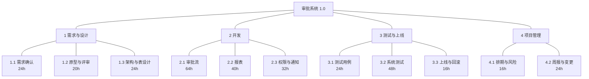

读图：根=项目，第二层=可交付物，叶子=工作包；叶子带估算、能验收。连接线用无向线（`---`），WBS 是「组成」结构，不是依赖关系——依赖关系放甘特/关键路径图里画。样例只列部分工作包，用来看结构，不是全量 168 人日；实际项目按 8/80 规则继续拆。

**画法**

1. 按交付物拆，不按部门/角色拆。
2. 每层 3-7 个分支；末级工作包 8-80 小时。
3. 给每个工作包写验收标准、估算、负责人。
4. 标依赖，编 WBS 码；检查 100% 原则（子节点之和=父节点）。
5. 让执行人确认估算和假设。

**常见错误**

- 按「前端/后端/测试」拆，这是角色，不是交付物。
- 拆到「写代码」「开会」这种活动，无法验收。
- 工作包太大，估算误差 ±100%。
- 没有验收标准，做完算不算完靠吵。
- WBS 和排期两张皮，排期里的任务在 WBS 里找不到。

**企业取舍**

WBS 是范围基线，变更要走流程。小项目用清单替代；大项目用 WBS + 估算表。不要拆到个人任务，那是看板的事。业务背景见 [`09-项目管理`](./09-项目管理.md) 3.1。

### 6.2 甘特图

**用途**：展示任务时间、重叠、里程碑、资源占用；对外沟通排期。

**何时画 / 何时不画**

- 画：需要看时间线和依赖、跨团队协调、对外承诺里程碑。
- 不画：短迭代、任务频繁变动的探索期；看板更合适。

**元素**

| 元素 | 含义 | 画法 |
|---|---|---|
| 任务 | 工作包/活动 | 左侧列表，右侧条形 |
| 开始/结束 | 日期 | 条形两端 |
| 持续时间 | 工期 | 条形长度 |
| 依赖 | 前置关系 | 箭头 |
| 里程碑 | 关键节点 | 菱形 |
| 负责人 | 谁做 | 标签/颜色 |
| 关键路径 | 决定工期的链 | 高亮 |

**最小样例**

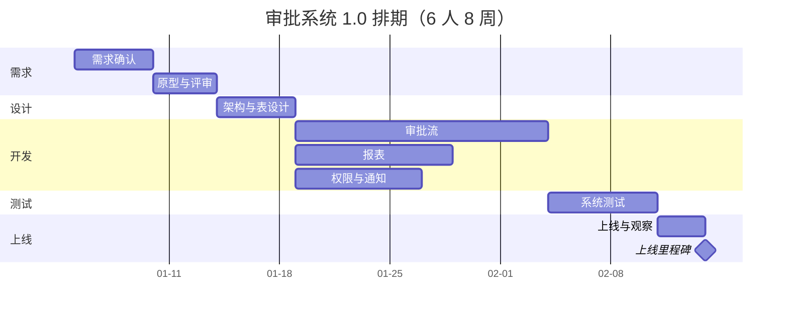

读图：横条是任务，`after` 是前置依赖，菱形是里程碑。关键路径是「需求确认 → 原型评审 → 设计 → 审批流 → 系统测试 → 上线」，共 40 个工作日。

**画法**

1. 从 WBS 取工作包，定工期和依赖。
2. 排资源，标负责人/投入比例；兼职按可用人日折算。
3. 标里程碑和关键路径，高亮。
4. 缓冲放在项目末尾，不藏在每个任务里。
5. 每周更新「计划 vs 实际」，偏差写原因。

**常见错误**

- 任务粒度太细，每天一行，图比表还长。
- 依赖全是「完成-开始」，不考虑并行和 lag。
- 缓冲藏进任务，看起来永远在加时。
- 不给负责人，谁做靠猜。
- 计划从不更新，甘特变成「历史承诺」。
- 把甘特当承诺，而不是当前假设。

**企业取舍**

甘特给管理层看，看板给团队用。超过 50 行拆成里程碑图；关键路径单独一张。日期用范围/置信度，不用单点承诺。业务背景见 [`09-项目管理`](./09-项目管理.md) 4。

### 6.3 关键路径网络图

**用途**：找决定总工期的任务链，判断「压缩哪里才有用」。

**何时画 / 何时不画**

- 画：任务依赖复杂、需要赶工期、资源冲突、多项目并行。
- 不画：线性项目、任务都能并行、工期由外部固定。

**元素**

| 元素 | 含义 | 画法 |
|---|---|---|
| 节点 | 任务 + 工期 | 方框，`A 需求 5d` |
| 箭头 | 前置依赖 | 单向箭头 |
| 最早开始/最晚开始 | 排期窗口 | 表或节点标签 |
| 总浮动 TF | 最晚-最早 | 表 |
| 关键路径 | TF=0 的链 | 高亮 |
| 资源 | 谁做、是否冲突 | 标签 |

**最小样例**

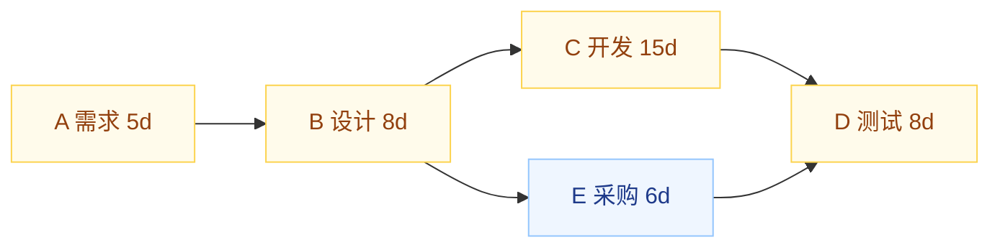

读图：节点=任务+工期，箭头=前置依赖；最长路径 A→B→C→D = 5+8+15+8 = **36 个工作日**，是关键路径（黄色高亮，TF=0）；E 只有 6 天，接在 B 后、D 前，浮动 = 9 天，可以错峰排。

正推/逆推（单位：工作日）：

| 任务 | 工期 | ES | EF | LS | LF | TF | 关键 |
|---|---|---|---|---|---|---|---|
| A 需求 | 5 | 0 | 5 | 0 | 5 | 0 | 是 |
| B 设计 | 8 | 5 | 13 | 5 | 13 | 0 | 是 |
| E 采购 | 6 | 13 | 19 | 22 | 28 | 9 | 否 |
| C 开发 | 15 | 13 | 28 | 13 | 28 | 0 | 是 |
| D 测试 | 8 | 28 | 36 | 28 | 36 | 0 | 是 |

正推 `EF = ES + 工期`，逆推 `LS = LF - 工期`，总浮动 `TF = LS - ES = LF - EF`。TF=0 的任务组成关键路径，压缩它们才影响总工期。

**画法**

1. 列任务和工期，标前置依赖。
2. 正推最早开始，逆推最晚开始，算总浮动。
3. 浮动=0 的链就是关键路径，高亮。
4. 标可压缩任务（加人/并行/外包）和不可压缩任务。
5. 检查资源冲突；每周用实际完成日期重算。

**常见错误**

- 把最长任务当关键路径，忽略依赖。
- 不标浮动，所有任务都当成关键。
- 压缩非关键任务，工期不变。
- 资源冲突没算进去，关键路径排了同一个人两次。
- 只算一次，进度一偏链就换了。

**企业取舍**

关键路径会随实际变化，每周重算。赶工优先加资源/并行，不盲目加班；关键链法可以加项目缓冲，但别把缓冲当任务。业务背景见 [`09-项目管理`](./09-项目管理.md) 4.1。

### 6.4 风险矩阵

**用途**：按概率×影响排风险，决定谁先处理、怎么处理。

**何时画 / 何时不画**

- 画：项目启动、月度复盘、重大变更前、多项目组合排序。
- 不画：风险少于 5 条、单点问题已经明确；用风险清单。

**元素**

| 元素 | 含义 | 画法 |
|---|---|---|
| 概率 | 发生的可能性 | 横轴，低→高 |
| 影响 | 对范围/时间/成本/质量的影响 | 纵轴，低→高 |
| 风险点 | 一条具体风险 | 散点，写事件+影响 |
| 等级 | 低/中/高/极高 | 按 1-4/5-9/10-14/15-25 分档 |
| 应对 | 规避/转移/减轻/接受 | 风险登记表 |
| 触发信号 | 什么情况说明要发生了 | 登记表 |
| owner/截止日 | 谁负责 | 登记表 |

**最小样例**

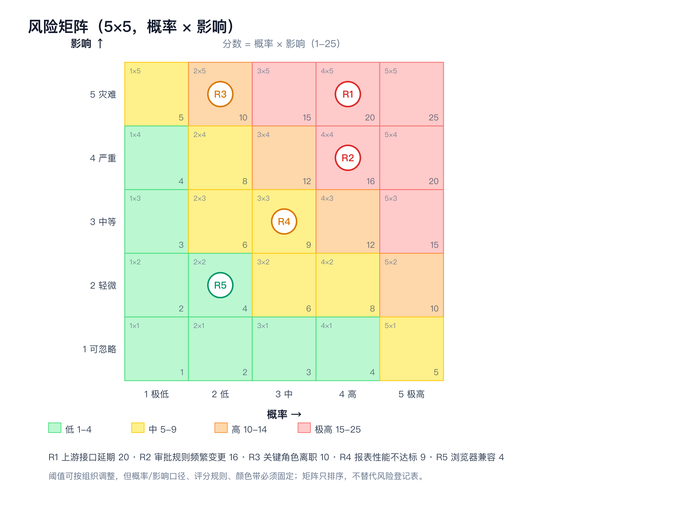

配套风险登记表（矩阵只排序，明细进登记表）：

| 编号 | 风险 | 概率 | 影响 | 分数 | 等级 | 应对 | owner |
|---|---|---|---|---|---|---|---|
| R1 | 上游接口延期 | 4 | 5 | 20 | 极高 | 规避：提前锁接口契约+桩 | 架构 |
| R2 | 审批规则频繁变更 | 4 | 4 | 16 | 极高 | 减轻：规则外置成配置 | 后端 |
| R3 | 关键角色离职 | 2 | 5 | 10 | 高 | 转移/减轻：文档+备份 owner | PM |
| R4 | 报表性能不达标 | 3 | 3 | 9 | 中 | 减轻：预聚合+压测 | 后端 |
| R5 | 浏览器兼容 | 2 | 2 | 4 | 低 | 接受：列兼容清单 | 前端 |

读图：分数 = 概率 × 影响（1-25），按 1-4 低 / 5-9 中 / 10-14 高 / 15-25 极高分四档（阈值可按组织调整，但概率/影响口径、评分规则、颜色带必须固定）。R1（20）、R2（16）落右上「立即处理」；R3（10）是「低概率高影响」重点监控，要有预案；R5（4）接受即可。散点标签写「事件 + 影响」，不要只写「接口风险」。

**画法**

1. 定概率/影响标尺（1-5 或高/中/低），写清口径。
2. 列风险，描述成「事件 + 影响 + 时间窗」。
3. 打分，画矩阵，定红/黄/绿阈值。
4. 每条风险写应对策略、触发信号、owner、截止日。
5. 每月重评，关闭/升级/新增。

**常见错误**

- 只画矩阵不写应对，图变成装饰。
- 概率影响拍脑袋，没有历史数据/专家依据。
- 风险描述太笼统：「接口风险」到底是什么。
- 没有 owner，风险永远没人管。
- 把问题当风险：已经发生的叫问题，未来可能发生的才叫风险。
- 矩阵从不更新。

**企业取舍**

矩阵是排序工具，不是解决方案。Top5 进周会；高风险要有预案和触发条件；接受的风险也要记录。业务背景见 [`09-项目管理`](./09-项目管理.md) 五。

### 6.5 燃尽图

**用途**：看剩余工作量随时间的变化，判断能否按期完成。

**何时画 / 何时不画**

- 画：迭代/项目周期固定、工作量可估算、范围相对稳定。
- 不画：范围频繁变动、工作量无法估算；用累积流。

**元素**

| 元素 | 含义 | 画法 |
|---|---|---|
| 时间轴 | 迭代/项目周期 | 横轴 |
| 剩余工作量 | 人日/故事点 | 纵轴 |
| 理想线 | 均速消耗 | 直线 |
| 实际线 | 每天/每周实际剩余 | 折线 |
| 范围变更 | 总量变化 | 标注/台阶 |
| 异常点 | 骤降/骤升 | 注释原因 |

**最小样例**

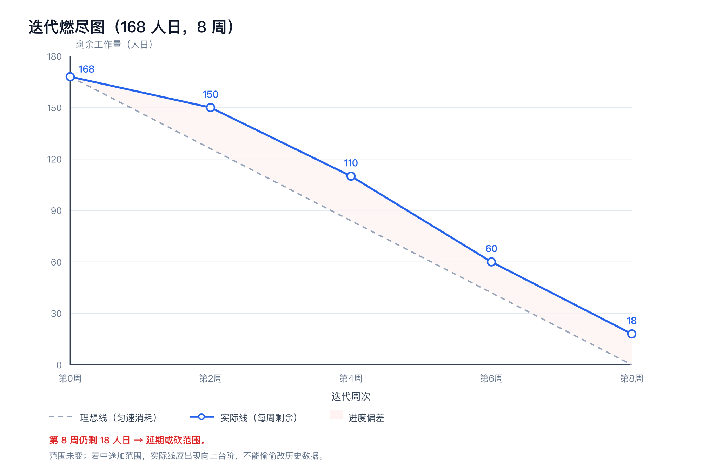

读图：灰色虚线是理想线（168 人日 ÷ 8 周 = 每周 21 人日），蓝色折线是实际剩余，两者之间的红色区域是进度偏差。实际线前慢后快，说明前期有阻塞，最后靠赶工也没能清零——第 8 周仍剩 18 人日，需要延期或砍范围。中途加范围时实际线会出现向上的台阶，不能偷偷改历史数据让图变好看。

**画法**

1. 定工作量单位（人日/故事点），中途不改。
2. 每天/每周更新剩余，画理想线。
3. 范围变更单独标出来，不要偷偷加进总量。
4. 看趋势，不看单点；连续 3 个点偏离就分析原因。
5. 异常时写原因和行动，不要改历史数据。

**常见错误**

- 中途改单位，曲线失去意义。
- 范围变了不标，实际线永远贴理想线。
- 只看今天不看趋势，最后一周才发现完不成。
- 把燃尽当绩效考核，团队开始造假。
- 实际线永远完美，说明数据被修饰过。

**企业取舍**

燃尽适合固定范围；范围可变用累积流。燃尽不预测交付日期，只暴露问题；团队自己更新，管理层看趋势。业务背景见 [`09-项目管理`](./09-项目管理.md) 8.1。

### 6.6 累积流图

**用途**：看在制品（WIP）、流动效率、瓶颈；适合持续交付/看板。

**何时画 / 何时不画**

- 画：需求持续流入、团队并行多、需要找瓶颈、看板管理。
- 不画：固定范围的一次性项目、任务少于 20 条。

**元素**

| 元素 | 含义 | 画法 |
|---|---|---|
| 时间轴 | 周/天 | 横轴 |
| 状态带 | 待办/开发/测试/完成 | 堆叠面积 |
| WIP | 在制品数量 | 各状态带宽度 |
| 周期时间 | 从开始到完成 | 计算/标注 |
| 吞吐量 | 每周完成数 | 计算/标注 |
| 瓶颈 | 堆积最宽的带 | 标注 |

**最小样例**

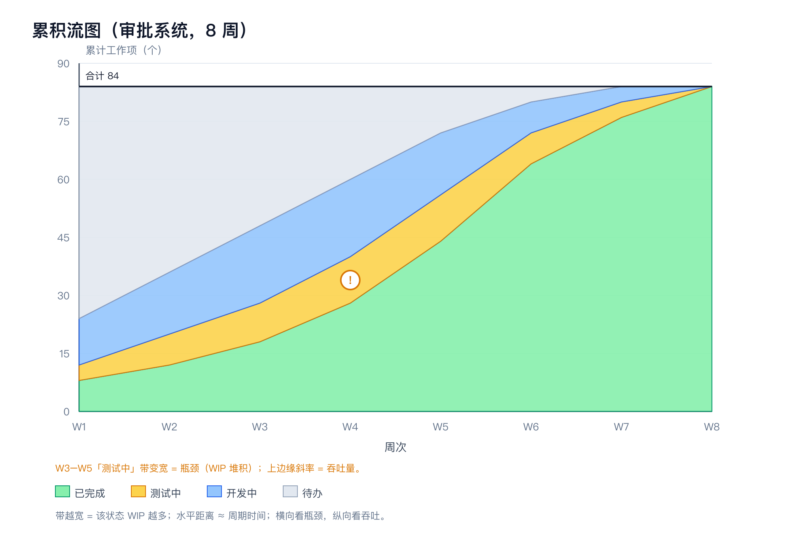

配套数据：

| 周 | 待办 | 开发中 | 测试中 | 已完成 | 合计 |
|---|---|---|---|---|---|
| W1 | 60 | 12 | 4 | 8 | 84 |
| W2 | 48 | 16 | 8 | 12 | 84 |
| W3 | 36 | 20 | 10 | 18 | 84 |
| W4 | 24 | 20 | 12 | 28 | 84 |
| W5 | 12 | 16 | 12 | 44 | 84 |
| W6 | 4 | 8 | 8 | 64 | 84 |
| W7 | 0 | 4 | 4 | 76 | 84 |
| W8 | 0 | 0 | 0 | 84 | 84 |

读图：四条带从下往上依次是已完成/测试中/开发中/待办；上边缘合计恒为 84，说明范围未变。W3–W5「测试中」带变宽（WIP 堆到 12，图上标了 `!`），测试是瓶颈；带的水平宽度约等于周期时间，上边缘斜率是吞吐量。W7 后开发先清空，测试才慢慢消化。

**画法**

1. 定状态列，和看板列一一对应，不超过 6 个。
2. 每周同一时间统计各状态数量，保证口径一致。
3. 画堆叠面积图；看带宽变化，不看单周总量。
4. 算周期时间和吞吐量；WIP 膨胀处就是瓶颈。
5. 调 WIP 限制/加测试资源，再看下一周期。

**常见错误**

- 状态定义不清：「开发中」包括哪些。
- 把「完成」当「上线」，口径不一致。
- 不看带宽只看总量，看不出瓶颈。
- WIP 无上限，需求一直往里灌。
- 统计口径每周变，图不可比。

**企业取舍**

累积流比燃尽更适合运维/持续交付。状态列和看板一致；每周同一时间统计；和周期时间/吞吐量一起看。业务背景见 [`09-项目管理`](./09-项目管理.md) 8.1。

## 七、运维图族

运维图只干一件事：让发布、回滚、故障处理可执行、可复盘。图必须和真实环境一致，过期比没有更危险。

### 7.1 部署拓扑图

**用途**：看清生产环境真实节点、网络区域、流量路径、单点；和设计阶段的部署图不同，这张必须是「现状」。

**何时画 / 何时不画**

- 画：上线前、故障演练、等保、扩容、机房迁移。
- 不画：本地开发、一次性脚本；README 足够。

**元素**

| 元素 | 含义 | 画法 |
|---|---|---|
| 区域 | 公网/DMZ/内网 | 虚线框 |
| 节点 | 真实服务器/集群 | 方框，标实例数/规格 |
| 负载均衡 | LB/网关 | 方框 |
| 数据存储 | DB/缓存/对象存储 | 圆柱 |
| 消息 | MQ/事件总线 | 队列形状 |
| 端口/协议 | 真实端口 | 箭头标签 |
| 监控点 | 指标/日志/追踪 | 图标/标签 |
| 单点 | 无冗余节点 | 红色标记 |

**最小样例**

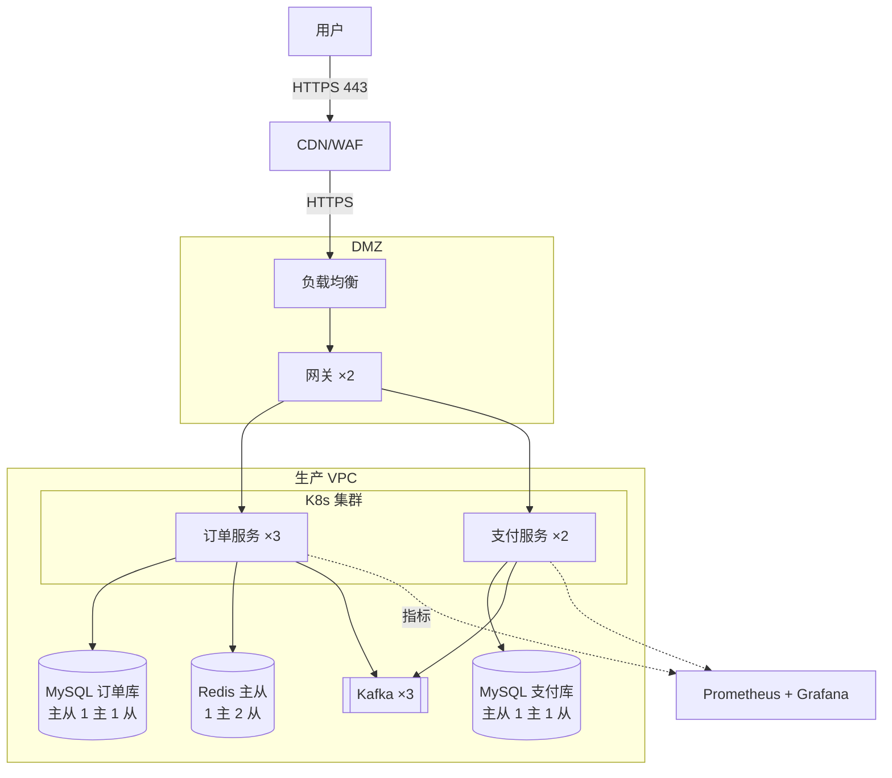

读图：先看区域，再看实例数和数据流向，最后看监控点。生产拓扑要标真实实例数/端口/单点；这张图是故障时第一张要看的图。

**画法**

1. 按网络区域画：公网、DMZ、生产 VPC。
2. 放真实节点和实例数，标规格/副本。
3. 标端口/协议和数据流向。
4. 标单点、故障域、监控/告警。
5. 每月和 CMDB/云控制台核对，过期就更新或标 snapshot。

**常见错误**

- 画成逻辑架构图，没有节点/实例/区域。
- 实例数不标，看不出单点。
- 环境混画：dev/staging/prod 一张图。
- 不标网络边界，安全评审过不了。
- 把 K8s 内部所有 Pod 画出来，图变成清单。
- 过期不更新，故障时按错图排查。

**企业取舍**

一张生产拓扑 + 一张环境差异表。敏感系统标数据流向和信任边界。拓扑图能从 CMDB 生成最好；不能生成就每月人工核对。业务背景见 [`08-系统部署与维护`](./08-系统部署与维护.md) 二。

### 7.2 发布/回滚流程图

**用途**：把「什么条件发、发到哪一步、什么条件回滚、谁拍板」写成可执行路径。

**何时画 / 何时不画**

- 画：每次生产发布、灰度、热修、重大配置变更。
- 不画：一次性脚本、无状态本地工具；发布单足够。

**元素**

| 元素 | 含义 | 画法 |
|---|---|---|
| 开始/结束 | 发布起点/终点 | 胶囊 |
| 检查项 | 发布前检查单 | 方框 |
| 发布步骤 | 灰度批次/部署 | 方框 |
| 观察窗口 | 看多久 | 标签 |
| 判断 | 指标是否达标 | 菱形 |
| 回滚 | 回滚动作 | 方框/反向箭头 |
| 拍板人 | 谁决定继续/回滚 | 标签 |
| 通知 | 通知谁 | 标签 |

**最小样例**

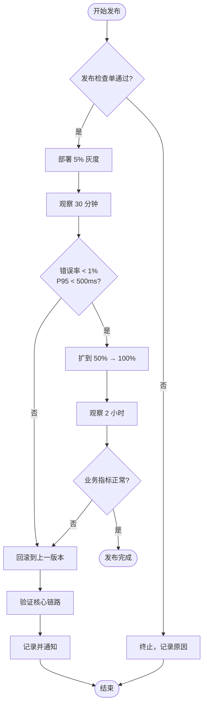

读图：发布前检查 → 5% 灰度 → 观察 → 扩量 → 观察 → 完成；发布后任一判断不达标走回滚，发布前检查不过则终止。阈值是示例，按系统定；拍板人写在发布单里。

**画法**

1. 列发布前检查：测试结论、变更单、回滚包、值班人。
2. 定灰度批次和观察窗口（5%→50%→100%）。
3. 定回滚阈值：错误率、P95、业务指标、持续时间。
4. 定拍板人和通知对象。
5. 定回滚步骤和数据兼容策略；演练一次再上线。

**常见错误**

- 没有回滚条件，出事靠临场发挥。
- 阈值拍脑袋，没有基线。
- 回滚步骤没人验证，真回滚时失败。
- 数据库变更不可逆，回滚变成灾难。
- 发布和回滚不是同一套脚本。
- 没有通知，业务方不知道。

**企业取舍**

图要短（<15 节点），细节放发布单。回滚阈值写具体数字；发布窗口避开业务高峰；热修也走简化版流程。业务背景见 [`08-系统部署与维护`](./08-系统部署与维护.md) 三。

### 7.3 回滚时序图

**用途**：明确回滚时各系统按什么顺序做什么，尤其是数据/缓存/消息/配置的补偿。

**何时画 / 何时不画**

- 画：有数据库迁移、缓存、消息、第三方回调的发布；跨团队系统。
- 不画：无状态服务、纯前端静态资源；流程图足够。

**元素**

| 元素 | 含义 | 画法 |
|---|---|---|
| 参与者 | 发布平台/应用/DB/缓存/MQ/网关/监控 | 顶部方框 |
| 触发 | 什么条件回滚 | 第一条消息 |
| 顺序 | 先流量、再应用、再数据 | 从上到下 |
| 补偿 | 数据/缓存/消息的补偿动作 | 消息 + Note |
| 验证 | 回滚后怎么确认 | 消息 |
| 通知/记录 | 谁通知、记什么 | 末尾 |

**最小样例**

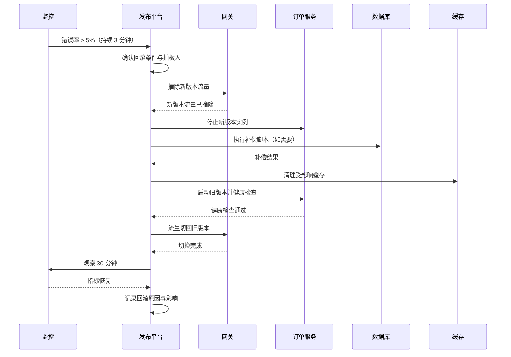

读图：先摘流量、停新版本，再补偿数据/缓存，起旧版本并验证，最后切回流量。顺序不能反：新版本还在写就回滚数据库，会丢数据，或者让新旧版本读到不兼容的结构。

**画法**

1. 定触发条件和拍板人。
2. 按依赖倒序排：流量 → 应用 → 数据 → 缓存 → 消息。
3. 标不可逆步骤和补偿动作（对账、回滚脚本、重放）。
4. 标验证点：健康检查、核心链路、业务指标。
5. 标通知和记录；演练一次，记录耗时。

**常见错误**

- 先回滚数据库再回滚应用。
- 缓存不清理，旧数据继续被读。
- 消息重复消费，没有幂等。
- 第三方回调不幂等，回滚后重复入账。
- 回滚后不验证，指标没恢复就宣布完成。
- 没有记录，复盘时说不清。

**企业取舍**

回滚时序图只画有状态/有数据的系统；无状态服务用流程图。数据库变更尽量向前兼容（expand-contract），减少回滚需求。业务背景见 [`08-系统部署与维护`](./08-系统部署与维护.md) 3.3。

### 7.4 鱼骨图

**用途**：从人、机、料、法、环、测六个方向找故障/缺陷的可能原因，避免只盯一个点。

**何时画 / 何时不画**

- 画：故障复盘、重复缺陷、质量分析、原因不明的性能问题。
- 不画：单点原因已明确、已经定位到具体代码行；直接写故障报告。

**元素**

| 元素 | 含义 | 画法 |
|---|---|---|
| 鱼头 | 问题/结果 | 右侧方框 |
| 大骨 | 5M1E 分类 | 人、机、料、法、环、测 |
| 中骨/小骨 | 可能原因 | 每个分类 3-5 条 |
| 圈选 | 已验证的主因 | 圈/标红 |
| 证据 | 日志/指标/访谈 | 表格列 |

**最小样例**

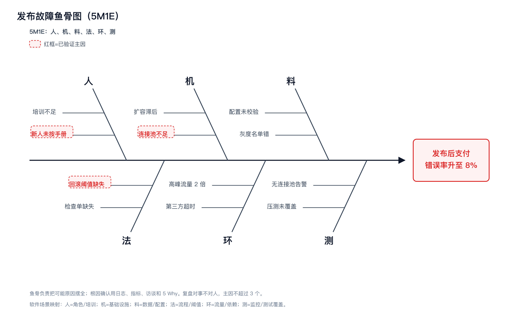

配套验证表（鱼骨只负责把可能原因摆全，验证靠表）：

| 大骨 | 追问 | 候选原因 | 证据 | 结论 |
|---|---|---|---|---|
| 人 | 谁在操作？培训够吗？ | 值班新人未按手册操作 | 操作日志 14:07 | 主因 |
| 机 | 资源够吗？ | 连接池 50，峰值 80 | 监控曲线 | 主因 |
| 料 | 输入数据有问题？ | 灰度名单配置错误 | 配置 diff | 次因 |
| 法 | 流程/阈值清楚吗？ | 回滚阈值未定义 | 发布单 | 主因 |
| 环 | 高峰/网络/依赖？ | 高峰期流量 2 倍 | 流量图 | 诱因 |
| 测 | 监控/测试覆盖？ | 无连接池告警 | 告警列表 | 次因 |

读图：鱼头是问题（发布后支付错误率升至 8%），六条大骨按 5M1E 分类（人/机/料/法/环/测），每条大骨挂 3-5 条可能原因；虚线红框是已验证的主因（新人未按手册、连接池不足、回滚阈值缺失），主因不超过 3 个。软件场景映射：人=角色/培训，机=基础设施，料=数据/配置，法=流程/阈值，环=流量/依赖，测=监控/测试覆盖。鱼骨图的外形不重要，分类不漏才重要；Mermaid 没有原生鱼骨图，手绘/白板或 draw.io 画，图转表落地验证。

**画法**

1. 写清问题：什么时间、什么现象、影响多少。
2. 按 5M1E 列大骨，每个大骨追问 3-5 条。
3. 只列「可能原因」，先不争论对错。
4. 用日志/指标/访谈逐条验证，圈出主因。
5. 主因转行动项，写 owner/截止日。

**常见错误**

- 只写技术原因，漏掉人/流程/环境。
- 把「可能原因」当结论，不验证。
- 鱼骨越画越大，变成问题清单。
- 复盘变成追责，没人敢说真话。
- 没有行动项，下次同样故障。

**企业取舍**

鱼骨用于「找可能原因」，根因确认用 5 Why/时间线/数据。复盘对事不对人；主因不超过 3 个，行动项不超过 5 个。业务背景见 [`08-系统部署与维护`](./08-系统部署与维护.md) 5.4。

### 7.5 故障时间线

**用途**：按时间顺序还原故障从发生到恢复的全过程，找检测/响应/恢复的延迟。

**何时画 / 何时不画**

- 画：P1/P2 故障复盘、重大客户投诉、监管事件。
- 不画：小事故、单点已明确；工单记录足够。

**元素**

| 元素 | 含义 | 画法 |
|---|---|---|
| 时间 | 统一时区 | 第一列 |
| 事件 | 发生了什么 | 第二列 |
| 来源 | 监控/用户/值班/日志 | 第三列 |
| 耗时 | 距上一节点 | 第四列 |
| 证据 | 链接/截图/日志 | 第五列 |
| 决策点 | 谁做了什么决定 | 标注 |

**最小样例**

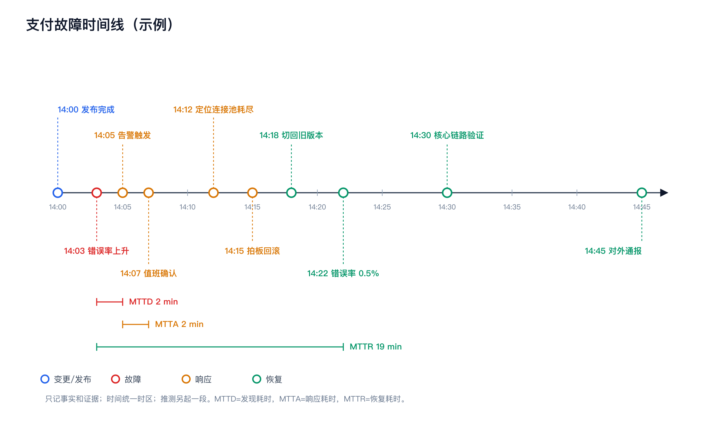

配套事件表：

| 时间 | 事件 | 来源 | 耗时 | 证据 |
|---|---|---|---|---|
| 14:00 | 新版本发布完成 | 发布平台 | — | 发布记录 |
| 14:03 | 支付错误率开始上升 | 监控 | 3 min | 指标图 |
| 14:05 | 告警触发 | Prometheus | 2 min | 告警链接 |
| 14:07 | 值班确认，拉群 | 值班日志 | 2 min | 群记录 |
| 14:12 | 定位为连接池耗尽 | 日志/指标 | 5 min | 日志 |
| 14:15 | 拍板回滚 | 发布单 | 3 min | 审批记录 |
| 14:18 | 流量切回旧版本 | 发布平台 | 3 min | 发布记录 |
| 14:22 | 错误率降到 0.5% | 监控 | 4 min | 指标图 |
| 14:30 | 核心链路验证通过 | 测试脚本 | 8 min | 报告 |
| 14:45 | 对外通报 | 公告 | 15 min | 公告 |

读图：颜色分四段（蓝=变更/发布、红=故障、橙=响应、绿=恢复）。14:00 发布 → 14:03 指标异常 → 14:05 告警（MTTD 2 分钟，发现耗时）→ 14:07 确认（MTTA 2 分钟，响应耗时）→ 14:22 恢复（MTTR 19 分钟，从故障发生到恢复）。时间线只记事实和证据，推测另起一列/一段。

**画法**

1. 从告警、日志、聊天记录、发布单拉时间，统一时区。
2. 只记事实：谁在什么时间看到什么、做了什么。
3. 标关键决策点和等待时间。
4. 算 MTTD/MTTA/MTTR，找最长延迟。
5. 输出行动项：监控、流程、演练、代码各几条。

**常见错误**

- 凭记忆写时间，前后对不上。
- 把推测当事实，复盘变成故事。
- 只写技术动作，不写谁拍板、为什么。
- 没有证据链接，无法复核。
- 复盘变成追责，隐瞒关键信息。
- 行动项没有 owner/截止日。

**企业取舍**

时间线是复盘的地基，不是报告的全部。对外通报用简化版，不暴露敏感信息。行动项进任务系统，下次复盘先看上次行动项是否完成。业务背景见 [`08-系统部署与维护`](./08-系统部署与维护.md) 5.4。

## 八、画图纪律

图的质量不取决于工具，取决于三件事：画之前想清楚问题，画的时候克制，画完之后维护。

### 8.1 一张好图的六个特征

1. **标题是结论/问题**：写「订单支付只经过三个模块」，不写「架构图」。
2. **一图一事**：节点 ≤12；泳道图活动 ≤15，活动图 ≤20；超过就拆图或改用表。
3. **箭头有语义**：调用、数据流、依赖、时序，一种线只表达一种含义。
4. **方向一致**：从左到右或从上到下，不要来回折。
5. **颜色 ≤3 种**：每种颜色有图例和含义，不要为了好看上色。
6. **有日期/版本/作者/数据来源**：让读者知道这张图什么时候有效。

### 8.2 命名与标注

| 对象 | 推荐写法 | 反例 |
|---|---|---|
| 活动 | 动词 + 宾语：提交报销单 | 处理、审核 |
| 状态 | 业务名词：待审批、已通过 | 审批、完成中 |
| 模块 | 名词 + 职责：订单服务（下单/取消） | 服务 A、模块 1 |
| 数据流 | 名词：报销单、付款指令 | 数据、信息 |
| 接口 | 动词 + 资源：createOrder | doIt、handle |
| 风险 | 事件 + 影响 + 时间窗 | 接口风险、人员风险 |
| 工作包 | 可交付物：审批流开发 | 写代码、开会 |

标注三条规矩：

- **单位统一**：人日/人时/故事点，一张图只用一种。
- **时间统一**：时区、日期格式、统计窗口写清楚。
- **口径统一**：「完成」是开发完成、测试完成还是上线，图里必须定义。

### 8.3 工具选型

| 工具 | 适合 | 不适合 | 版本管理 |
|---|---|---|---|
| Mermaid | 文档内嵌、代码评审、快速迭代 | 复杂布局、精美汇报 | 文本，diff 友好 |
| PlantUML | UML 全、复杂图、自动生成 | 样式偏老、中文排版一般 | 文本 |
| draw.io | 自由布局、汇报、网络拓扑 | 手工维护、容易过期 | XML |
| Excalidraw | 白板、工作坊、草图 | 精确规范、审计 | 图片/JSON |
| Figma | 高保真、汇报、产品原型 | 工程图、版本 diff | 设计文件 |
| Excel/BI | 表格、矩阵、帕累托、累积流 | 流程图、架构图 | 文件 |

选型规则：

- 能文本化就文本化：Mermaid/PlantUML 进 Git，和代码/文档一起评审。
- 需要自由布局再上画布工具：draw.io/Excalidraw/Figma。
- 图必须能更新：不能更新的图，标「snapshot + 日期」，不要冒充最新。
- 一张图只用一个工具：Mermaid 和 draw.io 混用，最后没人知道哪张是真的。

### 8.4 图的评审与维护

**评审三问**：

1. 读者能否在 1 分钟内说出这张图的结论？
2. 每个箭头/节点是否有明确语义，图例是否写清？
3. 图与代码/表/接口文档是否一致，差异是否有解释？

**生命周期**：

| 图类型 | 创建时机 | 更新触发 | 归档 |
|---|---|---|---|
| 泳道图 | 需求调研后 | 流程/角色变更 | 上线后归档，保留 As-Is/To-Be |
| 状态机/迁移表 | 需求确认时 | 状态/规则变更 | 随版本保留 |
| 架构图 | 设计评审前 | 模块/外部依赖变更 | 旧版本进 ADR |
| 结构图 | 设计/重构前 | 包结构变更 | 与代码目录同步 |
| 时序图 | 关键路径设计时 | 接口/回调变更 | 随接口文档 |
| ER 图 | 表设计时 | 迁移脚本变更 | 与数据库版本同步 |
| 部署图 | 上线前 | 发布/扩容/迁移 | 每次发布更新 |
| WBS/甘特 | 计划时 | 范围/资源变更 | 按版本归档 |
| 风险矩阵 | 启动/月度 | 风险变化 | 每月留档 |
| 故障时间线 | 复盘时 | 一次性 | 进复盘报告 |

**过期图的处理**：删除，或标「snapshot + 日期 + 适用范围」。最危险的不是没有图，是一张没有日期、看起来像最新的旧图。

## 九、案例：6 人 8 周审批系统的图清单

同一个项目，不同阶段只画能支撑决策的图。下面是 [`09-项目管理`](./09-项目管理.md) 案例的图清单，规模 6 人 8 周，交付一个审批系统 1.0。

| 阶段 | 要回答的问题 | 图/表 | 产出/决策 |
|---|---|---|---|
| 立项 | 值不值得做、走哪条路线 | 一页纸 TCO 对比表（不是图） | Go / No-Go / 条件 Go |
| 需求 | 谁在什么时候把什么交给谁 | 泳道图 As-Is + To-Be | 审批节点、角色、时限 |
| 需求 | 单据有哪些状态、怎么变 | 状态机图 + 状态迁移表 | 状态枚举、权限、异常路径 |
| 设计 | 系统分几块、外部依赖是谁 | 上下文图 + 分层架构图 | 模块边界、外部接口 |
| 设计 | 一次审批/支付怎么走 | 时序图 1-2 张 | 接口、回调、幂等、超时 |
| 设计 | 数据怎么存、表之间什么关系 | ER 图 + 数据字典 | 表结构、约束、索引 |
| 设计 | 多条件组合出什么结果 | 判定表 | 代码分支、测试规则 |
| 计划 | 交付什么、怎么拆、谁做 | WBS + 估算表 | 24 个工作包、168 人日 |
| 计划 | 什么时候做、哪条链决定工期 | 甘特图 + 关键路径图 | 8 周排期、缓冲 |
| 计划 | 哪些风险先处理 | 风险矩阵 + 风险登记表 | Top5 风险、预案、owner |
| 测试 | 状态/规则是否都覆盖 | 状态迁移测试表 + 判定表 | 用例集、自动化分层 |
| 上线 | 什么条件发、什么条件回滚 | 发布/回滚流程图 + 回滚时序图 | 灰度批次、回滚阈值、拍板人 |
| 复盘 | 为什么慢/为什么坏 | 故障时间线 + 鱼骨图 | 行动项、owner、截止日 |

### 三档最小图集

| 项目规模 | 必画 | 选画 | 可以不画 |
|---|---|---|---|
| 2 人 2 周 | 泳道图 1 张、状态迁移表 1 张、接口清单 | 架构草图、ER 图 | 类图、组件图、DFD、用例图、甘特、关键路径 |
| 6 人 8 周 | 上下文/分层架构、泳道、状态机+迁移表、时序 1-2 张、ER、判定表、WBS、甘特/关键路径、风险矩阵 | 组件图、部署图、帕累托、燃尽/累积流 | 类图、DFD、用例图（非投标/合规） |
| 多团队/合规 | 上述全部 + 组件图、部署拓扑、DFD、用例图、发布/回滚、时间线/鱼骨 | 类图按需、累积流、帕累托 | 对象图、包图、通信图、定时图等 UML 冷门图 |

### 一张图清单模板

项目启动时，用一张表把「画什么、给谁看、什么时候更新」定下来，避免后期补图：

| 图/表 | 回答什么问题 | 读者 | owner | 更新时机 | 存放位置 |
|---|---|---|---|---|---|
| 泳道图 | 业务流程怎么走 | 业务/开发/测试 | 需求 | 流程变更 | 需求文档 |
| 状态迁移表 | 状态怎么变 | 开发/测试 | 需求 | 规则变更 | 需求文档 |
| 架构图 | 系统分几块 | 开发/运维 | 架构 | 模块变更 | 设计文档/ADR |
| 时序图 | 关键路径怎么调 | 开发/测试 | 开发 | 接口变更 | 设计文档 |
| ER 图 | 数据怎么存 | 开发/DBA | 开发 | 迁移变更 | 设计文档 |
| WBS/甘特 | 怎么拆/什么时候完 | 全员 | 项目经理 | 范围/资源变更 | 项目计划 |
| 风险矩阵 | 哪些风险先处理 | 管理层/PM | 项目经理 | 每月 | 项目计划 |
| 发布/回滚 | 怎么发/怎么回 | 运维/开发/业务 | 运维 | 每次发布 | 发布单 |

## 十、附录

### A. UML 14 种图速查

UML 2.5 一共 14 种图，分结构图和行为图两类。日常项目常用的只有 7 种；其余 7 种在特定场景才用。**泳道图（BPMN）、DFD、ER、WBS、甘特、鱼骨、风险矩阵、帕累托、燃尽、累积流、C4 架构图、测试金字塔、部署拓扑、故障时间线都不是 UML**，不要混为一谈。

| 分类 | 图 | 回答什么 | 常用度 | 本文位置/说明 |
|---|---|---|---|---|
| 结构 | 类图 | 领域对象、属性、行为、关系 | 高 | 4.3 |
| 结构 | 对象图 | 某一时刻的对象实例快照 | 低 | 类图的实例化，很少单独画 |
| 结构 | 组件图 | 可替换组件及接口 | 中 | 4.4 |
| 结构 | 复合结构图 | 组件内部结构与端口 | 低 | 复杂嵌入式/平台内部 |
| 结构 | 部署图 | 软件到节点的映射 | 高 | 4.6 |
| 结构 | 包图 | 包/命名空间的依赖 | 中 | 结构图的另一种表达 |
| 结构 | 剖面图（Profile） | UML 扩展/ stereotypes | 低 | 建模工具/标准定制 |
| 行为 | 用例图 | 谁用系统做什么 | 中 | 3.3 |
| 行为 | 活动图 | 流程/分支/并行 | 高 | 3.2 |
| 行为 | 状态机图 | 对象状态与迁移 | 高 | 3.5 |
| 行为 | 时序图 | 按时间排列的交互 | 高 | 4.5 |
| 行为 | 通信图 | 对象之间的消息连接 | 低 | 与时序图等价，偏结构 |
| 行为 | 交互概览图 | 多个交互的控制流 | 低 | 复杂交互编排 |
| 行为 | 定时图 | 状态随时间的变化 | 低 | 实时/嵌入式系统 |

**一句话记忆**：结构图回答「系统由什么组成」，行为图回答「系统怎么动」。日常项目用「类/组件/部署 + 用例/活动/状态/时序」七种就够了。

**本文出现的非 UML 图**（各有自己的标准/出处，别当成 UML 的一部分）：泳道图与 BPMN 2.0（Object Management Group）、DFD 的 Gane-Sarson 与 Yourdon 记法、C4 模型（Simon Brown）、ER 图的 crow's foot / Chen 记法、WBS 与关键路径法（PMI/PMBOK）、测试金字塔、部署拓扑、故障时间线、风险矩阵（ISO 31000 思路）、鱼骨图（Ishikawa 5M1E）、帕累托图、燃尽图（Scrum）、累积流图（Kanban）。

### B. 中英对照

| 中文 | 英文 | 常见缩写/备注 |
|---|---|---|
| 用例图 | Use Case Diagram | —— |
| 活动图 | Activity Diagram | —— |
| 状态机图 | State Machine Diagram | 状态图 |
| 时序图 | Sequence Diagram | 顺序图 |
| 类图 | Class Diagram | —— |
| 组件图 | Component Diagram | —— |
| 部署图 | Deployment Diagram | —— |
| 数据流图 | Data Flow Diagram | DFD |
| 实体关系图 | Entity-Relationship Diagram | ERD |
| 工作分解结构 | Work Breakdown Structure | WBS |
| 甘特图 | Gantt Chart | —— |
| 关键路径法 | Critical Path Method | CPM |
| 风险矩阵 | Risk Matrix | —— |
| 燃尽图 | Burn-down Chart | —— |
| 累积流图 | Cumulative Flow Diagram | CFD |
| 鱼骨图 | Fishbone Diagram | 石川图/Ishikawa |
| 泳道图 | Swimlane Diagram | 跨职能流程图 |
| 测试金字塔 | Test Pyramid | —— |
| 业务流程模型 | Business Process Model and Notation | BPMN |
| 帕累托图 | Pareto Chart | 80/20 法则 |
| 服务等级目标 | Service Level Objective | SLO |
| 平均恢复时间 | Mean Time To Recovery | MTTR |
| 平均检测时间 | Mean Time To Detect | MTTD |
| 平均响应时间 | Mean Time To Acknowledge | MTTA |
| 在制品 | Work In Progress | WIP |

### C. 检查清单（打印版）

**画前 3 问**

- [ ] 这张图给谁看？
- [ ] 看完要做什么决定？
- [ ] 图上的信息够不够支撑这个决定？

**画后 5 查**

- [ ] 标题是不是结论/问题，而不是图种名称？
- [ ] 节点/流程是否超限（节点 ≤12；泳道 ≤15，活动 ≤20）？
- [ ] 每个箭头是否有语义，图例是否写清？
- [ ] 颜色是否 ≤3 种且有含义？
- [ ] 是否有日期/版本/作者/数据来源？

**评审 4 问**

- [ ] 读者能否在 1 分钟内说出结论？
- [ ] 图与代码/表/接口文档是否一致？
- [ ] 异常路径是否画了（超时/取消/失败/补偿）？
- [ ] 谁负责更新，下次什么时候更新？

**评审 5 问：图种与标准是否匹配**

- [ ] 标 UML 的图是否真的符合 UML 符号（棒棒糖=提供、插座=消费、菱形只问一个条件、`«artifact»`/三维节点）？
- [ ] DFD 是否用统一的一种记法（Gane-Sarson 或 Yourdon），没有混用？
- [ ] 泳道图是否按 BPMN lane 语义（跨泳道=交接），没有把 BPMN 和 Mermaid 流程图混为一谈？
- [ ] 非标准记法（C4、测试金字塔、5×5 风险矩阵）是否在图例/脚注里声明了口径？

**归档 3 条**

- [ ] 旧版本是否保留，能否追溯决策？
- [ ] 过期图是否标了「snapshot + 日期 + 适用范围」？
- [ ] 图是否和代码/文档放在同一个版本库里？

### D. 标准与参考

本文各图种对应的规范/出处，评审时按这个对符号：

| 图种 | 标准/出处 | 本文要点 |
|---|---|---|
| UML 用例/活动/状态机/时序/类/组件/部署图 | UML 2.5（OMG） | include 基础→被包含；extend 扩展→基础；棒棒糖=提供、插座=消费；三维节点+`«artifact»` |
| 泳道图 | BPMN 2.0（OMG） | lane=角色；跨泳道=交接；排他网关一个条件两个出口 |
| DFD | Gane-Sarson / Yourdon | 外部实体不直连存储；加工必有输入输出；父子图守恒 |
| 架构图 | C4 模型（Simon Brown） | 上下文/容器/组件/代码四层；不强制符号但必须有图例 |
| ER 图 | crow's foot / Chen 记法 | 基数必标；约束放数据字典 |
| WBS / CPM | PMI（PMBOK） | 100% 原则、8/80 规则；ES/EF/LS/LF/TF 正推逆推 |
| 风险矩阵 | ISO 31000 思路 | 分数=概率×影响；口径固定，阈值可调 |
| 燃尽图 | Scrum Guide | 理想线+实际线；范围变更要留台阶 |
| 累积流图 | Kanban | 带宽=WIP；水平距离≈周期时间；上边缘斜率=吞吐量 |
| 鱼骨图 | Ishikawa 5M1E | 人机料法环测；主因≤3，验证靠证据 |
| 帕累托图 | Juran 80/20 | 左轴上限=总量；累计线首点对齐首柱顶 |
| 测试金字塔 | Mike Cohn | 比例因系统而异；反模式：冰淇淋筒、沙漏 |

---

图典到这里。真正要记住的只有一句：**图是拿来回答问题的，不是拿来证明你会画图的。** 先有问题，再选图；图解决不了的，用表；表和图的细节，回到对应的阶段文章。
