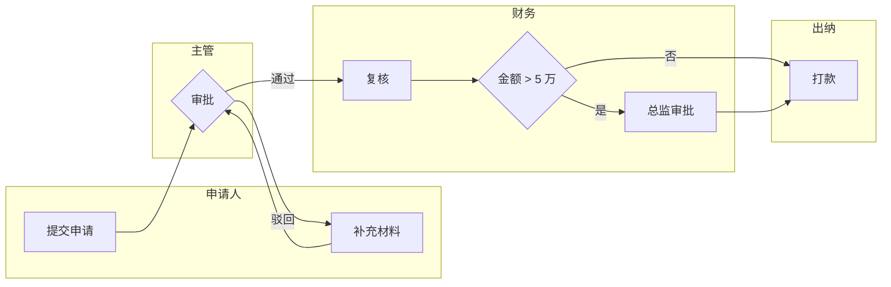
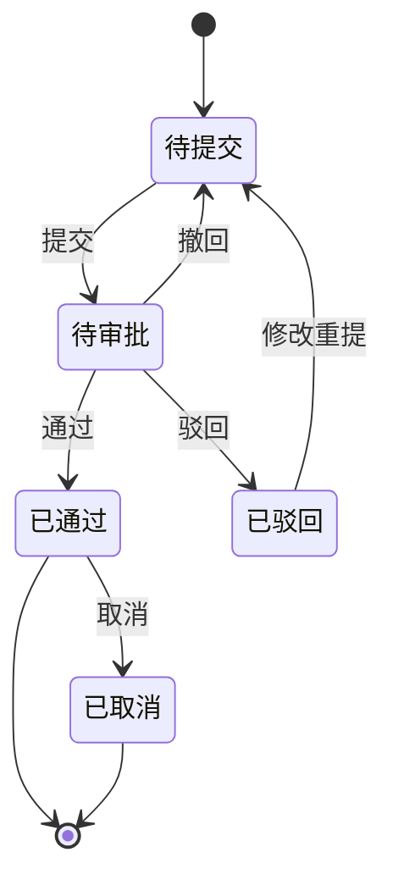
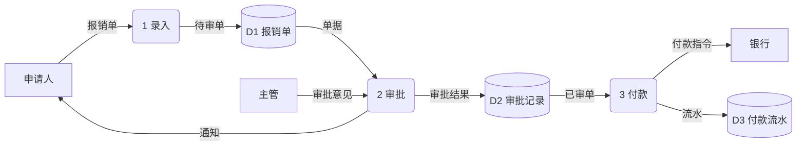
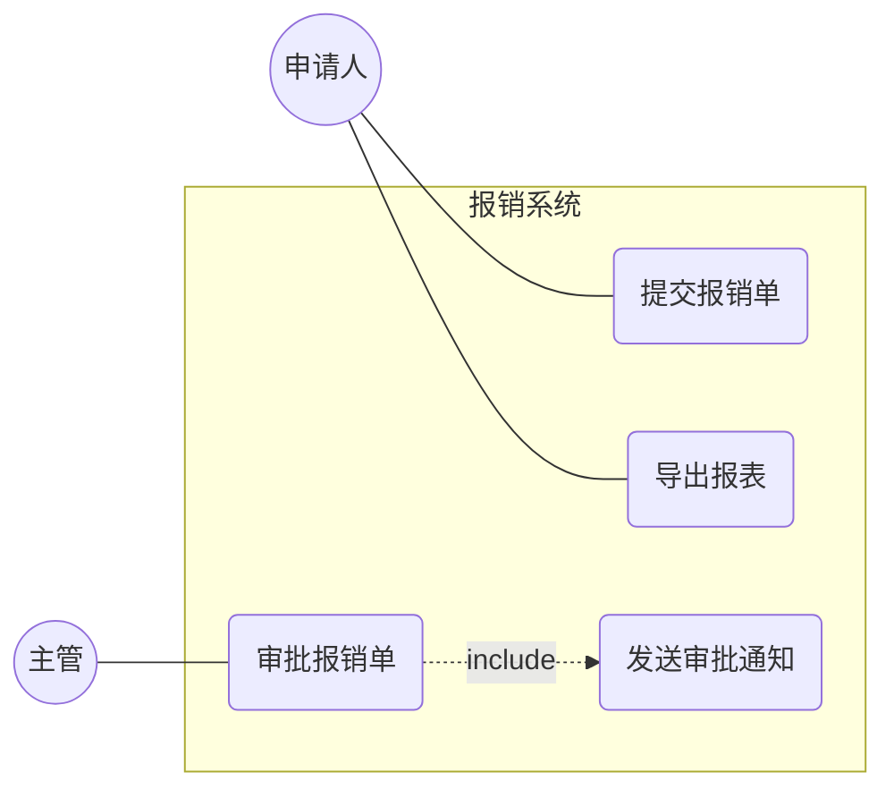

# 需求分析

## 一、需求分析交付什么

需求分析不是写一份没人看的 SRS，而是让四件事达成一致：**业务怎么做、系统管什么、什么算做完、改了怎么办**。

输入是 `03-立项评审` 给出的范围与预算，输出是 `05-系统设计` 唯一认的书面依据——设计只认这份清单和规则表，不认口头描述。

| 要达成的一致 | 产物 | 谁确认 |
|---|---|---|
| 业务怎么做 | 泳道流程图（As-Is / To-Be） | 业务负责人 |
| 系统管什么 | 需求清单（功能 + 非功能） | 业务 + 技术 |
| 规则怎么判 | 状态机 + 规则表 | 业务 + 测试 |
| 什么算做完 | 每条需求的验收标准 | 业务 + 测试 |
| 改了怎么办 | 基线 + 变更记录 | 项目经理 |

**按项目类型裁剪**，不是每个项目都要全套：

| 项目类型 | 必做 | 可省 |
|---|---|---|
| 内部管理系统 | 泳道图、需求清单、原型、规则表 | 用例图、DFD |
| 对外产品 | 需求清单、原型、状态机、验收标准 | DFD、数据字典 |
| 对接/集成项目 | 接口清单、数据字典、时序 | 泳道图 |
| 投标/外包验收 | 全套（见第七节） | 无 |
| 遗留系统改造 | 现状流程、数据字典、差异清单 | 原型 |

边界：需求分析不做表结构、不做接口字段定义（那是系统设计），但必须把「有哪些数据、数据从哪来、给谁看」说清，否则设计阶段会反复回来问。

## 二、需求获取：带着问题去现场

需求不是问出来的，是**看出来的**。用户说的「我想要一个导出按钮」，背后可能是「我每周要手工汇总一次报表」。只记前者，做出来的是按钮；问出后者，做出来的可能是自动报表。

### 2.1 四种方式的分工

| 方式 | 什么时候用 | 产出 | 成本 |
|---|---|---|---|
| 访谈 | 所有项目，按角色分开谈 | 痛点、诉求、口径 | 低 |
| 现场观察 | 流程类、操作类系统 | 真实步骤、隐性规则、例外处理 | 中 |
| 原型 | 界面重、业务方说不清 | 早期反馈、纠偏 | 中 |
| 工作坊 | 跨部门、口径冲突 | 当场对齐的结论 | 高 |

### 2.2 访谈问什么

不问「你想要什么功能」，问四类事实：

1. **现在怎么做**：从收到请求到处理完，一步一步是什么？
2. **卡在哪**：哪一步最慢、最容易错、最常返工？
3. **错了怎么办**：出了错谁发现、怎么补救、有没有例外？
4. **谁在看**：结果给谁看、用来做什么决定？

第三问最重要。例外和补救路径里藏着大部分业务规则，也是系统上线后最容易被骂的地方。

访谈当天整理成纪要，分三栏：**事实**（用户原话）、**诉求**（他想要什么）、**待澄清**（还不确定的）。第二天回给受访者确认。不确认的纪要等于没做。

### 2.3 工作坊怎么开

跨部门需求（审批流、结算规则、权限）不要一个个访谈，会得到三套互相矛盾的说法。开一次 2 小时工作坊：

- **参会人**：每个部门 1 个能拍板的人，不超过 8 人；
- **材料**：一块白板，画出当前流程；
- **规则**：只讨论「现在是什么样」，不讨论「应该是什么样」；
- **产出**：一张各方确认的现状流程 + 一份分歧清单。

分歧当场记录，会后由发起人决策，不要在工作坊上辩论。

## 三、把业务流程画清：泳道图

泳道图（swimlane）是需求阶段最值钱的一张图。它按「谁在做」分泳道，按时间顺序画步骤，一眼能看出：哪些步骤是人工、哪些要系统做、哪里在等、哪里会退回。

### 3.1 画法

读图：横轴是时间（从左往右），纵轴是角色泳道；跨泳道的箭头就是一次交接。Mermaid 没有原生泳道，用 `subgraph` 模拟，一个 `subgraph` 就是一条泳道。

| 元素 | 含义 | Mermaid 写法 |
|---|---|---|
| 泳道 | 一个角色 | `subgraph 申请人` |
| 方框 | 动作/任务 | `A1["提交申请"]` |
| 菱形 | 判断 | `B1{"审批"}` |
| 箭头 | 流转/交接 | `-->` |
| 箭头文字 | 分支条件 | `-->` 后接条件标签 |
| 虚线 | 系统自动/异步 | `-.->` |

画图三条规矩：

1. **一条泳道一个角色**，不要按部门画——部门会变，角色不会；
2. **每个判断分支都要有出口**，包括驳回、超时、取消；
3. **标出系统边界**：哪些步骤将来由系统自动做，用颜色或虚线区分。

### 3.2 As-Is 和 To-Be 都要画

只画 To-Be，业务方看不出改了什么；只画 As-Is，开发方不知道要做什么。

- **As-Is**：现在怎么做，用来找痛点和隐性规则；
- **To-Be**：系统上线后怎么做，用来定范围和验收。

两张图并排，差异就是需求。差异里删掉的步骤是收益，新增的步骤要解释为什么。

### 3.3 什么时候不用泳道图

纯数据展示类系统（报表、看板）、纯接口对接、算法类需求，没有跨角色的流程，画泳道图是浪费时间。这类需求直接用「数据从哪来、怎么算、给谁看」三句话加字段清单说清。

## 四、把规则定死：状态机 + 规则表

流程说清「谁在什么时候做什么」，规则说清「什么情况下允许、不允许、算多少」。规则不清，开发和测试各理解一套，上线后天天扯皮。

### 4.1 状态机：一个业务对象能怎么变

凡是对象有状态的（订单、工单、审批单、合同），先画状态机。它回答三个问题：有哪些状态、什么动作能触发迁移、哪些迁移是非法的。

先画图对齐，再落表：

读图：`[*]` 是起点/终点，圆角框是状态，箭头是一次迁移，箭头上的字是动作。先保证除终态外每个状态都有进有出，再补条件。

| 元素 | 含义 | Mermaid 写法 |
|---|---|---|
| 起点/终点 | 创建/归档 | `[*]` |
| 状态 | 对象当前所处的阶段 | `待审批` |
| 迁移 | 动作触发的状态变化 | `待审批 --> 已通过` |
| 迁移说明 | 动作（条件写表里） | `: 通过` |

| 当前状态 | 动作 | 目标状态 | 谁能做 | 条件 |
|---|---|---|---|---|
| 待提交 | 提交 | 待审批 | 申请人 | 必填项完整 |
| 待审批 | 通过 | 已通过 | 主管 | 金额 ≤ 权限 |
| 待审批 | 驳回 | 已驳回 | 主管 | —— |
| 待审批 | 撤回 | 待提交 | 申请人 | 未被审批 |
| 已驳回 | 修改重提 | 待提交 | 申请人 | 未超期 |
| 已通过 | 取消 | 已取消 | 管理员 | 未打款 |

图用来看有没有断路、死状态和非法入口，表用来写清谁能做、什么条件能做。开发照着表写 `switch`，测试照着表列用例，业务照着表确认「有没有漏掉的情况」，两样都要。

**最容易漏的三个状态**：草稿（存了没提交）、超时（多久没处理算什么状态）、撤回/取消（提交后反悔）。这三个不定义，上线第一个月就会出问题。

### 4.2 规则表：条件组合决定结果

当一个结果由多个条件共同决定（折扣、费率、权限、分档），用规则表把组合列全，不要用文字描述。

| 会员等级 | 订单金额 | 可用券 | 折扣 | 是否包邮 |
|---|---|---|---|---|
| 普通 | < 99 | 无 | 无 | 否 |
| 普通 | ≥ 99 | 无 | 无 | 是 |
| VIP | 任意 | 无 | 95 折 | 是 |
| VIP | ≥ 200 | 满 200 减 20 | 95 折 + 减 20 | 是 |
| SVIP | 任意 | 任意 | 9 折（封顶 50） | 是 |

规则表的三个作用：业务方确认口径（尤其是叠加顺序）、开发照着写判定、测试照着列组合。规则超过 20 条时，按「会员/金额/券」拆成多张表，不要一张表塞 50 行。

**必须问清的四件事**：叠加顺序（先打折还是先减券）、封顶规则（折扣上限）、互斥规则（哪些券不能同用）、兜底规则（都不满足时算什么）。

### 4.3 非功能需求也要可验收

「系统要快」不是需求，「订单列表在 1 万条数据下，95% 请求 2 秒内返回」才是。非功能需求至少覆盖四项：

| 类别 | 写法 | 验收方式 |
|---|---|---|
| 性能 | 并发数、响应时间、数据量 | 压测报告 |
| 可用性 | 允许停机窗口、故障恢复时间 | 演练记录 |
| 安全 | 谁能看什么数据、操作留痕 | 渗透测试、审计日志 |
| 兼容 | 浏览器/机型/分辨率 | 兼容性测试清单 |

## 五、把界面确认掉：原型 + 字段清单

原型的作用不是好看，是**让业务方在写代码之前反悔**。改一张图 10 分钟，改一个已上线的页面 2 天。

### 5.1 原型做到什么程度

| 阶段 | 精度 | 工具 | 用途 |
|---|---|---|---|
| 概念 | 纸笔/白板 | 手绘 | 对齐信息架构 |
| 流程 | 灰模，可点击 | Figma/即时设计 | 确认操作路径 |
| 交付 | 高保真 + 标注 | Figma | 开发照着做 |

需求阶段做到「灰模可点击」即可，不要花时间做视觉。视觉是 `02-设计` 的事。

### 5.2 字段清单比原型更重要

原型给业务方看，字段清单给开发用。每个字段写清五件事：

| 字段 | 类型 | 必填 | 来源 | 校验/说明 |
|---|---|---|---|---|
| 申请单号 | 字符串 | 是 | 系统生成 | BM + 年月 + 4 位流水 |
| 申请人 | 关联用户 | 是 | 登录信息 | 不可修改 |
| 金额 | 金额 | 是 | 手工录入 | > 0，两位小数，上限 100 万 |
| 附件 | 文件 | 否 | 上传 | pdf/jpg，单个 ≤ 10MB |

字段清单是后面表结构设计和接口设计的直接输入。需求阶段不写字段清单，设计阶段就要靠猜。

## 六、把范围锁住：需求清单与优先级

需求清单是需求分析的最终产物，也是项目管理的输入。一行一条需求，字段固定：

| 编号 | 需求 | 类型 | 优先级 | 验收标准 | 来源 |
|---|---|---|---|---|---|
| R-01 | 提交审批申请 | 功能 | P0 | 必填项校验通过后可提交，生成唯一单号 | 访谈-财务 |
| R-02 | 审批驳回并填写理由 | 功能 | P0 | 驳回后申请人可修改重提，历史留痕 | 访谈-主管 |
| R-03 | 审批超时提醒 | 功能 | P1 | 超过 24 小时未处理，提醒审批人 | 工作坊 |
| R-04 | 审批效率报表 | 功能 | P2 | 按人/部门统计平均处理时长 | 业务方 |
| R-05 | 单点登录 | 非功能 | P0 | 对接企业 IdP，支持 OIDC | 安全要求 |

### 6.1 优先级怎么定

用 MoSCoW 四档，但判定标准要写死：

| 档位 | 判定标准 | 排期处理 |
|---|---|---|
| Must（P0） | 没有它系统不能上线 | 本期必做 |
| Should（P1） | 很重要，但有临时替代方案 | 本期尽量做 |
| Could（P2） | 锦上添花 | 有余力再做 |
| Won't（P3） | 本期明确不做 | 记录，防止反复提 |

优先级不是业务方说了算，是**业务价值 ÷ 成本**排序后，由项目负责人和业务负责人共同确认。业务方永远说「都重要」，这时要问一句：如果只能上三个，你选哪三个？

### 6.2 明确写「不做什么」

需求清单的最后要有一节「本期不做」，逐条列出并写明原因。这一节的价值在于：防止上线后有人说「我以为这个功能有」。

## 七、经典图什么时候还必须画

DFD、数据字典、用例图不是没用，是在多数企业项目里性价比低。但下面四种场景必须画，不画会出事：

| 场景 | 必须画 | 为什么 |
|---|---|---|
| 投标/政府项目 | DFD、数据字典、用例图 | 评标要看，缺项扣分 |
| 等保/安全测评 | 数据流图、数据字典 | 测评机构要确认数据流向与敏感字段 |
| 外包验收 | 用例图、接口清单、数据字典 | 合同附件，验收依据 |
| 遗留系统改造 | 数据字典、现状 DFD | 没人说得清数据在哪，只能靠图倒推 |

### 7.1 DFD 的实用画法

DFD 只画三层：顶层（系统作为一个加工，连外部实体）、0 层（展开成 3-7 个主要加工）、1 层（只展开关键加工）。再往下画没人看。

只用四个符号：

| 元素 | 含义 | 画法（Mermaid 近似） |
|---|---|---|
| 外部实体 | 人/外部系统 | 方框 `E1["申请人"]` |
| 加工 | 把输入变成输出 | 圆角框 `P1("1 录入")` |
| 数据存储 | 表/文件/库 | 圆柱 `D1[("D1 报销单")]` |
| 数据流 | 流动的数据 | 箭头 + 名词（如「报销单」） |

0 层示例（顶层只画一个「报销系统」加工连外部实体；0 层展开如下，加工编号，数据流写名词）：

三条纪律：外部实体不能直连数据存储；每个加工必须有输入和输出；数据流写名词（报销单、审批结果），不写「调用接口」「写库」这类实现动作。控制流（先做什么后做什么）归泳道图，不画进 DFD。

Mermaid 没有 DFD 专用语法，`graph LR` 只是按形状近似，评审够用；投标/等保要正式图时，再导出到 draw.io/Visio 排成标准分层图。

### 7.2 用例图：谁用系统做什么

用例图只有四样东西：参与者（小人）、用例（椭圆）、系统边界（方框）、关系（实线 = 谁用；虚线 `include` = 必走的公共步骤，`extend` = 可选分支）。

画法四条：参与者写在框外，用例写在框内；用例名用「动词 + 名词」，一句话是一个完整目标，不是函数清单；`include` 箭头指向被包含的用例，`extend` 箭头指向被扩展的用例；用例图不画顺序、不画判断、不画传参——流程归泳道图，规则归状态机和规则表。

Mermaid 没有用例图语法，用 `(( ))` 当小人、`( )` 当椭圆、`subgraph` 当系统边界，形状是近似的，语义按上面四条守住。

### 7.3 数据字典的最小集

数据字典不是把数据库表抄一遍，而是定义**业务术语**：

| 术语 | 定义 | 口径 | 来源系统 |
|---|---|---|---|
| 有效订单 | 已支付且未取消的订单 | 按支付时间统计 | 订单库 |
| 活跃用户 | 30 天内有登录的用户 | 按自然日 | 用户库 |
| 缺货率 | 缺货 SKU 数 ÷ 在售 SKU 数 | 按日快照 | 库存系统 |

三行就够起步。数据字典最大的价值是消灭「同一个词，三个部门三种算法」。

## 八、需求变更：基线之后怎么改

需求一定会变，问题不是「防止变更」，是「变更可控」。

### 8.1 基线

需求清单评审通过、各方确认后，打一个基线（v1.0）。基线之后的所有改动走变更流程。

### 8.2 变更流程

| 步骤 | 谁 | 产出 |
|---|---|---|
| 提出 | 任何人 | 变更申请（改什么、为什么） |
| 评估 | 技术负责人 | 工作量、影响范围、风险 |
| 决策 | 项目负责人 + 业务负责人 | 接受/拒绝/延后 |
| 记录 | 项目经理 | 变更记录、基线版本号 |

三条规则：

1. **变更必须有人付账**：加需求就要加时间、加人，或者砍掉等量的其他需求。三者都不谈的变更，一律拒绝。
2. **小变更批量走**：一周内的多个小变更合成一次评审，不要每条都开会。
3. **紧急变更后补流程**：线上故障导致的紧急改动可以先做，48 小时内补记录。

### 8.3 变更记录长什么样

| 编号 | 日期 | 变更内容 | 原因 | 工作量 | 影响 | 决策 |
|---|---|---|---|---|---|---|
| C-01 | 11-05 | 增加审批超时提醒 | 业务方要求 | 2 人日 | 延后报表 2 天 | 接受 |
| C-02 | 11-08 | 增加微信通知 | 领导要求 | 3 人日 | 无 | 延后到下期 |
| C-03 | 11-12 | 修改金额上限 | 口径澄清 | 0.5 人日 | 无 | 接受 |

## 九、案例：报销系统需求分析

### 9.1 背景

一家 500 人公司，报销走纸质单据 + Excel 登记，财务 4 人，每月处理 600 单。目标：线上化，缩短报销周期。

### 9.2 产出

**泳道图**：申请人 → 主管 → 财务 → 出纳，四条泳道。As-Is 里发现两个隐性规则：金额超过 5000 要总监签字（制度里没写，靠财务口头把关）、每月 25 日后提交的单据顺延到下月（财务结账期）。

**状态机**：草稿 → 待审批 → 已通过 → 已打款；另有驳回、撤回、超时三个分支。超时规则：审批超过 48 小时自动提醒，超过 5 天自动转交上级。

**规则表**：差旅、招待、办公三类，各自的限额、发票要求、审批层级不同，列成三张表，共 18 条规则。

**字段清单**：32 个字段，其中 6 个是财务口径字段（费用类型、成本中心、项目号），这 6 个字段的取值必须和 ERP 一致，单独确认。

**需求清单**：47 条，P0 29 条、P1 12 条、P2 6 条。本期不做：与银行直连打款（P3）、移动端拍照识别发票（P3）。

### 9.3 关键决策

- **不做审批流引擎**，用固定三级审批 + 配置表。理由：流程只有三种，上引擎的成本高于收益；
- **发票验真接第三方接口**，不自研 OCR。理由：非核心业务；
- **报表先做 5 张固定的**，不做自定义报表。理由：自定义报表的真实需求要上线后才知道。

### 9.4 结果

上线后报销周期从平均 12 天降到 4 天。最大的收益不是线上化，是**把两个隐性规则显性化**：5000 元阈值和 25 日结账期，以前靠人记，现在写进系统。

失败的地方：P1 里的「审批超时提醒」上线后没人配置，三个月没生效。教训是：**带配置的功能，交付时要有人负责配**。
