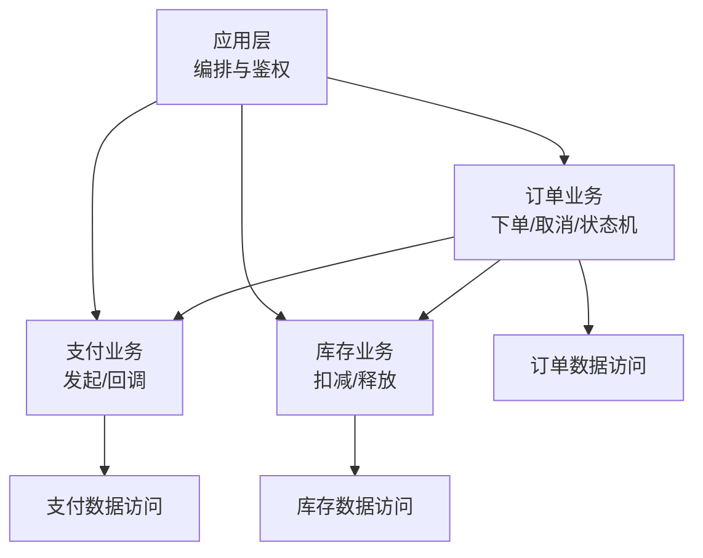
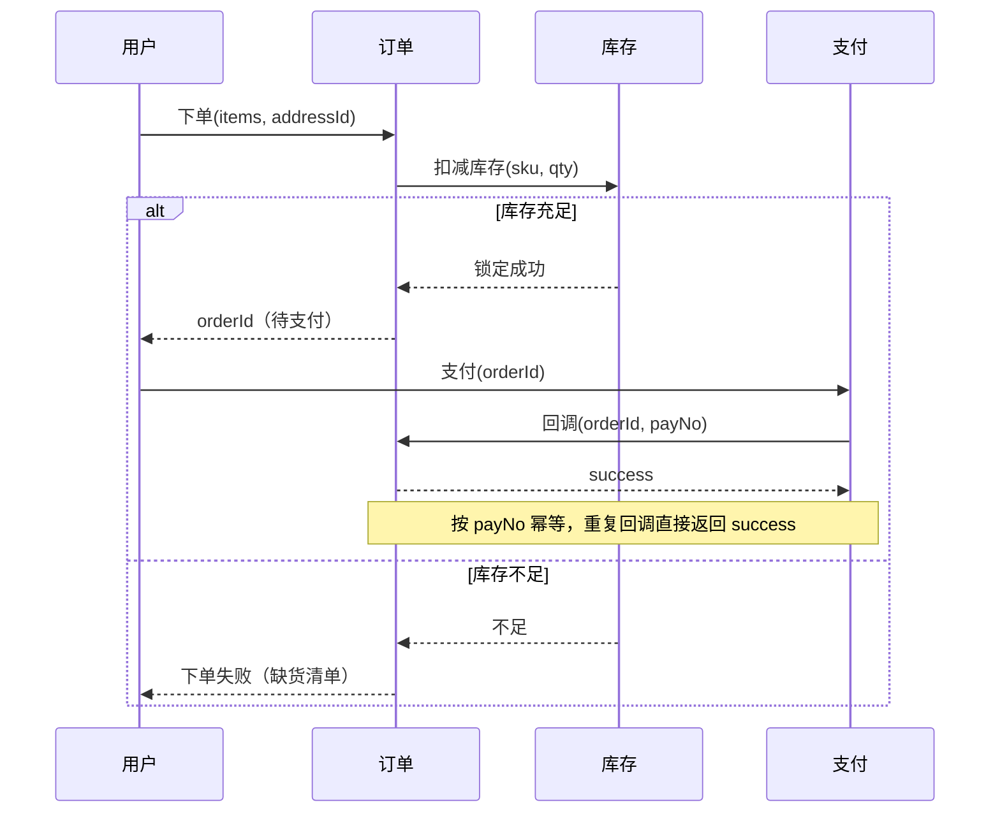

# 系统设计

## 一、设计文档写多少

设计文档不是越全越好。写多了没人看，写少了开发靠猜。判断标准只有一条：**这份文档要消除的是哪种不确定性**。

教材把设计拆成「总体设计」和「详细设计」两份文档、两次交接；实际项目多数只写一份系统设计文档，评审也常合并成一次会，但两个层次和两个检查点仍然要分开做。

这一层的输入是 `04-需求分析` 的需求清单、状态机与规则表；输出是 `06-系统实现` 能直接照着写的接口、表和异常清单。

| 改动规模 | 典型场景 | 要写什么 | 不写什么 | 篇幅 |
|---|---|---|---|---|
| 小改动 | 加字段、改校验、修 bug | 变更说明 + 影响面 | 结构图、架构选型 | 半页 |
| 中等功能 | 新模块、新流程 | 模块职责、接口契约、表结构、异常清单 | 架构选型、部署图 | 3-8 页 |
| 新系统/大改造 | 从 0 到 1、拆服务 | 全套（见 8.3） | 算法细节 | 15-30 页 |
| 对外交付/投标 | 合同附件 | 对方模板要求的所有图 | —— | 按模板 |

两条实践规则：

- **图不必多**。一张模块图 + 一张关键时序图，能覆盖 80% 的沟通需求。剩下的用表和文字，图多了没人维护；
- **文档跟着代码走**。设计文档放在仓库里（`docs/design/`），和代码一起评审、一起改。放在 Confluence 里没人更新的文档，三个月后就是错误信息源。

边界：原型验证、一次性脚本、需求还在天天变的时候不做系统设计。设计的前提是需求已经稳定到「不会再推倒重来」。

## 二、模块怎么切

模块划分只有一个判据：**一个变化原因一个模块**。会因为同一个理由被改的功能放一起，不会的拆开。

### 2.1 五步

| 步骤 | 做什么 | 产物 | 最容易错在哪 |
|---|---|---|---|
| 1. 功能点清单 | 把需求拆成可编号的功能点 | F-01..F-n | 粒度太粗，「订单管理」塞十件事 |
| 2. 职责聚类 | 同一变化原因的功能归一块 | 候选模块 | 按页面/菜单切，不按职责切 |
| 3. 数据归属 | 每张表只归一个模块写 | 数据归属表 | 多个模块直写同一张表 |
| 4. 接口草约 | 标出跨模块调用点 | 接口清单 | 漏掉异步、定时任务这类隐性依赖 |
| 5. 自检 | 看耦合和内聚，不达标回第 2 步 | 改进记录 | 只看功能，不看变化频率 |

需求还在变时，做到第 2 步就停，别急着定接口——每改一次需求就要重画一轮结构图。

### 2.2 按职责切，不按组织切

最常见的错误是按部门或菜单切：「订单中心」和「订单报表」分成两块，结果它们读同一批表、因同一条业务规则一起改。这不是两个模块，是一个模块被硬掰成两块，耦合从接口变成了共享表。

正确的切法看「谁最懂这张表的业务规则」：`order` 表归订单模块，因为订单状态怎么流转只有订单模块说得清；报表要数据，走订单模块的只读接口。

### 2.3 耦合内聚：只记两条

教材里的七种耦合、七种内聚，实际只需要记两条判断：

- **它内部的代码会因为几个理由被改？** 多于一个，内聚不够，拆；
- **它要靠多少个其他模块的内部细节才能工作？** 超过接口契约，耦合过紧，收口。

四种要处理的具体信号：

| 信号 | 问题 | 动作 |
|---|---|---|
| 传整个对象但只用两个字段 | 标记耦合 | 只传需要的字段 |
| 传布尔开关决定对方走哪条分支 | 控制耦合 | 拆成两个方法 |
| 多个模块读写同一张表 | 公共耦合 | 收敛到唯一属主 |
| 直接访问对方内部数据结构 | 内容耦合 | 加接口隔离，立刻改 |

为了「低耦合」把系统拆成几十个微模块，运维成本会吃掉收益。中小系统分层单体通常是更划算的落点。

## 三、架构风格：5 分钟决策

架构风格不是选型报告，是一个受约束的决策：团队几个人、多久发一次版、要不要独立扩容。

| 风格 | 适用 | 收益 | 代价 |
|---|---|---|---|
| 单体 | 1-3 人、MVP | 开发部署最简单 | 边界靠纪律，容易腐化 |
| 分层单体 | 3-8 人、业务稳定 | 结构清晰、调试容易 | 只能整体扩容 |
| 模块化单体 | 5-15 人、多团队共建 | 边界清晰、可局部替换 | 需要模块边界治理 |
| 微服务 | 15 人以上、需独立发布 | 独立扩容与发布 | 运维、分布式事务、观测成本高 |

决策顺序（照着问，5 分钟能定）：

1. 团队少于 10 人？→ 单体或分层单体，不要讨论微服务；
2. 多人/多团队改同一个工程，发布互相阻塞？→ 模块化单体；
3. 有明确的独立扩容需求（某模块流量是其他的 10 倍）？→ 只把那个模块拆出去；
4. 以上都不满足 → 分层单体。

**不要为「以后可能扩容」提前上微服务**。迁移成本是确定的，扩容收益是不确定的。反过来，团队过 15 人还挤在一个单体里，发布阻塞会成为主要瓶颈，这时该拆。

质量属性（可用性、性能、安全）的详细权衡见 `03-架构`，这里只定风格。

## 四、接口契约：设计的核心产物

系统设计里性价比最高的一份产物是接口清单。接口定清楚，联调不扯皮；接口含糊，后面全是猜。

### 4.1 一份接口契约写六样

| 项 | 写到什么粒度 | 示例 |
|---|---|---|
| 接口名与用途 | 一句话 | 创建订单 createOrder |
| 入参 | 字段名 + 类型 + 必填 + 校验 | items[] 非空，最多 100 行 |
| 出参 | 字段名 + 类型 + 枚举值 | orderId: long，status: 0/1/2 |
| 错误码 | 全局唯一 + 含义 | 4001 库存不足 |
| 幂等 | 幂等键字段与行为 | payCallback 用 payNo 去重 |
| 调用方式 | 同步/异步/回调 | 同步；支付结果异步回调 |

```text
接口：createOrder（订单模块提供，前端调用）
用途：创建一笔待支付订单
入参：items: [{sku: string, qty: int}]  非空，≤ 100 行
      addressId: long  必填，须属当前用户
出参：orderId: long, status: 0(待支付)
错误码：4001 库存不足 / 4002 参数无效 / 5001 锁等待超时
幂等：同一 requestId 24 小时内重复提交返回同一 orderId
调用：同步
```

### 4.2 五条不能破的规则

| 规则 | 反例 | 后果 |
|---|---|---|
| 入参逐个写校验 | 只写「必填」不写范围 | 脏数据入库，事后难清 |
| 错误码全局唯一 | 两处都用 4001 | 调用方判断错语义 |
| 幂等显式入参 | 回调无幂等键 | 重试导致重复入账 |
| 枚举用数字 + 注释 | 直接传「待支付」字符串 | 改文案即故障 |
| 出参不含中间态 | 返回「处理中」让前端轮询 | 轮询成瘾，服务被拖垮 |

### 4.3 接口先定，再写实现

顺序不能反。先写代码再补接口文档，文档一定和实现不一致；先定接口再写实现，实现会围着契约收敛。

接口变更要走版本：新增字段向后兼容，删字段/改语义必须升版本，老版本至少保留一个发布周期。

## 五、数据归属与表设计

### 5.1 一张表一个属主

| 模块 | 拥有的表（写） | 对外接口 | 跨模块依赖 |
|---|---|---|---|
| 订单 | order、order_item | createOrder、cancelOrder、updateOrderStatus | 库存（走接口） |
| 库存 | stock | deductStock、releaseStock | —— |
| 支付 | payment | createPayment、payCallback | 订单（走接口） |
| 报表 | report 读模型 | queryReport | 订单/库存只读副本 |

三个动作：**判属主**（谁最懂业务规则）、**定接口**（属主暴露只读查询和业务动作，不暴露裸 SQL）、**记例外**（跨库查询、大宽表聚合走只读副本，但要在表里注明原因）。

读和写要分开对待：只读场景全部强制走接口，会把属主模块变成查询瓶颈；写必须收口，读可以放宽到只读副本。

### 5.2 表设计写到什么程度

| 字段项 | 必须写 | 说明 |
|---|---|---|
| 类型与长度 | 是 | 金额用 DECIMAL，不用 FLOAT |
| 是否可空 | 是 | 能非空就非空，默认值写清 |
| 约束 | 是 | 主键、唯一、外键、检查约束 |
| 校验规则 | 是 | 范围、格式、枚举 |
| 并发约定 | 热点字段必写 | 如 `stock.qty` 扣减须行锁 |
| 索引 | 视情况 | 高频查询字段，设计阶段标出 |

索引和分区策略属于数据库/性能设计，不在这一层展开；但**热点字段的并发约定必须在这里写清**，否则编码阶段一定漏。

## 六、关键流程：两图两表够用

### 6.1 结构图：只看层次



读图：节点=模块，方框里写「模块名 + 一句话职责」，不写类名；边=调用方向（谁调谁），不标数据、不标时序；层次从上到下固定为「控制/编排 → 业务 → 数据访问」。图里出现表名、类名、服务器，说明画串了——那是 ER 图、类图、部署图。

三条规矩：一图只说一件事（这张只说「谁调谁」）、同层同色、跨层长线尽量少（长线多说明层次没切对）。

### 6.2 时序图：只看关键路径



读图：竖线=参与者，横向实线=请求，横向虚线=返回，`alt/else`=分支，`Note`=约束。时间从上往下，不要用回环箭头表示重试——重试次数写进 `Note`。

只画下单、支付回调这类跨模块关键路径。每个接口都画时序图，图会比代码还难读；超时、重复回调的具体处理放异常清单，图里只留一句幂等/超时约定。

### 6.3 判定表：规则组合不漏

条件和动作的组合超过三种时，用判定表，不要用 if-else 描述。

画法固定四块：左上条件桩（有哪些条件）、右上条件项（每列一组 Y/N/—）、左下动作桩（有哪些动作）、右下动作项（每列执行哪些动作）。下表把四块压成一张：上半是条件、下半是动作，一列=一条规则=一条用例；`—` 表示该条件在此规则下不关心。

| 条件 \ 规则 | R1 | R2 | R3 |
|---|---|---|---|
| 金额 > 5000 | Y | N | N |
| 金额 > 1000 | — | Y | N |
| 部门经理审批 | Y | N | N |
| 财务复核 | Y | N | N |
| 主管审批 | N | Y | N |
| 自动通过 | N | N | Y |

三条规则覆盖三档分支。连续数值区间先在条件桩里切好再填 Y/N，否则组合数爆炸。判定表同时是测试用例的依据——规则漏一条，用例就漏一组。

### 6.4 状态机：有状态的对象必画

订单、工单、审批单这类有状态的对象，设计阶段用迁移表落地；状态图怎么画、长什么样见 `04-需求分析` 4.1。表比图多「谁」和「条件」两列，开发和测试直接照表实现：

| 当前 | 动作 | 目标 | 谁 | 条件 |
|---|---|---|---|---|
| 待支付 | 支付成功 | 已支付 | 支付模块 | 金额一致 |
| 待支付 | 超时 | 已取消 | 系统 | 30 分钟未支付 |
| 已支付 | 发货 | 已发货 | 仓储 | —— |
| 已支付 | 退款 | 退款中 | 客服 | 未发货 |

**最容易漏的三个迁移**：超时取消、重复支付、部分退款。这三个不定义，上线第一个月必出问题。

## 七、异常与可观测

异常处理不是编码时随手 try/catch，是设计阶段就把每条路径和处理方式列出来。这是模块级设计里性价比最高的产物。

### 7.1 异常清单

| 接口 | 异常 | 触发条件 | 处理 | 日志级别 |
|---|---|---|---|---|
| createOrder | 参数无效 | items 空 / addressId 非属主 | 返回 4002，不进事务 | WARN |
| createOrder | 库存不足 | 行锁读后 qty < 需求 | 回滚，返回 4001 | WARN |
| createOrder | 锁等待超时 | 并发扣减超阈值 | 回滚，返回 5001，客户端重试 | ERROR + 告警 |
| payCallback | 重复回调 | 幂等键已存在 | 返回 success，不重复入账 | WARN |
| payCallback | 订单不存在 | orderId 查不到 | 返回 4004，告警 | ERROR + 告警 |

分级的判据：**调用方的错记 WARN 不告警，自己的错记 ERROR 并告警**。级别分错，噪音会淹没真故障。

### 7.2 事务与副作用的边界

- 事务里只放同一个库的写；跨库/跨服务用状态表 + 定时补偿；
- 外部调用（短信、支付、第三方）放在事务提交之后；
- 提交后的失败靠重试/补偿，不回滚已提交的事务；
- 不要为了「强一致」把两个模块塞进一个分布式事务，代价远高于收益。

下单的例子：行锁扣库存 + 写 `order` 在同一个本地事务（同库），提交后才发「下单成功」消息；消息失败不回滚订单，记补偿任务重发。

### 7.3 边界值清单

设计阶段就把这些点标出来，编码和测试都照着做：

- **数值**：0、负数、精度（金额两位小数）、上限；
- **状态**：非法迁移（已取消再取消）、并发改同一单；
- **集合**：空列表、超长（> 100 行）、重复元素；
- **时间**：跨天、跨月、时区、夏令时。

## 八、设计评审

### 8.1 两套检查单

**系统级（6 条）**

1. 每个需求点都能追到唯一模块；
2. 每个模块职责能一句话说清；
3. 每张表有唯一属主；
4. 跨模块调用都有接口约定，没有直连对方数据库；
5. 架构风格与团队规模、发布频率匹配；
6. 耦合问题都有改进动作或记为遗留风险。

**模块级（6 条）**

1. 每条业务规则都进了判定表或 if 链，无重叠无遗漏；
2. 每个接口的入参有校验，出参和错误码有定义；
3. 每张表的字段有类型、约束、校验，热点字段有并发约定；
4. 每条异常路径有处理方式，幂等和事务边界写清；
5. 边界值（数值/状态/集合/时间）都点到；
6. 没有为画图而画图。

### 8.2 评审怎么开

- 材料提前一天发，会上只讨论分歧；
- 结论只有三种：通过、带条件通过、退回；
- 问题清单记「位置、问题、责任人、状态」，位置精确到接口名或表名；
- 小团队可以把两次评审合成一次会，但两套检查单分开过。

现场第一次看文档的评审，基本会拖成需求澄清会，定不下结论。

### 8.3 产出物

| 产出物 | 谁用 | 必须 |
|---|---|---|
| 模块图 + 职责表 | 全员 | 是 |
| 数据归属表 | 评审、模块设计 | 是 |
| 接口清单 | 联调、测试 | 是 |
| 表结构 | 开发、DBA | 是 |
| 异常清单 | 开发、测试、运维 | 是 |
| 关键流程时序图 | 开发、测试 | 关键路径 |
| 架构选型说明（半页） | 评审、新人 | 新系统 |
| 遗留风险清单 | 项目管理 | 是 |

## 九、案例：8 人团队的订单系统改造

### 9.1 背景

一个 3 年的单体应用，订单、库存、支付、报表在一个工程里。问题：发布互相阻塞、库存和订单直写同一批表、一次规则改动要回归全系统、出过重复回调和超卖。团队 8 人，不引入微服务，要分批上线。

### 9.2 系统级

功能点 24 个，按变化原因聚成四个模块：订单（下单/取消/状态流转）、库存（扣减/预警）、支付（发起/回调）、报表（只读）。

数据归属：`order` 归订单、`stock` 归库存。废掉库存模块直写 `order.status` 的逻辑，改为订单模块暴露 `updateOrderStatus` 供支付回调调用。报表只读副本 + 独立读模型，不拥有业务表。

架构风格：8 人、不需独立发布、需要强边界 → **模块化单体**，工程内按模块分包，模块间只走接口。

自检发现「通知模块」是时间内聚（短信、站内信、营销推送因为「下单后发送」被凑在一起），按渠道拆分，触发规则独立。

### 9.3 模块级

三个接口：`createOrder`、`payCallback`、`cancelOrder`。

- `createOrder`：判定表列全「参数是否合法 × 库存是否充足」，伪代码定顺序：校验 → 开事务 → 逐项行锁扣减 → 写订单 → 提交 → 发消息；
- `payCallback`：先查幂等键，存在直接返回 success；订单不存在返回 4004 并告警；
- `cancelOrder`：补状态机判断，已支付/已取消不可再取消。

异常清单 5 条，其中「锁等待超时」定为「回滚 + 5001 + 客户端重试，不落补偿」。`stock.qty` 字段说明写死「扣减必须行锁 + 幂等键」。

### 9.4 结果与教训

第一批灰度暴露两个缺口：接口清单漏了支付异步回调的幂等约定（重复入账）、库存扣减没写行锁约定（并发超卖）。补齐后第二次灰度未再出现。

三个可复用的教训：

- **接口约定必须覆盖异步和并发**，只写同步调用点会留坑；
- **并发和幂等写进字段说明和接口约定**，只写在正文里，编码时会被忽略；
- **判定表先列全规则再写伪代码**，能有效防漏分支。

改动效果（示例）：涉及订单状态的规则改动，回归范围从整个工程降到「订单模块 + 库存接口」，改动文件数从约 40 个降到约 12 个。
