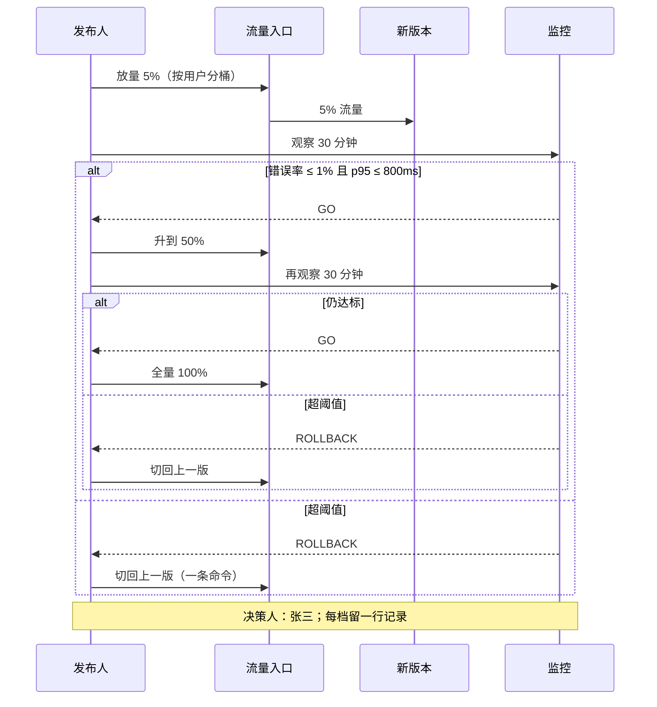
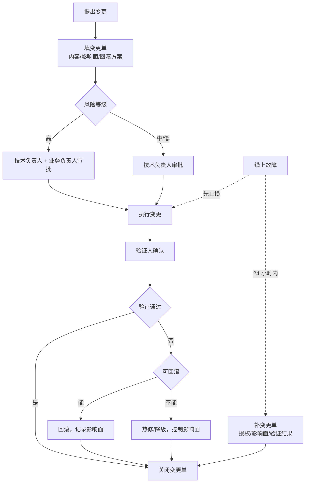

# 系统部署与维护

## 一、边界与术语

部署与维护解决的是「把已验收的版本变成线上服务，并让它在持续变更中保持可用」。产出物是清单、判定记录、变更单、故障报告和维护文档，不是新功能。

| 相邻环节 | 对方负责 | 本篇只负责 |
|---|---|---|
| 运维（`07-运维`） | 平台技术细节：容器、K8s、监控栈命令 | 要不要发、发了怎么判、出事怎么记 |
| 测试（`06-测试`） | 质量证据：用例、覆盖率、自动化 | 把测试结论当放行条件消费 |
| 产品（`01-产品`） | 需求价值与增长指标 | 按节奏把版本送上线 |

两个术语先分开：

- **部署**（deployment）：把制品安装到目标环境的技术动作；
- **发布**（release）：让用户真正用上新版本的业务决策。

可以部署一百次但只发布一次。发布决策发生在部署之后，也发生在「能不能回滚」的确认之后。

## 二、上线检查清单

一次上线能否开始，由清单逐项打勾决定，不由「感觉差不多」决定。清单是发布的法律文件，不是走形式的表格。

| 分类 | 检查项 | 证据 | 阻断级别 |
|---|---|---|---|
| 代码与测试 | 回归测试全绿 | CI 流水线链接 | 阻断 |
| 代码与测试 | 安全扫描无高危 | 扫描报告 | 阻断 |
| 配置与数据 | 配置项已同步到生产 | 配置比对输出 | 阻断 |
| 配置与数据 | 数据库迁移向后兼容 | 迁移脚本评审记录 | 阻断 |
| 能力与容量 | 容量评估覆盖峰值 | 压测报告 | 阻断 |
| 可观测 | 新功能有监控与告警 | 告警规则编号 | 阻断 |
| 可观测 | 回滚判定条件已写死 | 发布单判定栏 | 阻断 |
| 可观测 | 日志字段已接入检索 | 检索平台查询截图 | 非阻断 |
| 组织与审批 | 变更单已审批 | 变更单号 | 阻断 |
| 组织与审批 | 值班人在线 | 上线值班表 | 非阻断 |

打勾规则：阻断项缺一不可发布，非阻断项缺失可以带病发布但必须在变更单里记录。清单签核在发布前 2 小时完成，之后冻结，新问题走变更单补充而不是口头确认。

清单最容易错在两点：**阻断项没有真实事故来源**（久而久之没人当真）、**只写「做了什么」不写证据在哪**（复核时无从查起）。每一项都应能追溯到一次故障或一次行业教训，证据必须是可以点开的链接、编号或输出。

### 2.1 冻结与回退准备

- **变更冻结**从发布前 4 小时开始：主干不再合并新功能，只允许修复本次发布的缺陷；发布分支从主干切出，之后所有改动以缺陷修复形式 cherry-pick。冻结期内混进来的功能提交，是「上线后改的不是测的那版」的主要来源。
- **回退就绪**是独立三项：上一版制品存在（制品仓库版本号）、回退一条命令完成（变更单回滚方案栏）、旧版本读写新数据不报错（兼容性验证记录）。

发布前做一次**回退演练**：用上一版制品在预发环境起一次、切回一次，确认回退命令真实可执行。回退命令在发布当晚才第一次跑，等于把最危险的动作留到最紧张的时刻。

### 2.2 发布节奏

| 节奏 | 频率 | 适用 | 代价 |
|---|---|---|---|
| 固定窗口 | 每周或双周固定日 | 需要协调多团队 | 批量大、回滚影响面大 |
| 随时发布 | 通过即发 | 单服务、自动化测试完备 | 要求发布自动化程度高 |
| 发布列车 | 固定班次，晚一班等下一班 | 多团队集成 | 依赖严格的特性开关 |

窗口按「出事时损失最小」定，不按「人最方便」定：放在告警与值班力量最强的时段，避开业务高峰，避开周五下午。每月设一次发布冻结日（如财务结账日），该日只接受 P1 修复。

## 三、发布方式与回滚判定

发布方式决定爆炸半径；回滚判定必须在发布前写成数值条件，而不是出事之后再开会。

| 方式 | 机制 | 适用 | 代价 |
|---|---|---|---|
| 蓝绿 | 两套环境切换流量 | 回滚要求秒级 | 双倍资源 |
| 灰度/金丝雀 | 小流量先行，逐档放大 | 用户量大、指标可观测 | 判定条件要提前定 |
| 滚动 | 逐台替换实例 | 无状态服务、日常迭代 | 中间态版本混跑 |

### 3.1 回滚判定的四要素

| 要素 | 写法 | 反例 |
|---|---|---|
| 指标 | 错误率、p95 延迟、下单成功率，1-2 个 | 「看监控」 |
| 阈值 | 数字，如「5 分钟错误率 > 1%」 | 「明显升高」 |
| 观察窗口 | 每档停多久，如「5% 档观察 30 分钟」 | 「看一会儿」 |
| 决策人 | 写名字，不是写角色 | 「值班的人」 |

把「看图拍脑袋」变成可执行条件，最小一个脚本就够：

```bash
#!/usr/bin/env bash
# 片段：err_pct 与 p95_ms 由监控 API 拉取，此处假定已解析为数字
readonly ERR_PCT_MAX=1.0   # 5 分钟错误率上限（%）
readonly P95_MS_MAX=800    # p95 延迟上限（ms）

if awk "BEGIN {exit !($err_pct > $ERR_PCT_MAX || $p95_ms > $P95_MS_MAX)}"; then
  echo "ROLLBACK: err=${err_pct}% p95=${p95_ms}ms"
  exit 1
fi
echo "GO: err=${err_pct}% p95=${p95_ms}ms"
```

回滚判定有一条硬边界：**数据结构变更不可回滚**。能回滚的只是代码和配置，回不来的往往是数据。所以数据库迁移必须向后兼容，发布单里「回滚方案」为空的变更不允许排期。

### 3.2 灰度分档

| 档位 | 流量 | 观察 | 升档条件 |
|---|---|---|---|
| 1 | 5% | 30 分钟 | 指标全绿 |
| 2 | 25% | 30 分钟 | 指标全绿 |
| 3 | 50% | 30 分钟 | 指标全绿 |
| 4 | 100% | 持续 2 小时 | 进入观察期 |

三处细节决定灰度是否有效：

1. **按用户分桶，不按请求抽样**。按请求抽样会让同一用户时好时坏，且边界用户永远抽不到；
2. **两版同时可回退**。回退是「把流量切回去」，不是「重新部署」；
3. **每档升档留一行记录**。出事后能复原当时的决策依据。

把一次金丝雀发布画成时序图，判定点就清楚了：



读图：竖线=参与方，实线箭头=动作，虚线箭头=监控判定，`alt/else`=分档分支。图里要出现数字阈值、观察窗口和决策人；只写「观察监控」的图等于没画。

图为两档示例，实际按上表逐档放量（5% → 25% → 50% → 100%）。

### 3.3 向后兼容迁移三步法

把一次破坏性变更拆成三次发布，是消除「数据不可回滚」风险的唯一可靠解法。

| 步骤 | 做什么 | 发布后状态 |
|---|---|---|
| 扩展 expand | 加新列新表，旧代码不用 | 新旧共存 |
| 切换 migrate | 新代码读写新结构，回填旧数据 | 以新为准 |
| 收缩 contract | 确认无回退需求后删旧列 | 只剩新结构 |

硬规则：每步独立发布、独立变更单；contract 至少在 expand 的下一个发布周期才做，因为它一做，回退到旧代码就会因缺列崩溃。判断标准是「线上运行最久的版本已不依赖旧结构」，这句话要用版本分布数据证明，不靠记忆。

## 四、变更管理

变更管理的目的不是让审批变慢，而是让每一次线上改动可追溯、可通知、可复盘。流程走完的标志是变更单关闭，不是代码上线。

变更单九个字段，缺一项就退回：

| 字段 | 说明 | 示例 |
|---|---|---|
| 变更编号 | 唯一键，供回溯 | CHG-2026-1107-03 |
| 变更内容 | 改什么、动哪些服务 | 订单服务 2.4.0 发布 |
| 影响面 | 受影响功能与用户范围 | 下单、退款，全量用户 |
| 回滚方案 | 回滚步骤与预计耗时 | 切回 2.3.2，约 5 分钟 |
| 验证人 | 上线后谁确认可用 | 值班测试张三 |
| 变更窗口 | 计划开始与结束时间 | 11-07 20:00 至 21:00 |
| 风险等级 | 高/中/低 | 中 |
| 通知范围 | 提前通知谁 | 客服群、值班群 |
| 关闭结论 | 结果与遗留问题 | 成功，监控项已补 |

标准变更与紧急旁路画在一张图上：



实线=标准变更，虚线=紧急旁路；每个判定都必须有出口，不能出现断头。紧急旁路不是跳过流程，是把「执行」提前到「填单」之前，24 小时内必须补齐。

**紧急旁路**：线上正在烧钱的事故修复可以先做，但授权人、影响面、验证结果必须在 24 小时内补进变更单。「事后补单」是义务不是选项；长期走旁路的团队等于没有变更管理。

流程最容易错在两点：审批人只看「变更内容」不看「影响面」，高影响变更被当低风险放行；窗口错过就赶工上线——顺延到下一窗口，比带着风险发布便宜得多。

## 五、值班与故障

上线只是开始，维护期真正占人力的是「随时可能响的告警」。没有值班制度的团队，故障响应靠「谁碰巧看到」，平均恢复时间取决于运气。

### 5.1 on-call 怎么排

| 项 | 做法 |
|---|---|
| 轮值 | 每周一人主班、一人备份，备份必须能 5 分钟内接手 |
| 交接 | 每周一交接：上周告警、未闭环问题、本周计划变更 |
| 补偿 | 夜间告警按次调休，否则没人愿意长期值班 |
| 升级 | 15 分钟未定位，自动呼叫二线；30 分钟未恢复，通知负责人 |

on-call 的三条底线：**告警必须可行动**（不可行动的告警是噪音，要改阈值或删掉）、**值班人有权回滚**（没有权限的值班等于接线员）、**告警不追责**（追责会让人瞒报，瞒报比故障更贵）。

### 5.2 故障分级与响应时限

| 等级 | 判定 | 首次响应 | 恢复目标 | 谁指挥 |
|---|---|---|---|---|
| P1 | 核心链路不可用、资金损失、数据泄露 | 5 分钟 | 30 分钟内止损 | 值班负责人 |
| P2 | 部分用户受影响、有替代方案 | 15 分钟 | 4 小时内恢复 | 值班人 |
| P3 | 非核心功能异常 | 4 小时 | 下个工作日 | 模块 owner |
| P4 | 体验问题、咨询 | 1 个工作日 | 排期 | —— |

分级的争议通常在「是不是 P1」。判定标准只问一句：**有没有人在因此损失钱或数据**。有，就是 P1；只是「体验不好」，最多 P2。

### 5.3 现场处理顺序

1. **止损优先**。先回滚、先切流、先关功能，再找原因。不要在现场 debug；
2. **指定一个人指挥**。多人同时改配置是二次故障的主要来源；
3. **对外同步**。客服/客户需要知道「影响什么、多久恢复」，每 15 分钟更新一次；
4. **留证据**。截图、日志、变更单、时间点，事后复盘靠这些，不靠记忆。

### 5.4 复盘

P1/P2 在恢复后 3 个工作日内复盘，只写四节：

```text
1. 时间线：几点几分发生了什么、谁做了什么
2. 根因：直接原因 + 为什么会发生（流程/设计/监控缺口）
3. Action：每条带负责人和截止日
4. 对清单/告警/手册的修改：改了哪一条
```

复盘的硬规则：**不写「加强意识」「注意规范」这类无法验证的 Action**；每条 Action 要么改代码、要么改流程、要么改监控，能在一周内验证。没有 Action 的复盘等于白出。

## 六、SLO 与容量

### 6.1 用 SLO 判断「系统是不是在变好」

| 指标 | 定义 | 示例目标 |
|---|---|---|
| SLI | 实际测量值 | 下单接口成功率、p95 延迟 |
| SLO | 内部目标 | 成功率 ≥ 99.9%，p95 ≤ 500ms |
| SLA | 对外承诺 | 99.5%，违约赔付 |

SLO 要比 SLA 严，留出缓冲。没有 SLO 的团队只能用「用户有没有骂」判断质量，这个信号太晚。

**错误预算**：SLO 99.9% 意味着每月约 43 分钟不可用。预算没用完，可以正常发版；预算用完了，冻结功能发布，先修稳定性。这条规则把「快」和「稳」的争论变成一个有数字的依据。

### 6.2 容量

- 容量评估看**峰值**，不看均值；
- 大促前按「历史峰值 × 1.5」压测，压测报告进上线清单；
- 扩容要提前申请，云资源不是无限的（配额、库存、审批）；
- 降级预案要提前写好：限流阈值、关闭哪些非核心功能、缓存策略怎么切。

## 七、四类维护：只用来分工单

维护活动按「为什么改」分四类。分类不是为了考试，是为了让工单的优先级、排期和成本归属有依据。

| 类型 | 触发原因 | 例子 | 记录重点 |
|---|---|---|---|
| 改正性 | 缺陷暴露 | 优惠券金额算错 | 根因与回归用例 |
| 适应性 | 环境变了 | 上游接口改版、系统升级 | 兼容范围与验证 |
| 完善性 | 用户要更好 | 报表导出提速 | 改进前后指标 |
| 预防性 | 隐患存在 | 依赖升级、补自动化测试 | 风险证据 |

一个改动只按主因归类，判据是「如果没有这个触发，还会做吗」。跨类改动拆成两张单，否则年底统计维护分布时两类数据都被污染。

**分布表的用法**（示例）：

| 类型 | 占比 | 该怎么用 |
|---|---|---|
| 改正性 | 25% | 超过 30% 说明质量债在累积，优先补测试与评审 |
| 适应性 | 20% | 偏高说明外部依赖治理有问题 |
| 完善性 | 38% | 正常，系统在被真正使用 |
| 预防性 | 17% | 低于 15% 说明没腾手处理隐患 |

分布表也是向管理层要资源的证据：用「过去两季度改正性工时上升 40%」申请技术债清理，比说「代码有点乱」有效得多。

教材数据说维护占生命周期成本 60% 以上，这个数字的用途是解释「维护期不是空闲期」，不是用来精确分摊工时。

## 八、维护期的知识沉淀

维护期的核心资产是「新人 30 分钟能接手」，落到三样东西：

| 资产 | 回答的问题 | 更新时机 |
|---|---|---|
| 运行手册 runbook | 出事时第一步做什么 | 架构或流程变化时 |
| 已知问题库 KB | 这个现象是不是老问题 | 每次问题定性后 |
| 维护日志 | 这周系统被动过哪里 | 每次维护动作当天 |

运行手册只写动作，不写百科。判断标准是「凌晨三点按手册能操作」：

```text
告警：订单错误率 > 1% 持续 5 分钟
第一步：查最近 30 分钟的变更单，看是否有发布
第二步：若刚发布，执行回滚判定脚本，按判定执行
第三步：若无发布，查上游依赖状态页与数据库连接数
升级：前两步未定位，15 分钟内呼叫值班负责人
```

已知问题库条目固定四行：**现象、根因、规避方法、修复版本**。现象要写用户能看到的报错原文，不是开发内部的推断——检索靠的就是这几个字。

**文档最容易错在写完不更**。运行手册半年不更新比没有手册更危险，读者会按过时步骤操作。把「手册更新」挂进变更单的验证字段，是最省力的保证方式。

人员交接要过一次检查：新人按手册走通一次启停、抽查三条已知问题能查到、账号密钥审批流已转移。隐性知识（哪个上游月末必抖、哪个告警可以忽略）问不出来，只能靠交接周共同值一次班。

## 九、案例：一次上线与热修

### 9.1 背景

20 人团队的电商订单服务发布 v2.4.0，新增优惠券分摊。窗口周五 20:00-21:30；不能蓝绿，只能金丝雀；数据库迁移必须向后兼容。3 台节点，监控已有错误率与 p95 大盘，v2.3.2 运行稳定。

### 9.2 上线

20:00 金丝雀 5% 放量，观察 30 分钟：错误率 0.3%、p95 450ms，判定脚本输出 GO；升 50% 再观察 30 分钟，指标稳定；21:10 全量，变更单 CHG-2026-1107-03 关闭。

### 9.3 次日故障

14:20 告警，5 分钟错误率 2.4%。值班人执行判定并记录：

```text
回滚判定记录（2026-11-08 14:26）
指标：5 分钟错误率 2.4%，阈值 1%，超阈值
影响面：仅优惠金额为 0.01 元的边界订单，占比 0.3%
数据状态：已有 137 笔分摊成功订单落库
判定：热修不回滚——回滚会使 137 笔已成交订单与
      优惠券账目不一致；缺陷影响面 0.3%，可接受 4 小时
决策人：值班负责人（记录在案）
```

16:10 走紧急变更发布 v2.4.1，16:40 验证通过，17:00 补录变更单。

### 9.4 复盘

根因：金丝雀按请求维度抽样，金额边界用户未被覆盖。Action 两条，一周内落地：

- 金丝雀改为按用户维度分桶；
- 上线清单新增「边界值用例回归」阻断项。

同时补两条维护记录（改正性 4h、预防性 3h）和一条 KB 条目，运行手册加「金额边界用例」检查项。

### 9.5 教训

- **判定记录必须带数字**。初稿只写了「影响不大」，评审退回要求补数值；补齐后 0.3% 和 137 笔两个数字才让「热修不回滚」立得住；
- **回滚不是默认答案**。已经写入的数据会让回滚产生新的不一致，这时「热修 + 控制影响面」比「回滚」更正确；
- **灰度维度要和缺陷类型匹配**。按请求抽样能覆盖流量问题，覆盖不了「特定用户属性」的问题。
