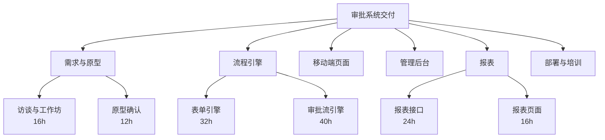
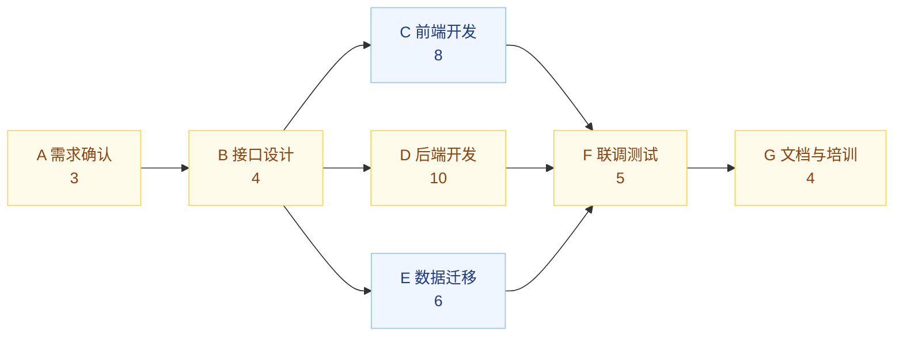

# 项目管理

## 一、项目管理真正管什么

项目管理不是画甘特图，是管三件互相拉扯的事：

| 管什么 | 具体动作 | 失控的表现 |
|---|---|---|
| 范围 | 定边界、管变更、砍需求 | 每周都在加需求，上线日期不变 |
| 资源 | 谁来做、做多久、和谁抢人 | 关键角色同时在三个项目上 |
| 风险 | 识别、定应对、留缓冲 | 出事才知道，且没有预案 |

三者只能同时保两个：范围固定就要动资源或时间；资源固定就要砍范围；三者都不动，质量一定出问题。

**PM 不替团队做估算**。PM 的工作是组织估算、记录假设、盯住偏差——估算错了是团队的问题，假设没记录是 PM 的问题。

| 相邻环节 | 对方负责 | 本篇只负责 |
|---|---|---|
| 产品（`01-产品`） | 需求价值与优先级 | 把已排的需求转成工作量与进度 |
| 需求与设计 | 功能设计 | 估算规模、排顺序 |
| 部署与维护（`08-系统部署与维护`） | 上线、变更、维护 | 排期里为上线与维护留位置 |

## 二、方法取舍：瀑布、敏捷、看板

三种方法不是先进与落后的关系，是适用条件不同。

| 方法 | 适用 | 不适用 | 关键动作 |
|---|---|---|---|
| 瀑布 | 需求稳定、外部验收、合规要求 | 需求边做边变 | 阶段评审、文档基线 |
| 敏捷（Scrum） | 需求不完全清楚、可增量交付 | 强外部依赖、无法拆批 | 迭代、评审、回顾 |
| 看板 | 持续流动的维护/支持类工作 | 有明确上线日期的项目 | 限制在制品、可视化管理 |

判断只需要问三个问题：

1. **需求能提前定死吗？** 能→瀑布；不能→敏捷。
2. **能分批交付吗？** 能→敏捷；不能（如一次切换核心系统）→瀑布。
3. **工作是「项目」还是「持续流」？** 项目→Scrum/瀑布；持续流（工单、维护）→看板。

企业里最常见的错误是「形式敏捷」：每天站会、两周迭代，但需求照样插队、发布日期照样由老板拍。这不是敏捷，是没有排期的瀑布。

**混合形态往往最实用**：整体按阶段（立项→设计→开发→测试→上线），阶段内按两周迭代。外部汇报用里程碑，内部执行用迭代。

## 三、WBS 与估算

### 3.1 工作分解

跳过分解直接报工期，误差可到 ±100%，因为它测的是「感觉」而不是「工作」。

三条规则：

1. **面向可交付物**：末级工作包必须是能验收的东西，不是「研究」「了解」；
2. **8/80 规则**：每个工作包 8-80 小时，小于 8 小时合并，大于 80 小时再拆；
3. **100% 原则**：上层节点等于下层之和，不留「其他」兜底节点。

WBS 树长这样（六个可交付物，示范展开三个；其余同构，共 24 个工作包）：



读图：根=项目，第二层=可交付物，叶子=工作包；叶子必须能验收、带估算（8-80 小时）。不要按部门或阶段画树——「前端」「后端」是角色，不是可交付物。

### 3.2 三种估算

| 方法 | 怎么做 | 适用 | 误差 |
|---|---|---|---|
| 类比 | 找相似项目按比例缩放 | 立项早期 | ±50% |
| 三点 | (O + 4M + P) / 6 | 单个工作包，做过类似任务 | ±20% |
| 参数 | 按功能点/表数/接口数 × 单位工作量 | 需求清单已稳定 | ±30% |

三点估算的 σ = (P − O) / 6，是排期时放缓冲的依据：关键路径上的工作包按 E + σ 排。

**三点估算的前提是「知道悲观值大概在哪」**。从没做过两次以上的任务，给不出有意义的 P 值，这种情况改用类比加宽缓冲，并在估算表里写明假设。

### 3.3 估算表：假设列最重要

```text
编号  工作包      O   M   P    E     σ    假设
W-01  审批流转   10  15  25  15.8  2.5  有历史代码可参考
W-02  条件路由    6   9  14   9.3  1.3  规则数 ≤ 20
W-03  报表导出    4   6  10   6.3  1.0  支持两种格式
```

假设列是这张表最重要的列。条件路由的估算建立在「规则数 ≤ 20」上，需求一周后改成 40 条，这张表立刻失效。**假设变了要重估，而不是把偏差留到复盘时解释**。评审估算表时，80% 的时间应该花在假设列上。

### 3.4 口径与系数

- 所有工作包统一用「人日」记：1 人日 = 8 人时，1 人周 = 5 人日，1 人月 ≈ 20 人日；
- 会议、评审、联调、修缺陷、文档不单独列，按**打包系数 1.3** 乘进去；
- 编码通常只占真实工时的一半左右，只估算编码时间必超。

## 四、排期：关键路径与资源冲突

### 4.1 关键路径

工期由关键路径决定。给非关键路径加班不加人不缩短工期；关键路径上少一个人日，项目就晚一天。

| 活动 | 工期 | 前置 | TF |
|---|---|---|---|
| A 需求确认 | 3 | 无 | 0 |
| B 接口设计 | 4 | A | 0 |
| C 前端开发 | 8 | B | 2 |
| D 后端开发 | 10 | B | 0 |
| E 数据迁移 | 6 | B | 4 |
| F 联调测试 | 5 | C, D, E | 0 |
| G 文档与培训 | 4 | F | 0 |

画成网络图，关键路径标黄：



读图：节点=活动 + 工期（人日），箭头=前置依赖，路径长度=沿途工期相加，最长的那条就是关键路径；`TF`（总浮动时间）= 最晚开始 − 最早开始，TF=0 的活动在关键路径上。关键路径每周用实际完成日期重算一次，偏一天就可能换链。

三条链：A→B→C→F→G = 24 人日；A→B→D→F→G = 26 人日；A→B→E→F→G = 22 人日。关键路径是 26 人日那条，C 浮动 2 天、E 浮动 4 天，可以错峰或交给兼职。

**缓冲放在项目末尾，不放在每个任务上**。每个任务各加 20%，会让排期「看起来永远在加时」，且缓冲被前面的任务吃光。项目级缓冲按关键路径长度的 15% 加。

排期最容易错在两点：**只算一次关键路径**（进度一偏链就换了，要每周用实际完成日期重算）、**把兼职当全职排**（6 人里有 1 人 50% 投入，可用人日要从 240 扣到 220）。

### 4.2 多项目资源冲突

一个人同时在三个项目上，是项目延期最常见的原因，也是最难在甘特图上看出来的。处理办法是**按人按周做负荷表**：

| 成员 | W1 | W2 | W3 | W4 |
|---|---|---|---|---|
| 开发甲 | 5 | 5 | 3 | 0 |
| 开发乙 | 5 | 4 | 5 | 5 |
| 兼职 PM | 2 | 2 | 3 | 3 |

任何一格超过 5 人日就是过载。过载要在计划期解决，不要等到第四周发现。

三种解法，按代价从低到高：

1. **调顺序**：把非关键路径的任务挪到低负荷周；
2. **减范围**：和产品确认哪些需求可以下期；
3. **加人**：最后才用，因为新人上手有成本，且关键路径上加人常常更慢。

### 4.3 里程碑

8 周的项目切 4 个可验收节点，每个节点有明确完成标志：

| 里程碑 | 周 | 完成标志 |
|---|---|---|
| M1 设计冻结 | W2 | 接口文档签字 |
| M2 引擎可用 | W4 | 审批流转演示通过 |
| M3 功能齐备 | W6 | 联调用例全过 |
| M4 发布就绪 | W8 | 上线清单通过 |

燃尽线连续两周高于理想线，只有两个动作：砍范围，或用风险登记册里的缓冲。拖到第七周才砍范围，能砍的选择已经不多了。

## 五、风险登记

风险登记册要可登记、可复审。每条风险必须能回答「触发条件是什么、谁负责、降级动作是什么」，否则它只是焦虑清单。

| 编号 | 风险描述 | 概率 | 影响 | 应对策略 | 负责人 |
|---|---|---|---|---|---|
| R-01 | 核心开发人员不可用 | 中 | 高 | 减轻：结对与文档 | PM |
| R-02 | 上游接口延期交付 | 高 | 高 | 转移：合同罚则 | 接口负责人 |
| R-03 | 测试环境资源不足 | 中 | 中 | 减轻：提前申请 | 测试负责人 |
| R-04 | 需求中途变更 | 高 | 中 | 接受：预留变更配额 | PM |
| R-05 | 第三方许可证争议 | 低 | 高 | 规避：法务预审 | 架构师 |

四条策略要分清：**规避**是消除原因（不做这件事）、**转移**是推给第三方（合同、保险、外包）、**减轻**是降低概率或影响、**接受**是只留观察项。

最常见的错是所有风险都写「密切关注」——那是接受，接受要有代价说明，例如「接受：影响最多 3 人日」。

**风险与问题的界线**：还没发生的是风险（带概率），已经发生的是问题（issue）。问题从风险册转入问题清单，不再占风险编号；把已发生的事当风险挂着，每周复审核不出真正的隐患。

复审节奏：周会过 Top5、里程碑过全册、新风险 24 小时内入册。状态只有三值：开放、缓解中、已关闭。「持续关注」不算状态。

登记册要控制规模：每季度清一次，已关闭归档、低概率低影响降级到观察清单，保持在 15 条以内。半年膨胀到 40 条的登记册，每周 Top5 永远看不完。

## 六、汇报机制

项目管理的产出有一半是「让该知道的人知道」。汇报不是写周报凑字数，是**在正确的时间把正确的信息给正确的人**。

| 对象 | 频率 | 内容 | 形式 |
|---|---|---|---|
| 团队 | 每日/每周 | 今天做什么、卡在哪 | 站会 15 分钟 |
| 项目负责人 | 每周 | 进度、偏差、风险、需要决策的事 | 一页周报 |
| 管理层 | 每月/里程碑 | 整体健康度、预算、重大风险 | 一页纸 + 口头 |
| 干系人 | 变更时 | 影响什么、什么时候 | 通知 |

一页周报四行就够：

```text
进度：M2 完成，M3 延迟 2 天（原因：接口联调）
风险：R-02 上游接口延期，已启用静态数据降级
需要决策：是否砍掉报表导出，保住 8 周上线
下周：完成联调，进入回归
```

**汇报的红线是「不藏坏消息」**。坏消息越早说越便宜；等到上线前一周才说做不完，所有选项都没了。

## 七、配置与基线

配置管理的目标：**任何时间能准确重建任何一个已发布版本**。

| 策略 | 分支 | 适用 | 代价 |
|---|---|---|---|
| trunk-based | 主干 + 短期特性分支 | 持续交付、高频发布 | 特性开关管理成本 |
| release-branch | 主干 + 发布分支 | 有版本周期、多版本并行 | 合并回主干的工作量 |

版本号用 SemVer `MAJOR.MINOR.PATCH`：不兼容变更升 MAJOR、向后兼容的新功能升 MINOR、修 bug 升 PATCH。这条规则用在 API 与对外服务上，内部库可简化，但「升级会不会破坏调用方」必须能从版本号直接读出。

**基线包含三样**：代码 tag、配置快照、依赖清单。只打 tag 不打配置，回滚时拿得出代码却配不回当时的连接串和开关。

基线不等于备份：基线服务于变更控制（能说清「当时是什么版本」），备份服务于灾难恢复（能恢复数据），两者不可互相替代。

**密钥不进代码库**是唯一不可妥协的一条：配置文件里只放变量名，值走独立的密钥管理；历史提交里泄露的密钥即使后来删掉也算泄露，必须轮换。

## 八、度量与反噬

度量的用途只有一个：回答「交付是否健康、下一步改什么」。一旦拿来当考核指标，数据就会被优化掉而不是被改善（古德哈特定律）。

| 指标 | 定义 | 典型误用 |
|---|---|---|
| 缺陷密度 | 缺陷数 ÷ KLOC | 直接给团队排名 |
| 逃逸率 | 生产缺陷 ÷ 总缺陷 | 只看率，不看逃到哪了 |
| 吞吐 | 每周完成的故事点 | 跨团队比较生产率 |
| 交付周期 | 从开始到上线的时间 | 只看均值，不看长尾 |

三条反噬：

1. **覆盖率当 KPI**→ 写无断言的测试；
2. **只测产出不测结果**→ 完成 40 个故事点不等于交付 40 个可用功能；
3. **口径悄悄变**→「缺陷同比下降 50%」先问统计口径变了没，口径一变数据就失去可比性。

**团队小于 10 人时，只留两个指标**：完成速度趋势、逃逸缺陷数。其余不建表——维护度量体系的成本会大于收益。

### 8.1 周看板

五列足够，多了没人填：

| 周 | 完成故事点 | 逃逸缺陷 | 阻塞天数 | 结论 |
|---|---|---|---|---|
| W1 | 12 | 0 | 0 | 正常 |
| W2 | 10 | 1 | 1 | 接口延迟 |
| W3 | 8 | 3 | 2 | 需干预 |
| W4 | 14 | 1 | 0 | 已恢复 |

三个信号：

- 完成量连续两周下降，看阻塞天数：阻塞不增，是估算偏乐观；阻塞增，是外部依赖；
- 逃逸缺陷任何一周超过 3 个，停下新功能，先修质量；
- 单周完成量突然翻倍，先怀疑口径变了，再庆祝。

填看板不超过 5 分钟。超过 5 分钟的度量体系撑不过一个月。

## 九、案例：6 人 8 周交付审批系统

### 9.1 背景

6 人小组（4 开发、1 测试、1 兼职 PM）要在 8 周内交付内部审批系统 v1.0。约束：人力不可加、第 8 周末必须演示、上一套类似系统可作类比、PM 每周投入 50%。

### 9.2 执行

**WBS**：六个可交付物（需求与原型、流程引擎、移动端页、管理后台、报表、部署与培训），共 24 个工作包。

**估算**（节选，单位人日）：

| 工作包 | O | M | P | E | σ |
|---|---|---|---|---|---|
| 审批流转 | 10 | 15 | 25 | 15.8 | 2.5 |
| 条件路由 | 6 | 9 | 14 | 9.3 | 1.3 |
| 报表导出 | 4 | 6 | 10 | 6.3 | 1.0 |

24 个工作包汇总 168 人日。COCOMO 有机型粗校验：3 KLOC，`2.4 × 3^1.05 ≈ 7.6` 人月 ≈ 152 人日，略低于 WBS 汇总——判定 WBS 偏保守但可解释（含测试与培训），取 WBS 数字并记下差异，作为下轮校准输入。

**排期**：关键路径为需求 → 流程引擎 → 联调 → 报表 → 部署演示，约 36 人日（串行约 7.2 周），其余并行；PM 承担浮动 6 天以上的报表与培训；项目级缓冲 15% 约 5 人日放末尾。

**风险 Top5**：核心开发离职（减轻：结对 + 文档）、上游人事接口延期（转移 + 降级：先用静态数据）、测试环境不足（提前申请）、需求变更（接受，预留 10 人日配额）、演示数据不足（提前造数）。

### 9.3 结果

项目在第 7.5 周完成。第 5 周流程引擎超支 3 人日，靠缓冲吸收，关键路径未变；第 6 周逃逸缺陷 4 个，触发「停新功能」规则，集中修了两天。

上游人事接口延期两周，触发 R-02 降级：静态数据先上、真实接口二期接，关键路径未被拖。

复盘三条：

- **WBS 估算偏保守**（COCOMO 低约 10%，差异来自测试与培训口径），下轮校准系数；
- **缓冲 5 人日被吃光但够用**，说明 15% 这个比例对小项目合适；
- **兼职人力要单独排**，不能按人数平摊——PM 的 50% 投入如果按 0.5 人算进总量，报表和培训就会在最后两周撞车。

可复用产物四张：WBS 工作包表、三点估算表、风险登记册、周度量卡。
