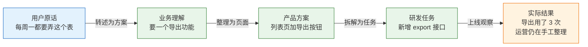
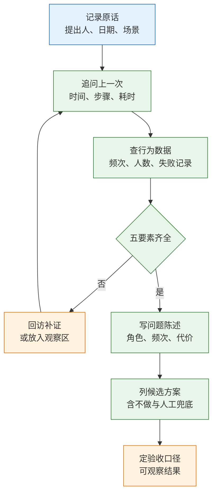

# 产品与用户

---

## 一、产品与用户是什么

### 1.1 核心概念

产品是持续满足一类用户在特定场景下需求的交付物，由功能、业务规则、数据模型和服务流程共同构成。产品工作要回答的不是“做哪个功能”，而是“为谁、在什么条件下、消除哪一段代价”。用户是在具体场景中执行任务的人；角色是人在决策链中的位置。两者不能混用：同一个人既可能是使用者，也可能是买单人，而不同角色关心的事实完全不同。

需求在传递中会经历三次变形。用户描述的是他想到的解法，业务转述会把它整理成更合理的方案，产品文档再把它固化成页面与字段。每经过一次转述，场景细节被压缩，方案确定性被加强。到了研发手里，原始代价往往已经消失，只剩一条可执行的任务。

| 概念 | 回答的问题 | 典型表达 | 验证方式 |
|---|---|---|---|
| 诉求 | 用户希望增加什么 | 加一个导出按钮 | 记录原话与日期 |
| 场景 | 谁在何时做什么、付出什么代价 | 周一上午手工搬数约 60 分钟 | 复盘上一次操作 |
| 需求 | 消除哪段代价、如何判定完成 | 周一 08:00 前自动送达 | 验收条件与行为数据 |

只有场景能支撑判断，诉求只能作为证据。把诉求直接写进需求池，评审时讨论的就不再是问题，而是方案之间的偏好。



每过一层，场景被压掉一点，方案被加固一点。链条末端的研发只能对“按钮能点”负责，无法对“周一早上能收到表”负责。恢复场景信息的唯一办法，是在链条前端留下证据：原话、时间、当前做法、耗时、失败后果。

> **注意**：原话是证据，不是需求。把用户原话整段贴进需求文档，评审时容易把“他说的方案”当成“已确认的问题”，事实与判断混在一起就无法讨论。

### 1.2 适用场景与边界

需求还原适用于所有需要判断“值不值得做”的场合，但不同场景的证据来源和风险不同。

| 场景 | 判断特征 | 主要风险 | 主要产出 |
|---|---|---|---|
| 企业内部系统 | 角色多、流程长、有明确指标 | 只覆盖一线使用者 | 角色清单、流程与权限 |
| 面向消费者的功能 | 链路短、可埋点、频次易测 | 把小众偏好当普遍需求 | 场景陈述、行为数据 |
| 平台与中台能力 | 需求来自多个业务方 | 各方口径冲突、范围膨胀 | 能力边界、接入规范 |
| 存量系统改造 | 有历史数据与旧习惯 | 忽略迁移与代班者 | 迁移清单、兼容要求 |

它不解决三类问题。第一，市场规模与竞争判断，需要行业研究和商业分析，访谈给不出。第二，频次证明，用户自述的“每天用”必须由日志、工单、账号操作记录校验。第三，预算与资源分配，属于业务负责人的经营决策，产品只能提供证据和选项。

需求还原也不替代界面设计与技术方案。它只负责把“谁的哪段代价”说清楚，界面如何组织、接口如何拆分、数据如何存储，属于后续设计环节。顺序颠倒会让讨论过早进入实现细节，场景信息在争论组件时丢失。

> **产品红线**：没有真实用户、也没有可观察行为的全新品类，不得用访谈结论直接排期。此类需求先做原型测试或小范围灰度，把假设变成可观测数据。

---

## 二、判断依据

### 2.1 角色与决策链

面向消费者的产品链路短，但角色仍然存在。使用者决定留存，付费者决定收入，影响者决定口碑。

| 角色 | 关心什么 | 否决方式 |
|---|---|---|
| 使用者 | 能否更快完成眼前任务 | 用一次就卸载 |
| 付费者 | 价格与所得是否匹配 | 不续费、不升级 |
| 影响者 | 是否打扰他人、是否安全 | 投诉、差评、举报 |

企业端的决策链更长，开发者最容易漏掉后两个角色。

| 角色 | 在采购中的作用 | 需要确认的事实 |
|---|---|---|
| 一线使用者 | 提供真实场景，决定用不用 | 操作步骤、耗时、代班安排 |
| 部门管理员 | 配权限、看报表、背指标 | 授权范围、数据边界 |
| 买单人 | 批预算、承担经营结果 | 省几人、少多少错、多久回本 |
| 信息技术与合规 | 决定能否过审 | 数据存放、审计、导出、单点登录 |

同一个工单系统，一线要的是少填字段，管理员要的是能追责，信息技术部门要的是单点登录和审计日志。只按一线需求做完，演示很顺，采购环节仍然会被否决。

企业端还要提前确认：谁不能看这条数据。权限与审计往往在需求末期才被想起，那时改数据模型的成本最高。把“不能看的人”写进角色清单，比上线后再补权限便宜得多。


> **注意**：角色清单按“谁执行、谁授权、谁付费、谁审查”四问展开，不按组织架构图展开。组织架构会变，决策位置相对稳定。

### 2.2 场景五要素

场景不是“用户很忙，需要提效”，而是一段可复盘的具体过程。合格的场景包含五个要素，缺任何一项都会让后续判断失去依据。

| 要素 | 订单日报的示例 | 缺失后果 |
|---|---|---|
| 角色 | 运营 A，兼管两个店铺 | 功能做给了错误的人 |
| 触发 | 每周一 07:30 定时，或手动触发 | 不知道何时执行、由谁发起 |
| 目标 | 08:00 前把上周汇总发给 3 位管理者 | 无法判断成功 |
| 步骤 | 生成汇总、发送邮件、失败重试、站内信 | 异常路径无人设计 |
| 代价 | 每次约 60 分钟，漏行会导致返工 | 优先级排不出来 |

五要素齐全还不够，还要写出“失败后果”。目标没达成时，是返工、罚款、停业，还是仅仅不方便，决定了这件事的优先级。写不出后果的场景，通常频次低或没有责任人。

场景描述应写成一段无形容词的陈述，只包含角色、时间、动作、耗时和结果。任何“提升体验”“更加智能”的表述都要删掉，因为它们既没有触发条件，也无法验收。

频次与单次代价共同决定价值上限，可以先用一个粗算公式把分歧显性化：

```text
价值上限 ≈ 频次（次/月） × 单次代价（分钟） × 受影响人数
```

以订单日报为例：每月约 4.3 次，单次 60 分钟，固定 1 人执行、2 人代班，月人力约 4.3 小时；若漏行导致对账返工，单次代价还要加上返工时间。这个数字不用于精确报价，只用于回答“值不值得为它加一套权限”。一年一次、每次十分钟的事，即使体验很差，也排在一周一次的事之后。

场景粒度也要统一。一个场景对应一次完整任务，从触发到结果交付，而不是一个页面或一次点击。把“打开列表”“筛选”“导出”拆成三个场景，会低估总耗时；把整条供应链写成一个场景，又无法判断卡点。边界取“一个角色完成一件可命名的事”为止。

> **产品红线**：场景缺少触发条件或代价时，不得进入排期。此类条目只能放观察区，补齐证据后再参与排序。

### 2.3 证据强度与样本选择

不同证据能证明的事情不同，混用会得出错误结论。

| 证据 | 能证明 | 不能证明 | 采集方式 |
|---|---|---|---|
| 访谈 | 动机、步骤、替代方案 | 真实频次与人数 | 复盘上一次操作 |
| 行为日志 | 频次、路径、失败率 | 用户为什么放弃 | 埋点、操作记录 |
| 工单与群记录 | 问题分布、发生时间 | 未投诉人群的规模 | 关键词归类 |
| 合同与承诺 | 外部约束、交付期限 | 功能是否真被使用 | 条款与验收单 |

样本要按行为分层，不按年龄、性别、地域分层。一个协作工具至少分四层：本周高频使用、注册后未使用、曾经使用后离开、团队管理员。每层找三到五人即可，不追求统计显著，追求把分歧找出来。

三种常见抽样错误：

| 只问了谁 | 得到的结论 | 漏掉的事实 |
|---|---|---|
| 活跃用户 | 功能如何用得更顺 | 多数人为何不用 |
| 需求提出人 | 一个清晰方案 | 同岗位其他人的做法 |
| 一线使用者 | 操作细节 | 管理员与合规方的否决点 |

访谈的停止条件不是人数，而是信息饱和：同一类角色连续三次给出相似步骤，且不再出现新的替代方案。继续加人通常只是在收集措辞。

样本的代表性不靠人数，而靠分层是否覆盖分歧最大的两端。每层至少一人，两端各有一人，比在同一层访谈二十人更有价值。

还要区分“说”与“做”。用户说愿意付费，不等于会付费；说导出很重要，后台可能三个月只调用五次。访谈负责解释动机，行为数据负责证明频次。两者冲突时，以行为为准，再回访谈找原因。

---

## 三、标准流程

### 3.1 需求还原流程

还原的目标是把一句方案还原成一段可验证的场景，再决定做不做、怎么做。流程固定为六步，顺序不能颠倒。



**第一步，记录原话。** 需求池只写原始诉求、提出人、提出日期、当前做法，不写“应该增加某功能”。转述时人会不自觉把方案整理得更合理，两周后就查不到用户卡在哪。

**第二步，追问上一次。** 只问过去，不问“你想要什么”。过去有细节，愿望只有形容词。追问到“这份表最后发给了谁、对方拿它做什么决定”为止，再往下就是对方的经营方式，与本次决策无关。评审任何方案前先问一句：不做会怎样。答不出代价的，先放观察区，不占用本期产能。

**第三步，用现有记录核对。** 没有埋点也能查：客服工单、群聊记录、账号操作日志、旧系统访问记录。频次稳定、人数少、有失败先例，这三条往往直接排除“大而全平台”的方案。

**第四步，写问题陈述。** 一段话讲清角色、频次、代价，句子里不出现功能名。功能名一出现，讨论就会滑向实现。

**第五步，列候选方案。** 至少三个：最小改动、目标方案、不做或人工兜底。每个方案标注工作量、覆盖的耗时比例、新增风险。没有“不做”选项的对比不是对比。

**第六步，定验收口径。** 验收写在开发前，描述上线后用什么可观察结果判断问题是否消失，而不是功能是否存在。

### 3.2 访谈执行要点

访谈提纲固定，问题按“事实、过程、后果”三类组织，避免引导。

```text
1. 上一次做这件事是哪天？从打开系统到发出去，点了哪些地方？
2. 那份表最后发给了谁？对方拿它做什么决定？
3. 表里哪几列是必须的？哪几列是自己加的？
4. 这周和上周的表，结构一样吗？哪里会变？
5. 如果周一早上没发出去，会发生什么？
6. 这件事除了你，还有谁在做？请假时谁代班？
```

| 阶段 | 目的 | 记录内容 |
|---|---|---|
| 开场 | 建立具体时间锚点 | 最近一次发生的日期 |
| 过程 | 还原真实步骤 | 系统、截图、手工环节、耗时 |
| 后果 | 量化失败代价 | 返工、投诉、罚款、停机 |
| 收尾 | 找替代与代班 | 现有工具、协作者、频率变化 |

访谈中三条纪律：不替用户总结，不评价他当前的做法，不介绍尚未确定的产品方案。一旦介绍方案，受访者会开始评价方案，而不是描述问题。

记录按时间轴写，不按主题写。“07:30 打开系统、07:35 筛选、07:50 复制、08:10 核对、08:20 发送”比“用户觉得流程繁琐”有用得多。时间轴能直接暴露两件事：哪一步最耗时，哪一步最容易出错。前者决定优化点，后者决定验收条件。原话、截图、录屏附在时间轴对应节点，评审时不再重复追问。

### 3.3 产出物与交接

还原阶段的产出不是原型，而是四份可交接的材料。

| 产出物 | 主要读者 | 完成标准 |
|---|---|---|
| 角色清单 | 产品、设计、研发 | 四类角色各有姓名或岗位 |
| 场景陈述 | 评审参与者 | 五要素齐全、含失败后果 |
| 证据附件 | 评审参与者 | 原话、截图、数据各有来源与日期 |
| 候选方案表 | 决策人 | 含不做选项与工作量区间 |

交接时只传结论会丢失判断依据，只传原话又会让研发重新猜。正确做法是“结论在上、证据在下”：第一页写问题陈述和选项，附录放原话与数据。

---

## 四、模板与示例

### 4.1 需求卡片模板

需求卡片是需求池的最小单元，一张卡只描述一个问题，不描述多个方案。

```text
【需求卡片】
标题：<角色><场景>下的<问题>，不超过 25 字
提出人 / 日期：
角色：使用者 / 管理员 / 买单人 / 合规方
触发：<时间点、事件、频率>
当前做法：<工具、步骤、耗时、参与人数>
失败后果：<返工、投诉、罚款、停机、无>
影响人数：<近 30 天真实人数及来源>
证据：<原话记录、工单号、日志查询、合同条款>
候选方案：A <最小改动> / B <目标方案> / C <不做或人工兜底>
验收口径：<上线后 2 周内可观察的结果>
本期不做：<明确排除的范围>
```

| 字段 | 填写要求 | 常见错误 |
|---|---|---|
| 标题 | 含角色与场景，不含功能名 | 写成“导出功能优化” |
| 触发 | 可对应到日历或事件 | 写“经常”“随时” |
| 当前做法 | 有步骤与耗时 | 只写“手工处理” |
| 失败后果 | 能量化或分级 | 写“影响体验” |
| 验收口径 | 有对象、阈值、时间窗 | 写“功能可用” |

### 4.2 完整示例：订单日报

某订单中台，运营在群里提出“订单列表加个导出 Excel，每周都要用”。两周后是大促，研发只有前端一人、后端一人，本期五个工作日，权限模型不能动。半年前做过报表中心，月活不到三十。

产品没有直接排期，先做了三件事。记录原话与当前做法：截图加手工录入，约六十分钟。访谈只问过去，得到完整步骤：筛选上周订单、复制关键字段、粘贴到固定模板、核对金额、发邮件给三位管理者。用现有记录核对：群记录显示近八周每周一次，账号列表显示固定一人执行、两人代班，旧报表中心访问记录月活低于三十。

问题陈述写成：

```text
运营 A 每周一上午花约 60 分钟，把上周订单的关键字段
从系统搬到 Excel，再发给 3 位管理者。
搬运会漏行、会抄错金额，A 请假时无人能替代。
```

三个候选方案：

| 方案 | 工作量 | 效果 | 风险 |
|---|---|---|---|
| 列表页加导出 | 2 天 | 省掉抄写，仍要整理与发送 | 只覆盖约三分之一耗时 |
| 周一 08:00 定时邮件日报 | 3 天 | 整理与发送都省掉 | 收件人与字段需确认 |
| 管理者只读看板 | 5 天 | 随时可查 | 本期无人力，旧看板已证明无人使用 |

选择定时邮件，保留导出作为手动兜底。理由三条：六十分钟里约四十分钟花在整理和发送；需求方要的是“周一早上看到”，不是“随时能查”；目标方案加兜底正好五天，且不改权限模型。

上线后第二周回访只问三个问题：收到了吗、数字对不对、还手动改过吗。第三个问题决定需求能否关闭。结果显示，周一耗时降到约五分钟；半年后“生成、发送、失败兜底”的结构被复用到另外两张报表。可复用的是结构，不是代码。

回访要看三类数据：触达、准确、替代。触达是收件人是否打开，准确是数字是否与手工核对一致，替代是人工步骤是否消失。只有触达没有替代，说明功能只是多了一个入口，原代价仍在。三类数据连续两周稳定，才关闭需求；否则回到场景重新判断。

> **注意**：案例中的工时、人数与月活均为示例数字，用于说明取舍过程，不代表任何公司的公开数据。

### 4.3 反例对照

| 反例 | 错在哪 | 修正方式 |
|---|---|---|
| “客户要求加审批流” | 把方案当问题 | 追问上一次卡在哪个环节、谁在等 |
| “所有用户都需要” | 无样本、无频次 | 按行为分层抽样，查真实人数 |
| “先做出来再看反馈” | 没有验收口径 | 先写可观察结果与观察周期 |
| “竞争对手有，我们也要有” | 无场景、无代价 | 找自身用户的同类场景证据 |
| “老板说要，先排上” | 无验收人、无预算 | 补责任人与失败后果，再排序 |

反例的共同点不是方案错误，而是证据缺失。方案可以讨论，缺失的证据无法在评审会上补出来。

---

## 五、常见失败模式与检查清单

### 5.1 失败模式

| 现象 | 最可能原因 | 处理 |
|---|---|---|
| 功能上线无人使用 | 把方案当问题，真实频次低 | 回看原话与行为记录，不急着加引导 |
| 演示顺利但采购不过 | 只覆盖使用者，漏管理员与合规 | 补权限、审计、导出、数据存放说明 |
| 需求越做越大 | 没有写非目标 | 在卡片与文档首屏列本期不做 |
| 访谈结论与直觉相反 | 只访谈活跃用户 | 补流失用户、代班者、管理员 |
| 用户坚持“就要这个” | 没问上次的具体做法 | 追问时间、步骤、耗时、后果 |
| 上线后发现涉及个人信息 | 没做数据清单 | 需求阶段标出采集、展示、导出、留存 |
| 两个部门需求冲突 | 没识别各自指标 | 把冲突摆到评审桌，由业务定口径 |
| 上线后指标没动 | 场景选错或频次太低 | 先确认使用数据，再谈推广 |

排查顺序固定：先看真实使用数据，再回访提出人，再核对场景五要素，最后才怀疑实现。反过来做，通常会把需求判断错误当成技术缺陷修。

### 5.2 检查清单

| 检查项 | 通过标准 |
|---|---|
| 原话留存 | 有提出人、日期、原始表述 |
| 角色覆盖 | 使用者、管理员、买单人、合规方各有结论 |
| 频次证据 | 有日志、工单或记录，不靠自述 |
| 场景完整 | 五要素齐全，含失败后果 |
| 方案对比 | 至少三个，含不做或人工兜底 |
| 验收口径 | 有对象、阈值、时间窗 |
| 非目标 | 明确写出本期不做什么 |
| 数据合规 | 采集、展示、导出、留存已标注 |

> **产品红线**：验收口径写不出可观察结果的条目，不得进入开发。功能上线只能证明代码运行，不能证明问题被解决。
