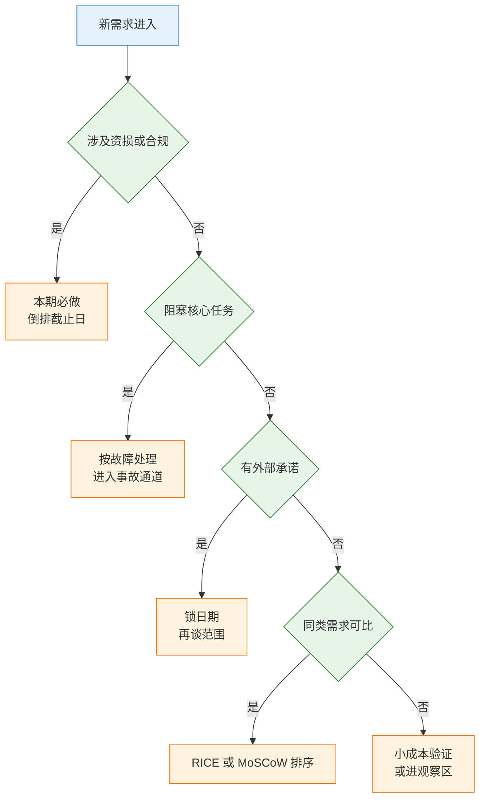
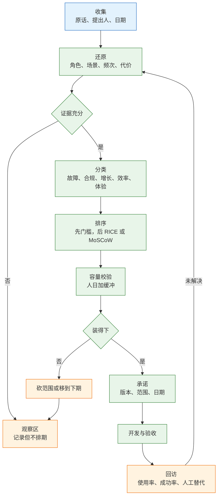
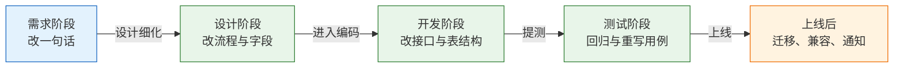

# 需求与验收

---

## 一、需求与验收是什么

### 1.1 核心概念

需求管理不是给列表排序，而是决定“这一期不做什么”，并给“做完了”下一个人人认账的定义。前者控制投入，后者控制返工。两件事都不做，需求池会变成压力表，版本会变成无休止的补丁。

需求（Requirement）是经过证据校验、可以验收的问题定义。它与诉求的区别在于：诉求是某个人希望增加的东西，需求写清了谁的问题、发生多频繁、代价多大、怎样算解决。需求池（Backlog）是所有候选需求的集合，必须包含状态、证据和关闭规则，否则只是标题清单。

验收标准（Acceptance Criteria）是判断需求是否完成的业务条件，用可观察的结果描述，不用实现细节描述。完成定义（Definition of Done）是团队对“可交付”的统一要求，覆盖代码评审、测试、文档、监控、回滚方案。两者层级不同：验收标准针对单条需求，完成定义针对所有交付物。

| 概念 | 作用 | 判断形态 | 失效表现 |
|---|---|---|---|
| 需求 | 定义要解决的问题 | 有角色、频次、代价 | 只有标题与优先级 |
| 需求池 | 管理候选与在办事项 | 有状态、证据、关闭规则 | 只增不减 |
| 验收标准 | 判断单条需求是否完成 | 前置条件、动作、结果 | 写成功能清单 |
| 完成定义 | 判断交付物能否上线 | 评审、测试、监控、回滚 | 每次靠口头确认 |

验收标准与测试用例不是一回事。测试用例覆盖实现细节和边界组合，验收标准覆盖业务结果。产品验场景与口径，测试验边界与异常，开发自测接口与数据。三方各验一段，才不会出现“测试全过、业务不能用”。

需求来源通常有四类：用户反馈、行为数据异常、合规与合同要求、内部效率损耗。四类来源的证据形态不同，不能用同一种卡片同一套话术处理。用户反馈要补频次，数据异常要补原因，合规要求要锁日期，效率损耗要算人力成本。来源不分，判断就会混。

### 1.2 适用场景与边界

需求治理适用于有固定交付节奏、需要多方协作的团队。规模越小，流程可以越轻，但判断依据不能省。

| 场景 | 流程重量 | 关键控制点 | 主要风险 |
|---|---|---|---|
| 单团队迭代 | 轻，卡片加评审 | 验收口径、非目标 | 需求随手插入 |
| 多团队协同 | 中，统一需求池 | 依赖、接口、口径 | 各自解释验收 |
| 合同交付 | 重，变更单 | 范围、日期、签字 | 无限次免费修改 |
| 合规与故障 | 最重，门槛优先 | 时限、证据、复盘 | 被增长需求挤占 |

它不解决三类问题。第一，战略取舍，做哪条业务线由经营目标决定，需求池只能承接。第二，零到一的验证，早期产品数据太少，打分只会制造精确的错觉，应先用小成本实验。第三，人员产能的根因，长期靠加班消化需求是组织问题，不是排序问题。

流程还要随团队规模调整。五人团队用一张共享表格加每周一次评审即可；五十人团队需要统一编号、状态与依赖字段，否则跨团队无法对齐。流程的复杂度应跟着协作边界增长，而不是跟着文档模板增长。

> **注意**：流程越重，越过期。需求卡片、评审、变更单都应为减少返工服务；如果一张卡片要填三十个字段却没人看，说明流程本身需要被砍。

---

## 二、判断依据

### 2.1 需求真伪的四个信号

真需求不靠语气强弱，靠四个可查的信号。

| 信号 | 真需求的样子 | 伪需求的样子 | 核查方式 |
|---|---|---|---|
| 频次 | 每周或每天发生 | “以后可能会用” | 工单、日志、聊天记录 |
| 代价 | 有耗时、错单、罚款 | 说不出不做会怎样 | 复盘上次的具体过程 |
| 替代 | 已在用表格、人工、外部工具 | 完全没有替代方案 | 看现有工具与手工流程 |
| 责任 | 有人验收、有人承担成本 | 只有一句“老板要” | 问谁验收、谁付预算 |

最后一条最容易被忽略。一个需求如果找不到验收人，也找不到为它承担成本的人，大概率在上线后无人使用。责任不是职位，而是“出问题时谁被追问”。

销售转述的需求要单独处理。典型说法是“客户说不做这个功能就续不了费”。这句话既不能直接排期，也不能直接驳回。先查三件事：合同里有没有这条承诺；客户近三个月的实际使用数据；客户现在用什么替代。常见结果是，续费障碍不是缺功能，而是权限太粗、导出太慢、或者无法对接单点登录。销售转述的是他能想到的功能，不是客户卡住的环节。

> **注意**：置信度不能靠语气定级。合同条款、监管日期、书面承诺可以视为高置信；转述、传闻、竞品截图只能算线索，需补证据。

### 2.2 分类与优先级门槛

不同类型的需求不能放在同一个分数轴上比较。合规与安全是门槛，不是选项；线上故障的优先级高于任何新功能；体验优化通常可以排队。

| 类型 | 判断标准 | 处理时限 | 排序位置 |
|---|---|---|---|
| 故障 | 核心任务不可用或数据错误 | 立即，按事故等级 | 高于所有新功能 |
| 合规 | 法律、合同、监管、审计要求 | 按截止日倒排 | 锁死日期，不参与打分 |
| 增长 | 直接影响收入或转化 | 按季度目标 | 与效率需求竞争 |
| 效率 | 降低人工耗时与错误率 | 按容量安排 | 常规排序 |
| 体验 | 改善可用性与观感 | 可延期 | 最后 |

先过三道门槛，任何一道为“是”都不进入打分：

1. 是否涉及资金损失、数据泄露、法律合规？是则本期必须处理。
2. 是否阻塞现有用户完成核心任务？是则按故障处理。
3. 是否有明确的外部承诺，如合同、招标、监管日期？有则先锁日期，再谈范围。

门槛的作用是防止“用分数把红线平均掉”。一个合规需求即使影响人数少、投入大，也不能因为 RICE 分数低而被排到增长需求之后。



决策树的顺序本身就是优先级：先排除不可协商项，再处理停摆问题，最后才比较收益。把顺序倒过来，就会得到“增长需求挤掉合规整改”的典型事故。

> **产品红线**：合规、资损、线上故障不得与增长需求放在同一分数轴上竞争。门槛项被分数挤掉，等于用排序模型推翻责任。

### 2.3 评分方法及其适用范围

过了门槛，才用评分方法处理同类需求之间的取舍。

```text
RICE = (影响人数 × 影响程度 × 置信度) / 投入人日
```

| 因子 | 取值建议 | 常见错误 |
|---|---|---|
| 影响人数 | 近 30 天真实活跃人数 | 用注册总数乘拍脑袋比例 |
| 影响程度 | 3 决定性、2 明显、1 轻微、0.5 很小 | 所有需求都填 3 |
| 置信度 | 有数据 100%、有访谈 80%、只有直觉 50% | 把销售承诺当 100% |
| 投入 | 设计、开发、测试、迁移、运维 | 只算编码，漏联调与数据 |

RICE 的作用不是给出唯一答案，而是把分歧变成可讨论的数字。算完与直觉相反时，先检查分子分母是否填错，再检查是否漏了门槛项。每个分数后面留一列证据：人数来自哪张表、置信度为什么是 80%、人日由谁估算。没有证据的分数只是把主观判断换成小数，评审时照样吵。

因子权重不必在每次评审重新争论。先把取值规则写死，再讨论具体数值；规则稳定后，分数才有跨期可比性。每次都换算法，历史分数就失去参考价值，也无法解释上季度为什么那样排。

MoSCoW 适合范围已经锁死、只差砍件的场景：Must 是缺了不能发布，Should 是重要但可延期，Could 是锦上添花，Won't 是本期明确不做。它的价值在最后一项，不在前三项；没有 Won't 的 MoSCoW 只是换了名字的全都要。

| 场景 | 更适合 | 原因 |
|---|---|---|
| 多个机会争抢同一批人 | RICE | 需要横向比较投入产出 |
| 发布日期已对外承诺 | MoSCoW | 先保底线，再砍范围 |
| 合规与故障混杂 | 先门槛后打分 | 分数不能替代红线 |
| 早期产品、数据很少 | 判断加小成本验证 | 置信度太低，打分是精确错觉 |

---

## 三、标准流程

### 3.1 需求池流转流程

需求从进池到关闭，要经过一条明确的路，而不是“提了就排”。



关键在两个岔口：证据是否充分、容量是否装得下。多数团队只做到排序，没做容量校验，于是每条需求都“很重要”，每期都延期。

状态字段至少五态：观察、待排、已承诺、开发中、已关闭。关闭要写原因：已上线、已合并、无证据、被替代。没有关闭原因的池子，半年后没人敢删任何东西。

关闭规则写三条：已上线且回访达标、与其他需求合并、连续三个月无新增证据。第一条由产品确认，第二条写清合并去向，第三条自动执行，不需要开会。规则写进池子说明，任何人都能按同一标准清理。

### 3.2 容量校验与交付承诺

排序解决“先做哪个”，容量解决“能做几个”。后者不做，前者没有意义。

示例：团队五人，季度有效工作日约五十天，扣除会议、支持、休假后按 0.7 折算，可用约一百七十五人日；再留 20% 缓冲应对故障与变更，可承诺约一百四十人日。四十七条需求估完合计二百六十人日，必须砍掉近一半。排序后保留十二条主线约一百一十五人日，两条大客户定制单独立项、单独排期约二十人日，其余进观察区。

承诺时记住一条：**版本、范围、日期，三者只能同时保证两个。**

- 日期固定，如招标、监管：范围可谈，先保 Must。
- 范围固定，如合同：日期可谈，写清依赖客户配合的部分。
- 两者都固定：加人只在任务可并行时有效，多数时候只增加沟通成本。

缓冲不是偷懒，是给线上故障、数据修复、评审返工留的位置。没有缓冲的计划，一次严重故障就能让整个季度失信。

估算不要只报一个数。让执行的人给出乐观、最可能、悲观三个值，再用历史速率校准：上季度计划一百人日、实际一百三十人日，本季度估算就按 1.3 倍修正。跨团队依赖单独列成里程碑，不要混进人日里假装可控。开发在估算时的价值不是压价，而是把“要做得稳需要什么条件”讲清楚：是否改表、是否兼容旧数据、是否等待第三方接口。

### 3.3 验收标准判定化

“支持导出”“优化体验”“性能提升”都不是验收标准。可执行的验收至少包含前置条件、动作、可观察结果。

| 类型 | 验收写法 | 反例 |
|---|---|---|
| 主路径 | 给定已付款订单，点击导出，五秒内下载表格，行数与列表一致 | 导出功能正常 |
| 边界 | 订单数为零时仍生成文件，含表头，正文提示无数据 | 空数据不报错 |
| 权限 | 无导出权限的角色看不到按钮，直接调接口返回 403 | 按角色控制 |
| 数据 | 取消订单不计入成交额，时区为 Asia/Shanghai | 金额正确 |
| 异常 | 邮件服务断开时重试两次，最终失败发站内信 | 失败有提示 |
| 性能 | 一万行导出在十秒内完成，内存不超过 512MB | 性能良好 |
| 埋点 | 点击、成功、失败三个事件可在报表中查到 | 加了埋点 |

每条验收条件只描述一个可观察事实，避免“并且”“同时”连接多个结果。多个结果应拆成多条，否则失败时无法定位是哪一项不满足。

验收责任按角色拆：产品确认业务口径与场景，测试确认边界与异常，开发确认接口契约与数据一致性，运维确认监控、日志与回滚。任何一方缺席，验收就退化成“页面能打开”。

阈值不能凭空写。先取当前基线，再约定改善幅度：当前周一发送耗时约六十分钟，目标压到十分钟以内；当前人工补发每周一次，目标连续两周为零；当前导出失败率约百分之三，目标降到百分之一以下。基线来自日志或人工记录，改善幅度由需求方确认，两者都写进卡片。没有基线的阈值只是愿望，上线后无法判断是否达标。

> **产品红线**：验收口径未写入需求卡片的条目，不得进入开发。上线后再补口径，等于用实现结果反向定义需求。

---

## 四、模板与示例

### 4.1 需求卡片模板

需求卡片承接的是“待判断的问题”，字段比用户访谈记录更偏决策。

```text
【需求卡片 · 池内版】
编号：REQ-<年月>-<序号>
标题：<角色>在<场景>下的<问题>
类型：故障 / 合规 / 增长 / 效率 / 体验
提出人 / 日期：
证据：<工单号、日志、访谈记录、合同条款>
频次：<次/月>    单次代价：<分钟或金额>
影响人数：<近 30 天真实人数>    来源：<表名>
门槛判断：资损 / 合规 / 阻塞核心任务 / 外部承诺
RICE：人数 × 程度 × 置信度 ÷ 人日 = <分值>
依赖：<团队、接口、数据、审批>
验收摘要：<三条可观察结果>
本期不做：<排除项>
状态：观察 / 待排 / 已承诺 / 开发中 / 已关闭
关闭原因：<已上线、已合并、无证据、被替代>
```

| 字段 | 填写要求 | 常见错误 |
|---|---|---|
| 编号 | 全库唯一，可回链 | 用标题当唯一标识 |
| 类型 | 单选，决定排序通道 | 同时勾选增长与合规 |
| 证据 | 可追溯到原始记录 | 写“用户反馈” |
| 影响人数 | 有数据来源与日期 | 用累计注册数 |
| 验收摘要 | 三条以内，可观察 | 复制功能清单 |
| 关闭原因 | 四选一，写日期 | 长期停在开发中 |

### 4.2 验收条件模板与示例

验收条件用固定句式写，避免形容词。

```text
【验收条件】
场景：<角色>在<触发条件>下执行<任务>
前置：<数据状态、权限、依赖可用>
动作：<用户操作或系统事件>
结果：<页面、文件、消息、状态变化>
阈值：<时间、数量、金额、成功率>
反例：<不应发生的结果>
观测：<日志、报表、埋点事件名>
```

以定时日报为例，验收条件写成四组：

```text
1. 每周一 07:30 自动生成上周日报，08:00 前送达 3 位收件人；
   附件行数与订单列表一致，金额合计与财务口径相差为 0。
2. 收件人缺少权限时，附件不生成，改为站内信提示申请人；
   直接访问下载链接返回 403。
3. 邮件服务超时后重试 2 次，间隔 5 分钟；仍失败则发站内信，
   并在监控面板产生一条失败记录。
4. 连续两周统计：自动送达率、人工补发次数、字段修改次数；
   人工补发次数为 0 时，需求方可关闭该需求。
```

第 4 组最容易被省略，却是判断需求是否真正解决场景的唯一依据。功能上线只证明代码运行，回访数据才证明代价消失。

### 4.3 变更评估单

变更成本随阶段上升，这是经验规律，不是精确公式。



变更要有规则，而不是“谁嗓门大谁插队”。

1. 变更写成一句话影响：加什么、去掉什么、影响哪些已承诺范围。
2. 必须有人做交换：加一条就砍一条或延一期，不能只加不减。
3. 上线前冻结窗口内的变更走负责人签字，不接受群里一句话。
4. 数据结构与权限变更单独评估，它们的回滚成本最高。

```text
【变更评估单】
变更内容：<一句话>
提出人 / 日期：
影响范围：<需求编号、接口、表结构、报表、权限>
工作量变化：<+N 人日，由谁估算>
交换方案：<砍掉哪条 / 延到哪个版本>
回滚成本：<数据、缓存、下游系统>
决定：接受 / 拒绝 / 延期    决策人：
```

> **产品红线**：只加不减的变更一律不接受。范围蔓延不是靠加班解决，而是靠交换规则阻断。

### 4.4 反例对照

| 反例 | 错在哪 | 修正方式 |
|---|---|---|
| 把“加导出”直接写进迭代 | 把方案当需求 | 回到场景，量化频次与耗时 |
| RICE 各项全填最高值 | 打分退化为表态 | 每项附证据与数据来源 |
| 承诺“尽量做完” | 范围未锁、日期含糊 | 版本、范围、日期只保两个 |
| 验收写“功能正常” | 没有可观察结果 | 前置、动作、阈值、反例 |
| 变更只在群里说一声 | 无交换、无记录 | 填评估单，写回滚成本 |

反例的共同点是跳过了判断步骤，直接从“有人提”走到“安排做”。补回证据与交换规则，比事后追责更有效。

---

## 五、常见失败模式与检查清单

### 5.1 失败模式

| 现象 | 最可能原因 | 处理 |
|---|---|---|
| 需求池越积越多 | 没有观察区与关闭规则 | 三个月无证据的自动进观察区 |
| 评分结果与直觉相反 | 人数或置信度拍脑袋 | 回到真实数据重填因子 |
| 评审无人反对 | 只宣讲方案，没有分歧项 | 提前列三个待定项，强制表态 |
| 开发说工作量翻倍 | 需求藏着未写的异常与权限 | 评审时补异常路径与数据范围 |
| 上线后无人使用 | 伪需求或频次极低 | 看使用埋点，不急着推广 |
| 同一需求反复提 | 上次只解决表面 | 回到场景确认根因 |
| 变更导致延期 | 没有交换规则 | 加一条砍一条，记录决策 |
| 合规需求总被后排 | 用分数与增长需求比较 | 合规走门槛，不参与打分 |
| 验收时各说各话 | 口径没写进需求 | 每条需求附三到五条可观察结果 |

排查顺序：先看需求记录是否完整，再看频次与代价证据，再看排序门槛，最后才讨论工作量。

失败模式里最隐蔽的是“指标没动但没人复盘”。上线两周后应固定做一次小复盘：使用率是否达到预期、失败率是否可接受、人工替代是否消失、有没有新增工单。四项都达标才关闭；任一项不达标，回到场景陈述，而不是继续加功能。复盘结论写回卡片，下一期排序时直接引用，避免同类需求反复立项。

### 5.2 检查清单

| 检查项 | 通过标准 |
|---|---|
| 证据链 | 每条需求可追到原话、工单或日志 |
| 门槛 | 资损、合规、阻塞、承诺已单独判定 |
| 排序 | 分数附证据，同类需求才比较 |
| 容量 | 人日含缓冲，依赖单列里程碑 |
| 承诺 | 版本、范围、日期只保两个 |
| 验收 | 有前置、动作、结果、阈值 |
| 回访 | 有使用率、成功率、人工替代指标 |
| 变更 | 有交换方案、回滚成本、决策人 |
| 关闭 | 有原因与日期，池子能减 |

> **产品红线**：需求池只进不出、验收口径靠上线后补，这两件事同时出现时，交付节奏一定失控。先修池子，再谈提速。
