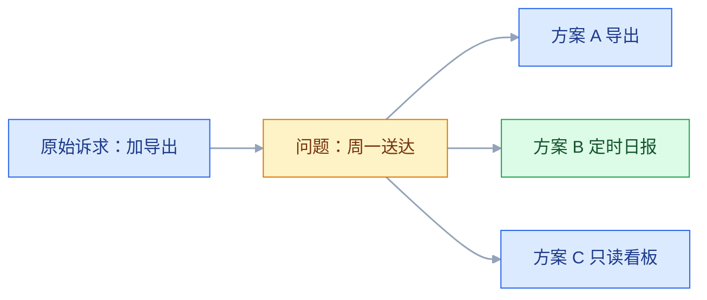
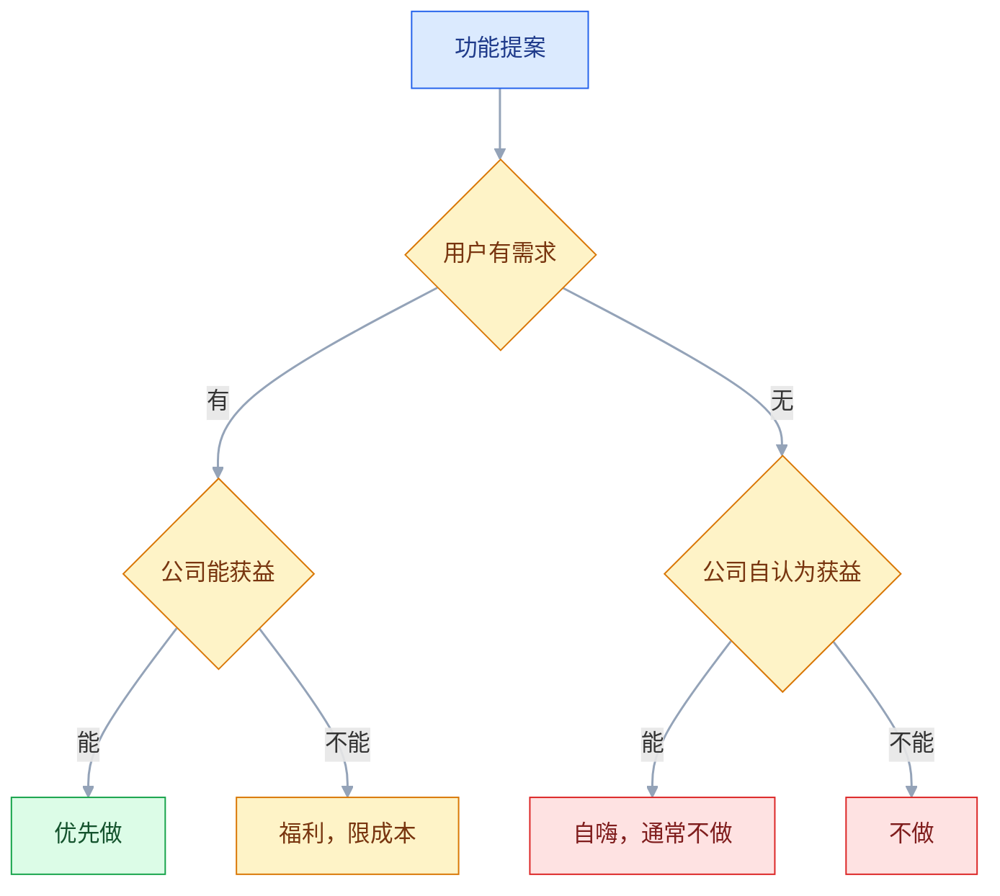

# 产品思维

## 一、工程案例：把「加一个导出按钮」做成一份能过评审的方案

**场景**：一套面向中小电商的订单中台，运营在群里提需求：「订单列表加个导出 Excel，每周都要用。」两周后是大促，研发只有前端 1 人、后端 1 人，本期 5 个工作日，权限模型不能动。

**约束**：

| 约束 | 具体内容 |
|---|---|
| 时间 | 5 个工作日内给出结论，做或不做都要有理由 |
| 人力 | 前端 1 人、后端 1 人，没有专职数据分析师 |
| 兼容 | 本期不能改角色与权限模型 |
| 历史 | 半年前做过「报表中心」，上线后月活不到 30 人 |

**目标**：把「每周一那份销售数据」从人工搬运变成自动送达，并让运营、研发、管理者三方对结论没有异议。

### 1.1 先记原话，不记方案

需求池里先写三行，避免一上来就被方案带走：

| 字段 | 内容 |
|---|---|
| 原始诉求（原话） | 「订单列表加个导出 Excel，每周都要用」 |
| 提出人 / 时间 | 运营 A / 周一 10:20 |
| 当前做法 | 截图加手工录入 Excel，约 60 分钟 |

**留原话的理由**：转述时人会不自觉地把方案「整理」得更合理，两周后就查不到用户到底卡在哪一步。

### 1.2 30 分钟访谈：只问过去

访谈提纲按顺序问，不跳步：

```text
1. 上一次做这件事是哪天？从打开系统到发出去，具体点了哪些地方？
2. 那份表最后发给了谁？对方拿它做什么决定？
3. 表里哪几列是必须的？哪几列是你自己加的？
4. 这周和上周的表，结构一样吗？哪里会变？
5. 如果周一早上没发出去，会发生什么？
6. 这件事除了你，还有谁在做？
```

**追问的停止点**：问到「对方拿这份表看什么」就够。再往下是对方的经营方式，与本次决策无关，继续问会变成审问。

**记录方式**：左手记原话，右手记自己当下的判断，两栏分开。写结论时只引用左栏。

### 1.3 用已有记录核对频次与人群

没有埋点就查现成记录，三处足够：

| 证据 | 在哪查 | 这次看到的结果 |
|---|---|---|
| 真实频次 | 客服工单、运营群聊天记录 | 近 8 周每周一次，共 8 次 |
| 涉及人数 | 账号列表与角色分配 | 固定 1 人做，2 人偶尔代班 |
| 历史替代方案 | 上一版报表中心的访问记录 | 月活低于 30，功能在但没人用 |

**判断**：频次稳定、人数少、已有失败先例。这三条直接排除「大而全报表平台」的方案。

### 1.4 把方案翻译成问题

```text
问题陈述：
运营 A 每周一上午要花约 60 分钟，把上周订单的关键字段
从系统搬到 Excel，再发给 3 位管理者。
搬运过程会漏行、会抄错金额，A 请假时无人能替代。
```

**合格的问题陈述有三个要素**：角色、频次、代价。缺任何一条，后面的方案都会飘。

### 1.5 三个方案的成本与效果



| 方案 | 工作量 | 效果 | 风险 |
|---|---|---|---|
| A. 列表页加导出 Excel | 2 天 | 省掉手工抄写，仍要人工整理、发送 | 低，但只覆盖三分之一工作量 |
| B. 每周一 08:00 定时邮件日报 | 3 天 | 整理与发送都省掉 | 中，收件人与字段需确认 |
| C. 管理者只读看板 | 5 天 | 可随时查，不必等邮件 | 高，本期无人力，历史看板无人使用 |

**决策**：选 B，保留 A 作为手动兜底。

**理由写成三句，附在决策记录里**：

1. 60 分钟里约 40 分钟花在整理和发送，导出只解决剩下的 20 分钟；
2. 需求方要的是「周一早上看到」，不是「随时能查」；
3. B 单独做约 3 天，加 A 的导出兜底约 1 天，合计约 5 天，正好用满窗口，且不动权限模型。

### 1.6 关键产出物：一页 PRD 片段

```text
目标：每周一 08:00，系统自动把上周订单汇总发给指定收件人。
非目标：不做自定义报表设计器；不做历史补发；不改角色权限。

流程：
1. 每周一 07:30 生成汇总（上周一 00:00 至周日 23:59）
2. 08:00 发送邮件，正文含汇总数字，附件为 xlsx
3. 发送失败重试 2 次，间隔 10 分钟
4. 全部失败时给运营 A 发站内信，并保留手动导出入口

规则：
- 统计口径：本报表按「已付款及之后的状态」计入 GMV，已取消不计
- 时区：Asia/Shanghai
- 收件人：最多 10 个，由运营 A 维护
- 空数据：仍然发送，正文注明「上周无订单」
```

**「非目标」一栏是重点**：没有它，评审时每个人都会往里加东西。

### 1.7 验收（6 项全过才算交付）

| 检查项 | 怎么验 | 通过标准 |
|---|---|---|
| 发送时间 | 测试环境把任务触发时间改到 5 分钟后；上线后连续观察两个周一 | 到点后 5 分钟内发出；正式环境在 08:00–08:05 送达，不提前 |
| 统计口径 | 用一份手工核过的样本周对比 | GMV 与订单数一致，取消单未计入 |
| 空数据周 | 造一个无订单的测试账套 | 仍发信，正文写「上周无订单」，不报错 |
| 失败重试 | 断开邮件服务后触发一次 | 重试 2 次，最终失败时运营收到站内信 |
| 手动兜底 | 关闭定时任务后进订单列表 | 导出入口仍在，字段与邮件附件一致 |
| 收件人维护 | 增删收件人后立即触发 | 新名单生效，无需发版 |

### 1.8 上线后的回访

第二周周二做一次 15 分钟回访，只问三个问题：收到了吗、数字对不对、还手动改过吗。第三个问题的答案决定这个需求能不能关闭。

**结果**：运营 A 的周一耗时从 60 分钟降到约 5 分钟，管理者没有再要求改格式。半年后「生成—发送—失败兜底」的结构被复用到另外两张报表，因为可复用的是结构，不是代码。

> **这个案例的要点**：用户提的是方案，可交付的是问题。方案 A 也能上线，但它只覆盖了三分之一的工作量，而且把「每周搬运」永久留在了运营身上。

---

## 二、高频问答：会卡住你的地方，也是面试最常问的

### 2.1 用户点名要的功能，做完没人用

**现场**

先查该功能上线后 30 天的使用记录，再回访提出人：「上一次用到它是什么时候？」使用数据低，再依次看入口位置、有没有提醒、要多几步操作，最后才怀疑需求本身。

**要点**

- 用户提的是方案，不是需求；只记录方案，就会丢掉触发场景。
- 多数情况是「需求真、路径断」：入口太深、没有提醒、多一步操作。
- 把「提出」当成「会使用」是最常见的误判，提出只说明他当时有这个念头。

**追问**

- 怎么区分「不知道」和「不需要」？→ 看使用账号数与频次，再回访确认对方能否说出上次的场景。
- 数据不支持「路径断」怎么办？→ 回到访谈问完整操作步骤，别只在功能内部找原因。
- 为什么不能直接归因于推广不到位？→ 推广只解决「不知道」，解决不了「不好用」。

### 2.2 评审会上被问「这个值多少钱」，答不上来

**现场**

翻需求池的「业务价值」字段；没有就当场补问：「现在这件事每周花多少人力，出错一次赔多少？」给出量级和口径，并注明这是估算。

**要点**

- 只写了方案和工时，没写「不做会损失什么」，价值就没有落成可比较的量。
- 无法精确量化不等于不必量化；量级正确比小数点正确重要。
- 价值要落成同一单位：省下的人力按时薪折算，出错按赔付折算。

**追问**

- 估算被质疑不准怎么办？→ 说明口径与假设，在同一口径下比较两个需求，而不是比绝对值。
- 没有数据来源的价值怎么写？→ 写「这是判断，依据是三条访谈」，比编一个百分比可信。
- 价值和工时都算不清呢？→ 先做验证再排期，不要用估算的确定性骗过评审。

### 2.3 老板直接指定了方案

**现场**

复述一遍目标再问：「您要的是月底能看到各区域回款，对吗？如果报表能自动出，是否还需要这个入口？」复述到对方点头，再给两个满足目标的选项。

**要点**

- 老板看到的是经营问题，说出口的是他认为最快的解法，中间那层问题没有被写下来。
- 要把「上级的判断」和「上级的方案」分开：判断通常对，方案可以换。
- 核实不是反驳，决策权仍在对方，产品负责把信息补齐。

**追问**

- 复述完对方还是坚持原方案？→ 执行，但把目标和放弃项写进决策记录，后面用数据复盘。
- 怎么避免变成「教老板做产品」？→ 只问目标和约束，不评价方案好坏。
- 两个选项都被否呢？→ 回到目标，问哪条约束最硬：时间、成本还是合规。

### 2.4 需求方说「竞品有，我们也要有」

**现场**

查三件事：竞品的目标客户、该功能的入口层级、他们最近的定价页变化；再问需求方「我们的哪个客户因为这个流失了？」

**要点**

- 竞品做这个功能，可能是为了服务另一类客户，或有销售团队能把它卖出去。
- 功能列表不是竞争的全部，要落到「谁因为缺少它而没有成交」。
- 拿不出客户名和金额，就先放进观察池，不占本期排期。

**追问**

- 竞品刚上线、我们还没有客户反馈怎么办？→ 看它的目标客户与我们重叠多少，不重叠就不跟。
- 确实流失了但只有一个客户？→ 走配置或人工兜底，不改产品路线。
- 竞品降价也这样处理吗？→ 不是，降价先看因价格流失的客户占比。

### 2.5 开发说「这个做不了」，方案卡死

**现场**

追问一句：「是数据拿不到、性能扛不住，还是改动面太大？」三种答案对应三种降级方案。

**要点**

- 「做不了」通常指「在当前架构和工期内做不了」，不是物理上不可能。
- 把技术约束当成态度问题，就失去了唯一的信息源。
- 拆成三档：本期缩范围、下期补能力、换实现路径。

**追问**

- 三种原因分别怎么处理？→ 数据拿不到先补采集，性能扛不住先限场景，改动面太大先切小。
- 开发只说「就是做不了」呢？→ 让他给一个最小可行范围，哪怕只覆盖一个角色。
- 缩范围后价值还在吗？→ 看是否还覆盖问题陈述里的代价，只覆盖动作的是半成品。

### 2.6 两个需求方同时要求插队

**现场**

让双方各写一句「延期一周的代价」，放到同一张表里比较；同时确认资源是否真的不可增加。

**要点**

- 两边都只描述了自己的截止日期，没有暴露「不做会损失什么」。
- 用权力或各做一半替代排序，各做一半通常等于两个都延期。
- 代价要写成同一单位：金额、客户数、合规风险。

**追问**

- 代价都写成「客户会不满」怎么办？→ 追到具体客户名和合同金额，写不出的排后面。
- 资源真的不能加呢？→ 那就是容量问题，必须砍一项，不是排序问题。
- 职级高的一方施压呢？→ 把代价表摊开，请他指出去掉哪一项。

### 2.7 上线后核心指标没动

**现场**

查上线前的假设记录：预期影响哪个指标、多久见效、对照组是谁；再看同期大盘与渠道结构有没有变化。

**要点**

- 默认「上线等于被使用等于指标变化」，这三件事每一件都可能断。
- 先排除大盘和样本变化，再检查使用链路，最后才判断假设错了。
- 指标、功能、假设三者没对齐时，指标不动是必然结果。

**追问**

- 没有对照组怎么办？→ 用同期未覆盖人群或前后同期对比，并在结论里写明不能单独归因。
- 指标动了但使用率很低？→ 可能是大盘或活动带来的，先看使用分布再下结论。
- 假设真的错了怎么处理？→ 记进复盘，区分「判断错」和「执行差」。

### 2.8 老用户强烈反对新改动

**现场**

查反对者的使用年限与操作路径；做 3 次回访，让对方现场演示改前改后各一遍。

**要点**

- 改动破坏的是熟练用户的肌肉记忆，或他们依赖的默认值。
- 先判断反对者是不是高价值用户、被破坏的是效率还是审美。
- 效率损失给开关或兼容期，审美差异才谈引导。

**追问**

- 反对的人很多怎么办？→ 看他们贡献的收入和使用频次，不看人数。
- 给开关会不会让产品越来越复杂？→ 开关要有下线日期，否则就是功能蔓延的第一步。
- 新老用户诉求冲突呢？→ 默认值给新用户，老用户走设置项保留旧行为。

### 2.9 需求范围越做越大

**现场**

翻 PRD 的「非目标」一栏；没有就现在补，并把新增点逐条对照「是否服务于同一个目标」。

**要点**

- 立项时没写「非目标」，每个新增点单看都合理，合起来就超预算。
- 范围蔓延不是沟通问题；一个新点如果不能改变目标指标，就不该进本期。
- 每加一项，必须指出拿掉哪一项。

**追问**

- 新增点是合规要求呢？→ 单独占容量，不参与交换，也不与业务需求比分数。
- 非目标写了还是被加？→ 可以加，走变更流程，写清延期多久、换掉哪项。
- 怎么判断是不是「同一个目标」？→ 看它改变的是同一个指标，还是顺手做了另一件事。

### 2.10 访谈结论和团队直觉相反

**现场**

查样本结构：新用户、老用户、流失用户各几人；再看结论是否在问卷或数据里得到同向支持。

**要点**

- 直觉来自内部视角和活跃用户，访谈覆盖了沉默用户与流失用户。
- 用「样本小」否定不同结论，却接受同样小的样本支持自己，是双重标准。
- 看的是样本结构与证据方向，不是人数多少。

**追问**

- 只有 8 个人能代表什么？→ 定性找模式，定量验规模，两类研究的目标不同。
- 结论和数据冲突呢？→ 先查口径是否一致，再回访确认，不要挑一个信。
- 团队就是不接受怎么办？→ 报告里写清样本、局限和建议动作，让对方针对动作反对。

### 2.11 说不清「我们不为谁做」

**现场**

查近 20 个成交客户与 20 个流失客户的特征；看收入是否集中在某一类，服务成本是否被另一类拖垮。

**要点**

- 目标客户没有定义，销售线索来了就接，产品被一个个特例拉扯。
- 「不拒绝」不是「市场大」，是没有定位。
- 用成交与流失两组数据画出客户轮廓，再明确写下一句「不服务谁」。

**追问**

- 拒绝一类客户会不会丢收入？→ 先算这类客户的服务成本占比，再决定是拒绝还是加价。
- 早期客户太少怎么画轮廓？→ 用流失原因和成交共性凑，并标注这是假设。
- 大客户正好在「不服务」那一类呢？→ 单独立项、单独记账，不改产品定位。

### 2.12 需求涉及用户数据，想先上线再补授权

**现场**

列出字段、来源、用途、留存时长和接触人员，找法务与安全各过一遍；拿不到明确授权就不进开发。

**要点**

- 方案阶段就要确认数据来源、授权范围、留存期限，合规不是上线前的一道手续。
- 「用户点过同意」不等于「可以任意使用」，要落到字段级授权与最小必要。
- 敏感信息、跨境传输、第三方共享要先做评估再排期。

**追问**

- 业务催得急，能不能先上线？→ 不能，一次判断错的代价是产品下架或用户数据损失。
- 用户同意了但没写用途呢？→ 用途不明的授权等于没有授权，要重新告知。
- 只做内部分析也要授权吗？→ 看是否超出原告知范围，超了就要重新告知。

---

## 三、核心知识：从零开始要建立的东西

### 3.1 产品、项目、运营的分工

三件事经常由一个人做，但判断标准不同：

| 角色 | 回答的问题 | 时间尺度 | 失败的样子 |
|---|---|---|---|
| 产品 | 做不做、为谁做、做到什么程度 | 半年到数年 | 做了一堆没人用的功能 |
| 项目 | 能不能按时、按范围交付 | 周到季度 | 延期、返工、资源冲突 |
| 运营 | 有没有人用、用得深不深 | 天到月 | 上线即峰值，随后回落 |

**混角色的典型后果**：用项目的「按时」标准去做产品，会倾向于砍掉验证环节；用运营的「日活」标准去做产品，会倾向于做活动而不是做能力。

**边界**：小团队一人兼任是常态，但每次决策前要明确「现在用的是哪套标准」。同一个会上既谈定位又谈排期，结论通常两边都不成立。

### 3.2 问题与方案的分离

用户给的是方案，方案背后是问题，问题背后是目标。

```text
方案：加一个导出按钮
问题：每周要把订单数据整理后发给管理者
目标：管理者在周一早上能判断上周经营情况
```

**三种解法的差别**：

| 解法 | 覆盖的工作 | 成本 | 长期负担 |
|---|---|---|---|
| 导出按钮 | 取数 | 低 | 每周仍要人工整理发送 |
| 定时日报 | 取数、整理、发送 | 中 | 收件人维护 |
| 只读看板 | 取数、整理、随时查看 | 高 | 权限与数据口径维护 |

**判断标准**：方案能不能覆盖问题陈述里的「代价」。只覆盖动作、不消除代价的，是半成品。

**边界**：不是所有需求都要挖到目标层。一次性、低代价、可逆的需求（改个文案、加个筛选）直接做，追问反而拖慢节奏。**挖掘深度与决策不可逆程度成正比。**

> **面试**：常问「用户说要个导出 Excel，你怎么判断该不该做？」答：先分离方案与问题，看方案是否覆盖问题陈述里的代价，只覆盖动作的是半成品。

### 3.3 需求的三层结构

| 层次 | 内容 | 订单场景 | 获取方式 |
|---|---|---|---|
| 表面需求 | 用户说出口的方案 | 「要能导出」 | 记录原话 |
| 真实需求 | 背后的目的 | 「周一要送到管理者面前」 | 问过去的行为 |
| 潜在需求 | 用户没意识到的约束 | 「不想因为请假而断供」 | 观察替代方案与异常场景 |

**潜在需求不是猜测**：它的证据来自用户已经在做的补救动作，例如设闹钟、贴便签、让别人代班、自己写脚本。**没有补救动作的「潜在需求」，多数是产品经理的想象。**

**边界**：三层都写进需求文档会太重。文档写真实需求，潜在需求写进验收标准的异常场景。

### 3.4 场景五要素

一个可执行的需求描述包含五项，缺一项就会在开发阶段补问：

| 要素 | 提问 | 反例 | 合格写法 |
|---|---|---|---|
| 角色 | 谁 | 用户 | 仓库管理员 |
| 场景 | 什么时候、什么触发 | 平时 | 每月盘点结束后 |
| 目标 | 要完成什么 | 批量导入 | 把 2000 条库存录进系统 |
| 替代方案 | 现在怎么做 | 没别的办法 | Excel 逐条复制粘贴 |
| 痛点 | 代价是什么 | 不方便 | 要一整天，且经常串行 |

**场景越具体，方案越靠近真实约束。** 上例中「2000 条」决定了必须做校验与错误行回显，而不只是「一个上传框」。

**边界**：场景描述不是越长越好。五项各一句，超过三行说明还没想清楚，或者把两个场景混在了一起。

### 3.5 用户价值与商业价值的四象限



| | 公司获益 | 公司不获益 |
|---|---|---|
| 用户有需求 | 优先做 | 福利，做但要限成本 |
| 用户无需求 | 自嗨，通常不做 | 不做 |

**「用户有需求、公司不获益」的处理**：可以做成获客成本或口碑投入，但要写清预算上限和退出条件。没有上限的免费能力会持续消耗服务资源。

**判断「公司获益」的三种口径**：直接收入、留存提升、风险下降。三者都答不上来的功能，通常只是内部觉得好看。

> **面试**：常问「用户有需求但公司不获益的功能，做不做？」答：可以做成获客或口碑投入，但要写清预算上限和退出条件。

### 3.6 B 端决策链的三个角色

B 端需求经常不是一个人说了算：

| 角色 | 关心 | 常见诉求 | 接触方式 |
|---|---|---|---|
| 使用者 | 省事、少出错 | 少点几步、能批量 | 现场观察、回访 |
| 决策者 | 结果、风险、预算 | 可汇报、可审计 | 方案汇报、案例 |
| 付费者 | 价格、合同、合规 | 明码标价、可退可换 | 报价单、条款 |

**三者分离时的典型冲突**：使用者要灵活配置，决策者要统一规范，付费者要按人数少付。产品方案如果只满足一方，另外两方会在采购或推广阶段否决它。

**边界**：小客户里三个角色常由一人兼任，此时按使用者体验优先；客户规模越大，越要优先满足决策者的可解释性需求。

### 3.7 价值主张的五个空

```text
为【目标用户】
他们面临【什么问题】
我们的产品【提供什么】
不同于【替代方案】
我们【核心差异】
```

| 空 | 判断标准 | 常见失败 |
|---|---|---|
| 目标用户 | 能用一句话找到这群人 | 写成「所有企业」 |
| 问题 | 有频次、有代价 | 写成「效率低」 |
| 提供什么 | 是能力，不是功能名 | 写成「智能中台」 |
| 替代方案 | 用户现在真实在用的 | 写成「没有竞品」 |
| 核心差异 | 对手短期补不上 | 写成「体验更好」 |

**「没有替代方案」要警惕**：多数时候意味着没有需求，或者用户在用人工方式硬扛，只是没被算作方案。

**边界**：价值主张是内部对齐工具，不是广告语。对外文案可以改，这五个空的答案不能含糊。

### 3.8 产品生命周期的阶段判断

| 阶段 | 核心目标 | 决策偏好 | 常见误判 |
|---|---|---|---|
| 探索期 | 找到可重复的需求 | 快、允许粗糙 | 过早追求完整体验 |
| 成长期 | 承接规模 | 稳、先补性能与留存 | 继续靠堆功能拉增长 |
| 成熟期 | 盈利与效率 | 算 ROI、控成本 | 还在大规模试错 |
| 衰退期 | 延续或迁移 | 收缩、保合同 | 投入新功能求翻身 |

**阶段判断的三个证据**：留存曲线是否走平、获客成本是否持续上升、客户是否开始为「稳定」而不是「新功能」付费。

**边界**：同一条产品线里可能并存不同阶段的功能模块。阶段判断要落到具体模块，而不是给整个公司贴标签。

### 3.9 数据与直觉的适用边界

| 决策类型 | 主要依据 | 数据能做的 | 数据不能做的 |
|---|---|---|---|
| 已有功能优化 | 漏斗、A/B、埋点 | 定位流失环节、比较方案 | 解释用户为什么放弃 |
| 全新功能 | 访谈、观察、类比 | 验证规模与付费意愿 | 证明一个不存在的需求 |
| 战略方向 | 行业结构、资源判断 | 提供现状基线 | 替代方向选择 |
| 体验细节 | 可用性测试、设计原则 | 发现操作障碍 | 决定品牌调性 |

**相关性与因果**：两个指标同时上升，只能说明它们一起变化。要判断因果，需要对照组、时间先后、以及排除共同原因。

**边界**：数据缺失时不要假装有数据。写清「这是判断，依据是三条访谈和一次竞品拆解」，比编一个百分比更可信。

### 3.10 取舍的结构化表达

拒绝不是一句「不做」，而是一份可复核的记录：

| 拒绝理由 | 适用情形 | 说法 |
|---|---|---|
| 不符合定位 | 需求来自非目标客户 | 这不是我们服务的人群，做了会拉高服务成本 |
| 成本高于价值 | 影响面小、工期长 | 需要 3 个月，影响不到 1% 的客户 |
| 有更优替代 | 现有能力可组合解决 | 用现有导出加定时任务可以覆盖 |
| 时机不对 | 需求真实但市场未成熟 | 等出现 5 个同类客户再评估 |

**话术模板**：

```text
这个需求我们理解了。目前不做的原因是【原因】。
如果【条件满足】，我们会重新评估。
现在可以用【替代方案】。
```

**「条件满足」必须可观测**：写成「有 5 个同类客户提出」（数量按业务规模定），而不是「以后再说」。否则同一个需求每季度都会被重新提一遍。

### 3.11 能力结构与写作杠杆

| 能力 | 作用 | 可观察的水平 |
|---|---|---|
| 用户理解 | 判断真实场景 | 能复述用户的一天，而不是用户的一句话 |
| 逻辑分析 | 拆解流程与边界 | 能把一个需求拆成状态与规则 |
| 优先级 | 分配稀缺资源 | 能说清为什么不是另一个 |
| 沟通 | 让不同角色达成一致 | 会议结束时有明确的做与不做 |
| 数据 | 验证假设 | 能区分相关与因果 |
| 技术理解 | 判断成本与可行性 | 能听懂约束在哪一层 |
| 商业理解 | 判断能不能活 | 能算清一单赚不赚钱 |

**写作是杠杆最高的能力之一**：一份写清目标、非目标、规则、异常的文档，能减少大量重复问答。口头结论在三个人之后就会变形。

**边界**：写作不能替代当面确认。高风险决策仍要有一次评审，文档的作用是让评审有靶子。

### 3.12 常见思维偏差

| 偏差 | 表现 | 纠正动作 |
|---|---|---|
| 确认偏误 | 只收集支持自己方案的用户原话 | 主动找 3 个反对者 |
| 幸存者偏差 | 只访谈留下的用户 | 补 5 个流失用户 |
| 锚定 | 被第一个报价或第一个方案锁住 | 先独立估一遍再对比 |
| 沉没成本 | 已经做了半年，不忍心停 | 只问「从今天起还值得继续吗」 |
| 从众 | 竞品都这么做 | 查对方阶段与客户结构 |
| 规划谬误 | 工期总估短 | 用历史同类项目的中位数 |
| 生态谬误 | 用大盘或群体数据推断具体用户 | 跟一次真实操作，回到单个场景 |

**最危险的是确认偏误**：它不会让人犯错，只会让人越来越自信。**研究前先写下「什么证据会让我改变结论」，写不出来就说明不打算改变。**

### 3.13 功能蔓延的形成机制

功能蔓延不是一次大决策造成的，而是一连串小让步：

```text
一个客户要定制 → 做成开关 → 第二个客户要类似开关 → 开关组合爆炸
→ 新用户看不懂 → 加引导 → 引导太长 → 再做一个简化模式
```

| 阶段 | 信号 | 处理 |
|---|---|---|
| 第一个特例 | 「就这一个客户」 | 先给替代方案或人工处理 |
| 第二个特例 | 「顺便一起做了」 | 抽象成配置，写清边界 |
| 开关增多 | 测试组合变多 | 合并开关，设默认值 |
| 认知过载 | 新用户上手时间上升 | 下线低频功能 |

**判断标准**：一个功能如果长期使用率很低（例如低于 5%，具体以实际数据为准），且不影响成交，就应该进入下线评估，而不是继续加引导。

**边界**：B 端大客户的合同约定功能不能直接下线，要先做迁移方案与合同核对。

### 3.14 决策记录与复盘

每个重要决策留四行，半年后能省一次争吵：

```text
决策：本期做定时日报，不做只读看板
依据：8 周使用记录、3 次访谈、5 天工期约束
放弃：看板的实时性；等有第二个部门提出再做
复盘点：上线后第 4 周，看周一手动导出次数与收件人反馈
```

| 复盘问题 | 目的 |
|---|---|
| 当初的假设是什么 | 区分「判断错」与「执行差」 |
| 哪个证据最关键 | 校准下次的信息采集 |
| 实际影响了谁 | 检查是否只服务了提出人 |
| 现在还会做同样选择吗 | 提炼可复用的判断 |

**复盘不是追责**：追责会让下一次的记录变得好看而无用。**要保留的是当时的判断依据，不是当时的正确性。**

### 3.15 MVP 与验证

MVP 不是「功能少的版本」，而是「用最小成本验证关键假设的方案」。判断标准不是上线了多少功能，而是能否得到一个明确的继续或停止信号。

| 常见误解 | 实际含义 | 验证方式 |
|---|---|---|
| 功能少就是 MVP | 只保留验证假设所需的最小能力 | 先写假设，再删到只剩验证所需 |
| 先上线再想指标 | 上线前定好成功标准 | 明确指标、阈值、观察周期 |
| MVP 必须能卖 | 可以人工兜底、可以不完整 | 用人工服务或原型替代未开发部分 |

**边界**：MVP 适用于需求不确定性高的场景；需求明确、路径已知的迭代（改文案、补字段）不需要套 MVP。合规、资金、安全相关的能力不能拿 MVP 当借口跳过。

> **面试**：常问「MVP 是不是功能最少的版本？」答：不是，是用最小成本验证关键假设，判断标准是能否得到一个明确的继续或停止信号。

---

## 四、冷门知识汇总

下列内容不必提前背，遇到时按关键词查定义与边界；真正高频的判断已放在第三节。

| 知识点 | 为什么冷门 | 用到时的关键词 |
|---|---|---|
| JTBD（Jobs to be Done） | 日常需求评审用场景描述就够，很少显式写「任务」 | 用户在特定情境下想取得的进展，产品只是手段 |
| 痛点、爽点、痒点 | 三个词常被混用，属于文案与增长的通俗说法 | 恐惧或损失、即时满足、身份想象 |
| 路线图的三种形态 | 日常排期用看板，路线图只在季度规划时更新 | 时间驱动、主题驱动、成果驱动 |
| 北极星指标 | 指标体系统一后很少单独提 | 一个数代表用户获得的价值 |
| 漏斗与同期群 | 有分析师支持时产品经理很少自己算 | 流程转化、分批次留存 |
| 二八法则 | 功能下线评估时才会用到 | 常见经验比例：少数功能贡献多数使用，具体以实际数据为准 |
| 双边市场冷启动 | 只在平台型业务里出现 | 先补贴哪一端 |
| 平台与自营的区别 | 模式确定后不再讨论 | 多方利益、成本结构 |
| 网络效应 | 多数产品并不具备，谈了容易自嗨 | 用户越多价值越大 |
| 规模效应 | 制造业与云服务更常用 | 边际成本递减 |
| 品牌溢价 | 定价讨论中偶有提及 | 同等功能定价更高 |
| PLG（产品驱动增长） | 自助试用型 SaaS 的专门话题 | 试用转付费、激活率 |
| 客户成功 | 订阅制或高客单 B 端才常设专职岗位 | 续费、健康度、流失预警 |
| 双钻模型 | 设计咨询公司常用，日常排期用不上 | 发现、定义、开发、交付 |
| 设计冲刺 | 5 天集中验证，成本高、频率低 | Design Sprint、原型测试 |
