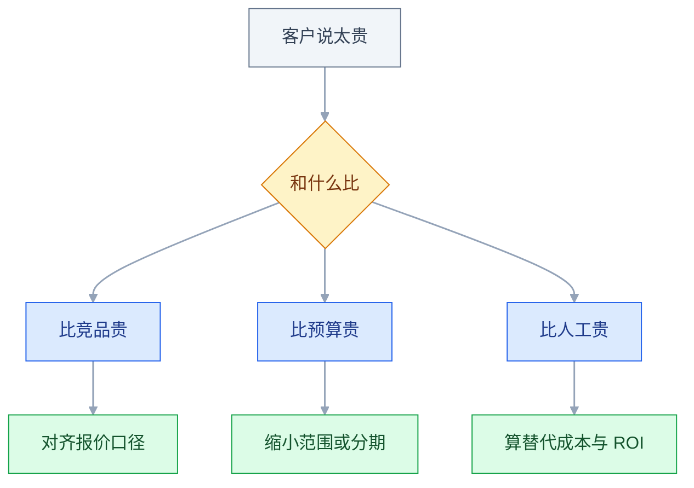
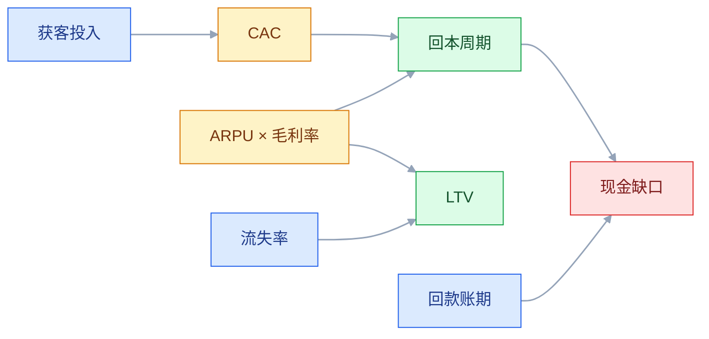

# 商业模式与竞争

## 一、工程案例：给一款工具型 SaaS 重做定价结构

**场景**：一款项目管理 SaaS，做了 4 年，只有一档价格：99 元/人/月，功能全包。近 12 个月新增付费客户数停滞，销售说「小团队嫌贵，大客户嫌便宜」。董事会要求 18 个月内现金流打平。

> 本案例是构造场景：客户数、金额、流失率都用于演示计算口径，不对应任何真实公司，比例也不要直接套用到别的业务。

**约束**：

| 约束 | 具体内容 |
|---|---|
| 数据 | 只有 12 个月的成交与流失记录，没有完整的获客渠道成本 |
| 人力 | 销售 3 人、客户成功 1 人，本期不能扩编 |
| 产品 | 6 个月内不改核心功能范围，只允许做权限与用量限制 |
| 合同 | 存量客户本期内不强制涨价，续费时才切换 |

**目标**：不是「定一个更好的数」，而是设计一套结构，让 5 人团队、50 人团队、500 人企业都能找到能接受的价格，同时算清每个客户是否赚钱。

### 1.1 先分层，再看价格

把近 12 个月的成交客户按席位规模切开，只切四段，避免样本过碎：

| 分段 | 客户数 | 客单价（元/月） | 12 个月流失率（相对高低） | 平均服务工时/月 |
|---|---|---|---|---|
| 1–5 人 | 142 | 297 | 较高 | 0.5 小时 |
| 6–20 人 | 96 | 1485 | 中 | 1.5 小时 |
| 21–100 人 | 38 | 5544 | 较低 | 4 小时 |
| 100 人以上 | 9 | 18000 以上 | 最低 | 12 小时 |

**第一眼结论**：客户数集中在 1–20 人，收入集中在 21 人以上。单一价格让两端都不舒服：小团队为用不到的能力付费，大客户拿不到企业所需的权限与承诺。

### 1.2 12 次客户访谈：只问三个决策点

访谈对象按「新签、续费、流失」各 4 家分配，每家 30 分钟：

```text
1. 当初为什么选我们？在选之前还比较了谁？
2. 续费的时候，谁签字？他看什么？
3. 有没有哪一刻想过换掉？当时发生了什么？
```

| 客户类型 | 高频原话 | 对应的商业问题 |
|---|---|---|
| 小团队 | 「功能太多，我们只用任务和日历」 | 付费能力与功能冗余不匹配 |
| 中型 | 「审批和审计日志要另外买别的工具」 | 关键能力缺失，客单价上不去 |
| 大客户 | 「你们没有 SLA，采购过不了」 | 企业版缺少可签约的承诺 |
| 流失 | 「换了更便宜的，反正只用看板」 | 低端缺少轻量档 |

**访谈的作用**：把「嫌贵」拆成三种不同的问题——用不上、缺能力、缺信任。三种问题对应三种定价动作，不能用一个折扣解决。

### 1.3 算清单个客户的经济账

以 6–20 人段为例，取该段的中位值：

```text
月费 1485 元，毛利率 78%
平均生命周期 22 个月
LTV = 1485 × 0.78 × 22 ≈ 25480 元

获客成本：
  销售人力分摊 1200 元
  市场投放分摊 900 元
  售前与试用支持 500 元
  CAC ≈ 2600 元

LTV / CAC ≈ 9.8
回本周期 = 2600 / (1485 × 0.78) ≈ 2.2 个月
```

| 分段 | 平均生命周期 | LTV/CAC | 回本周期 | 判断 |
|---|---|---|---|---|
| 1–5 人 | 约 8 个月 | 约 2 | 约 4 个月 | 偏低，只有自助成交才成立 |
| 6–20 人 | 约 22 个月 | 约 10 | 约 2 个月 | 健康，但销售成本被低估 |
| 21–100 人 | 约 36 个月 | 约 6 | 约 6 个月 | 尚可，服务成本上升 |
| 100 人以上 | 约 36 个月 | 约 4 | 约 9 个月 | 回本慢、定制多，要单独算 |

**两个比值同源**：LTV/CAC 约等于「平均生命周期 ÷ 回本周期」。生命周期估长、回本估短，都会让结果虚高；上表能互相校验，也是这个原因。

**注意**：上表用中位数估算，样本少，只能看量级。这里的 LTV 是毛利口径、未折现，CAC 是含销售人力与售前的混合口径；**真实决策以财务口径的月度数据为准，不要拿一次估算当结论。**

**关键发现**：1–5 人段并不是「价格太高」，而是「用销售去卖一个应该自助成交的产品」。这个段的 CAC 里，销售人力占了一半以上。

### 1.4 竞争分析只看四层

不做功能勾选表，只回答四个问题：

| 层次 | 问题 | 本次结论 |
|---|---|---|
| 功能 | 对方有什么、没有什么 | 基础功能高度同质，差异在权限与集成 |
| 用户 | 服务谁、谁在用 | 对手更偏 50 人以上，靠渠道拿单 |
| 模式 | 怎么收钱、成本结构 | 对手按年付加实施费，销售团队规模是我们的数倍 |
| 战略 | 阶段、资源、下一步 | 对手在冲中大客户，短期不会做低价自助 |

**推导出的空间**：低价自助段对手不会来，因为他们的人力结构撑不住；我们要做的是把 1–20 人段的成交成本降下来，而不是跟着他们做大客户定制。

### 1.5 设计三档加一个企业版

| 版本 | 价格 | 目标客户 | 关键边界 | 成交方式 |
|---|---|---|---|---|
| 免费版 | 0 | 3 人以内试用 | 2 个项目、无权限管理 | 自助 |
| 团队版 | 39 元/人/月 | 4–20 人 | 无限项目、基础权限 | 自助加销售跟单 |
| 专业版 | 99 元/人/月 | 21–100 人 | 审计日志、SSO、开放 API | 销售 |
| 企业版 | 定制，按年 | 100 人以上 | 私有化、SLA、专属支持 | 销售加售前 |

**边界设计的三条规则**：

1. 免费版必须能完成一次完整任务，否则用户感受不到价值；
2. 升级触发点要可解释，例如「第 4 个人加入时提示按席位计费」；
3. 专业版与企业版的差异是「责任」而不只是功能：SLA、审计、数据驻留都属于责任。

四个档位按人数边界切开，不是逐级升级的阶梯：免费版止于 3 人，团队版承接 4–20 人，专业版承接 21–100 人，企业版按合同走。

**取舍**：团队版从 99 元降到 39 元，短期 ARPU 下降。换的是 1–20 人段的自助成交比例，以及销售人力从低客单里释放出来。

### 1.6 关键产出物：定价页与销售口径

```text
团队版 39 元/人/月，按年付 390 元/人/年（相当于 10 个月）
专业版 99 元/人/月，按年付 990 元/人/年
超出席位按实际开通人数结算，不设阶梯折扣
企业版起签 100 席位，含 SLA 与私有化部署，价格面议

销售不得承诺：
- 免费版永久保留某功能
- 未写入合同的定制开发
- 低于报价单 8 折的折扣（需产品负责人审批）
```

**为什么把「不得承诺」写进产出物**：定价失效多数不是算错，而是销售在个案上让渡了边界，半年后变成事实上的新档位。

### 1.7 灰度：只对新签生效

| 阶段 | 范围 | 周期 | 观察 |
|---|---|---|---|
| 灰度 | 新签的 1–20 人客户 | 6 周 | 成交周期、折扣率、退款 |
| 扩面 | 全部新签 | 6 周 | 各档占比、ARPU |
| 存量切换 | 续费时切换 | 3 个月 | 流失率、降档比例 |

### 1.8 验收（7 项全过才算完成）

| 检查项 | 怎么验 | 通过标准 |
|---|---|---|
| 分档可下单 | 免费、团队、专业各用一个新账号走完流程，企业版走报价单 | 前三档自助支付，价格与页面一致；企业版报价单可生成、条款齐全 |
| 边界生效 | 免费版加到第 4 人 | 出现升级提示，不静默扣费 |
| 席位数结算 | 月中增删各 2 人 | 账单按实际天数折算，与财务口径一致 |
| 折扣审批 | 销售尝试 7.5 折下单 | 系统拦截，需负责人审批 |
| 存量不涨价 | 抽 10 个存量客户看续费账单 | 续费前价格不变，切换需客户确认 |
| 单位经济 | 灰度 6 周后重算 CAC 与回本周期，LTV 按同一假设重估 | CAC 下降、回本周期不延长；LTV 只作估算，不当作实测 |
| 收入结构 | 连续 3 个月的收入按档位拆分 | 平均总收入不低于改前的 95%，且客户数上升 |

**最后一项是关键**：降价换增长如果总收入跌超过 5%，说明价格弹性不够，要停在大客户段继续验证。

### 1.9 结果与复盘（示例推演）

下面是按上述假设推演的一组示例数字，用于说明该看哪几个信号，不是实测结果：

6 个月后，付费客户数从 285 增至 640，ARPU 从约 1470 元降到约 980 元，月总收入上升约五成。1–20 人段的自助成交占比从不足两成升到约六成。大客户数从 9 家增至 14 家，企业版贡献了约三分之一的收入。

**看错的三个地方**：

| 判断 | 实际情况 | 修正 |
|---|---|---|
| 免费版会带来大量升级 | 升级集中在第 4 人加入时，其他路径很少 | 把升级提示收到协作入口 |
| 专业版会抢团队版 | 两档客群清晰，重叠很小 | 保持边界，不加中间档 |
| 降价会拉高流失 | 低客单段流失略升，但收入贡献仍为正 | 用自助服务替代人工跟进 |

> **这个案例的要点**：定价不是定一个数，是设计一套结构。结构的作用是让不同规模的客户各自找到能接受的价格，同时让公司知道哪一段在赚钱、哪一段在耗人。

---

## 二、高频问答：会卡住你的地方，也是面试最常问的

### 2.1 客户说「太贵了」

**现场**

问一句：「和什么比贵？」答案若是竞品，查对方报价口径；若是预算，问今年这笔预算原本打算花在哪。



**要点**

- 「贵」通常指「看不到对应的回报」，也可能只是采购的压价话术。
- 比较对象有三种：比竞品贵、比人工贵、比预算贵。
- 三种分别对应价值证明、ROI 测算、缩小范围，打折只在预算这一种里有用。

**追问**

- 客户就是想要折扣怎么办？→ 用年付、案例、预收去换，不要白给，折扣要留审批权限。
- 比人工贵怎么算？→ 算客户现在花的人力与出错成本；报价接近替代成本时，阻力往往来自切换代价。
- 降价能换增长吗？→ 先确认价格是不是主要障碍，降价后总收入跌破阈值就停。

### 2.2 免费版上线后，付费转化反而下降

**现场**

查免费用户的行为路径：卡在哪一步、卡住后有没有看定价页、看完有没有回来。

**要点**

- 先分清「撞到限制的人」和「没撞到就离开的人」哪类更多。
- 前者收紧额度有效，后者收紧只会加速流失。
- 免费版的边界要对准「团队变大」这类自然触发点，而不是随手划一条线。

**追问**

- 边界定在功能还是人数？→ 人数是自然触发，功能堆叠会让客户不知道自己该买哪档。
- 免费版该给多少？→ 至少能完成一次完整任务，否则用户感受不到价值。
- 收紧额度后转化涨了、流失也涨呢？→ 看净收入，不看单点转化率。

### 2.3 大客户要求定制，接不接

**现场**

算三笔账：定制报价能否覆盖 3 年维护、是否会被第二个客户需要、是否与现有架构冲突。

**要点**

- 定制收入是一次性的，维护和兼容成本是长期的，还会改变产品路线。
- 把定制拆成「配置能解决的」与「必须改代码的」。
- 前者接，后者要么拒绝并给替代方案，要么单独立项并计入路线成本。

**追问**

- 金额很大，亏也接吗？→ 标杆客户可以例外，但立项时要写清复制路径，否则就是纯项目。
- 第二个客户也提了怎么办？→ 规则可枚举就做成配置项，排进正常需求。
- 拒绝怕丢单呢？→ 给替代方案再拒绝；只写「不做」，销售会一直提。

### 2.4 LTV/CAC 算出来很漂亮，现金流却越来越紧

**现场**

把回本周期和回款账期并排看：CAC 付出现金到收到现金之间隔了几个月。

**要点**

- LTV 是期望值、未折现，CAC 是当期现金支出，比率健康不代表现金健康。
- 回本周期长时，增长越快越缺钱。
- 回本超过 12 个月，扩张就要靠融资或年付预收来填。

**追问**

- LTV/CAC 多少算健康？→ 通常参考 3 倍左右，行业差异大，还要和回本周期一起看。
- 账期怎么算进去？→ 回本周期加上账期，才是真正的现金缺口。
- 比率高但客户结构在变呢？→ 历史 LTV 会失真，每半年按新结构重算。

### 2.5 竞品降价，要不要跟

**现场**

查对方降价的范围（全档还是引流档）、是否绑定年付、我方受影响客户的实际流失数。

**要点**

- 对方的成本结构可能不同，降价可能是清库存、抢份额或融资后的阶段性动作。
- 别把对手的价格当成市场价。
- 看「因价格流失的客户占比」：低于一成时跟进降价，是主动放弃利润。

**追问**

- 不跟价，销售怎么应对？→ 用合同条款、服务承诺和切换成本，不动标价。
- 降的是引流档呢？→ 那是获客动作，跟它比总价没有意义。
- 流失集中在大客户段呢？→ 用合同和服务应对，大客户本来就不看标价。

### 2.6 收入在涨，利润没涨

**现场**

按客户段拆毛利率与服务工时，看新增收入落在哪一段。

**要点**

- 新增收入可能来自低毛利业务，或服务成本随客户数同步上升。
- 只看总收入曲线，会掩盖结构变化。
- 把收入按「订阅、实施、定制」分开，再把服务人力按客户分摊。

**追问**

- 怎么判断是不是变成了外包公司？→ 实施与定制占比连续上升，人均服务客户数不升。
- 早期低毛利要不要接？→ 可以，但合同里写清服务范围与超出部分的计费方式。
- 砍费用能解决吗？→ 先分清是毛利结构问题还是费用问题，砍错只会伤交付。

### 2.7 单一大客户占了四成收入

**现场**

查合同到期时间、续约条款、该客户内部的对接人层级；再算失去它之后的现金流。

**要点**

- 收入结构失衡时，客户的采购周期、人事变动、预算收缩都会直接冲击公司。
- 单一客户超过三成收入，就必须有备份计划和明确的续约动作。
- 「大客户」不等于「稳定」。

**追问**

- 多少算危险？→ 超过三成是高，超过五成事实上就是项目公司。
- 除了收入还要看什么？→ 渠道集中和平台集中，属于同一类风险。
- 早期避免不了集中怎么办？→ 把依赖写进风险清单，别把它当成稳定。

### 2.8 按席位还是按用量收费

**现场**

看客户的价值来源：价值随人数增长就按席位，随处理量增长就按用量；再看财务能否预测。

**要点**

- 计费方式决定客户行为：按席位鼓励拉人，按用量鼓励省着用。
- 「公平」不是唯一标准，收入可预测性差的模型，销售成本会上升。
- 还要看销售能否预测下月收入、客户能否接受账单波动。

**追问**

- 两种一起用行吗？→ 可以，但每增加一种计费维度，报价、开票、对账的成本都会上升。
- 三种以上维度呢？→ 需要专门的计费系统，否则财务手工核对的错误率随客户数上升。
- 按用量客户省着用是坏事吗？→ 看价值是否随用量增长，不增长就说明模型选错了。

### 2.9 年付折扣给多少合适

**现场**

算年付预收带来的现金价值，对比折扣损失；再看该段客户的历史续费率。

**要点**

- 折扣的本质是用价格换现金流和锁定期，不同毛利结构能承受的折扣不同。
- 续费率高时，年付折扣接近白送钱。
- 续费率低时，锁定一年比折扣更重要。

**追问**

- 「10 个月」这个惯例能直接用吗？→ 不能，要按自己的毛利和续费率算。
- 折扣会不会常态化？→ 会，所以要写审批权限和底线价。
- 客户要更长锁定期换更大折扣呢？→ 先看现金流缺口，再算这段时间的续费风险。

### 2.10 销售说「没有这个功能客户就不签」

**现场**

要求提供客户名、合同金额、以及「没有它客户现在怎么解决」；再查同类需求出现过几次。

**要点**

- 销售面对的是单笔成交，产品面对的是可复用能力，两者时间尺度不同。
- 拿不出可验证的三项信息，多半是谈判筹码。
- 拿得出来，再判断是配置、集成还是产品能力。

**追问**

- 合同里已经写明了呢？→ 履约，但评估长期成本，单独核算。
- 只有一个客户要呢？→ 配置可解就做配置，必须改代码就拒绝并给替代方案。
- 怎么避免每次都被这句话推着走？→ 把这三项信息固定成流程，而不是靠人盯。

### 2.11 免费用户的服务成本失控

**现场**

统计免费用户工单量占比、平均处理时长，以及其中有多少最终付费。

**要点**

- 免费用户走了人工支持通道，而支持成本没有计入免费策略。
- 只看服务器成本，会低估免费策略的代价。
- 免费用户的支持应导向文档与社区，人工通道要设门槛。

**追问**

- 直接取消免费版行不行？→ 先看免费用户的获客价值，再决定是取消还是降服务等级。
- 工单占比多少算正常？→ 按付费状态分开看，比例本身没有通用标准。
- 免费用户最终付费比例很低呢？→ 它更接近市场费用，要有预算上限。

### 2.12 涨价后老客户反弹

**现场**

查合同里的调价条款、通知期；再抽 5 个客户问「如果多了这项能力，你是否接受」。

**要点**

- 反弹多半不是价格问题，是程序问题：没有价值说明、通知时间太短。
- 永久锁价会让新老客户价格倒挂，后患更大。
- 提价分三步：新客户、续费客户、合同未到期客户。

**追问**

- 合同没写调价条款呢？→ 只能等续约时切换，本期不强制。
- 涨幅多少能被接受？→ 看价值是否可解释，不看百分比本身。
- 老客户要求永久锁价呢？→ 给过渡期而不是永久，锁价要写期限。

---

## 三、核心知识：从零开始要建立的东西

### 3.1 商业模式的四个基本问题

| 问题 | 答不上来的后果 | 可验证的证据 |
|---|---|---|
| 谁付钱 | 做给用户，但没人付费 | 合同上的付款方与使用者是否同一角色 |
| 为什么付 | 产品是锦上添花，预算排不上 | 客户不买时的替代动作是什么 |
| 付多少 | 覆盖不了服务成本 | 单客户毛利与回本周期 |
| 能持续多久 | 一次性生意，没有复购 | 续费率与净收入留存 |

**第二条最容易被跳过**：客户说「挺好用」不等于有预算。真正的信号是「这笔钱从哪个科目出」。

**边界**：四个问题在早期只能给出假设，不能给出结论。写清假设并标注验证方式，比编一个精确数字有用。

### 3.2 商业模式画布的九个格子

| 格子 | 要写清的内容 | 常见空白 |
|---|---|---|
| 客户细分 | 为哪几类人服务 | 写成「所有企业」 |
| 价值主张 | 解决什么问题、比替代方案好在哪 | 写成功能清单 |
| 渠道 | 客户从哪里知道并买到 | 只有「官网」 |
| 客户关系 | 谁维护、多久接触一次 | 成交后无人管 |
| 收入来源 | 按什么计费、多久收一次 | 只写「订阅」 |
| 关键资源 | 人、数据、资质、算力 | 漏掉资质与数据授权 |
| 关键活动 | 必须自己做的事 | 把外包也算成自建 |
| 关键伙伴 | 谁提供渠道、集成、交付 | 漏掉实施方 |
| 成本结构 | 固定与变动各占多少 | 只算研发 |

**价值主张那一格可以单独展开**：用价值主张画布写清客户的「任务、痛点、收益」，它和商业模式画布是两个工具，常被混用；前者回答「为什么买」，后者回答「怎么活」。

**画布的用途是暴露空白**：收入来源与成本结构两格同时空白的项目，通常还没想清楚怎么活。

**边界**：画布是静态快照，不适合描述快速变化的业务。每季度重画一次，比一次画得漂亮更有价值。

### 3.3 收入模式的类型与组合

| 模式 | 收钱方式 | 适合 | 主要风险 |
|---|---|---|---|
| 订阅 | 按月或按年 | 持续使用的工具 | 流失率累积 |
| 按用量 | 用多少付多少 | 弹性资源、API | 收入不可预测 |
| 按席位 | 每个用户收费 | 协作类 | 客户为省钱少开账号 |
| 买断 | 一次性 | 本地部署、行业软件 | 无复购，靠新客 |
| 交易抽成 | 从交易额抽取 | 平台 | 与客户业务量同波动 |
| 广告 | 卖流量 | 大流量内容 | 体验与收入冲突 |
| 服务费 | 项目或咨询 | 定制交付 | 规模不经济 |

**免费增值是包装方式，不是收入类型**：基础版免费、高级功能订阅，收入仍来自订阅或用量。它的风险在免费额度设计，不在计费方式本身。

**混合模式很常见**：订阅打底、用量补峰、服务费覆盖定制。**但每增加一种计费维度，报价、开票、对账、销售培训的成本都会上升。**

**边界**：三种以上计费维度同时存在时，需要专门的计费系统，否则财务每月手工核对，错误率会随客户数上升。

### 3.4 定价的三个锚点

| 锚点 | 含义 | 取证方式 |
|---|---|---|
| 替代方案成本 | 客户现在花多少人力、软件、外包费 | 问「现在这件事谁在做、花多少时间」 |
| 客户感知价值 | 能算清 ROI 的更容易卖高价 | 省下的人力、减少的差错、避免的罚款 |
| 竞品价格 | 客户拿来比较的参照点 | 看对方定价页、合同口径、折扣习惯 |

**客户规模不是锚点**：它决定支付能力与决策链复杂度，属于分层依据。把规模当价格依据，容易得出「大客户就该贵」这种说不通的结论。

**价值定价的算法**：

```text
客户每月因此省 2 个人力，按 1 万元/人月计，价值约 2 万元
定价 3000 元/月，客户回报约 6 倍，容易过预算
定价 3 万元/月，超过客户感知价值，会被拿去和人工比
```

**定价不是成本加利润**：成本决定下限，价值决定上限，竞品决定客户的参照点。

**边界**：价值难以量化时，用「替代方案成本」做锚更稳。完全无法量化的品类，通常靠品牌与信任定价，不适合早期公司。

**算价值锚时不要只算收益**：客户还要承担切换、培训、审批的隐性成本，价值感知会被这些抵掉一部分。所以报价接近替代方案成本时，成交阻力往往来自「换一次要付出的代价」，而不是价格本身。

> **面试**：常问「定价为什么不是成本加利润？」答：成本决定下限，价值决定上限，竞品决定客户的参照点。

### 3.5 价格分层的边界设计

| 层级 | 目标 | 边界放在哪 | 升级触发 |
|---|---|---|---|
| 免费 | 完成一次完整体验 | 人数或项目数 | 团队变大 |
| 基础 | 小团队日常 | 高级权限、集成数 | 需要审计或对接 |
| 专业 | 中型企业 | 合规、SSO、API 配额 | 采购要求 |
| 企业 | 大客户 | SLA、私有化、数据驻留 | 合同要求 |

**边界要满足三条**：可解释（客户能理解为什么这条线在这里）、可预期（不会突然改动）、可升级（撞线后有顺畅路径）。

**最常见的错误**：把核心价值放进付费版，免费版只剩空壳。用户试用后感受不到价值，不会升级，只会离开。

**另一种错误**：边界按功能堆叠，导致同一能力出现在三个档位。客户无法判断该买哪个，销售只能逐单解释。

### 3.6 单位经济模型的四个指标



| 指标 | 公式 | 用途 | 注意 |
|---|---|---|---|
| CAC | 获客总投入 / 新增客户数 | 判断卖一个贵不贵 | 要含销售人力与售前支持；混合口径与投放口径要分开 |
| LTV | ARPU × 毛利率 × 平均生命周期 | 判断客户长期值多少 | 毛利口径、未折现；生命周期用流失率推算 |
| LTV/CAC | 两者相除 | 判断扩张是否划算 | 通常参考 3 倍左右，行业差异大，以实际数据为准 |
| 回本周期 | CAC /（ARPU × 毛利率） | 判断现金压力 | 超过 12 个月要谨慎扩张；还要叠加回款账期 |

**流失率与生命周期**：月流失 5% 对应平均约 20 个月，月流失 2% 对应约 50 个月。这个换算是按流失率恒定估算的，早期产品或客户结构在变时只能当粗算。**降低流失对 LTV 的杠杆，通常大于提高客单价。**

**边界**：LTV 是期望值，不是已实现的现金。客户结构变化、涨价、降档都会让历史 LTV 失真。**每半年重算一次，别拿两年前的模型做今天的决策。**

> **面试**：常问「LTV/CAC 很高就说明生意健康吗？」答：不一定，它是期望值，还要看回本周期和回款账期，比率健康不等于现金流健康。

### 3.7 毛利率与服务成本

| 成本 | 计入哪里 | 常见漏算 |
|---|---|---|
| 服务器与带宽 | 主营成本 | 峰值扩容、备份存储 |
| 客户成功 | 主营成本或费用 | 培训、回访、健康检查 |
| 实施与迁移 | 主营成本 | 数据清洗、接口对接 |
| 支持 | 主营成本 | 二线升级、疑难工单 |
| 研发 | 费用 | 为单客户做的定制 |

**B 端最容易忽略服务成本**：一个客户要培训、要对接、要响应。卖得越多，服务团队越大，毛利可能越薄。

**判断信号**：新增客户数与服务人数同步增长，且人均服务客户数没有上升，说明交付仍未标准化。

**边界**：早期为拿标杆客户，可以接受低毛利，但要在合同里写清服务范围与超出部分的计费方式。

### 3.8 流失率与收入结构

| 指标 | 含义 | 用途 |
|---|---|---|
| 客户流失率 | 流失客户数 / 期初客户数 | 看客户留不留 |
| 收入流失率 | 流失收入 / 期初收入 | 看钱留不留 |
| 净收入留存（NRR） | 同批老客户本期收入 / 上期收入，含扩容、降档、流失 | 看扩容能否抵消流失 |
| 降档率 | 降档客户数 / 续费客户数 | 看定价边界是否合理 |

**客户流失率与收入流失率可能背离**：小客户走了很多，但收入几乎没变；也可能客户数没变，几个大客户降档，收入明显下滑。

**边界**：NRR 大于 100% 说明老客户在扩容，但如果扩容主要来自涨价而非用量增长，长期不可持续。

### 3.9 竞争分析的四个层次

| 层次 | 回答 | 证据来源 |
|---|---|---|
| 功能 | 有什么、没有什么 | 产品试用、帮助文档、更新日志 |
| 用户 | 服务谁、谁在用 | 案例页、招聘信息、应用市场评价 |
| 模式 | 怎么收钱、成本结构 | 定价页、合同条款、渠道政策 |
| 战略 | 阶段、资源、下一步 | 融资与招聘、发布会、合作伙伴 |

**最有用的两个问题**：「他们的收入从哪里来」决定优先级；「他们不会做什么」决定你的空间。

**功能对比表的问题**：它只能说明差异，不能说明差异是否重要。一个功能对对手是核心，对你可能是负担。

**边界**：竞争分析要定期更新，但不必每月做。产品方向变化、对手融资、对手降价，这三个时点值得重做。

### 3.10 护城河的类型与强度

| 类型 | 机制 | 强度 | 建立周期 |
|---|---|---|---|
| 网络效应 | 用户越多，单个用户价值越高 | 强 | 长 |
| 切换成本 | 数据、流程、集成绑定 | 强，B 端常见 | 中 |
| 规模效应 | 规模越大单位成本越低 | 强 | 长 |
| 品牌 | 信任与溢价 | 中强 | 长 |
| 数据积累 | 数据越多模型越准 | 中 | 中 |
| 渠道 | 独占的分发通路 | 中 | 中 |
| 技术专利 | 法律排他 | 中 | 中 |
| 成本优势 | 更低的成本结构 | 中 | 中 |

**功能不是护城河**：功能会被抄，抄的成本通常低于研发成本。

**B 端最现实的一条是切换成本**：客户的数据、审批流、集成、培训都在系统里，换掉要停机、要重新验收。**这也是深度集成比轻量工具更难被替换的原因。**

**边界**：切换成本过高会反噬——客户因为怕被绑死而不敢深度使用。要提供数据导出与开放接口，降低「进入」的心理门槛。

> **面试**：常问「功能能不能当护城河？」答：不能，功能会被抄，抄的成本通常低于研发成本；B 端更现实的是切换成本。

### 3.11 客户集中度与收入结构

| 集中度 | 风险 | 应对 |
|---|---|---|
| 单一客户低于 10% | 低 | 正常维护 |
| 10%–30% | 中 | 建立备份管道 |
| 超过 30% | 高 | 合同锁定、专项服务、拓展同类客户 |
| 超过 50% | 极高 | 事实上是项目公司，需重新评估商业模式 |

**这些比例是经验阈值**，不同行业、合同期限、续约节奏下要调整；关键是和账期、续约时间一起看。

**除了收入集中，还要看渠道集中与平台集中**：一个应用市场带来八成新增，或一个集成伙伴决定半数交付，都属于同一类风险。

**边界**：早期公司很难避免集中，关键是知道自己在依赖谁，并把依赖写进风险清单，而不是当成稳定。

### 3.12 增长与商业化的顺序

| 阶段 | 主要动作 | 商业化程度 |
|---|---|---|
| 问题验证 | 访谈、手工交付 | 可以收费，验证付费意愿 |
| 早期客户 | 少量客户、深度服务 | 按价值定价，不追求规模 |
| 可重复销售 | 标准化报价与交付 | 建立分档与折扣规则 |
| 规模化 | 渠道、自助、扩客 | 优化单位经济与留存 |

**「先做大再想怎么赚钱」的适用条件**：边际成本接近零、网络效应强、且能承受长期补贴。多数 B 端产品不满足这三条。

**平台型业务多一道前置**：先解决双边冷启动（补贴哪一端、如何形成流动性），再谈抽成比例。抽成高低与补贴方向都属于方向性决策，定错之后很难靠运营补回来。

**边界**：早期收费会筛掉一部分客户，但也能筛出真需求。免费试点适合验证使用，不适合验证付费。

### 3.13 商业化陷阱的识别

| 陷阱 | 早期信号 | 后果 |
|---|---|---|
| 免费版过强 | 付费转化持续下降 | 有用户无收入 |
| 定价过低 | 服务成本占收入比上升 | 卖越多亏越多 |
| 客户过散 | 小客户占比上升，人均服务客户数偏低且不升 | 服务成本失控 |
| 依赖单一大客户 | 一个客户占收入三成以上 | 客户流失即危机 |
| 补贴驱动 | 补贴停止后留存骤降 | 没有真实需求 |
| 产品线过散 | 每条线都有人做，都不精 | 资源分散 |
| 定制收入占比高 | 实施人力持续扩张 | 规模不经济 |

**识别方法**：把收入按「订阅、实施、定制、其他」拆开，连续看四个季度。实施与定制占比上升，说明产品化程度在下降。

### 3.14 提价与降价的决策

| 动作 | 适用条件 | 前置准备 | 主要风险 |
|---|---|---|---|
| 提价 | 价值提升、续费率高、合同允许 | 提前通知、老客户过渡方案 | 老客户流失、销售反弹 |
| 降价 | 价格是主要障碍、成本可降 | 明确不降服务标准 | 收入下滑、品牌受损 |
| 分档 | 客户规模差异大、单一价格两头不讨好 | 边界可解释、计费系统支持 | 档位重叠、销售混淆 |
| 折扣 | 换年付、换案例、换预收 | 审批权限、底线价 | 折扣常态化 |

**提价的三步**：先对新客户生效，再对续费客户生效，最后处理合同未到期的客户。每一步观察流失与降档。

**边界**：降价换来的客户如果服务成本更高，规模越大亏得越多。降价前先确认边际成本结构。

---

## 四、冷门知识汇总

这一节只放低频、出错代价不高、用到时能现查的细节；会伤到方向或客户的判断，都在第二节处理。

| 知识点 | 为什么冷门 | 用到时的关键词 |
|---|---|---|
| 席位计数规则 | 换计费系统或大客户谈判时才细究 | 命名用户、并发用户、只读席位 |
| 最低承诺用量 | 年付合同里才有的条款 | commit、未用完是否结转 |
| 超额用量 | 订阅制的补充条款 | 超出配额、自动升档、封顶 |
| 试用期长度 | 上线时定一次，之后很少改 | 14 天、到期提醒、延长审批 |
| 价格尾数 | 定价页改版时才注意 | 99 与 100 的心理差 |
| 报价单模板 | 销售工具，产品很少接触 | 分项报价、有效期、含税口径 |
| 多币种定价 | 出海或跨境结算才涉及 | 汇率基准、调价周期 |
| 自动续约条款 | 合同模板里的一段，平时不看 | 续约窗口、取消方式 |
| 预付与递延收入 | 财务口径，签年付时才涉及 | 按月确认、退款条款 |
| 渠道报备 | 直销与代理并行才出现 | 报备、区域保护、返点 |
| 客户健康度评分 | 客户成功团队专用 | 使用率、工单、登录频次 |
| 数据导出与迁移 | 客户要换系统时才被提起 | 导出格式、迁移工时 |
