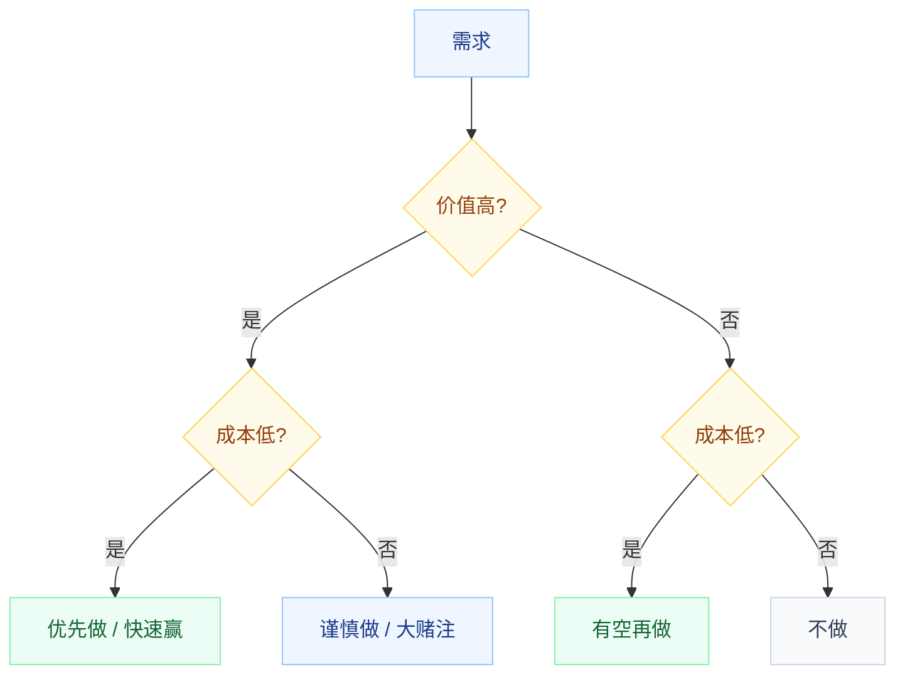

# 需求分析与优先级

> 这篇从需求分层和场景五要素讲起，经过证据强度、需求拆解、KANO/RICE、需求池和评审，最后落到交付验收。
>
> 学完能把一句诉求还原成场景、需求卡和优先级，并判断先做什么、怎么验收。

## 一、需求不是功能清单

需求是“某类用户在某个场景下要完成的目标”，功能只是实现目标的一种手段。把“加一个导出按钮”当需求，会跳过用户、场景和验收，最后做出一个“有按钮但没人用”的功能。

需求至少分三层：

| 层次 | 回答什么 | 例子 |
|---|---|---|
| 业务需求 | 为什么做 | 报销周期从 10 天降到 3 天 |
| 用户需求 | 谁在什么场景下要什么 | 报销人上传发票后能看到验真结果 |
| 功能/非功能需求 | 系统必须做什么、做到什么程度 | 支持 PDF/OFD 上传；单张识别≤3 秒 |

需求从场景来，不从“我觉得”来；证据强度决定优先级，不决定声音大小；验收标准写不出来，需求就还没定义清楚。

### 1.1 证据强度

| 证据 | 强度 | 判断 |
|---|---|---|
| 行为数据、付费记录、高频投诉 | 强 | 已经发生的事实，优先验证 |
| 深度访谈、现场观察、可用性测试 | 中 | 能还原场景，但样本有限 |
| 问卷、竞品分析、个人经验 | 弱 | 只能作为假设，需要验证 |
| 老板要求、会议拍板 | 特殊 | 可以作为约束，但要补目标和验收 |

> 边界：强证据也可能有偏差。数据只能说明“发生了什么”，不能自动解释“为什么”；访谈只能说明“用户怎么说”，不能自动等于“用户会怎么做”。

## 二、场景五要素

一个可分析的需求场景，至少写清五个要素：

| 要素 | 问题 | 示例 |
|---|---|---|
| 角色 | 谁 | 一线报销人 |
| 触发 | 什么时候、什么事件 | 出差结束后整理发票 |
| 目标 | 想完成什么 | 一次提交、少退回 |
| 路径 | 现在怎么做 | 拍照、手工填金额、逐个上传 |
| 约束 | 时间、设备、规则、权限 | 手机端、发票种类多、财务有合规要求 |

场景写不清，需求就会变成“支持上传”，而不是“让报销人在手机上一次提交多张发票，并立即知道哪张不合格”。

## 三、从场景到需求

### 3.1 区分问题与方案

- 问题：报销人上传发票后不知道是否合格，平均退回 1.8 次。
- 方案 A：上传后立即做 OCR 和验真，返回结果。
- 方案 B：增加人工预审岗位。
- 方案 C：把发票要求写成更长的帮助文档。

方案可以多个，问题只有一个。需求分析先锁定问题，再比较方案。

### 3.2 用户故事与验收标准

用户故事只写“谁、要什么、为什么”，不写实现：

```text
作为报销人，
我希望上传发票后立即看到验真结果，
以便在提交前修正不合格的发票。
```

验收标准用 Given/When/Then 写：

```text
Given 报销人已选择一张 PDF 发票
When 点击上传
Then 3 秒内显示“验真通过/不通过/需人工复核”
And 不通过时给出具体原因和修改建议
```

> 边界：用户故事不是越小越好。一个故事必须能独立交付一个可验收的用户价值；只拆前端按钮或只拆后端接口，不是用户故事。

### 3.3 纵向切片

纵向切片是按“用户能感知的完整能力”切，而不是按“前端/后端/数据库”切。

| 切法 | 第一刀 | 问题 |
|---|---|---|
| 横向 | 先做所有表结构 | 用户看不到价值，反馈来得晚 |
| 纵向 | 先做“单张 PDF 上传→验真→结果展示” | 能尽早验证核心假设 |

## 四、优先级

优先级不是“重要/不重要”，而是“在有限产能下，先做哪一件，为什么”。

### 4.1 KANO 模型

| 类型 | 满足时 | 不满足时 | 策略 |
|---|---|---|---|
| 基本型 | 无感 | 强烈不满 | 必须做，做到行业基线 |
| 期望型 | 满意 | 不满 | 做得越多越好，但要算成本 |
| 兴奋型 | 惊喜 | 无感 | 少量投入，制造差异 |
| 无差异 | 无感 | 无感 | 不做 |
| 反向 | 不满 | 满意 | 避免 |

### 4.2 RICE 评分

RICE = Reach × Impact × Confidence / Effort。

| 需求 | Reach（人/月） | Impact | Confidence | Effort（人周） | RICE |
|---|---:|---:|---:|---:|---:|
| 发票上传即时验真 | 1200 | 2.0 | 0.8 | 6 | 320 |
| 审批流自定义 | 80 | 3.0 | 0.6 | 12 | 12 |
| 报销单批量导出 | 300 | 1.0 | 0.9 | 2 | 135 |



> 数字是示例，不是实测。RICE 的作用是强制写出假设，不是制造精确感。

### 4.3 成本、依赖与可逆性

- 成本：研发、测试、运维、培训、合规；
- 依赖：是否被其他需求、外部系统或数据质量阻塞；
- 可逆性：做错了能不能低成本回退；
- 时效：错过窗口是否永久失去价值。

> 边界：RICE 适合可比较的需求集合，不适合把“合规红线”和“增长实验”放在一张表里硬算。红线先做，实验按证据排。

## 五、需求池与评审

需求池不是清单，而是有状态、有 owner、有证据的系统。

| 状态 | 含义 | 退出条件 |
|---|---|---|
| 收集 | 原始诉求 | 有场景和提出人 |
| 分析 | 正在补证据、拆方案 | 有需求卡和验收标准 |
| 待排 | 已评估，等待产能 | 有优先级和依赖说明 |
| 开发 | 已进入迭代 | 有 owner 和交付时间 |
| 验收 | 等待 UAT | 验收标准全部有结论 |
| 上线 | 已发布 | 有监控和回滚方案 |
| 观察 | 看指标 | 达到目标或决定关闭 |
| 关闭 | 不做/已替代 | 记录原因，避免反复提 |


需求卡最少包含：背景、角色与场景、目标、范围、验收标准、指标、风险、依赖、 owner。

评审只回答四个问题：

1. 问题是否真实、证据是什么？
2. 方案是否最小、是否有更便宜的替代？
3. 验收标准是否可验证？
4. 不做会怎样，什么时候做？

> 边界：评审不是审批会。没有证据的需求可以进池，但不能直接进迭代。

## 六、交付与验收

需求交付时，产品、开发、测试要对齐“完成”的定义：

- 功能可用；
- 验收标准逐条通过；
- 异常和权限有处理；
- 指标可采集；
- 文档和培训到位；
- 有回滚或降级方案。

常见失败模式：

- 把方案当需求，过早锁定实现；
- 只写功能，不写非功能和异常；
- 优先级靠声音，缺少证据和成本；
- 需求池没有 owner，状态长期不更新；
- 上线后不看指标，需求永远“完成”但不产生结果。

## 七、最佳实践案例

### 7.1 案例背景

某报销系统每月有 1200 名报销人，发票退回率 18%，客服每月收到约 200 条“不知道发票哪里不合格”的咨询（示例数据）。

目标是在 3 个月内把退回率降到 10% 以下，预算 6 人周；不能改变财务合规规则，提交也不能因外部服务不可用而中断。

### 7.2 案例实操

先补证据：访谈 12 名报销人，8 人说不清退回原因；退回数据中约 60% 是抬头或税号错误；客服工单显示，上传后没有即时反馈是主要抱怨。

| 需求 | Reach | Impact | Confidence | Effort | RICE |
|---|---:|---:|---:|---:|---:|
| 发票即时验真 | 1200 | 2.0 | 0.8 | 6 | 320 |
| 审批流自定义 | 80 | 3.0 | 0.6 | 12 | 12 |
| 批量导出 | 300 | 1.0 | 0.9 | 2 | 135 |

按 RICE 先做发票即时验真。灰度顺序为 10% → 50% → 100%；外部验真超时时降级为格式校验 + 人工复核。


### 7.3 案例结果

灰度两周后，退回率从 18% 降到 11%，提交时长从 6 分钟降到 3 分钟（示例数据）。复盘发现：只告诉用户“验真失败”没有用，必须给出具体原因和修改建议，否则客诉不会下降。
