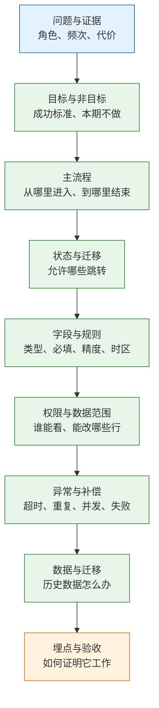
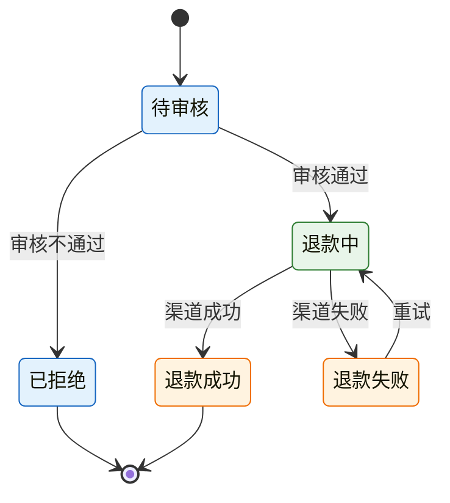
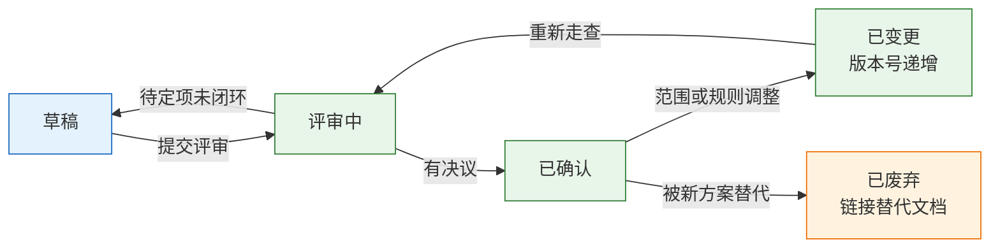

# PRD 与评审

---

## 一、PRD 与评审是什么

### 1.1 核心概念

PRD（Product Requirements Document，产品需求文档）是把业务问题翻译成可实现、可测试、可运维规则的文档。它的价值不在篇幅，而在消除歧义：状态如何流转、字段什么规则、谁不能看、失败如何收场。这些内容代码里猜不出来，上线后再补，成本按阶段递增。

评审（Review）不是宣讲，而是一次提前的设计走查。开发、测试、运营、安全在同一份文档上寻找“无法实现、无法测试、无法运营、无法审计”的地方。评审的产出不是“大家没意见”，而是一组有负责人、有截止时间的决议。

| 概念 | 定义 | 判断标准 | 常见替代品 |
|---|---|---|---|
| PRD | 业务规则与验收的唯一真源 | 开发能据此实现，测试能据此设计 | 聊天记录、原型图 |
| 技术设计 | 实现方案与取舍 | 说明模块、接口、存储、容量 | 用 PRD 代替 |
| 接口文档 | 请求响应契约 | 字段、错误码、版本 | 用表格口头约定 |
| 评审 | 对文档的结构化走查 | 有分歧项、有结论、有负责人 | 演示会 |
| 决议 | 评审后的确定结论 | 可回链到文档版本 | 会议纪要 |

PRD 不是需求池的替代品。需求池回答“做不做、先做哪个”，PRD 回答“做的话，规则是什么”。两者混在一起，文档会变成既没有优先级也没有细节的材料。

一份 PRD 有明确的生命周期：草稿、评审中、已确认、已变更、已废弃。状态要标在文档首行，读者据此判断能否依赖。草稿可以缺项，已确认不能；已变更必须写清变更点与影响范围，已废弃必须给出替代文档的链接。没有生命周期标记的文档，半年后没人敢删，也没人敢用。

### 1.2 适用场景与边界

PRD 的详细程度应由风险决定，而不是由模板决定。

| 场景 | 文档重量 | 必写内容 | 主要风险 |
|---|---|---|---|
| 涉及资金与账务 | 重 | 状态、精度、对账、补偿 | 差一分、重复记账 |
| 涉及权限与隐私 | 重 | 角色矩阵、字段脱敏、审计 | 越权、数据泄露 |
| 跨团队协作 | 中 | 主流程、接口边界、依赖 | 口径不一致 |
| 单点体验优化 | 轻 | 场景、交互、验收 | 过度设计 |
| 技术重构 | 另写设计文档 | 兼容、迁移、回滚 | 用 PRD 代替架构决策 |

它不替代三类文档。技术设计文档说明模块划分、接口协议、存储选型与容量估算；接口文档说明字段、错误码与版本兼容；测试用例说明边界组合与执行步骤。三者都以 PRD 的业务规则为准，并回链到 PRD 的具体章节。

> **注意**：原型图不是 PRD。原型能表达布局，表达不了状态迁移、并发冲突、失败补偿和历史数据。只发原型就开发，等于把规则设计推迟到编码阶段。

---

## 二、判断依据

### 2.1 文档完整度与返工成本

开发最怕的不是需求复杂，而是需求“看起来简单”。下面每一处缺项，几乎都对应一次上线后的补丁。

| PRD 缺项 | 编码时的猜测 | 上线后果 |
|---|---|---|
| 状态未穷举 | 用条件分支临时拼 | 出现文档外状态，列表查不到 |
| 必填与唯一未定义 | 前端校验、后端不校验 | 脏数据入库，清理要写脚本 |
| 权限只写“按角色” | 只做菜单隐藏 | 直接调接口可越权 |
| 异常路径未画 | 只处理成功分支 | 第三方超时后订单卡死 |
| 金额精度未约定 | 使用浮点数 | 对账差额，排查耗时 |
| 历史数据未提 | 上线后才想迁移 | 老订单打不开 |
| 埋点未定义 | 上线后补 | 无法判断是否有人使用 |
| 非目标未写 | 每个人都来加一点 | 范围膨胀、延期 |

判断一份 PRD 是否够用，可以用一个简单测试：把文档交给未参与讨论的开发，要求他写出状态表和异常分支。写不出来，说明文档缺规则；写出来但与产品理解不同，说明文档有歧义。两种情况都不能进入开发。

返工成本随阶段上升。需求阶段改一句话，设计阶段改流程与字段，开发阶段改接口与表结构，测试阶段要回归并重写用例，上线后还要迁移、兼容与通知。文档的作用是把修改尽量前移。

### 2.2 读者分层与信息需求

同一份 PRD 要服务五类读者，每类人只看与自己有关的段落。按读者组织章节，比按页面组织更有效。

| 读者 | 关注段落 | 典型追问 |
|---|---|---|
| 开发 | 流程、状态、字段、异常 | 并发时谁赢、失败能否重试 |
| 测试 | 边界、权限、验收 | 空数据、超限、越权如何表现 |
| 运营 | 规则、文案、时效 | 用户看到什么、多久生效 |
| 安全与合规 | 数据分类、权限、审计 | 谁可见、留存多久、能否导出 |
| 客服 | 异常处理、状态解释 | 用户投诉时按哪条规则答复 |

文档开头应有一页“阅读指引”：哪些人看哪几节，哪些结论已定，哪些仍是待定项。待定项要编号并写负责人，不能混在正文里让人误以为已确认。

篇幅由复杂度决定，不由重要性决定。状态三个、角色两类、异常两条的功能，一页足够；状态十个、角色五类、涉及资金与外部渠道的功能，二十页也不多。用页数衡量认真程度，会得到大量无人阅读的背景介绍。

---

## 三、标准流程

### 3.1 PRD 编写顺序

PRD 不按模板填格子，而按“一个请求怎么走完”组织。顺序颠倒，写到异常时才发现状态不够用，只能推翻重来。



| 阶段 | 核心动作 | 产出 | 完成标准 |
|---|---|---|---|
| 问题 | 引用需求卡片的证据 | 问题陈述 | 角色、频次、代价齐全 |
| 边界 | 写目标与非目标 | 成功指标、排除项 | 指标可测，排除项具体 |
| 流程 | 画主路径与分支 | 流程图 | 每个终点有明确结果 |
| 状态 | 穷举状态与事件 | 状态机、迁移表 | 无文档外状态 |
| 规则 | 定义字段与校验 | 字段表 | 类型、精度、时区明确 |
| 权限 | 列角色与数据范围 | 权限矩阵 | 每个接口有校验点 |
| 异常 | 逐条追问“然后呢” | 异常与补偿表 | 每条有兜底与告警 |
| 迁移 | 设计新旧兼容 | 迁移与回滚方案 | 可在样本数据上演练 |
| 验收 | 写可观察结果 | 验收清单、埋点表 | 每项有阈值与观测方式 |

目标要写成可判定的句子。“提升审核效率”不合格；“审核员处理一单的平均时长从四分钟降到两分钟，且差错率不上升”才合格。非目标同样是正文：本期不做批量审核、不做移动端、不改财务口径。没有这一栏，每个人都会觉得自己的需求“顺手就能加”。

### 3.2 评审组织流程

评审的质量取决于会前准备，而不是会议时长。

| 阶段 | 动作 | 时间 | 产出 |
|---|---|---|---|
| 会前 | 发文档、标待定项、指定读者 | 提前一至两天 | 待定项清单 |
| 会中 | 按状态与异常走查 | 四十五至六十分钟 | 分歧与结论 |
| 会后 | 发决议、更新版本 | 二十四小时内 | 决议清单、新版本 |
| 跟踪 | 下次评审先复盘上次决议 | 每次开场 | 未闭环项 |

参会人只请两类：能决策的人，会踩坑的人。开发、测试、运营、安全各一人即可，无关角色旁听会稀释讨论。主持人固定，负责控制顺序与记录分歧，不负责替产品辩护。

会前文档必须列出待定项，而不是让所有人现场发挥。待定项写成选择题，每项给两个到三个可选方案及各自代价。没有选项的“大家看有什么问题”，通常得到沉默或跑题。

会中按状态迁移逐条走，每走到一个异常就追问“然后呢”。页面可以演示，状态和异常才决定系统是否稳定。出现分歧时当场记录三个字段：选项、结论、负责人；不能当场定的，写截止时间，不能留“会后再说”。

四十五分钟的议程可以这样分配：五分钟确认目标与非目标，十五分钟走主流程，十五分钟走状态与异常，五分钟确认权限与数据范围，五分钟收决议。超时的部分不进会议，转入待定项，由负责人会后带方案再定。把时间花在逐页讲界面上，异常讨论一定被压缩到最后五分钟。

> **注意**：评审不是签字仪式。没有人提出分歧，通常说明文档没有写到会引发分歧的深度，或者参会人不对。此时应检查状态表与异常表是否过于简略。

---

## 四、核心内容、模板与示例

### 4.1 状态机与迁移表

状态机描述一个业务对象在生命周期内允许的全部状态与跳转。文字描述容易漏，画图加迁移表最可靠。



| 当前状态 | 事件 | 下一状态 | 触发方 | 副作用 |
|---|---|---|---|---|
| 待审核 | 通过 | 退款中 | 财务 | 冻结额度、调用渠道 |
| 待审核 | 拒绝 | 已拒绝 | 财务 | 解冻额度 |
| 退款中 | 渠道成功 | 退款成功 | 系统 | 记账、通知 |
| 退款中 | 渠道失败 | 退款失败 | 系统 | 告警、允许重试 |
| 退款失败 | 重试 | 退款中 | 财务或系统 | 生成新的渠道单号 |

状态表要回答三件事：谁能改、改完还会发生什么、重复触发会怎样。第三件最常漏。用户连点两次确认退款，如果没有幂等键，就会生成两笔渠道单。非法跳转也要定义处理方式：拒绝并记录，还是落到异常状态等待人工，不能静默忽略。

> **注意**：状态命名要用业务词，不用技术词。“处理中”无法区分排队、调用渠道、等待回调三个阶段，排查时只能猜。一个状态只表达一个可观测的业务阶段。

### 4.2 字段规则与权限矩阵

字段不是列个名字就够。至少写清类型、必填、默认值、唯一性、长度、枚举、精度、时区与脱敏要求。

| 字段类 | 必写规则 | 常见错误 |
|---|---|---|
| 金额 | 最小货币单位、含税口径、精度 | 浮点存储、口径不一 |
| 时间 | 存储时区、展示时区、边界 | 本地时间直接入库 |
| 枚举 | 完整取值、未知值兜底 | 只写常用值 |
| 标识 | 唯一性、生成规则、可读性 | 用自增主键对外 |
| 敏感信息 | 脱敏位置、导出限制、留存 | 只在页面隐藏 |

金额统一用最小货币单位存整数，不用浮点；时间统一存 UTC，展示按用户时区；手机号、证件号在列表与导出中脱敏；枚举给出完整取值和未知值兜底。这些不是实现细节，是业务规则，写晚了开发只能各自决定。

权限至少分三层：功能权限，决定能否看到入口与调用接口；数据范围，决定能看全部、本部门、本部门及下级还是仅本人；字段权限，决定同一条记录中哪些字段可见、可编辑。

| 操作 | 财务 | 客服主管 | 客服 | 审计 |
|---|---|---|---|---|
| 查看退款单 | 全部 | 本部门 | 本人处理 | 全部只读 |
| 审核通过 | 是 | 否 | 否 | 否 |
| 修改退款金额 | 是 | 否 | 否 | 否 |
| 导出 | 是 | 本部门 | 否 | 是，含日志 |

前端隐藏按钮只是体验，后端每个接口都要再校验一次。导出、附件下载、批量接口是最容易绕过权限的三个入口，必须在 PRD 中单独列出。

### 4.3 异常路径与数据迁移

主流程谁都会写，PRD 的价值在“然后呢”。逐条追问，直到每条异常都有归宿。

| 异常 | 必须回答 | 兜底方式 |
|---|---|---|
| 第三方超时 | 是失败还是未知 | 查单、标记待确认、人工介入 |
| 请求重复 | 幂等键是什么 | 业务单号唯一约束、去重表 |
| 并发操作 | 后到者如何处理 | 乐观锁、状态校验、先到优先 |
| 部分成功 | 以谁为准 | 明细对账、差额挂账 |
| 消息失败 | 重试几次、间隔多久 | 退避重试、死信、站内信 |
| 渠道成功本地失败 | 如何补记 | 对账任务、补偿流水 |

改表结构的需求，必须写清老数据怎么办：新字段默认值、历史记录回填方式、回填期间新旧代码能否同时运行、失败能否重跑。常见做法分三步：先加可空字段并双写，再回填并校验，最后加约束并切换读路径。

| 步骤 | 动作 | 观察指标 | 回滚条件 |
|---|---|---|---|
| 加字段 | 可空、双写 | 写入成功率、空值比例 | 写入错误上升 |
| 回填 | 分批、可重入 | 回填进度、差异条数 | 差异超阈值 |
| 切读 | 灰度、比对 | 新旧结果一致率 | 一致率下降 |
| 加约束 | 非空、唯一 | 约束冲突数 | 出现存量冲突 |

### 4.4 PRD 片段模板

下面的片段可直接套用，按功能替换占位内容。每节只写结论，证据放附录。

```text
【PRD 片段】
一、问题与目标
  角色：<谁>    频次：<次/月>    当前代价：<耗时或金额>
  目标：<指标> 从 <基线> 到 <目标值>，观察周期 <N 周>
  非目标：<本期明确不做的事项，逐条列出>

二、主流程
  入口：<页面、接口、定时任务>
  步骤：<1 → 2 → 3>
  终点：<成功态、失败态、人工处理态>

三、状态与迁移
  状态：<枚举全部状态>
  迁移：<当前状态 + 事件 → 下一状态，触发方，副作用>
  非法跳转：<拒绝方式、记录内容>

四、字段与规则
  <字段名>：<类型、必填、默认、唯一、精度、时区、脱敏>

五、权限与数据范围
  <角色>：<功能权限、数据范围、字段权限>

六、异常与补偿
  <异常场景>：<判定、重试、兜底、告警对象>

七、数据与迁移
  <老数据处理、回填步骤、回滚条件>

八、埋点与验收
  <事件名>：<触发时机、参数>
  验收：<前置、动作、结果、阈值>

九、待定项
  <编号、问题、选项、负责人、截止时间>
```

片段之外只放三类附录：原话与访谈记录、接口与外部渠道说明、数据查询与口径。背景介绍、行业趋势、竞品截图不进入正文，它们无法约束实现。

### 4.5 完整示例：部分退款评审

订单后台要增加部分退款。PRD 提前两天发出，评审四十五分钟，参加人为开发两人、测试一人、财务一人、客服主管一人、安全一人。会前文档列出五个待定项，每项附两个可选方案与代价。

| 待定项 | 可选方案 | 会上结论 |
|---|---|---|
| 部分退款后的订单状态 | 新增部分退款态，或保持已付款 | 新增状态，剩余金额单独记录 |
| 可退金额上限 | 前端限制，或后端校验 | 后端按剩余可退金额校验 |
| 渠道失败重试 | 自动三次，或人工触发 | 自动两次，之后转人工 |
| 财务导出时点 | 按申请日，或按成功日 | 按成功日，与对账系统一致 |
| 客服可见卡号 | 完整展示，或脱敏 | 仅后四位，导出不含卡号 |

会上按状态迁移逐条走，每遇到异常追问后续动作，最终改了三处：补“退款申请号”唯一约束，防止重复提交生成两笔渠道单；财务口径定为按退款成功日，避免月底差账；导出权限从客服主管收紧为财务与审计，因为导出文件不受页面权限控制。

这三个问题如果留到开发后才发现，前两个要改表，第三个要改接口，成本远高于会上多花二十分钟。评审的价值不在得出结论，而在把结论提前到改表之前。

> **产品红线**：非目标缺失的 PRD 不得进入评审。没有“本期不做”，评审就会变成需求追加会，范围必然蔓延。

---

## 五、评审决议与版本治理

### 5.1 评审检查清单

检查清单在会前由文档作者自检一遍，会上由测试与开发各抽三项复核。自检的作用不是打勾，而是提前暴露缺项：任何一项填不出，都应在会前补完或转成待定项，而不是带到会上现场讨论。

| 检查项 | 通过标准 |
|---|---|
| 问题 | 有角色、频次、代价，能回链证据 |
| 目标 | 有基线、目标值、观察周期 |
| 非目标 | 逐条具体，能挡住追加 |
| 状态 | 穷举完整，非法跳转有处理 |
| 字段 | 类型、必填、精度、时区齐全 |
| 权限 | 功能、数据、字段三层都有矩阵 |
| 异常 | 超时、重复、并发、部分成功有兜底 |
| 迁移 | 三步可演练，有回滚条件 |
| 埋点 | 事件、参数、报表可查 |
| 待定项 | 有选项、负责人、截止时间 |

### 5.2 决议记录与版本管理

| 对比项 | 宣讲会 | 有效评审 |
|---|---|---|
| 会前 | 当天发文档 | 提前一至两天发，标出待定项 |
| 参会 | 相关与不相关都来 | 只请能决策与会踩坑的人 |
| 走法 | 按页面逐屏讲 | 按状态与异常逐条走 |
| 分歧 | 会后私下解决 | 当场记录选项、结论、负责人 |
| 产出 | 大家没意见 | 决议清单与新版本 |
| 变更 | 群里说一声 | 改版本号，通知测试与运维 |

决议清单只写四列：待定问题、最终结论、负责人、截止时间。不写会议纪要式的长篇记录，没人会回看。真正的检验标准是：两周后开发遇到同一问题，能否只查这张表就得到答案。

| 待定项 | 结论 | 负责人 | 截止 |
|---|---|---|---|
| 部分退款后的状态 | 新增部分退款态 | 产品 | 评审当日 |
| 可退金额上限 | 后端按剩余金额校验 | 开发 | 开发前 |
| 渠道失败重试 | 自动两次后转人工 | 开发 | 开发前 |
| 导出时点 | 按退款成功日 | 财务 | 评审当日 |
| 卡号可见范围 | 仅后四位 | 安全 | 开发前 |



版本管理遵守三条：全库只保留一个真源，废弃版本标注“已废弃”并移入归档目录；每次变更递增版本号，附一行变更摘要；接口文档与测试用例回链 PRD 章节号，不复制规则。复制会产生第二真源，两边各改各的，最终无人知道以谁为准。

> **注意**：评审后只在群里发一句“按会上说的改”，等于没有决议。口头结论无法追溯，也无法交给未参会的人执行。

### 5.3 反例对照

| 反例 | 直接后果 | 修正方式 |
|---|---|---|
| 只写页面与字段 | 状态与异常靠编码时猜 | 补状态机与异常表 |
| 权限写“按角色控制” | 直接调接口越权 | 功能、数据、字段三层矩阵 |
| 金额用浮点存储 | 对账出现差额 | 最小货币单位存整数 |
| 评审当天才发文档 | 无人读完，会上跑题 | 提前一至两天发，标待定项 |
| 决议只在群里通知 | 无法追溯，交接失真 | 四列决议清单加版本号 |
| 接口文档复制 PRD 规则 | 两处各改各的 | 回链章节号，不复制内容 |

反例的共同点是“把该写的规则留给了实现阶段”。规则一旦进入代码，修改就要连带改表、改接口、改用例，成本不再由文档承担。

---

## 六、常见失败模式与检查清单

### 6.1 失败模式

| 现象 | 最可能原因 | 处理 |
|---|---|---|
| 开发反复问字段是否必填 | 字段规则没写全 | 补字段表，含默认值与唯一性 |
| 上线后出现文档外状态 | 状态机没穷举 | 补迁移表与非法跳转处理 |
| 权限只挡住菜单 | 只做前端校验 | 后端逐接口校验 |
| 金额差一分 | 浮点存储或口径不一 | 整数分存储，明确含税口径 |
| 重复提交生成两单 | 没有幂等键 | 业务单号唯一约束加去重 |
| 历史数据打不开 | 没写迁移方案 | 上线前跑全量样本 |
| 上线才发现没埋点 | 埋点没进验收 | 事件写进 PRD 与验收单 |
| 评审通过仍返工 | 只走主流程 | 按异常与状态迁移走查 |
| 文档出现五个版本 | 没有版本管理 | 单一真源加变更记录 |
| 接口文档与 PRD 不一致 | 两处各改各的 | 以 PRD 规则为准，接口文档回链 |
| 评审结论无人跟进 | 没有负责人与截止时间 | 决议清单四列，下次开场复盘 |

排查顺序：先确认文档版本，再核对状态与字段，再查权限与数据范围，最后才怀疑实现。多数“实现错误”在文档里已经埋下，只是没人按表核对。

### 6.2 检查清单

| 检查项 | 通过标准 |
|---|---|
| 单一真源 | 只有一个有效版本，归档版本有标记 |
| 可实现 | 开发能据此写出状态表与异常分支 |
| 可测试 | 每条规则对应至少一条验收条件 |
| 可运营 | 客服能按文档解释用户看到的状态 |
| 可审计 | 敏感字段、导出、日志均有约束 |
| 可回滚 | 迁移与发布各有回退路径 |
| 可观测 | 关键事件有埋点、告警、看板 |
| 可交接 | 未参会者读文档能独立执行 |

> **产品红线**：状态、权限、金额、迁移四项中任一未写清，不得进入开发。这四项的返工成本最高，且无法靠加班弥补。
