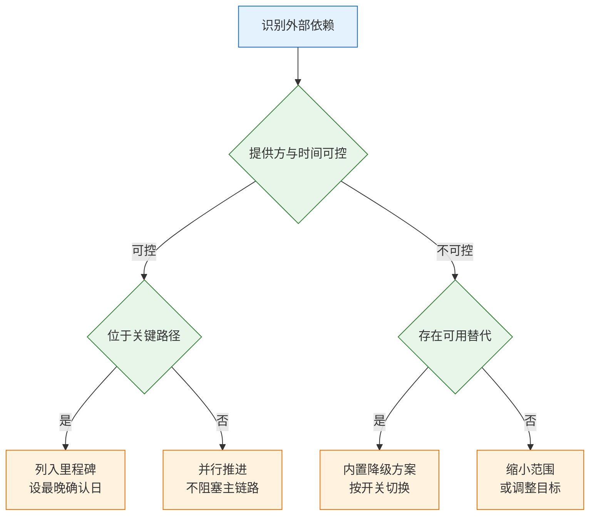

# 规划与敏捷

---

## 一、规划与敏捷是什么

### 1.1 核心概念

规划（Planning）是在资源受限的前提下，把不确定的机会转换成一组有顺序、有边界、可交付的承诺。它输出的不是功能清单，而是一份关于“先做什么、做到什么程度、什么时候交付给谁”的取舍记录。

敏捷（Agile）是一组以短反馈周期为核心的协作约束：把大块工作切成可独立验证的增量，用真实运行结果替代前置预测。敏捷不取消规划，它改变的是规划的修正频率——从季度末复盘一次，变成每个迭代结束都能修正。

两者结合后形成一条固定链路：目标决定机会，机会经过产能过滤变成版本范围，版本拆成迭代增量，增量经灰度发布产生结果数据，结果数据反过来修正目标。链路每一段都有明确产出物，缺一段就会退化成“排期表加加班”。


| 概念 | 含义 | 常见误用 |
|---|---|---|
| 成果 Outcome | 用户行为或业务指标的可观测变化 | 把“功能上线”当成果 |
| 产出 Output | 可交付的版本、接口、页面 | 用产出数量衡量团队 |
| 承诺 Commitment | 对外给出的日期与范围组合 | 日期与全范围同时锁死 |
| 产能 Capacity | 扣除非交付性工作后的可用工时 | 按人数乘工作日满算 |
| 速率 Velocity | 单位迭代稳定交付的工作量 | 跨团队比较故事点 |
| 范围 Range | 版本内必须包含与可选包含 | 全部标为必须 |

这条链路上最容易断裂的位置不是执行，而是“目标”和“机会”之间的翻译。目标写成“提升客户满意度”，机会写成“做一套新的工单界面”，中间缺少可验证的因果假设，团队就只能凭感觉判断优先级。可用的写法是把目标落到一个可观测的量上，再列出两到三个能影响它的机制，每个机制对应一组候选方案。

### 1.2 适用场景与边界

规划与敏捷并非所有团队都按同一模板运行。业务确定性、外部承诺强度、团队规模三项决定方法组合，而不是由团队偏好决定。

| 场景 | 适配方式 | 主要约束 |
|---|---|---|
| 成熟产品持续迭代 | 双周迭代加月度版本 | 主干随时可发布 |
| 零到一探索 | 里程碑加假设验证 | 允许范围大幅调整 |
| 合同制交付 | 固定范围加变更单 | 变更必须计价与签认 |
| 平台与支持型团队 | 看板加服务级别 | 难以承诺具体日期 |
| 多团队共用版本 | 发布火车加冻结窗口 | 赶不上顺延一班 |

规划的边界在于：它只解决资源分配与承诺管理，不解决需求本身是否正确。需求正确性只能靠发布后的数据和小范围试验回答。敏捷的边界在于：它提高反馈速度，不提供方向判断；一个方向错误的团队敏捷度越高，浪费越快。

> **注意**：规划粒度越细，维护成本越高。超过一个季度的逐条排期，本质上是用精确的格式包装不精确的预测，一旦需求变化就要整体重写，反而失去参考价值。

还有一类常见错配：把探索型业务塞进固定范围合同，或把合规交付型业务做成开放式迭代。前者的结果是团队不断承诺无法兑现的功能，后者的结果是验收标准随迭代漂移，客户在验收阶段才发现范围没有边界。方法要跟着业务确定性走，不跟着流行术语走。

---

## 二、规划质量的判断依据

### 2.1 路线图的三层结构

一份可执行的路线图分三层，层与层的变更成本差别很大。上层粗、下层细，且只有最下层对外承诺。

| 层 | 时间跨度 | 内容 | 变更成本 |
|---|---|---|---|
| 目标层 | 季度 | 一个可判定的结果与衡量口径 | 低，可季度调整 |
| 机会层 | 季度内 | 候选方案、假设、依赖 | 中，可月度替换 |
| 承诺层 | 版本与迭代 | 已确认范围、日期、验收条件 | 高，需变更流程 |

目标层只写一到两个结果，且必须能被团队的工作影响。机会层是候选池，条目可以随时增删，但要写清“推动哪个目标、验证什么假设”。承诺层是唯一对外可见的部分，写的是已排入版本的范围，不含“可能会做”的条目。

三层结构的作用是给讨论定位。销售抱怨交付慢，先判断是目标层定得过高、机会层选错了方案，还是承诺层排得过满。三层混在一起讨论，最后往往变成互相指责执行力。

### 2.2 成果型与功能型的判别

功能型路线图回答“做什么”，成果型路线图回答“改变什么”。两者都可以出现在文档里，但只有后者能判断成败。

| 维度 | 功能型 | 成果型 |
|---|---|---|
| 写法 | 第三季度做报表中心 | 第三季度把月结耗时压到一天内 |
| 成功判断 | 功能上线并验收 | 指标变化，或假设被证伪 |
| 砍件依据 | 谁的声音大 | 对结果贡献最小 |
| 失败后的动作 | 加功能继续试 | 回头修改假设 |

判别有三条标准。第一，目标能否在一到两个季度内被观测到变化；不能，说明它是战略方向，不该占季度目标的位子。第二，目标是否独立于某个具体功能；如果删掉那个功能目标就不成立，说明写的仍是功能。第三，目标是否可被证伪；如果无论结果如何都能解释成成功，它就不是目标。

> **注意**：把“上线三个模块”改写成“完成三个模块的交付”不构成成果型，只是换了动词。成果必须描述用户侧或业务侧的变化，并附带口径、基线、观察窗口。

反例很常见：路线图写“打造统一权限中心，提升安全治理能力”。“统一”和“提升”都无法验收，团队最后只能用“权限中心上线了”交差。可用的改写是“新增客户中，管理员在开通当天完成角色配置的比例从某个基线提升到目标区间”，这样权限中心只是手段，做不做、做多少由数据决定。

---

## 三、产能与速率测算

### 3.1 可用产能构成

可用产能不是人数乘工作日。故障支持、技术债、评审返工、休假都会实际占用时间，排期时必须先扣掉。

| 构成 | 经验占比 | 说明 |
|---|---|---|
| 计划内需求 | 55%–65% | 路线图中的主线交付 |
| 故障与支持 | 15%–20% | 线上问题、客户工单、值班 |
| 技术债与基础设施 | 10%–15% | 不还就以故障形式回来 |
| 缓冲 | 10%–15% | 评审返工、依赖等待、休假 |

计算顺序固定：先算毛工时，乘专注系数得到有效工时，再按上表比例分配。专注系数取 0.6 到 0.8，会议多、跨时区协作多的团队取低值。示意算法如下，具体数值按团队实际填写：

```text
毛工时     = 人数 × 迭代工作日
有效工时   = 毛工时 × 专注系数
计划内产能 = 有效工时 × 60%
可承诺量   = 计划内产能 × 历史达成率
```

历史达成率用最近三到六个迭代的实际交付除以承诺交付，取中位数。新团队没有历史数据时，前两个迭代按预估值的七成承诺，把差额留作校准。

> **注意**：把“计划内需求”排到九成以上，等于把延期写进日历。第一个线上故障就会挤占主线，随后每次延期都用加班补，质量下降又制造新的故障，形成正反馈。

### 3.2 速率基线与估算规则

速率是观测值，不是目标值。它的用途是预测下一次能装多少，不是给团队排名。

| 方法 | 适用 | 主要偏差 |
|---|---|---|
| 历史中位数 | 团队稳定、迭代长度固定 | 忽略结构性变化 |
| 分布模拟 | 条目多、样本足 | 依赖历史数据质量 |
| 类比估算 | 新团队、相似项目 | 相似性判断主观 |
| 三点估算 | 单个高不确定条目 | 乐观值与悲观值难校准 |

估算单位由团队自定，故事点与人日都可行，但有两条硬规则：同一团队内保持稳定，不跨团队比较点数；估的是工作量，不是工期，谁并行、谁等待要在排期阶段单独处理。

估算结果要带区间，不写单点。“这个需求三天”在现场会被听成承诺，“三到五天，取决于支付接口是否按文档返回”才是可管理的信息。区间宽度随不确定性变化，探索型条目允许上下浮动一倍。

反例：上个迭代承诺一百人日、实际交付七十五人日，下个迭代仍按一百人日排。理由是“这次大家更熟悉了”。熟悉度带来的提升通常只有几个百分点，补不上二十五的缺口，结果是连续三个迭代延期，团队对估算彻底失去信任。

---

## 四、版本切分方法

### 4.1 纵向切片原则

切版本有两种方向。横向按模块切，每个模块各完成一部分；纵向按链路切，每一片都让一条业务从头跑到尾。前者适合外包分工，后者适合需要尽早验证的产品。


| 维度 | 横向模块切分 | 纵向链路切分 |
|---|---|---|
| 版本结束时 | 每个模块完成一部分 | 一条业务可完整运行 |
| 可验证程度 | 只能演示页面 | 可灰度给真实客户 |
| 风险暴露 | 集成问题在末期集中爆发 | 每个迭代暴露一次 |
| 砍范围 | 半成品模块无价值 | 可砍场景不影响主链路 |

纵向切片有三条操作要求。每一片包含界面、接口、数据、权限的最小闭环，不能只做前端或只做后端；一片只覆盖一种主要场景，其他场景明确后置；片与片之间用开关隔离，未完成的片不影响已上线部分。

切片粒度以“能否独立上线并产生可观察结果”为准。一个切片如果需要等三个其他切片同时完成才能上线，说明切错了方向，应合并或重新划分。

### 4.2 版本切分表模板

版本切分表把“做什么”和“凭什么算成功”固定在同一张表上，评审和复盘都以此为准。

| 字段 | 填写要求 | 示例 |
|---|---|---|
| 版本号 | 可追溯到发布记录 | V2.3 |
| 验证假设 | 一句话，可被证伪 | 客户可自助完成开通，无需实施介入 |
| 主链路范围 | 端到端包含的环节 | 邀请、建单、流转、关闭 |
| 明确不做 | 本期排除项 | 批量导入、审批流定制 |
| 成功判据 | 指标、基线、观察窗 | 开通耗时中位数下降且工单量不升 |
| 依赖 | 提供方与最晚确认日 | 短信通道，发布前两周 |
| 回退方式 | 开关、镜像或数据脚本 | 关闭自助入口，回退旧流程 |

以工单产品为例，三个版本的切分如下（数值为示例，仅说明写法）：

| 版本 | 验证假设 | 主链路与不做 | 成功判据 |
|---|---|---|---|
| V2.1 | 单人可独立完成建单到关闭 | 建单、流转、关闭；不做多人协作 | 新客户首周完成一次真实工单 |
| V2.2 | 协作是留存主因 | 邀请、指派、通知；不做统计 | 团队工单中多人参与占比上升 |
| V2.3 | 数据可自助导出即可减少实施 | 列表导出、字段映射；不做自定义报表 | 实施类工单占比下降 |

> **注意**：“明确不做”一栏不能空。空着意味着范围无边界，任何人在评审时都可以加一条，切分表就失去约束力。排除项要写具体，不写“其他优化”。

MVP 的判定标准不是功能最少，而是能验证核心假设的最小闭环。假设是“客户愿意自助开通”，MVP 必须包含开通、首个管理员登录、基础配置；报表可以没有，单点登录可以后置。假设是“管理员愿意按项目配权限”，权限模型与项目结构必须在，界面粗糙可以接受。

切分时让开发参与。产品定“验证什么”，开发定“最小可运行边界”，两边合起来才是可执行的版本。只由产品切分，常见结果是切出一条技术上无法独立部署的链路；只由开发切分，常见结果是做了一堆可运行但无法验证的技术模块。

---

## 五、节奏设计与迭代运行

### 5.1 三种节奏的选择

节奏解决的是“多久给一次可预期的交付”。三种主流方式各有适用面，多数团队实际是组合使用。

| 方式 | 适合 | 代价 | 不适合 |
|---|---|---|---|
| 双周迭代 | 需求相对独立、团队稳定 | 会议多，范围易中途变动 | 高频线上支持 |
| 看板流动 | 支持型、故障多、持续流入 | 难给外部承诺日期 | 跨团队大版本 |
| 发布火车 | 多团队共用一个版本窗口 | 赶不上就顺延一班 | 单团队小规模交付 |

常见的稳定组合是：双周迭代管执行，月度版本管对外，季度目标管方向。迭代内冻结范围，只接受等价换出；版本窗口对外公布，客户按窗口预期；季度目标决定机会层取舍，不因单个客户诉求随意改。

发布火车要成立，前提是主干随时可发布。若每次发版都要两周集成，火车会变成“集体加班日”，固定窗口反而放大风险。引入火车前先确认持续集成、自动化测试、灰度能力是否具备。

### 5.2 就绪与完成定义

需求进入迭代前要过就绪关口，交付结束时过完成关口。两个关口都写成可核对的条件，不写“理解清楚”“测试通过”这类无法验证的描述。

| 关口 | 检查项 | 证据 |
|---|---|---|
| 就绪 | 场景、角色、目标明确 | 一页说明与流程图 |
| 就绪 | 验收条件可写 | 至少一条正常与一条异常路径 |
| 就绪 | 依赖已确认 | 提供方回复与时间点 |
| 就绪 | 设计与数据口径可看 | 设计稿、指标定义卡 |
| 完成 | 代码合并、测试通过 | 流水线记录 |
| 完成 | 验收环境可演示 | 真实数据走通主链路 |
| 完成 | 埋点可查 | 事件在测试环境可见 |
| 完成 | 回滚方案确认 | 开关或上一版镜像可用 |

> **注意**：完成的定义只写“开发完成”，会把测试、文档、埋点、回滚准备全部推到上线前一周。那一周通常同时压着多个需求，任何一项遗漏都会变成发布当天的现场问题。

就绪关口不是形式审查。需求在进入迭代后才想清场景，等于用开发时间做需求分析，而且是在最贵的阶段做。评审时发现条件不全，正确动作是退回补充，不是“先做起来，边做边想”。

迭代中途插入的紧急需求按两条规则处理：换出一条同等工作量的任务，或明确写入下一迭代并告知提出方。默认“加加班就能出来”只对单次有效，连续三次之后团队会自行降低估算，把缓冲藏进任务里，排期数据随之失真。

### 5.3 评审与回顾的运行形式

站会、评审、回顾三个会议各自解决不同问题，混用会让每个都失效。

| 会议 | 唯一目的 | 失效表现 |
|---|---|---|
| 站会 | 暴露阻塞与依赖 | 逐人汇报进度，超过十五分钟 |
| 评审 | 展示可运行增量 | 放演示文稿，无人操作 |
| 回顾 | 定下一项改进 | 提出十条，下期零落实 |

站会只回答三件事：昨天推进了什么、今天推进什么、被什么卡住。第三人称的进度叙述直接打断，因为那类叙述不产生决策。评审必须现场操作真实数据，走通主链路和一条异常路径；只能讲页面截图的增量，无法证明系统可用。

回顾会结束前必须收敛到一项改进，并给它负责人和验证方式。改进项过多等于没有改进，团队会把回顾当成情绪疏导，逐渐敷衍。连续两个迭代无改进时，问题通常不在团队意愿，而在改进项超出了团队权限，此时应升级到目标层或资源层讨论。

复盘的对象是版本，不是个人。讨论“这个版本哪个假设被证伪、哪个依赖判断错了、哪次砍件砍晚了”，比讨论“谁没做完”更能产生可执行结论。

---

## 六、依赖管理与承诺管理

### 6.1 依赖登记与降级

跨团队依赖不能混进人日里假装可控。每个依赖单独登记，写清提供方、需要的内容、最晚确认时间、拿不到时的降级方案。



| 依赖 | 提供方与内容 | 最晚确认 | 降级方案 |
|---|---|---|---|
| 单点登录 | 客户 IT 或身份厂商 | 版本冻结前 | 账号密码加手动导入 |
| 支付回款 | 财务系统接口 | 开发中期 | 线下回款登记 |
| 历史数据迁移 | 客户原厂商 | 上线前两周 | 模板导入加人工校验 |

依赖还有一笔隐性成本：等待。团队等接口的两周不会真的空闲，而是被塞进其他任务，切回来要重新熟悉上下文，实际损失往往超过两周。所以依赖未确认时，优先推进不依赖它的部分，不把整条链路停下来等。

> **注意**：依赖的“最晚确认日”要早于版本冻结，且要写进对方的排期，不能只写在自己文档里。没有对方确认的时间点只是愿望，不是计划。

### 6.2 承诺三角与变更规则

日期、范围、质量三者只能同时保两个。这不是修辞，是排期时的硬约束。

| 承诺类型 | 适用 | 主要风险 |
|---|---|---|
| 固定日期、弹性范围 | 市场发布、监管节点 | 范围被反复压缩，主线被砍 |
| 固定范围、弹性日期 | 合同交付、验收制项目 | 日期滑到无法对外解释 |
| 固定范围、固定日期 | 极少适用 | 只能牺牲质量，故障率上升 |

对外承诺时把范围写成“至少包含”，增强项留活口；承诺范围时把日期写成区间，并说明区间取决于哪些依赖。两者都锁死，团队唯一能调的就是质量，而质量会以故障、返工、人员流失的形式回来。

> **产品红线**：同时锁死日期、全范围与质量标准的承诺不可签署。若业务方坚持，必须把范围拆成“必须”和“可延后”两段并写入合同或邮件，否则延期责任会全部落在执行团队。

变更要有记录。每次范围调整写清四项：新增或移除什么、换出了什么、对日期的影响、谁批准。只口头说“这个先加上”，三个月后没人能解释版本为什么延期。变更日志同时也是复盘材料，能看出范围是在哪个阶段开始失控的。

---

## 七、常见失败模式与检查清单

### 7.1 失败模式

| 现象 | 最可能原因 | 处理 |
|---|---|---|
| 路线图排得满满当当 | 未留故障与缓冲 | 按历史达成率重排，砍到八成 |
| 延期后不知道先砍什么 | 没有砍件顺序 | 先砍可选，再缩应该，最后动日期 |
| 销售按路线图逐条承诺 | 路线图被当成合同 | 对外只承诺版本主题与已锁范围 |
| 技术债永远排不进去 | 没有固定配额 | 每期留一成到一成五，按故障信号排序 |
| 依赖到上线前才暴露 | 未列依赖里程碑 | 补提供方、最晚确认日、降级方案 |
| 迭代结束还剩一半 | 范围塞满、准入缺失 | 下期按真实速率减两成 |
| 需求中途反复插入 | 无换出规则 | 插一条换一条，或进下一迭代 |
| 版本发了客户不知道 | 缺少变更说明 | 按角色写“改了什么、要做什么” |
| 特性开关长期挂着 | 无负责人与过期时间 | 稳定一个版本后删除或固化 |
| 团队声称敏捷即无文档 | 把短会当成不要设计 | 保留决策记录与接口契约 |

失败模式之间会互相放大。范围塞满导致延期，延期导致插入需求被拒，插入需求转成私下承诺，私下承诺又让下一版范围更满。打断这个循环的入口通常在产能与准入两处，而不是在执行端加压。

### 7.2 检查清单

**目标与路线图**

- [ ] 季度目标数量不超过两个，且每个都有口径、基线与观察窗
- [ ] 每个机会条目写明推动哪个目标、验证什么假设
- [ ] 对外材料只包含承诺层内容，机会层标注为“候选”

**产能与估算**

- [ ] 产能已扣除故障支持、技术债、缓冲
- [ ] 速率取历史中位数，未使用承诺值
- [ ] 估算给区间，未给单点承诺

**切分与节奏**

- [ ] 每个版本含一条可端到端运行的链路
- [ ] 切分表的“明确不做”一栏已填写
- [ ] 就绪与完成定义均有可核对证据
- [ ] 插入需求有换出或延期记录

**依赖与承诺**

- [ ] 每个外部依赖有提供方、最晚确认日、降级方案
- [ ] 承诺未同时锁死日期、范围、质量
- [ ] 变更日志记录范围调整与批准人

**发布准备**

- [ ] 回滚方式已实际验证，不只是文档描述
- [ ] 开关有负责人、默认值与清理日期
- [ ] 变更说明已按角色发出

检查清单的价值在于把争论转成核对。评审时逐条过表，比讨论“团队是否足够努力”有效得多。清单之外的问题，通常属于目标设定或组织授权，不是规划方法能解决的。
