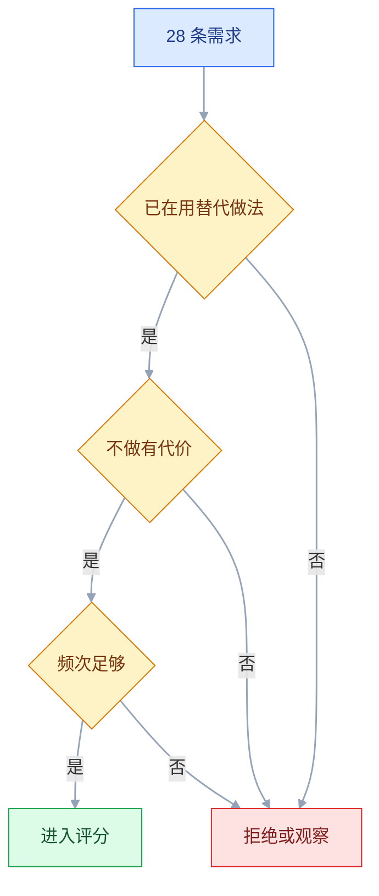
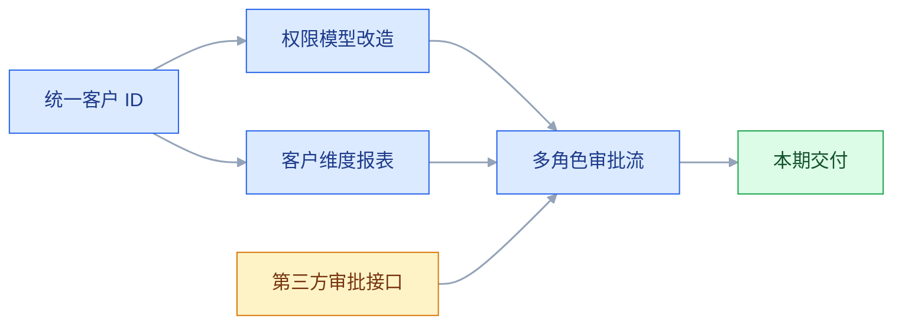

# 需求分析与优先级

> 说明：以下为脱敏后的示例场景，客户与数字仅用于演示判断过程，不代表行业统计。

## 一、工程案例：把 47 条需求压到一个季度能交付的范围

**场景**：一套 B 端协同产品，需求池积了 47 条。销售每天在群里催「这个客户要，那个客户也要」，团队上一季度按「谁催得急」排期，做了 12 个需求，收入没涨，新用户上手时间反而从 30 分钟涨到 45 分钟。

**约束**：

| 约束 | 具体内容 |
|---|---|
| 人力 | 前端 3 人、后端 3 人，本季度不能加人 |
| 容量 | 30% 人力用于线上维护与故障，可做新需求的只有约 70% |
| 周期 | 一个季度 3 个迭代，每个迭代 2 周 |
| 合同 | 2 家客户有定制条款，需在本季度给出处理方案 |
| 目标 | 需求池从 47 条收敛到可交付范围，并让销售能接受「不做」的理由 |

### 1.1 先补字段，再谈排序

原始需求池只有「标题、提出人、日期」三列。先补齐六项，缺的标注「未知」，不猜：

| 字段 | 作用 | 缺失时的处理 |
|---|---|---|
| 场景 | 谁在什么情况下遇到什么 | 找提出人补，补不上先搁置 |
| 原始诉求 | 用户原话，不改写成方案 | 从聊天记录、工单里摘 |
| 影响面 | 受影响账号数或客户数 | 用后台数据估，标注估算口径 |
| 业务价值 | 收入、留存、效率、风险 | 至少选一类，写量级 |
| 成本 | 设计、开发、测试、维护 | 由开发给区间，不给单点 |
| 拒绝理由 | 不做的原因与重启条件 | 评审后补，必须可观测 |

**补字段花了 2 天**：47 条里有 19 条补不出场景，这 19 条进入「待观察」，30 天内仍补不出就关闭，不占本期排期。

### 1.2 逐条还原场景

对剩下 28 条，用同一组问题过一遍，每个需求不超过 10 分钟：

```text
1. 谁提出来的？他的角色是什么？
2. 上一次遇到这个问题是什么时候？
3. 现在怎么解决？花了多少时间或多少钱？
4. 不做会怎样？会损失什么？
5. 这个问题一个月出现几次？
```

**记录方式**：场景写成一句「角色 + 触发 + 目标 + 当前做法 + 代价」。写不出这一句的，退回待观察。

### 1.3 真伪判断：四个信号



| 信号 | 真需求 | 伪需求 | 取证 |
|---|---|---|---|
| 现有做法 | 已在用麻烦的方式解决 | 从没尝试解决 | 问「现在怎么做」 |
| 不做的影响 | 有损失、无法完成、被罚 | 「有就更好了」 | 问「上次没做成发生了什么」 |
| 频次 | 每周或每天 | 一年一次 | 查工单、日志、聊天记录 |
| 付费或切换 | 愿意为此付费、换工具 | 「免费的话会用」 | 查合同、采购记录 |

**这次的结果**：28 条中，11 条没有替代方案也无代价，判为伪需求；6 条频次低于每季度一次，转入观察；11 条进入评分，其中 7 条信息齐备，4 条退回补充影响面。

**注意**：伪需求不等于用户撒谎。用户描述的是想象中的自己，**记录时要保留原话，判断时看行为**。

### 1.4 分类：先看需求类型，再看分数

| 类型 | 特征 | 投入策略 | 已评分条数 |
|---|---|---|---|
| 基本型 | 缺失会被骂，有了是应该的 | 必须做到稳定 | 2 |
| 期望型 | 越好越满意，可比 | 跟住竞品，持续改进 | 2 |
| 兴奋型 | 没有无所谓，有会惊喜 | 少量投入，做差异 | 3 |

另 4 条信息未齐，暂不归类，补完影响面后再进入评分。

**分类的作用**：基本型不能因为 RICE 分数低就砍掉，它是「不被骂」的底线；兴奋型分数再高，也不能挤占基本型的稳定性投入。

### 1.5 RICE 打分

```text
RICE = (Reach × Impact × Confidence) / Effort

Reach：本季度受影响的账号数
Impact：对单个用户的影响，3 极大 / 2 大 / 1 中 / 0.5 小 / 0.25 极小
Confidence：对上述估算的信心，100% / 80% / 50%
Effort：人月，含设计、开发、测试
```

| 需求 | Reach | Impact | Confidence | Effort | RICE | 类型 |
|---|---|---|---|---|---|---|
| 批量操作（订单、任务） | 2000 | 2 | 80% | 6.5 | 492 | 期望 |
| 移动端审批 | 1200 | 3 | 80% | 7.5 | 384 | 期望 |
| 权限模板 | 900 | 2 | 80% | 4 | 360 | 基本 |
| 客户 A 的定制报表 | 60 | 2 | 50% | 2 | 30 | 兴奋 |
| 客户 B 的特殊审批流 | 40 | 3 | 50% | 2 | 30 | 兴奋 |
| 主题换肤 | 200 | 0.5 | 50% | 1.6 | 31 | 兴奋 |
| 登录失败提示优化 | 3000 | 1 | 100% | 0.6 | 5000 | 基本 |

**读法**：登录提示分数极高，因为影响面大、成本极低；两个客户定制分数极低，因为只影响几十个账号。

**RICE 的作用不是算准，而是把依据摆到桌面上**。分数接近时（例如 30 与 31），不要纠结小数，直接按战略判断。

### 1.6 容量校验

| 项 | 数值 |
|---|---|
| 季度总人力 | 6 人 × 3 迭代 × 2 周 = 36 人周 |
| 维护与故障 | 约 30%（10.8 人周），剩 25.2 人周 |
| 评审、联调、发布 | 再占剩余人力的约 15%（3.8 人周），剩约 21.4 人周 |
| 可分配需求工作量 | 约 21 人周 |

按分数从高到低累加，前 4 项已用 18.6 人周，只剩 2.4 人周。第 5 项是主题换肤，需 1.6 人周，塞进去只剩 0.8 人周缓冲，不足以吸收一次中等变更，因此本期不排。

**结论：本季度做 4 个需求，预留 2.4 人周缓冲。**

**容量先算，再排序**：先排序再算容量，会得出一个「看起来都能做」的列表，最后靠加班收尾。

### 1.7 关键产出物：评审会与决策记录

评审不逐条讲方案，只处理三类条目：

| 类型 | 处理 | 参会人 |
|---|---|---|
| 分数接近、方向不同 | 现场定取舍 | 产品、研发负责人、销售负责人 |
| 大客户定制 | 定「配置还是拒绝」 | 产品、销售、客户成功 |
| 基本型但成本高 | 定范围与上线时间 | 产品、研发 |

**评审产出**（当场记录，当天发出）：

```text
本期做：批量操作、权限模板、登录提示优化、移动端审批
本期不做：客户 A 定制报表（提供导出模板）、客户 B 审批流（评估配置化）
观察池：主题换肤、6 条低频需求、4 条待补场景
负责人：各需求对应产品与开发
验收：每条需求附 3 条以上验收标准
```

### 1.8 两个定制的处理

| 客户 | 诉求 | 判断 | 处理 |
|---|---|---|---|
| A | 定制报表格式 | 只影响 1 个客户，且可用导出 + Excel 模板解决 | 拒绝定制，交付导出模板与字段说明 |
| B | 特殊审批流 | 同行业第二个客户也提过，可抽象为条件分支 | 转为配置项，排到下季度 |

**判断标准**：只有一个客户需要、且无法抽象为通用配置的，拒绝；有两个以上客户需要、且规则可枚举的，做成配置。

**拒绝时要给替代方案**：只写「不做」，销售会继续提；给出可用的替代路径，需求才会真正关闭。

### 1.9 变更规则

本期开始执行一条硬规则：**变更不是加进来，是换进来。**

```text
1. 提出变更方写清：影响哪个目标、延期多久、愿意换掉哪一项
2. 产品评估影响面，研发给工期增量
3. 超出缓冲（2.4 人周）的，必须砍掉等量的已排需求
4. 同步销售、客服、客户成功，不只同步开发
5. 记入变更日志，季度复盘时统计次数
```

### 1.10 验收（7 项全过才算完成）

| 检查项 | 怎么验 | 通过标准 |
|---|---|---|
| 需求池收敛 | 导出本期需求池 | 条目从 47 降到 20 以内，每条有状态与理由 |
| 场景完整 | 随机抽 5 条 | 都能读出一句「角色 + 触发 + 目标 + 代价」 |
| 评分可复核 | 抽 3 条重算 RICE | 四个因子都有来源，换人算结果在同一量级，差异能说清 |
| 容量未超 | 对比排期与实际人力 | 已排工作量不超过 21 人周 |
| 拒绝有记录 | 查 11 条伪需求的记录 | 都有拒绝理由与重启条件 |
| 定制有结论 | 查两家客户的沟通记录 | 都已书面告知处理方案与时间 |
| 上线有效果 | 上线 4 周后对比上线前基线 | 至少一项预设指标达到目标，否则进入复盘 |

**第 7 项最容易被跳过**：没有效果复盘，下一季度还会用同样的方式排一遍。

### 1.11 结果与复盘

3 个月后的示例结果：需求池从 47 条降到 17 条（4 条在执行、2 条定制待处理、11 条观察），新用户上手时间从 45 分钟降到 22 分钟，团队每周加班从 8 小时降到 1 小时。付费转化率同期有改善，但受同期运营活动影响，只能作为参考，不作为本轮结论。

**最反直觉的结果**：拒绝两家客户的定制后，复盘时没有观察到续费率下降（受当期整体经营影响，不能单独归因）。A 客户用导出模板解决了问题，B 客户接受了配置化排期。

**做错的一处**：把「登录提示优化」当成本期建设需求排进来（RICE 最高），但它其实是一次线上故障的补丁，应该走维护通道，不该占新需求容量。**RICE 不区分「还债」与「建设」，容量要分开算。**

> **这个案例的要点**：「谁催得急」是最差的排序方式。RICE 的价值在于逼你说清影响多少人、影响多大，把「声音大」和「价值高」分开。但分数只是输入，基本型需求、技术债、合同义务都要单独占位。

---

## 二、高频问答：会卡住你的地方，也是面试最常问的

### 2.1 销售说「客户说不做就续不了费」

**现场**

要三样东西：客户名与合同金额、合同里是否写明该功能、客户现在的替代做法。

**要点**

- 销售的判断基于单次沟通，缺少合同依据与替代方案的尝试。
- 「销售的压力」不等于「客户的最后通牒」。
- 合同没写、替代方案没试过，先做客户回访，再决定是否排期。

**追问**

- 合同真写明了呢？→ 履约，但单独核算长期成本，别混进产品路线。
- 客户坚持要、不给就流失呢？→ 用配置或人工兜底换时间，别直接改架构。
- 只有一个客户要呢？→ 单独立项，或者拒绝并给替代方案。

### 2.2 需求池越积越多，没人敢删

**现场**

查超过 90 天未更新的条目占比；再抽查 10 条，看提出人是否还记得。

**要点**

- 没有关闭机制，也没有「重启条件」，旧需求永远处于「待评估」。
- 「记录」不等于「承诺」，池子的价值在于可判断，不在于数量。
- 90 天无更新且无客户的关闭；有客户的写清重启条件。

**追问**

- 提出人还记得但不急呢？→ 保留但降级，标注重启条件。
- 删了以后又来提怎么办？→ 重启条件本身就是答案，不用重新讨论。
- 战略需求也按 90 天清吗？→ 标「战略保留」，但要定期确认仍然成立。

### 2.3 RICE 算完，和直觉完全相反

**现场**

把四个因子逐项摊开，找最不确定的那一项；用另一组人独立估一遍。

**要点**

- 分数相反时，通常不是公式错，是有人对影响面的估计差了一个量级。
- Reach 和 Confidence 这两个因子最容易估粗。
- 不要用「推翻方法」替代「检查输入」。

**追问**

- 两组人估出来还是差很多呢？→ 说明缺数据，先做验证再评分。
- 分数接近怎么定？→ 按战略判断，不纠结小数。
- 为什么不用另一个方法，比如 MoSCoW？→ 范围被合同或上线日期锁死时用 MoSCoW，要做相对排序时用 RICE。

### 2.4 老板的需求突然插队

**现场**

复述目标后问：「如果这期做，您希望我砍掉哪一项？」；再确认截止时间是否可谈。

**要点**

- 老板掌握了你没有的信息（客户、竞争、合规），但通常没说清代价。
- 「优先级高」不等于「不需要代价」。
- 插一项，就要指出去掉哪一项或延期多久。

**追问**

- 老板说「都做」呢？→ 把容量表摆出来，让他选砍哪项或加人。
- 截止时间真的不能谈呢？→ 走变更流程，砍掉等量的已排需求。
- 怎么避免每次都这样？→ 把决策记录和变更日志常态化，让代价可见。

### 2.5 需求评审没人提反对

**现场**

会前 24 小时发材料，明确要求研发、测试各写一条风险；会上先问风险再讲方案。

**要点**

- 评审变成了宣讲，参会人没提前看材料，也没被要求给判断。
- 沉默不等于同意。
- 没有争议的评审，通常意味着没人认真想过。

**追问**

- 小需求也要开会吗？→ 可以异步，在文档里留 24 小时评论窗口。
- 提的风险都是技术细节呢？→ 说明业务价值和非目标没写清。
- 怎么让人敢提反对？→ 会前点名要风险，不要会上临时问。

### 2.6 开发说工作量比预估大一倍

**现场**

让对方列出增量来自哪里：新接口、数据迁移、兼容旧版、测试用例。

**要点**

- 需求里的异常分支、权限、兼容没被算进去，或依赖了未完成的能力。
- 估算差距超过 50% 时，通常先查需求边界，不查人。
- 把估算差异当成态度问题，就问不出增量在哪。

**追问**

- 增量来自需求本身呢？→ 缩范围或分期，别靠加班填。
- 每次估都偏小呢？→ 把开发、联调、测试、修复分段估，用历史中位数校准。
- 开发故意留缓冲怎么办？→ 看历史同类项目的实际耗时，用数据谈。

### 2.7 上线后没人用

**现场**

查上线 30 天的使用账号数、使用频次；回访 3 个目标用户，问「上次用它是什么时候」。

**要点**

- 需求可能来自单个客户或内部猜测，没有进入多数人的工作流。
- 要区分「不知道」「不需要」「不好用」。
- 三者对应推广、判断失误、体验问题，处理方式完全不同。

**追问**

- 怎么快速区分这三者？→ 看入口点击和使用路径，再回访问上次场景。
- 确认是「不需要」怎么办？→ 复盘来源，把判断失误和推广失误分开记。
- 要不要再发公告推一次？→ 先确认需求存在，否则只是延长失败。

### 2.8 同一个需求被反复提

**现场**

翻需求池的拒绝理由字段；没有就补上，并同步给提出人。

**要点**

- 上次拒绝只说了「不做」，没说「什么条件下会做」。
- 重复提出不是骚扰，是缺一个可观测的重启条件。
- 条件可观测，争论才会停止。

**追问**

- 重启条件怎么写？→ 写成「出现 5 个同类客户」或「下季度容量释放」。
- 条件满足了但还是没容量呢？→ 那是排期问题，明说时间，别重新讨论需求。
- 提出人换了怎么办？→ 条件写在池子里，不依赖某个人记得。

### 2.9 两个需求互相依赖，排期打架

**现场**

画出依赖方向：数据依赖、接口依赖、权限依赖；确认能否用临时方案解耦。

**要点**

- 依赖关系没在池子里标注，排期时才发现。
- 合并会让需求变大、验收变难，是用合并掩盖依赖。
- 优先做被依赖的一方，或先做一层兼容接口。

**追问**

- 依赖链超过三层呢？→ 通常说明需求切得太大，回到拆分。
- 能不能并行做？→ 有临时桩就可以，但要写清替换时间。
- 依赖外部团队呢？→ 提前联调，并准备降级方案。

### 2.10 需求变更导致延期

**现场**

查变更日志：次数、每次的增量、是否砍掉了等量需求。

**要点**

- 变更没有走「换进来」流程，只是不断追加。
- 没有交换机制的团队，变更一定以延期或加班的形式消化。
- 变更不是纪律问题，是流程缺了交换机制。

**追问**

- 变更合理但没东西可砍呢？→ 那就是容量问题，延期要明说，不要靠加班吞掉。
- 小变更也要走流程吗？→ 缓冲内的可以直接做，但要留记录。
- 怎么减少变更？→ 需求阶段把异常和边界问清，那时变更成本最低。

### 2.11 大客户要求定制，拒绝怕丢单

**现场**

算三笔账：报价能否覆盖 3 年维护、是否有第二个客户需要、是否与现有架构冲突。

**要点**

- 定制的长期维护成本没有进入报价，也没判断能否抽象为配置。
- 只看合同金额，会把一次性收入当成长期收益。
- 拆成「配置可解」「需要改代码」「需要改架构」三档，后两档单独立项或拒绝。

**追问**

- 拒绝后客户真的走了呢？→ 记录下来，看是不是定位客户，别因一例就改路线。
- 报价能覆盖就等于能做吗？→ 还要看是否与架构冲突、是否会被第二个客户需要。
- 标杆客户能不能例外？→ 可以，但立项时要写清复制路径，否则就是纯项目。

### 2.12 说不清优先级理由，团队不认

**现场**

回看排期文档：是否写了影响面、成本、放弃项；会上是否有人能复述理由。

**要点**

- 只公布结论、不公布依据与放弃项，团队只能执行，不能认同。
- 「告知」不等于「对齐」。
- 说不出「为什么不是另一个」，就还没有真正排好序。

**追问**

- 团队复述不出来怎么办？→ 说明文档只写了做什么，没写放弃什么。
- 怎么让销售接受「不做」？→ 给理由、给重启条件、给替代方案。
- 优先级真要改呢？→ 走变更流程，公开改的理由。

### 2.13 合规、数据安全被当成普通需求往后排

**现场**

查三件事：合同与监管要求的截止日期、涉及的数据范围与流向、最小合规范围能否单独交付。

**要点**

- 合规是硬截止日期，不是「体验优化」，也没算过违规带来的下架、罚款与用户损失。
- 它不是排序项，是门槛项，要从普通需求池里拿出来单独立项。
- 单独占容量，不参与 RICE 比较。

**追问**

- 合规需求也写「场景」吗？→ 用它自己的口径：监管条款、截止日期、影响范围。
- 只做最小范围够吗？→ 够，前提是能过审计，剩余部分单独立项。
- 资源不够怎么排？→ 砍业务需求，不能砍合规，这是门槛。

---

## 三、核心知识：从零开始要建立的东西

### 3.1 需求池的字段结构

| 字段 | 必填 | 作用 |
|---|---|---|
| 标题 | 是 | 一句话说清要解决什么，不写方案 |
| 场景 | 是 | 角色、触发、目标、当前做法、代价 |
| 原始诉求 | 是 | 用户原话，防止转述失真 |
| 来源 | 是 | 用户、销售、老板、数据、竞品 |
| 影响面 | 是 | 账号数、客户数、收入占比 |
| 业务价值 | 是 | 收入、留存、效率、风险，至少一类 |
| 成本 | 是 | 设计、开发、测试、维护，给区间 |
| 优先级 | 是 | 方法与分数 |
| 状态 | 是 | 待评估、已排期、开发中、已上线、已拒绝 |
| 拒绝理由 | 拒绝时必填 | 原因与重启条件 |

**最容易被忽略的是最后一项**：它决定同一个需求会不会每季度被重新提一遍。

**边界**：字段太多会没人填。团队小于 5 人时，保留场景、影响面、成本、状态四项即可。

### 3.2 真需求与伪需求的信号

| 信号 | 观察点 | 真 | 伪 |
|---|---|---|---|
| 现有做法 | 现在怎么做 | 已在人工硬扛 | 从没尝试 |
| 代价 | 不做会怎样 | 有损失、被罚、无法交付 | 「有更好」 |
| 频次 | 多久一次 | 每周或每天 | 一年一次 |
| 付费 | 谁出钱 | 有预算科目 | 「免费会用」 |
| 扩散 | 多少人提 | 多个客户同类场景 | 一个人反复提 |

**判断顺序**：先看现有做法，再看代价。用户从没尝试解决过，通常意味着没有需求，而不是蓝海。

**边界**：合规、安全类需求可能没有用户主动提出，也没有替代方案，但必须做。**这类需求走风险通道，不参与真伪判断。**

### 3.3 Kano 模型的五种类型

| 类型 | 缺失时 | 具备时 | 投入 |
|---|---|---|---|
| 基本型 | 强烈不满 | 无感，视为应该 | 做到稳定，不能省 |
| 期望型 | 不满 | 越强越满意 | 跟住竞品，持续投入 |
| 兴奋型 | 无感 | 惊喜 | 少量试点，做差异 |
| 无差异型 | 无感 | 无感 | 不做，避免占容量 |
| 反向型 | 无感 | 不满 | 识别后去掉，或做成可选 |

**衰减规律**：今天的兴奋型，通常两三年后会变成基本型。**不能把差异点当成永久护城河。**

**例（后台系统，只列前三种）**：

```text
基本型：能登录、能保存、不丢数据
期望型：加载速度、批量操作、筛选能力
兴奋型：智能推荐下一步、快捷键
```

**边界**：Kano 分类要靠正反两问的问卷（功能型问题 + 反功能型问题），不能由产品经理独自判定。同一个功能对不同角色可能属于不同类型。

> **面试**：常问「Kano 分类能不能产品经理自己定？」答：不能，要靠正反两问的问卷，而且同一功能对不同角色可能是不同类型。

### 3.4 RICE 的四个因子

| 因子 | 定义 | 常见错误 |
|---|---|---|
| Reach | 一段时间内受影响的用户数 | 用总用户数代替受影响人数 |
| Impact | 对单个用户的影响程度 | 所有需求都填「大」 |
| Confidence | 对估算的信心 | 没有数据也填 100% |
| Effort | 总工作量，人月，含设计、开发、测试；长期维护另算 | 只算开发工时 |

**刻度要固定**：同一个团队用同一套 Impact 与 Confidence 刻度，换刻度会让历史分数不可比；不同团队之间的 RICE 分数也不能直接比较。

**Impact 的参考刻度**：3 极大（无法完成工作）、2 大（显著变慢或出错）、1 中（有改善）、0.5 小（轻微）、0.25 极小（几乎无感）。

**Confidence 的参考**：有数据 100%，有访谈 80%，只有判断 50%。**低于 50% 的需求，先做验证再评分。**

**边界**：RICE 只适合在同类、相互独立的需求之间做相对比较。合规、合同义务、技术债不应与业务需求一起排序，要单独预留容量；需求之间有依赖时，先按依赖合并或分层，再评分。

> **面试**：常问「RICE 分数最高的就先做吗？」答：不是，它只在同类需求间做相对比较，合规、合同义务、技术债要单独占容量。

### 3.5 MoSCoW 的适用范围

| 级别 | 含义 | 用法 |
|---|---|---|
| Must have | 没有就不能上线 | 合同交付、合规底线 |
| Should have | 重要但可延后 | 本期尽量做 |
| Could have | 有余力才做 | 缓冲容量的候选 |
| Won't have | 本期明确不做 | 写进范围说明 |

**适用场景**：范围由合同或上线日期锁死的项目。此时 RICE 的「相对排序」意义不大，关键是确认底线。

**边界**：MoSCoW 容易被滥用成「全是 Must」。必须给 Must 设上限，并留出应对变更的缓冲；上限按团队历史交付数据定，不要照搬固定比例。

### 3.6 价值与成本的构成

| 价值类型 | 估算方式 | 证据 |
|---|---|---|
| 收入 | 新增合同、续费、扩容 | 销售 pipeline、合同 |
| 留存 | 降低流失、提升频次 | 流失访谈、行为数据 |
| 效率 | 节省人力与时间 | 现场计时、工时记录 |
| 风险 | 避免罚款、事故、合规问题 | 合同条款、审计要求 |
| 战略 | 打开新市场、拿到标杆客户 | 客户名单、路线图 |

| 成本类型 | 内容 | 常被漏算 |
|---|---|---|
| 开发 | 前后端工时 | 数据迁移、兼容旧版 |
| 设计 | 方案、走查 | 多角色界面的差异 |
| 测试 | 用例、回归 | 组合爆炸 |
| 维护 | bug、升级、文档 | 长期占用 |
| 机会 | 占用的容量 | 被推迟的其他需求 |
| 认知 | 用户学习成本 | 新入口带来的困惑 |

**「不能量化」不是不做的理由**，但要写清判断依据和验证方式。

**边界**：维护成本通常按开发成本的固定比例估，比例因系统而异，用自己团队的历史数据校准，不要照搬外部数字。

### 3.7 需求来源的权重

| 来源 | 权重 | 处理方式 |
|---|---|---|
| 付费客户（多客户同类） | 高 | 看影响面与合同 |
| 数据异常 | 高 | 先定位原因，再定方案 |
| 大量普通用户 | 高 | 看频次与分布 |
| 销售、客服 | 中 | 当信号，还原场景 |
| 老板 | 中 | 挖目标，不照搬方案 |
| 竞品 | 低 | 看动机，不看功能列表 |
| 产品经理自己 | 低 | 除非自己就是目标用户 |

**单一客户的高权重是例外**：合同写明、金额占比大、或行业标杆，可以单独立项，但要与控制的产品路线分开记账。

**边界**：来源权重不是投票权。十个普通用户的同一个问题，可能比一个大客户的定制更重要。

### 3.8 需求评审的产出

| 要回答 | 责任人 | 产出 |
|---|---|---|
| 解决什么问题 | 产品 | 一句问题陈述 |
| 为什么现在做 | 产品 | 时机依据 |
| 方案与替代 | 产品、设计 | 至少两个方案对比 |
| 技术风险 | 开发 | 风险清单与应对 |
| 怎么验证 | 产品、数据 | 指标与观察期 |
| 不做什么 | 产品 | 非目标清单 |
| 谁负责 | 产品 | 到人到日期 |

**评审失效的典型**：产品讲一遍方案，大家点头，散会。**没有争议，通常说明材料没提前看，或没人被要求负责。**

**边界**：小需求可以异步评审，在文档里留 24 小时评论窗口，不必开会。

### 3.9 变更成本的曲线

| 阶段 | 变更成本 | 主要代价 |
|---|---|---|
| 需求 | 极低 | 改一句话 |
| 设计 | 低 | 重画稿 |
| 开发中 | 中 | 返工、影响同批需求 |
| 测试中 | 高 | 重测、回归 |
| 上线后 | 极高 | 数据迁移、用户通知、口碑 |

**变更处理五步**：评估影响、判断是否本期必须、明确换掉什么、同步所有相关方、记录日志。

**最关键的是第三步**：资源固定，加一件事就要减一件事。没有减法，变更就会以延期或加班消化。

**边界**：合规与安全事故不受此流程限制，可以先处理再补记录。

### 3.10 验收标准的写法

| 要求 | 说明 | 反例 |
|---|---|---|
| 可验证 | 能判断通过或不通过 | 「体验流畅」 |
| 覆盖异常 | 不只写正常路径 | 只写「成功时提示」 |
| 包含边界 | 空、超长、超多、并发 | 只写「支持批量」 |
| 可追溯 | 能对回原始需求 | 验收项与目标无关 |
| 有数据口径 | 统计算法写清 | 「显示总数」 |

**示例**：

```text
需求：订单列表支持按状态筛选

AC：
1. 提供全部、待付款、已付款、已发货、已完成、已取消
2. 默认选中「全部」
3. 切换后列表即时刷新，不需要点查询
4. 筛选条件写入 URL，刷新后保留
5. 无结果时显示「没有符合条件的订单」与「清空筛选」
6. 切换筛选时清空已选中的行
```

**第 4、6 条是重点**：这些细节开发容易漏、测试容易漏，上线后很可能被用户发现。

### 3.11 需求池的治理节奏

| 动作 | 频率 | 负责人 |
|---|---|---|
| 关闭 90 天无更新的需求 | 每月 | 产品 |
| 合并重复需求 | 每月 | 产品 |
| 更新影响面与成本 | 每季度 | 产品、开发 |
| 复盘已上线需求的效果 | 每季度 | 产品、数据 |
| 重排下季度优先级 | 每季度 | 产品、销售、研发 |

**效果复盘最有价值**：比如一季做了 10 个需求，只有 2 个带来可观察的变化，通常说明判断方法有问题，而不是执行不力。

**边界**：治理不是清零。长期路线图上的战略需求可以保留，但要标注「战略保留」并定期确认仍然成立。

### 3.12 大客户定制的处理

| 情况 | 处理 | 记账方式 |
|---|---|---|
| 配置可解决 | 做成配置项 | 计入产品能力 |
| 需少量改代码、有第二客户 | 排入正常需求 | 计入产品 |
| 需改架构、仅一个客户 | 单独立项或拒绝 | 计入项目成本 |
| 合同已写明 | 履约，但评估长期成本 | 单独核算 |

**判断口诀**：能配置就不写死，能通用就不定制，必须定制就单独报价并计入维护成本。

**边界**：标杆客户的定制可能带来行业复制价值，可以例外，但要在立项时写清「复制路径」，否则就是纯项目。

> **面试**：常问「大客户的定制需求什么时候能做？」答：能配置就不写死，能通用就不定制，必须定制就单独报价并计入维护成本。

### 3.13 需求依赖与排期

| 依赖类型 | 例子 | 处理 |
|---|---|---|
| 数据依赖 | 先有统一客户 ID | 先做数据治理 |
| 接口依赖 | 依赖第三方开放接口 | 预留联调与降级方案 |
| 权限依赖 | 新功能需要新角色 | 先改权限模型 |
| 组织依赖 | 需要客服团队配合 | 提前培训与排班 |

**排期方法**：先画依赖图，找出被依赖最多的节点，优先交付；无法解耦的，做一层临时适配。



**读图**：先把「统一客户 ID」做掉，两个下游需求才能并行；第三方接口是外部依赖，即使排在最后也要提前联调，并准备降级。

**边界**：依赖链过长（例如超过三层）时，通常说明需求切得太大，应该回到拆分，而不是继续排期。

### 3.14 上线后的效果复盘

```text
1. 原假设：这个需求会让谁改变什么行为
2. 预设指标：看哪个数、观察多久、对照组是谁
3. 实际结果：指标变化与使用分布
4. 差异原因：需求错、方案错、推广错、还是外部因素
5. 下一步：继续、扩大、修改、下线
```

| 结果 | 判断 | 动作 |
|---|---|---|
| 指标达标、使用集中 | 需求成立 | 扩大入口，补相关能力 |
| 指标达标、使用分散 | 价值有限 | 观察一个周期 |
| 指标未动、有人在用 | 指标可能选错，也可能观察期太短 | 重设指标，或延长观察期 |
| 指标未动、几乎无人用 | 判断失误 | 复盘来源与场景 |

**复盘要区分「判断错」与「执行差」**：前者改方法，后者改流程。混在一起谈，只会得到「下次注意」。

---

## 四、冷门知识汇总

| 知识点 | 为什么冷门 | 用到时的关键词 |
|---|---|---|
| Kano 问卷设计 | 要正反两问，执行成本高，平时不做 | 功能型问题、反功能型问题、Better/Worse |
| 价值与成本四象限 | 粗排工具，正式评分后很少用 | 高价值低成本、快速筛选 |
| 成对比较法 | 需求一多，两两比较的次数就爆炸 | 两两比较、O(n²) |
| 需求回溯矩阵 | 只有合同、审计类项目要求 | 需求 ID、验收项、合同条款 |
| 需求冻结时间点 | 小团队不设冻结也能交付 | 冻结日、变更截止 |
| 需求季节性 | 年末、月初集中出现，平时想不到 | 预算周期、盘点 |
| 需求编号规则 | 工具自动生成，很少有人手工维护 | 需求 ID、状态流转 |
| 定制维护系数 | 只在报价时用，平时不关注 | 3 年维护、开发成本系数 |
| 灰度开关预留 | 分客户放量时才需要 | 开关、回滚、放量比例 |
| 工单与需求关联 | 只有客服驱动的产品才长期维护 | 工单标签、需求 ID 回填 |
