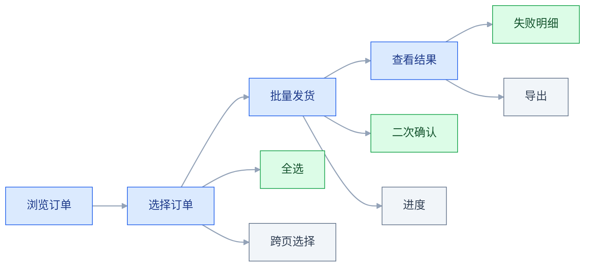
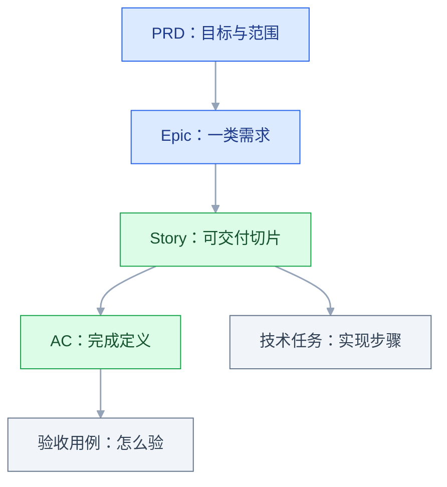

# 用户故事与验收

## 一、工程案例：把「批量处理订单」拆成三个能开发的故事

**场景**：一套仓储后台，仓库管理员在订单列表里逐条点「发货」。大促期间一天 300 单，点完要 40 多分钟，还经常点错行。客服转来需求原话：「能不能批量处理订单，现在一条条点太慢了。」

**约束**：

| 约束 | 具体内容 |
|---|---|
| 迭代 | 2 周一个迭代，本期只有 1 个迭代 |
| 人力 | 前端 1 人、后端 1 人、测试 1 人 |
| 范围 | 本期只做「批量发货」，批量取消、批量打印排后 |
| 兼容 | 订单状态机不能改，旧版列表页仍在使用 |
| 数据 | 单次最多 200 条，超过需提示分批 |

**起手动作**：不写方案，先把「批量处理」拆成可回答的问题。

### 1.1 澄清：六个问题

```text
1. 哪些操作需要批量？发货、取消、打印、改地址？
2. 一次大概多少条？最多见过多少？
3. 失败了你需要知道什么？订单号、原因、能不能重试？
4. 谁有这个权限？仓库管理员和客服看到的一样吗？
5. 跨页选中的订单，翻页后还算选中吗？
6. 重复点「确认发货」会怎样？
```

**回答**：本期只做发货；一次 20–200 条；失败要知道订单号和原因；只有仓库管理员有权限；跨页不算选中；重复点不能重复发货。

**这六个答案直接决定了三个 AC**：数量上限、部分失败、幂等。**澄清阶段没问到的，开发阶段一定会以「这个怎么处理」的形式回来。**

### 1.2 三个故事

**故事 1：批量选择**

```text
作为仓库管理员
我想要在订单列表里勾选多条订单
以便一次性处理，而不是一条条点
```

**故事 2：批量发货**

```text
作为仓库管理员
我想要把选中的订单一次标记为已发货
以便在集中打包后快速更新状态
```

**故事 3：批量结果查看**

```text
作为仓库管理员
我想要看到批量操作的成功与失败明细
以便知道哪些订单需要单独处理
```

**为什么拆成三个**：按「可独立验收」切，而不是按「各自独立产生价值」切。选择本身不产生业务价值，但它是执行的前置；执行离不开结果页处理失败；结果页没有入口也无法独立交付。三块在同一迭代按顺序交付，每块都有自己的 AC 和验收点。

### 1.3 INVEST 检查

| 字母 | 检查 | 本次结论 |
|---|---|---|
| Independent | 能否单独交付 | 不完全独立：1 是可验收切片，2 依赖 1，3 依赖 2 |
| Negotiable | 实现方式可否讨论 | 可以，前端批量接口与循环调用都行 |
| Valuable | 用户能否感知 | 1+2 合起来减少点击；单看故事 1 价值弱 |
| Estimable | 能否估算 | 能，参考已有列表页 |
| Small | 能否一个迭代完成 | 三个合计约 8 人日，可以 |
| Testable | 能否写出 AC | 能，见 1.4 |

**结论**：这组故事在 I 与 V 上不完美，用「同一迭代按顺序交付」补足。**如果迭代容量只够做一个，应把故事 1 与 2 合并成「批量发货」，而不是只交付选择。**

**依赖关系**：故事 2 依赖故事 1 的选择状态，故事 3 依赖故事 2 的结果数据。**依赖不等于必须合并**，可以在同一迭代内按顺序交付。

### 1.4 验收标准

**故事 1 的 AC**：

```text
- 每行前有复选框，表头有全选
- 全选只选当前页，跨页需重新勾选
- 选中后底部出现操作栏，显示「已选 12 条」
- 操作栏提供「取消选择」，点击后清空当前页选择
- 翻页后上一页的选择清空，并有一次性提示
```

**故事 2 的 AC**：

```text
- 支持一次 1–200 条，超过 200 条提示「请分批处理」
- 执行前二次确认，文案含数量：「即将为 12 个订单标记发货」
- 执行中显示进度，按钮禁用
- 部分失败时列出失败订单号与原因
- 成功后刷新列表，保留原筛选条件与页码
```

**故事 3 的 AC**：

```text
- 全部成功：顶部提示「12 个订单已发货」，5 秒后消失
- 部分失败：结果面板分「成功 10」「失败 2」两栏
- 失败项显示订单号、原因、重试按钮
- 结果面板可导出 CSV
- 关闭面板后可从操作记录再次打开
```

### 1.5 Given-When-Then：写清异常路径

```text
场景：部分订单发货失败
Given 仓库管理员已选中 12 个订单，其中 2 个已被其他同事发货
When 点击「确认发货」
Then 10 个订单状态变为已发货
And 结果面板显示成功 10、失败 2
And 失败项显示「订单已发货，请刷新」与重试按钮
And 列表刷新后，失败的 2 条仍保持原状态
```

```text
场景：重复提交
Given 用户已点击「确认发货」，请求正在处理
When 再次点击确认按钮
Then 按钮处于禁用状态，不发出第二次请求
And 服务端对相同订单的重复请求返回已处理，不重复写状态
```

**GWT 的价值**：前提、动作、结果分开写，异常路径不容易被漏掉。

### 1.6 关键产出物：验收用例表

| 用例 | 前置 | 操作 | 期望 |
|---|---|---|---|
| 正常批量 | 12 条待发货 | 全选并确认 | 12 条变为已发货，提示成功 |
| 部分失败 | 2 条已被他人发货 | 选中 12 条确认 | 成功 10、失败 2，失败项有原因 |
| 超过上限 | 选中 201 条 | 点击发货 | 提示分批，不发起请求 |
| 重复提交 | 请求处理中 | 连续点击 3 次 | 只产生一次状态变更 |
| 无权限 | 客服账号 | 查看列表 | 无复选框，无操作栏 |
| 跨页选择 | 第 1 页选 5 条 | 翻到第 2 页 | 第 1 页选择清空并提示 |
| 空选择 | 未勾选任何行 | 查看操作栏 | 操作栏不出现 |
| 筛选后操作 | 已筛选「待发货」 | 批量发货后刷新 | 筛选条件与页码保留 |

**这张表就是测试用例的骨架**：产品写期望，测试补步骤与数据。

### 1.7 DoR 与 DoD

| 阶段 | 条件 |
|---|---|
| 已就绪（DoR） | 有角色与价值、有 AC、估过、依赖已确认、设计稿已评审 |
| 已完成（DoD） | AC 全过、异常用例通过、旧版页面兼容、埋点上线、操作记录可查 |

**旧版兼容写进 DoD**：这次改动复用了列表组件，旧页面如果不同步，会出现「有复选框但点了没反应」。

### 1.8 验收（7 项全过才算交付）

| 检查项 | 怎么验 | 通过标准 |
|---|---|---|
| 选择行为 | 在第 1 页选 5 条后翻页 | 选择清空并有提示，不静默丢失 |
| 数量边界 | 分别选 1 条、200 条、201 条 | 1 与 200 成功，201 提示分批且不发请求 |
| 部分失败 | 构造 2 条状态冲突的数据 | 成功与失败数量正确，失败原因可读 |
| 幂等 | 抓包重放同一请求 3 次 | 订单只变更一次，无重复日志 |
| 权限 | 用客服、仓库管理员各登录一次，再用客服账号直接调批量发货接口 | 客服无入口，接口返回无权限且数据不变 |
| 兼容 | 打开旧版列表页 | 无报错，原有单条发货不受影响 |
| 可追溯 | 操作后查操作记录 | 有操作人、时间、订单号、结果 |

### 1.9 上线与回访

上线首周每天看三件事：批量发货的使用次数、失败率、客服关于「哪单没发出去」的咨询量。第 2 周回访 3 名仓库管理员，问「现在一次处理多少条」「失败时你怎么找那几条」。

**怎么判断有效**：用上线前同样的口径复测 200 单的耗时、失败率与相关咨询量。耗时明显下降、失败能被用户自助处理、咨询量下降，才算达成目标；具体数值以埋点和回访记录为准，不预设百分比。

> **这个案例的要点**：「批量处理」四个字要拆成三个故事才能开发。真正决定体验的不是「能批量」，而是**部分失败时能不能说清哪条失败、为什么、能不能重试**。

---

## 二、高频问答：会卡住你的地方，也是面试最常问的

### 2.1 故事写完了，开发还是反复问

**现场**

统计开发提问的类型：如果集中在异常与边界，说明 AC 缺失；如果集中在业务背景，说明价值没写清。

**要点**

- 故事只写了「要什么」，没写状态、权限、异常与数据口径。
- 同一个问题被问两次，就是文档的缺口。
- 理解成本不该推给读者。

**追问**

- AC 要补到什么程度？→ 覆盖高风险类别，不是每一类都写一遍。
- 开发没看文档怎么办？→ 先确认文档是否可执行，再谈态度。
- 需求还在变，AC 写细会白写吗？→ 边界和口径写死，方案留活口。

### 2.2 AC 写完了，测试说没法测

**现场**

让测试逐条标注「可判定 / 不可判定」，不可判定的当场改写。

**要点**

- 「流畅」「合理」「友好」这类词无法判定，等于没写。
- 可测试性的标准是：换一个人执行，能得出同样的通过或不通过结论。
- 把可测试性当成测试的责任，AC 就永远写不完。

**追问**

- 体验类需求怎么写 AC？→ 写成可观察的行为或阈值，例如几步内完成。
- 数据前提没写清会怎样？→ 测试造不出数，只能靠猜。
- AC 和需求冲突呢？→ 以需求目标为准，改 AC，不改目标。

### 2.3 故事太大，一个迭代做不完

**现场**

看故事的工作量估算；接近或超过迭代容量一半的，通常要拆。

**要点**

- Epic 被当成 Story，没有按可交付价值拆分。
- 加班或砍测试时间，是用时间填容量的缺口。
- 按流程、角色、规则、平台、数据范围拆成可独立交付的小块。

**追问**

- 拆不动怎么办？→ 通常说明需求还没想清楚，回去澄清。
- 按前端后端拆行不行？→ 不满足「可独立上线」，中途无法交付。
- 拆得太细呢？→ 一个迭代超过 10 个故事，管理成本通常超过收益。

### 2.4 部分失败没有定义

**现场**

问业务方：「10 条里 2 条失败，你希望剩下 8 条生效还是全部不生效？」

**要点**

- 批量操作里部分成功是常态，整体回滚会让用户重复劳动。
- 用技术上的整齐替代业务上的可用，是最常见的错。
- 可重试的失败通常部分成功并给明细；扣款、转账能否部分成功，以业务与合规要求为准。

**追问**

- 为什么不能整体回滚？→ 已成功的部分要重做，用户白干一遍。
- 部分成功怎么让用户放心？→ 失败明细给订单号、原因、重试入口。
- 涉及资金呢？→ 不能照搬，通常要整批一致，按业务与合规定。

### 2.5 用户重复点击，导致重复执行

**现场**

抓包重放同一请求；或在两个标签页同时提交。

**要点**

- 前端禁用只能挡住同一页面，网络重试、多标签页、接口直调仍会重复。
- 前端防抖是体验，服务端幂等才是正确性。
- 看服务端有没有去重键与状态校验。

**追问**

- 去重键用什么？→ 请求 ID 或业务唯一键，并且要有有效期。
- 永久去重行不行？→ 会占存储，也可能挡住合法的重复操作。
- 两个人同时改同一单呢？→ 版本号或状态校验，后写不能覆盖先写。

### 2.6 跨页选择的行为没人说清

**现场**

拿真实数据问用户：「你筛出 300 条，全选后希望处理多少条？」

**要点**

- 「全选」的范围有歧义：当前页、当前筛选结果、全部数据。
- 用自己的理解替代用户预期，测试和开发会各按各的做。
- 三种范围要摆出来让业务选，并写进 AC。

**追问**

- 用户选「全部数据」怎么办？→ 数量上限和分批提示要一起写。
- 翻页后选择保留还是清空？→ 看业务，但必须写进 AC 并给提示。
- 筛选条件变了呢？→ 选择是否失效要有明确规则。

### 2.7 故事写成了技术任务

**现场**

读一遍故事，问「谁因此受益、受益是什么」；答不上来就是技术任务。

**要点**

- 缺少用户视角，价值无法判断，做完也不知道对谁有用。
- 文档不是任务单。
- 技术任务可以存在，但要挂在某个用户故事下面，作为实现步骤。

**追问**

- 纯技术改造怎么写？→ 写成技术任务，注明支撑哪个用户故事。
- 硬套「作为系统」行不行？→ 不建议，格式对不代表有价值。
- 基础设施项目没有用户呢？→ 用户是开发者或运维，价值写清支撑什么。

### 2.8 两个故事互相依赖，排期卡住

**现场**

画依赖箭头：谁先交付、谁提供数据、谁提供入口。

**要点**

- 依赖没有被显式标注，拆分时按功能切，没按依赖切。
- 用合并消除依赖，会让故事变大、验收变难。
- 可以调整顺序、做临时桩，或先交付被依赖的一方。

**追问**

- 依赖超过两层呢？→ 通常说明故事切得不对，回去拆。
- 做桩会不会返工？→ 会，但比串行等待便宜，要写清替换时间。
- 依赖外部团队呢？→ 约定可用时间和降级方案。

### 2.9 估算偏差很大

**现场**

对比历史同类故事的实际耗时，看偏差集中在哪个环节。

**要点**

- 估算时只想了正常路径，没算异常、联调、测试数据准备。
- 用加缓冲替代拆解，偏差会一直存在。
- 把工作拆成开发、联调、测试、修复四段分别估。

**追问**

- 偏差稳定出现说明什么？→ 是流程缺项，不是人不准。
- 要不要按人加系数？→ 不要，把缺的环节补进估算表。
- 故事点能换算成天吗？→ 一旦换算，相对估算就失效了。

### 2.10 上线后发现漏了权限

**现场**

用每个角色各走一遍主流程；查接口是否也做了校验，而不只是前端隐藏。

**要点**

- AC 只写了正常角色，没写不同角色与数据范围的差异。
- 权限不是界面问题，只隐藏按钮不做接口校验，等于没有权限。
- 前端入口和后端接口要同时看。

**追问**

- 数据范围权限怎么写 AC？→ 写清谁能看哪些数据，不只是能不能进页面。
- 接口没校验会怎样？→ 直接调接口就能越权，界面隐藏没有意义。
- 怎么防止再漏？→ 权限类 AC 固定进检查清单。

### 2.11 验收时扯皮「这不是我要的」

**现场**

对照 AC 逐条过；把「没写在 AC 里但对方期待」的项单独列出，作为下一期输入。

**要点**

- 验收标准没有覆盖需求方的真实预期，或验收时才发现有未确认的假设。
- 没有确认过的 AC，只是产品经理的单方面理解。
- 把差异归因于对方反悔，就查不到真正的缺口。

**追问**

- 需求方当场又加需求呢？→ 记下来走下期或变更，不塞进本次验收。
- AC 确认过还是扯皮呢？→ 看确认的是文字、理解的是另一件事，演示一遍。
- 怎么减少这类争执？→ 开发前让需求方对 AC 逐条点头。

### 2.12 需求方向错了，功能做完也白做

**现场**

找 3 个真实用户复述最近一次遇到该问题的经过；说不出具体场景，就只是假设。

**要点**

- 格式正确不代表问题真实。
- 要验证「谁在什么场景下遇到什么损失」。
- 方向错了，AC 越细，返工越大。

**追问**

- 故事写得规范还不够吗？→ 规范解决沟通，解决不了方向。
- 找不到 3 个用户呢？→ 说明需求来源本身可疑，先验证再开发。
- 用户说的场景很模糊呢？→ 追问频次、损失和现在的替代做法。

### 2.13 超时了，不知道到底成功没有

**现场**

查服务端记录或业务状态：同一请求是否已落库，再决定文案。

**要点**

- 请求超时不等于失败，服务端可能已经执行。
- 提示「操作失败，请重试」会诱导用户重复操作。
- 要区分确定成功、确定失败、结果未知三种情况。

**追问**

- 结果未知怎么提示？→ 只能提示刷新核对，不能提示重试。
- 服务端怎么支持查询？→ 用请求 ID 或业务单号反查状态。
- 能自动补偿吗？→ 先查再定，不要用重试代替对账。

---

## 三、核心知识：从零开始要建立的东西

### 3.1 用户故事的三段结构

```text
作为【角色】
我想要【做什么】
以便【达成什么价值】
```

| 部分 | 要求 | 反例 | 合格写法 |
|---|---|---|---|
| 角色 | 具体到岗位或身份 | 作为用户 | 作为仓库管理员 |
| 做什么 | 目标，不是操作步骤 | 点击导出按钮 | 把选中订单标记为已发货 |
| 价值 | 带来什么改变 | 以便完成功能 | 以便集中打包后一次更新 |

**价值部分最有用**：写不出价值，说明这个需求可能不值得做。

**边界**：纯技术改造（升级框架、修数据）不适用三段式，写成技术任务并注明支撑哪个用户故事。**不要为了格式把技术任务硬套成「作为系统」。**

### 3.2 INVEST 的六项检查

| 字母 | 含义 | 检查问题 | 常见违反 |
|---|---|---|---|
| I | 独立 | 能否单独交付 | 前后端拆成两个故事 |
| N | 可协商 | 实现方式能否讨论 | 故事里写死技术方案 |
| V | 有价值 | 用户能否感知 | 只写「新增字段」 |
| E | 可估算 | 团队能否估出大小 | 需求含糊，无法估 |
| S | 小 | 一个迭代能否完成 | Epic 当 Story |
| T | 可测试 | 能否写出 AC | 只有一句「优化体验」 |

**常见的违反是 S 与 T**：太大和不可测，都会在开发阶段暴露。

**边界**：独立性是尽量，不是绝对。**有依赖时标注顺序，比强行拆成两个假独立的故事更好。**

> **面试**：常问「INVEST 里最容易违反哪一条？」答：S 和 T，太大不可估、不可测，都会在开发阶段暴露。

### 3.3 垂直拆分与水平拆分

| | 垂直拆分 | 水平拆分 |
|---|---|---|
| 例子 | 「查看订单」从界面到接口 | 「所有前端」「所有后端」 |
| 优点 | 每块都能交付 | 技术上整齐 |
| 缺点 | 需要跨层协作 | 中途无法交付 |
| 适用 | 多数产品迭代 | 基础设施改造 |

**原则**：优先垂直拆分，让每一块都能被用户使用或被验收。

**边界**：平台级改造（统一登录、数据迁移）天然是水平的，此时按「可验证的里程碑」切，而不是按技术层切。

### 3.4 Epic 的拆分维度

| 维度 | 例子（订单管理） | 适合 |
|---|---|---|
| 流程步骤 | 下单、支付、发货、完成 | 流程长的业务 |
| 数据操作 | 查看、新增、编辑、删除 | 后台管理 |
| 业务规则 | 普通单、退货单、换货单 | 规则差异大 |
| 用户角色 | 买家、卖家、客服 | 多角色产品 |
| 平台 | Web、移动、小程序 | 多端 |
| 数据范围 | 先 100 条，再分页 | 性能约束 |

**拆分标准**：每一块能独立上线并产生可观察的价值。**按「前端 / 后端」拆不满足这一条。**

**边界**：拆分不是越细越好。一个迭代内故事过多（例如 10 个以上），管理成本通常会超过收益。

### 3.5 验收标准的两种写法

**规则列表式**（简单直接，适合规则清晰的功能）：

```text
- 提供全部、待付款、已付款、已发货、已完成、已取消
- 默认选中「全部」
- 切换后列表即时刷新
- 筛选条件写入 URL，刷新后保留
- 无结果时显示提示与「清空筛选」
```

**Given-When-Then 式**（适合有分支与状态的功能）：

```text
Given 用户已登录且有查看订单权限
When 选择「已取消」且该状态下没有订单
Then 列表显示「没有符合条件的订单」
And 显示「清空筛选」按钮
And 点击后回到「全部」
```

| 写法 | 优点 | 缺点 |
|---|---|---|
| 规则列表 | 紧凑、易读 | 分支多时容易漏 |
| GWT | 前提与结果清晰 | 篇幅长，重复多 |

**AC 不是需求**：需求说明做什么、为什么做；AC 说明做到什么程度算完成。**验收也不是 AC**：验收是拿 AC 对照实际结果并留下记录，AC 是验收的依据。

**边界**：一个故事里可以混用：主流程用规则列表，异常场景用 GWT。

### 3.6 AC 的九类覆盖

| 类别 | 检查 | 例子 |
|---|---|---|
| 正常路径 | 顺利时会怎样 | 12 条全部发货成功 |
| 空数据 | 没有数据时 | 显示空状态与引导 |
| 边界值 | 0、1、最大、超最大 | 200 条成功，201 条提示 |
| 异常 | 网络失败、超时、冲突 | 提示重试，不丢选择 |
| 权限 | 不同角色差异 | 客服无操作入口 |
| 状态 | 加载、禁用、只读 | 提交中按钮禁用 |
| 并发 | 两人同时操作 | 后提交者收到冲突提示 |
| 幂等 | 重复点击、重放 | 只生效一次 |
| 一致性 | 关联数据被删改 | 订单删除后结果面板可打开 |

**开发最喜欢问的是并发与幂等，产品最容易漏的也是这两类。**

**边界**：不是每个故事都要覆盖九类。按风险选：涉及金额、库存、状态的，必须覆盖并发与幂等；纯展示的可以只覆盖前三类。

> **面试**：常问「AC 要把九类都写一遍吗？」答：不用，按风险选，涉及金额、库存、状态的必须覆盖并发与幂等。

### 3.7 幂等与并发

| 场景 | 风险 | 处理 |
|---|---|---|
| 重复点击提交 | 重复下单、重复发货 | 前端禁用加服务端去重键 |
| 网络重试 | 同一请求到达两次 | 请求 ID 去重 |
| 两人同时改同一单 | 后写覆盖先写 | 版本号或状态校验 |
| 批量中部分已被处理 | 状态冲突 | 跳过并列入失败明细 |

**幂等的判断**：同一个请求执行一次和执行多次，结果是否相同。**查询通常幂等，写入需要设计。**

**边界**：幂等键要有有效期。永久去重会占用存储，也可能挡住合法的重复操作（例如再次发货是业务允许的）。

> **面试**：常问「前端加了 loading，为什么还要服务端幂等？」答：禁用只挡同一页面，网络重试、多标签页、直接调接口都会重复，幂等是正确性。

### 3.8 部分失败的结果设计

| 结果 | 展示 | 用户下一步 |
|---|---|---|
| 全部成功 | 顶部提示，含数量 | 继续操作 |
| 部分失败 | 面板分成功与失败两栏 | 查看原因、重试、导出 |
| 全部失败 | 面板显示原因与重试 | 修数据后重试 |
| 超时未知 | 明确提示「结果未知，请刷新」 | 刷新核对，不直接重试 |

**最关键的是「超时未知」**：不能提示「失败」，否则用户会重复操作；也不能提示「成功」，否则会漏单。

**边界**：失败原因要能被非技术人员看懂。「500 错误」不是原因，「订单已被其他同事发货」才是。

### 3.9 故事地图：旅程与优先级



**图中主干是用户旅程**（浏览 → 选择 → 发货 → 查看结果），每个步骤下挂的是可拆的故事；绿色为本期必须，灰色为后续。**优先级靠颜色区分，不靠节点位置。** 第一层要能走通完整流程，而不是把某一步做到完美。

**故事地图的价值在暴露缺口**：某一步只有后端没有入口，或某个异常没有对应界面。

**边界**：地图是规划工具，不是交付清单。每个迭代仍要回到单个故事与 AC。

### 3.10 故事点与相对估算

| 方法 | 单位 | 适合 | 风险 |
|---|---|---|---|
| 故事点 | 相对大小 1/2/3/5/8/13 | 稳定团队 | 被换算成工时 |
| T 恤码 | XS/S/M/L/XL | 早期、粗排 | 粒度太粗 |
| 理想人天 | 天 | 外包、合同 | 忽略协作成本 |

**故事点的意义**：绕开个人效率差异，只比较「这个比那个大几倍」。**一旦换算成小时，相对估算就失效了。**

**计划扑克**：团队各自出牌，差异大的先解释。**分歧本身就是信息**，说明有人看到了别人没看到的复杂度。

**边界**：新团队缺少历史数据时，先用 T 恤码建立基线，再过渡到故事点。

### 3.11 DoR 与 DoD

| | DoR（就绪） | DoD（完成） |
|---|---|---|
| 目的 | 防止带疑问开工 | 防止「代码写完就算完」 |
| 内容 | 角色、价值、AC、估算、依赖、设计稿 | AC 通过、异常覆盖、文档、埋点、上线 |
| 责任 | 产品与团队共同确认 | 团队共同确认 |

**没有 DoR 的后果**：开发做到一半发现需求不清，返工。
**没有 DoD 的后果**：测试没做、文档没写、埋点没上，功能「完成了」但不可用。

**边界**：DoR 不是把所有细节写完才开工。探索型故事允许带着假设开工，但要写清验证方式。

### 3.12 故事与 PRD 的分工

| | 用户故事 | PRD |
|---|---|---|
| 粒度 | 单个可交付点 | 整个功能或版本 |
| 读者 | 开发、测试 | 产品、设计、开发、运营 |
| 内容 | 角色、目标、价值、AC | 背景、目标、流程、规则、非目标 |
| 时机 | 开发前 | 立项与评审 |



**读法**：PRD 定范围，Epic 把范围切成一类需求，Story 是最小可交付切片，AC 定义这个切片的完成边界；技术任务挂在 Story 下，验收用例从 AC 派生。

**两者不是替代关系**：PRD 说整体边界，故事说单点完成定义。

**边界**：小改动可以只写故事，但要有验收标准；跨团队、跨版本的功能必须两者都有。

### 3.13 依赖与顺序管理

| 依赖 | 表现 | 处理 |
|---|---|---|
| 数据依赖 | 字段还没建 | 先做数据变更 |
| 接口依赖 | 第三方未就绪 | 做桩，先联调 |
| 权限依赖 | 新角色未上线 | 先改权限模型 |
| 发布依赖 | 多服务需同时上线 | 约定发布窗口与回滚顺序 |

**管理方法**：在故事卡上写「依赖谁、什么时候可用」，排期时按依赖排序，而不是按优先级硬排。

**边界**：依赖超过两层时，通常说明故事切得不对，回到拆分而不是继续协调。

### 3.14 验收用例的组织

```text
1. 主流程：一条最短的成功路径
2. 分支：每个判断条件的两种结果
3. 边界：0、1、最大、超最大
4. 异常：超时、冲突、无权限
5. 回归：受影响的旧功能
```

| 层级 | 谁写 | 内容 |
|---|---|---|
| 产品 | 产品 | 期望结果与业务规则 |
| 测试 | 测试 | 步骤、数据、断言 |
| 开发 | 开发 | 单元与接口用例 |

**验收用例不是测试用例的复制**：产品写「什么算对」，测试写「怎么验」。

**边界**：用例要能追溯到 AC 编号，否则改需求时无法判断哪些用例要更新。

---

## 四、冷门知识汇总

判定标准三条都满足才放这里：工作中**很少遇到**、漏了**代价低**、用到时**能当场查**。批量操作的失败明细、幂等、超时态这些一旦出错代价高的问题在第二节；AC 写法、INVEST、DoR/DoD 这些零基础必须掌握的第三节，不在这里重复。

| 知识点 | 为什么冷门 | 用到时的关键词 |
|---|---|---|
| 3C 原则 | 卡片只是占位，日常靠对话与 AC 补全，很少单独讲 | Card、Conversation、Confirmation |
| Gherkin 的 Scenario Outline | 只有大量同构用例时才值得用 | Examples、参数表、占位符 |
| Given 只写前置状态 | 写成动作会让场景难复用，但很少被专门纠正 | 前置条件、状态、动作 |
| GWT 的 And / But | 只是可读性关键字，不改变语义 | And、But、步骤 |
| Spike 的时间盒 | 一年也用不上几次 | timebox、调研问题、产出物 |
| Walking Skeleton | 新项目启动时才提，平时不画 | 端到端最小链路、先跑通 |
| Epic / Theme / Initiative | 各团队叫法不统一，工具里又常混用 | 主题、举措、史诗 |
| 验收环境的造数与脱敏 | 每次上线前做一次，平时不碰 | 测试数据、脱敏、造数 |
| 非目标（Out of Scope） | 小需求通常不写，范围一大才补 | 不做什么、范围边界 |
| 需求 / 故事 / AC 编号追溯 | 工具能自动生成，很少有人手工维护 | 需求 ID、AC ID、映射 |
| Sprint Review 与验收的区别 | 很多团队把演示当验收 | 演示、确认、验收记录 |
