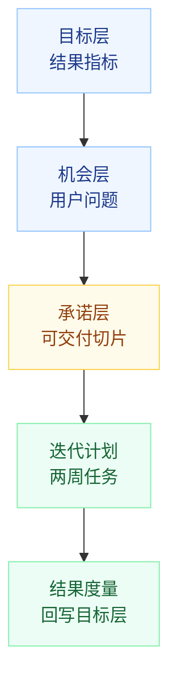

# 项目规划与敏捷

> 这篇从规划要解决的问题讲起，经过目标、机会、承诺三层路线图，纵向切片、产能折算与排期，最后落到迭代运行、变更管理和规划失效的现场处理。
>
> 学完能把一个季度目标拆成有证据的机会和可承诺的交付，用产能与缓冲算出可信的迭代计划，并在需求插入和进度偏差时做出明确的取舍。

## 一、规划是在不确定下分配承诺

规划不是预测未来，而是在信息不全的条件下决定：资源投到哪、承诺给到谁、什么时候允许改。规划做得好坏，不体现在路线图好不好看，而体现在三件事：承诺的兑现率、变更的成本、偏差出现后多久被发现。

### 1.1 规划回答的四个问题

| 问题 | 产出 | 时间尺度 |
|---|---|---|
| 去哪 | 目标与衡量方式 | 一到两个季度 |
| 做什么 | 机会清单与排序 | 一到三个月 |
| 承诺什么 | 路线图与发布计划 | 一个月到一季 |
| 这两周做什么 | 迭代计划与任务 | 一到两周 |

四个问题的粒度依次变细，回答方式完全不同。“去哪”靠指标和历史数据，“这两周做什么”靠团队的产能。用回答“这两周”的方式去回答“去哪”，就是拍脑袋；用回答“去哪”的宏大叙事去回答“这两周”，就是空转。

### 1.2 三层路线图

路线图分三层：目标层、机会层、承诺层。三层的粒度、变更成本、责任人不同，混在一层就会出现“季度目标被一次会议改掉”或“三个月前的承诺不能动”两种病。

| 层 | 时间跨度 | 内容粒度 | 变更成本 | 责任人 |
|---|---|---|---|---|
| 目标层 | 一到两个季度 | 结果指标与基线 | 高，需管理层确认 | 产品负责人 |
| 机会层 | 一到三个月 | 用户问题与方案方向 | 中，双周可调 | 产品与研发共同 |
| 承诺层 | 一个月到一季 | 可交付的切片清单 | 低，按迭代可换 | 团队 |

三层之间的纪律只有一条：上层变更必须向下传导，下层不允许私自扩大范围。目标变了，机会和承诺要重新排；承诺要加东西，必须用同等产能的东西换出去。



### 1.3 敏捷与规划的关系

敏捷不等于不要计划，而是把计划切成更短的反馈环：长周期锁目标，短周期换内容。把所有东西都锁死，是伪敏捷的前半段；什么都不锁，是伪敏捷的后半段。

两种极端的修复方式相同：目标层锁指标不锁方案，承诺层锁时间盒不锁任务清单，迭代层锁范围不锁人。

### 1.4 什么不适合固定迭代节奏

迭代节奏适合“需求可以切小、交付可以增量”的产品开发。三种场景不适合，硬套会产生假节奏。

| 场景 | 原因 | 替代方式 |
|---|---|---|
| 合规截止日 | 日期刚性，范围不可谈 | 里程碑倒排加每日站会 |
| 硬件或迁移窗口 | 外部资源一次性 | 关键路径管理 |
| 纯运维值班 | 工作来自事件 | 看板限流，不排迭代 |

合规类需求日期不能动，能动的只有范围：先上最小合规集，体验类需求后补。

### 1.5 规划失效的四个根因

| 根因 | 表现 | 解法所在章节 |
|---|---|---|
| 产能幻觉 | 排期按 100% 工时算 | 第二章、第七章 |
| 承诺过早 | 机会层就承诺了日期 | 第五章 |
| 切片切不开 | 一个需求横跨三个月 | 第六章 |
| 变更无成本 | 谁都能往迭代里塞活 | 第八章 |

四个根因分别对应后面四章。规划出问题时先定位根因，不要直接改日期。

## 二、准备：产能与历史数据

排期之前先算产能。跳过这一步直接排任务，就是在用愿望代替计算。

### 2.1 可用产能的计算

有效产能不等于人数乘以工作日。扣掉休假、会议、线上支持和杂项后，一个成熟的研发团队通常只有名义工时的六到七成可用于规划内工作。

计算公式：

```text
可用人日 = (人数 × 迭代工作日 − 休假与假日
           − 支持与会议占用) × 专注系数
```

一个 6 人团队、两周迭代的算例（示例）：

| 项目 | 数值 | 说明 |
|---|---|---|
| 名义人日 | 60 | 6 人 × 10 个工作日 |
| 休假与假日 | 4 | 按排班表实算 |
| 专注系数 | 0.85 | 会议、沟通、临时打断 |
| 支持与值守占用 | 6 | 线上问题与需求答疑 |
| 可用人日 | 42.5 | 约为名义工时的 71% |

专注系数必须用本团队数据校准，不能抄行业值。新团队第一次估算时可以从 0.8 起步，三个迭代后用自己的完成数据替换。

### 2.2 历史速率

速率是团队每个迭代完成的工作量，用过去 6 个迭代的数据说话，不用感觉。

| 迭代 | 承诺 | 完成 | 偏差 |
|---|---:|---:|---:|
| 12 | 40 | 36 | −10% |
| 13 | 42 | 38 | −10% |
| 14 | 38 | 41 | +8% |
| 15 | 45 | 33 | −27% |
| 16 | 40 | 39 | −3% |
| 17 | 44 | 42 | −5% |

这组数据（示例）的中位速率约 38.5，第 85 百分位约 41。迭代 15 的 −27% 值得单独复盘：通常是插入需求或关键成员请假，这类事件在下一次排期时应作为已知风险记录，而不是当作噪声忽略。

### 2.3 用分位数承诺，不用平均值

平均值承诺有一半的概率完不成。分位数承诺把“要不要赌”变成明确选择。

| 分位 | 含义 | 用法 |
|---|---|---|
| P50 | 一半迭代能完成 | 内部目标，有挑战 |
| P85 | 六分之五的迭代能完成 | 对外承诺的下限 |
| P95 | 几乎总能完成 | 合规类硬日期 |

对外承诺用 P85，对内冲刺用 P50。两者之间的差距就是天然的缓冲，不需要再额外编一个“缓冲 20%”。

### 2.4 依赖盘点

排期前把外部依赖列成一张表，每个依赖写清提供方、需要日期和失败时的替代方案。依赖不在表里，就不在计划里。

| 依赖 | 提供方 | 需要日期 | 状态 | 风险与替代 |
|---|---|---|---|---|
| 支付通道接口 | 平台组 | 迭代 19 第 3 天 | 联调中 | 延期则先用测试通道 |
| 等保测评 | 外部机构 | 6 月 20 日 | 已签 | 日期刚性，范围可谈 |
| 客户脱敏数据 | 实施团队 | 迭代 18 结束 | 未确认 | 延期则用造数替代 |

外部机构的日期不能靠催，只能靠提前签。依赖表里“未确认”的行超过三条，这个迭代的承诺就要降级。

### 2.5 最小验证：用历史回测产能模型

产能模型是否可信，用过去三个迭代回测：把当时的排期表和实际完成对上，误差在 15% 以内，模型可用；超过 15%，先修模型再排期。

回测发现的最常见问题是专注系数取高：按 0.9 排的计划，实际只有 0.75。这类系统性偏差必须回写到公式，否则每个迭代都会以同样的方式超期。

## 三、目标层：从战略到可衡量目标

目标层回答“去哪”。它的产出不是任务清单，而是可衡量的结果指标，加上一条清晰的放弃条件。

### 3.1 输出指标与结果指标

| 类型 | 例子 | 特征 | 陷阱 |
|---|---|---|---|
| 输出指标 | 发布 8 个功能 | 团队可直接控制 | 做完不代表有用 |
| 结果指标 | 实施周期从 45 天降到 25 天 | 反映用户或业务变化 | 受外部因素影响 |

目标层只放结果指标，输出指标放在承诺层当过程参考。把“发布 8 个功能”当季度目标，团队会倾向于做 8 个最容易的功能。

### 3.2 目标的四个要素

每个目标必须写全四项，缺一项就无法在季度末判定成败。

| 要素 | 写法 | 反例 |
|---|---|---|
| 指标 | 实施周期中位数 | 提升交付效率 |
| 基线 | 当前 45 天 | 未测量 |
| 目标值 | 25 天以内 | 大幅缩短 |
| 期限 | 9 月 30 日前 | 三季度内 |

基线没测过就定目标值，是目标层最常见的病。先花两周测出真实基线，再定目标，比定一个振奋人心但无法判定的数字有用得多。

### 3.3 目标树：目标、机会、方案三层

目标树自上而下只有三层，每层一页纸。

| 层 | 回答 | 例子 |
|---|---|---|
| 目标 | 要什么结果 | 实施周期降到 25 天 |
| 机会 | 哪些用户问题在拖后腿 | 数据导入靠手工、培训要排期 |
| 方案 | 用什么解决 | 批量导入、配置模板、自助文档 |

一个目标对应 3 到 5 个机会，一个机会对应 2 到 3 个候选方案。机会超过 8 个说明目标太大，方案只有一个说明没有做选择。

### 3.4 目标的放弃条件

目标要写清“什么情况下放弃”。没有放弃条件的目标，会在季度末变成“基本达成”的修辞练习。

放弃条件写两条就够：外部条件发生什么变化时目标失去意义；到期中检查点时指标没有任何移动时，把资源转向哪个目标。

### 3.5 目标与迭代的关系

迭代目标服务于结果目标，但两者不是一回事。迭代目标写“完成批量导入切片并上线灰度”，结果目标写“实施周期降到 25 天”。每个迭代的评审都要回答：这个迭代的交付让结果指标移动了吗。连续两个迭代指标不动，问题多半不在执行层，而在机会选错了。

## 四、机会层：问题、证据与排序

机会层回答“做什么最有希望移动目标”。机会的定义是：一个有证据支撑的用户问题，附上影响面和解决成本。

### 4.1 机会的三要素

| 要素 | 判断标准 | 缺失时的样子 |
|---|---|---|
| 用户问题 | 谁在什么场景被什么卡住 | “优化体验” |
| 证据 | 数据、访谈或工单 | “大家都觉得” |
| 影响面 | 多少用户、多大成本 | 没有量化 |

三要素齐了才有资格进机会清单。不齐的先放回收集箱，不参加排序。

### 4.2 机会评估表

机会评估只看五列，评分用高中低三档，不用 1 到 10 的精细分。精细分制造精确感，但证据本身支撑不了。

| 机会 | 证据 | 影响面 | 成本 | 置信度 |
|---|---|---|---|---|
| 数据导入靠手工 | 实施工单 38 条/季 | 高 | 中 | 高 |
| 培训要排期 | 实施周期中位 45 天 | 中 | 低 | 中 |
| 报表口径不一 | 客户投诉 6 条 | 低 | 中 | 低 |
| 权限模型太粗 | 销售反馈 4 条 | 中 | 高 | 中 |

证据强度分强、中、弱三档，判断标准与需求阶段一致，见 [需求分析与优先级](../01-需求与验收/01-需求分析与优先级.md)。机会层只需要引用结论，不重复论证。

### 4.3 排序规则

排序分两步：先过红线，再比性价比。

红线只有两类：合规与安全、生产事故级缺陷。这两类不参与排序，直接置顶并占产能。

其余机会按“证据 × 影响面 ÷ 成本”粗排，再用置信度调整：置信度低的先做小实验验证，不直接进开发。置信度低还排在高位的，是规划里最贵的错误。

### 4.4 方案比较

一个机会至少比较两个方案，比较维度固定四个。

| 方案 | 覆盖机会 | 成本 | 风险 | 可逆性 |
|---|---|---|---|---|
| 自建批量导入 | 手工导入 | 高 | 周期长 | 可逆 |
| 用开源导入引擎 | 手工导入 | 中 | 维护依赖 | 可逆 |
| 实施服务代导 | 手工导入 | 低 | 不解决根因 | 可逆 |

“不解决根因”的方案不是不能选。如果目标是三个月内把周期降下来，先靠服务代导把指标降下来，同时自研排进下个季度，这种组合是合理的取舍，但要写进路线图，避免“临时方案”变成永久方案。

### 4.5 机会不是需求

机会层禁止写功能名。“批量导入”不是机会，“实施顾问每周手工导 3000 行数据，占用 1.5 天”才是。写成功能名的机会无法比较，因为它已经预设了方案，讨论会直接跳到“这个功能怎么做”，跳过“是不是最值得做的事”。

## 五、承诺层：路线图与发布计划

承诺层回答“向谁承诺什么”。承诺一旦给出，就产生交付义务和信任成本，所以承诺的粒度、置信度和变更规则都要事先定好。

### 5.1 范围、时间、质量：锁两个浮一个

| 锁定项 | 浮动项 | 适用 |
|---|---|---|
| 时间 + 质量 | 范围 | 产品迭代，最常用 |
| 范围 + 时间 | 质量 | 一般不选，透支团队 |
| 范围 + 质量 | 时间 | 探索型工作，研发类 |

对外承诺默认锁时间和质量，范围按优先级砍。承诺了范围还承诺死日期，等于把风险全部转给质量，最后以线上事故的形式结账。

### 5.2 三种路线图画法

| 画法 | 形态 | 适用 | 风险 |
|---|---|---|---|
| Now / Next / Later | 三栏卡片 | 不确定高时 | 被当成排期表用 |
| 时间盒 | 按月分栏 | 对外沟通 | 读者脑补成承诺 |
| 里程碑 | 关键节点 | 合规、迁移类 | 中间过程被忽视 |

对销售和客户沟通用时间盒加置信度标注；内部管理用 Now / Next / Later。同一份内容两种表述时，对外版永远只少不多。

### 5.3 承诺的置信度表达

| 表达 | 含义 | 适用 |
|---|---|---|
| 将交付 | P85 以上 | 已在开发或测试 |
| 计划交付 | P50 到 P85 | 已排入承诺层 |
| 评估中 | 无法估 | 只在机会层 |

禁止对“评估中”的事项给日期。销售拿到的每个日期都会变成合同条款，置信度标注在对外沟通里不能省。

### 5.4 缓冲的两种放法

| 类型 | 放法 | 用量 |
|---|---|---|
| 迭代缓冲 | 不排满，容量按 P85 填 | P50 与 P85 之差 |
| 集成缓冲 | 里程碑前留一个空迭代 | 关键路径的 15% 到 20% |

缓冲不写进对外日期。对外日期已经包含缓冲，内部再叠一层缓冲，交付就会系统性提前太久或被怀疑藏工作量。

### 5.5 路线图变更规则

| 变更类型 | 例子 | 决策人 | 通知 |
|---|---|---|---|
| 承诺层内部换序 | 两个切片对调 | 团队自决 | 周会同步 |
| 承诺层进出 | 新增或砍切片 | 产品负责人 | 更新路线图 |
| 目标层变更 | 指标或期限调整 | 管理层 | 全员加客户 |

变更规则的价值在于把“悄悄改”变成“按规则改”。每次目标层变更要附一句影响说明：哪些已给出的承诺受影响，如何补偿。

## 六、纵向切片：让每个迭代都能上线

切片是把机会变成可交付单元的方式。切得好，每个迭代都有东西可上线、可度量；切不好，三个月只有一个大爆炸式发布。

### 6.1 切片的判定标准

一个合格的纵向切片同时满足四条：

1. 端到端：从用户入口到数据落地，中间不依赖“下一期补”；
2. 可上线：合并后能发布，不需要隐藏开关之外的保护；
3. 可度量：有指标能观察到它是否起作用；
4. 限时长：一个切片不超过一个迭代，超过就再切。

### 6.2 故事地图的切法

故事地图横轴是用户活动，纵轴是完成每步的细节，切片沿着“能上线的最小完整路径”纵向下刀。

| 用户活动 | 活动一：导入 | 活动二：映射 | 活动三：校验 | 活动四：上线 |
|---|---|---|---|---|
| 必要步骤 | 模板上传 | 字段映射 | 必填校验 | 结果报告 |
| 加分步骤 | 拖拽上传 | 自动映射 | 规则自定义 | 失败重导 |

第一片是“模板上传 + 手工映射 + 必填校验 + 结果报告”，能上线但糙；自动映射、失败重导是后续切片。刀法不同，第一片的规模差三倍。

### 6.3 切片顺序

| 策略 | 先切什么 | 适用 |
|---|---|---|
| 风险优先 | 最不确定的技术路径 | 新技术、新集成 |
| 价值优先 | 用户最痛的一步 | 存量产品改进 |
| 学习优先 | 能验证假设的最小路径 | 探索型需求 |

三种策略经常冲突，取舍原则：不确定高的先降风险，不确定低的先给价值。把风险高的排在最后，是延期最常见的成因。

### 6.4 切片反模式

| 反模式 | 表现 | 后果 |
|---|---|---|
| 横向切片 | 先做全部表结构 | 两个月无可用功能 |
| 按角色切 | 先做管理端 | 用户端没人验证 |
| 按技术切 | 先做通用框架 | 框架随需求返工 |
| 按页面切 | 一个页面一个切片 | 页面间流程断裂 |

### 6.5 切片的完成定义

一个切片的完成定义固定八条，缺一条就不能移出迭代：

- 验收标准逐条通过；
- 权限与数据范围已核对；
- 异常与降级路径已实现；
- 监控与埋点已上线；
- 文档与 FAQ 已更新；
- 灰度方案与回滚脚本已备；
- 无 P0、P1 遗留；
- 指标基线已记录，用于两周后对比。

## 七、产能折算与排期

排期是把切片放进产能的动作。可信的排期只需要三步：折算口径统一、切片填产能、缓冲护关键路径。

### 7.1 三种折算口径

| 口径 | 单位 | 适用 | 误用 |
|---|---|---|---|
| 人日 | 天 | 跨团队协作、外包 | 忽略专注系数 |
| 故事点 | 相对值 | 团队内部迭代 | 跨团队比较 |
| 吞吐量 | 切片/迭代 | 长期趋势 | 小团队波动大 |

三种口径不要混用换算。故事点跨团队比较是最常见的误用：两个团队对“3 点”的理解完全不同，比出来只有噪音。

### 7.2 折算算例

一个 6 人团队、两周迭代（示例）：

| 项目 | 数值 | 来源 |
|---|---:|---|
| 可用人日 | 42.5 | 第二章公式 |
| 历史中位速率 | 38.5 | 近 6 个迭代 |
| P85 速率 | 41 | 近 6 个迭代 |
| 本期可承诺 | 38 | 取低于 P50 的整数 |

承诺取 38 而不是 42.5，是因为历史速率从未达到过名义产能。用 42.5 排满的迭代，第一天就已经延期了。

### 7.3 排期表

| 迭代 | 切片 | 依赖 | 人日 | 缓冲 |
|---|---|---|---:|---|
| 18 | 模板上传 + 手工映射 | 无 | 16 | 2 |
| 18 | 必填校验 + 结果报告 | 无 | 12 | 2 |
| 19 | 自动映射 | 映射表上线 | 14 | 4 |
| 20 | 失败重导 + 灰度全量 | 无 | 12 | 8 |

迭代 20 的缓冲最大，因为它是全量灰度，出现问题的回退成本最高。缓冲跟着风险走，不平均分配。表中只列批量导入相关切片，剩余产能由线上支持、等保整改和其他需求占用，不进入本项目的承诺口径。

### 7.4 排期自检

- 每个切片的依赖都在它之前的迭代完成；
- 没有一个人出现在所有切片里；
- 承诺总量不超过 P85 速率；
- 合规类切片有倒排的截止检查点；
- 每个迭代至少留 10% 处理线上问题。

第五条最容易被砍。线上支持不做预算，它就会以“这个迭代又没完成”的形式结算。

### 7.5 排期的三个常见错误

| 错误 | 症状 | 修正 |
|---|---|---|
| 按最好情况排 | 每个迭代都差一点 | 用 P85 承诺 |
| 关键人单点 | 排期表里一个人占一半 | 强制两人可做 |
| 缓冲当产能 | 缓冲被填满 | 缓冲只给风险事件 |

## 八、迭代运行与变更管理

计划的价值在执行中兑现。迭代节奏固定四类会，变更按三条规则处理，度量看三张图。

### 8.1 迭代节奏

| 会议 | 时长 | 输入 | 输出 | 失败信号 |
|---|---|---|---|---|
| 迭代计划 | 60 分钟 | 切片、产能 | 本迭代承诺 | 会后仍改范围 |
| 每日站会 | 10 分钟 | 任务板 | 阻塞清单 | 变成汇报会 |
| 迭代评审 | 45 分钟 | 可上线切片 | 验收结论 | 演示半成品 |
| 迭代回顾 | 45 分钟 | 度量数据 | 一到两条改进 | 改进没有 owner |

四个会里最有价值的是回顾，最容易被牺牲的也是回顾。连续两个迭代不开回顾，团队就会用脚投票：反正说了也不改。

### 8.2 迭代目标

每个迭代写一句目标，格式固定：

```text
本迭代目标：完成批量导入第一片（模板上传 + 手工映射
+ 必填校验 + 结果报告），灰度 10% 实施顾问，
记录导入耗时基线。
```

目标必须提到可观察结果（灰度比例、基线），不只是任务清单。迭代结束时用这一句判定成败，而不是逐个任务打钩。

### 8.3 变更的三条规则

| 规则 | 内容 | 例外 |
|---|---|---|
| 不加活 | 插入需求必须换出等量工作 | 生产事故 |
| 换必须显式 | 写明换出什么，向受影响方确认 | 无 |
| 剩余量透明 | 燃尽图实时可见 | 无 |

插入需求最破坏性的部分不是工时，而是上下文切换。一个 2 人日的插入需求，实际损失通常是 3 到 4 人日。换出规则的存在就是让这个成本显性化。

### 8.4 度量：三张图各自看什么

| 图 | 看什么 | 误读 |
|---|---|---|
| 燃尽图 | 剩余量趋势 | 后半段陡降是 Scope 变了 |
| 累积流图 | 各状态在制品堆积 | 只看完成线 |
| 周期时间 | 任务从开始到完成的时长 | 与工作量混淆 |

在制品堆积是最早的预警信号：测试列堆积超过一周的处理量，说明上游在做无效产出。此时正确动作是停下开发、支援测试，而不是继续“完成”任务。

### 8.5 跨团队依赖

跨团队依赖用两样东西管理：依赖板和接口先行约定。依赖板上每个依赖有负责人和日期，每天站会扫一遍；接口先行指上下游先约定字段和错误码，再各自开发，避免联调期才发现语义不一致。

依赖方必须在接收方迭代计划里占一行。只出现在自己计划里的依赖，等于没有计划。

### 8.6 迭代回顾的格式

回顾固定三段，输出限一到两条改进：

```text
一、看数据：速率、周期时间、在制品，只陈述事实；
二、找原因：做得好的、卡住的，各举一个具体例子；
三、定改进：只选一到两条，写清 owner 和验证方式。
```

改进条目在下个回顾的第一分钟检查。没有检查上一条改进的回顾，会迅速变成情绪宣泄会。

## 九、现场手册：规划失效的处理

规划出问题的第一时间不是改计划，而是先定位问题出在哪一层，再选对应的处理动作。

### 9.1 快速定位表

| 现象 | 所在层 | 第一条动作 |
|---|---|---|
| 承诺总延期 | 承诺层 | 用 P85 重算，砍范围 |
| 速率忽高忽低 | 迭代层 | 查插入需求与在制品 |
| 指标不动 | 目标层 | 复查机会是否选错 |
| 一个切片做三个月 | 切片 | 按故事地图重切 |
| 路线图没人信 | 承诺层 | 加置信度标注并兑现两次 |
| 会议越开越多 | 迭代层 | 砍会，留评审和回顾 |

### 9.2 承诺总是延期

先查排期用的是名义产能还是有效产能。九成的“总延期”团队，排期表用的是人数乘工作日，实际可用只有七成。修法不是加班，是把承诺降到 P85，连续三个迭代兑现，再逐步上探。

### 9.3 速率忽高忽低

低速率的迭代几乎都有插入需求。把三个月的插入需求列出来按来源分类，对最大的来源定规则：销售类插入走换出规则，事故类插入走专项时间盒（每迭代固定预留 10%），合规类插入直接升级到承诺层重排。

### 9.4 指标不动

交付按计划走、结果指标不动，说明机会选错了。处理顺序：先确认埋点是否真的在度量；再确认用户是否真的在用新功能；最后才怀疑方案。三个都正常而指标不动，就要回到目标层重新选机会，这是规划里最贵但必须做的决定。

### 9.5 切片切不开

切不开通常是因为把“技术上完整”当成了切片标准。换用故事地图：先写用户活动横轴，再按“能上线的最小路径”下刀。还切不开，说明需求本身耦合太深，先把解耦工作当成第一个切片。

### 9.6 季度规划检查清单

- 每个目标有指标、基线、目标值、期限四项；
- 每个机会有证据和影响面；
- 承诺层总人日不超过 P85 速率；
- 每个切片不超过一个迭代；
- 关键路径有 15% 以上缓冲；
- 外部依赖全部有负责人和替代方案；
- 变更规则已向销售和客户同步；
- 每个迭代有明确的目标句和度量动作。

## 十、最佳实践案例

### 10.1 案例背景

某供应链 SaaS 公司，客户实施由 4 名实施顾问负责，当前实施周期中位数 45 天，行业对手宣称 20 天，销售持续丢单。团队 6 人：4 后端、1 前端、1 测试。

目标是三季度内把实施周期降到 25 天以内。约束有三条：不能加人；销售已对两家战略客户承诺 6 月底交付“批量导入”；期间必须完成两项合规插入需求——等保整改 6 月 20 日截止、发票新规 7 月上线。

现状数据（示例）：实施工单里 38 条/季度与“数据导入靠手工”相关；实施周期拆解显示，数据准备占 18 天、配置占 9 天、培训与验收占 18 天；近 6 个迭代速率中位 38.5、P85 约 41。

### 10.2 案例实操

**第一步，算产能。** 按第二章公式算出可用人日 42.5，历史 P85 速率 41，本季度每个迭代承诺不超过 38。两项合规需求合计估 9 人日（等保 4、发票新规 5），直接从承诺层扣除，不参与排序——合规是红线，不比性价比。

**第二步，建目标树。**

| 层 | 内容 |
|---|---|
| 目标 | 实施周期中位数 45 天 → 25 天，9 月 30 日前 |
| 机会 | 手工导入（18 天）、配置靠开发（9 天）、培训排期（18 天） |
| 方案 | 批量导入、配置模板、自助验收 |

**第三步，评估机会。**

| 机会 | 证据 | 影响面 | 成本 | 置信度 |
|---|---|---|---|---|
| 手工导入 | 工单 38 条/季 | 高 | 中 | 高 |
| 配置靠开发 | 4 后端各背 2 客户 | 中 | 中 | 中 |
| 培训排期 | 周期拆解 18 天 | 中 | 低 | 中 |

三个机会都进路线图，但顺序不同：手工导入先做（证据最强、影响最大），配置模板第二，自助验收第三并明确“视前两项效果决定是否启动”。

**第四步，切切片。** 用故事地图把批量导入切成三片：

| 切片 | 内容 | 人日 |
|---|---|---|
| 第一片 | 模板上传 + 手工映射 + 必填校验 + 结果报告 | 16 |
| 第二片 | 自动映射 + 失败行重导 | 14 |
| 第三片 | 增量导入 + 灰度全量 | 12 |

**第五步，排期。** 6 月底是销售已给出的硬日期，从 6 月 30 日倒排：

| 迭代 | 切片 | 人日 | 缓冲 | 备注 |
|---|---|---:|---:|---|
| 18 | 导入第一片 | 16 | 2 | 含等保整改 4 人日 |
| 19 | 导入第二片 | 14 | 4 | 等保 6 月 20 日截止 |
| 20 | 导入第三片 + 灰度 | 12 | 8 | 6 月底前对战略客户可用 |

迭代 20 缓冲最大，因为它承接对外承诺。排期同时确认：第一片 6 月 25 日可对战略客户开放灰度，兑现“6 月底交付批量导入”的字面承诺——切片切小在这里直接救了销售承诺。

**第六步，处理插入。** 5 月中，发票新规通知 7 月 1 日生效，需要 5 人日。处理按变更三规则：不加活，从迭代 21 换出“配置模板”的第一片 5 人日，向等待该项的 1 名实施顾问说明并确认；变更记录写明换出内容、影响方、恢复时间。

**第七步，度量。** 每个迭代评审时回答“结果指标移动了吗”：导入第一片上线后，试点顾问的数据准备从 18 天降到 11 天；第二片自动映射上线后降到 6 天。速率记录显示迭代 19 受等保整改影响只完成 34 人日，略低于 P50，因属合规插入可解释，未触发重排。

**第八步，中点复查。** 7 月中检查点：实施周期中位数已到 29 天，趋势成立；培训排期仍未改善，占剩余 11 天。决定启动自助验收的最小切片（验收清单线上化，8 人日），砍掉配置模板第二片，理由记录在案：前两项已覆盖目标，第三项性价比更高。

### 10.3 案例结果

9 月 30 日的数据（示例）：

| 指标 | 季初 | 季末 |
|---|---|---|
| 实施周期中位数 | 45 天 | 27 天 |
| 数据准备时长 | 18 天 | 6 天 |
| 战略客户承诺兑现 | 6 月底批量导入 | 6 月 25 日灰度，兑现 |
| 迭代按时完成率 | 约 40% | 5/6 个迭代 |
| 期间插入需求 | 合规 2 项、销售 1 项 | 全部按换出规则处理 |

目标 25 天差 2 天未达成，判定为未完成，不写“基本达成”。原因拆解：培训与验收环节仍有 11 天没有被任何切片覆盖，属于机会层容量不足，复盘结论是“下季度把自助验收列为第一优先级，或接受 27 天为新的稳态目标”。

失败模式三条：

1. 批量导入第一片的“必填校验”最初按开发理解只校验格式，实施顾问实际需要业务规则校验，灰度第一周退回 40% 的导入任务。教训：切片的验收标准必须有目标用户参与确认，不是研发自查。
2. 中点复查时差点砍错方向：指标一度停在 31 天两周不动，第一反应是方案有问题；查埋点发现是两家大客户的数据质量异常拉高了中位数，剔除后趋势正常。教训：指标不动时先查度量口径，再改方案。
3. 对销售的“6 月底交付”差点被理解成“全量可用”。切片化之后用“6 月 25 日灰度可用、7 月中全量”两段式表达，避免了一次合同风险。教训：对外承诺要与切片粒度对齐，承诺“切片”而不是承诺“项目名”。

复盘后固定下来的两条规则：硬日期一律倒排并绑定具体切片；任何机会进入承诺层前，必须有度量口径和目标用户确认的验收标准。
