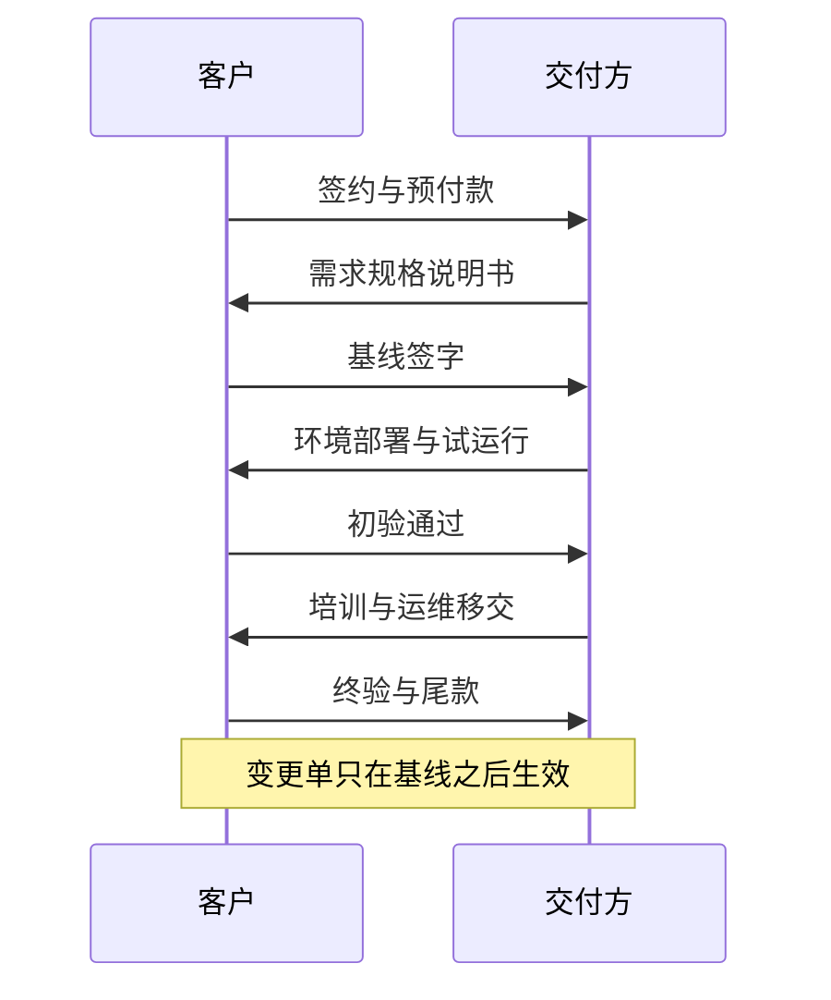

# 产品类型与交付形态

> 这篇从 2C、2B、2G 和开发者四类客户讲起，经过云服务分层与 XaaS 变体的能力边界、项目制到 SaaS 的交付形态、多租户隔离、SLA 与计量口径、合规要求，最后落到一次交付形态的选型案例。
>
> 学完能判断一款产品该卖给谁、以什么形态交付，说清隔离、SLA、计量口径和合规的边界，并为一条产品线选对交付形态。

## 一、四类客户：购买逻辑完全不同

产品类型的第一刀切在客户上。同一套功能，卖给个人、企业、政府或开发者，是四门不同的生意：买家不同、周期不同、验收标准也不同。

### 1.1 客户类型对比

| 客户类型 | 谁决定购买 | 典型周期 | 怎么验收 |
|---|---|---|---|
| 2C 个人 | 使用者本人 | 秒级到天 | 感受即验收 |
| 2B 企业 | 使用者之外有决策链 | 1 到 6 个月 | 合同与指标 |
| 2G 政府机关 | 招投标与预算流程 | 3 到 12 个月 | 招标文件逐条响应 |
| 开发者 | 用的人自己集成 | 天到周 | 接口跑通即验收 |

2C 的关键动作是降低尝试成本：免费增值（Freemium）、试用、自助注册。2B 的关键动作是管理决策链：使用者提需求、管理层看 ROI、IT 看安全、采购砍价，任何一环没跟上都会卡住。2G 的关键动作是合规响应：资质、招投标流程、国产化适配，产品本身反而只占评分的一部分。开发者的关键动作是文档和最小可用示例：文档读不懂就没有下一步。

### 1.2 2B 决策链的五个角色

| 角色 | 关心什么 | 对应动作 |
|---|---|---|
| 使用者 | 好不好用 | 试用与反馈 |
| 业务管理者 | 省多少钱 | ROI 测算 |
| IT 与安全 | 集成与风险 | 安全问卷与 POC |
| 采购 | 价格与条款 | 比价与合同 |
| 财务付款人 | 预算科目 | 结算方式 |

B 端产品做决策时五个角色都要有答案。只说服使用者是常见失败：业务方热情很高，安全问卷卡三个月，采购最终按竞品价格砍到预算内。

> 边界：客户类型决定的是“怎么卖”，不决定“做成什么样”。同一家企业既可能是 SaaS 客户也可能是私有化客户，区分在交付形态，见第四章。

## 二、云服务分层：IaaS、PaaS、SaaS

云服务按“提供到哪一层”分层，层的边界就是责任边界：提供得越多，产品方承担的责任越多，客户能定制的空间越小。

### 2.1 三层基本形态

| 层 | 提供什么 | 客户负责 | 典型产品 |
|---|---|---|---|
| IaaS | 计算、存储、网络资源 | 系统以上全部 | 弹性云服务器 |
| PaaS | 运行时与中间件 | 数据与应用逻辑 | 托管数据库、对象存储 |
| SaaS | 开箱即用的应用 | 只剩使用与配置 | 在线协作、CRM |

分层的判断标准是“客户还剩什么要自己做”。IaaS 客户要装系统装中间件，PaaS 客户只管代码和数据，SaaS 客户只管配置。责任共担模型（Shared Responsibility）据此划线：资源层之下的安全由云厂商负责，资源层之上的数据与权限由客户负责。

### 2.2 分层与计费的天然对应

层越往上，计量单位离业务越近：IaaS 按核时和 GB 计费，PaaS 按请求数和存储量计费，SaaS 按席位或业务对象（工单、坐席）计费。给产品定价前先确认自己在哪一层，计量单位就能顺着层推出来，不必发明新口径。

> 边界：分层不是越往上越好。工具链、数据库这类产品强行走 SaaS 化，会同时失去客户对数据位置的信任和按需调优的自由，最终被客户用“私有化替代方案”换掉。

### 2.3 部署位置：公有云、私有云、混合云

同一层能力可以放在三种位置，位置改变的是责任归属而不是功能：

| 部署位置 | 资源归属 | 运维责任 | 适用约束 |
|---|---|---|---|
| 公有云 | 厂商 | 厂商 | 无数据驻留要求 |
| 私有云 | 客户或专属 | 客户为主 | 数据不出域 |
| 混合云 | 双方分担 | 按模块划分 | 部分数据敏感 |

混合云不是“一半公有云一半私有云”这么简单，它必须回答“哪一部分放在哪里、边界上同步什么”。通行做法是把数据存储和计算放在本地，把模型、规则和升级通道放在云端，边界上只走脱敏后的统计量与制品。边界一旦跨越原始数据，混合云就退化成私有化。

> 边界：私有云和私有化部署常被混用。私有云强调的是资源专属、仍由厂商远程运维；私有化部署强调的是软件装进客户环境、由客户自己运维。前者卖的是专属资源，后者卖的是软件许可加服务，合同里的 SLA 与升级责任完全不同。

## 三、XaaS 变体：能力边界与目标客户

云原生产品在三层之外衍生出一批垂直变体。判断一个变体属于哪类，看它替客户管理了哪一段能力，以及它收费的计量单位。

### 3.1 集成与流程类

| 变体 | 替客户管理什么 | 典型客户 | 计量单位 |
|---|---|---|---|
| iPaaS | 应用间集成与数据管道 | 中大型企业 IT | 连接器与任务量 |
| aPaaS | 低代码应用搭建平台 | 业务部门与 IT | 应用数与用户数 |
| BaaS | 后端能力即服务 | 移动与前端团队 | API 调用与存储 |

iPaaS 卖的是“系统对话的翻译与调度”，aPaaS 卖的是“业务人员自己搭应用”，BaaS 卖的是“前端团队不用养后端”。三者的客户画像不同：iPaaS 对接 IT 部门，aPaaS 对接业务加 IT联合评审，BaaS 对接研发团队。

### 3.2 函数、数据与接口类

| 变体 | 替客户管理什么 | 典型客户 | 计量单位 |
|---|---|---|---|
| FaaS | 事件驱动的函数运行 | 研发团队 | 执行次数与时长 |
| DaaS | 数据集与数据服务 | 数据团队 | 记录数与调用量 |
| API | 单一能力封装 | 开发者与企业 | 调用次数或 Token |

FaaS 的边界是“无状态短任务”：超过执行时长上限或需要常驻连接的场景不适合。DaaS 的边界是数据质量责任——提供数据就要对新鲜度和准确性给出口径承诺。API 产品把一个能力（识别、翻译、风控）封装成接口，客户不买软件，买的是每次调用。

### 3.3 Agent 产品

智能体（Agent）产品在 2026 年的边界是“按任务成果交付、按推理过程计量”。它与传统 API 的差别在于交付的是多步任务的完成结果，计费天然依赖大模型的 Token 消耗：

| 形态 | 提供什么 | 计量单位 | 边界 |
|---|---|---|---|
| Agent 平台 | 编排与工具调用框架 | 任务数加 Token | 长任务失败重试口径复杂 |
| 垂直 Agent | 单一岗位的完整任务 | 按次或按坐席 | 效果承诺难量化 |
| Agent API | 单步能力封装 | Token 与工具调用 | 与传统 API 边界渐融合 |

Agent 产品计费最容易出错的点在重试：一次任务失败后自动重跑，Token 双倍消耗而客户只认可一次任务的价。计量口径必须写明“成功任务才计费、内部重试成本由产品方承担”，或者反过来给重试设上限并把口径公示。

## 四、交付形态：从项目制到 SaaS

交付形态回答“产品以什么方式装到客户那里”。同样的功能，装法不同，就是不同的生意：收入模式、成本结构和团队构成全部随之改变。

### 4.1 五种交付形态对比

| 交付形态 | 交付物 | 收入模式 | 边际成本 |
|---|---|---|---|
| 项目制 | 定制开发与验收 | 一次性加服务费 | 高，随人力线性 |
| 私有化部署 | 软件包装进客户环境 | License 加年维 | 中，版本碎片化 |
| 混合云 | 敏感部分本地其余云端 | 订阅加服务 | 中 |
| 公有云 SaaS | 多租户在线服务 | 订阅或用量 | 低，规模化 |
| API 服务 | 接口与文档 | 用量计费 | 低 |

### 4.2 各形态的交付内容与验收

项目制的交付物是“按需求规格说明书验收的系统”，验收标准逐条来自合同，需求变更走签证流程。私有化的交付物是“可在客户环境运行的版本加部署文档”，验收包含安装、升级和回滚演练。混合云的交付物是“拆分部署的两部分加数据同步链路”，验收要覆盖断网降级场景。SaaS 的交付物是“可登录的服务加配置手册”，验收是 SLA 承诺。API 的交付物是“接口文档、密钥与沙箱”，验收是连通性测试与配额验证。

### 4.3 形态选择的四条判据

1. 数据敏感度：数据不能出客户环境，私有化或混合云是硬约束；
2. 客户 IT 能力：没有运维团队的公司养不起私有化；
3. 产品成熟度：需求还长着的项目，先项目制沉淀再产品化；
4. 团队规模：一个团队同时维护 SaaS 加私有化两条线，等于维护两套版本矩阵。

> 边界：多形态不是产品强的标志，是成本翻倍的起点。私有化版本落后云端版本半年以上时，销售会不断承诺“下个版本就同步”，最后交付部门为这句话买单。多形态必须配“同一套代码、构建期开关”的工程约束，否则不要开第二条形态。

### 4.4 项目制交付的四道关口

项目制的成败不在开发阶段，而在四个容易跳过的关口。每一道关口都有可检查的交付物。

| 关口 | 交付物 | 不过关的后果 |
|---|---|---|
| 需求基线 | 需求规格说明书与签字 | 范围无限扩张 |
| 变更签证 | 变更单与工时确认 | 成本自己承担 |
| 验收材料 | 测试报告与逐条对照表 | 尾款无期限 |
| 知识转移 | 运维手册与培训记录 | 交付即失联 |

需求基线要在开工前冻结版本，后续任何新增走变更单；变更单必须写明工作量、费用和对工期的影响，由客户签字。验收材料按合同条款逐条对照，一条一个证据，避免“整体感觉不满意”这种无法反驳的结论。知识转移常被当成走过场，但它决定项目结束后客户能不能自己运维，也决定二期还有没有。

项目制的里程碑顺序与付款节点绑定，顺序错了现金流就会断：

> 边界：先部署后签需求基线的项目，等于把范围谈判推迟到已经投入人力之后，客户每提一条新需求，交付方都缺少拒绝的依据。

### 4.5 多形态并行的版本治理

同时有 SaaS 和私有化两条线时，必须建立三条纪律：

1. 单一代码库：私有化通过构建期开关裁剪模块，不复制分支；
2. 发布节奏分级：云端每两周一次，私有化按季度出 LTS（长期支持）版本，客户只升 LTS；
3. 能力差公示：一张表列出私有化版本缺失的功能与预计补齐时间，销售报价前必须查表。

这三条做不到，就会出现“销售承诺云端功能、交付方发现私有化版本没有”的经典冲突。能力差公示比技术方案更重要，它把不可控的期望管理变成可查的清单。

### 4.6 SaaS 的交付不是上线就结束

SaaS 的交付物是“持续可用的服务”，上线只是开始。交付后的责任要在合同里分清楚：

| 责任 | 产品方 | 客户 |
|---|---|---|
| 服务可用性 | 平台运行与升级 | 网络与终端 |
| 数据准确性 | 处理逻辑正确 | 录入与配置 |
| 账号安全 | 平台侧防护 | 账号与权限管理 |
| 业务结果 | 工具与建议 | 决策与执行 |

最常见的争议是业务结果归属：客户认为“用了没效果”是产品问题，产品方认为配置和推广不到位。把责任表附在合同后面，比事后解释有效。

### 4.7 订阅形态的边界与交付

订阅（Subscription）不是“按月收钱”这么简单，它的本质是把一次性交易换成持续服务，因此交付内容从“系统”变成“持续可用的能力加持续的服务”。

| 对比项 | 项目制 | 订阅 |
|---|---|---|
| 交付终点 | 验收通过 | 持续服务至退订 |
| 收入确认 | 一次性 | 按期间分摊 |
| 成功标准 | 合同条款 | 续约与扩容 |
| 团队重心 | 交付与验收 | 客户成功与产品迭代 |

订阅交付要完成五件事：开通（账号、租户、初始配置）、入驻（数据导入、角色权限）、培训（管理员与关键用户）、首月陪跑（把使用率做起来）、续约管理（到期前 90 天启动）。少一件，续约率就会掉一档：没有入驻，客户买了不用；没有陪跑，首月活跃度低，续约时找不到价值证据。

> 边界：订阅适合“价值持续发生”的产品，例如持续更新的数据、持续运行的风控、持续迭代的协作工具。一次性交付的咨询成果或定制系统，硬套订阅会变成“每年收一次维护费”，客户会按项目制的标准要求验收。

## 五、多租户与隔离

多租户（Multi-tenancy）是 SaaS 成本优势的来源，也是安全争议的来源。隔离层级的选择是成本与安全的权衡，不是技术先进性的展示。

### 5.1 四级隔离

| 隔离级别 | 数据存放 | 隔离强度 | 单客户成本 |
|---|---|---|---|
| 独立部署 | 独立实例独立库 | 最强 | 最高 |
| 独立 Schema | 共库分 Schema | 强 | 中 |
| 共享表 | 同表加租户 ID 字段 | 中 | 低 |
| 独立资源池 | 共享逻辑独立计算 | 中高 | 中 |

共享表加租户 ID 是 SaaS 的默认起点，但有三条铁律：所有查询必须带租户条件，最好由框架层强制注入而不是靠开发自觉；索引必须以租户字段为前缀，否则跨租户查询互相拖慢；导出与日志脱敏必须按租户过滤。这三条任何一条失守，就是数据越权事故。

### 5.2 邻居噪声与性能隔离

共享资源的风险是邻居噪声（Noisy Neighbor）：一个大客户的批量任务拖垮所有租户的响应时间。治理手段分三层：接口层限流按租户配额，任务层把批量操作引到低峰窗口，资源层为重客户单独开计算池。限流粒度按租户而不是按账号，因为账号可以注册很多个。

### 5.3 密钥与凭据

租户隔离延伸到密钥管理：客户的集成凭据（回调密钥、第三方 Token）必须按租户加密存储，日志与错误信息里不得明文回显。SaaS 出的第一批越权事故，多数不是数据表设计错误，而是日志把 A 租户的凭据打进了 B 租户的报错。

## 六、SLA 与计量口径

服务水平协议（SLA）是对交付形态的量化承诺。承诺什么、怎么算、赔多少，三件事必须在合同和系统里都是同一套口径。

### 6.1 SLA 的三个组成部分

| 组成 | 常见写法 | 计量口径 |
|---|---|---|
| 可用性 | 月度 99.9% 可用 | 成功请求 / 总请求 |
| 时延 | P95 响应小于 500ms | 按分钟取分位再聚合 |
| 修复时限 | 一级故障 4 小时 | 故障确认到恢复计时 |

可用性的算式要写清排除项：客户侧网络、计划内维护窗口、客户配额耗尽导致的拒绝服务，算不算在分母里，每一条都提前约定。99.9% 意味着每月 43 分钟不可用，承诺之前先算维护窗口够不够用。

### 6.2 赔付与免责

| 条款 | 常见做法 | 说明 |
|---|---|---|
| 赔付形式 | 服务费抵扣下期账单 | 不退现金 |
| 赔付上限 | 当期服务费的 10% 到 30% | 风险封顶 |
| 索赔条件 | 客户书面提出并举证 | 不主动赔 |
| 连续未达标 | 达到触发条件可解约 | 客户退出通道 |

赔付是风险定价的一部分：把赔付上限和实际故障成本放在一张表里算，再决定承诺几个九。拍脑袋承诺 99.99%（月度 4.3 分钟）而监控粒度只有分钟级，等于承诺了一个测不出来的指标。

### 6.3 计量口径的三个必答题

任何按用量计费的产品，上线前必须回答三个问题，答案写进合同附件：

1. 什么算一次调用：成功响应、客户端超时、限流拒绝各算不算；
2. 重试与幂等怎么计：客户端自动重试、产品方内部重试各算不算；
3. 口径以谁为准：以产品方计量日志为准，但客户提供何种申诉通道、多长的追溯期。

口径不清的代价不在争论本身，而在对账成本：一家大客户每月花两小时核对账单，两个月后就会要求改为包年一口价，用量增长的收入路径就此关闭。

### 6.4 计量口径与交付形态的组合

交付形态决定计量数据的采集位置，采集位置又决定口径的可信度：

| 交付形态 | 计量采集点 | 口径风险 |
|---|---|---|
| 公有云 SaaS | 平台网关注入 | 客户自报数据不采信 |
| 私有化 | 客户环境日志 | 客户可修改日志 |
| 混合云 | 本地模块加云端汇总 | 两侧数据可能对不齐 |
| API | 网关请求日志 | 重试与限流易争议 |

私有化的计量最麻烦：日志在客户机房里，产品方拿不到原始数据，只能由客户导出汇总。可行的做法是部署独立的计量代理，日志加密签名后每日上报汇总，合同约定代理人不可被绕过。若客户拒绝部署代理，就只能接受按部署规模（节点数、坐席数）的订阅计价，把用量风险换成固定价格。这是私有化产品卖不出“按量计费”的结构性原因，不是商务谈判能力问题。

## 七、合规与交付决策清单

合规要求决定交付形态的上限：数据不能去哪里，产品就不能部署在哪里。这一章给出主要合规维度和选型检查清单。

### 7.1 主要合规维度

| 维度 | 典型要求 | 影响的形态 |
|---|---|---|
| 等级保护 | 等保二级三级测评 | 私有化与混合云 |
| 数据驻留 | 数据不出境或不出行业专网 | 排除公有云 SaaS |
| 行业监管 | 金融、医疗、政务分域 | 专属云或私有化 |
| 国产化 | 芯片、操作系统、数据库适配 | 私有化交付清单 |
| 出口管制 | 跨境数据传输与加密要求 | 混合云设计 |

政务和金融客户的“数据不出域”多数是硬约束，谈不下例外。遇到这种客户，方案设计从“怎么把数据搬上云”改为“本地处理数据、云端只收脱敏指标”，混合云的形态就自然浮现。

### 7.2 合规证据清单

合规不是签合同时的口头承诺，而是要拿得出测评报告和审计证据。等保三级为例，交付前要备齐的证据（示例清单）：

| 证据 | 谁出 | 周期 |
|---|---|---|
| 定级备案证明 | 客户与测评机构 | 1 个月 |
| 等保测评报告 | 测评机构 | 2 到 3 个月 |
| 安全整改记录 | 交付方 | 随测评 |
| 渗透测试报告 | 第三方机构 | 每年 |
| 数据分类分级文档 | 双方共同 | 随设计 |

测评周期必须进项目排期：等保三级从启动到拿报告通常 2 到 3 个月，放在交付后才补，验收就会卡在报告上。谁出费用在合同里写明，一般客户出测评费、交付方出整改费。

### 7.3 形态选型检查清单

- [ ] 客户数据是否允许出客户环境；
- [ ] 客户有没有运维团队和机房资源；
- [ ] 合同要求的 SLA 等级监控粒度能不能测；
- [ ] 计量口径三问有没有逐条写进合同附件；
- [ ] 多形态并行时版本同步策略与成本有没有核算；
- [ ] 合规测评（等保、行业）由谁出费用与周期；
- [ ] 源码托管或知识产权条款有没有谈；
- [ ] 退出条款：数据导出格式与协助期限。

### 7.4 常见失败模式

- 为拿下单个客户开私有化分支，一年后私有化版本与云端版本相差三个大版本，两个团队互相等对方合入；
- SaaS 承诺了客户专属的定制功能，破坏多租户共用代码，一次升级只敢灰度一个租户；
- SLA 承诺的可用性没有配套监控，客户按自己的拨测数据索赔，产品方拿不出反证；
- API 产品的计量没在签约时定义“成功”的口径，客户把限流拒绝也算作计费调用拒付；
- 混合云上线后才发现断网场景没设计降级，客户内网一出故障就整体不可用；
- 合规测评安排在交付后补做，客户验收卡在测评报告上，回款拖一个季度。

## 八、最佳实践案例

### 8.1 案例背景

某反欺诈 SaaS 公司，客户为中小银行与消金公司，产品跑在公有云上，按“日均风控调用量”计费，年经常性收入约 6000 万元（示例数据）。一家头部股份制银行主动上门，单客户预估年收入 1500 万元，但采购条件有三条硬约束：全部交易数据不得出银行机房、整体通过等保三级、交付物包含可审计的部署文档。团队 40 人，其中研发 28 人；管理层担心为一单生意拖垮产品迭代节奏，要求决策在 6 周内做出，并明确判断这单该不该接、以什么形态接。

### 8.2 案例实操

第一步把客户约束转成形态排除项：数据不出机房，直接排除公有云 SaaS；剩余候选是纯私有化、混合云、拒绝三种。

第二步对三个候选按收入、成本、风险打分，证据来自现有客户的真实数据（示例）：

| 候选方案 | 预期年收入 | 首年成本 | 主要风险 |
|---|---:|---:|---|
| 拒绝 | 0 | 0 | 竞品借标杆客户切入行业 |
| 纯私有化 | 1500 万元 | 900 万元 | 版本碎片化拖垮迭代 |
| 混合云 | 1300 万元 | 520 万元 | 断网场景设计复杂 |

测算依据：私有化需要抽调 8 人常驻适配与运维，占研发团队 29%，且银行环境国产化适配（操作系统与数据库）首年投入约 300 万元；混合云只在本地部署特征计算与数据存储模块，模型训练与规则更新留在云端，投入减半。风险上，纯私有化的最大代价不是这单的成本，而是此后每家大客户都会要求同样待遇，产品形态被锁死。

第三步选混合云，并做了四个关键设计：

1. 架构拆分：本地侧只保留特征计算、实时决策和数据落库三个模块，走银行内网；云端保留模型训练、规则管理与产品升级通道；两侧只同步脱敏后的特征统计数据与模型产物，满足“原始数据不出域”；
2. 隔离设计：本地模块独立部署在银行提供的资源池，与该公司其他客户完全物理隔离；云端训练用脱敏数据，客户合同里写明脱敏口径与审计权；
3. SLA 与计量：本地决策链路可用性承诺 99.95%，云端模型更新通道承诺 99.5%；计量口径定为“本地决策调用成功次数”，以本地计量日志为准，云端重试不计费，客户提供 90 天追溯申诉期；断网时本地降级为“最后一版模型加本地规则”，保底可用性写进合同；
4. 合同条款：验收分部署、试运行、等保测评三个里程碑，付款节奏 30%、40%、30%；等保测评费用客户承担、公司配合；源码不做交付但提供第三方托管（Escrow），约定公司破产或停止维护时银行可取得源码。

第四步执行节奏：先做 6 周概念验证（POC），用银行历史脱敏数据回测效果，指标定为与该行现有方案相比欺诈损失率下降 15% 以上；POC 通过后签正式合同，交付排期 9 个月，前 3 个月完成本地模块容器化与国产化适配。

### 8.3 案例结果

交付 12 个月后的结果（示例数据）：

| 指标 | 结果 |
|---|---|
| 项目按期上线 | 里程碑二延期 3 周，其余按期 |
| 实际欺诈损失下降 | 21%，高于承诺的 15% |
| 首年收入 | 1280 万元，略低于预估 |
| 研发占用峰值 | 5 人，低于纯私有化的 8 人 |
| 后续复制 | 行业另 3 家银行以同形态签约 |

失败模式也真实发生了两处：一是国产化适配低估了数据库存储过程兼容问题，里程碑二延期 3 周，靠把部分计算改写为应用层逻辑才解决，证明适配工作量必须在报价前做实测而不是按经验估；二是断网降级在第一次演练中发现本地规则库过期超过 90 天，风险敞口被客户审计指出，此后把“模型产物同步延迟”纳入 SLA 监控并设 7 天告警阈值。

复盘结论：这单的价值不在 1280 万元收入，而在用混合云形态打开了“数据不出域”的头部银行市场，且没有开私有化分支，云端版本只落后一个迭代；关键取舍是把“纯私有化”的 1500 万元让渡为混合云的 1300 万元，换来研发占用从 8 人降到 5 人和后续 3 家的复制——形态选型真正要算的是单笔合同之外的成本锁定。若重来一次，国产化适配的实测应放在报价之前，把 3 周延期消化在谈判期而不是交付期；SLA 的同步延迟指标也应该在第一次设计评审就提出，而不是等客户审计倒逼。
