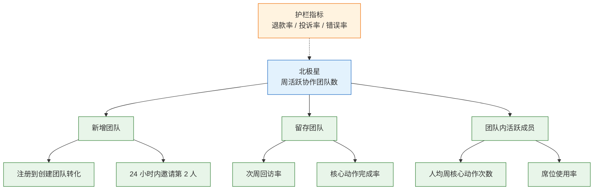
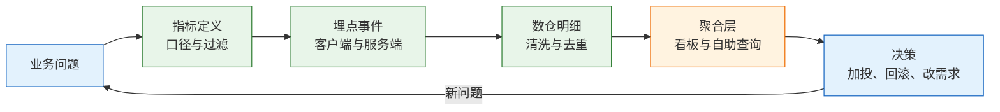
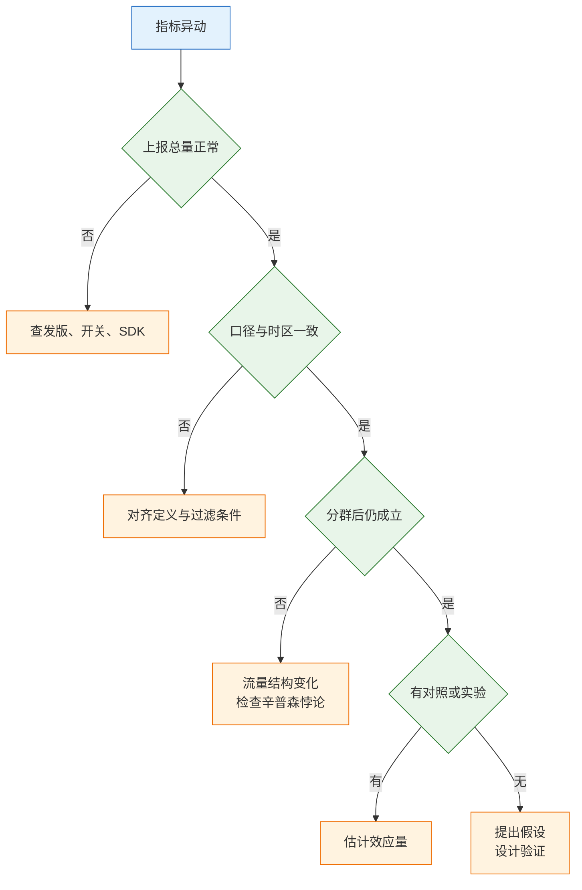

# 指标体系与数据分析

---

## 一、指标体系是什么

### 1.1 核心概念

指标（Metric）不是报表上的一个数字，而是一段可复现的计算。同一句话换一种过滤条件、换一个时区、换一个去重键，得到的数值可以完全不同，结论也可能相反。因此指标的最小完整形态包含六项：业务定义、计算公式、过滤条件、时间口径、数据来源、负责人。

指标体系是把这些计算组织成树状结构：顶端是一个能代表用户获得价值的结果指标，中间是可以被团队影响的输入指标，旁边是防止局部优化伤害整体的护栏指标。三者缺一，指标体系就会退化成“一堆图”。

数据分析则是从数值异动走到可验证假设的流程。它要回答三个递进的问题：数据本身是否可信、变化发生在哪个人群、什么机制能解释这个变化。跳过前两步直接解释业务，得到的通常是事后故事。



| 概念 | 含义 | 常见误用 |
|---|---|---|
| 结果指标 | 反映最终价值的量 | 直接拿来考核单个团队 |
| 输入指标 | 团队动作能直接影响的前置量 | 与结果无稳定因果关系 |
| 护栏指标 | 防止局部优化伤害整体 | 缺失或被长期忽略 |
| 口径 | 定义、过滤、时区、去重键的集合 | 只写指标名，不写条件 |
| 维度 | 拆分指标的角度 | 维度过多导致样本稀碎 |
| 同期群 | 按同一起始时间分组的人群 | 与整体留存混算 |

指标树的价值在于归因路径。结果指标下降时，沿树向下找哪个输入指标先动，比在几十张图里逐张看快得多。图上的每个节点都要能对应一个明确的计算，节点之间是乘法、加法或比率关系，不能只是“相关”。

### 1.2 适用场景与边界

不同业务形态的指标重心差异很大，套用同一套模板会得到大量无关图表。

| 场景 | 核心指标 | 主要边界 |
|---|---|---|
| 订阅制工具 | 团队激活率、席位使用率、续费率 | 单用户活跃不能代表付费理由 |
| 交易平台 | 支付成功率、复购率、履约时长 | GMV 受促销影响，需拆量价 |
| 内容产品 | 有效消费时长、次日留存 | 停留时长可被自动播放污染 |
| 内部平台 | 采用率、任务完成率、自助率 | 强制使用会虚高采用率 |
| 基础设施 | 可用性、P95 延迟、错误预算 | 平均值掩盖长尾 |

指标体系的边界有三条。第一，它解释“发生了什么”，不解释“为什么”，原因要靠访谈、可用性测试和对照实验。第二，它不能替代决策责任，数据只能降低不确定性，不能替人承担取舍。第三，小样本无法支撑细分结论，按渠道、机型、地区交叉之后每组只剩几十人时，任何差异都可能是噪声。

> **注意**：指标数量与专业度无关。一个团队同时维护上百个指标，通常意味着没人对任何一个负责。可维护的规模是：一个北极星、五到八个输入指标、三到五个护栏指标，其余按需临时查询。

还有一类边界容易被忽略：指标体系只覆盖已埋点的行为。用户放弃、困惑、绕路这些没有事件的行为，往往才是问题的核心。数据能指出“哪一步流失”，不能指出“为什么流失”，后者必须回到真实用户场景。

---

## 二、指标质量的判断依据

### 2.1 五项判别标准

一个指标值得进入看板，必须同时满足五项标准。任意一项不满足，它更适合留在临时分析里。

| 标准 | 含义 | 反例 |
|---|---|---|
| 可行动 | 变化能对应一个具体动作 | 宏观经济指数 |
| 可归因 | 能拆到团队可影响的环节 | 品牌好感度 |
| 抗扭曲 | 难以通过损害长期价值刷高 | 注册数、下载量 |
| 领先性 | 早于收入与流失变化 | 季度收入 |
| 可测量 | 采集成本与延迟可接受 | 需全量人工标注 |

可行动性最容易被忽略。一个指标即使真实、重要，如果团队看到它下降也无事可做，它只会制造焦虑。判断方法是补一句“如果它跌了，下周做什么”，写不出动作的指标不进看板。

抗扭曲性决定指标能否用于考核。任何被单独考核的指标都会被人找到最省力的提升路径，这是古德哈特定律的常规表现，不是道德问题。对策不是换一个“更完美”的指标，而是给它配护栏指标，并定期检查分子分母是否被结构性改变。

### 2.2 北极星指标的筛选

北极星指标是“最能代表用户获得价值、又能被团队影响”的那一个。筛选时逐项打分，不用讨论偏好。

| 候选 | 可影响 | 抗扭曲 | 判断 |
|---|---|---|---|
| 总收入 | 间接 | 弱，可降价冲量 | 领先性差，只做结果 |
| 日活跃用户 | 是 | 弱，可买量 | 领先性弱，需配质量指标 |
| 周活跃协作团队 | 是 | 较强 | 领先于收入，适合协作产品 |
| 累计注册用户 | 是 | 极弱 | 无领先性，虚荣指标 |
| 核心动作完成次数 | 是 | 中，可拆单 | 领先，需定义防刷规则 |

“周活跃协作团队”要求一个团队内至少两人各完成一次核心动作，比单看日活更难刷，也更接近付费理由。它的代价是口径复杂，需要团队维度、成员维度、事件表三方对齐，埋点与数仓成本更高。这个代价通常值得付，因为它把“活跃”从打开应用改成了产生协作价值。

北极星一次只能有一个。多个北极星等于没有优先级，团队会在冲突时自行选择更容易的那个。产品阶段变化时可以更换，但要有明确的切换点、新旧口径并行期和书面说明，否则历史曲线会出现无法解释的断层。

> **注意**：北极星不能直接用于个人或小团队考核。它受投放、定价、季节、竞品影响，单个团队无法控制。正确用法是考核输入指标，观察北极星，两者分离。

---

## 三、指标树的构建方法

### 3.1 从北极星到叶子节点

指标树按“结果—输入—可执行动作”三层展开，最多四层。层数再多，节点就会变成同义反复。

| 层级 | 回答的问题 | 产出 |
|---|---|---|
| 结果层 | 用户获得的价值是否增长 | 一个北极星与口径 |
| 输入层 | 哪些环节驱动结果 | 三到五个可影响因子 |
| 动作层 | 哪个功能或流程改变该因子 | 埋点事件或业务表 |
| 护栏层 | 增长是否伤害体验与成本 | 质量、成本、投诉指标 |

展开时用乘法和加法校验关系。以“周活跃团队数”为例，它约等于“上周活跃团队数 × 留存率 + 本周新增活跃团队数”，新增又可拆为“访问 × 注册转化 × 建团队转化 × 首周激活”。拆完能对上总量，说明结构成立；对不上，说明漏了环节或口径重叠。

叶子节点的验收标准是“能落到一个事件或一张表”。落不下去，说明这个因子还没想清怎么测，应继续拆或直接删掉。一个常见错误是把“用户体验”作为叶子节点，它既不能计算也不能归因，只会让整棵树失去可操作性。

### 3.2 口径字典与指标定义卡

口径必须写成卡片，不能散落在分析师记忆、SQL 注释和口头约定里。卡片是指标的身份证，也是两个报表对不上时的唯一裁判依据。

```text
【指标定义卡】
指标名：周活跃协作团队数
业务定义：自然周内至少 2 名成员各完成 1 次核心动作的团队数
计算式：count(distinct team_id) from 事件表 where 条件
过滤条件：排除内部账号、测试租户、已注销团队
时间口径：事件发生时间，Asia/Shanghai，周一 00:00 起算
去重键：team_id
数据来源：核心动作事件表 + 团队维表
更新频率：每日一次，T+1
基线：上一自然周同口径，另附四周移动中位数
负责人：数据侧、后端侧各一名
变更记录：见口径变更日志，含并行期与切换日
```

| 字段 | 填写要求 | 常见缺失 |
|---|---|---|
| 业务定义 | 用自然语言说清“算谁、算什么” | 只写指标名 |
| 计算式 | 分子分母、去重键明确 | 漏掉 distinct |
| 过滤条件 | 内部、测试、注销、机器人 | 测试数据混入 |
| 时间口径 | 时区、起止边界、事件时间或入库时间 | 一端本地时间一端 UTC |
| 数据来源 | 库表全名与分层 | 指向会变的临时表 |
| 负责人 | 定义负责人与实现负责人 | 只写部门名 |

> **注意**：“活跃”“有效”“真实”这类词在卡片里必须替换成具体动作。写“活跃用户”而不写动作，等于把定义权留给每个写 SQL 的人，同一张看板能算出三种结果。

口径变更按发版管理：旧口径保留、新口径并行、差异逐项解释、确认后切换、旧口径归档。直接改 SQL 不改说明，历史曲线会在某天出现断点，而三个月后没人能解释那次下跌是业务问题还是计算问题。

---

## 四、埋点与数据链路设计

### 4.1 事件模型与字段约定

指标的可信度取决于最上游那一次上报。埋点设计要在开发前定稿，不能等上线后补。



| 事件类型 | 命名示例 | 用途 |
|---|---|---|
| 曝光 | `page_viewed` | 计算入口到达率 |
| 点击 | `export_clicked` | 计算意向与入口效率 |
| 成功 | `report_exported` | 计算真实完成率 |
| 失败 | `export_failed` | 归因错误类型与影响面 |

四条约定必须写进事件契约：一个事件只表达一个动作，`export_clicked` 与 `report_exported` 分开，不用一个事件加结果字段混报；公共字段齐全，至少包含事件 ID、用户 ID、租户 ID、时间戳、应用版本、平台、会话 ID；属性只放可聚合的枚举、数字、布尔，不放整段 JSON、文件内容与手机号；事件名用“对象加动作”的过去式，改名视为换指标，走版本并保留旧事件一个周期。

> **注意**：客户端重试、页面重渲染、SDK 重复初始化都会造成同一动作多次上报。仅靠事件名去重不够，必须带事件 ID 并在明细层去重，否则转化率会虚高，且虚高程度随网络质量变化。

服务端事件与客户端事件要能对齐。支付成功、订单创建这类事实以服务端为准，客户端只用于记录交互意图。两边都上报时，用业务单号关联，不能靠时间戳近似匹配。

埋点评审要在开发前完成，参与方包括产品、开发、数据。评审输出一份事件清单：事件名、触发时机、公共字段、业务属性、对应指标。开发按清单实现，数据按清单验数，产品按清单确认能回答原问题。缺少这一步，常见结果是功能上线两周后才发现关键动作没有上报，补埋点又要等一个版本，整个验证周期被推迟一个月。

埋点上线后的第一件事是验数，不是看报表。用测试账号走一遍主链路，确认每个事件按预期出现、字段值正确、数量与操作次数一致。验数通过后再接入看板，否则错误会沿着聚合层一路放大，且难以判断是哪一层引入的。

### 4.2 对账与质量防线

数据质量靠机制，不靠人工核对。三道防线按成本从低到高排列，日常以第一道为主。

| 防线 | 做法 | 能发现的问题 |
|---|---|---|
| 事件与业务表对账 | 每日比对同一事实的两处计数 | 漏报、重复、口径不一致 |
| 事件契约校验 | schema 校验必填字段与类型 | 字段缺失、类型漂移 |
| 异常检测 | 日环比、周同比超阈值告警 | 发版故障、开关误关 |
| 测试租户隔离 | 测试账号打标并默认过滤 | 测试数据污染大盘 |

对账要选“同一事实、两个来源”。支付成功事件数应等于支付表成功记录数，注册事件数应等于用户表新增数。差异超过阈值时先告警再排查，不要等到月度对账才发现。阈值按业务波动设定，大促期间单独放宽并记录原因。

| 现象 | 最可能原因 | 排查动作 |
|---|---|---|
| 指标突然翻倍 | 重复上报、重渲染 | 按事件 ID 去重，看单用户事件数 |
| 指标突然归零 | SDK 未上报、开关关闭 | 查发版记录与上报量 |
| 漏斗某步大于上一步 | 事件顺序错、补报 | 按会话排序，核对时间戳 |
| 新老用户对不上 | 注册时间取错、账号合并 | 比对用户表与事件表 |
| 跨时区“今天”不一致 | 一端本地时间一端 UTC | 统一存 UTC，展示再转换 |
| 看板与业务表差几单 | 过滤条件或同步延迟 | 对齐状态定义与更新时间 |

上游 schema 变更是最隐蔽的一类故障。字段改名、枚举值调整、时区默认值变化，都不会报错，只会让某个指标慢慢偏移。对策是把上游表结构纳入监控，变更走通知，关键字段做非空与取值分布校验。

---

## 五、分析方法与归因流程

### 5.1 异动排查顺序

指标异动时，先证伪数据，再解释业务。顺序反过来，会在错误的数据上构建完整的故事。



| 步骤 | 检查内容 | 通过标准 |
|---|---|---|
| 一 | 事件上报量、去重后用户数 | 与历史趋势同量级 |
| 二 | 口径、时区、过滤、数据源 | 与其他报表可对齐 |
| 三 | 按端、渠道、新老、规模分群 | 各群方向一致或可解释 |
| 四 | 同期变更：发版、投放、定价 | 时间点能对上 |
| 五 | 对照实验或准实验 | 效应量与置信区间可估 |

分群是第三步的核心。整体转化率下降、每个端的转化率却都在上升，这种辛普森悖论在流量结构快速变化时非常常见：低转化的新渠道占比变大，把整体拉低。只看总体会得出“产品变差”的错误结论，进而做出错误的产品决策。

### 5.2 分群、混杂与假设卡

相关不等于因果。观察到“使用模板的团队留存更高”，可能只是大团队更爱用模板，而大团队本身留存就高。控制变量、分层比较、倾向匹配都能缓解混杂，但只有随机对照实验能干净地回答因果。

假设卡把分析结论固定成可执行格式，避免“数据显示用户喜欢某功能”这类无法验证的表述。

| 字段 | 填写要求 | 示例 |
|---|---|---|
| 观察 | 现象、时间、口径 | 新团队首周留存低于基线 |
| 分群 | 影响范围与不变范围 | 仅单人注册团队下降 |
| 假设 | 一句可证伪的机制 | 未邀请同事则无法完成协作动作 |
| 验证 | 实验设计、样本、周期 | 新注册团队按租户随机分组 |
| 判据 | 效应阈值与停止条件 | 提升超过阈值则全量，否则回退 |

> **注意**：实验期间反复查看结果并提前停止，会把随机波动当成显著效应。停止条件、样本量、观察窗口必须在开始前写定，中途只看护栏指标是否恶化。

多重比较同样会制造假阳性。同时检验二十个分群，即使没有任何真实效应，也大概率有一个“显著”。对策是预先指定主指标与少量分群，其余结果标注为探索性，不直接进入决策。

### 5.3 漏斗、同期群与分群的取舍

三种分析视角回答不同问题，选错视角会得到看似精确但无法使用的结论。

| 视角 | 回答的问题 | 适用边界 |
|---|---|---|
| 漏斗 | 哪一步流失最多 | 步骤有明确先后顺序 |
| 同期群 | 不同批次的表现是否变差 | 需要足够长的观察周期 |
| 分群对比 | 哪类人群差异最大 | 样本量足以支撑细分 |
| 时间序列 | 变化是趋势还是波动 | 需剔除季节与促销 |

漏斗要求步骤严格有序且可去重。把“浏览、加购、下单、支付”放在一起时，必须说明是否允许跳步，否则各步人数会出现倒挂。漏斗的每一层都要同时看绝对量与转化率，只看率会忽略分母萎缩。

同期群按首次关键行为的时间分组，观察同一批人在后续周期的表现。它能区分“整体留存稳定”与“每批都在变差”这两种完全不同的状态，后者被新增稀释后很难从总量上看出来。同期群的观察周期要与业务周期匹配，月度续费产品看七天留存没有意义。

分群对比最容易产生假阳性，因此要预设分群维度与最小样本量。低于样本阈值的分群只做探索，不进入结论。三种视角通常组合使用：先用时间序列发现异动，再用分群定位人群，最后用漏斗或同期群确认机制。

---

## 六、口径治理与变更管理

### 6.1 口径漂移的识别

口径漂移指指标名称不变、计算实际变了。它不会报错，只会让趋势悄悄失真，是最难发现的一类数据问题。

| 漂移类型 | 表现 | 检测方式 |
|---|---|---|
| 定义变更 | 活跃动作被替换 | 对比卡片与 SQL |
| 过滤变更 | 内部账号被纳入或剔除 | 核对过滤条件与量级 |
| 时区变更 | 日界前后数据跳变 | 固定时区做边界测试 |
| 数据源变更 | 换表后口径近似但不等价 | 双跑比对差异 |
| 去重键变更 | 人数变次数或反之 | 检查 distinct 字段 |
| 上游 schema | 枚举值新增或改名 | 监控取值分布 |

> **产品红线**：任何口径变更不得直接覆盖线上指标。必须先建新指标或新版本、并行双跑至少一个完整业务周期、逐项解释差异，再切换看板并通知所有使用方。没有并行期的口径切换，等同于在无人察觉的情况下改写历史。

识别漂移的日常手段是“口径回归”：每月抽查三到五个核心指标，用卡片重写一遍 SQL，与线上结果比对。差异为零说明口径稳定，有差异就进入变更流程。这个动作成本不高，但能拦住大部分悄悄发生的偏移。

### 6.2 变更与双跑流程

| 阶段 | 动作 | 产出 |
|---|---|---|
| 提案 | 说明变更原因、影响指标、使用方 | 变更单 |
| 实现 | 新口径独立命名，不覆盖旧口径 | 新 SQL 与新卡片 |
| 双跑 | 并行一个完整周期，按维度比对 | 差异清单与解释 |
| 评审 | 确认差异可解释、无使用方阻塞 | 评审记录 |
| 切换 | 看板换源，旧口径归档只读 | 切换通知 |
| 复核 | 切换后一周检查趋势连续性 | 复核结论 |

双跑周期要覆盖至少一个完整业务周期。B 端产品覆盖月末结账与月初出账，交易类覆盖一个促销周期，内容类覆盖一个周末。只跑三天就切换，等于没覆盖周内波动。

差异解释要写到“每一项差多少、为什么”。常见可解释差异包括：去重键从用户改为租户、过滤掉测试租户、时区从本地改为 UTC。无法解释的差异一律视为实现错误，不进入切换。

> **注意**：口径变更通知要发给所有下游使用方，包括报表、告警、结算、对外披露。只改看板不通知，会出现财务按旧口径结算、运营按新口径复盘的并行事故。

---

## 七、常见失败模式与检查清单

### 7.1 失败模式

| 现象 | 最可能原因 | 处理 |
|---|---|---|
| 活跃涨、收入不涨 | 北极星与付费脱节 | 补团队级与席位级指标 |
| 两张报表同一指标不一致 | 口径、时区、过滤不同 | 建口径字典，指定唯一来源 |
| 总留存稳定、每批变差 | 新用户稀释 | 按注册周做同期群 |
| 平均响应正常、用户喊慢 | 长尾分布 | 看 P95 与 P99，按接口拆 |
| 整体转化跌、分端都涨 | 流量结构变化 | 分群重算并检查权重 |
| 指标一考核就变形 | 古德哈特定律 | 配护栏指标，不单点考核 |
| 看板很多、无人使用 | 没有决策场景 | 每张图绑定一个动作 |
| 指标突然下降 | 埋点或发版变更 | 先查上报量与版本 |
| 事件改名后历史断层 | 无双写过渡 | 旧事件保留一个版本并映射 |
| 小分群结论反复 | 样本不足、多重比较 | 预注册主指标与分群 |

失败模式有一条共同线索：大部分“数据问题”最后都落在工程侧，而不是分析侧。埋点由开发写、口径由 SQL 定义、上游表由后端维护，任何一环缺少契约，下游就只能靠猜。

### 7.2 检查清单

**定义与选型**

- [ ] 北极星只有一个，且有明确业务定义与动作
- [ ] 每个指标能回答“跌了做什么”
- [ ] 核心指标配有护栏指标
- [ ] 虚荣指标未进入考核

**口径与文档**

- [ ] 核心指标均有定义卡，六项要素齐全
- [ ] 时区、去重键、过滤条件已写明
- [ ] 口径变更走双跑与通知流程
- [ ] 旧口径归档为只读

**埋点与质量**

- [ ] 事件一动作一命名，成功与失败分离
- [ ] 公共字段齐全，事件 ID 可用于去重
- [ ] 敏感字段未采集、未转发
- [ ] 关键事实与业务表每日对账
- [ ] 测试租户已打标并默认过滤

**分析与决策**

- [ ] 异动先查数据可信度，再解释业务
- [ ] 结论按人群分群，检查流量结构
- [ ] 因果结论有实验或准实验支撑
- [ ] 假设卡写明判据与停止条件
- [ ] 分析产出能落到一个具体动作

清单的执行要点是“有证据”。口径卡指向具体 SQL，对账指向每日任务，实验指向预注册文档。只有结论没有证据的分析，在下一次指标波动时会被全部推翻。
