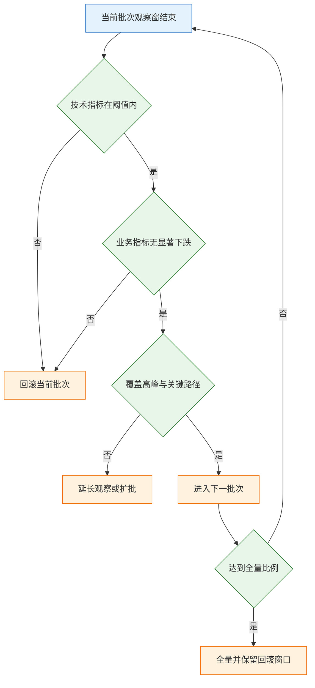

# 上线与增长

---

## 一、上线与增长是什么

### 1.1 核心概念

上线（Release）是把一次已验证的变更，按受控节奏暴露给真实用户的过程。它与部署（Deploy）不是同一件事：部署是把制品放进运行环境，发布是决定哪些用户能看到它。两者分离之后，代码可以先上线但保持关闭，也可以只对一部分租户开放，风险被限制在可控范围内。

增长（Growth）是在留存成立的前提下，放大用户获得价值的规模。它包含获客、激活、留存、变现、推荐五个环节，每个环节都有可测的转化。增长不是投放的同义词，投放只影响入口，产品内部的激活与留存才决定投入是否划算。

发布能力与增长能力互相制约。发布能力弱，团队不敢频繁变更，增长实验的迭代速度就上不去；增长方向错，发布越快，错误被放大的速度也越快。成熟团队把两者放在同一条链路上管理：发布提供可观察的小样本，增长在小样本上验证假设，验证通过再放量。


| 概念 | 含义 | 常见误用 |
|---|---|---|
| 部署 | 制品进入运行环境 | 与发布混为一谈 |
| 发布 | 决定哪些用户可见 | 全量即发布完成 |
| 灰度 | 按稳定键分批放量 | 随机放一点流量 |
| 回滚 | 恢复到上一可用状态 | 只回代码不回数据 |
| 特性开关 | 运行时控制代码路径 | 长期挂着不清理 |
| 观察窗 | 判定前的最短观察时长 | 看一眼大盘就放量 |
| 错误预算 | 允许的不可用额度 | 没有预算概念，凭感觉 |

不可变制品是整条链路的基础。同一个镜像从测试走到生产，版本号可追溯，配置从环境注入，不在服务器上改代码。否则回滚时面对的是一台与测试环境不一致的机器，任何“应该一样”的假设都不成立。

### 1.2 适用场景与边界

发布策略要跟变更类型匹配，不能所有变更走同一套流程。

| 场景 | 发布策略 | 主要边界 |
|---|---|---|
| 单体后台服务 | 滚动更新加灰度 | 会话与本地缓存需外置 |
| 移动客户端 | 分阶段放量加强制更新 | 旧版本长期共存 |
| 多租户 SaaS | 按租户灰度 | 同租户内体验必须一致 |
| 数据库变更 | 扩展收缩分步发布 | 不可逆操作需单独窗口 |
| 合规敏感系统 | 固定变更窗口加审批 | 紧急变更另有通道 |
| 内部工具 | 全量加快速回滚 | 仍需保留上一版 |

灰度的边界在于它能验证“是否可用、是否明显变差”，不能验证长期留存与商业影响。七天留存、续费率、品牌影响需要更长的观察周期和更大的样本，通常要用对照实验而不是灰度批次回答。

增长的边界在于它放大的是已有价值。留存曲线持续下滑时做投放，等于用更高的成本买来更快流失的用户；支付成功率低时做拉新，等于把预算花在必然失败的环节。增长的前提是核心链路已经跑通，且单位经济模型不为负。

> **注意**：灰度不是“放一点流量看看”。没有稳定分流键、没有基线、没有停止判据的灰度，只是把全量故障推迟了半小时，同时让排查更困难。

---

## 二、发布风险的判断依据

### 2.1 三层风险与回滚成本

每次发布都在交换三样东西：新功能带来的收益、变更引入的故障概率、出事后恢复所需的时间。成熟团队不是不出故障，而是把恢复时间压到很短。

| 层 | 例子 | 回滚手段 | 恢复时间 |
|---|---|---|---|
| 代码 | 新版本逻辑错误 | 切回上一版制品 | 分钟级 |
| 配置 | 开关、限流、超时值 | 改配置并生效 | 秒到分钟 |
| 数据 | 表结构、回填、状态变更 | 逆向脚本或备份恢复 | 小时到天 |

风险随层数上升。一次发布同时改代码、改配置、改表结构，出问题时无法判断该回滚哪一层，通常只能整体回退，而数据层往往回不去。控制风险的核心动作是“一次只动一层”：功能发布不带破坏性表变更，配置调整单独走开关，数据迁移在功能上线前完成兼容。

回滚成本要在发布前量化，而不是出事时估算。需要回答四个问题：上一版制品是否还在仓库、回滚命令是否演练过、数据是否需要逆向脚本、回滚后缓存与消息是否需要清理。任何一个答不上来，这次发布就不具备回滚能力。

### 2.2 变更分级

不是所有变更都值得走完整流程，但分级标准要提前写死，不能由发布人现场判断。

| 级别 | 判断依据 | 审批与节奏 |
|---|---|---|
| 常规 | 无结构变更、有开关、可快速回滚 | 负责人审批，工作日窗口 |
| 高风险 | 涉及支付、权限、数据删除 | 双人复核，避开高峰 |
| 紧急 | 修复正在发生的故障 | 事后补记录与复盘 |
| 破坏性 | 删列、改类型、改语义 | 单独版本，独立窗口 |

高风险变更的定义要具体到模块，不写“重要系统”。支付回调、登录鉴权、权限校验、批量删除、计费口径，这几类一旦出错影响面大且难以察觉，应默认按高风险处理。

> **注意**：周五下午与节假日前不适合发布高风险变更，原因不是迷信，而是故障被发现的时间被拉长，值班人力也更难协调。常规低风险变更不受此限制，否则团队会用“攒到一起发”来规避，反而扩大单次变更的范围。

---

## 三、发布流程与上线清单

### 3.1 不可变制品与流水线

流水线要保证“构建一次、逐级晋级”。测试环境验证过的制品，原样进入灰度与生产，中间不允许重新构建，也不允许在服务器上打补丁。

| 环节 | 产出 | 失败处理 |
|---|---|---|
| 构建 | 带版本号与提交哈希的制品 | 阻断，不晋级 |
| 单元与集成测试 | 测试报告与覆盖率 | 阻断，修复后重跑 |
| 测试环境验收 | 主链路与异常路径记录 | 退回开发，不带病上线 |
| 灰度 | 分批名单与观察数据 | 停止放量并回滚 |
| 全量 | 发布记录与变更说明 | 保留回滚窗口 |
| 收尾 | 开关清理与旧版下线 | 纳入下个迭代 |

版本号要能反推代码。语义化版本加提交哈希是常见做法，镜像标签不使用浮动标签，否则同一标签在不同时间指向不同内容，回滚就失去确定性。制品仓库要设置保留策略，至少保留最近若干个可回滚版本，保留期短于故障发现周期时，回滚能力形同虚设。

配置也要纳入版本管理。环境变量、开关默认值、限流阈值写在配置中心或部署清单里，与应用版本一起评审。生产环境手工改配置是配置漂移的主要来源，表现是“测试正常、生产缺一个参数”，而这类问题在日志里通常只有一行不显眼的报错。

### 3.2 上线前验证清单

清单的每一条都要写“怎么验”和“不过怎么办”。写“确认数据库正常”没有意义，写“主从延迟低于阈值，超过则暂停发布”才可执行。

| 类别 | 检查项 | 不通过怎么办 |
|---|---|---|
| 基线 | 发布前七日错误率、P95、转化率 | 补齐基线再发 |
| 容量 | CPU、连接池、队列积压按峰值估算 | 扩容或限流后再发 |
| 依赖 | 第三方接口、证书、配额 | 演练超时与降级 |
| 迁移 | 脚本可重跑、有回滚点 | 在接近生产量级验证 |
| 开关 | 新功能有独立开关，关闭回旧版 | 补开关再发 |
| 回滚 | 上一版制品可用，命令演练过 | 修复回滚能力再发 |
| 通知 | 客服、销售、运维知道变更内容 | 补齐说明再发 |
| 值班 | 谁盯、盯多久、如何升级 | 明确责任人再发 |

基线必须提前准备，至少取发布前七个完整日的数据，并标出周内波动。遇到大促、月末、开学季，要用去年同期作为参照。没有基线，发布后的涨跌只能靠感觉解释，而感觉通常会偏向“这次改动有效”。

> **注意**：回滚演练要实际切一次，不只看文档。演练内容包括切回上一版、关闭开关、清理缓存、确认数据兼容。只写在预案里的回滚步骤，在真实故障中经常缺少权限、镜像或数据库连接。

---

## 四、灰度策略与判定

### 4.1 分流键与观察窗

灰度的第一件事是选稳定分流键。按用户或租户哈希取模，同一个主体始终落在同一组，否则体验会跳变，实验数据也会被污染。

| 分流方式 | 适合 | 主要风险 |
|---|---|---|
| 按用户比例 | 面向个人的功能 | 同一用户跨设备不一致 |
| 按租户 | 多租户 SaaS | 大客户需单独白名单 |
| 按地域 | 有合规或延迟差异 | 样本代表性不足 |
| 内部加白名单 | 高风险变更 | 只能验可用，验不了转化 |

分流比例不是重点，能否覆盖关键路径才是。5% 一切正常、全量十分钟就崩，通常不是玄学，而是样本偏差：小流量集中在低峰时段，全量赶上高峰，连接池与缓存被打穿；小流量命中的是热数据，全量后冷数据走慢查询；小流量没有触发定时任务或批量接口；第三方对灰度流量另有限额。

因此灰度要覆盖至少一个完整业务周期。B 端覆盖月末结账与月初出账，交易类覆盖一个促销周期，内容类覆盖一个周末。只在工作日上午观察，等于只验证了最平稳的那一段。

观察窗按发现能力分层，不同问题在不同时间尺度上暴露。

| 时间 | 观察内容 | 能发现的问题 |
|---|---|---|
| 零到一小时 | 错误率、P95、5xx、重启 | 崩溃、连接池、明显逻辑错误 |
| 二十四小时 | 核心转化、订单量、退款 | 定时任务、时区、日终结算 |
| 七天 | 留存、复购、客服工单 | 体验问题、边缘场景 |
| 三十天 | 收入、流失、成本 | 商业影响、资源浪费 |

### 4.2 灰度判定表

判定表把“继续放量、保持观察、回滚”三种动作写成明确条件，避免现场凭气氛决定。

批次推进的入口条件统一为：上一批次在观察窗内技术与业务指标均通过，且至少覆盖一个高峰时段。下表的判据按批次逐级收紧。

| 批次 | 观察窗 | 通过判据 | 回退动作 |
|---|---|---|---|
| 内部 | 半日 | 无阻断性错误 | 关开关 |
| 5% | 一日 | 错误率与 P95 不超基线 | 切回上一版 |
| 25% | 一日加一个高峰 | 核心转化不显著下跌 | 回 5% 并排查 |
| 50% | 两日 | 业务与护栏指标均正常 | 回 25% |
| 全量 | 保留回滚窗口 | 无新增告警与工单 | 整体回退 |



判定要同时看技术与业务。技术指标全绿但核心转化下跌，常见原因是慢查询、交互变更或权限判断变严，此时继续放量会把问题扩散到更大样本。业务指标正常但错误率上升，也不能放量，因为错误可能集中在尚未覆盖的边缘场景。

> **产品红线**：未经过灰度与观察窗的变更不得直接全量，包括“只改了一行配置”“只改文案”“只加一个字段”。变更风险与代码行数无关，配置错误与文案歧义同样能造成大面积影响。紧急修复也必须保留一键回退手段，并在事后补灰度记录。

例外只有一种：正在发生的故障需要立即止血，且回退路径已经确认。这种情况下先恢复服务，再补记录，不能用“紧急”作为跳过流程的常态理由。

---

## 五、回滚与数据迁移

### 5.1 扩展、回填、切换、收缩

代码回滚最容易，数据回滚最贵。涉及表结构的需求，发布前就要设计兼容窗口，让新旧代码能在同一份数据上共存。


| 阶段 | 关键动作 | 可停点 | 回退方式 |
|---|---|---|---|
| 扩展 | 加可空字段或新表 | 随时 | 删字段，无数据损失 |
| 双写 | 新旧同时写，忽略读 | 随时 | 停双写，读旧字段 |
| 回填 | 分批更新，记录进度 | 每批之间 | 从断点续跑 |
| 切换读 | 灰度读新字段 | 按比例 | 切回读旧字段 |
| 收缩 | 加非空约束、停双写 | 观察期后 | 恢复双写 |
| 清理 | 删除旧字段 | 独立版本 | 依赖备份恢复 |

这条链的每一步都要能停。回填脚本必须幂等，失败重跑不产生重复数据；更新要限速，避免主从延迟被推到几十分钟；切换读要按比例灰度，先比对两列取值是否一致。

### 5.2 破坏性变更的隔离

删列、改类型、改语义属于破坏性变更，永远单独发版，与功能发布隔开。这样出问题时只需要回滚一个维度。

| 变更 | 兼容做法 | 禁止做法 |
|---|---|---|
| 删除字段 | 先停读写，观察后再删 | 先删列再发新代码 |
| 修改类型 | 新增字段并双写 | 原地改类型 |
| 修改语义 | 新增枚举值并兼容旧值 | 复用旧值表示新含义 |
| 大表加索引 | 在线建索引或低峰执行 | 业务高峰直接执行 |
| 批量更新 | 分批加限速 | 一条语句更新全表 |

> **注意**：先删旧字段再发新代码，回滚时旧代码找不到列，服务无法启动。正确顺序永远是“先让新代码不依赖旧结构，再删除旧结构”，中间留一个完整观察周期。

数据迁移还需要一份恢复预案。预案写清备份时间点、恢复命令、预计耗时、验证方式。只写“有备份”不算预案，备份是否可恢复、恢复后业务是否一致，都要在演练中确认。没有演练过的备份，在事故中通常会被发现缺少某张表或某个时间点。

---

## 六、上线后的增长验证

### 6.1 增长链路与杠杆

发布成功不等于需求成功。上线后的第一件事是确认有没有人用，第二件是用的人有没有产生预期行为，第三件才是指标有没有动。

| 环节 | 关键问题 | 可用杠杆 | 常见误区 |
|---|---|---|---|
| 获客 | 用户从哪里来 | 分享链路、搜索、深链 | 只看注册量 |
| 激活 | 多快到达首次价值 | 引导、默认值、性能 | 把登录当激活 |
| 留存 | 为什么会回来 | 通知、协作、数据沉淀 | 用打开率代替核心动作 |
| 变现 | 为什么付费 | 定价页、限额、支付成功率 | 只改价格不改价值 |
| 推荐 | 为什么愿意传播 | 邀请机制、权限与共享 | 奖励刷单 |

性能经常是最便宜的增长手段。首屏接口从秒级降到数百毫秒，注册到首次完成核心动作的转化可能明显提升，效果超过一次文案改版。但这个结论必须用对照实验验证，不能只看上线前后对比，因为同期可能还有投放、季节、竞品变化。

增长动作要按环节定位。激活率低，先查引导与性能；留存低，先查核心动作是否被完成；付费低，先查定价页与支付成功率。跳过定位直接做活动，常见结果是短期数据好看，长期留存更差，因为活动吸引来的是与产品价值不匹配的人群。

### 6.2 实验设计与停止条件

A/B 实验有三个最低要求：随机分流、样本量足够、停止条件提前写定。

| 要素 | 要求 | 错误做法 |
|---|---|---|
| 分流单元 | 与体验边界一致，用户或租户 | 服务端按请求分流 |
| 样本量 | 按最小可检测效应预估 | 跑几天看感觉 |
| 主指标 | 一个，预先指定 | 十几个指标挑显著的 |
| 停止条件 | 达到样本量或护栏恶化 | 看到显著就停 |
| 实验周期 | 覆盖完整业务周期 | 只跑工作日 |
| 互斥 | 同期不叠加其他变更 | 同时改定价与引导 |

分流单元必须与体验边界一致。按用户分流就不能在服务端按请求分流，否则同一用户一会儿新版一会儿旧版，体验和数据都乱。B 端按租户分流，避免同一团队两个人看到不同价格。

样本量要按最小可检测效应预估，而不是追求“越多越好”。效应越小，需要的样本越大；样本不足时，观察到的差异大部分是噪声。实验中途反复查看并提前停止，会显著抬高假阳性率，这是最常见的实验错误。

> **注意**：分流比例与预期不符时，先查分流实现，不要直接分析结果。样本比例失衡通常意味着哈希不均、缓存串号或埋点漏报，此时任何结论都不可信。

实验结束后的决策要写清：全量、回退、继续观察、修改方案再测。只写“效果不错”不算结论，要给出效应量、置信区间、影响范围与后续动作。

---

## 七、事故响应与复盘

### 7.1 分级响应与止血顺序

事故先止血，再找原因。顺序固定为：回滚、降级、扩容、修数据。不要在故障中一边查根因一边改代码，那会让现场更乱。

| 级别 | 判断依据 | 响应方式 |
|---|---|---|
| P0 | 核心链路不可用、资损、数据泄露 | 全员响应，随时通报 |
| P1 | 部分用户不可用、核心指标明显下跌 | 值班加负责人，限时定位 |
| P2 | 非核心功能异常、有绕过方案 | 工作时间内处理 |
| P3 | 体验问题、个别报错 | 排期修复 |

分级的意义是决定资源投入与通报范围。P0 的第一条通报要在确认影响后尽快发出，内容包含现象、影响面、当前动作、下次更新时间，不包含未经验证的猜测。缺少通报会让客服、销售、管理层各自猜测，衍生出比故障本身更大的沟通成本。

止血动作要提前准备。回滚命令、开关位置、限流阈值、只读开关，都应在运行手册里写清并演练过。事故现场现找命令，通常会多花十几分钟，而这十几分钟往往就是影响面扩大的主要区间。

### 7.2 复盘模板

复盘要证据链，不要形容词。时间线、影响面、直接原因、深层原因、防线为何失效、后续动作，六项缺一不可。

| 字段 | 内容要求 | 不合格写法 |
|---|---|---|
| 时间线 | 发现、响应、止血、恢复的具体时刻 | 大致在下午 |
| 影响面 | 用户数、订单数、金额、时长 | 影响较大 |
| 直接原因 | 触发故障的具体变更或条件 | 系统不稳定 |
| 深层原因 | 为何该变更能进入生产 | 测试不够 |
| 防线失效 | 哪道监控、评审、灰度没拦住 | 加强管理 |
| 后续动作 | 具体改动、负责人、截止时间 | 尽快优化 |

```text
【复盘模板】
事故标题：<现象 + 影响对象>
级别与时长：P?，从 <时刻> 到 <时刻>
影响面：<用户 / 订单 / 金额 / 地域 / 租户>
时间线：
  <时刻> 变更上线或异常首次出现
  <时刻> 监控告警或用户投诉
  <时刻> 确认影响并启动响应
  <时刻> 止血动作完成
  <时刻> 服务恢复，进入观察
直接原因：<具体代码、配置、数据或依赖>
深层原因：<流程、评审、容量、权限上的缺口>
防线失效：<监控未覆盖 / 灰度样本偏差 / 回滚未演练>
后续动作：
  <动作> / <负责人> / <截止时间> / <验证方式>
沉淀：<新增监控项、用例、检查清单条目>
```

后续动作要可验证。写“加强测试”等于没写，写“为支付回调补超时与重试用例，由某人在某个版本前完成，并在预发环境跑通”才可执行。每条动作都要有负责人和截止时间，否则复盘会变成一份没有下文的文档。

> **注意**：复盘对象是系统和流程，不是个人。把原因写成“某同事操作失误”，会终止对流程缺口的追问，下一次同样的失误仍会发生。个人失误要问的是：为什么这个操作没有二次确认，为什么权限允许直接操作生产。

---

## 八、常见失败模式与检查清单

### 8.1 失败模式

| 现象 | 最可能原因 | 处理 |
|---|---|---|
| 灰度正常、全量崩溃 | 样本偏差、高峰、冷数据 | 灰度覆盖高峰，压测全量路径 |
| 回滚完成用户仍打不开 | CDN、缓存、客户端旧包 | 清缓存、做版本兼容、强制更新 |
| 代码回了、数据回不去 | 迁移不可逆 | 预留兼容窗口与逆向脚本 |
| 测试正常、生产缺配置 | 配置漂移 | 配置入版本管理，启动时校验 |
| 大盘全绿、用户已投诉 | 只看技术指标 | 补业务指标与真实拨测 |
| 错误率没涨、转化掉了 | 慢查询、交互变更 | 看 P95 与前端性能，做分群 |
| 上线后客服被问懵 | 没有对外说明 | 按角色写变更通知与话术 |
| 迁移锁表时间过长 | 大表直接改结构 | 扩展收缩，分批限速 |
| 要回滚发现旧镜像没了 | 仓库保留策略太短 | 保留最近若干可回滚版本 |
| 假期发版出事无人 | 发布窗口无约束 | 高风险变更避开假期 |
| 开关长期不清理 | 无负责人与过期时间 | 稳定一个版本后删除或固化 |

失败模式有一条共性：大部分严重事故不是“代码写错”，而是“变更没有被正确观察”。灰度覆盖不到、监控看不到、回滚没演练、通知没发出，这四项任意一项缺失，都会把一次本可控制的小故障放大成事故。

### 8.2 检查清单

**发布前**

- [ ] 制品带版本号与提交哈希，测试与生产同一制品
- [ ] 配置已入版本管理，启动时校验必填项
- [ ] 基线数据已留档，含七个完整日
- [ ] 容量按峰值估算，连接池与队列有余量
- [ ] 上一版制品可用，回滚命令已演练
- [ ] 新功能有独立开关，关闭后回到旧行为
- [ ] 变更说明已按角色发出

**灰度中**

- [ ] 分流键稳定，同一用户不会跨组
- [ ] 灰度覆盖高峰与关键路径
- [ ] 技术与业务指标同时观察
- [ ] 判定表写清通过、观察、回退条件
- [ ] 回退动作可在一分钟内启动

**全量与收尾**

- [ ] 全量后保留回滚窗口，未立即删除旧版
- [ ] 观察窗覆盖二十四小时与七天节点
- [ ] 开关登记负责人与清理日期
- [ ] 旧代码路径与旧字段按计划下线
- [ ] 发布记录可追溯到需求与变更单

**增长验证**

- [ ] 激活定义对应核心动作，不是登录
- [ ] 实验分流单元与体验边界一致
- [ ] 样本量与停止条件提前写定
- [ ] 同期未叠加其他影响指标的变更
- [ ] 结论含效应量、影响范围与后续动作

**事故与复盘**

- [ ] 分级标准明确，通报模板可用
- [ ] 止血顺序为回滚、降级、扩容、修数据
- [ ] 复盘含时间线、影响面、直接与深层原因
- [ ] 每条后续动作有负责人、截止时间、验证方式
- [ ] 复盘结论已沉淀为监控项或检查清单条目
