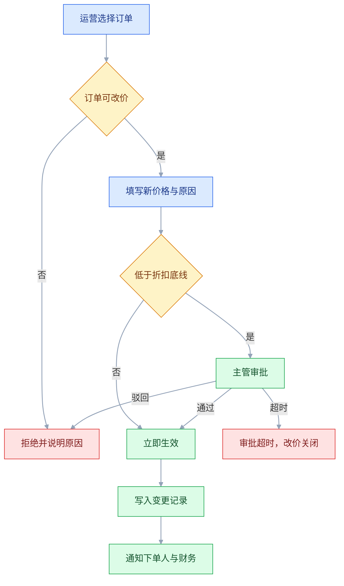
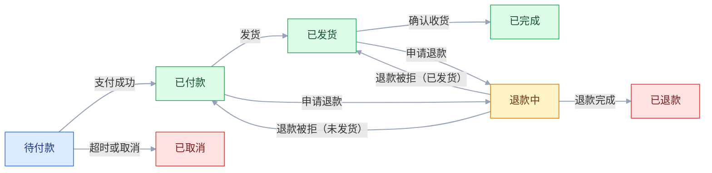

# PRD

## 一、工程案例：给一个订单后台写 PRD 并组织一次评审

**场景**：一家做企业采购的团队，要把订单后台从「Excel + 聊天工具」迁进系统。本期只做一个模块：订单改价与批量导出。使用方是运营（发起改价）、财务（对账）、主管（审批）三类角色，日订单量在几千到一万之间（以实际数据为准）。

**约束**：

- 开发窗口 3 周，后端 1 人、前端 1 人、测试 0.5 人；
- 旧系统有三年前的历史订单，字段缺失，不能全量迁移；
- 财务的对账口径已经固定，任何改价必须留痕、可追溯到人；
- 上线不能停服，先灰度两个仓，再全量。

**交付定义**：开发能据此拆任务，测试能据此写用例，评审能据此做出「做 / 不做 / 砍什么」的决定。三者有一个不成立，文档就还没写完。

### 1.1 问题、目标与证据

| 项 | 内容 |
|---|---|
| 问题 | 改一个订单价格要经过聊天工具申请、财务手工改表、再回传运营，同一笔数据录两次 |
| 受影响的人 | 运营每天约 20–40 单改价（示例区间，以实际数据为准）；财务每月对账要追溯改价记录；主管事后才知道折扣低于底线的单 |
| 现状证据 | 近一个月「改价」相关聊天消息条数、财务手工调整表的行数、因改价产生的对账差异单号 |
| 目标 | 改价在系统内完成并留痕，对账差异能定位到人、时间、原因 |
| 非目标 | 不做自动定价，不做客户自助改价，不做跨币种结算 |

**证据要落到具体位置**：聊天记录导出文件、财务调整表的 sheet 名、差异单列表。写「很多」「经常」等于没写，评审时第一个人就会问「多少单」。

**目标要能被验证**：把「提升效率」改写成「单笔改价从申请到生效的时长」和「每月对账差异单数」两个可取的数，并注明基线来自哪张表、哪个时间窗、由谁取数。

**目标要能被推翻**：PRD 同时写「什么结果出现就停」——灰度后使用率或替代路径占比低于约定值，且访谈确认是「不需要」而不是「不知道」，就把功能下线或改造，而不是继续加需求。

### 1.2 范围清单

```text
本期包含
- 单笔改价：价格、折扣、原因、生效时间
- 低折扣审批：折扣低于底线时进入主管审批
- 改价记录：按订单、操作人、时间查询
- 批量导出：CSV，单次最多 5000 行，UTF-8 带 BOM（兼容 Excel）

本期不包含
- 批量改价（下期；先跑通单笔审批流，再复用）
- 三年前历史订单的回填（缺价格字段，不做回填；本期仅只读展示，不参与改价）
- 客户侧的价格申请入口（本期只服务运营与财务；需求未验证，进问题池）
- 与 ERP 的双向同步（本期只做单向推送；回写涉及对方改造，排下期）
```

**排除项要带理由和去向**。只写「不做」会在评审时被当成「可以做，只是没排」；写成「不做，原因是历史订单缺价格字段，去向是下期做只读映射」，别人才不会反复提。

### 1.3 目标流程图



三条硬要求：每个判断都有两个分支；每个失败都有出路（重试、跳过、返回、找人）；每个节点写的是**用户看得到的结果**，不是「系统处理」。主流程之外至少补三类分支：审批超时（默认驳回还是默认通过）、通知失败（改价是否已生效）、提交后订单状态已变（提示刷新还是关闭）。图里画出会改变用户下一步的审批超时，另外两类落到 1.6 的异常表。

### 1.4 状态与迁移



| 当前状态 | 动作 | 目标状态 | 触发者 | 前置条件 | 不满足时 |
|---|---|---|---|---|---|
| 待付款 | 改价 | 待付款 | 运营 | 订单未支付、未取消 | 提示「订单状态已变化，请刷新」 |
| 已付款 | 改价 | 已付款 | 运营；折扣低于底线时转主管审批 | 订单未发货、未退款 | 提示「订单状态已变化，请刷新」 |
| 已发货 | 改价 | 已发货 | 运营 | 只改备注价，不改实付金额 | 提示「已发货订单仅支持备注」 |
| 已完成 | 改价 | — | 无 | 不允许 | 提示「已完成订单不支持改价，请走售后」 |
| 退款中 | 改价 | — | 无 | 不允许 | 提示「退款中订单不支持改价」 |
| 已退款 | 改价 | — | 无 | 不允许 | 提示「已退款订单不支持改价」 |
| 已取消 | 改价 | — | 无 | 不允许 | 灰置入口 |

**非法迁移要显式写「不允许」**，而不是留空。留空开发就会自己补一个分支，测试也不知道该不该报 bug。已完成、已取消、已退款是终态，本期不再流转；终态能否售后、能否重开，单独写在异常表里。

### 1.5 字段与规则

| 项 | 规则 | 反例（会被打回） |
|---|---|---|
| 金额存储 | 整数分，展示时除以 100 | 用浮点存 19.99 |
| 折扣范围 | 0.01–1.00，两位小数 | 允许填 0 或负数 |
| 改价原因 | 必填，下拉枚举 + 200 字补充 | 只给一个自由文本框 |
| 生效时间 | 默认立即；可选未来 24 小时内 | 允许选过去时间 |
| 时区 | 统一按业务时区存储，展示跟随账号 | 服务器 UTC 直接展示 |
| 并发 | 带版本号，后提交者收到冲突提示 | 后写覆盖前写，无提示 |
| 幂等 | 同一请求 ID 只生效一次 | 双击生成两条记录 |
| 审计 | 记录操作人、前后值、原因、审批人 | 只记「已修改」 |

**金额和时间的规则最容易被一句「按常规处理」带过**，而这两处一出错就是资损和对账差异。

### 1.6 异常与失败路径

| 场景 | 处理 | 用户看到什么 |
|---|---|---|
| 提交时网络中断 | 不落库，保留已填内容 | 「未提交成功，请重试」 |
| 请求超时 | 以请求 ID 查询结果，不自动重试 | 「结果确认中，稍后可在记录里查看」 |
| 审批期间订单被支付 | 审批单失效 | 「订单状态已变化，审批已关闭」 |
| 两人同时改同一单 | 版本号冲突 | 「价格已被他人修改，请刷新后重试」 |
| 下游通知失败 | 记录失败、进入重试队列 | 「改价已生效，通知稍后送达」 |
| 导出超过 5000 行 | 拒绝并提示拆分 | 「单次最多 5000 行，请按时间分批」 |
| 历史订单缺字段 | 只读，入口灰置 | 「历史订单不支持改价」 |
| 权限被回收 | 立即失效 | 「你没有该仓库的改价权限」 |
| 提交后订单已被支付或取消 | 拒绝本次提交，已填内容保留 | 「订单状态已变化，请刷新后重试」 |
| 审批超时未处理 | 超时后关闭审批单，改价不生效 | 「审批超时已关闭，请重新发起」 |

### 1.7 权限矩阵

| 角色 | 查看 | 发起改价 | 审批 | 导出 | 看审计 |
|---|---|---|---|---|---|
| 运营 | 本仓 | 本仓 | 否 | 本仓 | 本仓 |
| 主管 | 本部门 | 本部门 | 本部门 | 本部门 | 本部门 |
| 财务 | 全部 | 否 | 否 | 全部 | 全部 |
| 客服 | 本仓只读 | 否 | 否 | 否 | 否 |
| 管理员 | 全部 | 全部 | 全部 | 全部 | 全部 |

权限要写清**数据范围**（全部 / 本部门 / 本仓 / 仅自己），只写角色不写范围，最后一定出现「销售能看到别人订单」这类问题。

### 1.8 埋点与验收用例

| 事件 | 关键参数 | 用来回答 |
|---|---|---|
| `price_edit_start` | 订单 ID、入口位置 | 有多少人想改 |
| `price_edit_submit` | 原价、新价、折扣、原因 | 改价的分布 |
| `price_edit_blocked` | 阻断原因 | 规则是否过严 |
| `price_approval_result` | 审批结果、耗时 | 审批是否成为瓶颈 |
| `price_export` | 行数、筛选条件 | 导出是否被滥用 |

```text
Given 订单已支付且折扣低于 0.8
When 运营提交改价
Then 记录进入待审批，价格不变
And 主管收到待办
And 运营看到「等待主管审批」

Given 同一请求重复提交两次
When 两次请求使用同一请求 ID
Then 只生成一条改价记录
And 第二次返回第一次的结果
```

### 1.9 评审的组织

| 时间点 | 动作 | 产出 |
|---|---|---|
| 会前 48 小时 | 发 PRD、流程图、3 个待决问题 | 预读意见 |
| 会前 1 天 | 收集书面反对意见，指定 1 名反方 | 争议清单 |
| 会中 45 分钟 | 只讨论待决问题和争议项 | 决策记录 |
| 会后 24 小时 | 发纪要、更新 PRD、建任务 | 版本号 +1 |

三个待决问题示例：「低折扣审批是单级还是两级」「历史订单是否允许只读展示」「导出上限 5000 还是 10000」。**评审只解决这几个，其余进问题池**。

「决策记录」一行只写结论不算记录，要写四列：问题、结论、理由、决策人。被否决的方案也留在里面，写「已废弃 + 原因」，别让三个月后有人重新提一遍。

### 1.10 PRD 骨架

```text
1. 背景与目标
   1.1 问题与证据
   1.2 目标指标与基线
   1.3 非目标
2. 范围
   2.1 本期包含
   2.2 本期不包含（含理由与去向）
3. 方案
   3.1 目标流程图（含异常分支）
   3.2 状态机与迁移表
   3.3 字段与规则
   3.4 权限矩阵
4. 异常与边界
5. 数据与埋点
6. 依赖与风险
   6.1 外部依赖与接口契约
   6.2 风险与应对
7. 非功能需求
8. 上线计划
   8.1 灰度
   8.2 回滚
   8.3 数据迁移
9. 验收标准
10. 附录
   10.1 术语表
   10.2 变更记录
```

### 1.11 PRD 自检表

发布前按这张表逐项自检，任一项不过就不发评审。

| 检查项 | 怎么验 | 通过标准 |
|---|---|---|
| 问题有证据 | 翻证据文件与数据表 | 每条现状都能指到具体来源和时间窗 |
| 目标可量化 | 看目标指标与基线 | 有指标定义、基线、目标值、时间窗和数据来源 |
| 范围有排除项 | 检查第 2 节 | 每项排除都有理由和去向 |
| 流程图覆盖异常 | 逐节点走查 | 每个判断两分支，每个失败有出路 |
| 状态迁移完整 | 对照迁移表造用例 | 合法迁移可走通，非法迁移有明确提示 |
| 金额规则 | 构造 0.01、0.1+0.2、负数 | 不出现浮点误差，边界有提示 |
| 并发与幂等 | 两个会话同时提交、双击提交 | 冲突有提示，重复提交只生效一次 |
| 权限范围 | 用每个角色分别登录（含管理员） | 看不到的数据不出现，越权有提示 |
| 埋点可上报 | 测试环境触发每个事件 | 参数齐全，事件名与文档一致 |
| 依赖有契约 | 看外部依赖清单 | 提供方、超时、重试、降级、联调人齐全 |
| 上线计划可执行 | 看灰度维度、观察指标、回滚条件 | 三项都能落到具体仓、指标和时间 |
| 版本可追溯 | 看文档头与变更记录 | 版本连续，每次变更有日期、变更点和确认人 |
| 验收用例可执行 | 测试独立按文档写用例 | 不需要再问产品即可完成 |

---

## 二、高频问答：会卡住你的地方，也是面试最常问的

这一节按「卡住你的频率」排；最后两条发生频率不高，但方向错了或合规出事，代价比返工大得多，所以仍放在这里，不放进冷门表。

### 2.1 评审开成宣讲会，没人反对

**现场**

先翻会议邀请和材料发送时间，再看纪要里有没有「决策」一栏。要补救就三件事：会前 48 小时发材料并附三个待决问题；会上逐个点名要「最担心的点」；会后单独问没发言的测试和开发「哪里你觉得会返工」。

**要点**

- 全场沉默不是认可，是没人被要求表态。
- 材料没提前发，或没写清「今天要决定什么」，参会者只能被动听。
- 判断看两处：材料距会议是否够 48 小时，纪要里有没有独立的「决策」栏。

**追问**

- 怎么让反对意见出来？→ 会前指定反方并书面收「最担心的点」，别在会上问「有人反对吗」。
- 会上已经没人说话怎么办？→ 点名到人，问「哪里会返工」，不问「有没有问题」。
- 沉默通过了会怎样？→ 争议不会消失，只会推到开发和联调阶段爆发。

### 2.2 开发反复问「这个字段必填吗」

**现场**

打开 PRD 的字段表，看是否有「必填 / 默认 / 校验 / 提示」四列。再让开发把问题指到文档的具体行。

**要点**

- 同一个字段被反复问，先查文档结构，不要先判断开发有没有看。
- 只写字段名，不写必填性、默认值、校验时机和错误文案，开发只能来问。
- 开发指不出具体行，说明缺的是字段表结构；补四列比在群里回十次省时间。

**追问**

- 字段表最少要有哪几列？→ 名称、类型、必填、规则；再补默认值、校验时机、错误提示。
- 「非必填」还要写什么？→ 空值语义和默认值，否则前端传空、后端当 0，报表就错。
- 枚举字段为什么容易返工？→ 枚举不全，运营就会选「其他」，数据最后没法分析。

### 2.3 开发做到一半，需求又加了两条

**现场**

查变更记录：谁提的、影响哪些端、工期加几天、砍掉了什么。把变更写成「影响面清单」，让开发和测试各估一次。

**要点**

- 加需求不是加开发工时，测试、联调、文案、客服培训都要算进去。
- 没有变更评估，也没约定「加一件要减一件」，变更就是净增范围。
- 没有减项就不进本期，这是唯一能守住工期的规则。

**追问**

- 老板坚持要加怎么办？→ 让他在 Must 里指名换出哪一项，把取舍显式化。
- 小改动也要走评估吗？→ 改文案、修 bug 不占范围；动流程、动数据要评估。
- 变更记录要记什么？→ 版本、日期、改了什么、为什么、谁确认。

### 2.4 流程图只画了主路径

**现场**

先数图里的判断节点，再看每个节点有没有失败分支。然后对每个外部依赖（支付、短信、ERP、文件上传）各问一次「超时 / 报错 / 返回空」。

**要点**

- 只画顺利路径的图，等于把最难的异常留给开发猜。
- 每个判断要两个分支，每个失败要有出路：重试、跳过、返回、找人。
- 异常不进图就要进异常表，答案不能留在脑子里。

**追问**

- 哪些分支必须画进图？→ 会改变用户下一步的，比如审批超时是默认通过还是驳回。
- 通知失败要不要回滚改价？→ 不用，改价已生效，提示「稍后送达」并进重试队列。
- 怎么检查图是否完整？→ 按节点走查，每个判断问一次「不满足去哪」。

### 2.5 订单出现了文档里没有的状态

**现场**

拉出线上状态分布表，按状态分组统计订单数，对照迁移表找「表里没有的组合」；再看操作日志里是哪个动作把它带进去的。

**要点**

- 先看数据再定责，异常状态多半是状态机没列全。
- 常见成因是某个动作能从前置条件不满足的状态进入。
- 补两处：迁移表补全组合，非法迁移写明「不允许」和提示文案。

**追问**

- 非法迁移留空会怎样？→ 开发自己补一个分支，测试也不知道该不该报 bug。
- 终态还要不要写出入口？→ 要，能否售后、能否重开单独写在异常表里。
- 怎么证明迁移表是完整的？→ 线上状态分组数与表里状态数对得上，没有图外状态。

### 2.6 权限只写了「按角色控制」

**现场**

用低权限账号访问高权限数据，看是报错、空白还是隐藏入口；再让测试用每个角色各走一遍列表、详情、导出三条路径。

**要点**

- 「按角色控制」只说了功能权限，没说数据范围。
- 数据范围必须写清：全部 / 本部门 / 本仓 / 仅自己。
- 越权的最佳表现是「看不到」：列表不出现、详情 404，但导出和接口要单独校验。

**追问**

- 前端隐藏了入口算不算做了权限？→ 不算，接口和导出必须各自校验。
- 字段权限和功能权限差在哪？→ 一个是按钮出不出来，一个是同一行里哪些值要脱敏。
- 管理员要不要单独测？→ 要，管理员最容易出现「什么都能看」的默认实现。

### 2.7 金额差了一分钱

**现场**

查数据库字段类型；用 0.1 + 0.2、19.99 × 3 这类值复现；对账时用原始值而不是展示值。

**要点**

- 一分钱不是误差，是资损和对账差异的起点。
- 成因通常是存储用了浮点，或前端展示与后端计算各舍入一次。
- 规则只有两条：金额以分为整数存储，舍入只在一处发生。

**追问**

- 为什么不能用 float？→ 二进制浮点表示不了 0.1，累加会漂。
- 用 decimal 就够了吗？→ 够存，但计算和舍入规则仍要统一到一处。
- 展示层四舍五入错了会怎样？→ 用户看到的和库里不一致，客诉与对账差异一起涨。

### 2.8 用户重复提交，生成了两笔单

**现场**

查请求日志里同一业务单号是否出现多次，再看接口是否接收幂等键；用脚本并发提交同一请求，观察落库条数。

**要点**

- 前端禁用按钮挡不住重试和超时重发，幂等必须做在接口层。
- 幂等键要有明确的生成方和有效期，同一请求 ID 只生效一次。
- 同一订单的并发修改再加一层版本号，后提交者收到冲突提示而不是覆盖。

**追问**

- 幂等键由谁生成？→ 客户端生成随请求带上，或服务端按业务单号派生。
- 幂等键存多久？→ 覆盖业务可能重试的窗口，通常长于最大超时时间。
- 幂等和锁有什么区别？→ 幂等管重复请求，锁管同时修改。

### 2.9 上线后才发现没埋点

**现场**

对照事件表在测试环境逐个触发，看数据表是否落库。每个事件先写成「事件名 + 参数 + 触发时机 + 校验 SQL」，上线前跑一遍。

**要点**

- 埋点不是附属品，是验收项，缺一个就不算完成。
- 事件名要稳定，参数要够分群，但不含个人信息。
- 只有事件名没有参数，等于只能看总量。

**追问**

- 埋点最晚什么时候定？→ 和 PRD 一起评审，不进验收就会拖到上线后。
- 参数里能不能带手机号？→ 不能，个人信息不进埋点，需要时用 ID 关联。
- 怎么验埋点真的上报了？→ 一条 SQL 能查出预期量级，而不是只看控制台有日志。

### 2.10 历史数据迁移后对不上账

**现场**

迁移前冻结一份快照；迁移后对比总行数、金额合计、状态分布三张对账表，再抽一批明细核对。

**要点**

- 只核对行数一定会漏，金额和状态分布才是资损来源。
- 迁移前要先定：哪些字段必须迁、缺失怎么填、迁移后如何核对。
- 差异要有清单和责任人，不能以「大概是历史数据」结束。

**追问**

- 缺失字段能不能统一填 0？→ 不能，0 会被当成真实金额参与统计，应留空并标「不可用」。
- 迁移要不要停服？→ 数据量大就双写 + 对账，停服窗口只做切换。
- 迁移失败了怎么退？→ 回到迁移前快照，别在原表上反复修。

### 2.11 PRD 有五个版本，不知道哪个是最新

**现场**

查文档头的版本号、更新时间、变更记录是否连续。只保留一个文档入口，旧版本归档而不是继续转发。

**要点**

- 靠聊天工具传文件，等于没有版本管理。
- 每次变更写「版本、日期、改了什么、谁确认」，缺一处就追溯不了。
- 旧版本要归档并标注「已废弃」，别让它在群里继续流通。

**追问**

- 版本号怎么编？→ 连续递增，别用 final、最终版这类词。
- 变更记录三个月后还有用吗？→ 有用，有人问「当时为什么这么定」就靠它。
- 文档放哪？→ 一个固定入口，权限内可搜。

### 2.12 评审通过了，上线仍然返工

**现场**

翻评审纪要，看有没有逐条确认验收用例、性能上限、兼容范围。补救办法是评审最后 10 分钟逐条过验收表。

**要点**

- 评审只对「方案大意」，不对验收标准和非功能要求，返工是必然的。
- 方向一致不等于细节一致：验收用例、响应时间、并发量、最低客户端版本都要落字。
- 评审的产出不是「通过」，是「可执行的验收标准」。

**追问**

- 非功能需求最少写哪几项？→ 响应时间、并发量、可用性、兼容范围、数据保留。
- 验收标准怎么写才可判定？→ 给定 / 当 / 则，一条只验一件事，不写「友好提示」。
- 评审没时间过验收表怎么办？→ 单独开 30 分钟验收对齐会，别省这一步。

### 2.13 功能上线了，目标指标没动

**现场**

用同一口径对比上线前后指标，看使用率、替代路径和未使用用户的反馈。前提是上线前就把基线、观察窗、止损条件写进 PRD。

**要点**

- 「再观察一段时间」经常是在掩盖方向问题。
- 目标写成「上线某功能」，就没有基线、对照和止损条件，指标不动也无法判断。
- 观察窗结束先访谈未使用的人，分清不知道、不需要还是不好用；需求不成立就停，比继续加功能便宜。

**追问**

- 怎么区分「不知道」和「不需要」？→ 看曝光率：没曝光是不知道，曝光了不用是不需要或不好用。
- 止损条件怎么写？→ 用「使用率或替代路径占比低于某个值」，具体值按实际数据定。
- 指标没动但用户说好用，怎么办？→ 换指标或换口径再看，别用感受替代证据。

### 2.14 个人信息、导出和留痕，被留到上线前

**现场**

字段表标出个人信息；导出清单核对脱敏；审计日志与回调验签各测一次。字段表再加「是否个人信息 / 保存期限 / 可见角色」三列。

**要点**

- 合规是需求约束，不是上线前的一道审批。
- 要写清：收集哪些字段、存多久、谁能导出、出了事怎么查。
- 审计日志独立表、只追加，业务代码没有更新权限。

**追问**

- 保存期限谁定？→ 按公司法务口径，产品不自己拍。
- 导出怎么防泄露？→ 默认脱敏、记录导出人和行数，超量走审批。
- 外部回调要验什么？→ 签名、时间戳和重放窗口，缺一个都可被伪造重放。
- 权限回收后旧会话还有效吗？→ 必须立即失效，缓存也要清。

---

## 三、核心知识：从零开始要建立的东西

### 3.1 读者分层与阅读路径

PRD 不是给一个人看的。老板只读前三段，开发读流程和规则，测试读边界和异常，运营读入口和文案。结构必须按「为什么 → 做什么 → 怎么做 → 怎么验」排列，让不同的人在不同的深度停下。

| 读者 | 最先看 | 最可能追问 |
|---|---|---|
| 老板 | 背景、目标、范围 | 为什么现在做、投入多大 |
| 开发 | 流程、状态、字段、接口 | 异常怎么处理、旧数据怎么办 |
| 测试 | 规则、边界、验收 | 非法操作提示什么 |
| 运营 | 入口、权限、文案 | 上线后怎么用、怎么解释 |
| 客服 | 异常、权限、话术 | 用户遇到问题找谁 |

**分层不是写四份文档**，而是一份文档里的四级标题要能让读者跳读。目录里看到「异常与边界」就能直接跳过去，这比在正文里加一堆「注意」有效。

### 3.2 问题陈述与目标定义

问题陈述的最小结构是「谁，在什么场景下，做什么事，卡在哪里，证据是什么」。目标则是「哪个指标，从多少到多少，在多长时间内」。

```text
问题：运营在订单已支付后改价，需要财务手工改表，导致对账差异。
证据：财务调整表 9 月共 N 行，其中改价类 M 行（N、M 以实际导出为准）。
目标：每月对账差异单从 X 单降到 Y 单（X 取财务 9 月对账表，Y 与业务确认）。
非目标：不做自动定价。
```

**目标不要写成手段**。「上线改价功能」是手段，「改价时长缩短」才是目标。手段完成了但指标没动，说明需求本身可能不该做。

> **面试**：常问「PRD 里的目标怎么写才算合格？」答：指标 + 从多少到多少 + 时间窗，把「上线某功能」当目标就不合格。

### 3.3 范围与排除项

范围是清单，不是一句话。每一项要能被判断「做完没有」。排除项要写三件事：不做什么、为什么、以后从哪进。

| 类型 | 写法 | 作用 |
|---|---|---|
| 包含 | 可验收的名词 + 动词 | 防止漏做 |
| 排除 | 不做的边界 + 理由 + 以后从哪进 | 防止顺手做，也防止反复提 |
| 待定 | 需要什么信息才能定 | 防止假装确定 |

**「待定」比「不做」更危险**：待定项如果在开发中期才有答案，通常意味着返工。待定项必须带「谁、什么时候、依据什么定」。

### 3.4 业务流程图

流程图的价值不在画得漂亮，而在逼你把「谁在什么时候做什么判断」写出来。画的时候按角色分泳道，按时间顺序走，遇到判断就分叉；角色少时，也可以在节点里直接写「谁」，但同一张图只能选一种写法。

| 要素 | 必须写清 |
|---|---|
| 起点 | 谁、从哪个入口进来 |
| 判断 | 条件是什么、不满足去哪 |
| 系统动作 | 写结果，不写实现 |
| 人工动作 | 谁来做、有没有时限 |
| 终点 | 成功、失败、挂起分别是什么状态 |

只画「上传 → 解析 → 成功」的图，等于把最难的 80% 留给开发猜。判断节点越多，越要配一张规则表说明每个条件的取值。

### 3.5 状态机与迁移表

状态机回答四个问题：有哪些状态、哪些迁移合法、谁触发、条件是什么。图给全局，表给细节，两者要能互相对上。

| 检查 | 做法 |
|---|---|
| 状态是否穷尽 | 拉线上数据按状态分组，看有没有图外状态 |
| 迁移是否闭合 | 每个状态都要有出口或明确标终态 |
| 触发者是否唯一 | 同一迁移出现两个触发者时，要写优先级 |
| 失败是否可回退 | 审批拒绝、支付失败后回到哪个状态 |

**终态不是「结束」的同义词**：已完成、已取消、已关闭都可能是终态，但它们的可操作范围不同。终态能不能再开、能不能退款，要单独写。

> **面试**：常问「状态机设计要检查什么？」答：状态穷尽、迁移闭合、触发者唯一、失败可回退。

### 3.6 字段规则与数据字典

字段表是开发和测试的共同语言。最少四列：名称、类型、必填、规则；字段多时再补默认值、校验时机、错误提示、是否可改。

| 字段 | 类型 | 必填 | 规则 |
|---|---|---|---|
| 订单号 | string | 是 | 系统生成，全局唯一，不可改 |
| 新价格 | int（分） | 是 | 大于 0，不超过订单原额（本期只允许下调） |
| 折扣 | decimal(3,2) | 是 | 0.01–1.00，两位小数 |
| 原因码 | enum | 是 | 固定枚举，附 200 字说明 |
| 生效时间 | datetime | 否 | 默认当前，最远 24 小时 |

**枚举值要一次列全**，不要写「等原因」。枚举不全，运营就会选「其他」，数据最后没法分析。

### 3.7 边界值设计

边界不是「最大值多少」，而是一组具体输入和预期结果。每个数值字段至少覆盖：空、最小、最小减一、最大、最大加一、非法类型。

```text
数量：空 / 0 / -1 / 1 / 上限-1 / 上限 / 上限+1 / 非数字
文本：空 / 1 字 / 上限 / 上限+1 / emoji / 纯空格
时间：过去 / 当前 / 跨天 / 跨年 / 时区边界
金额：0.01 / 0.1+0.2 / 原额 / 原额+0.01
导出：0 / 1 / 5000 / 5001
文件：0 字节 / 上限 / 上限+1 / 错误编码
```

**边界要写「然后呢」**：是截断、报错、还是允许？只写「最多 5000 行」而不写 5001 的行为，测试只能猜。

### 3.8 异常路径与兜底

异常表按「外部依赖 × 失败模式」展开。每个失败至少要有：用户看到什么、数据处于什么状态、怎么恢复、谁负责。

| 失败模式 | 数据状态 | 恢复方式 |
|---|---|---|
| 超时但实际成功 | 已生效 | 按请求 ID 查询，不重复提交 |
| 部分成功 | 半成品 | 事务回滚或明确标记部分成功 |
| 下游不可用 | 本地已落库 | 重试队列 + 人工补偿入口 |
| 用户中途离开 | 草稿 | 自动保存或明确丢弃 |

**「可能已成功」是最难处理的提示**：它既不能鼓励重试，也不能让用户干等。正确做法是给一个可查询的结果页，并说明多久能确认。

### 3.9 权限模型与数据范围

权限拆成三层：功能权限（能不能点）、数据权限（能看到谁的数据）、字段权限（能看到哪个字段）。三层要分别写，不能合并成「管理员可以看全部」。

| 层 | 问题 | 示例 |
|---|---|---|
| 功能 | 这个按钮出不出来 | 改价、审批、导出 |
| 数据 | 列表里有哪些行 | 本仓、本部门、全部 |
| 字段 | 详情里哪些值脱敏 | 成本价、客户手机号 |

**越权的最佳表现是「看不到」而不是「报错」**：列表里不出现、详情直接 404，比「无权限」更少泄露信息。但导出和接口要单独校验，不能只靠前端隐藏。

> **面试**：常问「权限模型怎么拆？」答：功能、数据、字段三层分开写，越权优先表现为看不到。

### 3.10 埋点与验证口径

埋点要在 PRD 里定义，不等到上线后补。每个事件写清：什么时候触发、带哪些参数、参数从哪里取、用来回答什么问题。

| 项 | 要求 |
|---|---|
| 事件名 | 统一命名，动词 + 对象，稳定不改 |
| 触发时机 | 成功、失败、点击、曝光要分开 |
| 参数 | 足够分群，但不包含个人信息 |
| 口径 | 人数还是次数、去重键是什么 |
| 校验 | 一条 SQL 能查出预期量级 |

**只有事件名没有参数，等于只能看总量**。想分群时才发现没带渠道、版本、角色，只能等下个版本。

### 3.11 验收标准写法

验收标准用「给定 / 当 / 则」写，一条只验一件事。避免「正常显示」「友好提示」这类无法判定的词。

```text
Given 订单已支付，折扣为 0.75，底线为 0.80
When 运营提交改价
Then 状态变为待审批，价格保持原值
And 主管待办中出现该单
And 运营看到「等待主管审批」
```

**验收标准不是测试用例的全部**，但它是测试用例的骨架。每条验收标准至少对应一条正向用例，边界和异常另补。

> **面试**：常问「验收标准怎么写才可判定？」答：给定 / 当 / 则，一条只验一件事，不用「友好提示」这类词。

### 3.12 非功能需求

非功能需求最容易被省略，然后在上线前一周变成「性能不达标」。至少写五项：响应时间、并发量、可用性、兼容范围、数据保留。

| 项 | 写法示例 |
|---|---|
| 响应时间 | 列表首屏 P95 小于 2 秒（以监控口径为准） |
| 并发 | 支持 50 个运营同时操作不报错（量级以实际压测为准） |
| 可用性 | 工作时段不可用超过 5 分钟即触发告警，恢复目标按业务要求定 |
| 兼容 | 支持当前主流浏览器最近两个大版本 |
| 保留 | 改价记录保留年限按财务合规要求确定，导出文件 7 天后清理 |

**非功能要求要能被监控**：写「要快」没用，写「P95 小于 2 秒」才能在上线后判断是否达标。

### 3.13 外部依赖与接口契约

每个外部依赖都要写：提供方、调用方式、超时、失败重试、数据格式、谁负责联调。没有契约的依赖，联调时一定吵架。

| 项 | 内容 |
|---|---|
| 提供方 | 哪家公司或哪个团队、联系人、SLA |
| 接口 | 路径、方法、鉴权方式 |
| 入参 | 必填字段、类型、上限 |
| 出参 | 成功结构、错误码、空值语义 |
| 超时 | 连接、读取分别多少 |
| 重试 | 是否幂等、重试几次、间隔 |
| 降级 | 对方挂了，本方显示什么 |
| 联调负责人 | 双方各一人，谁跟到底 |

**错误码要双方共用一份**，而不是各自解释。联调第一天先对错误码，比最后一天查「为什么提示未知错误」省事。

### 3.14 灰度、回滚与迁移

上线计划是 PRD 的一部分。灰度写清维度、比例、观察时长、回滚条件；迁移写清范围、顺序、核对方式、失败后的退路。

| 项 | 必须回答 |
|---|---|
| 灰度维度 | 按仓、按客户、按比例、按版本 |
| 观察指标 | 错误率、核心转化、客诉、耗时 |
| 回滚条件 | 超过哪个阈值就回，谁有权决定 |
| 迁移顺序 | 先读后写，还是双写对账 |
| 迁移失败 | 停在哪个版本，怎么恢复 |

**没有回滚条件的灰度不是灰度**，只是「小范围上线」。回滚条件要写成可判断的数，而不是「看情况」。灰度期新建的数据和回滚后的新代码要能对上：已改价订单在回滚后必须仍可查看，不能因为回滚丢记录或变成不可读。

### 3.15 版本与变更记录

文档要有唯一入口、连续版本号、可追溯的变更记录。每次变更至少记：版本、日期、改了什么、为什么、谁确认。

| 版本 | 日期 | 变更 | 原因 | 确认人 |
|---|---|---|---|---|
| v0.1 | 2026-09-01 | 初稿 | 发起评审 | 产品 |
| v0.2 | 2026-09-03 | 补充审批分支与异常表 | 评审提出低折扣口子 | 产品、开发 |
| v0.3 | 2026-09-10 | 补充导出拆分提示与灰度回滚条件 | 大客户导出超时 | 产品、测试 |
| v0.4 | 2026-09-12 | 维持导出上限 5000 行，补充分批说明 | 评审结论，不扩到 10000 | 产品、财务 |

**变更记录的价值在三个月后**：有人问「当时为什么这么定」，能查到理由，而不是靠回忆。已废弃的方案要标注「已废弃」，不要直接删掉让后来人重新提。

### 3.16 文档长度与详略取舍

长度不是质量。判断标准是「读者能否在不问人的情况下完成自己的下一步」。该详的地方：规则、边界、异常、权限、验收；该简的地方：背景故事、行业趋势、所有人都知道的常识。

| 内容 | 详略 |
|---|---|
| 目标与范围 | 简，但必须有数 |
| 流程与状态 | 详，图和表都要 |
| 字段与规则 | 详，能当字典用 |
| 异常与权限 | 详，决定返工量 |
| 技术与实现 | 简，交给设计文档 |
| 行业背景 | 简，一段话或链接到内部资料 |

**删掉「可现查」的清单**：具体浏览器版本矩阵、HTTP 状态码含义、公司组织架构，这些写进 PRD 只会稀释重点。留下的是「这个需求特有的判断」。

---

## 四、冷门知识汇总

这一节只放「低频 + 出错代价低 + 能现查」的条目：平时很少遇到，遇到时查表能解决，写错了通常只带来返工或体验问题，不会直接造成资损、合规事故或用户损失。评审和写 PRD 时反复遇到的卡点在第二节，不要来这里找。

| 知识点 | 为什么冷门 | 用到时的关键词 |
|---|---|---|
| 软删除与唯一索引 | 删除后重建同名记录会撞唯一键 | `deleted_at`、部分索引、唯一键加删除位 |
| 文件编码与 BOM | 导出的 CSV 在 Excel 里乱码 | UTF-8 BOM、CRLF、打开后首列错位 |
| 枚举的兼容性 | 新增枚举值时旧客户端不认识 | 未知值兜底、版本兼容、默认分支 |
| 空值与零值 | 「没填」和「填了 0」在报表里不同 | `NULL`、默认值、`COALESCE` |
| 导出上限与超时 | 小数据量测不出来，大客户一用就崩 | 异步导出、分批、下载中心、任务重试 |
| 审批流的撤回 | 发起人撤回后审批人待办不消失 | 撤回事件、待办同步、撤回后能否再提交 |
| 通知的重复与丢失 | 只测「发成功」，不测「发两次」 | 去重键、重试间隔、补偿入口 |
| 灰度人群的稳定性 | 同一用户每次刷新进入不同分组 | 分桶键、哈希、实验期固定 |
| 草稿与正式数据 | 草稿被统计进报表 | 状态过滤、草稿隔离、清理策略 |
| 自然日与时区边界 | 跨时区统计时「今天」不是同一个今天 | UTC 存储、业务时区、报表口径固定 |
| Excel 导入的隐式转换 | 手机号前导零丢失、长数字变科学计数 | 单元格设文本、列类型、导入预览 |
