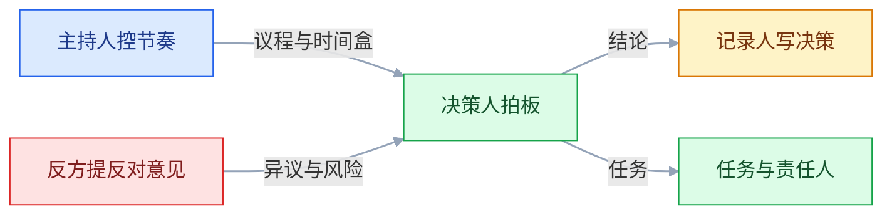
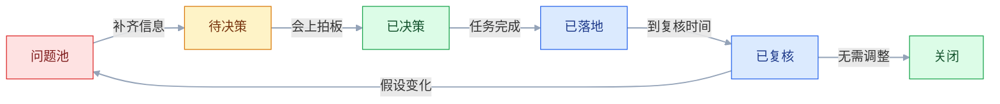
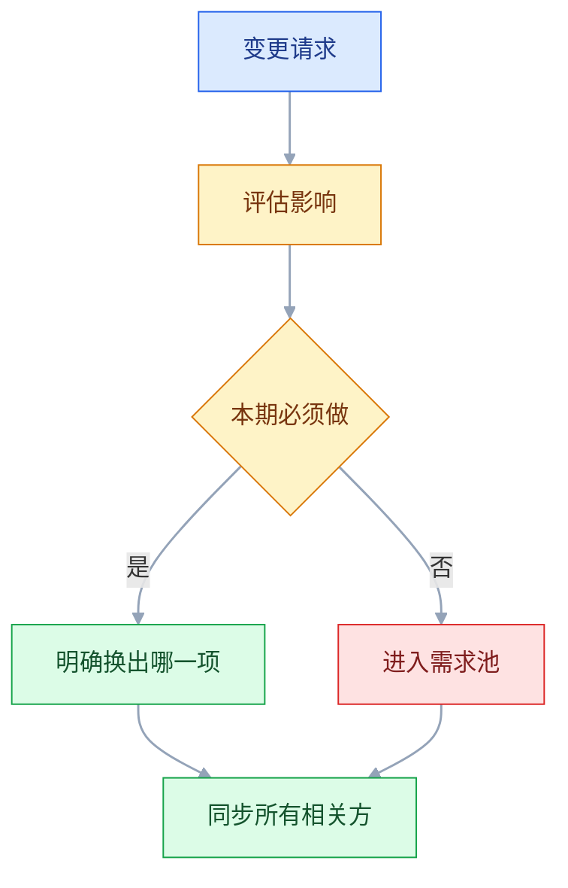

# 评审与协作

## 一、工程案例：把一次 90 分钟的评审压到 45 分钟并做出三个决策

**场景**：支付流程要改版，新增企业转账和拆单支付。上一次同类评审开了 90 分钟，结束时没有人说得清「到底定了什么」，开发按自己的理解做了两周，联调时才发现财务的对账口径没对齐。

**本次约束**：

- 老板只给 45 分钟，且只能参加前 20 分钟；
- 涉及支付网关、财务、客服三方外部依赖，任何一方没对齐都会卡在上线前；
- 开发窗口两周，评审后第二天必须开工；
- 本次必须解决三个问题：企业转账是否本期做、拆单退款由谁发起、对账文件由谁生成。

**目标**：会议结束时，三个问题都有明确结论、有责任人、有复核时间；没结论的进入问题池并写清「缺什么信息」。

### 1.1 会前先定「要决定什么」

评审不是「讲一遍方案」，而是「收集反对意见并做决定」。所以会前第一件事不是写 PPT，而是把要决策的问题写成可选项。

| 待决问题 | 选项 | 推荐 | 影响 |
|---|---|---|---|
| 企业转账是否本期做 | A 做 / B 下期 / C 只做白名单 | B | 选 A 需额外接一个网关，工期加一周 |
| 拆单退款由谁发起 | A 用户 / B 客服 / C 两者都可 | B | 选 C 要同时改两个端 |
| 对账文件由谁生成 | A 支付网关 / B 财务系统 / C 本系统 | A | 选 C 要把对账逻辑再做一遍 |

**好的待决问题有三个特征**：一句话能说清冲突；选项之间互斥；每个选项的代价可估。写成「大家看看方案有没有问题」的，最后一定发散。

### 1.2 材料包与预读

| 材料 | 内容 | 长度 |
|---|---|---|
| 一页纸 | 问题、目标、范围、三个待决问题 | 1 页 |
| PRD | 流程、状态、字段、异常 | 按需 |
| 原型 | 关键页面与状态 | 3–5 屏 |
| 数据 | 现状量级、影响面 | 1 张表 |
| 依赖清单 | 外部系统、联系人、需要的配合 | 1 页 |

材料通常提前 2 个工作日发出，正文里直接写「请重点看第 3 节的三个问题」。**不写这句话，多数人只会扫一眼标题**。

预读意见用固定格式收集：最担心的点、建议的选项、需要补充的信息。会前汇总成争议清单，会上只讨论有分歧的部分。

### 1.3 角色与反方



| 角色 | 谁 | 职责 |
|---|---|---|
| 主持人 | 产品 | 控时间、拉回议题、确认结论 |
| 决策人 | 业务负责人 | 争议不下时拍板 |
| 反方 | 指定一名开发或测试 | 专门找漏洞，不当「好好先生」 |
| 记录人 | 不发言的人 | 记决策、反对意见、待办 |
| 领域专家 | 财务、支付、客服 | 只回答事实与约束 |

**反方要提前指定**，不能会上临时问「有人反对吗」。指定的人有心理准备，也避免了「谁先说谁得罪人」。

### 1.4 议程与时间盒

| 时间 | 内容 | 产出 |
|---|---|---|
| 0–5 分钟 | 重申目标与三个待决问题 | 对齐范围 |
| 5–15 分钟 | 方案与关键流程 | 共同理解 |
| 15–35 分钟 | 逐条讨论争议 | 每个问题的选项与代价 |
| 35–42 分钟 | 决策人拍板 | 三个结论 |
| 42–45 分钟 | 复述结论、确认责任人 | 口头确认 |

主持人手里要有一张「停车场」纸：跑题的想法写下来，承诺会后处理，不在会上展开。**不设停车场，评审就会被一个边缘问题吃掉半小时**。

### 1.5 决策记录

| 问题 | 结论 | 理由 | 反对意见 | 责任人 | 复核时间 |
|---|---|---|---|---|---|
| 企业转账 | 下期 | 网关排期来不及，本期先留接口 | 销售认为会丢单 | 产品 | 下月评审 |
| 拆单退款 | 客服发起 | 金额争议需要人工判断 | 开发担心工单量 | 客服主管 | 上线后两周 |
| 对账文件 | 支付网关生成 | 财务已有现成解析 | 无 | 财务 | 联调前 |

**决策记录要写「反对意见」**。只写结论，三个月后有人翻出来会重新争论；写清当时的反对理由和为什么没采纳，后来人才能判断要不要改。

决策不是会议结束就完了。它有一个生命周期，任何一个状态没人跟，都会退化成「会上说过」。



### 1.6 会后 24 小时

| 动作 | 内容 | 负责人 |
|---|---|---|
| 发纪要 | 结论、待办、待定项、下次时间 | 记录人 |
| 更新 PRD | 版本号 +1，标注变更处 | 产品 |
| 建任务 | 每条待办有负责人和截止日 | 产品 |
| 同步缺席者 | 单独发结论，不留「你没来所以不知道」 | 产品 |
| 通知外部 | 财务、支付、客服各一份结论 | 产品 |

**纪要不是会议流水**，只写「决定了什么、谁去做、什么时候」。讨论过程可以删，反对意见要留。

### 1.7 变更控制



变更评估表固定五列：影响范围、工期增量、需要谁配合、风险、换出什么。**没有「换出什么」这一列，变更就是净增范围**，延期只是时间问题。

### 1.8 关键产出物

```text
评审材料包
├── 01-一页纸（问题/目标/范围/待决问题）
├── 02-PRD（流程/状态/字段/异常）
├── 03-原型（关键页面与状态）
├── 04-数据（现状量级与影响面）
├── 05-依赖清单（系统/联系人/配合事项）
└── 06-预读意见汇总（争议清单）
```

```text
变更影响评估
├── 变更内容（一句话）
├── 影响范围（端 / 模块 / 数据）
├── 工期增量（开发 / 测试 / 联调）
├── 外部配合（谁、需要几天）
├── 风险（技术 / 合规 / 客户）
└── 换出项（本期砍掉什么）
```

### 1.9 验收表

| 检查项 | 怎么验 | 通过标准 |
|---|---|---|
| 待决问题数量 | 数一页纸上的问题 | 1–3 个，每个都有选项与推荐 |
| 材料提前量 | 查发送时间与会议时间 | 至少提前 2 个工作日 |
| 关键角色到场 | 对照干系人清单点名 | 决策人、开发、测试、受影响的外部方都在 |
| 反方已指定 | 看会议邀请里的角色 | 有明确的人，不是「大家」 |
| 每个问题有结论 | 查决策记录 | 每个问题都有结论，或写清待定条件和补信息时间 |
| 反对意见留痕 | 查纪要的反对意见栏 | 有分歧必须记录；无分歧记录反方的确认结论 |
| 待办可执行 | 查任务系统 | 每条有负责人、截止日、验收物 |
| 纪要及时 | 查发送时间 | 通常会后 1 个工作日内 |
| 缺席者已同步 | 查单独发送记录 | 关键缺席者确认收到 |
| 变更走评估 | 抽查一次变更 | 有影响评估和换出项 |

---

## 二、高频问答：会卡住你的地方，也是面试最常问的

### 2.1 全场没有反对意见

**现场**

会前收书面意见，会上逐个点名问「最担心哪一点」。判断时看两处：预读意见表是否空白，以及单独问测试「你觉得哪里会返工」时怎么答。

**要点**

- 沉默不是共识，多数是材料没看、不敢说，或觉得说了也没用。
- 会前指定反方并收书面意见，比会上临时问「有人反对吗」有效。
- 三个人都说「挺好」时，改问「如果必须挑一个毛病，你挑哪个」。

**追问**

- 为什么会上临时问没人应？→ 没有准备时间，也没人愿意第一个得罪人。
- 反方要不要固定一个人？→ 每会指定一名开发或测试，轮换，别变成专职反对者。
- 有反对意见但没采纳怎么办？→ 写进决策记录的反对意见栏，留下当时的理由。

### 2.2 会议开成宣讲，结束时没有结论

**现场**

翻会议邀请，看有没有写「本次要决定什么」。补法是改议程：目标 5 分钟、争议 20 分钟、决策 10 分钟，每个议题标注「需要谁拍板」。

**要点**

- 没有决策环节的评审，本质是一场宣讲。
- 议题后面不写「谁拍板」，讨论就会停在「大家再想想」。
- 没有决策项的议题改成异步通知，不占会议时间。

**追问**

- 45 分钟怎么分配？→ 前 5 分钟对齐目标，中段只讨论争议，最后 7 分钟拍板并复述。
- 讨论发散怎么办？→ 主持人设「停车场」，跑题的先记下并承诺会后处理。
- 会上定不了怎么办？→ 明确写「今天只收集意见」，并约下一次决策时间。

### 2.3 关键决策人没来

**现场**

看邀请里的必选人，会前 24 小时确认出席，必要时问助理当天日程。

**要点**

- 决策人缺席，会议只能收集意见，不能拍板。
- 常见错误是把「相关方」和「决策人」混在同一个邀请列表里。
- 决策人不到就改期，或明确「今天不决策」，不要让不在场的人被代表。

**追问**

- 决策人授权别人来行不行？→ 行，但要事先书面授权，会上说清授权范围。
- 改期成本高怎么办？→ 先开收集意见的会，决策单独约 15 分钟。
- 会后代转达有什么损耗？→ 反对理由和约束条件最先丢，只剩一个结论。

### 2.4 会上争论方案，忘了要解决什么问题

**现场**

问一句「我们共同的目标是哪个数」，看能不能一句话答上。答不上就把目标、约束、不可变项写到白板上。

**要点**

- 方案之争通常是目标不一致，继续比细节不会有结果。
- 先对齐目标和约束，再谈方案。
- 白板上要写「不可变项」：合规节点、客户合同、不能动的老系统。

**追问**

- 目标对齐了还吵怎么办？→ 那就是方案之争，做小实验或让决策人拍板。
- 谁来判断目标一致？→ 决策人，主持人负责把问题递到他面前。
- 目标能不能中途改？→ 能，但要写进决策记录并同步影响的范围。

### 2.5 会后没人记得定了什么

**现场**

翻纪要，看能不能找到「谁、什么时候、做什么」。会上就该当场复述结论。

**要点**

- 靠记忆协作，结论活不过一周。
- 纪要只写结论、待办、待定项；讨论过程可以删，反对意见要留。
- 每条待办进任务系统，留在文档里的待办等于没人做。

**追问**

- 纪要多长合适？→ 一页，只写决定了什么、谁去做、什么时候。
- 待定项怎么跟？→ 单独成表，写清缺什么信息、谁补、什么时候补。
- 讨论过程真的一点不留？→ 关键取舍留一句理由，其余删掉。

### 2.6 需求变更只通知了开发

**现场**

对照变更记录，看每个相关方是否有确认回执。建一张固定同步清单：开发、测试、设计、运营、客服、财务、销售，每次变更按清单逐个勾。

**要点**

- 变更只通知开发，等于把测试、客服、财务的风险留到上线前。
- 客服的话术和 FAQ 要单独确认，不能默认他们自己会看文档。
- 判断标准是「有回执」，不是「发过消息」。

**追问**

- 哪些变更必须通知全部相关方？→ 动流程、动权限、动数据口径的，改文案不用。
- 外部方怎么同步？→ 财务、支付、客服各发一份结论，别只发群消息。
- 通知了但对方没看怎么办？→ 关键变更要求书面确认，没回执不算同步完成。

### 2.7 排期是产品单方面定的

**现场**

看排期表里有没有「任务拆解」和「缓冲」两列，再让开发按任务列出依赖和不确定性。

**要点**

- 单方面定的排期是「希望的时间」，不是「可行的时间」。
- 用历史速率估，不用理想工时；按每人每天 8 小时算出来的产能一定偏高。
- 排期时要同时定「延期先砍什么」，否则延期就只剩加班。

**追问**

- 缓冲留多少？→ 通常 15%–25%，按依赖和不确定性调整。
- 开发估得太乐观怎么办？→ 看过去三个迭代的实际完成量，用速率校正。
- 排期能不能倒排？→ 有硬节点可以倒排，但要显式标出哪些项会被砍。

### 2.8 销售向客户承诺了下个月的功能

**现场**

查销售手里的能力清单版本，再查这次承诺有没有走产品确认。补法是给销售一份「可承诺 / 不可承诺 / 需确认」三档清单。

**要点**

- 销售乱承诺的根因是看不到能力边界，也没有承诺审批机制。
- 对外只给「主题 + 已确认能力」，不给逐条功能和日期。
- 已经说出去的承诺要进台账：客户、内容、日期、谁说的、口径来源。

**追问**

- 客户就要一个日期怎么办？→ 给区间和前置条件，或走合同硬节点单独确认。
- 承诺台账多久对一次？→ 每周对一次，发现要失期就提前说。
- 销售绕过产品直接答呢？→ 承诺统一入口 + 事后追认，否则口径永远收不回来。

### 2.9 联调时才发现接口对不上

**现场**

看有没有接口文档、字段表、错误码表，以及双方确认记录。评审后单独开 30 分钟接口对齐会。

**要点**

- 评审只对业务流程、不对接口契约，联调必然吵架。
- 要先定字段名、类型、空值语义、错误码，再谈联调排期。
- 用 mock 先跑通主流程，比等对方排期两周可控。

**追问**

- 空值语义为什么容易出问题？→ 一方当「没填」，一方当 0 或空字符串，统计结果就不同。
- 错误码谁维护？→ 双方共用一份，联调第一天先对齐。
- 对方接口一直不交付怎么办？→ mock 加契约测试，把阻塞点提前暴露给决策人。
- 重试由谁做？→ 契约里写清重试方和超时，两边都重试会放大流量。

### 2.10 站会变成向老板汇报

**现场**

听一轮，看有没有人只说「做了什么」不说「卡在哪」。

**要点**

- 站会是团队同步，不是向上汇报；混在一起就没人说真话。
- 只问三个问题：昨天、今天、阻塞。
- 老板旁听不发言，超过 15 分钟就切到会后单独聊。

**追问**

- 阻塞没人提怎么办？→ 主持人逐个问「今天最可能卡住你的是什么」。
- 站会能不能解决问题？→ 不能，站会只负责暴露，问题会后单独拉人。
- 远程团队怎么开？→ 异步文字先写，会上只讨论阻塞。

### 2.11 复盘变成追责会

**现场**

看复盘记录里有多少条是「某人不够仔细」这类表述。每个问题追到「哪个环节没有检查、没有同步、没有门禁」。

**要点**

- 指向人的复盘不会产生改进，只会让人下次隐瞒。
- 根因要落到流程缺失：没有检查、没有同步、没有门禁。
- 改进项写成可执行动作，带负责人和日期；下一次复盘先查上次有没有落地。

**追问**

- 复盘改进列几条？→ 1–2 条，列十条等于一条都不做。
- 涉及外部团队的问题怎么追？→ 追到接口和约定，不追到具体的人。
- 事故责任还要不要定？→ 定影响和补救，责任认定走另一套流程。

### 2.12 异步消息发出去，没人回

**现场**

翻消息记录，看有没有 @ 到具体人和时间。重要消息按「背景一句 + 需要你决定什么 + 选项 + 截止时间」重写。

**要点**

- 「发出」不等于「送达」，没有明确收件人和截止时间的消息等于没发。
- 决策类消息必须落成文档，聊天记录不算记录。
- 超过截止没回就升级到电话，不要等。

**追问**

- 一条异步消息要写什么？→ 背景一句、要谁决定、选项、截止时间。
- 群里 @ 所有人有效吗？→ 无效，要 @ 到具体的人。
- 升级会不会得罪人？→ 截止时间是事先约定的，升级是执行约定，不是催。

### 2.13 做完了才发现方向不对

**现场**

看有没有用户证据：访谈、行为数据、试点结果；看目标能不能写成一句可验证的话。评审材料固定加一页「证据」：谁的问题、影响多少人、现在怎么解决、不做会怎样。

**要点**

- 「有人提」不等于「有需求」，评审最容易漏的是「值不值得做」。
- 只讨论怎么做，方向错了做得越快亏得越多。
- 证据不足就先做小范围验证，再进排期。

**追问**

- 证据最少要有什么？→ 一个真实用户的具体问题、影响面、现在的替代做法。
- 老板提的需求也要证据吗？→ 要，至少写清假设和验证方式，别把职位当证据。
- 小范围验证怎么做？→ 访谈加原型加灰度，能在两周内出结论的优先。

### 2.14 上线前才想起合规、隐私和回滚

**现场**

看方案是否涉及个人信息、支付、跨境、未成年人、广告用语；看有没有回滚与降级方案。立项时就把法务、合规、安全加进干系人地图。

**要点**

- 合规是立项时的约束，不是上线前的手续。
- 涉及个人信息、支付、跨境、营销用语的，评审前先做一次合规预判。
- 上线方案必须带「出问题怎么退回」，并写清谁有权触发回滚。

**追问**

- 谁有权回滚？→ 指定到人，一般是一线值班加技术负责人，不需要开会。
- 回滚条件怎么写？→ 错误率、核心转化、客诉的具体阈值，达到即回。
- 合规预判找谁？→ 法务或安全，早期只问「有没有红线」，不做完整评审。

---

## 三、核心知识：从零开始要建立的东西

### 3.1 评审的四种决策类型

不是所有评审都需要「拍板」。先分清类型，才能决定请谁、开多久、产出什么。

| 类型 | 要解决的问题 | 产出 |
|---|---|---|
| 信息同步 | 让大家知道要做什么 | 共同理解，无需决策 |
| 方案选择 | 几个方案选一个 | 选定方案 + 理由 |
| 范围取舍 | 本期做多少 | 范围清单 + 砍单顺序 |
| 风险接受 | 某个风险是否可接受 | 接受/规避 + 责任人 |

**把信息同步开成决策会**，会浪费所有人的时间；**把风险接受开成信息同步**，会上没人敢说「我不同意」，风险就被默认接受。

> **面试**：常问「评审有哪几种类型，为什么要先分类？」答：信息同步、方案选择、范围取舍、风险接受；类型决定请谁、开多久、产出什么。

### 3.2 会前材料与预读

材料的目的不是「留档」，而是「让参会者带着意见来」。一页纸放在最前面，详细内容放附录。

| 材料 | 必须回答 |
|---|---|
| 一页纸 | 为什么做、做到什么程度、今天定什么 |
| 流程图 | 主路径和异常路径 |
| 数据 | 影响多少人、多少单、多大金额 |
| 选项 | 至少两个，含「不做」 |
| 依赖 | 谁配合、什么时候要 |

**预读要设最低要求**：至少读完一页纸，并在会前回复「同意 / 有疑问 / 反对」。没有回复的人，会上不重复讲背景。

### 3.3 待决问题的写法

一个可决策的问题 = 背景一句 + 选项 2–3 个 + 每个选项的代价 + 推荐 + 需要谁拍板。

```text
✘ 拆单退款怎么做？
✔ 拆单退款由谁发起？
   A 用户自助：体验好，但金额争议要客服兜底
   B 客服发起：可控，但增加工单量
   C 两者都可：覆盖全，但要改两个端
   推荐 B，本期先保证可控；需要客服主管确认工单承接能力。
```

**问题里不要藏方案**。「是否采用方案 A」会让讨论变成「A 好不好」，而不是「要解决什么」。

> **面试**：常问「一个可决策的问题怎么写？」答：背景一句、2–3 个互斥选项、每个选项的代价、推荐、谁拍板。

### 3.4 议程与时间盒

时间盒的作用是强制取舍：时间到了就停，没讨论完的进停车场或另约。

| 会议 | 时长 | 关键动作 |
|---|---|---|
| 需求评审 | 45–60 分钟 | 只讨论争议与决策 |
| 迭代计划 | 60 分钟 | 定目标、选范围、认领任务 |
| 每日站会 | 15 分钟 | 同步与暴露阻塞 |
| 迭代评审 | 60 分钟 | 演示、收集反馈 |
| 复盘 | 60 分钟 | 找根因、定 1–2 个改进 |

**会议成本 = 人数 × 时长**。8 个人开 1 小时，就是 1 个人天。用这个数去判断「这个会值不值得开」。

### 3.5 反方角色与异议机制

反方的职责不是「为反对而反对」，而是替所有没说话的人把风险说出来。

| 做法 | 效果 |
|---|---|
| 会前指定反方 | 有准备，敢说 |
| 书面提「最担心的三点」 | 避免现场压力 |
| 设「反对意见」记录栏 | 让异议有位置 |
| 决策人最后发言 | 避免早定调 |

**领导先发言是评审的最大杀手**：一旦老板说「我觉得挺好」，后面的人只会补充优点。让决策人最后说，前面的人才能说真话。

### 3.6 决策记录与可追溯

决策记录不是会议纪要，它只记「定了什么、为什么、谁负责、什么时候复核」。

| 字段 | 作用 |
|---|---|
| 问题 | 一句话，能搜到 |
| 结论 | 明确到可执行 |
| 理由 | 当时的约束和取舍 |
| 反对意见 | 后来人判断要不要改 |
| 责任人 | 一个名字，不是团队 |
| 复核时间 | 什么时候回看 |

**「责任人」只能有一个**。写「产品 + 开发」等于没人负责；需要协作时写主责和配合方。

### 3.7 责任分配与 RACI

| 角色 | 含义 | 常见错误 |
|---|---|---|
| R（执行） | 真正做事的人 | 写成部门 |
| A（问责） | 最终负责、拍板的人 | 多个 A |
| C（咨询） | 提供意见的人 | 把 C 当 A |
| I（知会） | 需要知道结果的人 | 漏掉客服、财务 |

一件事只能有一个 A。**A 不在场时，决策要延期或授权**，不能由主持人代替拍板。

> **面试**：常问「RACI 里最常见的错误是什么？」答：一件事多个 A、把 C 当 A，以及漏掉客服财务这类知会方。

### 3.8 变更控制与范围缓冲

变更一定会发生。健康的做法不是「拒绝变更」，而是「每次变更都显式换出等价的范围」。

| 变更类型 | 处理 |
|---|---|
| 修 bug、改文案 | 直接进，不占范围 |
| 小优化 | 进当前迭代，换出一个同量级任务 |
| 新功能 | 评估后进下期，除非决策人明确换出 |
| 合规/安全 | 优先插入，明确延期什么 |

**范围缓冲比时间缓冲健康**：时间缓冲会被拖延填满，范围缓冲让团队在延期时先砍「可以做」的部分，而不是加班或降质量。

### 3.9 排期协商与估算

排期是「一起算出来」的，不是「产品定、开发执行」。步骤固定：讲需求 → 拆任务 → 估工作量 → 识别依赖 → 加缓冲 → 定砍单顺序。

| 估算输入 | 来源 |
|---|---|
| 历史速率 | 过去 3 个迭代实际完成量 |
| 任务拆解 | 每项不超过 2–3 天 |
| 依赖等待 | 外部接口、设计稿、数据 |
| 缓冲 | 通常留 15%–25%，按风险调整 |
| 砍单顺序 | 排期时当场定 |

**不要用「每人每天 8 小时」算产能**：会议、答疑、线上问题通常占掉一部分，按有效工时估更接近实际。

### 3.10 跨职能接口与契约

跨团队协作最容易出问题的地方是「边界」。谁提供数据、谁触发、失败谁重试，都要在开工前写清。

| 边界 | 要约定 |
|---|---|
| 数据 | 字段、格式、更新频率、空值语义 |
| 触发 | 谁调用谁、同步还是异步 |
| 失败 | 重试方、超时时间、补偿方式 |
| 权限 | 谁有读权限、谁有写权限 |
| 上线 | 谁先上、怎么联调、怎么回滚 |

**接口契约先于开发**。用 mock 把主流程跑通，比等对方排期两周更可控。

### 3.11 会议类型与成本

| 会议 | 目的 | 不该做的事 |
|---|---|---|
| 需求评审 | 决策做不做、怎么做 | 逐页讲原型 |
| 迭代计划 | 定目标与范围 | 自上而下派任务 |
| 站会 | 同步与阻塞 | 解决技术问题 |
| 迭代评审 | 演示与反馈 | 内部自嗨 |
| 复盘 | 改流程 | 追责 |

**能异步的就别开会**：状态同步、资料宣读、方案初稿都用文档；需要争论、需要拍板、需要共创的才开会。

### 3.12 书面沟通的分级

| 级别 | 内容 | 载体 |
|---|---|---|
| 必须书面 | 决策、范围、排期、承诺、风险 | 文档 + 版本号 |
| 建议书面 | 方案讨论、接口约定 | 文档或长消息 |
| 可以口头 | 日常同步、快速确认 | 站会、电话 |

**书面不是「写得很长」**，而是「结论清楚、责任人明确、能搜到」。一条 50 字的结论，胜过 500 字的会议流水。

### 3.13 冲突类型与处理

| 冲突 | 本质 | 处理 |
|---|---|---|
| 事实 | 数据不一致 | 查同一张表、同一口径 |
| 方案 | 路径不同 | 回到目标和约束，做小实验 |
| 优先级 | 资源有限 | 用价值/成本/风险排序 |
| 价值观 | 对用户或风险的理解不同 | 上升到目标和原则，由决策人拍板 |

**先分类再处理**。用「查数据」解决价值观冲突，永远吵不出结果；用「投票」解决事实冲突，只会留下错误结论。

### 3.14 向上沟通的结构

向上沟通的目标是「让决策者在需要时掌握足够信息」，不是「汇报工作量」。

```text
结论：本期只能交付 A 和 B，C 建议下期。
依据：原计划 15 人天，实际可用 10 人天；C 依赖的外部接口还没排期。
选项：A 砍 C 保 A/B；B 延期 5 天；C 加 1 人。
建议：选 A，因为 C 的用户量小，且下期有更完整的方案。
```

**结论先行、给选项、说建议**。只抛问题不给选项，等于把决策成本又推回去。

### 3.15 复盘机制

复盘的结构固定：目标、结果、差异、根因、保留、改进。

| 环节 | 要求 |
|---|---|
| 目标 | 当初定的可验证目标 |
| 结果 | 实际数据，不含解释 |
| 差异 | 哪些达成、哪些没达成 |
| 根因 | 流程哪一环缺失，不指向个人 |
| 保留 | 做对了什么，别改掉 |
| 改进 | 1–2 件，有负责人和日期 |

**改进不超过两件**。列十条改进，等于一条都不做；下次复盘先检查上次的两件有没有落地。

### 3.16 干系人地图

| 利益 / 影响 | 高影响 | 低影响 |
|---|---|---|
| 高利益 | 重点管理：决策人、核心客户 | 保持告知：一线使用者 |
| 低利益 | 保持满意：财务、法务、合规 | 最小关注：旁观团队 |

**高影响 + 高利益的人必须进评审**，否则会在上线前突然提出否决；低影响 + 低利益的人只需要结果通知，不要拉进每个会。

---

## 四、冷门知识汇总

下表只放低频、出错代价小、用到时查一下就能确认的细节；会造成方向错误、合规风险或用户损失的，放在第二节。

| 知识点 | 为什么冷门 | 用到时的关键词 |
|---|---|---|
| 纪要标题的写法 | 多数人只写「会议纪要」，三个月后搜不到 | 主题 + 日期 + 结论 |
| 时区缩写有歧义 | CST 既是中国标准时间，也是美国中部时间 | UTC 偏移、Asia/Shanghai |
| 跨时区会议轮换 | 固定时间总有人熬夜，轮换才公平 | 轮换主持、录制、异步纪要 |
| 文档版本号命名 | v1、v2、final 最后分不清 | 日期版本、变更说明 |
| 录屏与逐字稿留存 | 会后没人管，需要时已过期 | 保存期限、访问权限 |
| 待定项单独成表 | 混在待办里就没人跟 | 待定条件、补信息时间 |
| 会议邀请的角色标注 | 不写角色，参会人不知道自己该拍板还是旁听 | 必选 / 可选、决策人 / 知会人 |
