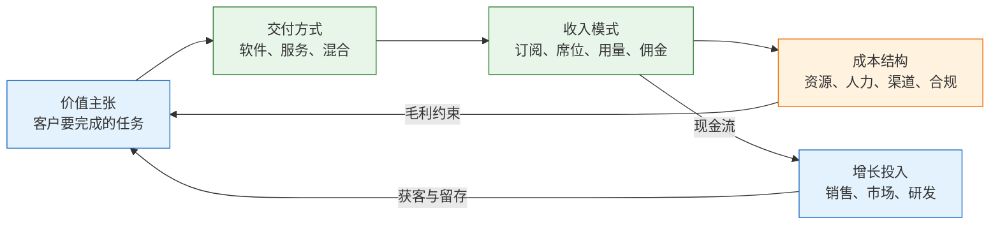
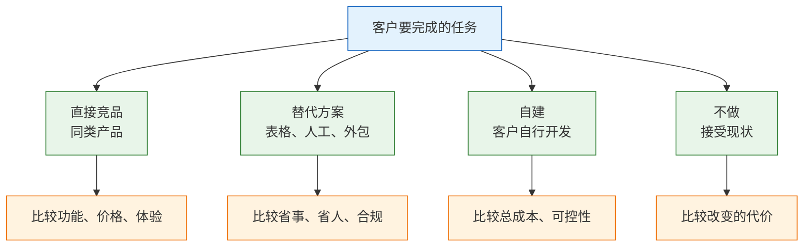
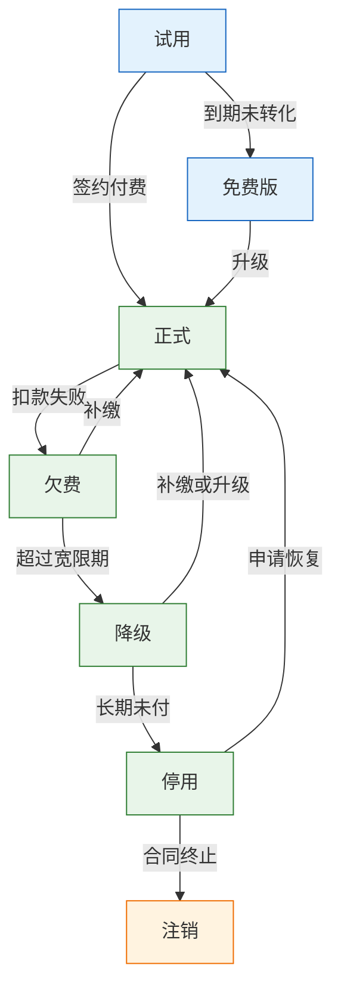

# 商业模式与竞争

---

## 一、商业模式与竞争是什么

商业模式（Business Model）是一套关于价值创造、价值交付与价值获取的稳定结构。它描述四件事：为哪类客户解决什么问题，以什么形态交付，按什么单位收费，服务一个客户需要付出多少直接成本。四件事彼此约束，任何一项改变都会传导到其余三项。

竞争分析不是竞品功能清单，而是对替代方案的比较。客户不采购本产品时，可以用表格、人工流程、外包、自建系统，或者接受现状。这些路径与直接竞品共同构成竞争环境。判断竞争格局，实质是判断客户改变现状的代价与本产品提供的增量价值之间的差额。

### 1.1 核心概念

商业模式由价值主张、交付方式、收入模式、成本结构四个部分组成。价值主张说明客户愿意为什么付费；交付方式说明产品以软件、服务还是混合形态落地；收入模式说明计费单位与周期；成本结构说明每增加一个客户要付出什么。

收入模式与成本结构最容易和工程脱节。产品画一张价格页，研发要补计量、配额、对账、退款与权限回收；销售承诺不限量，基础设施账单却随用量线性上涨。商业模式的成立条件，最终落在一条可验证的公式上：单个客户带来的收入减去服务该客户的全部直接成本，仍然为正，且能覆盖获客投入。

竞争分析同样有工程含义。客户比较的是切换成本，而切换成本由数据、权限、集成、历史记录共同构成。产品把权限与审计做深，客户迁移就疼；只做页面功能，竞品一个导入工具就能完成替换。



| 组成 | 核心内容 | 工程落点 |
|---|---|---|
| 价值主张 | 目标客户与待完成任务 | 功能优先级、行业模板 |
| 交付方式 | 公有云、专属实例、私有化 | 部署架构、版本策略 |
| 收入模式 | 订阅、席位、用量、佣金 | 计量、配额、账单、发票 |
| 成本结构 | 资源、人力、渠道、合规 | 毛利核算、容量规划 |

### 1.2 适用场景与边界

这套方法适用于需要持续收费、客户数量较多、边际成本不可忽略的产品。SaaS、API 服务、交易平台、内容订阅都符合。它也适用于内部结算：集团内部按席位或用量分摊成本时，同样要设计计量口径与预算约束。

方法有明确边界。第一，它不替代产品价值判断。收费设计再精细，功能不解决真实任务也无法成交。第二，它不适用于一次性项目制交付的收入预测，项目制的收入由合同与验收节点决定，不服从订阅模型。第三，早期验证阶段不宜过度设计计费系统，先用人工账单验证价格与需求，再决定是否工程化。

| 场景 | 适用判断 | 主要产出 |
|---|---|---|
| 标准化 SaaS | 客户需求重合度高 | 分层定价、席位与用量规则 |
| API 与基础设施 | 成本随调用增长 | 计量链路、配额、阶梯价 |
| 交易与平台 | 收入来自成交 | 分账、佣金、对账 |
| 项目制交付 | 一次性验收 | 报价单、变更单、验收节点 |
| 内部结算 | 跨部门分摊 | 内部计价、预算与审计 |

> **注意**：商业模式分析不能替代财务核算。毛利口径必须与财务一致，否则产品侧算出的“盈利客户”在报表上可能是亏损客户。

---

## 二、收入模式与工程约束

### 2.1 收入模式分类

收入模式的选择直接决定系统里必须存在哪些对象。订阅模式需要套餐、周期、续费、到期降级；席位模式需要成员、邀请、席位统计、超编处理；用量模式需要事件采集、聚合、配额、限流；佣金模式需要订单、分账、结算、退款冲正。

同一款产品可以组合多种模式，但每增加一种，就多一条必须保证正确的链路。计费链路的特殊性在于它同时面对收入与客户信任：少算客户不追究，公司受损；多算客户投诉，可能涉及退款与合规；重复计费则要逐笔冲正。

| 收入模式 | 计量点 | 工程必备 | 主要风险 |
|---|---|---|---|
| 订阅 | 时间与套餐 | 续费、到期降级、发票 | 续费提醒缺失导致流失 |
| 席位 | 活跃成员数 | 成员管理、席位统计、超编处理 | 共享账号造成收入漏损 |
| 用量 | 调用、存储、消息 | 计量、聚合、配额、限流 | 计量延迟、重复计费 |
| 一次性授权 | 版本与部署 | 许可证、升级、离线校验 | 盗版、升级收入断档 |
| 交易佣金 | 成交金额 | 分账、对账、退款冲正 | 资损、渠道对账差异 |
| 广告 | 曝光与点击 | 归因、反作弊、频控 | 虚假流量、体验下降 |

### 2.2 计费链路的工程结构

一条可审计的计费链路包含五个环节：事件采集、用量聚合、出账快照、收款开票、对账调整。每个环节都要有幂等键与时间边界，否则补数据、重跑、跨周期结算都会产生重复或遗漏。

事件采集落成只追加的用量明细，记录“谁在什么时间用了多少”。聚合按客户、资源类型、计费周期汇总，聚合结果要能追溯到原始事件。出账生成不可变快照，快照之后的修正只能通过调整单完成。收款与开票对接支付渠道和财务系统，对账发现差异后回写调整单，而不是直接改历史账单。


> **注意**：账单出账后不能修改，只能追加调整单。直接改历史账单会让财务流水、客户截图和系统记录三方对不上，争议处理成本远高于一张调整单。

### 2.3 收入模式的组合与演进

收入模式的演进通常遵循“先简单、后可计量”的顺序。早期用固定套餐降低交付复杂度；客户分层明显后引入席位；资源成本失控后引入用量配额；平台化之后再引入佣金或分成。

| 组合方式 | 结构 | 适用阶段 | 风险 |
|---|---|---|---|
| 纯订阅 | 按月或按年固定价 | 需求稳定、成本可预测 | 重度客户侵蚀毛利 |
| 订阅加席位 | 底价加成员数 | 协作型产品 | 活跃口径争议 |
| 订阅加用量 | 底价含额度、超出计费 | 资源型产品 | 计量与账单争议 |
| 平台抽佣 | 按成交额比例 | 双边市场 | 飞单与对账差异 |

组合的原则是让计费单位与客户感知的价值同步。客户因为“多一个人协作”而付费，就用席位；因为“多处理一条数据”而付费，就用用量；因为“多完成一笔交易”而付费，就用佣金。计费单位与价值来源错位，销售解释成本会持续上升。

---

## 三、单客户经济模型

### 3.1 核心指标与计算

单位经济回答一个问题：一个客户从签约到流失，是否赚钱。它不预测增长率，只校验每一单是否成立。增长只是把单客户的结果放大，单客户为负时，增长会加速亏损。

```text
ARPA        = 月度经常性收入 / 付费客户数
毛利率      = (收入 - 直接服务成本) / 收入
CAC         = 销售与市场投入 / 新签客户数
回本周期(月) = CAC / (ARPA × 毛利率)
LTV         = ARPA × 毛利率 / 月流失率
LTV / CAC   = 客户终身价值 / 获客成本
```

口径比公式更重要。ARPA 只算经常性收入，不含一次性实施费；直接服务成本要包含基础设施、支持人力、第三方调用费，不含研发；CAC 要包含销售薪酬、市场投放、渠道返佣，按同一周期归集；流失率按客户数还是按收入计算，必须固定一种并长期一致。

| 指标 | 观察内容 | 经验区间（因行业而异） |
|---|---|---|
| 毛利率 | 是否存在规模效应 | 标准 SaaS 通常 70% 以上 |
| 回本周期 | 现金流压力 | 12 个月内较稳，超过 18 个月需谨慎 |
| 月流失率 | 收入稳定性 | 中小企业 2%–3% 已不算低 |
| 客户集中度 | 抗风险能力 | 单客户超过 20% 收入需警惕 |
| 服务成本占比 | 定制与支持是否失控 | 持续上升说明产品化不足 |

### 3.2 成本结构

成本要按“随客户增长如何变化”分类，而不是按会计科目罗列。固定成本决定起步门槛，变动成本决定规模上限。一个功能是否免费，取决于它的变动成本能否被其他收入覆盖。

| 成本项 | 内容 | 增长方式 | 易漏点 |
|---|---|---|---|
| 基础设施 | 计算、存储、带宽、数据库 | 随用量近似线性 | 公网流量、跨区复制 |
| 第三方调用 | 模型、短信、地图、支付 | 随调用次数线性 | 重试与失败请求也计费 |
| 支持人力 | 工单、培训、迁移 | 随客户数与复杂度上升 | 大客户专属群 |
| 合规与安全 | 等保、审计、渗透测试 | 阶段性跳升 | 年度复测与整改 |
| 渠道成本 | 返佣、代理、市场 | 随成交额上升 | 续费是否继续返佣 |

> **注意**：免费额度的成本要按重度用户而不是平均用户估算。平均值掩盖长尾，少数重度客户可能消耗掉大部分资源，把免费策略直接打成负毛利。

### 3.3 单客户经济模型模板

模板按客户填写，所有金额使用同一币种与同一周期。空白项表示尚未取得数据，不能用假设值填充后当作结论。

| 字段 | 计算口径 | 填写要求 |
|---|---|---|
| 客单价 ARPA | 月度经常性收入 ÷ 付费客户数 | 剔除一次性费用 |
| 直接服务成本 | 基础设施 + 支持 + 第三方 | 按客户可归属部分分摊 |
| 客户毛利 | ARPA − 直接服务成本 | 保留两位小数 |
| 获客成本 CAC | 销售与市场投入 ÷ 新签客户数 | 按获客渠道分组 |
| 月流失率 | 当月流失客户 ÷ 期初客户数 | 口径固定，不随月调整 |
| 回本周期 | CAC ÷（ARPA × 毛利率） | 单位统一为月 |
| 终身价值 LTV | ARPA × 毛利率 ÷ 月流失率 | 与回本周期同口径 |

示例数字均为假设，仅用于说明计算过程。某客户月付 300 元，直接服务成本 90 元，毛利率为 70%；获客成本 6,000 元，回本周期约为 28.6 个月；月流失率 2%，LTV 约为 10,500 元，LTV/CAC 约为 1.75。回本周期超过两年，说明该渠道的获客投入过重，或者客单价过低。

改进只有三条路径：提高客单价、降低服务成本、提高留存。延长合同期可以改善现金流，但不改变单客户价值；削减支持可以短期降本，但可能推高流失率。三条路径要一起测算，不能只看其中一项。

---

## 四、定价方法与价格结构

### 4.1 定价锚点

定价不是成本加一个百分比，而是在成本下限、竞品参考与客户价值上限之间取位置。三种锚点各有适用条件，成熟产品通常混合使用。

| 锚点 | 依据 | 适用 | 风险 |
|---|---|---|---|
| 成本加成 | 服务成本加目标毛利 | 基础设施、代运营 | 忽略客户感知价值 |
| 竞争定价 | 竞品公开价格 | 同质化市场 | 被拖入价格战 |
| 价值定价 | 客户节省或增加的金额 | 垂直软件、B 端工具 | 价值难证明，销售成本高 |

价值定价要求能把收益写成客户认得的单位：节省多少人力、减少多少差错、缩短多少审批时间。写不出单位，就只能退回竞争定价，利润空间由对手决定。

### 4.2 分层与计量单位

分层的目的不是把功能切碎，而是让不同规模的客户都能找到匹配的价格。分层过多会增加选择成本，过少会留下价格断层。三到四档通常足够，另设企业版承接定制需求。定价表模板如下，按档位逐行填写：

| 档位 | 目标客户 | 计量与额度 | 价格结构 |
|---|---|---|---|
| 基础版 | 小团队、单部门 | 固定席位数，含基础额度 | 月付或年付固定价 |
| 专业版 | 成长型团队 | 按席位，含审批与集成 | 席位单价 × 数量 |
| 团队版 | 多部门协作 | 席位加用量额度 | 底价加超出单价 |
| 企业版 | 大型组织 | 独立实例、SSO、审计 | 年度合同，单独报价 |

计量单位要满足四个条件：与价值相关、可预测、难规避、可计量。按账号数计费容易被共享账号绕过，按活跃席位计费更接近真实使用；按存储计费容易被压缩和归档规避，按处理条数计费更稳定。任何单位都要提供用量查询与阈值提醒，否则客户在账单到达时才第一次看到数字。

> **注意**：定价页必须能自助回答“当前用量对应多少钱”。把用量换算推给销售，会在转化路径上丢掉大量中小客户。

### 4.3 涨价与折扣纪律

涨价的风险不在价格本身，而在老客户的公平感。风险最小的顺序是：先对新签生效，观察四到八周的成交率与客单价；再提前六十到九十天通知老客户，提供按旧价续一年的选项；最后才全面切换。每一步都要设止损线，流失率或降级比例超过阈值就暂停。

折扣同样需要纪律。折扣不是让价，而是交换：年付换现金流，案例授权换市场，预付款换账期，批量采购换规模。没有交换条件的折扣会把标价变成摆设。

| 折扣区间 | 审批层级 | 常见交换条件 |
|---|---|---|
| 0–10% | 销售主管 | 年付、一次性付款 |
| 10–20% | 销售负责人 | 多年合同、案例授权 |
| 20–30% | 财务与业务负责人 | 预付款、最低用量承诺 |
| 30% 以上 | 总经理或等价角色 | 战略客户，需单独测算毛利 |

---

## 五、竞争分析与护城河

### 5.1 竞争的四个层次

客户要完成的任务只有一个，完成方式有四种：直接竞品、替代方案、自建、不做。四种方式对应四种比较逻辑，功能清单只覆盖第一种。



丢单最常见的原因不是竞品多一个按钮，而是客户认为表格够用，或者自建更可控。销售最难的对手不是同行，而是“维持现状”。因此竞争分析要先回答“客户为什么要改变”，再回答“为什么选本产品”。

### 5.2 护城河的成立条件

护城河只有在特定条件下成立，条件不成立时只是叙事。判断护城河，看它是否让客户迁移成本上升，或者让对手复制成本上升。

| 类型 | 成立条件 | 常见高估 |
|---|---|---|
| 网络效应 | 用户增加提升其他用户价值 | 用户多但彼此无影响 |
| 切换成本 | 数据、流程、权限深度嵌入 | 导出 CSV 即可迁走 |
| 规模成本 | 规模越大单位成本越低 | 成本随规模线性上升 |
| 品牌与合规 | 采购敢签字、监管认可 | 只有一个认证页面 |
| 数据 | 数据形成闭环且不可替代 | 存了日志但未使用 |

开发者能直接影响的是切换成本。权限矩阵、审计日志、集成生态、历史数据，这些做得越深，客户迁移越疼；做得越浅，竞品一个导入工具就能完成替换。切换成本也有边界：刻意制造导出障碍会引发合规与信任问题，健康的切换成本来自“用得更深”，不是“走得更难”。

### 5.3 竞品信息的处理流程

竞品信息按“来源、用途、更新频率”管理，避免销售听到一句话就变成研发需求。客户访谈用于确认真实决策因素，赢单输单记录用于校准判断，公开资料用于跟踪价格与功能，招投标文件用于识别硬性门槛。

| 信息源 | 回答内容 | 更新频率 |
|---|---|---|
| 客户访谈 | 为什么买、为什么走 | 每月 |
| 赢单与输单记录 | 真实决策因素与对手 | 每单 |
| 公开价格页 | 定价与套餐变化 | 每季度 |
| 招标与合规文件 | 准入门槛 | 每半年 |

信息进入路线图之前要过三道筛：是否影响成交、是否影响续费、是否能标准化。三条都不满足的功能，只记录不排期。竞品的每一个新功能都跟进，团队会被拖入对手的节奏，自己的差异化反而被稀释。

---

## 六、商业条款与交付边界

### 6.1 条款到工程需求的映射

合同里的每一条承诺，最终都会变成工程需求与运维责任。条款评审要在报价阶段完成，不能等到签约后才发现系统不支持。

| 条款 | 工程含义 | 验收证据 |
|---|---|---|
| 99.9% SLA | 多活、监控、赔付计算、状态页 | 可用性报表与演练记录 |
| 数据不出境 | 区域部署、备份与日志同域 | 区域配置与数据流图 |
| 专属实例 | 资源隔离、独立升级、运维排期 | 实例清单与升级记录 |
| 按用量计费 | 计量精度、账单周期、争议处理 | 用量明细与对账单 |
| 无条件退款 | 退款流程、收入确认、权限回收 | 退款单与权限回收记录 |
| 安全问卷 | 加密、审计、漏洞响应、供应商清单 | 问卷回执与证据附件 |

### 6.2 企业版能力清单

企业版能力不直接带来新收入，却经常是采购的否决项。把它们做成标准件，比每个单子临时开发便宜。标准件包括身份集成、权限治理、审计、数据导出、网络限制与 SLA。

| 能力 | 最低要求 | 常见缺口 |
|---|---|---|
| 单点登录 | SAML 或 OIDC，支持多 IdP | 证书轮换与降级未处理 |
| 账号同步 | SCIM 或目录同步 | 离职停用与重入职 |
| 审计日志 | 时间、租户、操作者、对象、结果 | 只记登录不记变更 |
| 数据导出 | 全量、结构化、可校验 | 导出不含附件与历史 |
| 网络限制 | IP 白名单、私网接入 | 只做前端限制 |
| 服务等级 | 可用性、响应时限、赔付 | 无监控数据支撑 |

> **注意**：企业版能力要在试用阶段就能演示。采购流程走到法务时再补 SSO，通常会错过客户的上线窗口。

### 6.3 计费状态机与账单

客户生命周期不是一条直线，而是一组状态迁移。试用、正式、欠费、降级、停用、注销，每个状态都要定义数据保留、权限范围与恢复路径。



状态机要写清四个参数：宽限期长度、降级后保留哪些能力、数据保留多久、恢复是否需要人工审核。试用到期直接锁死是最差的设计，客户的数据还在系统里，却没有任何自助恢复路径，客服会被迫承担全部解释工作。

---

## 七、常见失败模式与检查清单

### 7.1 失败模式

| 现象 | 最可能原因 | 处理 |
|---|---|---|
| 客户认为价格过高 | 价值未量化或档位断层 | 先确认比较对象，再调分层 |
| 免费版挤压付费 | 免费额度覆盖了付费点 | 把付费点移到协作、权限、审计 |
| 收入增长利润不增 | 服务成本随客户上升 | 拆解毛利，压缩定制与重支持 |
| 单客户占比过高 | 客户结构失衡 | 拓客，合同锁最低用量 |
| 席位收费被共享绕过 | 计量按账号不按活跃 | 改活跃席位，补审计 |
| 用量账单争议 | 计量口径不透明 | 提供明细、提醒与对账 |
| 竞品降价即跟进 | 缺少价值锚点 | 守住分层，避免同档价格战 |
| 涨价引发老客户流失 | 缺少过渡条款 | 旧价保留一个周期，只对新签 |
| 每个大客户都要定制 | 缺少标准能力 | 建企业版标准件，定制单独报价 |
| 出账后频繁改账单 | 无快照与调整单 | 账单只追加调整，不改历史 |
| 试用到期直接锁死 | 降级规则缺失 | 转免费版并保留只读 |

排查顺序：先看单客户毛利，再看获客与回本，再看价格分层，最后才讨论竞争策略。顺序反了，容易用降价掩盖单位经济的缺口。

### 7.2 检查清单

- [ ] 收入模式与计量点已写成一句话，销售、财务、研发理解一致
- [ ] 每个计费事件有幂等键，聚合结果可追溯到原始记录
- [ ] 账单出账后不可改，调整走独立单据
- [ ] 单客户毛利、回本周期、流失率有固定口径与月度报表
- [ ] 免费额度按重度用户测算过最坏成本
- [ ] 定价页能自助完成用量换算与下单
- [ ] 折扣有审批层级与交换条件
- [ ] 涨价有新旧客户过渡方案与止损线
- [ ] 竞争分析覆盖替代方案、自建与不做
- [ ] 合同条款逐条映射到工程能力与验收证据
- [ ] 企业版标准件可在试用环境演示
- [ ] 客户生命周期状态机覆盖欠费、降级、停用与注销

> **核心结论**：收费方式就是架构约束，单客户经济算不平的增长会放大亏损，竞争要看替代方案而不是功能清单。
