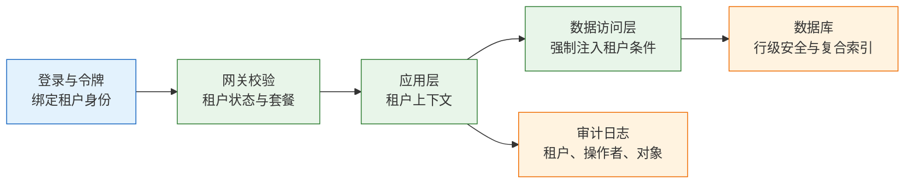
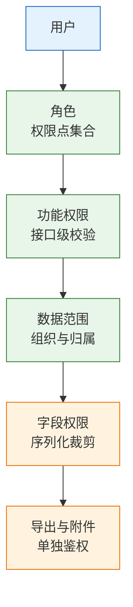
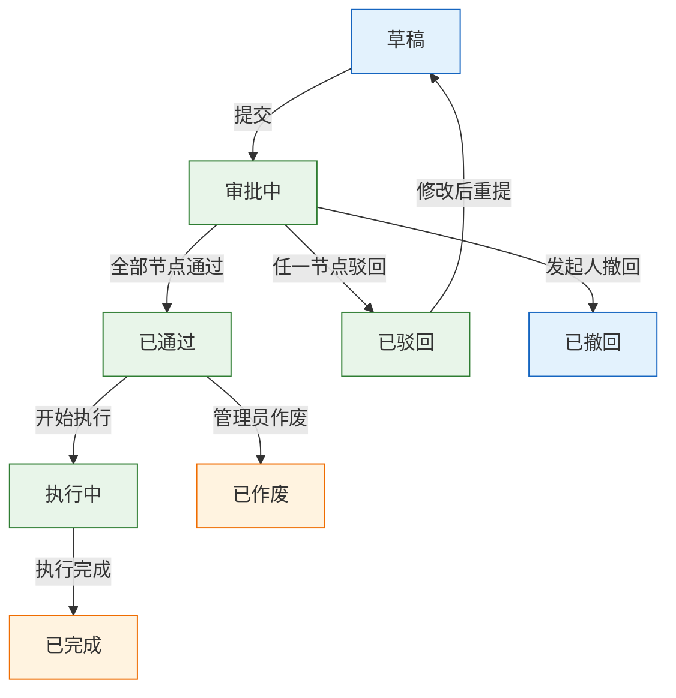

# B 端与 SaaS

---

## 一、B 端与 SaaS 是什么

B 端产品服务于组织而不是个人。使用者、管理者、采购者、IT 与法务同时存在，购买决策与日常使用分离，成功标准不是“用着顺手”，而是流程跑通、责任可追、数据可控。SaaS 则是 B 端产品的一种交付与收费形态：一套系统服务多个租户，统一升级，按订阅或用量收费。

两者经常被混为一谈。B 端描述客户类型，SaaS 描述交付方式。一个 B 端产品可以私有化部署、按项目收费，也可以做成多租户 SaaS；一个 SaaS 产品也可能服务个人用户。判断一套系统是不是 SaaS，看的是多租户、标准化交付与持续订阅，不是页面长什么样。

### 1.1 核心概念

B 端产品的核心对象是组织、角色、流程与数据边界。组织决定层级与归属，角色决定能做什么，流程决定一件事如何流转，数据边界决定谁能看到哪些行与哪些字段。四个对象中，组织和角色会随客户调整而变化，流程会随管理要求变化，只有数据边界必须始终保持稳定。

SaaS 的核心是租户隔离与统一交付。租户是计费、隔离与配置的最小单位；同一套代码为所有租户运行，通过配置区分行业、流程与界面；升级由供应商统一完成，客户不掌握版本节奏。这三条决定了 SaaS 的成本结构，也决定了它的能力边界。

B 端产品要同时记三本账：功能账、权限账、审计账。功能账回答业务能不能跑通、异常能不能收场；权限账回答谁能看、谁能改、能看到哪几行与哪几个字段；审计账回答谁在什么时候做了什么、出了事能不能还原。功能最容易被看见，权限与审计最容易被拖到最后，但客户换供应商的成本，往往来自后两本。

| 维度 | B 端产品 | SaaS 形态 |
|---|---|---|
| 客户单位 | 组织 | 租户 |
| 决策方式 | 试用、评审、采购 | 自助订阅或销售签约 |
| 交付重点 | 流程、权限、集成 | 开通、隔离、升级 |
| 收入结构 | 项目、授权、服务费 | 订阅、席位、用量 |

### 1.2 适用场景与边界

标准化程度高、客户需求重合度高的业务适合 SaaS。审批、工单、CRM、协作、财务报销这类流程，行业差异可以用配置承接，多租户的边际成本低，统一升级也能持续摊薄研发投入。

需求高度分散、集成极重、数据不能出内网的业务不适合纯 SaaS。强监管行业的核心系统、与生产设备深度耦合的系统、需要离线运行的现场系统，通常要专属实例或私有化。单客户深度定制的项目也不属于 SaaS：它按项目验收，不按订阅续费，代码分支会随客户数量增长。

| 场景 | 适合形态 | 判断依据 |
|---|---|---|
| 标准审批与协作 | 公有 SaaS | 需求重合度高，配置可覆盖 |
| 中大型客户核心系统 | 专属实例 | 需要隔离与独立升级 |
| 强监管与内网环境 | 私有化部署 | 数据不能出网 |
| 单客户深度定制 | 项目制交付 | 需求不可复用 |
| 集团内部系统 | 内部平台 | 无外部租户与计费 |

> **注意**：SaaS 的边界不是技术边界，而是经济边界。每个客户都要单独改代码、单独排期、单独回归时，多租户的成本优势已经消失，继续按 SaaS 定价会持续亏损。

---

## 二、B 端与 C 端的差异

### 2.1 决策链与角色

C 端决策链短，看到、试用、付费可以在一小时内完成。B 端决策链长，使用者喜欢不等于能采购，业务负责人同意不等于 IT 与法务放行。产品要同时满足四类角色的不同诉求，任何一环被忽略都可能卡住签约。

| 角色 | 关注点 | 对产品的要求 |
|---|---|---|
| 使用者 | 操作效率、少填字段 | 流程顺畅、批量操作 |
| 业务负责人 | 流程可控、结果可查 | 报表、审批、责任归属 |
| IT 与安全 | 身份集成、漏洞、数据边界 | SSO、审计、权限矩阵 |
| 采购与法务 | 价格、合同、合规 | 报价透明、条款可审 |

决策链通常按“需求确认、试用验证、业务评审、IT 与安全评估、采购与法务、上线与续费”推进。每个阶段的否决理由不同：试用阶段看功能是否覆盖，安全评估看权限与日志，采购阶段看价格与条款。产品把力气全花在试用阶段，后面仍可能因为一份安全问卷被挡回。

### 2.2 三本账与成功标准

功能账决定客户是否开始用，权限账与审计账决定客户是否敢把核心业务放进来。三本账的验收方式不同：功能靠场景测试，权限靠越权测试，审计靠事件还原。

| 账目 | 内容 | 失败后果 |
|---|---|---|
| 功能账 | 主流程、异常分支、批量操作 | 业务跑不通，试用即终止 |
| 权限账 | 功能、数据范围、字段、导出 | 越权泄露，审计不通过 |
| 审计账 | 操作者、对象、时间、结果 | 事故无法追责，整改不过 |

B 端的失败成本远高于 C 端。C 端产品出错，用户卸载即可；B 端产品出错，可能停线、罚款、审计不通过，甚至影响客户与监管的关系。因此 B 端的上线标准不是“功能可用”，而是“异常可收场、责任可追溯”。

> **注意**：B 端产品的“完成”包含权限与审计。只交付主流程、把权限留到二期，通常会在客户安全评估时被迫返工，返工成本高于一开始就做对。

---

## 三、多租户与隔离模型

### 3.1 隔离级别

多租户的第一层设计是隔离。隔离强度、成本与运维复杂度三者同向变化，没有绝对最优，只有与客户结构匹配的选择。

| 模式 | 隔离强度 | 成本 | 适用 |
|---|---|---|---|
| 共享库共享表 | 逻辑隔离 | 最低 | 大量中小客户 |
| 共享库独立 Schema | 较强 | 中 | 中大型客户、有合规要求 |
| 独立数据库 | 强 | 较高 | 大客户、敏感数据 |
| 独立实例 | 最强 | 最高 | 私有化、强监管 |

共享表模式靠 `tenant_id` 区分数据，研发效率最高，风险也最集中：任何一条查询漏掉过滤条件，就是跨客户泄露。独立 Schema 把迁移与备份粒度提高到租户级，但连接池、版本迁移和跨租户统计会更复杂。独立库与独立实例适合大客户，代价是版本碎片与运维人力。

### 3.2 租户上下文的传递

租户上下文只能从可信来源建立。登录或令牌校验通过后，服务端把租户身份写入请求上下文，后续每一层都从上下文读取，不再接受前端传入的租户标识。

> **产品红线**：租户标识不得由前端参数决定。切换租户必须重新鉴权并重新签发上下文；任何接口收到其他租户的资源 ID，都应返回 404 或 403，不能返回数据，也不能泄露资源是否存在。

三条工程约束必须同时成立。第一，过滤由框架强制，不靠开发者记得写：中间件、ORM 全局作用域或数据库行级安全任选其一，但要覆盖所有入口。第二，跨租户测试进入自动化：用 A 租户账号请求 B 租户资源，覆盖详情、列表、导出、附件、批量操作五类接口。第三，审计日志按租户隔离，租户管理员只能看到本租户记录。

### 3.3 隔离级别的演进

隔离级别要可升级。多数 SaaS 从共享表起步，签下大客户后再迁到独立库或独立实例。如果数据模型没有预留出口，升级会变成重写。

| 演进目标 | 当前要预留 | 避免的重构 |
|---|---|---|
| 共享表转独立库 | 所有表带租户键，路由层可切换 | 全表改造与数据搬迁脚本 |
| 独立库转独立实例 | 部署模板参数化，配置外置 | 手工部署与配置漂移 |
| 单区域转多区域 | 租户与区域映射表 | 按区域拆库的临时方案 |
| 统一密钥转租户密钥 | 加密层抽象，密钥按租户寻址 | 在业务代码里直接加密 |

连接路由要抽象成一层。应用不直接拼接数据库地址，而是根据租户上下文从路由层获取连接；迁移某个租户时，只改路由表，不改业务代码。这个抽象在客户量小时看似多余，签下第一个大客户时就是能否按期交付的分界线。

> **注意**：租户键要建复合索引，查询条件必须把租户键放在首位。只在应用层过滤而没有索引支撑，数据量上来后会出现慢查询，最终迫使团队绕过框架写裸 SQL，隔离随之失效。

---

## 四、权限模型与数据范围

### 4.1 RBAC 与权限点

RBAC（Role-Based Access Control，基于角色的访问控制）由用户、角色、权限点、资源四个实体组成。角色是权限点的集合，用户通过角色获得权限，组织树决定数据范围。

最常见的错误是把岗位当角色。岗位会变、会兼岗、会出现临时负责人；角色应该对应“能做什么”，岗位只是角色的分配依据。把“车间主任”直接做成角色，组织一调整，权限就全部失效。

权限点按“资源加动作”命名，例如工单创建、工单派发、工单验收、成本查看。权限点要细到接口，不能细到菜单。菜单只是权限的一种展示，接口才是真正的边界。

| 层级 | 控制对象 | 实现位置 |
|---|---|---|
| 功能权限 | 能否执行某个动作 | 接口鉴权 |
| 数据范围 | 能操作哪些组织的数据 | 查询条件 |
| 字段权限 | 能看见哪些字段 | 序列化层 |
| 入口权限 | 导出、附件、批量、打印 | 独立鉴权 |

### 4.2 数据范围与字段权限

数据范围要落成可执行的查询条件，不是页面上的一个下拉框。“本部门及下级”需要组织闭包表或递归查询，先算出可见的组织 ID 集合，再过滤业务表。组织调整后，历史数据要保留当时的归属，否则员工调岗会导致历史单据从原主管的列表里消失。

字段权限在序列化层处理。同一个接口，不同角色返回不同字段；不是前端拿到全部数据再隐藏。成本、报价、供应商、身份证号这类字段，一旦进入响应体，就已经泄露。

| 权限类型 | 判断依据 | 实现层 |
|---|---|---|
| 数据范围 | 组织树、归属人、项目成员 | 查询条件与索引 |
| 字段可见 | 角色与字段的授权关系 | 序列化与脱敏 |
| 字段可编辑 | 状态与角色的组合 | 写入校验 |
| 历史归属 | 单据创建时的组织快照 | 快照字段 |

示例场景为假设：一家制造企业的工单系统采用集团、工厂、车间、班组四级组织。早期只有管理员与普通用户，车间主任能看到全集团工单，集团审计要求整改。整改后权限拆成三层：功能权限控制建单、派单、验收；数据范围控制本班组、本车间、本厂、全集团；字段权限控制成本与供应商报价仅厂务可见。三层同时生效，缺一层就会出现越权。

### 4.3 高频越权路径

越权很少来自复杂攻击，多数来自“只做了一个入口”。列表做了过滤，导出没有；页面隐藏了按钮，接口没有；详情校验了权限，附件下载没有。

| 入口 | 典型漏洞 | 测试方法 |
|---|---|---|
| 列表与详情 | 只按 ID 查询，未校验归属 | 替换资源 ID 请求 |
| 导出 | 单独实现，未复用权限 | 低权限账号导出全量 |
| 附件 | 链接永久有效，无鉴权 | 退出登录后访问链接 |
| 批量操作 | 逐条校验缺失 | 混合有权限与无权限 ID |
| 开放接口 | 令牌权限过大 | 用只读令牌调用写接口 |

> **产品红线**：导出、打印、附件下载、批量操作是四个必须独立鉴权的入口。任何入口只要绕过统一权限判断，就视为越权漏洞，不能以“前端已隐藏”作为修复方案。

修复顺序固定：先堵接口，再补测试，最后才调整前端展示。前端隐藏只影响正常用户的误操作，不构成安全边界。

---

## 五、审批流与配置化边界

### 5.1 审批状态机

审批不是一串条件判断，而是有状态、有参与者、有超时的流程。先把状态画清楚，再讨论配置能力。

状态迁移要满足三个条件：每条边有明确触发者，每个状态有明确的待办归属，每次迁移写审计日志。重复点击通过、两个审批人同时操作、撤回时已部分执行，这些并发场景要靠状态版本号或幂等键处理，不能靠前端按钮置灰。

### 5.2 审批模式

不同审批模式的语义差异很大，实现时必须分开建模。把会签当成或签，会出现“一个人同意就放行”；把加签当成新增节点，会导致原审批人失去控制权。

| 模式 | 语义 | 实现要点 |
|---|---|---|
| 或签 | 任一人通过即可 | 首个通过后关闭其他待办 |
| 会签 | 所有人通过才流转 | 记录每人意见与时间 |
| 加签 | 当前节点临时增加审批人 | 原节点不结束，插入子节点 |
| 转办 | 待办转交他人 | 权限随转办转移并留痕 |
| 代理 | 授权他人代批 | 限定时间范围与代理人 |

必须处理的边界包括：审批人离职、长期请假、同时被多个流程占用、重复提交、超时无人处理、发起人撤回时已部分执行。常见兜底是“超时提醒、升级上级、管理员强制处理”，每一步都要进入审计日志。管理员兜底不能静默执行，必须填写理由并通知相关人。

### 5.3 配置化层次

客户要自定义，几乎每个 B 端产品都会遇到。配置化分三层，越往下成本越高，可控性越低。

| 层次 | 做法 | 适合 | 代价 |
|---|---|---|---|
| 配置项 | 开关、阈值、枚举、模板 | 大部分差异 | 低，可控 |
| 字段与表单 | 自定义字段、布局、必填规则 | 行业差异 | 中，查询变复杂 |
| 插件与脚本 | 客户代码扩展 | 极少数大客户 | 高，安全与升级困难 |

自定义字段的存储有三种常见方案：数据库加列、EAV（实体属性值）模型、JSONB 字段。加列最简单，但每个客户一套表结构，迁移会失控；EAV 灵活，查询与索引复杂；JSONB 折中，需要设计索引与约束。无论选哪种，都要限制字段数量、类型、是否可索引、是否进导出、是否参与权限。

审批流可以配置，但不要做成图灵完备的规则引擎。条件分支支持金额、部门、单据类型这类字段已经足够；再复杂的规则用插件或人工处理。规则引擎一旦需要客户自己写表达式，维护成本、安全风险与升级难度都会超过收益。

> **注意**：配置化的目标是覆盖差异，不是消灭产品判断。客户提出“流程完全不一样”时，先确认差异来自管理要求还是操作习惯；前者用配置，后者用培训，后者往往更便宜。

---

## 六、交付形态与成本结构

### 6.1 交付模式与成本

同一套产品，三种交付方式的成本结构完全不同。公有 SaaS 的边际成本最低，专属实例增加隔离与运维，私有化把升级责任转移给客户现场。

| 模式 | 成本 | 升级 | 适合 |
|---|---|---|---|
| 公有 SaaS | 最低 | 统一 | 中小客户、标准流程 |
| 专属实例 | 中 | 分批 | 中大客户、数据隔离 |
| 私有化部署 | 最高 | 客户排期 | 强监管、内网、超大型客户 |

成本差异主要不在服务器，而在人力。专属实例要维护独立的监控、备份、证书与扩容；私有化要处理客户环境差异、离线安装包、现场支持与版本兼容。报价时只算服务器成本，通常会在第二个客户开始亏损。

### 6.2 私有化与版本碎片

私有化最疼的不是安装，而是版本碎片。客户 A 停在旧版本，客户 B 改了报表，客户 C 不允许升级，研发要同时维护多条代码线。

| 问题 | 表现 | 控制手段 |
|---|---|---|
| 版本分散 | 每个客户一个版本 | 只维护少数长期支持版本 |
| 定制侵入 | 客户需求直接改核心代码 | 配置与插件优先 |
| 升级受阻 | 客户担心影响生产 | 灰度升级与回滚方案 |
| 环境差异 | 操作系统、数据库、网络不同 | 标准安装包与自检脚本 |

控制办法是三条：只维护少数几个长期支持版本，超出支持期的版本只修安全问题；定制通过配置、扩展点或独立插件完成，不直接改核心代码；每次升级前跑一遍客户特有的回归用例，把升级从“项目”降为“操作”。

### 6.3 上线迁移与并行期

B 端上线很少能一次性切换。历史数据、组织权限、在途流程都要迁移，业务不能停。稳妥的做法是保留并行期，新旧系统同时运行一段时间。

| 阶段 | 动作 | 验收 |
|---|---|---|
| 数据准备 | 清洗、映射、试导入 | 抽样核对一致 |
| 权限重建 | 按组织树重建角色与范围 | 关键岗位逐人验证 |
| 并行运行 | 新旧系统同时处理业务 | 差异可解释 |
| 正式切换 | 停止旧入口，保留只读 | 回退通道可用 |

迁移最容易出问题的是权限与在途单据。权限按新组织树重建后，要逐人验证可见范围；在途单据要保留原审批链，不能因为组织调整而重新走一遍。并行期结束前，必须确认旧系统只读、数据不再变化，否则会出现双写冲突。

> **注意**：迁移方案要包含回退。回退不是“把旧系统再打开”，而是旧系统仍保有切换时刻之后的数据，或者有反向同步通道。只做单向迁移就切流，回退时会出现数据缺口。

---

## 七、模板与示例

### 7.1 SaaS 基础检查清单

清单按“租户、权限、审计、交付”四类组织，每项都要有可验证的通过标准，不能只写“已支持”。

| 类别 | 检查项 | 通过标准 |
|---|---|---|
| 租户 | 所有业务表带租户键 | 抽查十张核心表无遗漏 |
| 租户 | 跨租户资源访问 | 返回 404 或 403，无数据 |
| 权限 | 功能权限覆盖写接口 | 逐个接口验证未授权拒绝 |
| 权限 | 数据范围落到查询 | 低权限账号列表与导出一致 |
| 权限 | 字段权限在序列化层 | 响应体不含未授权字段 |
| 审计 | 关键操作可还原 | 时间、租户、人、对象、结果齐全 |
| 交付 | 全量数据可导出 | 导出包含附件与历史 |
| 交付 | 账号可批量开通与停用 | 离职停用当日生效 |

### 7.2 权限矩阵模板

矩阵按“操作乘角色”填写，单元格写数据范围而不是简单的“是/否”。数据范围用固定枚举：本人、本班组、本车间、本厂、全集团。

| 操作 | 提交人 | 审批人 | 管理员 |
|---|---|---|---|
| 创建单据 | 本人 | 本部门 | 全部 |
| 审批单据 | 否 | 本部门及下级 | 全部 |
| 查看成本 | 否 | 本部门 | 全部 |
| 导出数据 | 否 | 本部门 | 全部并记审计 |
| 配置流程 | 否 | 否 | 全部 |

矩阵要随角色说明一起维护：每个角色对应哪些岗位、由谁分配、离职如何处理。只维护矩阵不维护分配规则，组织调整时仍然会靠人工改权限。

### 7.3 交付验收表

验收表把“上线”拆成可检查的条目，避免以“系统能登录”作为完成标准。

| 项目 | 验收标准 | 证据 |
|---|---|---|
| 主流程 | 三条核心流程端到端跑通 | 操作录屏与单据编号 |
| 异常分支 | 驳回、撤回、超时均有出口 | 异常用例执行记录 |
| 权限 | 关键岗位可见范围正确 | 逐人核对表 |
| 迁移 | 历史数据抽样一致 | 核对报告与差异清单 |
| 审计 | 关键操作可检索 | 审计查询截图 |
| 回退 | 旧系统只读且数据完整 | 回退演练记录 |

---

## 八、常见失败模式与检查清单

### 8.1 失败模式

| 现象 | 最可能原因 | 处理 |
|---|---|---|
| 权限只有管理员与普通用户 | 未做权限点建模 | 拆功能、数据、字段三层 |
| 数据范围只在前端过滤 | 查询层未注入条件 | 统一在数据访问层过滤 |
| 多租户查询漏租户键 | 依赖开发者自觉 | 中间件或行级安全强制 |
| 岗位被直接当成角色 | 组织变动即失效 | 角色对应权限集合 |
| 审批流写死在代码里 | 每个客户都要改代码 | 配置条件分支并限制复杂度 |
| 审批人离职单据卡死 | 无代理与升级规则 | 超时升级、管理员兜底 |
| 自定义字段变成加列 | 未设计存储方案 | JSONB 或 EAV，限制数量 |
| 导出绕过权限 | 导出单独实现 | 复用同一套权限判断 |
| 附件链接永久可访问 | 无签名与鉴权 | 短时效链接，下载再校验 |
| 审计只记登录 | 未定义审计事件 | 记录变更前后值 |
| 组织调整后历史数据消失 | 按当前组织计算范围 | 保留归属快照 |
| 私有化版本越铺越多 | 无长期支持策略 | 收敛版本，定制走插件 |

排查顺序：先确认租户上下文，再查功能权限，再查数据范围，再看字段与导出，最后才查业务逻辑。越权问题多数出在入口遗漏，而不是业务判断。

### 8.2 检查清单

- [ ] 租户上下文只从令牌或会话建立，前端参数不参与
- [ ] 所有业务表带租户键，核心查询有复合索引
- [ ] 跨租户测试覆盖详情、列表、导出、附件、批量
- [ ] 功能权限落到接口，不依赖菜单隐藏
- [ ] 数据范围在查询层实现，字段权限在序列化层实现
- [ ] 导出、打印、附件、批量四个入口单独鉴权
- [ ] 审批状态机覆盖驳回、撤回、超时与作废
- [ ] 审批人离职、请假、代理有明确兜底
- [ ] 自定义字段有数量、类型与索引约束
- [ ] 私有化只维护少数长期支持版本
- [ ] 迁移包含权限重建、抽样核对与回退演练
- [ ] 审计日志可检索、防篡改、有保留期

> **核心结论**：B 端的底线是默认隔离与三层权限，SaaS 的底线是租户上下文不可伪造；配置化解决差异，但不能替代产品判断。
