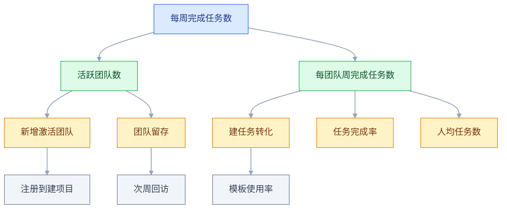
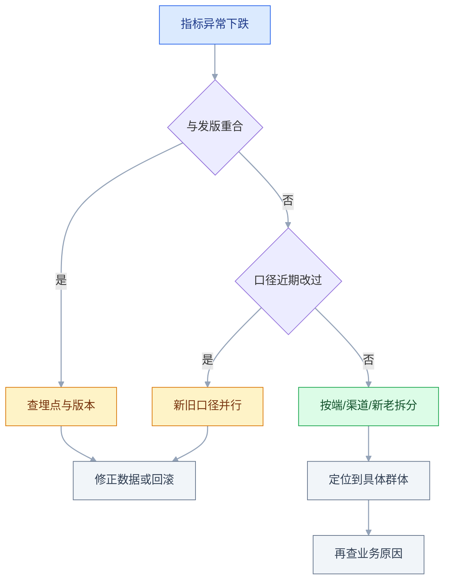

# 指标体系

## 一、工程案例：给一个协作工具搭指标树，判断增长是真是假

**场景**：一个 B 端协作 SaaS，免费版 + 按席位付费。最近两个季度 DAU 在涨，但付费转化和续费没有同步变化，客诉里「通知太多」的反馈变多。团队每天只看一张 DAU 曲线，老板要求下季度汇报一套能解释「增长来自哪里」的指标。

**约束**：

- 埋点已有两年，中间改过一次「活跃」的定义，历史数据不能直接拼；
- 数据团队只有 1 个人，不能为每个问题都新建宽表；
- 销售按席位收费，收入口径与「活跃用户数」不是一回事；
- 下季度要决定是否继续投入推送拉活，必须给出可验证的判断。

**目标**：产出一棵能落到 SQL 的指标树、一份口径字典、三层看板，以及「什么情况下停止推送」的决策规则。

### 1.1 先定决策场景，再选指标

指标不是越多越好，而是「为哪个决定服务」。先把要做的决定列出来，再倒推需要什么数。

| 决策 | 需要的指标 | 不需要的指标 |
|---|---|---|
| 是否继续推送拉活 | 推送带来的次日留存、关闭通知率、客诉率 | 总注册数 |
| 是否加投入做协作功能 | 周活跃团队数、团队内邀请率、任务完成数 | 页面浏览量 |
| 是否调整定价 | 付费转化、席位使用率、NRR | DAU 总量 |

**没有决策场景的指标，最后都会变成「看着挺好看」的装饰**。每加一个指标，先问「它变了我们会做什么」。

### 1.2 北极星候选与选择

| 候选 | 反映什么 | 问题 |
|---|---|---|
| DAU | 有多少人打开 | 可以被推送和签到拉高 |
| 周活跃团队数 | 有多少团队真的在用 | 不反映使用深度 |
| 每周完成任务数 | 用户获得了什么结果 | 需要排除测试与批量脚本 |
| 付费席位使用率 | 付了钱的人用不用 | 只覆盖付费客户 |

**选择**：北极星用「每周被完成的协作任务数」，一级指标拆成「活跃团队数 × 每团队周完成任务数」。理由：它同时反映广度和深度，且团队的动作（引导建任务、模板、提醒）能影响它。

**北极星不是收入**。收入是结果，受定价、销售周期、合同条款影响，产品团队日常动作很难直接改变它。

### 1.3 指标树



**树的每一层都要能算**：叶子节点必须落到一张事实表和一组过滤条件，否则只是概念图。

### 1.4 口径字典

| 指标 | 定义 | 分子 | 分母 | 时间窗 | 去重键 |
|---|---|---|---|---|---|
| 活跃团队 | 周内有成员完成至少 1 个任务 | 有完成行为的团队 | 全部已激活团队 | 自然周 | team_id |
| 新增激活团队 | 注册后 7 天内建成首个项目 | 建成项目的团队 | 当周注册团队 | 注册后 7 天 | team_id |
| 团队留存 | 注册第 N 周内完成任务 | 第 N 周活跃团队 | 注册当周团队 | 周 | team_id |
| 建任务转化 | 进入项目后创建任务 | 建过任务的用户 | 进入项目的用户 | 首次进入后 24 小时 | user_id |
| 任务完成率 | 创建后被完成的任务占比 | 已完成任务数 | 创建任务数 | 按创建日 | task_id |
| NRR | 老客户收入留存 | 期初 + 扩容 - 降级 - 流失 | 期初收入 | 月/季 | account_id |

**口径字典要写「不包含什么」**：内部账号、测试团队、批量导入生成的任务、已删除项目。不写排除项，两个人算出的数一定不同。

### 1.5 分群与对比

| 分群 | 用途 | 注意 |
|---|---|---|
| 新 / 老 | 区分「拉新效果」和「产品粘性」 | 新用户定义要固定 |
| 免费 / 付费 | 判断收入侧影响 | 付费状态按月初快照 |
| 渠道 | 判断增长质量 | 渠道归因窗口要统一 |
| 端 | 定位体验问题 | 同一用户多端要去重 |
| 团队规模 | 判断是否只涨了小团队 | 分桶边界固定 |

**「总体涨了」是最没有信息量的结论**。先分群，再看每一群的方向是否一致；方向不一致时，总体数字只是加权平均。

### 1.6 看板分层

| 层 | 受众 | 内容 | 更新 |
|---|---|---|---|
| 战略层 | 老板、业务负责人 | 北极星、收入、留存、NRR | 每周 |
| 战术层 | 产品、运营 | 一级指标、分群趋势、漏斗 | 每日 |
| 执行层 | 一线 | 过程指标、明细、异常 | 实时或每小时 |

**三层不是三张不同的表，而是同一套指标的三种切法**。口径必须同源，否则会上第一句话就是「你的数和我的数为什么不一样」。

### 1.7 目标、阈值与告警

| 项 | 写法 |
|---|---|
| 目标 | 基线 + 合理增幅，写清假设 |
| 静态阈值 | 超出历史波动范围即告警 |
| 同比/环比 | 排除季节性与周期 |
| 护栏 | 主指标提升时，其他指标不能恶化 |

**目标不要拍脑袋**：先看过去 3–6 个周期的实际分布，再结合投入判断能做到哪。目标定得过高，团队会去优化最容易造假的环节。

### 1.8 决策规则

| 观察 | 判断 | 动作 |
|---|---|---|
| 推送带来的用户次日留存显著低于自然用户 | 增长质量差 | 缩减推送，改为事件触发 |
| 活跃团队涨、每团队任务数跌 | 来的都是小团队或空转 | 优化激活与模板 |
| 任务完成率跌、创建量涨 | 任务变多但没人做 | 检查任务分配与提醒 |
| NRR 跌、新签涨 | 老客户在流失 | 优先做留存，不是拉新 |
| 任务完成数涨、关闭通知率同步涨 | 增长靠打扰换来 | 收缩推送频次，改用站内提醒 |

**决策规则要提前写**，不能等数据出来再解释。提前写的好处是：数据不利时，团队没法临时换一套说法。

### 1.9 产出物

```text
指标方案包
├── 01-决策清单（要支持哪些决定）
├── 02-指标树（北极星到叶子）
├── 03-口径字典（定义/分子/分母/排除项）
├── 04-分群维度（新老/付费/渠道/端）
├── 05-看板三层（战略/战术/执行）
├── 06-目标与告警（基线/阈值/责任人）
└── 07-决策规则（什么情况做什么）
```

### 1.10 验收表

| 检查项 | 怎么验 | 通过标准 |
|---|---|---|
| 每个指标有决策用途 | 逐条问「变了做什么」 | 都能答出具体动作 |
| 北极星反映用户价值 | 看定义与分子 | 不是收入、不是注册总数 |
| 指标树可落地 | 每个叶子写 SQL | 能跑出数，且量级合理 |
| 口径唯一 | 两个人数同一指标 | 结果一致，差异可解释 |
| 排除项完整 | 检查内部账号、测试数据 | 已排除且有规则 |
| 分群维度可用 | 按维度拆一次 | 每群能算出稳定比率，样本量不足时标注 |
| 看板分层 | 找三类受众各看一次 | 各自能完成自己的判断 |
| 目标有基线 | 查目标来源 | 有历史分布和假设 |
| 告警可触发 | 构造异常值 | 能通知到责任人 |
| 决策规则可执行 | 模拟一次数据变化 | 能对应到明确动作 |

---

## 二、高频问答：会卡住你的地方，也是面试最常问的

### 2.1 DAU 在涨，收入不涨

**现场**

按渠道或来源拆 DAU，再看各群的付费转化与次周留存。落到一张「来源 × 次周留存 × 付费转化」交叉表上。

**要点**

- 活跃不等于价值，DAU 涨可能只是低质量渠道在稀释整体。
- 推送拉活来的用户留存和付费都低，总量好看但收入不动。
- 判断看交叉表：某渠道 DAU 占比高、留存和付费双低，就是它在稀释。

**追问**

- 怎么定义低质量渠道？→ 次周留存和付费转化都显著低于自然用户，且样本量够。
- DAU 涨还可能是别的原因吗？→ 签到、弹窗、埋点口径变更，先排除「数变了」。
- 该砍渠道还是改产品？→ 渠道 ROI 为负先砍渠道；留存低但付费高，是产品没接住。

### 2.2 两个报表同一个指标对不上

**现场**

把两边的 SQL 并排，逐项对比 WHERE 和 COUNT 的字段。先让对方给出「分子、分母、时间范围、排除条件」四项。

**要点**

- 先对口径再怀疑算错，九成差异出在定义。
- 四个常见分歧点：时间窗、去重键、是否含测试账号、时区。
- 具体多出在「按人还是按次」「自然日还是滚动 24 小时」。

**追问**

- 按人还是按次差多少？→ 一个 COUNT(*)，一个 COUNT(DISTINCT user_id)，重复行为多时差几倍。
- 自然日和滚动 7 日哪个对？→ 看决策，留存看自然周、风控看滚动窗口，同一张看板不能混。
- 怎么防止下次再对不上？→ 口径字典写清分子分母和排除项，看板标口径版本。

### 2.3 总留存看起来稳定，其实每批都在变差

**现场**

做同期群：按注册周或月分组，看每一批的第 N 周留存，画成 cohort 热力图。

**要点**

- 总体留存稳定可能只是结构效应：新用户大量涌入，把老批次的下降摊薄了。
- 判断方法是看每一行，而不是看最后一行总数。
- 每一行都在变浅，说明产品在退步，只是总量掩盖了它。

**追问**

- 热力图怎么看？→ 横向看同一批随时间的衰减，纵向看不同批在同一生命周期位置的差异。
- 结构效应还有别的表现吗？→ 转化率、客单价、留存都可能是加权平均造成的假稳定。
- 怎么汇报？→ 同时给总体和分行，只给一个都会误导。

### 2.4 平均用时 5 分钟，用户却抱怨很慢

**现场**

看 P50、P90、P99 和直方图，不只看均值；再按端、按操作类型拆分布。

**要点**

- 平均值代表不了体感，尤其分布是双峰或长尾时。
- 均值被少数极快或极慢的样本拉偏，P90 是均值的数倍很常见。
- 体验类指标优先看 P90/P99，优化目标也应该定在长尾。

**追问**

- P99 高但均值正常，先修哪？→ 先看长尾集中在哪个端或操作，再定优化点。
- 分位数要多少样本才可信？→ 尾部要求样本足够大，样本小就报区间或直接看分布图。
- 平均值还有用吗？→ 有用，看总量和成本，但不用来判断体验。

### 2.5 整体转化率跌，分端却在涨

**现场**

做「端 × 转化率 × 流量占比」三列表，看结构变化；再固定各群权重重算一次。

**要点**

- 这是辛普森悖论：低转化的端占比上升，拉低了整体。
- 分组都在涨、整体在跌，说明变化来自流量结构，不是产品变差。
- 固定权重后方向反转，就能确认是结构效应。

**追问**

- 汇报时给整体还是给分组？→ 两个都给，只给一个都会误导。
- 结构效应能避免吗？→ 不能，但可以固定权重或分层后再比较。
- 转化率跌一定是结构问题吗？→ 不一定，先排除埋点和口径变更。

### 2.6 指标一考核，行为就变形

**现场**

看有没有「只提升指标、不改善体验」的动作，如弹窗、默认勾选、刷单。给主指标配 2–3 个护栏指标：客诉、卸载、退款、关闭通知。

**要点**

- 古德哈特定律：指标成为目标后，会被以最省力的方式优化。
- 对策不是不用指标，而是主指标 + 护栏指标 + 抽查真实行为。
- 护栏要在考核前定，不能等副作用出现再补。

**追问**

- 护栏恶化但主指标涨了，上不上？→ 不上，先修副作用。
- 抽查真实行为怎么做？→ 看录屏、工单和退款原因，不只看埋点。
- 考核指标要不要公开？→ 公开主指标，护栏内部看，避免团队直接优化护栏数字。

### 2.7 新老用户混在一起算留存

**现场**

按注册时间分组，分别算次周和次月留存；至少拆「新 / 老」「免费 / 付费」两维。

**要点**

- 新老用户行为基线完全不同，混算会掩盖真实问题。
- 新用户留存低但老用户稳定，问题在激活，不是产品整体。
- 分母必须是当期新增的全量，不能只用仍活跃的人。

**追问**

- 新用户怎么定义？→ 按注册时间或首次关键行为，口径固定后不能随手改。
- 付费用户要不要单独看？→ 要，付费状态按月初快照，避免月中变动造成混算。
- 混算最坏的结果是什么？→ 用老用户的稳定掩盖新用户流失，越拖越晚发现。

### 2.8 跨时区导致「今天」不是同一个今天

**现场**

取同一时间段，用 UTC 和业务时区各算一次，看差异是否集中在凌晨。

**要点**

- 事件按 UTC 存储、报表按本地时区截断，边界日就会错位。
- 差异通常集中在凌晨几个小时，总量看着差不多，日环比已经失真。
- 统一「业务日」的定义写进口径，底层保留 UTC 时间戳。

**追问**

- 跨时区团队按谁的时区出报表？→ 按业务时区，并在看板上标注。
- 只存本地时间行不行？→ 不行，夏令时和跨区会出重复或缺失。
- 为什么凌晨最明显？→ 时区偏移正好落在日切边界上。

### 2.9 人数和次数被混用

**现场**

看 SQL 的聚合函数和去重键。所有比率指标都写明「分子分母各自是按人还是按次」。

**要点**

- COUNT(*) 和 COUNT(DISTINCT user_id) 是两个指标，不能混着比。
- 重复行为多时两个数会差几倍，结论可能完全相反。
- 同一张看板里不要混用两种口径。

**追问**

- 什么场景该按次？→ 看使用强度、调用量、成本。
- 什么场景该按人？→ 看渗透率、转化率、留存。
- 比率指标最容易错在哪？→ 分子按人、分母按次，算出来能大于 100%。

### 2.10 北极星选了「总收入」

**现场**

问一句「这个数变了，团队本周能做什么」。把收入作为结果指标放在战略层。

**要点**

- 收入受定价、合同、销售周期影响，产品团队的日常动作短期改不了它。
- 北极星要选「用户获得价值」且团队能影响的量。
- 结果指标放战略层看方向，别拿来当日常抓手。

**追问**

- 北极星能不能有两个？→ 一个主指标，拆成两三个因子，不要并列两个方向。
- 免费产品选什么？→ 看用户获得价值的行为量，比如完成任务数。
- 北极星会变吗？→ 业务阶段变了可以换，但要版本化并说明不可比。

### 2.11 看板做了 30 个图，没人看

**现场**

问三个角色「你上周从看板做了什么决定」。然后每个看板只保留「能触发动作」的指标。

**要点**

- 没人看不是态度问题，是没有按受众分层，也没有「看了要做什么」的入口。
- 战略层不超过 8 个图，每个异常旁边写「找谁、看哪张明细」。
- 三层看板是同一套指标的三种切法，口径必须同源。

**追问**

- 战略层放什么？→ 北极星、收入、留存、NRR，周更。
- 执行层要实时吗？→ 只有排障和值班需要，其他 T+1 就够。
- 看板要不要标更新时间？→ 要，不标新鲜度，异常排查先花半天确认数对不对。

### 2.12 指标突然下降，其实是埋点改了

**现场**

查埋点版本记录和发布记录，看下降日是否与发版重合。第一步不是查业务，是先对齐发布与埋点时间线。



先排除「数变了」，再解释「业务变了」，能省掉大半无效排查。

**要点**

- 指标下降先排除口径变更，再解释业务变化。
- 事件名、触发时机或上报版本变更，都会让历史不可比。
- 一次下降只影响单个端或单个事件时，基本可以锁定埋点。

**追问**

- 怎么快速确认是埋点问题？→ 下降日与发版日重合，且影响面正好是改过的端或事件。
- 埋点改了历史数据怎么办？→ 新旧口径并行一段，图表上标变更点，不静默重算。
- 变更日志要记什么？→ 事件名、改了什么、生效版本、责任人。

---

## 三、核心知识：从零开始要建立的东西

### 3.1 指标与目标的区别

指标是「现在的状态」，目标是「希望达到的状态」。指标可以很多，目标必须少。

| | 指标 | 目标 |
|---|---|---|
| 数量 | 可以几十个 | 1–3 个 |
| 作用 | 描述、诊断 | 对齐、取舍 |
| 变化 | 随业务增删 | 一个周期内稳定 |
| 失败方式 | 没人看 | 定得过高或过虚 |

**目标要写成「指标 + 数值 + 时间 + 范围」**。例如「下季度末，付费团队的周任务完成率从基线提升到目标值」，而不是「提升用户活跃」。

### 3.2 北极星指标

北极星是「一个能代表用户获得价值、且团队能影响」的数。它不是唯一的指标，而是所有指标的方向。

| 判断 | 通过 | 不通过 |
|---|---|---|
| 反映用户价值 | 用户完成任务、获得结果 | 注册总数、页面浏览量 |
| 可稳定取数 | 有事实表、口径固定 | 靠人工汇总 |
| 团队可影响 | 引导、模板、性能能改变它 | 宏观政策、季节 |
| 不被轻易刷高 | 需要真实行为 | 签到、弹窗即可提升 |

**北极星要能拆成乘法或加法**，否则无法定位问题。例如「周完成任务数 = 活跃团队数 × 每团队任务数」，两个因子分别对应「拉新/留存」和「深度」。

> **面试**：常问「北极星指标怎么选？」答：反映用户价值、可稳定取数、团队能影响、不被轻易刷高。

### 3.3 指标树与分层

指标树从北极星往下拆，直到「能直接采取行动」的叶子。

| 层 | 作用 | 例子 |
|---|---|---|
| 北极星 | 方向 | 每周完成任务数 |
| 一级 | 拆主要矛盾 | 活跃团队数、每团队任务数 |
| 二级 | 定位环节 | 激活、留存、建任务转化 |
| 过程 | 日常可操作 | 模板点击率、邀请成功率 |

**叶子节点的标准**：能对应一个具体的产品改动。如果某个指标下降了，团队只能说「再观察」，说明它还不是叶子。

### 3.4 口径字典

口径是指标的「法律定义」。没有口径的指标，迟早会在会上打架。

| 字段 | 必须写清 |
|---|---|
| 指标名 | 唯一名称，不用缩写 |
| 业务含义 | 一句话解释 |
| 分子 | 精确到字段和过滤条件 |
| 分母 | 谁被纳入统计 |
| 时间窗 | 自然日/周/月，还是滚动窗口 |
| 去重键 | 按人、按团队、按单 |
| 排除项 | 测试、内部、机器人、已删除 |
| 数据源 | 库、表、字段 |
| 负责人 | 谁维护定义 |

**口径变更要版本化**：改定义可以，但旧数据不能悄悄按新口径重算；要么双口径并行一段时间，要么在图表上标注变更点。

> **面试**：常问「口径字典必须写哪几项？」答：分子、分母、时间窗、去重键、排除项，缺一项两个人就会算出两个数。

### 3.5 留存与同期群

留存回答「用户会不会回来」。最基本的算法是按首次行为分组，再看第 N 个时间窗是否活跃。

```text
第 N 日留存 = 首日新增用户中第 N 日活跃的人数 / 首日新增用户数
第 N 周留存 = 注册当周团队中第 N 周活跃的团队数 / 注册当周团队数
```

**分母必须是当期新增的全量**，不能只用仍活跃的人，否则就是幸存者偏差，留存会被系统性高估。另外，「第 N 日活跃」与「第 N 日及以后仍活跃」是两种口径，后者数值更高，两者不能混用，口径里要写清用哪一种。

| 曲线形态 | 含义 |
|---|---|
| 持续降到 0 | 没有形成使用习惯 |
| 降到某水平后走平 | 有稳定的核心用户群 |
| 起点低但很快走平 | 小众但粘性强 |
| 起点高但持续下滑 | 早期新鲜感，未形成习惯 |

**走平是产品市场匹配的信号之一**，但不是唯一证据。还要看走平的那批人是否付费、是否扩容。

> **面试**：常问「留存率最容易算错的地方是什么？」答：分母只用仍活跃的人，幸存者偏差会把留存系统性高估。

### 3.6 漏斗分析

漏斗把流程拆成有序步骤，看每一步的转化与流失。下面是一组示例数据：

```text
访问 → 注册 → 建项目 → 完成任务 → 次周回访
1000 →  320  →   180   →    120   →    70
       32%     56%       67%        58%
```

| 读法 | 问题 | 动作 |
|---|---|---|
| 绝对值流失最大 | 哪一步人最多 | 优先优化 |
| 转化率最低 | 哪一步设计有问题 | 看录屏与访谈 |
| 趋势变差 | 哪一步最近在恶化 | 对齐发版与埋点 |

**漏斗只统计进入流程的人**。如果入口曝光本身很少，漏斗再漂亮也没用，要另看曝光率和入口点击率。

### 3.7 AARRR 与 RARRA

| 框架 | 顺序 | 适用 |
|---|---|---|
| AARRR | 获取 Acquisition → 激活 Activation → 留存 Retention → 推荐 Referral → 收入 Revenue | 从获客到变现逐段梳理增长 |
| RARRA | 留存 → 激活 → 推荐 → 收入 → 获取 | 留存是瓶颈时，先修产品再拉新 |

AARRR 是 Dave McClure 的「海盗指标」，Referral 与 Revenue 谁在前，不同资料的写法不一致，关键是别漏项。RARRA 不是另一套漏斗，而是把 AARRR 重排、把留存提到最前。

**框架是检查清单，不是组织架构**。不需要为每个字母设一个团队，也不需要每个阶段都做指标；先看哪个环节是当前瓶颈。

### 3.8 领先指标与滞后指标

| 类型 | 特点 | 例子 |
|---|---|---|
| 领先 | 早于结果变化，可干预 | 首日建项目率、邀请成功率 |
| 滞后 | 结果，验证成败 | 收入、续费、NRR |
| 同步 | 与结果同时发生 | 活跃、订单数 |

**日常管理看领先，复盘看滞后**。只盯收入，等发现下降时已经晚了；只看领先，又可能偏离最终结果。

### 3.9 分群维度

| 维度 | 切法 | 常见用途 |
|---|---|---|
| 时间 | 注册周/月、首次使用 | 同期群 |
| 用户 | 新/老、免费/付费 | 区分基线 |
| 渠道 | 自然、投放、推荐 | 判断增长质量 |
| 端 | iOS、Android、Web | 定位体验 |
| 规模 | 团队人数、订单量 | 判断结构变化 |
| 地区 | 国内/海外、时区 | 合规与本地化 |

**分群不是越多越好**：每多一个维度，样本就被切薄一层。先选与决策最相关的 2–3 个维度。

### 3.10 平均值与分位数

| 统计量 | 回答 | 局限 |
|---|---|---|
| 均值 | 总量除以样本数 | 被极端值拉动 |
| 中位数 P50 | 一半人低于它 | 不看尾部 |
| P90/P99 | 最慢的那部分 | 需要足够样本 |
| 分布图 | 形状、双峰、长尾 | 不便于跨期比较 |

**体验类指标优先看 P90/P99**：比如平均响应 200ms，但 P99 到数秒，用户仍会觉得卡。

### 3.11 辛普森悖论

当分组后的趋势与整体趋势相反，通常是「结构变化」在起作用。下面是一组构造出来的数字：

```text
桌面端：4% → 5%（涨）
移动端：2% → 2.5%（涨）
整体：3.6% → 3.5%（跌）
原因：移动端流量占比从 20% 升到 60%
```

**检查方法**：固定各群权重，重新计算整体；如果固定权重后方向反转，说明是结构效应。**汇报时要同时给分组和整体**，不能只挑一个。

> **面试**：常问「整体和分群趋势相反怎么解释？」答：辛普森悖论，是结构变化；固定各群权重再算一次就能确认。

### 3.12 虚荣指标与古德哈特定律

| 指标 | 为什么虚荣 |
|---|---|
| 总注册数 | 只增不减 |
| 总下载量 | 与使用无关 |
| 页面浏览量 | 可被刷新和爬虫放大 |
| 累计用户数 | 不反映当前活跃 |

**古德哈特定律**：当一个指标成为目标，它就不再是好的衡量。对策不是不用指标，而是「主指标 + 护栏指标 + 抽查真实行为」。

### 3.13 护栏指标

护栏指标的作用是防止「主指标提升、整体变差」。

| 主指标 | 可能的副作用 | 护栏 |
|---|---|---|
| 点击率 | 标题党、诱导点击 | 跳出率、投诉率 |
| 推送打开率 | 打扰用户 | 关闭通知率、卸载率 |
| 订单量 | 过度促销 | 退款率、毛利率 |
| 建任务数 | 空任务堆积 | 任务完成率、删除率 |

**护栏要在实验前定**，不能等副作用出现再补。护栏恶化超过阈值时，即使主指标显著，也不上线。

### 3.14 看板分层

| 层 | 更新频率 | 图的个数 | 核心问题 |
|---|---|---|---|
| 战略 | 周/月 | ≤8 | 方向对不对 |
| 战术 | 日 | 10 个左右 | 哪个环节出问题 |
| 执行 | 实时/小时 | 按需 | 现在发生了什么 |

**看板要标注数据新鲜度和口径版本**。没有这两个，异常排查会先花半天确认「数是不是对的」。

### 3.15 目标设定与基线

目标 = 基线 + 合理增幅 + 支撑假设。

| 步骤 | 做法 |
|---|---|
| 取基线 | 过去 3–6 个周期的中位数，排除异常周 |
| 看趋势 | 自然增长、季节性、已做动作的滞后效应 |
| 估投入 | 本期能投入的人力与功能 |
| 定目标 | 保守/基准/挑战三档 |
| 写假设 | 如果某功能没上线，目标下调多少 |

**目标不要只有一个数**：至少给区间和三档，避免「差 0.1% 就算失败」的僵化。

### 3.16 指标的维护与下线

指标会腐烂：口径变了、埋点没了、业务不关心了。每季度清理一次。

| 状态 | 处理 |
|---|---|
| 仍在决策中使用 | 保留，更新口径 |
| 无人查看 | 下线或归档 |
| 口径已变 | 标注版本，旧数据不重算 |
| 被新指标替代 | 保留映射关系，避免历史断裂 |

**下线要公告**：看板突然少一个图，会有人以为数据坏了。保留一个「已下线指标」清单和替代关系。

---

## 四、冷门知识汇总

以下为低频、用到时能现查的技术细节，按关键词检索即可。

| 知识点 | 为什么冷门 | 用到时的关键词 |
|---|---|---|
| 分母的选择 | 大家只盯分子，忘了分母也会变 | 口径、纳入范围 |
| 排除测试账号 | 内测数据混入生产报表 | 内部标记、白名单 |
| 滚动窗口与自然日 | 两者在边界日差异明显 | 7 日滚动、自然周 |
| 去重键 | 按人还是按团队，结果差很多 | `COUNT(DISTINCT)` |
| 归因窗口 | 渠道功劳被重复计算 | 首次点击、末次点击 |
| 季节性与节假日 | 同比看着正常，环比失真 | 同期对比、移动平均 |
| 数据新鲜度 | 看板不标更新时间 | T+1、实时、延迟 |
| NRR 与 GRR | 两者都叫收入留存，差别在是否计入扩容 | 含扩容、不含扩容、降级 |
| 席位使用率 | B 端只看活跃人数，不看买了多少席 | 已用席位、总席位 |
| 激活的定义 | 注册不等于激活 | 首个关键行为 |
| 指标间的守恒 | 拆解后因子之积要等于总数 | 乘法树、校验 |
| 异常检测 | 人工看曲线发现太晚 | 阈值、同比、突变 |
| 领先指标的滞后 | 领先也会延迟，不是即时 | 观察窗口 |
| 小样本波动 | 小团队比例波动大 | 置信区间、最小样本 |
| 看板的权限 | 敏感指标全员可见 | 行级权限、脱敏 |
| 收入的确认口径 | 合同额与确认收入不同 | 合同额、确认收入、递延收入 |
