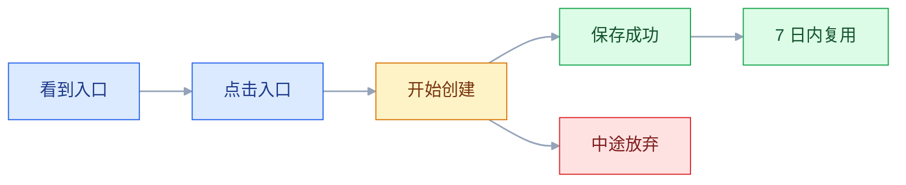
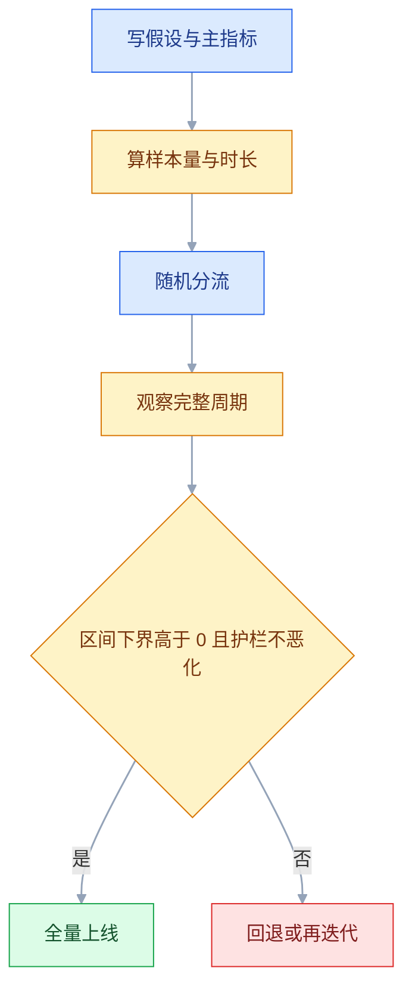

# 数据分析与实验

## 一、工程案例：用现有埋点判断新功能是否该继续投入

**场景**：协作工具上线了「自动化规则」：当任务状态变化时，自动通知、自动建子任务。上线 4 周，周使用率很低（以实际数据为准，假设只有个位数百分比）。老板问：下个版本继续投入做模板和条件分支，还是把人力撤回去。

**约束**：

- 没有上线前的对照组，功能是全量发布的；
- 埋点只覆盖 Web 端，移动端没有上报；
- 数据团队排期一周，下个版本两周后定稿；
- 功能本身不复杂，但入口深、需要先建规则再触发。

**约束带来的边界**：只能回答 Web 用户里「不知道 / 不需要 / 不好用 / 没场景」的比例，答不了移动端有没有需求；没有对照组，就不能直接说功能带来了留存。

**目标**：不是证明「功能好不好」，而是回答「使用率低是因为不知道、不需要、不好用，还是没场景」，并给出继续/缩小/砍掉的决策和验证方式。

### 1.1 把模糊问题拆成可回答的问题

| 模糊问题 | 可回答的问题 | 需要的数 |
|---|---|---|
| 功能没人用 | 有多少人看到入口 | 曝光人数、入口点击率 |
| 是不是不知道 | 看到入口的人里有多少尝试 | 曝光 → 点击 → 创建 |
| 是不是不好用 | 创建流程在哪一步流失 | 各步转化、失败原因 |
| 是不是不需要 | 用了的人是否复用 | 7 日内再次创建率 |
| 值不值得投入 | 用的人是否留存更好 | 分群留存、但只能作参考 |

**问题拆到「能对应一个指标」才算完成**。上来就说「分析一下这个功能」，最后一定变成一堆图。

### 1.2 数据质量核验

先确认数能不能用，再谈结论。

| 检查 | 方法 | 不合格时的处理 |
|---|---|---|
| 事件量突变 | 按天画事件量 | 对齐发版与埋点版本 |
| 重复上报 | 同一用户同一秒多条 | 按事件 ID 去重 |
| 内部账号 | 排除公司邮箱、测试团队 | 建内部名单 |
| 端覆盖 | 分 Web/iOS/Android | 只在该端下结论 |
| 时区 | UTC 与业务时区各算一次 | 统一业务日 |
| 口径变更 | 查埋点变更日志 | 变更前后分开看 |

**这一步不能省**。后面所有结论都建立在「数是对的」之上，数据质量问题会让最漂亮的分析变成误导。

### 1.3 描述：从曝光到复用的漏斗



```sql
WITH base AS (
  SELECT user_id,
         MIN(CASE WHEN event = 'automation_expose' THEN dt END) AS expose_dt,
         MIN(CASE WHEN event = 'automation_click'  THEN dt END) AS click_dt,
         MIN(CASE WHEN event = 'automation_save'   THEN dt END) AS save_dt,
         COUNT(DISTINCT CASE WHEN event = 'automation_run' THEN rule_id END) AS run_rules
  FROM events
  WHERE dt >= '2026-09-01'
    AND user_id NOT IN (SELECT user_id FROM internal_users)
  GROUP BY user_id
)
SELECT COUNT(expose_dt) AS exposed,
       COUNT(click_dt)  AS clicked,
       COUNT(save_dt)   AS saved,
       COUNT(CASE WHEN run_rules > 0 THEN 1 END) AS ran,
       ROUND(COUNT(click_dt) * 100.0 / COUNT(expose_dt), 2) AS ctr,
       ROUND(COUNT(save_dt)  * 100.0 / COUNT(click_dt), 2)  AS save_rate
FROM base;
```

**漏斗的每一步都要有分母和去重键**。按人算和按次算会得到完全不同的结论，尤其是「反复尝试但没成功」的场景。

上面这段 SQL 只用来核对量级：它对每个事件各取最早的 MIN，没有约束先后顺序，会把「先点击、后曝光」的用户也算成转化。要出正式漏斗，必须按顺序加时间窗匹配（曝光后 24 小时内点击、点击后 24 小时内保存），并且同一用户同一时间段只算一次。

### 1.4 分群：找到差异最大的那一群

| 维度 | 切法 | 想回答 |
|---|---|---|
| 团队规模 | 1–5 / 6–20 / 21+ | 是不是只有小团队用 |
| 角色 | 管理员 / 成员 | 是不是只有管理员看得到 |
| 使用深度 | 高活跃 / 低活跃 | 是不是老用户才用 |
| 入口位置 | 项目首页 / 二级菜单 / 搜索 | 是不是入口太深 |
| 来源 | 自然 / 投放 | 新渠道用户是否不熟 |

**先看差异最大的群，再看整体**。整体使用率低，可能是「入口藏在二级菜单、多数人根本没看到」造成的结构问题，而不是需求不存在。每个群至少凑到 100 人（示例阈值）再比比例，人数不够的群只报绝对人数，不进结论。

### 1.5 诊断：数字背后的原因

| 现象 | 可能原因 | 验证方式 |
|---|---|---|
| 曝光高、点击低 | 入口不显眼、文案不清 | 热图、入口位置实验 |
| 点击高、保存低 | 配置复杂、条件难懂 | 录屏、可用性测试 |
| 保存高、运行低 | 触发条件不匹配 | 查规则条件分布 |
| 运行高、复用低 | 一次性场景 | 访谈、看规则类型 |
| 只有管理员用 | 权限或入口问题 | 分角色看曝光 |

**数字告诉你哪里，访谈告诉你为什么**。两者缺一不可：只看数字容易猜错原因，只看访谈容易以偏概全。

### 1.6 相关与因果的边界

「用自动化规则的人留存更高」是相关，不是因果。可能的解释：

| 解释 | 含义 |
|---|---|
| 反向因果 | 本来就更活跃的用户才会去用 |
| 共同原因 | 团队规模大、流程规范，既用功能也留存高 |
| 选择偏差 | 只统计了还在用产品的人 |

**在没有实验的情况下，只能写「相关」，不能写「带来」**。要证明因果，需要随机分流或可靠的准实验设计。

### 1.7 设计一次可决策的实验

下一版把入口从二级菜单提到项目首页，验证「曝光提升能否带来使用提升」。

| 要素 | 设计 |
|---|---|
| 假设 | 入口前置会让团队周创建率提升至少 2 个百分点 |
| 主指标 | 团队周内「至少创建过一条规则」的占比，与分流单元一致 |
| 护栏 | 首页其他功能点击率、页面加载时间、客诉 |
| 分流 | 按团队随机，50/50，团队内保持一致 |
| 样本 | 示例：基线 6%、MDE 2 个百分点 → 每组约 2300 个团队（算式见 3.7） |
| 时长 | 至少 2 个完整周，覆盖工作日与周末 |
| 决策 | 95% 区间下界 > 0 且护栏不恶化 → 全量；否则回退 |

**按团队分流，就要按团队算指标**。分流单元是团队、指标却按用户算，等于假装样本比实际多，方差被低估，显著性被高估；非要用用户级指标时，要么按团队汇总后再比，要么用聚类稳健标准误。另外，团队数通常远少于用户数，「每组 2300 个」这种量级经常凑不齐，凑不齐就说明这个实验在这个体量下做不了，别硬上。



### 1.8 结论与决策规则

| 结论 | 证据 | 决策 |
|---|---|---|
| 需求真实，入口是瓶颈 | 曝光低、点击后保存率高 | 做入口改版，先实验 |
| 需求窄，只有少数团队 | 使用集中在特定规模/角色 | 缩小投入，做轻量版 |
| 不会用 | 点击高、保存低、失败集中 | 做模板与引导，不急着加功能 |
| 没场景 | 保存高、运行低、复用低 | 暂停投入，转做触发场景 |

**决策规则要提前写**，否则数据出来后，每个人都能从中找到支持自己观点的部分。写清「什么数出现时，我们做什么」，比争论「功能好不好」有效。

阈值要写成数字并提前定稿，例如「曝光率低于 40%、且点击后保存率高于 50%，判为入口问题，先做入口实验」。只写「曝光偏低」，十个人会读出十个结论；写成数字，评审时才能被反驳。

### 1.9 产出物

```text
分析一页纸
├── 问题（要支持哪个决定）
├── 结论（一句话，含方向）
├── 证据（3 条，含口径与时间窗）
├── 分群（差异最大的两群）
├── 反证（哪些数据不支持结论）
├── 建议（继续/缩小/暂停 + 下一步验证）
└── 附录（SQL、数据质量检查、访谈记录）
```

### 1.10 验收表

| 检查项 | 怎么验 | 通过标准 |
|---|---|---|
| 问题对应决策 | 读第一段 | 写明了「哪个数出现 → 做哪个动作」 |
| 数据质量已核 | 查检查记录 | 事件量、去重、内部账号各有结论，异常已处理 |
| 口径写明 | 查分子分母与时间窗 | 换一个人按记录能算出同一个数 |
| 漏斗有分母且有序 | 看 SQL | 每步同一去重键，且按时间顺序加时间窗 |
| 分群有对比 | 看分组表 | 至少两个维度，每群的 n 写在表里 |
| 相关未写成因果 | 读结论措辞 | 无实验时用「相关/同时出现」 |
| 实验可执行 | 看设计表 | 主指标与分流单元一致，样本量有算式，时长 ≥ 2 周 |
| 分流已检查 | 看首日两组人数 | 比例检验 p > 0.001 才算通过 |
| 护栏已定 | 看实验表 | 至少两个护栏指标 |
| 反证已列 | 看一页纸 | 至少一条不支持结论的数据 |
| 建议可落地 | 看下一步 | 有负责人、时间、验证方式 |
| 结论范围 | 读结论 | 只写 Web 与观察时间窗内可得的证据 |

**通过标准要能判定**：「样本量足够」不算标准，要写成「每组 ≥ 2300 个团队」或「每群 n ≥ 100」；「有结论」不算标准，要写成「异常已排除并记录原因」。判定不了的验收项等于没有验收。

---

## 二、高频问答：会卡住你的地方，也是面试最常问的

### 2.1 转化率下降就想改产品

**现场**

按端、版本、渠道、时间拆，先看下降从哪天开始、集中在哪群，再对齐发版和投放时间线。

**要点**

- 整体下降不等于每个群都下降，先怀疑结构，不要先回滚。
- 常见来源是流量结构、渠道质量、埋点版本、季节变化。
- 只有一个渠道跌，先查渠道，不要动产品。

**追问**

- 怎么判断是结构问题？→ 分群都在涨或持平、整体却跌，固定权重后方向反转。
- 什么时候该立刻回滚？→ 全端全渠道同步跌，且与发版时间重合。
- 分群之后还是查不出呢？→ 回到数据质量：埋点、去重、时区、JOIN 放大。

### 2.2 两份数据对不上

**现场**

把两边 SQL 并排，逐项对比 WHERE、COUNT、JOIN。先让对方给出「分子、分母、时间范围、排除项」。

**要点**

- 先对定义再怀疑算错，多数差异来自「按人/按次」和「自然日/滚动 24 小时」。
- 时间窗、去重键、排除条件、时区，四项逐项排除。
- JOIN 一对多会放大行数，也会让两份数对不上。

**追问**

- 为什么 JOIN 会让数变大？→ 一对多关联后行数翻倍，聚合前没先去重。
- 排除条件一般差在哪？→ 内部账号、测试团队、已删除数据。
- 谁的口径算对？→ 看决策用途，以口径字典里定义的那个为准。

### 2.3 功能使用率低，直接决定砍掉

**现场**

看「曝光 → 点击 → 完成」漏斗，而不是只看使用人数；第一步先算曝光率。

**要点**

- 使用率低不等于没需求，可能是曝光不足、入口太深、只有部分角色可见。
- 大多数人没见过入口时，结论应该是「先改入口再验证」，不是砍。
- 判断顺序是曝光、点击、保存、复用，逐层看流失在哪。

**追问**

- 曝光率多少算低？→ 先找同类功能的基线，没有基线就看「看到的人里转化高不高」。
- 只有管理员用说明什么？→ 权限或入口问题，不一定是需求窄。
- 什么情况下才该砍？→ 曝光充足、点击后保存也低、用的人不复用，三条同时成立。

### 2.4 把相关当成因果

**现场**

看使用前的活跃度是否已经更高，有没有随机分流；对比「使用前 2 周」的行为。

**要点**

- 用功能的用户留存高，可能是高活跃用户本来就更愿意用新功能。
- 没有实验时只能写「相关」，不能写「带来」。
- 三种常见解释：反向因果、共同原因、选择偏差。

**追问**

- 怎么快速排除反向因果？→ 看使用前的基线，两组在功能上线前是否已经不同。
- 准实验能证明因果吗？→ 比前后对比强，但仍要检查平行趋势等假设。
- 相关结论还有用吗？→ 有用，用来提假设和排优先级，不用来定因果。

### 2.5 A/B 实验看到显著就停

**现场**

查实验配置里的计划样本量和实际观察次数。补救靠实验前锁定样本量和时长，到点再看。

**要点**

- 反复查看并随时停止，会显著抬高假阳性率。
- 「某一刻显著」不是「最终显著」，中途停等于给自己加了很多次检验机会。
- 必须提前看就用序贯检验，并把规则写进实验方案。

**追问**

- 偷看几次问题有多大？→ 看得越频繁，至少一次碰到显著的概率越高。
- 序贯检验和普通检验差在哪？→ 按累计检验次数调整阈值，代价是需要更大样本。
- 到点不显著但趋势好，能延长吗？→ 延长等于换一个实验，要重新算样本并说明。

### 2.6 样本不够，结论却是「没差异」

**现场**

算当前样本能检测到的最小效应，和业务关心的效应比；再看置信区间的位置和宽度。

**要点**

- 「不显著」不等于「没效果」，可能只是样本不够，检测不出真实差异。
- 区间很宽、同时包含 0 和业务关心的 MDE，结论只能是「不确定」。
- 只有整个区间都低于 MDE，才能说提升不值得投入。

**追问**

- 样本不够怎么办？→ 延长实验、换更粗的指标（团队级），或直接不做。
- MDE 怎么定？→ 从业务价值倒推，低于这个幅度就不值得投入。
- 为什么不能中途加样本？→ 加样本等于重新看结果，假阳性率会上升。

### 2.7 看了 20 个指标，挑了一个显著的

**现场**

查实验方案里是否预先指定唯一主指标。其余指标只作探索，需在新实验中验证。

**要点**

- 20 个独立指标在 5% 水平下，至少一个碰巧显著的概率约 64%。
- 事后选指标等于自己制造显著性，结论不可用。
- 实验前定一个主指标和少量护栏，其余只看方向。

**追问**

- 多重比较怎么校正？→ Bonferroni（α/m）保守，Benjamini–Hochberg 控 FDR，分析前写清用哪种。
- 主指标只能有一个吗？→ 决策用一个，护栏可以有 2–3 个。
- 探索性指标完全不能用吗？→ 能用来提假设，但要标注「待验证」。

### 2.8 分流比例不对，50/50 变成 55/45

**现场**

实验上线第一天就看两组人数和特征分布；按分桶键重新核对，看是否有端、版本、地区被系统性排除。

**要点**

- 分流比例明显偏离设计是 SRM，不是随机波动。
- 常见原因：分桶键不稳定、某端未上报、新用户进入逻辑不同、实验互斥配置错误。
- 对两组人数做卡方拟合优度检验，p < 0.001 视为异常。

**追问**

- 为什么阈值用 0.001 而不是 0.05？→ 分流检查天天做，太松会把正常波动当事故。
- 发现 SRM 还能继续看结果吗？→ 不能，先停实验查分流，结果不可解读。
- 特征分布也要查吗？→ 要，人数对但端、新老比例失衡，同样说明分流有偏。

### 2.9 新功能短期涨，两周后回落

**现场**

看 2 周以上的趋势，按首次使用时间分群，对比「早期使用」和「稳定期使用」的行为。

**要点**

- 首周上涨可能只是新奇效应，或早期用户本身更愿意尝试。
- 判断要看稳定期，而不是发布当周。
- 延长观察窗口前先确认样本量够，否则只是把噪声看更久。

**追问**

- 新奇效应和真实提升怎么区分？→ 看第 2–4 周是否回落到基线，新进来的用户还愿不愿意用。
- 观察多久合适？→ 至少覆盖两个完整周，B 端按使用周期定。
- 早期用户偏差怎么处理？→ 按首次使用时间分群，别把尝鲜者当全体。

### 2.10 埋点重复，指标虚高

**现场**

查同一用户同一秒的事件条数，再按事件 ID 去重后重算。

**要点**

- 事件量翻倍先怀疑重复上报，不是用户变活跃。
- 常见来源：页面重复上报、重试、客户端缓存重放。
- 埋点规范要写「一次行为一个事件」，并保证事件 ID 唯一。

**追问**

- 怎么快速判断是重复？→ 同一用户同一秒多条同事件，去重前后差异明显。
- 事件 ID 谁生成？→ 客户端生成并随重试复用，服务端不要每次重发都换新 ID。
- 去重会不会误杀真实行为？→ 会，所以去重键要带行为标识，不能只按用户和时间。

### 2.11 平均值掩盖了长尾

**现场**

看 P90/P99 和分布直方图，再按端、网络、操作类型拆分布。

**要点**

- 平均响应 300ms 可能藏着 P99 数秒的请求，用户体感由尾部决定。
- 少数极慢请求被大量快请求平均掉，均值看起来正常。
- 优化目标放在 P90/P99，而不是均值。

**追问**

- P90 和 P99 先看哪个？→ 先看 P90 定位覆盖面，P99 判断极端情况。
- 长尾是技术问题还是业务问题？→ 先按端和操作拆，能定位到具体链路再谈优化。
- 均值还有用吗？→ 看容量和成本有用，判断体验不够。

### 2.12 图表让差异看起来比实际大

**现场**

看坐标轴起点和刻度，换成同尺度柱状图对比，把原始数写在图旁。

**要点**

- 纵轴不从 0 开始、双纵轴、3D、面积夸大，都会放大差异。
- 图表的责任是不误导，不是好看。
- 对比图纵轴从 0 开始，双纵轴只在必要时用并标注。

**追问**

- 折线图也要从 0 开始吗？→ 趋势图可以截断，但必须标出截断并说明。
- 双纵轴为什么危险？→ 两条轴的缩放可以任意制造「同步上涨」的错觉。
- 给老板看的图怎么简化？→ 一个结论一张图，标原始数和时间窗。

---

## 三、核心知识：从零开始要建立的东西

### 3.1 分析问题的定义

一个可分析的问题包含四要素：对象、时间、口径、决策。

| 要素 | 反例 | 正例 |
|---|---|---|
| 对象 | 用户 | 近 30 天注册的付费团队 |
| 时间 | 最近 | 9 月 1 日–9 月 30 日 |
| 口径 | 使用率 | 周内创建过规则的用户占比 |
| 决策 | 看看情况 | 决定下版本是否继续投入 |

**问题定义不清，后面所有工作都会返工**。先花十分钟把四要素写下来，比直接写 SQL 更省时间。

### 3.2 SQL 取数基元

产品经理不需要精通 SQL，但需要能独立回答常见问题。

| 能力 | 用途 | 常见错误 |
|---|---|---|
| `SELECT / WHERE` | 选列与过滤 | 忘记排除测试账号 |
| `GROUP BY` | 分组统计 | 分组键有 NULL |
| `JOIN` | 关联维表 | 一对多导致行数放大 |
| `COUNT(DISTINCT)` | 统计人数 | 用 `COUNT(*)` 当人数 |
| 时间函数 | 按日/周/月聚合 | 时区不一致 |
| CTE | 拆复杂逻辑 | 嵌套过深难维护 |

```sql
-- 一对多关联前先聚合，避免行数放大
WITH orders AS (
  SELECT user_id, COUNT(*) AS order_cnt, SUM(amount) AS gmv
  FROM orders
  WHERE dt >= '2026-09-01'
  GROUP BY user_id
)
SELECT u.channel, COUNT(*) AS users, SUM(o.gmv) AS gmv
FROM users u
LEFT JOIN orders o ON u.user_id = o.user_id
WHERE u.dt >= '2026-09-01'
GROUP BY u.channel;
```

**JOIN 前先想粒度**：主表一行是一个用户，还是一笔订单？粒度不一致时，先聚合再关联。

### 3.3 去重与漏斗

漏斗的每一步都要明确「按什么去重」和「时间窗多长」。

| 步骤 | 去重键 | 时间窗 |
|---|---|---|
| 曝光 | user_id + 页面 | 当天 |
| 点击 | user_id + 按钮 | 曝光后 24 小时 |
| 创建 | user_id + 规则 | 点击后 24 小时 |
| 复用（再次创建） | user_id + 规则 | 首次创建后 7 日内 |

**一张漏斗里不要混用人和团队两种粒度**。上面的表全按 user_id 算；如果要看团队级（B2B 常用），整列换成 team_id 重算，不能只换其中一步，否则分子分母对不上，转化率会算出大于 100% 这种结果。

**时间窗不固定，转化率可以被随意放大**。把「点击后 7 天内创建」和「当天创建」混在一起，两个人算出的数必然不同。

### 3.4 分群分析

分群的目的不是把表切碎，而是找到「方向相反」或「差异最大」的群体。

| 分群 | 适用问题 |
|---|---|
| 新/老 | 拉新还是留存 |
| 付费/免费 | 收入侧影响 |
| 端/版本 | 体验与技术问题 |
| 渠道 | 增长质量 |
| 规模/角色 | 需求是否只覆盖一部分人 |

**分群后要看样本量**。一个群里只有几十个人，比例波动会很大，不能据此下结论。

### 3.5 相关与因果

| 关系 | 例子 | 能否指导动作 |
|---|---|---|
| 相关 | 用搜索的人留存高 | 只能作为线索 |
| 因果 | 搜索速度提升导致留存提升 | 可以 |
| 反向因果 | 活跃的人更爱搜索 | 不能 |
| 共同原因 | 高意愿用户既搜索又留存 | 不能 |
| 选择偏差 | 只统计还在用的人 | 不能 |

**因果的证据强度**：随机实验 > 准实验（DID、断点回归、匹配）> 前后对比 > 相关。没有实验时，结论要写成「相关」，并说明可能的混杂因素。

### 3.6 实验的基本要素

| 要素 | 要求 |
|---|---|
| 假设 | 具体、可证伪、有方向 |
| 主指标 | 唯一，提前定 |
| 护栏 | 2–3 个，防止副作用 |
| 分流 | 随机、稳定、团队内一致 |
| 单元 | 分流单元与分析单元一致（按人或按团队） |
| 样本 | 提前算，不中途加 |
| 时长 | 覆盖完整周期，至少 1–2 周 |
| 决策 | 涨多少、跌多少，分别做什么 |

**假设要写成一句可验证的话**：「入口前置会让周创建率从基线提升至少 X 个百分点」，而不是「入口前置会更好」。

> **面试**：常问「一个可决策的实验要提前定什么？」答：假设、唯一主指标、护栏、分流单元、样本量、时长和决策规则。

### 3.7 样本量与最小可检测效应

比例指标的每组样本量近似公式：

```text
每组样本量（近似，双侧 α = 0.05、power = 80%）：
    n ≈ 16 × p(1-p) / Δ²
其中 p = 对照组基线比例，Δ = 想检测的绝对变化（0.02 表示 2 个百分点）

简化来源：n = 2 × (z_{1-α/2} + z_{1-β})² × p(1-p) / Δ²
         取 1.96 + 0.84 = 2.8，2 × 2.8² ≈ 15.68 ≈ 16
```

| 基线 | 绝对提升 | 每组样本（约） |
|---|---|---|
| 5% | 0.5 个百分点 | 3 万 |
| 5% | 1 个百分点 | 7600 |
| 20% | 2 个百分点 | 6400 |
| 50% | 2.5 个百分点 | 6400 |

**假设写清楚，否则数不能用**：上式假设两组基线相同（p₁ ≈ p₂ ≈ p）、两组等量、指标是比例、正态近似可用（要求 n×p ≥ 5 且 n×(1-p) ≥ 5）、观测之间独立。真实用户有聚集效应（同团队、同设备），实际所需样本会更大，常见做法是按团队汇总后计算，或给预估乘以一个膨胀系数。

**先定 MDE，再算样本**。如果业务只关心 1 个百分点，而流量只够检测 3 个百分点，这个实验就不该做，应该换更粗的指标（团队级而不是用户级）或更长的周期。

> **面试**：常问「样本量怎么估？」答：n ≈ 16 × p(1-p) / Δ²，先定业务关心的 MDE，再判断现有流量够不够。

### 3.8 显著性与置信区间

p 值回答的是「如果两组真的没差别，出现当前或更极端结果的概率有多大」，不是「A 比 B 好的概率」。它是基于零假设（H₀）的条件概率，既不是「零假设为真的概率」，也不是「重复做一次实验还能复现」的概率。

| 说法 | 是否正确 |
|---|---|
| p < 0.05，说明 A 比 B 好 | 错：只说明与「无差异」不兼容，方向要看效应量的符号 |
| p < 0.05，说明结果不太可能是巧合 | 较准确：但仍有 5% 假阳性，且 p 小不等于效应大 |
| p = 0.06，说明两个版本没差别 | 错：只能说证据不足，不能当成「等价」 |
| 统计显著，业务一定值得做 | 错：还要看效应量、成本与护栏 |
| 置信区间包含 0，说明没效果 | 错：只能说不能排除 0，区间很宽代表样本不够 |

**同时看效应量和区间**：显著但效应极小，可能不值得投入；不显著但区间很宽，说明样本不够，不能断言没效果。

> **面试**：常问「p < 0.05 说明什么？」答：只说明结果与「无差异」不兼容，方向看效应量，大小和不确定性看区间。

### 3.9 实验的常见陷阱

| 陷阱 | 后果 | 对策 |
|---|---|---|
| 中途偷看 | 假阳性率升高 | 锁定样本与时长 |
| 多指标挑选 | 碰巧显著 | 预设主指标 |
| 样本不足 | 检测不到真实差异 | 提前算 MDE |
| 新奇效应 | 短期虚高 | 观察 2 周以上 |
| 分流不均 | 两组不可比 | 上线即查 SRM |
| 实验互相干扰 | 效果叠加或抵消 | 分层、互斥 |
| 指标口径变更 | 前后不可比 | 实验期冻结口径 |

**实验设计阶段就要写「如果结果是这样，我们做什么」**，否则数据出来后容易事后解释。

### 3.10 分流与 SRM

SRM（样本比例失调）指实际分流比例与设计不符。常见原因：

| 原因 | 表现 |
|---|---|
| 分桶键不稳定 | 同一用户反复换组 |
| 某端未上报 | 某组人数持续偏少 |
| 新用户进入逻辑不同 | 两组新增比例差异大 |
| 实验互斥配置错误 | 一组被其他实验挤占 |

**上线第一天就查分流**：两组人数、端分布、新老比例，对两组人数做卡方拟合优度检验，p < 0.001 视为异常。发现 SRM 先停实验，不要继续观察。

> **面试**：常问「什么是 SRM，发现后怎么办？」答：实际分流比例与设计不符；先停实验查分桶和上报，不要继续解读结果。

### 3.11 实验单元与分析单元

分流单元（用户被分到哪一组）和分析单元（指标按什么算）必须一致。

| 分流单元 | 典型场景 | 指标怎么算 | 风险 |
|---|---|---|---|
| 用户 | 面向个人的功能 | 用户级转化率 | 同团队用户互相影响，效应被稀释 |
| 团队/租户 | B2B 协作功能 | 团队级比例，或团队内先汇总再比 | 单元少、方差大，需要更多团队 |
| 城市/门店 | 线下、投放、定价 | 城市级汇总指标 | 单元极少，小效应根本测不出 |

**不一致会高估显著性**。按团队分流、按用户算转化率，等于把相关观测当成独立样本，标准误被算小；样本量要按团队数算，必要时按设计效应放大（组内相关性越高，有效样本越小）。

**单元越大，干扰越少、精度越低**：同一团队的两个人分到不同组，会互相看到对方的新入口，效应被稀释；反过来，城市级实验常常只有几十个单元，只能测大效应。选单元就是在「不受干扰」和「样本够用」之间取舍。

### 3.12 数据质量

| 问题 | 表现 | 检查 |
|---|---|---|
| 埋点缺失 | 某事件量为 0 | 按端/版本看事件量 |
| 重复上报 | 事件量异常翻倍 | 事件 ID 去重 |
| 测试数据 | 内部账号占比高 | 内部名单过滤 |
| 口径变更 | 某天起跳变 | 对齐发版与埋点版本 |
| 时区错位 | 凌晨数据异常 | UTC 与本地各算一次 |
| JOIN 放大 | 汇总值大于明细 | 先聚合再关联 |

**数据分析的第一步永远是验数**。验数花 20 分钟，可能省掉两天的错误结论。

### 3.13 数据可视化

| 目的 | 图表 | 注意 |
|---|---|---|
| 趋势 | 折线 | 时间轴等距 |
| 对比 | 柱状 | 纵轴从 0 开始 |
| 构成 | 堆叠柱 | 类别不要太多 |
| 分布 | 直方图/箱线 | 标注样本量 |
| 相关 | 散点 | 警惕混杂 |
| 漏斗 | 漏斗/条形 | 标每步转化率 |

**图表的责任是「不误导」**：纵轴截断、双纵轴、3D 饼图都会放大或制造差异。给老板看的图，越简单越好。

### 3.14 结论表达

```text
结论：入口曝光不足是主因，不是需求不存在。
证据：① 曝光率低，点击后保存率高；
      ② 入口只在二级菜单，从项目首页进入的人看不到；
      ③ 用过的人 7 日内复用率不低（以实际数据为准）。
反证：只有管理员能看到入口，可能高估了普通成员的意愿。
建议：先做入口前置实验，验证曝光提升能否带来创建提升。
```

**结论先行、证据三条、反证一条、建议一条**。不要按分析过程叙述，读者不关心你先看了哪张表。

### 3.15 决策规则

| 实验结果 | 决策 |
|---|---|
| 主指标显著提升，护栏不变 | 全量 |
| 主指标提升，护栏恶化 | 不上线，先修副作用 |
| 主指标不变，护栏变好 | 可作为体验优化上线 |
| 主指标下降，护栏恶化 | 回退 |
| 置信区间很宽 | 延长实验或不下结论 |

**决策规则要在实验前签字**。这不是形式，而是防止「结果不理想就换个指标解释」。

### 3.16 分析复盘与知识沉淀

每次分析结束后留三样东西：问题、结论、可复用的 SQL/口径。

| 沉淀物 | 作用 |
|---|---|
| 口径卡 | 下次不用重新定义 |
| SQL 片段 | 减少重复取数 |
| 结论与反证 | 避免后来人重复踩坑 |
| 决策记录 | 知道当时为什么这么做 |

**分析不是一次性工作**。同一个问题半年后还会被问，有沉淀就能十分钟回答，没有就再排一周。

---

## 四、冷门知识汇总

「冷门」三条标准：出现频率低、出错代价低、需要时能现查。所以第二节的高频卡点（偷看、样本不足、多重比较、SRM）和第三节的基础概念都不在这里重复；这里只留两类——做进阶实验或追查异常时才用得上，以及「知道名字就能找数据同学问清楚」的点。

| 知识点 | 为什么冷门 | 用到时的关键词 |
|---|---|---|
| 序贯检验 | 只知道「不能偷看」，不知道有合法方案 | alpha spending、序贯 |
| 曝光偏差 | 只统计了触发了埋点的人 | exposure、trigger |
| 归因窗口 | 渠道功劳重复计算 | 首次/末次点击 |
| 辛普森悖论 | 整体和分群方向相反 | 加权、分层 |
| 异质处理效应 | 只看平均，忽略谁受益 | HTE、分群 |
| 幸存者偏差 | 看活跃用户的功能使用率 | 分母、cohort |
| 比率指标的方差 | 比率比均值更难估 | delta method |
| CUPED | 用历史数据降方差，知道的人少 | 方差缩减、协变量 |
| 遥测采样 | 客户端采样导致量级偏差 | sample rate |
| 事件时间与处理时间 | 延迟上报导致当天数偏低 | event time、ingestion |
| 数据回刷 | 历史数被重算，前后不可比 | backfill、快照 |
| 双重差分 | 无法实验时的替代 | 平行趋势 |
| 断点回归 | 阈值天然形成分组 | running variable |
| 倾向得分匹配 | 观察数据里找可比人群 | 匹配、平衡性 |
