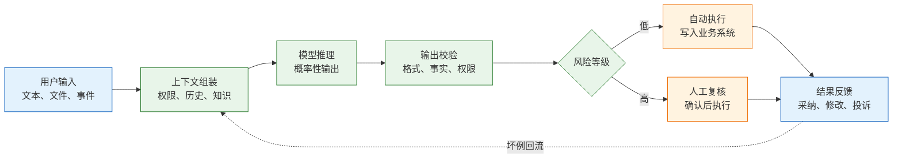
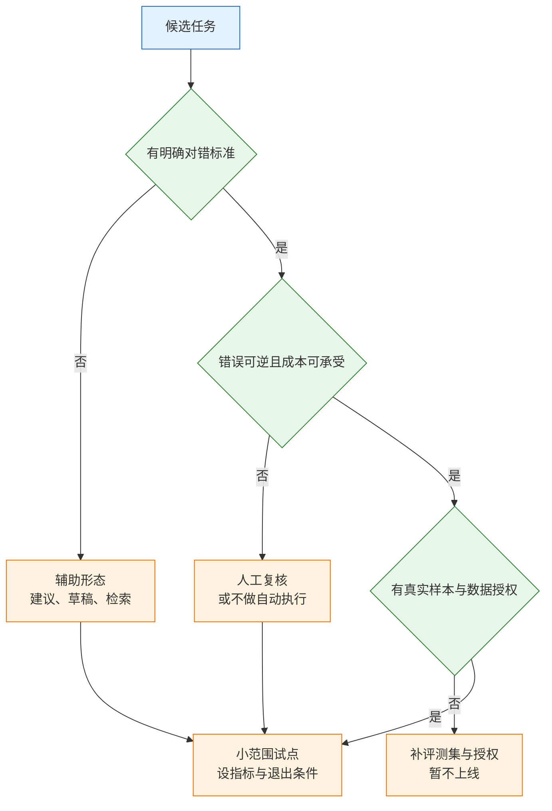
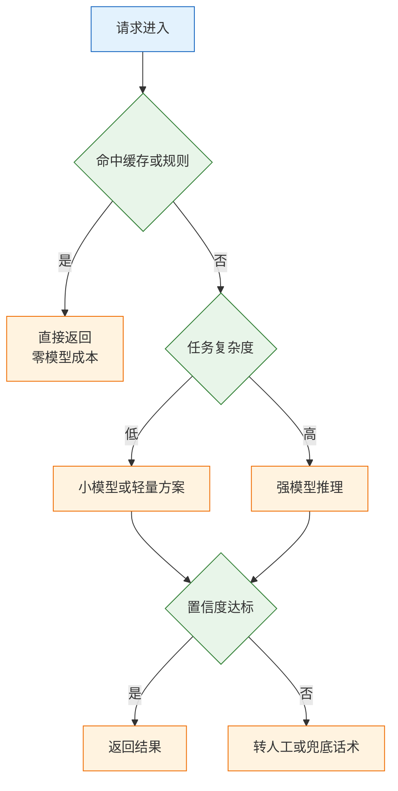
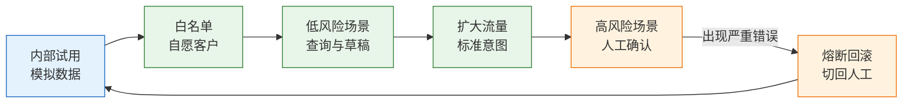

# AI 产品

---

## 一、AI 产品是什么

AI 产品是把概率性的模型能力嵌入真实业务流程的产品形态。它与普通功能最大的区别不在技术栈，而在确定性：同一个输入可能得到不同输出，错误往往以“自信地答错”而不是“报错”的形式出现。产品设计的重点因此从“功能是否实现”转向“错误如何被发现、由谁承担、怎样退出”。

模型、AI 功能、AI 产品是三个层次。模型提供推理能力；AI 功能把模型接到一个具体任务上，例如分类、抽取、生成；AI 产品则把功能放进业务流程，连同权限、人工复核、计费、审计和退出路径一起交付。只完成模型调用，距离可售卖的产品还有很长一段距离。

### 1.1 核心概念

AI 产品的设计围绕四个约束展开：任务边界、人机分工、评测标准、成本与退出。任务边界说明做什么、不做什么；人机分工说明谁做最终决定；评测标准说明什么算合格；成本与退出说明每次调用能花多少钱、出错后如何停止。

概率性输出带来三类特殊风险。第一是不可判定：文案好坏、战略建议这类任务没有公认答案，无法用准确率验收。第二是不可回滚：发错的邮件、改错的库存、自动执行的退款，撤回成本极高。第三是成本无上限：按调用计费时，一次异常重试或一个爬虫流量就可能把预算打穿。



| 层次 | 交付内容 | 验收重点 |
|---|---|---|
| 模型 | 推理接口与能力边界 | 能力与稳定性 |
| AI 功能 | 单任务闭环 | 准确率与错误类型 |
| AI 产品 | 流程、权限、计费、退出 | 业务指标与责任归属 |

### 1.2 适用场景与边界

适合 AI 的任务通常具备三个特征：输入可以结构化、输出有判断标准、错误可以承受或拦截。分类、抽取、摘要、格式转换、检索问答都属于这一类。它们的目标明确，评测可以按场景拆解，人工复核也能在关键节点插入。

不适合直接自动化的任务也有三个特征：没有公认答案、错误不可逆、责任无法转移。医疗诊断、法律意见、资金划转、生产设备控制，不适合让模型独立做最终决定。这些场景可以做信息整理、草稿生成、异常提示，但必须保留专业人员签字与转人工路径。

| 场景类型 | 判断依据 | 建议形态 |
|---|---|---|
| 分类与路由 | 标签明确、可抽样复核 | 自动加抽样 |
| 信息抽取 | 原文可核对 | 抽取加高亮加人审 |
| 内容生成 | 好坏主观、错误成本低 | 多候选加人选 |
| 客服答复 | 意图复杂、涉及承诺 | 草稿加人工发送 |
| 资金与权限操作 | 错误不可逆 | 硬规则加人工审批 |
| 高风险专业建议 | 责任无法转移 | 只做资料整理并转人工 |

> **注意**：AI 产品的边界不是“模型能不能做”，而是“组织愿不愿意为错误承担后果”。技术可行但责任无法落地的场景，不应进入自动执行。

---

## 二、任务适用性判断

### 2.1 四个判断维度

判断一个任务是否适合 AI，用四个维度筛选，比争论模型强弱有效。四个维度分别是可判定性、错误成本、可逆性、样本与权限。

可判定性看是否存在公认的正确结果。分类、抽取、格式转换可以判定；文案质量、战略建议只能评价，不能判定。错误成本看答错之后是麻烦、赔钱还是停线。可逆性看错误能否撤回。样本与权限看是否有真实输入、真实答案，以及数据能否交给第三方处理。

| 维度 | 判断依据 | 不满足时的处理 |
|---|---|---|
| 可判定性 | 是否有公认正确答案 | 只做辅助，不做自动判定 |
| 错误成本 | 答错的赔付、停线、合规后果 | 必须人工在环 |
| 可逆性 | 能否撤回、更正、补偿 | 禁止自动执行 |
| 样本与权限 | 真实数据与授权是否具备 | 先补数据与授权 |



### 2.2 任务分级与形态选择

四个维度组合后，任务会落到不同等级。等级决定产品形态，不决定模型选型。先定形态，再选技术，顺序反过来通常得到一个“演示很好、上线不敢用”的功能。

| 任务 | 可判定性 | 错误成本 | 建议形态 |
|---|---|---|---|
| 工单分类到部门 | 高 | 低，可改派 | 自动加抽样复核 |
| 合同条款抽取 | 高 | 中，需核对 | 抽取加原文高亮加人审 |
| 客服标准问题 | 中 | 中，影响体验 | 草稿加人工发送 |
| 自动退款 | 高 | 高，直接资损 | 硬规则加人工审批 |
| 营销文案 | 低 | 低 | 多候选加人工选择 |
| 医疗与法律建议 | 低 | 极高 | 只做整理并明确转人工 |

最后一行的判断不是技术判断，而是责任判断。高风险领域要写清输出不构成专业意见，保留转人工入口，具体合规要求以当地法规与专业评估为准。

> **注意**：同一个任务在不同客户处的等级可能不同。内部知识检索答错只是不便，面向客户的答复答错可能构成承诺；产品要按使用场景分级，不能按功能名称统一放开。

---

## 三、人机协同模式

### 3.1 四种分工

“AI 替代人”通常是最差的起点。更现实的做法是按风险与频率分配决定权，形成四种稳定的分工。

| 模式 | 决定权 | 适合 | 关键指标 |
|---|---|---|---|
| AI 建议、人执行 | 人 | 写作、设计、客户回复 | 采纳率、修改幅度 |
| 人审 AI 输出 | 人 | 抽取、审核、合规检查 | 复核通过率、漏检率 |
| AI 自动、异常转人 | 系统 | 高频、低风险、可回滚 | 自动处理率、转人工率 |
| 人机协作 | 共同 | 复杂分析、长流程 | 完成时长、满意度 |

四种模式可以共存。同一个产品里，标准问题走自动，涉及退款与投诉的意图转人工，复杂工单由人机协作完成。模式由风险决定，不由技术能力决定；模型再强，不可逆动作也应保留人工确认。

### 3.2 错误成本的不对称

AI 的错误不是对称的。漏答一个问题，用户可能再问一次；答错一个退款政策，可能直接赔钱。把两类错误合并成一个“准确率”，会掩盖真正的风险。

| 错误类型 | 典型后果 | 控制手段 |
|---|---|---|
| 错答 | 赔付、投诉、合规事件 | 高置信阈值、人工复核 |
| 漏答 | 体验下降、重复咨询 | 覆盖率监控、兜底话术 |
| 格式错 | 下游解析失败 | 结构化校验与重试 |
| 越权 | 看到不该看的数据 | 检索前过滤、权限校验 |
| 拒答不当 | 可用性下降 | 分场景统计拒答率 |

产品要分别设定错答率与漏答率的阈值，并单独统计严重错误。严重错误指造成资损、投诉、数据泄露或监管风险的错误，它的容忍度远低于平均准确率。一个总体准确率 92% 的功能，如果 8% 的错误集中在小概率高赔付场景，仍然不能自动上线。

> **产品红线**：AI 输出不得直接触发不可逆动作。退款、扣款、删数据、发对外邮件、修改库存，必须经过硬规则校验或人工确认；模型置信度不能作为唯一放行依据。

---

## 四、评测体系与验收标准

### 4.1 评测集构造

演示阶段试十几个问题、大部分答得不错，不构成验证。上线前要有一份按真实分布构造的评测集，它能回答“在真实流量下会错在哪里”，而不是“在精心挑选的问题上能答多好”。

评测集要满足五个条件：来源真实、分层覆盖、标准明确、留出独立、持续更新。来源真实指从历史工单、真实文档、真实提问中抽样；分层覆盖指高频、长尾、边界、恶意输入、空输入、超长输入都要有；标准明确指谁判对、判错以及依据；留出独立指调优用过的问题不能再用作最终评测；持续更新指上线后把真实坏例补进去，按版本回归。

| 维度 | 要求 | 常见反例 |
|---|---|---|
| 来源 | 真实历史数据抽样 | 自己编写的漂亮问题 |
| 分层 | 高频、长尾、边界、攻击 | 只覆盖主流程 |
| 标注 | 双人标注、分歧仲裁 | 一人凭感觉判定 |
| 留出 | 调优集与测试集分离 | 用测试集反复调提示 |
| 更新 | 坏例按版本回流 | 上线后不再维护 |

### 4.2 指标分层

单一准确率不能作为验收标准。指标要按任务与错误类型拆开，才能判断改版是变好还是变坏。

| 指标 | 含义 | 常见陷阱 |
|---|---|---|
| 准确率 | 答对样本占比 | 样本不平衡时虚高 |
| 召回率 | 应找到的找到多少 | 只追召回带来误报 |
| 精确率 | 报出的有多少正确 | 与召回互相拉扯 |
| 覆盖率 | 能处理的请求占比 | 不会就说不会可能更好 |
| 采纳率 | 人愿意直接使用 | 最接近业务价值 |
| 严重错误率 | 造成资损或投诉的比例 | 比总分更该盯 |

指标要绑定业务动作。采纳率低，可能是输出太长、语气不对、缺少依据；转人工率高，可能是置信阈值过严或知识库缺失；严重错误率上升，必须立即回滚，不能靠平均值解释。

阈值要在评测集上标定，而不是凭经验设定。置信阈值过高会把大量本可自动处理的请求推给人工，推高复核成本；阈值过低会把错误直接放出去。标定方法是在留出集上计算不同阈值下的准确率与转人工率，选择业务能够承受的交点，并在上线后按周复核。

### 4.3 AI 功能验收表

验收表按“任务、评测、人机、成本、退出”五类组织，每项都要有证据。没有证据的“已优化”不计入验收。

| 验收项 | 通过标准 | 证据 | 结论 |
|---|---|---|---|
| 任务边界 | 明确列出做与不做 | 任务说明与范围表 | 通过或驳回 |
| 评测集 | 覆盖高频、长尾、边界 | 样本清单与标注 | 通过或驳回 |
| 严重错误 | 低于约定阈值 | 分场景错误统计 | 通过或驳回 |
| 人工复核 | 高风险场景全部拦截 | 复核日志抽样 | 通过或驳回 |
| 单次成本 | 低于商业模型上限 | 账单与用量测算 | 通过或驳回 |
| 退出路径 | 可关闭、可回退、可删除 | 演练记录 | 通过或驳回 |

验收结论只有三种：通过、限制上线、驳回。限制上线要写清开放场景、流量比例与观察期，不能只写“先小范围试试”。

---

## 五、成本结构与预算倒推

### 5.1 成本构成

AI 功能的成本至少四块：模型调用、人工复核、失败重试与兜底、基础设施。按调用计费时，前三块都会随用量增长，而收入不一定同步增长。

| 成本项 | 内容 | 变动方式 |
|---|---|---|
| 模型调用 | 输入输出令牌、图片、语音 | 随调用量与长度线性增长 |
| 人工复核 | 审核、修正、客服兜底 | 随高风险请求比例增长 |
| 重试与兜底 | 失败重试、降级、转人工 | 随错误率与超时增长 |
| 基础设施 | 向量库、缓存、日志、带宽 | 随数据量与并发增长 |

> **注意**：失败请求同样计费。重试策略要有上限，超时与限流要有降级路径，否则一次供应商抖动会在短时间内产生大量无效调用。

### 5.2 单次成本上限

成本要从商业模型倒推，而不是先选模型再算账。单次可承受成本由客单价、毛利率、功能预算占比与月调用次数共同决定。

```text
单次成本上限 = 客单价 × 毛利率 × 功能预算占比 / 月调用次数
```

示例数字均为假设：某功能客单价 30 元每月，毛利率 70%，愿意把其中 20% 用于模型调用，月调用 1,000 次，则单次上限约为 0.0042 元。若目标模型单次成本为 0.05 元，方案在商业上不成立，只能减少调用、改用更便宜的路径，或者提高客单价。

倒推之后再看方案，判断会清晰很多。高端模型适合低频高价值任务，例如合同风险提示；高频低价值任务要用小模型、缓存或规则前置。把两者混在同一预算里，通常会出现“演示效果很好，规模越大亏得越多”。

倒推的另一个作用是比较方案。同样的预算，可以买更少的强模型调用，也可以买更多的弱模型调用加人工复核；哪条路径的总成本更低，要用真实样本跑一遍，而不是按单价直接比较。

### 5.3 方案分层与路由

分层处理是控制成本的主要手段。简单请求走便宜路径，复杂请求升级到强模型，不确定的请求转人工。路由依据可以是输入长度、意图分类、置信度或业务规则。



| 方案 | 适合 | 代价 |
|---|---|---|
| 直接调用商用接口 | 快速验证、调用量小 | 单价高，受供应商条款约束 |
| 自建或开源部署 | 量大、数据敏感 | 运维与人力成本高 |
| 分层路由 | 请求差异大 | 需要评测与兜底 |
| 采购成品 | 非核心场景 | 定制难，数据边界需谈清 |

数据条款要在试点前确认：输入是否用于训练、保留多久、是否跨境、能否删除、子处理商有哪些。把这些写成一句话给客户看，比藏在长协议里更有效；具体法律要求因地区与行业而异，需法务确认。

---

## 六、上线、观察与退出

### 6.1 灰度策略

AI 功能的灰度按场景开放，不按随机比例开放。低风险意图先上，高风险意图后上；同一意图内部再按流量比例扩大。随机比例会把退款、投诉这类高风险请求一起放出去，等于用真实客户做压力测试。

| 阶段 | 开放范围 | 退出条件 |
|---|---|---|
| 内部试用 | 员工与模拟数据 | 严重错误超过阈值 |
| 白名单 | 少量自愿客户 | 投诉率上升 |
| 低风险场景 | 查询、分类、草稿 | 采纳率持续低于目标 |
| 扩大流量 | 标准意图全量 | 成本超预算或转人工率异常 |
| 高风险场景 | 需人工确认的意图 | 任何严重错误即暂停 |



### 6.2 可观测与版本追溯

AI 功能的可观测性与普通功能不同：除了延迟和错误率，还要记录输入分布、输出质量、人工修改与转人工原因。没有这些数据，改版只能靠感觉。

| 观测项 | 采集方式 | 用途 |
|---|---|---|
| 输入分布 | 意图、长度、语言分类 | 发现流量漂移 |
| 输出质量 | 采纳、修改、拒绝 | 判断实际可用性 |
| 转人工原因 | 标签与自由文本 | 定位能力缺口 |
| 版本信息 | 模型、提示、知识库版本 | 复现与回滚 |
| 成本 | 每次调用与每日汇总 | 控制预算 |

模型、提示、检索资料、后处理规则都要有版本号。供应商升级模型时，先在评测集上跑回归，再按灰度放量；提示改动同样要回归，不能因为“只改了一句话”就直接上线。

线上抽检要固定频率与样本量。按场景分层抽样，重点看被采纳但实际错误的样本；只统计用户投诉会低估问题，因为多数错误用户不会反馈，只会沉默流失。抽检结果进入坏例库，作为下一版评测集的来源。

### 6.3 退出与数据删除

退出能力是 AI 产品的一部分，不是售后补充。用户要能关闭功能、切回旧流程、删除历史输入；删除要真正生效，而不是只在界面上隐藏。

回滚不只是关开关。已经生成的草稿、已经发出的内容、已经写入业务系统的字段，都要有清理或更正方案。不可逆动作默认不自动执行，确需自动执行时，要有硬规则、额度上限与人工抽检。

> **产品红线**：AI 输出不可控时，系统必须能在一分钟内停止放量并切回人工路径。没有熔断开关、没有旧路径、没有数据更正方案的功能，不得进入生产环境。

---

## 七、常见失败模式与检查清单

### 7.1 失败模式

| 现象 | 最可能原因 | 处理 |
|---|---|---|
| 先选模型再找场景 | 技术驱动，缺任务边界 | 回到可判定性与错误成本 |
| 用演示准确率做上线决策 | 样本少、问题过于简单 | 建分层评测集，看严重错误 |
| 目标定为替代人工 | 忽略责任与异常 | 先做人机协同，按场景放开 |
| 上线后准确率骤降 | 真实分布不同或评测泄漏 | 补真实样本，按版本回归 |
| 用户不愿采纳 | 输出过长、不可编辑、无依据 | 缩短、给引用、支持修改 |
| 没有转人工入口 | 把 AI 当唯一路径 | 高风险场景保留人工 |
| 只算调用费 | 漏了复核与兜底成本 | 按单次全成本倒推 |
| 所有请求都用强模型 | 没有分层与缓存 | 简单请求走便宜路径 |
| 供应商升级后效果变差 | 无回归与版本锁定 | 固定版本，升级前跑评测 |
| 客户数据被用于训练 | 条款未确认 | 试点前谈清并提供关闭项 |
| 出问题只能等修复 | 无开关与旧路径 | 灰度、熔断、数据更正 |

排查顺序：先确认输入分布是否变化，再查版本与配置，再看评测集覆盖，最后才讨论换模型。多数“模型变差”实际来自流量结构变化或提示改动。

### 7.2 检查清单

- [ ] 任务边界写明做什么、不做什么、错了怎么办
- [ ] 可判定性、错误成本、可逆性、样本权限四项已评估
- [ ] 高风险场景保留人工确认，不自动执行不可逆动作
- [ ] 评测集来自真实分布，覆盖长尾、边界与恶意输入
- [ ] 调优集与测试集分离，坏例按版本回流
- [ ] 严重错误率单独统计并有明确阈值
- [ ] 单次成本按商业模型倒推，未超过上限
- [ ] 失败重试有次数上限，超时有限流与降级
- [ ] 灰度按场景推进，每个阶段有退出条件
- [ ] 模型、提示、知识库版本可追溯
- [ ] 熔断开关、旧路径、数据更正方案已演练
- [ ] 数据条款明确训练用途、保留期、跨境与删除

> **核心结论**：AI 产品先定责任再定技术；准确率不是验收标准，分场景的错误成本才是；成本按单次倒推，退出能力与功能同时交付。
