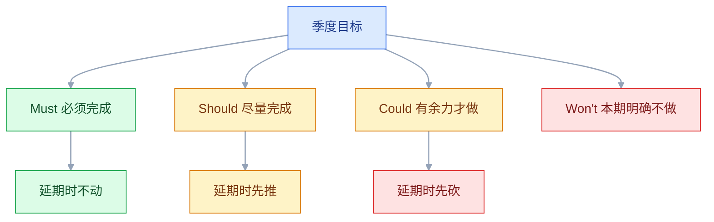
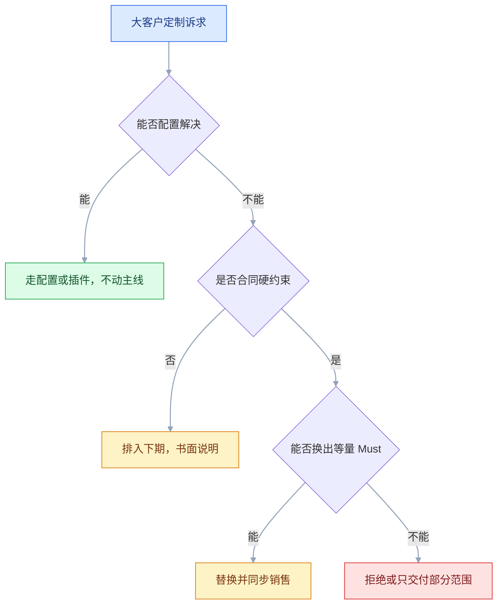

# 路线图与版本规划

## 一、工程案例：给一个 B 端产品做下季度路线图并对外沟通

**场景**：一个审批流 SaaS，研发 12 人（8 开发、2 测试、1 设计、1 产品）。上季度路线图排了 12 个功能，实际完成 7 个；销售拿着路线图向客户承诺「下季度都有」，结果两次失信；团队连续加班，线上事故也变多。下季度不能再扩编，还要接两个大客户的定制诉求和一个合规改造节点。

**约束**：

- 产能固定，12 人不变；
- 两个大客户的要求互相冲突，不能都进主线；
- 合规改造有硬性截止时间，不能延期；
- 技术债已经影响到发布速度，必须预留时间；
- 销售需要一个可以对外说的版本，但不能变成逐条承诺。

**目标**：产出一份「有目标、有分层、有缓冲、有砍单顺序」的路线图，以及一份销售能用的对外口径。

### 1.1 先盘产能，不先列功能

| 项 | 计算 | 结果 |
|---|---|---|
| 名义产能 | 8 开发 × 季度工作日 | 基准 |
| 有效产能 | 扣除会议、答疑、线上问题 | 通常按 60%–70% 估 |
| 测试与设计 | 与开发并行，但有关键路径 | 单独排 |
| 已占用 | 合规改造、历史事故修复 | 先扣 |
| 可用于新功能 | 剩余部分 | 再分配 |

**不要按「每人每天 8 小时」排满**。会议、代码评审、答疑、线上支持都会吃掉时间；按名义产能排，等于默认加班。

### 1.2 定季度目标，而不是功能清单

```text
✘ 本季度做：批量审批、移动端、报表、消息中心、权限细化……
✔ 本季度目标：让 200 人以上组织的审批平均耗时下降，
   同时把发布频率从每月一次提升到每两周一次。
```

目标要能被指标验证，且不超过两个。写法上至少补齐四件事：

| 要素 | 本例 | 判定 |
|---|---|---|
| 基线 | 当前审批平均耗时、当前发布间隔 | 能从埋点或发布记录取到 |
| 目标值 | 耗时较基线下降、发布间隔缩到两周 | 有方向、幅度和判断口径 |
| 验证窗口 | 季度末看结果，月中看趋势 | 到期能取数 |
| 负责人 | 产品负责人 + 数据接口人 | 有人对结果负责 |

幅度按实际基线定，不要照搬别家的百分比。目标太多，等于没有优先级。

### 1.3 收集机会并排序

| 来源 | 输入 | 处理 |
|---|---|---|
| 销售 | 客户承诺、丢单原因 | 进需求池，标注客户与金额 |
| 客服 | 高频问题、工单量 | 按问题类型聚合 |
| 客户成功 | 续费风险、健康度、流失前兆 | 按客户分层看，不只听单次投诉 |
| 数据 | 使用率、流失点 | 对应到具体环节 |
| 技术 | 事故、性能、技术债 | 单独评估风险 |
| 合规 | 法务、安全要求 | 硬性排期，不参与排序 |

排序用价值/成本/风险的粗算即可，不需要精确到小数。

| 机会 | 价值 | 成本 | 风险 | 结论 |
|---|---|---|---|---|
| 批量审批 | 大客户刚需 | 中 | 低 | 本期做 |
| 移动端审批 | 使用频率高 | 大 | 中 | 本期做轻量版 |
| 报表自定义 | 少数客户提 | 大 | 中 | 下期 |
| 换肤 | 锦上添花 | 小 | 低 | 有余力再做 |
| 消息中心重构 | 技术债 | 中 | 高 | 单独排 |

### 1.4 分层与砍单顺序



| 层 | 含义 | 延期时 |
|---|---|---|
| Must | 不做会违反合规、丢大客户、阻塞其他功能 | 不砍，宁可延期 |
| Should | 重要但不致命 | 往后推一个版本 |
| Could | 锦上添花 | 先砍 |
| Won't | 本期明确排除 | 不进讨论 |

**Won't 要写理由和去向**。「本期不做报表自定义，因为需要重做查询引擎，下季度单独评估」，比只写「不做」更能止住反复提。

### 1.5 依赖与里程碑

| 事项 | 依赖 | 需要谁 | 最晚确认时间 |
|---|---|---|---|
| 批量审批 | 审批引擎支持批量事务 | 后端 | 第 2 周 |
| 移动端审批 | 移动端登录态打通 | 客户端 | 第 1 周 |
| 合规改造 | 安全团队评估 | 安全 | 第 1 周 |
| 报表 | 数据仓库字段补齐 | 数据 | 第 4 周 |

**依赖要标「最晚确认时间」**。没有这个时间，依赖会一直「在推进」，直到上线前才暴露。

里程碑只设 3–5 个，每个对应一个可观察的状态，不写「开发完成 80%」：

| 里程碑 | 可观察状态 | 时间 |
|---|---|---|
| 方案冻结 | 批量事务方案通过评审，接口定稿 | 第 2 周末 |
| 联调通过 | 批量审批在测试环境跑通主流程 | 第 6 周末 |
| 灰度就绪 | 开关、监控、回滚脚本均可用 | 第 8 周末 |

**到期未确认就升级**：先找对接人，再找对方负责人，最后进季度风险清单。不要等到联调才发现对方根本没排期。

### 1.6 产能分配与缓冲

```text
季度有效产能：按 100 人天计（示例，以实际盘点为准）
- 合规改造（Must）：20 人天
- 新功能（Must + Should）：50 人天
- 技术债与稳定性：20 人天
- 缓冲：10 人天
```

| 项 | 比例 | 作用 |
|---|---|---|
| 新功能 | 50%–60% | 对外交付 |
| 技术债 | 15%–20% | 防止事故与速度下滑 |
| 合规/硬性 | 按实际 | 不可协商 |
| 缓冲 | 10%–15% | 吸收估算误差 |

**缓冲不是浪费**。没有缓冲的计划，一次线上事故就会让整个季度失信。

### 1.7 灰度与发布计划


| 阶段 | 观察时长 | 通过条件 |
|---|---|---|
| 内部 | 1–2 天 | 主流程可用，无阻断缺陷 |
| 白名单 | 3–5 天 | 无新增高优工单 |
| 5% 租户 | 3 天 | 错误率、耗时、转化在阈值内 |
| 20% 租户 | 3 天 | 指标稳定，客诉未上升 |
| 全量 | 持续 | 进入常规监控 |

**回滚条件要写成数**：错误率超过基线多少、核心转化下降多少、客诉增加多少，达到即回。没有数的「视情况回滚」等于不回。

### 1.8 对外版本与承诺口径

| 对象 | 内容 | 粒度 |
|---|---|---|
| 客户/销售 | 主题 + 大致时间 + 已确认能力 | 季度/半年 |
| 内部团队 | 目标 + 功能 + 依赖 + 砍单顺序 | 迭代 |
| 老板 | 目标 + 里程碑 + 风险 | 月度 |

**对外只承诺「主题 + 已确认的能力」**，不逐条承诺功能和时间。销售需要具体答复时，走「需确认」流程，由产品给出书面口径。

给销售的口径分三档，写成一句话就能转发：

```text
可承诺：本季度聚焦审批效率，批量审批已进入开发。
需确认：移动端审批的具体时间，待产品书面回复后再答复客户。
不做：报表自定义本期不做，下季度单独评估。
```

**已经说出去的承诺要单独记账**：客户、内容、日期、谁说的、口径来源。每周对一次，发现要失期就提前说，不要拖到承诺日。

### 1.9 复盘机制

| 指标 | 算法 | 用途 |
|---|---|---|
| 计划完成率 | 实际完成项数 / 计划完成项数 | 规划质量 |
| 价值达成率 | 达到目标的功能数 / 上线功能数 | 选题质量 |
| 变更次数 | 季度内范围变更次数 | 稳定性 |
| 事故数 | 线上 P1/P2 数量 | 技术债效果 |

**价值达成率最值得看**：做了十个功能只有两个达到目标，说明问题在「选什么」，不是「做得多快」。

复盘在季度结束后两周内做完，用同一套口径和上一季度对比。只看一个数容易误判：完成率高但价值达成率低，说明做了一堆没人用的功能；完成率低但价值达成率高，可能是范围收缩得当。

### 1.10 产出物

```text
路线图包
├── 01-季度目标（1–2 个，可验证）
├── 02-产能盘点（名义/有效/已占用）
├── 03-机会清单（来源/价值/成本/风险）
├── 04-分层清单（Must/Should/Could/Won't）
├── 05-排期表（含依赖与最晚确认时间）
├── 06-发布计划（灰度/回滚/观察指标）
├── 07-对外口径（可承诺/需确认/不做 + 承诺台账）
└── 08-复盘指标（完成率/价值达成率）
```

### 1.11 验收表

| 检查项 | 怎么验 | 通过标准 |
|---|---|---|
| 产能有依据 | 看盘点表 | 名义、有效、已占用三列齐全 |
| 目标可验证 | 读季度目标 | 有指标、基线、时间 |
| 每项有分层 | 抽查功能清单 | 都能归入 Must/Should/Could/Won't |
| 砍单顺序明确 | 问「延期先砍什么」 | 能立刻答出具体项 |
| 依赖有 owner | 看依赖表 | 每项有负责人和最晚确认时间 |
| 技术债有预算 | 看产能分配 | 占比 15%–20% 且有具体项 |
| 缓冲存在 | 看分配表 | 至少 10% |
| 灰度有回滚条件 | 看发布计划 | 阈值是可判断的数 |
| 对外口径分档 | 看销售版 | 可承诺/需确认/不做三档清楚 |
| 承诺可追溯 | 查承诺台账 | 客户、内容、日期、口径来源齐全 |
| 回滚有人拍板 | 问「谁能直接回滚」 | 指定到人，不需要开会 |
| 复盘指标可算 | 看数据源 | 完成率和价值达成率都能取数 |

---

## 二、高频问答：会卡住你的地方，也是面试最常问的

### 2.1 路线图排得满满当当

**现场**

用上个季度的实际完成量对比计划量，再取过去 3 个季度的实际完成率。

**要点**

- 排满不等于产出多，按理想产能规划就是默认加班。
- 长期完成率低于 80%，说明计划量本身不成立，先把量降到历史均值。
- 缓冲和技术债不是浪费，是吸收估算误差的部分。

**追问**

- 完成率多少算健康？→ 80% 左右；长期 100% 往往说明排得太松。
- 有效产能怎么估？→ 名义产能扣掉会议、答疑、线上问题，通常 60%–70%。
- 老板要求排满怎么办？→ 把 Must 压到产能的 60% 以内，其余标 Should/Could。

### 2.2 延期了，不知道先砍什么

**现场**

问「如果只能交付一半，保哪些」。答案要能在规划文档里直接找到，而不是临时开会吵。

**要点**

- 没有 Must/Should/Could 分层，所有事看起来都重要，延期只能靠加班。
- 砍单顺序要在规划时定，不是延期时定。
- 加班换来的是质量和事故，不是交付。

**追问**

- Must 占多少合适？→ 不超过产能的 60%，占满就没有缓冲。
- Won't 要不要写？→ 要，写理由和去向，否则会被反复提。
- 砍单和降级怎么选？→ 先砍 Could，再降 Should 的范围，Must 不动。

### 2.3 销售按路线图逐条承诺客户

**现场**

看销售手里的版本和产品版本是否同一份。补法是给销售单独做一份「主题 + 已确认能力」的版本。

**要点**

- 对外版本太细、又没有分档，销售只能照着念。
- 对外只承诺「主题 + 已确认的能力」，不逐条承诺功能和时间。
- 具体答复走「需确认」流程，由产品给书面口径。

**追问**

- 三档口径怎么写？→ 可承诺、需确认、不做，每档一句话能直接转发。
- 客户就要具体日期怎么办？→ 给区间和前置条件，合同硬节点单独确认。
- 承诺失期了怎么处理？→ 提前告知加替代方案，别拖到承诺日。

### 2.4 路线图只有功能名，没有目标

**现场**

逐项问「这个功能上线后看哪个数」，每个 Must 项配一个目标指标。

**要点**

- 功能清单回答不了「做完算不算成功」。
- 没有指标的项目降级为 Could，或先做调研。
- 目标要写成「指标 + 基线 + 时间」，不是「上线某功能」。

**追问**

- 一个季度几个目标？→ 1–2 个，多了等于没有优先级。
- 目标能不能只有方向没有数？→ 不能，验收时没法判断。
- 功能有指标但取不到数怎么办？→ 先补埋点，或立项时换一个能取到的指标。

### 2.5 技术债永远排不进去

**现场**

看过去半年的事故数、发布耗时、回滚次数；每季度固定留 15%–20% 产能给技术债。

**要点**

- 技术债收益不直观，又没有固定预算，就永远排在业务需求后面。
- 要写成业务语言：「把回归时间从两天降到半天」，不是「重构某模块」。
- 预算和功能预算分开列，不参与功能排序。

**追问**

- 15%–20% 是硬指标吗？→ 是经验区间，事故多的季度临时上调，稳定后回落。
- 怎么向老板证明值得？→ 用事故数、发布耗时、回滚次数三个数说话。
- 技术债要不要单独立项？→ 架构级要，代码级随功能顺手改。

### 2.6 依赖到上线前才暴露

**现场**

看排期表里有没有「依赖方」和「确认时间」两列；每个跨团队项指定对接人和截止日。

**要点**

- 只排自己的活，外部依赖就一定会拖到联调才暴露。
- 依赖要标「最晚确认时间」，没有这个时间，依赖会一直「在推进」。
- 到期未确认就升级：对接人、对方负责人、季度风险清单。

**追问**

- 为什么不能等到联调？→ 联调是最后一道，暴露时已经没有排期空间。
- 依赖方一直说在推进怎么办？→ 要可观察的产出物，比如文档、沙箱、接口 mock。
- 关键路径怎么找？→ 画依赖图，找最长路径，把不确定的环节前置。

### 2.7 灰度上了，出问题不敢回滚

**现场**

看发布计划里有没有「回滚条件」和「决策人」。上线前定好错误率、转化率、客诉三条阈值。

**要点**

- 没有阈值的「视情况回滚」等于不回。
- 回滚不是失败，是预案；不敢回滚通常是因为没人被授权。
- 指定一人有权直接回滚，不需要开会。

**追问**

- 回滚条件怎么写？→ 错误率、核心转化、客诉的具体数，达到即回。
- 谁有权回滚？→ 一线值班加技术负责人，写进发布计划。
- 回滚后数据怎么办？→ 新字段要向前兼容，回滚后已产生的数据仍要可读。

### 2.8 特性开关越积越多

**现场**

数一下当前活跃开关数量，看最老的创建时间；每个开关登记「负责人、创建时间、清理时间」。

**要点**

- 开关留着「万一要用」，代价是代码分支和测试组合爆炸。
- 全量稳定 2–4 周后清理，跨季度的开关进季度审计。
- 没有负责人的开关，等于没人敢删。

**追问**

- 开关和配置有什么区别？→ 开关是临时的发布控制，配置是长期的产品能力。
- 清理时怎么确认没在用？→ 看调用日志和开关平台的使用记录，连续两周无命中再删。
- 开关能不能替代回滚？→ 能覆盖大部分场景，但数据结构和依赖变更还得回滚版本。

### 2.9 版本节奏和客户节奏冲突

**现场**

看客户合同里是否有版本窗口约定，再把「部署」和「发布」分开看。

**要点**

- 客户要稳定，不等于要少发版。
- 部署可以频繁，功能用开关控制；面向客户的功能发布按约定窗口走。
- B 端要提前给变更说明和培训材料。

**追问**

- 部署和发布的区别？→ 部署是把代码放上去，发布是让用户看到行为变化。
- 客户要求固定窗口怎么办？→ 约定窗口加紧急修复单独流程。
- 发版频率由什么决定？→ 缺陷检测能力和客户的变更成本，不是越频繁越先进。

### 2.10 路线图一年没更新

**现场**

对比当前路线图与最近一次客户需求变化。节奏是季度重规划、月度微调。

**要点**

- 年初定完就不动，等于假设市场、客户和技术都没变。
- 坚持计划不是执行力，按新信息调整才是。
- 重大假设变化时随时开一次复盘，不用等季度末。

**追问**

- 多久重规划一次？→ 季度重规划，月度微调，重大变化随时。
- 频繁改会不会失去方向？→ 改的是范围和优先级，季度目标保持稳定。
- 怎么记录变化？→ 每次重规划写清改了什么、为什么、谁确认。

### 2.11 大客户定制插队，主线全乱

**现场**

看定制需求是否可配置解决，再算合同金额与占用产能的比。判断路径固定下来，销售就不用每次找产品特批。



判断结果和换出的项要写进同一份路线图。

**要点**

- 大客户不能得罪，但定制也不是必须改主线。
- 先看能否配置或插件解决；必须改主线的，明确换出哪个 Must。
- 定制的维护成本要单独评估，它会在后面每个版本收税。

**追问**

- 怎么判断该不该接？→ 合同金额除以占用产能，再叠加后续维护成本，看能否产品化。
- 换不出 Must 怎么办？→ 拒绝或只交付部分范围，书面说明。
- 定制怎么避免变成永久分支？→ 能抽象成配置项的抽象，抽象不了就限时交付并约定下线。

### 2.12 发布说明缺失，客户不知道改了什么

**现场**

查最近三次发布有没有对外说明。每次发布附一页：新增、变更、修复、需要注意的行为变化。

**要点**

- 上线不等于交付完成，客户不知道改了什么就等于没改。
- 发布说明写「行为变化」，不只写「优化体验」。
- B 端提前 1–2 周发，留出培训和内部审批时间。

**追问**

- 「注意」块写什么？→ 下游脚本、对接系统、培训材料依赖的变化。
- 内部发布也要写吗？→ 要，客服和销售靠它回答问题。
- 发在哪里？→ 客户能搜到的地方，别只发群消息。

### 2.13 已经对外承诺的日期要失期

**现场**

查承诺清单：离承诺日还剩多久，剩余工作量还有多少。每个承诺日前 4 周做一次可达性评估。

**要点**

- 晚说不会让日期变可行，只会把失期变成失信。
- 承诺要进台账：客户、内容、日期、谁说的、口径来源。
- 判断要失期就立刻告知，同时给替代方案：分批交付、临时绕过、补偿。

**追问**

- 提前多久说？→ 至少提前 4 周评估，发现不可行立即沟通。
- 谁去说？→ 销售和产品一起出面，产品讲范围，销售讲关系。
- 事后怎么收口？→ 把承诺口径收回「主题 + 已确认能力」。

---

## 三、核心知识：从零开始要建立的东西

### 3.1 路线图的本质

路线图不是「未来功能清单」，而是「在当前约束下，为什么做这些、不做什么、按什么顺序做」的解释。

| 路线图回答 | 不回答 |
|---|---|
| 为什么是这些事 | 每个按钮怎么画 |
| 为什么是这个顺序 | 具体技术方案 |
| 做完什么算成功 | 每天的进度 |
| 延期先砍什么 | 谁加班 |

**路线图是沟通工具**，不是项目管理工具。它的读者是老板、销售、客户，不是开发的任务列表。

> **面试**：常问「路线图的本质是什么？」答：在当前约束下解释为什么做这些、不做什么、按什么顺序做，不是未来功能清单。

### 3.2 四种形态

| 形态 | 写法 | 适合 |
|---|---|---|
| 时间驱动 | Q1 做 A，Q2 做 B | 对外承诺、合规节点 |
| 主题驱动 | Q1 提升审批效率 | 内部规划 |
| 成果驱动 | 审批平均耗时降到基线以下 | 对内考核、需要留实现空间 |
| Now/Next/Later | 现在做 / 下一步 / 以后 | 变化快、不便给日期 |

没有一种形态对所有场景都最优。对外要给时间就用时间驱动，对内要保灵活就用成果驱动；成果驱动的代价是「怎么做」会反复讨论，需要有人拍板。

**成果驱动允许「怎么做」变化，但「达成什么」不变**。发现更好的方案时，不需要改路线图，只需要改实现路径。

### 3.3 成果驱动的写法

```text
目标：让 200 人以上组织的审批平均耗时下降。
关键结果：
- 批量审批覆盖主要审批类型，覆盖率达到季度初设定的目标值；
- 移动端能完成完整审批，移动端审批占比不低于设定值；
- 超时提醒可配置，超时未处理占比低于基线。
```

目标值从基线推出来，不照搬外部数字；连基线都取不到，就先补数据，再定关键结果。

**关键结果是「可验证的状态」，不是「做完某个功能」**。功能上线但没人用，关键结果就没达成。

### 3.4 产能与速率

| 概念 | 含义 | 用法 |
|---|---|---|
| 名义产能 | 人数 × 工作日 | 上限，不能直接用 |
| 有效产能 | 扣除会议、答疑、支持 | 通常 60%–70%，以实际盘点为准 |
| 历史速率 | 过去几个周期实际完成量 | 最可靠的排期依据 |
| 缓冲 | 吸收估算误差 | 10%–15% |

**排期用历史速率，不用理想产能**。过去三个周期平均完成 7 项，下季度就按 7–8 项排，而不是按「这次大家努力一点」排 12 项。

速率取的是「完成」而不是「开工」：统计过去 3–4 个周期实际合并并上线的项数，剔除体量特殊的大项目，再取中位数。人天口径和项数口径不要混用——一个项里含 10 人天还是 2 人天，排期结论完全不同。

> **面试**：常问「排期该用名义产能还是历史速率？」答：用历史速率，名义产能只是上限，有效产能通常只有 60%–70%。

### 3.5 优先级分层

| 层 | 判断标准 | 延期时 |
|---|---|---|
| Must | 合规、丢客户、阻塞其他功能 | 不砍 |
| Should | 明显影响体验或收入 | 推后 |
| Could | 锦上添花 | 先砍 |
| Won't | 本期明确不做 | 不讨论 |

**Must 通常不超过产能的 60%**（经验值，按团队历史完成率调整）。Must 占满，等于没有缓冲；一次意外就会让所有承诺失效。

### 3.6 排序方法

| 方法 | 公式/做法 | 适用 |
|---|---|---|
| RICE | (覆盖人数 × 影响 × 信心) / 投入 | 多个机会比较 |
| 价值/成本 | 价值分 / 人天 | 快速粗排 |
| 风险优先 | 先做不确定性最高的 | 技术方案未验证 |
| 合规优先 | 硬性截止优先 | 安全、法务 |

**排序结果要能解释**。如果两个项目分数接近，就看战略契合度和依赖关系，不要为了小数位争论。

### 3.7 MVP 的边界

MVP 是「能验证核心假设的最小完整流程」，不是「功能最少的版本」。

| 错误理解 | 正确理解 |
|---|---|
| 先做个能用的 | 先验证最不确定的假设 |
| 砍到只剩一个按钮 | 保留完整闭环，砍增强 |
| 质量可以差 | 体验可糙，但不能崩 |

**检验标准**：用户能不能完整走通一件事。只能上传不能查看，不是 MVP；能上传、查看、删除，哪怕没有批量，也是 MVP。

> **面试**：常问「MVP 的边界怎么划？」答：能验证核心假设的最小完整闭环，砍增强、不砍流程。

### 3.8 版本节奏

| 节奏 | 适合 | 风险 |
|---|---|---|
| 每周 | C 端、快速迭代、自动化完善 | 变更打扰用户 |
| 双周 | 多数团队 | 需要稳定自动化 |
| 每月 | B 端、企业客户 | 反馈慢 |
| 每季度 | 大型系统、强合规 | 市场响应慢 |

**节奏由「缺陷检测能力 + 客户变更成本」共同决定**，不是越频繁越先进：自动化测试和回滚能力没到位，频繁发版只是把事故提前。

**B 端的特殊约束**：客户要培训、走内部审批、做变更管理。频繁变更对他们是负担，所以「小步但稳定」，并提前给说明。部署可以每天进行，面向客户的功能发布仍按约定窗口走。

### 3.9 依赖与关键路径

| 依赖类型 | 例子 | 处理 |
|---|---|---|
| 外部接口 | 支付、短信、ERP | 先要文档和沙箱 |
| 跨团队 | 设计、数据、安全 | 指定对接人和截止日 |
| 技术前置 | 登录态、权限模型 | 第一周做技术验证 |
| 客户配合 | 数据迁移、培训 | 提前排客户时间 |

**关键路径上的任务不能并行拖到最后**。先画一张依赖图，找出最长路径，把不确定的环节前置。

### 3.10 灰度发布

| 维度 | 用法 |
|---|---|
| 按比例 | 最常用，5% → 20% → 50% → 100% |
| 按白名单 | 愿意尝鲜的客户 |
| 按租户 | B 端按客户灰度 |
| 按地区 | 合规、本地化差异 |
| 按端/版本 | 先覆盖新版本 |

**灰度的关键不是「小范围」，而是「可观察、可回滚」**。没有观察指标和回滚条件，只是把事故范围缩小了一点。

### 3.11 特性开关

| 用途 | 说明 |
|---|---|
| 灰度控制 | 按用户/租户开关 |
| 快速回滚 | 关开关，不回滚代码 |
| A/B 实验 | 同版本不同逻辑 |
| 套餐控制 | 按付费等级开放 |
| 应急关闭 | 出问题立即停 |

**开关的代价**：代码分支增多、测试组合爆炸、长期不清理会腐烂。每个开关都要有负责人和清理时间，通常在全量稳定 2–4 周内移除；跨季度的开关要进季度审计。

### 3.12 回滚设计

| 项 | 要写清 |
|---|---|
| 触发条件 | 错误率、转化率、客诉的具体阈值 |
| 决策人 | 谁有权直接回滚 |
| 回滚方式 | 关开关、回滚版本、切流量 |
| 数据兼容 | 新字段、新表是否向前兼容 |
| 回滚后 | 怎么补偿受影响的用户 |

**回滚不是失败，是预案**。上线前没想好怎么回，出问题时就会在群里讨论半小时，错过最佳时机。

### 3.13 对外承诺的粒度

| 粒度 | 可信度 | 适用 |
|---|---|---|
| 主题方向 | 高 | 对外常规沟通 |
| 功能清单 | 中 | 已确认的合同项 |
| 具体日期 | 低 | 合规、合同硬节点 |

**承诺越具体，失信成本越高**。对外说「Q3 聚焦审批效率，会交付批量审批」，比「Q3 的 7 月 15 日上线批量审批」更稳。

> **面试**：常问「对外承诺给到什么粒度？」答：主题方向最稳，功能清单次之，具体日期只在合规和合同硬节点给。

### 3.14 技术债预算

| 类型 | 例子 | 处理 |
|---|---|---|
| 代码债 | 硬编码、缺测试 | 随功能顺手改 |
| 架构债 | 单体过大、耦合 | 单独立项 |
| 文档债 | 接口无说明 | 发布前补 |
| 测试债 | 回归靠手工 | 每季度投入 |

**技术债要写成「业务语言」**：不是「重构订单模块」，而是「把发布前的回归时间从两天降到半天」。这样产品才能判断优先级。

预算通常占季度产能的 15%–20%，和功能预算分开列，不参与功能排序。具体占比看事故率和发布速度：事故多的季度临时上调，稳定后回落，别把它当成固定税。

### 3.15 路线图复盘

| 指标 | 说明 |
|---|---|
| 计划完成率 | 实际完成 / 计划 |
| 价值达成率 | 达到目标的功能 / 上线功能 |
| 变更次数 | 范围稳定性 |
| 事故数 | 技术债效果 |

**复盘不是改数字**。完成率低，要区分是「估得不准」「范围被插单」还是「依赖没解决」，三种原因的改法完全不同。

### 3.16 版本号与发布说明

| 位 | 变化含义 | 例子 |
|---|---|---|
| 主版本 | 不兼容变更 | 2.0 |
| 次版本 | 新功能，向后兼容 | 2.3 |
| 修订号 | 修 bug、小优化 | 2.3.1 |

**发布说明写「行为变化」**，不只写「优化体验」。B 端客户最关心的是「我用惯的流程有没有变」，需要提前通知和培训。

一页发布说明包含四块，按读者关心的顺序排：

```text
新增：批量审批（入口：审批列表 → 批量操作）
变更：超时提醒默认值由 24 小时改为 8 小时
修复：移动端审批偶发白屏
注意：导出的 Excel 增加「审批人」列，可能影响下游报表
```

「注意」块最重要——下游脚本、对接系统、培训材料都依赖它，没有这块的说明等于没发。

### 3.17 功能下线与减法

| 步骤 | 要做什么 | 判定 |
|---|---|---|
| 识别 | 看使用率、替代路径、维护成本 | 连续两个周期使用率低于设定阈值 |
| 通知 | 提前告知客户，给迁移方案和时间表 | 有书面通知和替代路径 |
| 迁移 | 数据导出、批量替换、培训 | 客户能自行完成迁移 |
| 移除 | 关开关、删代码、清理文档 | 无调用、无合同义务 |

**下线先看合同**。合同里写明的功能不能直接停，先走变更协商；没有合同约束的，也给足迁移期。只做加法不做减法，最后会被维护成本拖住。

---

## 四、冷门知识汇总

| 知识点 | 为什么冷门 | 用到时的关键词 |
|---|---|---|
| 季度工作日折算 | 只数人头，不扣法定假日与调休 | 工作日、调休、可用天数 |
| 财年与自然年 | 预算按财年走，路线图按自然年写 | FY、财年起点、Q1 |
| H1/H2 的写法 | 对外文档混用 Q 和半年，客户理解不一致 | 上半年、H1、Q2 |
| 语义化版本三段 | 随手递增，说不清哪次不兼容 | major、minor、patch |
| 预发布版本号 | 灰度包和正式包用同一个号 | rc、beta、build |
| RICE 的信心系数 | 只算价值和成本，信心随手填 | confidence、50%、80% |
| 灰度分桶的稳定性 | 每次随机分组，同一用户反复换形态 | hash、桶、粘性 |
| 开关命名与过期标记 | 创建后没人认领 | owner、expire、前缀 |
| 发布说明的行为变化 | 只写新增，不写改了什么 | breaking change、迁移 |
| Now/Next/Later 写法 | 只见过按季度排的表 | 相对时间、滚动更新 |
| 发布窗口的时区 | 跨区客户按本地时间理解 | UTC、时区、窗口 |
| 灰度批次与版本号对应 | 出问题查不到是哪个包 | 批次、构建号、回滚点 |
| 路线图三份版本的命名 | 一份文档发给所有人 | 对外版、对内版、汇报版 |
| 平台化的「三」法则 | 第二个客户就想抽象 | rule of three、共性 |
