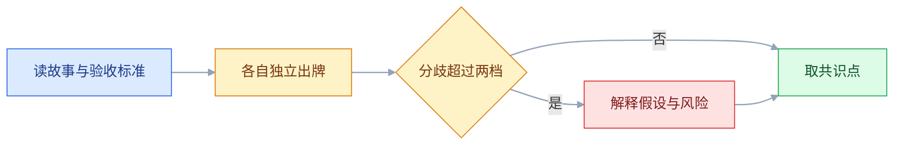
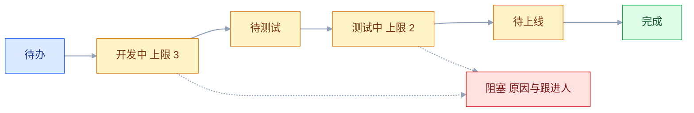
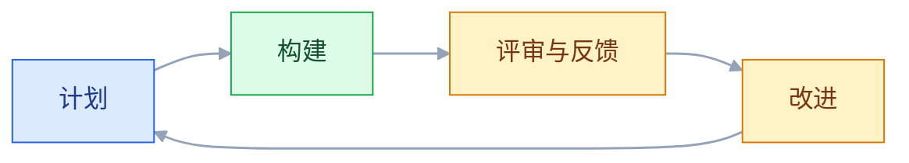

# 敏捷与项目管理

## 一、工程案例：把一个连续延期的迭代拉回正轨

**场景**：一个 6 人团队（4 开发、1 测试、1 设计兼部分产品工作），连续 5 个迭代计划 10 个故事，实际完成 5–6 个。客户版本还有 3 周到期（约 1–2 个迭代），团队已经在连续加班，线上缺陷还在增加。

**约束**：

- 不能扩编，也不能把测试外包；
- 客户版本有一个硬性交付日，不能整体延期；
- 有两个外部接口依赖，对方排期未定；
- 历史上插单频繁，平均每个迭代 3–4 个；
- 团队对「故事点」的理解不一致，估算经常吵。

**目标**：先用 1–2 个迭代保住客户版本的核心范围，再用三个迭代让计划量与实际完成量基本对齐（通常以完成率 80% 以上为参考，按团队历史波动调整），不靠加班换速度。

### 1.1 先用数据描述现状

| 指标 | 取法 | 现状（示例） |
|---|---|---|
| 吞吐 | 每迭代完成的故事数 | 5–6 个 |
| 周期时间 | 从开始到完成的中位数 | 8 天 |
| 在制品 | 同时处于开发/测试的卡片数 | 13 张 |
| 插单占比 | 插单故事点 / 总故事点 | 约 30% |
| 等待时间 | 卡片处于「阻塞」的累计人天（卡数 × 天数） | 每迭代约 4 人天 |

**没有数据的改进，最后都会变成「大家再努力一点」**。先把吞吐、周期、WIP、插单四项拉出来，等待时间作为补充，才能判断问题在计划、流程还是依赖。

### 1.2 校准产能

```text
名义产能：6 人 × 10 个工作日 = 60 人天
有效产能：扣除会议、答疑、支持，示例按 65% 计 ≈ 39 人天
历史吞吐：过去 3 个迭代平均完成 6 个故事
本迭代计划：6 个故事，不再按 10 个排
```

65% 只是本例的取法，实际要用团队自己的记录算：拿上个迭代的日历工时，减去会议、值班、答疑、招聘、培训等固定占用，剩下的才是可排期时间。没有工时记录时，用最近三个迭代的完成量反推，不要凭感觉定一个百分比。

**按历史吞吐排，不按理想工时排**。上个迭代完成 6 个，这个迭代就排 6 个；想排更多，先改善流程，而不是先加计划。故事粒度不同，6 个故事只在本团队内对照；换团队或换拆分方式后，要重新取基线，不要直接套用故事数。

### 1.3 定一个迭代目标

```text
✘ 本迭代：修 12 个 bug、做 3 个需求、优化 2 个页面
✔ 本迭代目标：让客户能在移动端完成一次完整审批
   （对应：移动端登录、待办列表、审批详情、通过/驳回）
```

| 要素 | 本例 |
|---|---|
| 目标状态 | 审批人能在手机上完成一次完整审批 |
| 覆盖场景 | 收到待办、查看详情、通过、驳回、结果同步 |
| 判定方式 | 测试环境用真实账号走通；审批耗时与成功率可查 |
| 明确不做 | 批量审批、报表、组织架构调整 |

**目标是一个可验证的状态，不是任务清单**。写法至少要能回答「谁、在什么场景、完成什么、怎么判定」。有目标才能判断「哪些任务可以砍」；没有目标，每个任务都显得重要。目标之外的需求进下期，不临时塞进本迭代。

### 1.4 拆分到可交付的粒度

| 信号 | 处理 |
|---|---|
| 估不出 | 先做技术验证，不放进迭代 |
| 超过 3 天 | 继续拆 |
| 无法独立测试 | 说明没拆好 |
| 依赖多个角色 | 按交付物拆，不按角色拆 |

**拆分的终点是「能独立演示」**。一个故事做完后，测试能验、产品能看、用户能用，才算拆到位。

### 1.5 估算与分歧



| 出牌 | 含义 |
|---|---|
| 1–2 | 半天到一天，规则清楚 |
| 3 | 两三天，有少量未知 |
| 5 | 一周左右，通常需要再拆 |
| 8 以上 | 太大，先拆或先验证 |

点数本身没有单位，不能和天数固定换算；上表只是团队建立共同基准时的参照，换团队或换拆分方式后要重新校准。

**估算的作用是暴露分歧，不是算准时间**。两个人一个出 3 一个出 13，说明他们对需求或技术方案的理解不同，这比数字本身重要。

### 1.6 依赖前置与风险清单

| 风险 | 触发条件 | 缓解 | 负责人 |
|---|---|---|---|
| 外部接口未就绪 | 第 3 天仍无沙箱 | 先用 mock，接口后接 | 后端 |
| 测试环境不稳 | 部署失败两次 | 迭代前锁定环境，失败就切备用 | 测试 |
| 客户临时改范围 | 客户会议提出新需求 | 走变更，换出等量范围 | 产品 |
| 关键人请假 | 迭代中段 | 任务交叉，避免单点 | 团队 |

**高风险任务放迭代第一周**。等到第三周才发现接口不通，已经没有补救时间。

### 1.7 看板与 WIP 限制



列与限额按本团队的瓶颈调整，本例的数值只说明「开发和测试各设一个上限」，不是通用标准。设上限的顺序是先找堆积最严重的那一列，把它压下来，再处理下一列；一次同时改所有列的限额，看不出是哪一列在起作用。

| 现象 | 含义 | 动作 |
|---|---|---|
| 开发中堆积 | 计划塞得太满或拆分太粗 | 限 WIP，先完成再开始 |
| 待测试堆积 | 测试是瓶颈 | 测试左移、开发自测 |
| 阻塞卡片多 | 依赖没解决 | 每天单独跟阻塞 |
| 完成列很平 | 上游在堆积，或发布与验收有卡点 | 看 WIP 上限和发布步骤 |

**限制 WIP 的目的不是少干活，而是让瓶颈暴露**。同时做 13 件事，等于 13 件都在等。

### 1.8 计划、站会、评审与回顾

| 会议 | 时间 | 只回答 |
|---|---|---|
| 计划 | 通常 2–4 小时 | 本迭代目标是什么、做哪些、怎么算完成 |
| 站会 | 15 分钟 | 昨天完成什么、今天做什么、卡在哪 |
| 评审 | 通常 1–2 小时 | 演示可运行的成果，收集反馈 |
| 回顾 | 通常 1–1.5 小时 | 哪一件事下个迭代要改 |

时间盒随迭代长度调整；2 周迭代常见上面的时长，具体以团队约定为准。每个会议都要有产出物：计划会议产出迭代目标与故事清单，站会产出阻塞清单，评审产出反馈与待办，回顾产出 1–2 个改进项。没有产出物的会议，下一次就会变成汇报。

**站会不解决问题**。发现问题会后单独拉人，站会只负责让问题被看见。

### 1.9 完成定义与质量门禁

```text
完成（DoD）：
- 代码已合并，通过评审
- 自动化测试通过
- 测试环境验收通过
- 埋点已上报并可查
- 发布说明已更新
- 监控与告警已配置
```

**没有 DoD，故事会在「开发完成」和「真正可上线」之间堆积**。看板上写着完成，实际还在等测试或等配置，吞吐就被高估了。DoD 要放进卡片模板和评审检查单：卡片进「完成」列前逐条勾选，评审时抽查一张卡按 DoD 复现。紧急上线可以豁免，但要登记「谁批准、缺哪项、何时补」；连续豁免说明排期或质量标准有问题，不是团队「灵活」。

### 1.10 产出物

```text
迭代包
├── 01-迭代目标（一个，可验证）
├── 02-故事清单（含验收标准与估算）
├── 03-产能与吞吐（历史数据）
├── 04-风险与依赖（负责人 + 触发条件）
├── 05-看板（列 + WIP 限制）
├── 06-DoD（完成的定义）
└── 07-回顾改进（1–2 件，含负责人）
```

这份迭代包在迭代开始时建好，评审和回顾时逐项更新。它不是写给领导看的报告，而是团队自己判断「这个迭代有没有跑偏」的工作底稿；缺哪一项，下一次复盘就先补哪一项。

### 1.11 验收表

| 检查项 | 怎么验 | 通过标准 |
|---|---|---|
| 计划基于吞吐 | 对比上三个迭代 | 计划量不超过过去三个迭代的平均完成数；要加量需说明流程改进点 |
| 迭代目标唯一 | 读迭代计划 | 能说清谁在什么场景完成什么，以及怎么判定 |
| 故事可独立演示 | 抽查三个故事 | 都有验收标准，能单独测试 |
| 估算分歧已处理 | 看计划扑克记录 | 最大分歧有解释和结论 |
| 依赖有负责人 | 看风险清单 | 每项有触发条件和缓解 |
| 看板有 WIP 限制 | 看列头 | 至少开发、测试两列有限制 |
| 阻塞可见 | 看板标记 | 阻塞卡片有原因和跟进人 |
| DoD 明确 | 看团队公约 | 每项都能在评审时逐条核对 |
| 回顾有改进 | 看上次记录 | 1–2 件，有负责人、截止时间、验收方式 |
| 插单有换出 | 抽查一次插单 | 有等量范围被移出 |

---

## 二、高频问答：会卡住你的地方，也是面试最常问的

### 2.1 每个迭代都排满，永远做不完

**现场**

对比「计划故事点」和「过去三个迭代实际完成」；算有效产能（名义工时扣掉会议、答疑、支持，通常 60%–70%，以团队记录为准）；看完成率是否连续两个迭代低于 80%（阈值按团队历史波动调整）。

**要点**

- 排满做不完不是执行力问题，是按理想产能排期，没扣会议、答疑、支持的时间。
- 计划是预测不是承诺，核实的第一步是把计划量和历史完成量放在一起比。
- 完成率连续两个迭代低于 80%，先减计划量；有效产能通常只有名义工时的六到七成。

**追问**

- 为什么不能按名义工时排？→ 会议、答疑、支持、值班都占掉时间，可排期的只有六到七成。
- 完成率低就加人有用吗？→ 加人改变不了流程瓶颈，先看 WIP 和依赖。
- 计划量按哪个数定？→ 最近三个迭代的平均完成量，不是最高值。

### 2.2 插单太多，原计划全乱

**现场**

统计插单故事点占比和被挤掉的原计划项；插单必须由产品决定换出哪一项；通常以 20% 为警戒线，超过就单独开一次范围复盘（阈值按团队实际调整）。

**要点**

- 插单不是「业务变化快」的必然结果，是插单没有成本，也没约定「加一件减一件」。
- 每插一件必须同时移出等量范围，由产品决定移出哪一项。
- 插单占比通常以 20% 为警戒线；没有换出的插单等于偷偷延期。

**追问**

- 为什么插单一定会拖垮计划？→ 产能固定，加进来的每一项都在挤掉原计划。
- 谁来定换出哪一项？→ 产品负责人，优先级只能有一个人定。
- 插单占比怎么算？→ 插单故事点除以总故事点，再对照被挤掉的原计划项。

### 2.3 卡片一直「在做了」，就是不完

**现场**

看每张卡的停留时间，找停留最久的那一列；给阻塞卡标记原因和跟进人；每天站会只跟阻塞，不跟「进度百分比」。

**要点**

- 卡片不动通常不是开发效率低，是同时开工太多，或依赖没解决，卡在等。
- 用每张卡在各列的停留时间定位，而不是看人的忙闲。
- 限制 WIP 让瓶颈暴露；阻塞卡必须写原因和跟进人，否则第二天还是同一张。

**追问**

- 为什么限 WIP 反而完成得更多？→ 同时做 13 件等于 13 件都在等，在制品越多周期越长。
- 停留时间该看哪一列？→ 最久的那一列，它就是当前瓶颈。
- 站会为什么不报百分比？→ 百分比是主观估计，只有阻塞能带来动作。

### 2.4 测试永远在追赶

**现场**

看累计流图里「待测试」那条带子是否持续变厚；测试左移，开发提测前自测；故事拆小持续交付；测试用例提前写；限制「开发中」的 WIP。

**要点**

- 测试追赶不是人手不够，是开发一次性交付太多，测试集中在迭代末尾。
- 判断依据是累计流图「待测试」带子持续变厚，不是测试同事的抱怨。
- 先左移再加人：加人只能缓解峰值，交付节奏不变下个迭代照旧堆积。

**追问**

- 加测试人能解决吗？→ 只能缓解峰值，节奏不变的话堆积会回来。
- 测试左移具体做什么？→ 验收标准先写、用例提前、开发提测前自测。
- 怎么从图上看出来？→ 待测试带子变厚、完成带上沿变平。

### 2.5 估算总是吵不出结果

**现场**

问「3 点大概等于哪个已完成的故事」；选三个已完成故事做基准（小、中、大）；估算只比相对大小；分歧超过两档就解释假设，不投多数票。

**要点**

- 吵不出结果不是大家对故事点没概念，是没有共同基准故事，或把故事点当工时。
- 估算的作用是暴露分歧：一个出 3 一个出 13，说明对需求或方案的理解不同。
- 点数没有单位，不与工时固定换算；分歧超过两档就各自解释假设。

**追问**

- 故事点能换算成天吗？→ 不能，只能在本团队内做相对比较，排期用历史吞吐。
- 分歧大的时候该做什么？→ 先解释假设，还差就拆故事或先做技术验证。
- 基准故事怎么选？→ 两三个团队都做过、粒度不同的已完成故事。

### 2.6 站会变成向老板汇报

**现场**

听一轮，看有没有人说「卡在哪、需要谁」；站会只问三个问题；老板旁听不点评；超过 15 分钟的内容切到会后。

**要点**

- 站会变汇报不是老板关心进度的问题，是站会没有固定问题结构。
- 站会只回答「昨天完成什么、今天做什么、卡在哪」，目的是让问题被看见。
- 站会不解决问题，发现问题会后单独拉人；超过 15 分钟的内容一律切到会后。

**追问**

- 老板能不能旁听？→ 可以，但不点评、不追问，否则团队会开始表演。
- 站会该不该解决问题？→ 不该，站会只负责暴露，解决会后单独开。
- 远程团队怎么开？→ 前一天异步写「完成、计划、阻塞」，第二天只处理阻塞。

### 2.7 回顾开完，什么也没变

**现场**

翻上次回顾记录，看有几项真正落地；每次只定 1–2 件；写成可执行动作（谁、何时、怎么验）；下次回顾第一件事就是检查上次的改进。

**要点**

- 回顾没变化不是团队不上心，是改进项太多太虚，没有负责人和检查点。
- 一次只定 1–2 件，写成「谁、何时、怎么验」，否则就是愿望清单。
- 下次回顾的第一件事是检查上次那两件，不检查就等于默许不做。

**追问**

- 为什么只能定两件？→ 改进项一多，团队会当成愿望清单，两件落地比十件上墙强。
- 改进项怎么写才算可执行？→ 谁、何时、怎么验，缺一项就会烂尾。
- 根因追到哪一层？→ 追到可改的层面，停在「沟通不够」等于没写。

### 2.8 用「完成百分比」报进度

**现场**

问「剩下哪些具体任务，各自多久」；用「已完成除以总数」和剩余任务清单代替百分比；看周期时间和累计流图，而不是感觉。

**要点**

- 百分比是主观估计，90% 之后往往还有一半时间，最后 10% 最贵。
- 进度要报「已完成除以总数」加剩余任务清单，每一项都能估出时间。
- 趋势看周期时间和累计流图，不看单点的百分比。

**追问**

- 为什么 90% 会卡很久？→ 剩下的往往是最不确定的集成、联调和异常分支。
- 老板就要一个数怎么办？→ 给完成数和预计日期，并说明依据是历史吞吐。
- 燃尽图能代替吗？→ 能看剩余量趋势，但不暴露瓶颈在哪一列。

### 2.9 故事点被当成工时

**现场**

看排期表是否直接用点数换算天数；明确故事点只用于团队内部相对比较；对外排期用历史吞吐和日期；不跨团队比较点数。

**要点**

- 故事点不是工时，它只在同一团队内做相对比较。
- 团队没有区分「相对估算」和「排期」，管理者又拿点数算人天，是点数被当工时的根源。
- 对外排期用历史吞吐和日期；换团队或换拆分方式后要重新校准。

**追问**

- 5 点等于几天？→ 没有固定换算，只能在本团队内对照基准故事。
- 两个团队的点数能比吗？→ 不能，拆分方式和基准都不同。
- 那怎么给客户交期？→ 用最近三个迭代的吞吐反推日期，不用点数乘天数。

### 2.10 「完成」的标准不一致，DoD 形同虚设

**现场**

抽查三张「完成」卡，看是否真的可发布；团队共同写一份 DoD；看板增加「待测试、待上线」列；没达到 DoD 的卡不能进完成列。

**要点**

- 「开发说完成就是完成」是把代码写完当完成，开发完成、测试通过、可上线是三件事。
- DoD 最常见的失效形态是「写了，没人查」，必须挂到卡片模板、合并检查项和评审逐条核对上。
- 紧急上线可以豁免，但要登记谁批准、缺哪项、何时补；连续豁免说明排期或质量标准有问题。

**追问**

- DoD 和验收标准有什么区别？→ DoD 是所有故事共用的完成底线，验收标准是单个故事的业务条件。
- 为什么口头 DoD 没用？→ 忙的迭代第一个被跳过，必须挂在可检查的位置。
- 豁免要不要留痕？→ 要，登记批准人、缺项和补齐时间，否则等于没有 DoD。

### 2.11 远程团队信息不同步

**现场**

问一个没参会的人「现在做到哪、下一步是什么」；决策、范围、接口约定必须书面；站会异步更新；会议录屏或写纪要；固定重叠时间处理争议。

**要点**

- 远程不同步不是会开得少，是关键信息留在私聊和口头，文档没更新。
- 默认书面：决策、范围、接口约定放在同一个可搜索的位置。
- 站会可以异步，固定重叠时间只用来处理争议，不用来同步信息。

**追问**

- 多开会能解决吗？→ 不能，会议补的是文档缺失，散会后信息还是没留下。
- 异步站会怎么写？→ 前一天写「完成、计划、阻塞」，第二天只处理阻塞。
- 怎么验证同步做得好？→ 随机问一个没参会的人，他能说清进度和下一步。

### 2.12 风险到最后才说

**现场**

看风险清单是迭代初就有，还是最后一周才出现；每个迭代初列风险清单；站会固定问「有什么风险」；高风险任务第一周做验证；早发现不罚，隐瞒才罚。

**要点**

- 风险晚说不是团队报喜不报忧，是没有固定的暴露机制，早说会被认为能力不行。
- 风险要带触发条件，「第 3 天还没有沙箱就启动 mock」才是可执行的描述。
- 高风险任务放迭代第一周验证；早发现不罚，隐瞒才罚。

**追问**

- 为什么风险总在最后一周才出现？→ 没有固定位置问，早说又要担责任。
- 风险怎么写才有用？→ 带触发条件、缓解动作和负责人。
- Spike 和风险清单什么关系？→ Spike 是有时间盒的验证任务，用来提前消掉技术风险。

### 2.13 速率被拿去考核

**现场**

看绩效表、周报或排名里是否出现故事点、速率；速率只用于本团队下一期排多少；对外用交付结果和日期；跨团队比较改用周期时间、吞吐等口径一致的指标，并注明统计范围。

**要点**

- 速率只能用来排下一期做多少，一旦和奖金、排名挂钩就立刻失真。
- 团队会系统性高估点数或把故事拆小，数据失去参考价值。
- 跨团队比较改用周期时间、吞吐这类口径一致的指标，并注明统计范围。

**追问**

- 为什么速率一考核就失真？→ 点数由团队自己估，指标变成目标就会被优化。
- 那怎么衡量团队效率？→ 看周期时间和吞吐的趋势，口径一致才可比。
- 速率取均值还是最高值？→ 最近三个迭代的中位数或均值，不取最高值。

---

## 三、核心知识：从零开始要建立的东西

### 3.1 敏捷的反馈循环

敏捷的核心不是「快」，而是「缩短从想法到反馈的时间」，让猜错的成本更低。



**循环越短，调整越早**。两个星期的迭代比半年的版本更容易纠正方向，但也要求团队有自动化测试和稳定的发布能力。

### 3.2 Scrum 团队的三个角色

Scrum 团队由产品负责人、Scrum Master 和开发者组成。2020 版指南不再把「开发团队」单列为一个子团队，开发者就是 Scrum 团队里负责交付的人；测试、设计等角色可以在这个职责里，不必单列成 Scrum 之外的角色。

| 职责 | 负责 | 不负责 |
|---|---|---|
| 产品负责人 | 做什么、优先级、验收 | 怎么实现、任务分配 |
| Scrum Master | 流程、障碍、引导 | 替团队做决定 |
| 开发者 | 怎么实现、估算、交付 | 决定范围 |

**产品负责人只能有一个**。委员会做优先级，最后往往是谁声音大谁赢。Scrum 团队内不设项目经理这类指挥角色；技术负责人可以是开发者之一，但不靠职位替团队做决定。需要协调时，由团队自己认领，或由 Scrum Master 推动。

### 3.3 四个会议与迭代容器

Scrum 有四个正式会议：迭代计划、每日站会、迭代评审、迭代回顾；它们都在「迭代」这个容器事件里发生。2020 版指南把迭代描述为包含这四个事件的容器，而不是第五个并列的会议。

| 会议 | 目的 | 常见退化 |
|---|---|---|
| 迭代计划 | 定目标与范围 | 变成任务派发 |
| 每日站会 | 同步与暴露阻塞 | 变成汇报 |
| 迭代评审 | 演示成果、收集反馈 | 只给内部看 |
| 回顾 | 改进流程 | 变成抱怨或追责 |

时间盒随迭代长度缩短：站会固定 15 分钟；2 周迭代里，计划通常 2–4 小时，评审 1–2 小时，回顾 1–1.5 小时，具体以团队约定为准。迭代通常只有在目标失效时，才由产品负责人取消；取消后未完成项回到待办重新排序，不是直接算失败。

**评审要请真实用户或客户**。没有外部反馈的评审，只是团队自己确认「我做完了」。

### 3.4 Kanban 与 WIP

Kanban 的核心是「让工作流动」，不是「画一块板」。

| 概念 | 含义 |
|---|---|
| WIP | 同时在进行的工作数量 |
| 瓶颈 | 限制整体流动的那一列，通常也是堆积最多的一列 |
| 拉动 | 下游有空位才拉新工作 |
| 周期时间 | 从开始到完成的时间 |

WIP 上限通常按列设，而不是全板一个数。先设「开发中」「测试中」两列，观察两周再调；上限太低会让下游空闲，太高等于没设。瓶颈转移后，限额也要跟着移。

**利特尔法则**：平均周期时间 ≈ 平均在制品数量 / 吞吐量。WIP 翻倍而吞吐不变，周期时间就会翻倍。

> **面试**：常问「利特尔法则怎么解释限 WIP？」答：平均周期时间约等于在制品数量除以吞吐量，WIP 翻倍而吞吐不变，周期时间就翻倍。

### 3.5 迭代目标

| 写法 | 问题 |
|---|---|
| 做 A、B、C 三个功能 | 是清单，不是目标 |
| 修复 20 个 bug | 是数量，不是结果 |
| 让新用户能完成首次下单 | 可验证，能指导取舍 |

**目标是取舍的依据**。当新需求插进来时，问「它服务于本迭代目标吗」，答不上来就进下期。

### 3.6 用户故事与拆分

一个好故事包含：角色、目标、价值、验收标准。

```text
作为 审批人
我希望 在手机上直接通过或驳回
以便 出差时不用等回到电脑
验收：待办可见、详情完整、通过/驳回有二次确认、结果实时同步
```

验收标准要可判定：写成 Given/When/Then 或检查清单，避免「体验流畅」「正常可用」。至少覆盖主流程；有异常分支的，再补一条异常路径。

**优先做纵向切片**：每个故事都穿透界面、逻辑和数据，能独立演示。可以按流程步骤、数据类型、角色、规则复杂度拆；不要按「前端/后端」拆，那会得到两个都不能独立演示的半成品。垂直拆出的故事小而全，比水平拆出的两个半成品更容易验证、也更容易在延期时整个换出。

### 3.7 估算与计划扑克

| 做法 | 作用 |
|---|---|
| 先选基准故事 | 统一尺度 |
| 独立出牌 | 避免锚定 |
| 最大和最小解释 | 暴露假设 |
| 分歧大就拆 | 降低不确定性 |

点数没有单位，也不与工时固定换算；斐波那契数列只是常见做法，不是规则。基准故事选 2–3 个团队都做过、粒度不同的已完成故事，新故事只和它们比相对大小。

**估算不用于考核**。一旦点数和个人绩效挂钩，团队会系统性高估，数据就失去意义。

### 3.8 速率与产能

| 指标 | 算法 | 用途 |
|---|---|---|
| 速率 | 每迭代完成的故事点 | 排期参考 |
| 吞吐 | 每迭代完成的故事数 | 更直观 |
| 有效产能 | 名义工时 × 有效率 | 上限 |
| 缓冲 | 通常取产能的 10%–15% | 吸收意外 |
| 已占用 | 值班、支持、已知技术债 | 先扣再排 |

缓冲的常见起点是 10%–15%，但不同团队波动差别很大，先按这个数试，用三个迭代的实际偏差回推自己的比例。

**用速率排期，不要用速率考核**。速率会随故事拆分方式变化，跨团队比较没有意义。排期取最近 3 个迭代的中位数或均值，不取最高值；连续多个迭代稳定后，再考虑上调计划量。

> **面试**：常问「速率能不能跨团队比较？」答：不能，它会随故事拆分方式变化；对外用交付结果和日期，跨团队改用周期时间这类口径一致的指标。

### 3.9 看板与累计流图

| 图形 | 看什么 | 局限 |
|---|---|---|
| 看板 | 当前 WIP、阻塞、瓶颈 | 只看当下，不显示趋势 |
| 累计流图 | 各状态带子厚度随时间的变化 | 需要持续维护状态 |
| 燃尽图 | 剩余工作量趋势 | 只看数量，不暴露瓶颈位置 |
| 周期时间分布 | 大多数任务多久完成 | 需要记录开始和完成时间 |

**累计流图看带子的厚度和斜率**：某条带子持续变厚，说明工作堆在这个状态；「完成」带子的上沿变平，说明吞吐下降。两条同时出现时，先看最厚的那条带子，再结合 WIP 上限判断瓶颈，不要只看一条带子就下结论。反过来，完成带子上沿变陡、中间带子变薄，是流动改善的信号。

### 3.10 风险与依赖

| 风险 | 应对 |
|---|---|
| 技术未验证 | 第一周做 Spike |
| 外部接口 | 先要沙箱和 mock |
| 关键人依赖 | 任务交叉、文档化 |
| 需求不清 | 先做原型或访谈 |
| 环境不稳 | 提前锁定、准备备用 |

**风险清单要带触发条件**。「接口可能延迟」不是风险描述，「第 3 天还没有沙箱就启动 mock 方案」才是。Spike 是一个有时间盒的验证任务，产出是结论、方案或原型，不是可上线功能；时间到了没结论，也要带着已知信息回来重新决策。

### 3.11 质量门禁与 DoD

| 门禁 | 检查 |
|---|---|
| 代码 | 评审通过、静态检查通过 |
| 测试 | 单测、集成、回归通过 |
| 数据 | 埋点上报、口径正确 |
| 运维 | 监控、告警、回滚预案 |
| 文档 | 发布说明、接口文档 |

**DoD 首先是团队公约，也可以有组织底线**。组织有统一标准时，团队把它当最低要求并补充自己的部分；没有组织标准时，团队自己定。无论哪种，标准都要能被执行和检查；上面压下来却不给资源的清单，最后会变成走过场。多团队时，组织级标准不应替团队决定全部细节。

**DoD 和验收标准不是一回事**：DoD 是所有故事共用的完成底线（评审、测试、埋点、监控），验收标准是单个故事的业务条件（谁能做什么、结果是什么）。前者回答「能不能算完成」，后者回答「做成什么样」。

> **面试**：常问「DoD 和验收标准有什么区别？」答：DoD 是所有故事共用的完成底线，验收标准是单个故事的业务条件。

### 3.12 技术债管理

| 类型 | 例子 | 处理 |
|---|---|---|
| 代码债 | 重复、硬编码 | 顺手改 |
| 架构债 | 耦合、单体过大 | 单独立项 |
| 测试债 | 手工回归 | 每迭代补 |
| 文档债 | 接口无说明 | 发布前补 |

**技术债要让产品看见**。用业务语言描述：「回归时间两天」「发布需要停服半小时」，产品才能判断值不值得投入。

### 3.13 复盘（回顾会议）

```text
1. 本迭代目标达成了吗（对照目标与指标，不凭感觉）
2. 哪些做得好（保留）
3. 哪些要改（根因，不列现象）
4. 下个迭代改 1–2 件（谁、何时、怎么验）
```

**不超过两件**。改进项太多，团队会把它们当成愿望清单；两件能落地，比十件写在墙上强。根因常用「五问法」追到可改的层面，停在「沟通不够」这类描述的改进项等于没写。

### 3.14 远程与分布式协作

| 挑战 | 应对 |
|---|---|
| 信息不同步 | 默认书面，决策留痕 |
| 时区差异 | 固定重叠时间，异步优先 |
| 信任缺失 | 结果导向，不看在线时长 |
| 会议疲劳 | 缩短会议，能异步就异步 |

**远程团队更依赖文档**。口头约定在分布式环境里会迅速失真，重要结论必须落到可搜索的地方。把「默认书面」做成模板：决策记录、接口约定、范围变更放在同一个位置；站会可以异步，前一天写「完成/计划/阻塞」，第二天只花时间处理阻塞。

### 3.15 度量团队

| 指标 | 说明 | 误用 |
|---|---|---|
| 周期时间 | 从开始到完成 | 拿来比较个人 |
| 吞吐 | 每周期完成量 | 只看数量不看质量 |
| 完成率 | 完成 / 计划 | 通过压低计划提高 |
| 缺陷逃逸率 | 上线后发现的问题 / 总缺陷 | 只看总数不看严重度 |

**看趋势和分布，不看单点**。周期时间至少看 P50 和 P90，吞吐看连续 3–5 个周期；一次高一次低说明不了问题。度量流程，不度量个人：用故事点或代码行考核个人，会让团队优化数字而不是交付价值。

### 3.16 团队规模与拓扑

| 规模 | 特点 |
|---|---|
| 3–5 人 | 沟通路径少，适合早期 |
| 5–9 人 | 常见上限，两个披萨原则 |
| 10 人以上 | 需要拆分，否则协调成本过高 |

这里的数字是常见经验范围，不是规定；团队的协调成本更多取决于依赖关系和技术复杂度，不只看人数。

**沟通路径 = n(n-1)/2**。10 个人有 45 条路径，20 个人有 190 条；团队越大，越需要清晰的接口和边界。

---

## 四、冷门知识汇总

| 知识点 | 为什么冷门 | 用到时的关键词 |
|---|---|---|
| 康威定律 | 系统结构会复制组织的沟通结构，日常排期不涉及 | 团队边界、接口、组织架构 |
| 发布列车与迭代解耦 | 迭代完成不等于可发布，发布可以按固定节奏走 | 固定发车、特性开关、未上车等下一班 |
| 就绪定义（DoR） | 不少团队只写 DoD，不写进迭代前的准入 | 澄清、可估算、可测试 |
| Spike 的时间盒 | 叫「调研」就容易无限延长 | 时间上限、结论、方案 |
| 缺陷严重度与优先级 | 两个词经常混用 | 影响面、频率、绕过成本 |
| 特性开关的生命周期 | 上线后没人清理 | 负责人、清理时间、组合爆炸 |
| 跨团队接口契约 | 依赖靠口头同步 | 契约、mock、联调 |
| 故事地图 | 只按列表排优先级，看不到用户路径 | 用户活动、任务、切片 |
| 迭代长度的时间盒 | 没有唯一答案，容易照搬别队 | 1 个月以内、通常 2 周、自动化 |
| 回顾的首要原则 | 一开口就追责 | 对事不对人、心理安全 |
| 看板的服务类别 | 所有卡片一个优先级，加急挤掉正常流 | 加急、固定日期、标准 |
| 未完成项的回收 | 以为没做完就自动顺延到下一期 | 回到待办、重新排序 |
| 发布说明的行为变化 | 只写新功能，不写兼容性变化 | 行为变化、breaking change |
