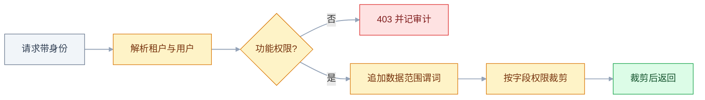
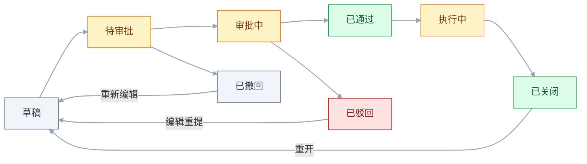
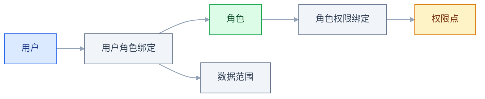

# B 端产品设计

## 一、工程案例：给一家制造企业设计多租户工单系统的权限模型

**场景**：一家制造企业，集团加 3 个工厂、2 个售后团队，共约 1200 人（示例数据量）。工单现在靠 Excel 和邮件流转，采购已经选定一套多租户 SaaS 工单系统，要求 6 周上线，**不改代码，只做配置**。约束条件写在合同附件里：

- 集团运营看全部工单汇总；厂长只看本厂；售后工程师只看自己负责的客户；财务能看金额，但不能改工单状态。
- 成本价、客户联系人手机号只对指定角色可见。
- 单张工单金额超过 5000 元走厂长审批，超过 20000 元再加财务总监；客户投诉工单要售后经理与质量经理会签。
- 客户 IT 要求 SSO 登录，审计日志保留 1 年（示例），上线前与旧系统并行两周。
- 历史工单 18 万条，附件约 40 万个，要从旧系统迁移。

目标不是「把功能做全」，而是产出一套**可复用的权限模型、审批流和验收表**。做完这一单，后面 20 个同行业客户只换组织树和阈值，不再开代码分支。

这一单的交付物固定为五份：组织与租户边界表、功能/数据/字段三张权限表、审批流配置表、迁移对账报告、验收记录。每份都要能被下一个人直接拿去复用，而不是只存在实施顾问的电脑里。

**先做权限模型的原因**：B 端项目最常见的返工不是功能少，而是权限太粗。第一版只有「管理员 / 普通用户」，第二个客户就会提出「销售只看自己、主管看团队、财务看全部但只能改金额」。一旦为客户写分支，后面每个客户都要维护一条分支，产品再也回不到主线。

**动手前确认**：组织架构表含汇报线；岗位清单与兼岗情况；旧系统字段、状态机、附件存放方式；客户编码规则；SSO 协议是 OIDC 还是 SAML；审计保留期限与导出要求。本节金额、阈值、比例均为示例。

下面出现的存储表与模型设计属于平台侧工作，不是为这个客户改代码；给客户交付时只动配置。两者混在一起看，容易把「产品要支持多租户」误解成「这一单要写多租户代码」。

### 1.1 组织、租户与数据边界

先分清五个概念。它们经常被混成一张「部门表」，导致后面权限、报表、计费全部缠在一起。

| 概念 | 回答的问题 | 本项目的取值 | 变更频率 |
|---|---|---|---|
| 租户 | 数据属于哪家客户 | 该集团一个租户，下面 3 个工厂 | 极低 |
| 组织单元 | 人挂在哪个组织节点 | 集团 / 工厂 / 车间 / 售后组 | 中 |
| 岗位 | 这个人做什么工作 | 厂长、调度、工程师、财务 | 低 |
| 角色 | 能操作什么 | 工厂管理员、调度员、工程师、财务、审计 | 中 |
| 数据范围 | 能看哪些行 | 全部 / 本厂 / 本部门及下级 / 本人负责客户 | 高 |

**岗位不是角色**。岗位是人力资源概念，角色是权限集合。一个人可以兼多个角色，例如厂长同时是「工厂管理员」和「审批人」；调岗时换角色绑定，不换账号。把岗位直接写成角色，遇到兼岗就要建「厂长兼财务」这种组合角色，角色数量会指数膨胀。

顺序固定：组织与租户边界 → 权限点 → 角色矩阵 → 数据范围 → 审批与字段 → 验收。每一步的产出都是下一步的输入，跳过任何一步，后面都要返工。

### 1.2 权限点清单

权限点按**业务动作**拆，不按菜单拆。菜单是界面组织方式，权限点是服务端校验的最小单位。同一个菜单里可能同时有查看、导出、批量关闭三种风险完全不同的动作。

```text
workorder:view          查看工单
workorder:create        新建工单
workorder:assign        派工与改派
workorder:edit_status   改状态
workorder:close         关闭工单
workorder:reopen        重新打开
workorder:export        导出工单
workorder:approve       审批工单
workorder:delete        删除工单
customer:view           查看客户
customer:edit           编辑客户
user:manage             管理成员与角色
audit:view              查看审计日志
config:manage           修改租户配置
```

三条拆分规则：

1. **导出必须单列**。能看 10 条和能带走 10 万条，风险不是一个量级。
2. **审批必须单列**。审批是「替组织做决定」，和编辑不是一回事。
3. **删除与关闭分开**。关闭是业务终结，删除是数据消失，后者通常只给管理员。

### 1.3 角色权限矩阵

功能权限决定「能不能进这个动作」，用 ✓ / — / △ 表示。△ 表示受限执行，具体限制写在数据范围表里。

| 权限点 | 集团运营 | 工厂管理员 | 调度员 | 工程师 | 财务 | 审计 |
|---|---|---|---|---|---|---|
| workorder:view | ✓ | ✓ | ✓ | ✓ | ✓ | ✓ |
| workorder:create | ✓ | ✓ | ✓ | — | — | — |
| workorder:assign | ✓ | ✓ | ✓ | — | — | — |
| workorder:edit_status | ✓ | ✓ | ✓ | △ | — | — |
| workorder:close | ✓ | ✓ | ✓ | △ | — | — |
| workorder:reopen | ✓ | ✓ | — | — | — | — |
| workorder:export | ✓ | ✓ | △ | △ | ✓ | ✓ |
| workorder:approve | ✓ | ✓ | — | — | ✓ | — |
| workorder:delete | — | ✓ | — | — | — | — |
| customer:view | ✓ | ✓ | ✓ | △ | ✓ | ✓ |
| customer:edit | ✓ | ✓ | ✓ | △ | — | — |
| user:manage | ✓ | ✓ | — | — | — | — |
| audit:view | ✓ | — | — | — | — | ✓ |
| config:manage | ✓ | — | — | — | — | — |

数据范围单独一张表。**角色相同、数据范围不同**，是同一个角色在多个组织里复用的关键。

| 角色 | 数据范围 | 边界说明 |
|---|---|---|
| 集团运营 | 全部 | 跨工厂汇总，可导出 |
| 工厂管理员 | 本厂及下级 | 不含其他工厂，可管本厂成员 |
| 调度员 | 本厂 | 可派本厂工单，不能跨厂借人 |
| 工程师 | 本人负责客户与本人被派工单 | 两条集合取并集 |
| 财务 | 全部 | 只读金额与结算字段，不能直接改状态（审批动作除外） |
| 审计 | 全部 | 只读，含历史版本与操作记录 |

字段权限再单独一层。它不改变「能看到哪条工单」，只改变「这条工单里哪些格子显示真值」。

| 字段 | 可见角色 | 呈现方式 |
|---|---|---|
| 成本价 | 集团运营、财务 | 原值 |
| 客户联系人手机号 | 调度员、工程师、集团运营 | 中间四位掩码 |
| 合同金额 | 集团运营、财务、审计 | 原值 |
| 内部备注 | 集团运营、工厂管理员 | 原值 |
| 客户评分 | 全部角色 | 原值 |

### 1.4 数据范围写成可执行规则

数据范围不是角色表上的一个标签，而是**每条查询都要追加的谓词**。功能权限、数据范围、字段权限三层都通过，才返回数据。



三层校验的顺序不能反：先确认这个人能不能做这个动作，再确认能看哪些行，最后裁剪这一行里哪些字段。反过来先查数据，会把无权访问的记录也读进内存，日志和缓存都跟着脏。

```text
全部（租户内）      → 1 = 1
本厂及下级          → org_path LIKE '/G1/P2/%'
本厂                → org_id = :org_id
本人                → owner_id = :uid
本人负责客户        → customer_id IN (SELECT customer_id FROM customer_owner WHERE user_id = :uid)
本人负责客户并集派工 → 上面的集合 UNION 被派工单集合
```

这段规则必须落在**统一的数据访问层**，不能每个接口各写一遍。以下入口最容易漏：

| 入口 | 漏掉的后果 |
|---|---|
| 列表与详情 | 最常测，详情接口仍要单独验 |
| 搜索联想 | 输入关键词就能看到别人的客户名 |
| 导出 | 列表过滤了，导出走另一条 SQL |
| 统计报表 | 汇总数包含无权数据，能从差额反推 |
| 消息与待办 | 推送里带工单标题和客户名 |
| 附件下载 | 拿到 file_id 就能绕过页面直接下载 |
| OpenAPI | 第三方集成不经过前端，最容易裸奔 |
| 打印模板 | 打印服务用管理员账号查数据 |

**最小实现**：在仓储层统一注入 `tenant_id` 和范围谓词，业务代码只传当前身份，不传 SQL 片段；策略函数一次判断功能权限、数据范围、字段可见性三层。

### 1.5 审批流按条件分支配置

审批流不是一条固定链路，而是「条件 → 节点 → 策略」的集合。先把矩阵写出来，再决定哪些字段可配。

| 条件 | 审批链 | 模式 | 超时处理 |
|---|---|---|---|
| 金额 < 5000 | 直属主管 | 单签（多人时或签） | 24 小时提醒 |
| 5000 ≤ 金额 < 20000 | 直属主管 → 厂长 | 依次 | 每节点 24 小时 |
| 金额 ≥ 20000 | 直属主管 → 厂长 → 财务总监 | 依次 | 每节点 48 小时 |
| 客户投诉工单 | 售后经理 + 质量经理（同一节点） | 会签 | 8 小时 |
| 安全类工单 | 厂长 + EHS 负责人（同一节点） | 会签 | 4 小时 |

模式是节点级属性：同一节点有多个人时选或签或会签，跨节点按箭头依次流转。把「主管 → 厂长」写成或签，会变成两个节点任选其一，金额分级就失效了；把会签写成两个节点，会变成先审完一个再审下一个，也不是会签。

带审批的工单是一条状态链，不是一排按钮。状态与允许的动作必须收紧，否则会出现「已驳回的单还能审批通过」。下图覆盖从草稿到关闭的完整链路；如果审批单独立建模，它在已通过或已驳回处结束，执行与关闭属于工单状态。



必须支持的异常路径：

| 异常 | 处理 |
|---|---|
| 审批人离职 | 角色绑定失效，自动转交给其上级或指定代理人 |
| 审批人请假 | 预设代理人，按时间段生效 |
| 加签 | 在当前节点插入临时审批人，原节点继续 |
| 转交 | 把待办转给同权限的人，留痕 |
| 撤回 | 仅「待审批」可撤，进入审批中后只能驳回 |
| 超时 | 提醒 → 升级 → 自动通过或自动转交，按单据类型定 |
| 关闭后重开 | 单独权限点，重开时记录原因并重新走审批 |

### 1.6 配置边界与自定义字段

配置化的目标是「客户自己改」，但不是什么都能配。**越靠近数据隔离和审计的，越不能开放。**

| 可配置 | 不可配置 |
|---|---|
| 角色与权限点组合 | 租户隔离条件 |
| 数据范围类型 | 权限校验入口 |
| 审批条件与节点 | 审计日志写入 |
| 自定义字段与表单 | 计费计量口径 |
| 列表列与筛选器 | 数据删除与保留策略 |
| 通知模板与 SLA 时限 | 越权判定逻辑 |

自定义字段的存储不要用「每个客户加一列」的宽表。正确做法是元数据表加值表，按类型分列存储，查询时按需透视。

```text
custom_field(
  id, tenant_id, entity, code, label,
  field_type, required, options_json, sort_no
)

custom_value(
  id, tenant_id, entity_id, field_id,
  value_text, value_number, value_date, value_bool
)

索引：(tenant_id, entity, entity_id)
```

**边界**：自定义字段适合承载「行业差异」，不适合承载「核心业务逻辑」。如果某个字段会参与审批条件、计费或权限判断，应升级为一等字段，否则每次算条件都要解析字符串，性能和一致性都会出问题。

### 1.7 审计、导出与 SSO

审计日志至少记七要素：**谁、什么时候、在哪个租户、对什么对象、做了什么、改前改后、结果如何**。再补 `request_id` 和来源 IP，才能串起一次完整操作。

| 字段 | 示例 | 用途 |
|---|---|---|
| occurred_at | 2026-10-22T10:15:00+08:00 | 排序与追溯 |
| actor_id | u_1024 | 定位操作人 |
| tenant_id | t_08 | 多租户隔离 |
| object | workorder:WO-2026-0018 | 定位对象 |
| action | status_changed | 区分动作 |
| before / after | 待派工 → 已派工 | 还原变更 |
| request_id | req_7f3a | 串联接口与日志 |
| ip | 10.2.3.4 | 来源定位 |
| result | success / denied | 区分成功与越权尝试 |

**审计表只追加，不更新、不删除**。保留期由合同约定，到期归档而不是直接清空。写入用独立连接或事件表，避免业务事务回滚把审计一起回滚。

导出走异步任务，创建时**冻结权限快照**。任务执行时用户可能已经被调岗，如果按执行时权限重算，会出现「申请时能导、下载时少了数据」；如果按创建时快照，至少口径可解释。下载链接设置有效期，并记录下载人与行数。快照只冻结数据范围，不冻结账号状态：账号被停用、租户到期或被移出角色时，链接应立刻失效。

SSO 用 OIDC 或 SAML，账号生命周期用 SCIM 同步。三个必须验收的点：停用账号在约定时间内失效；角色映射按规则落位；SSO 故障时有本地应急管理员，但该账号必须单独审计。

### 1.8 迁移、灰度与并行

迁移不是「把 Excel 导进去」，而是四件事：字段映射、去重、状态映射、对账。

| 阶段 | 动作 | 产出 |
|---|---|---|
| 盘点 | 旧系统表、字段、附件、用户 | 字段映射表 |
| 清洗 | 客户去重、手机号规范化、状态归一 | 清洗规则与异常清单 |
| 试迁 | 抽 5000 条迁到预发 | 差异报告 |
| 全量 | 停机窗口内迁完 | 数量与金额对账 |
| 并行 | 新旧双跑两周 | 差异工单清单 |
| 切换 | 旧系统只读 | 回滚预案 |

灰度按组织灰度，不按用户随机灰度。先上一个工厂，再上第二个，因为权限和审批是组织级行为，随机抽一部分用户会把同一张单的审批链拆散。

### 1.9 验收（12 项全过才算交付）

| # | 检查项 | 怎么验 | 通过标准 |
|---|---|---|---|
| 1 | 租户隔离 | 用租户 A 的账号请求租户 B 的工单 ID | 返回 404 或 403，且记越权日志 |
| 2 | 功能权限 | 工程师直接调用派工接口 | 403，不是前端按钮隐藏 |
| 3 | 数据范围 | 工程师列表总数与手工台账比对 | 只含本人负责客户与本人被派工单 |
| 4 | 字段权限 | 工程师与财务分别打开同一张工单 | 工程师看不到成本原值，财务看得到 |
| 5 | 导出不越权 | 工程师导出其可见工单 | 行数与列表一致，不含他人数据 |
| 6 | 审批分支 | 造 4999 / 5000 / 20000 三张单 | 审批链分别为主管、主管加厂长、再加财务总监 |
| 7 | 会签 | 提交一张客户投诉单 | 两方都通过才流转，缺一不可 |
| 8 | 离职兜底 | 停用当前审批人 | 约定时间内自动转交或升级提醒 |
| 9 | 审计完整 | 改状态、改权限、导出各做一次 | 关键字段齐全，含 request_id 与来源 IP，记录不可修改 |
| 10 | SSO 失效 | 在身份源停用账号 | 约定时间内不能登录，会话失效 |
| 11 | 迁移对账 | 全量迁移后核对 | 数量、金额、状态一致，抽样 200 条无误 |
| 12 | 配置生效 | 客户自建一个角色并绑定用户 | 保存后即生效，无需发版 |

> **第 1 项要用两个真实租户互打**，不要只测「没有 tenant_id 时是否报错」。串号往往发生在带了 tenant_id 但取值来自请求参数的场景。
> **第 5 项要真的下载文件**。很多系统列表过滤正确，导出走另一条查询，权限只在前端做了判断。
> **第 11 项要抽到金额和状态**。只对总数会对不上「同一张单拆成两张」这种结构性差异。

### 1.10 复制到下一个客户

可复制的不是一套固定角色，而是**模板加参数**：组织模板、角色模板、审批模板、字段字典、报表口径。复制前先看五个上限，超了就说明配置正在变成第二套代码。

| 配置项 | 建议上限 | 超限信号 |
|---|---|---|
| 角色数 | 30 个以内 | 出现「某某专用角色」 |
| 权限点 | 200 个以内 | 客户要求按按钮授权 |
| 审批流 | 20 条以内 | 同一条流复制多份只改金额 |
| 自定义字段 | 单实体 80 个以内 | 表单要分三步才能填完 |
| 组织层级 | 6 层以内 | 查询开始出现递归超时 |

表中上限是经验值，按客户规模与团队维护能力调整；真正的判断标准是「新增一个客户还要不要开发介入」。

---

## 二、高频问答：会卡住你的地方，也是面试最常问的

### 2.1 权限只有「管理员」和「普通用户」

**现场**

拿一张真实工单，逐个角色问「看不看得到、能不能改、能不能导出」，把答案填进矩阵；填不出来的格子就是缺口。

```text
客户原话：销售只能看自己的，主管看团队的，财务看全部但只能改金额。
翻译：数据范围 3 种 + 字段权限 1 组 + 动作权限 2 组。
```

**要点**

- 权限是数据模型的一部分，不是界面开关；上线后再细化，历史数据归属、审计、报表口径都要重算。
- 只有两个角色时，客户一句「销售看自己、主管看团队、财务看全部」就要求三种数据范围加字段权限。
- 判断够不够：同一张单上的动作组合超过两三种，两个角色就不够。

**追问**

- 为什么不能先上线再补权限？→ 权限是查询条件，后加要改所有列表、详情、导出、报表。
- 角色和岗位有什么区别？→ 岗位是组织身份，角色是权限集合，兼岗要换绑定而不是建组合角色。
- 权限矩阵怎么开始？→ 从一张真实单据出发，按角色填「看、改、导出」。

### 2.2 数据范围只在前端过滤

**现场**

浏览器 DevTools 抓列表接口，去掉前端参数重放，重点看 total、pageSize、返回数组长度；再用另一个账号的 ID 做越权测试，同时检查导出、搜索、统计、OpenAPI 四个旁路。

```text
浏览器 DevTools → Network → 复制请求 → 去掉前端参数重放
重点看：total、pageSize、返回数组长度
```

**要点**

- 前端过滤只影响显示，接口仍返回全量数据；改 URL、抓包、调 OpenAPI 都能拿到。
- 「看不见」不等于「拿不到」，越权测试要在接口层做。
- 导出、搜索、统计、OpenAPI、附件下载都是旁路，页面上的「我的工单」正常不代表没漏。

**追问**

- 前端已经过滤了，为什么还要服务端做？→ 前端只是渲染，抓包或直接调接口就绕过去了。
- 越权测试怎么造数据？→ 两个账号各一条数据，用 A 的会话请求 B 的 ID。
- 哪些地方最容易漏？→ 导出、搜索联想、统计报表、OpenAPI、附件。

### 2.3 多租户查询漏了 tenant_id

**现场**

全局搜索 SQL 与 ORM 查询，看 `tenant_id` 是否来自会话而不是请求参数；建两个租户各 1 条数据，用 A 的会话请求 B 的 ID；再查缓存键和附件 URL 是否含租户前缀。

```text
高危位置：
JOIN 的从表
GROUP BY 的汇总查询
Redis key：tenant:{id}:...
异步任务参数
对象存储路径 /tenant/{id}/...
```

**要点**

- 有字段不等于每条查询都带条件；关联表、统计表、缓存键、异步任务、附件路径任何一处漏掉都会串号。
- `tenant_id` 必须从会话取，不能从请求参数取。
- 串号一次就是事故，上线前必须专门验，不能等抽查发现。

**追问**

- 高危位置有哪几类？→ JOIN 从表、GROUP BY 汇总、缓存键、异步任务参数、对象存储路径。
- 为什么不能信请求参数？→ 参数可伪造，服务端只能信会话。
- 唯一索引要不要带 `tenant_id`？→ 要，不同租户可以各有 `WO-001`。

### 2.4 把岗位直接当角色

**现场**

问客户「有没有一个人同时管两个厂」「厂长休假谁批」；列出全部兼岗与代理场景，如果组合数量明显多于岗位数量，就该拆角色。

**要点**

- 岗位是人力资源概念，角色是权限集合；把岗位直接写成角色，遇到兼岗就要建「厂长兼财务」这种组合角色。
- 角色只装权限点，岗位另存组织关系；调岗时换角色绑定，不换账号。
- 组合数量明显多于岗位数量，就是拆角色的信号。

**追问**

- 兼岗怎么处理？→ 一个人绑多个角色，不新建组合角色。
- 岗位调整为什么会影响权限？→ 岗位直接当角色时，调岗会带走历史数据的可见性。
- 代理审批算角色吗？→ 算时间段的授权，不是新角色。

### 2.5 审批流写死在代码里

**现场**

统计客户提过的流程变体数量；让销售拿三个同行业客户的审批制度对比，差异部分就是要配置的字段；变体多且只差条件时，就说明需要配置化。

**要点**

- 审批条件随金额、组织、单据类型变化，写死意味着每个客户一条分支。
- 判断依据是「变体多且只差条件」，这种差异应该变成配置项而不是代码分支。
- 把「这个客户的流程」当成行业标准，是写死的根源。

**追问**

- 哪些该配置、哪些不该？→ 条件、节点、阈值可配；越权判定和审计写入不可配。
- 配置化到什么程度算过度？→ 客户改完后系统答不出「为什么走这条流程」就是过度。
- 会签和依次能配出来吗？→ 能，模式是节点级属性，跨节点按箭头流转。

### 2.6 审批人离职或请假，单据卡死

**现场**

停用一个审批人账号，看待办是否自动转移；看审计里有没有转交记录；兜底三条是离职转上级、请假时间段代理、超时提醒后升级。

**要点**

- 审批人不在岗时单据会永久停在某个节点，靠管理员手改不是方案。
- 兜底需要三条：离职转上级、请假时间段代理、超时提醒后升级。
- 这不是边界情况，是每个客户都会遇到的日常。

**追问**

- 离职转交给谁？→ 上级或指定代理人，并留痕。
- 超时之后自动通过还是转交？→ 按单据类型定，高风险单据只提醒升级，不自动通过。
- 代理要按时间生效吗？→ 要，请假是时间段，过期要自动收回。

### 2.7 自定义字段做成「每个客户加一列」

**现场**

看单表列数是否明显超出业务需要，或是否存在 `ext_1` 到 `ext_50` 这种命名；统计近半年新增字段数与使用率，长期无人使用的字段就是负担。

**要点**

- 每个客户加一列会把交付速度建在 schema 债务上：列越来越多、类型不一致、索引失控。
- 正确做法是元数据表加值表，按类型分列存，查询时按需透视。
- 参与审批、计费或权限判断的字段必须升级为一等字段，不能留在字符串里解析。

**追问**

- 宽表加列什么时候还能用？→ 字段少且稳定、行业差异不多的时候。
- EAV 的代价是什么？→ 查询要多次 JOIN，报表会变慢。
- 哪些字段不能放自定义字段？→ 参与审批条件、计费、权限判断的字段。

### 2.8 导出接口绕过权限

**现场**

用受限账号导出，比对文件行数与列表总数；再分别用工程师、财务、审计导出同一批数据，三个文件的行数和字段应各不相同。

**要点**

- 导出常走独立异步任务、独立 SQL、独立服务账号，权限链最容易断。
- 列表过滤对不等于导出对，两个入口要分别验。
- 下载链接要过期，下载行为本身要进审计；导出创建时要冻结权限快照。

**追问**

- 为什么导出要冻结快照？→ 执行时用户可能已调岗，按执行时权限重算会出现「申请时能导、下载时少了数据」。
- 快照要不要冻结账号状态？→ 不冻结，账号停用或租户到期时链接必须立刻失效。
- 怎么验最直接？→ 用受限账号真下载一次，比对行数与列表。

### 2.9 附件与文件 URL 没做鉴权

**现场**

用工程师账号拿到一张工单的附件 URL，再在没有该工单数据范围的账号会话里打开，最后用无痕窗口打开；两条都失败才算过。

**要点**

- 随机 ID 不可猜不等于有权限；文件常放在公开读的 Bucket、CDN 缓存、消息推送附件里。
- 附件下载必须和父对象的行级权限同源判断。
- 不可枚举是保密，不是鉴权。

**追问**

- 预签名 URL 够不够？→ 有时效但仍是持 URL 即可访问，要短有效期并绑定身份或一次性。
- CDN 缓存会绕过鉴权吗？→ 会，私有附件不能走公开缓存。
- 消息推送里的附件怎么处理？→ 推送里只给带鉴权的链接，不放直链。

### 2.10 审计日志只记登录

**现场**

让客户安全负责人说出三个必须追溯的动作，再看日志里有没有；随机抽一张已关闭工单，要求还原它从创建到关闭的完整操作链。

**要点**

- 采购要查的是「谁改了金额、谁关了单、谁导出了数据」，不是「谁登录过」。
- 审计至少记七要素：谁、什么时候、哪个租户、什么对象、做了什么、改前改后、结果如何，再补 `request_id` 和来源 IP。
- 审计表只追加，不更新不删除，写入用独立连接或事件表，避免业务回滚把审计一起回滚。

**追问**

- 只记成功操作够不够？→ 不够，越权尝试的 denied 也要记。
- 审计和业务事务能同一个事务吗？→ 不能，业务回滚会把审计一起回滚。
- 保留期到了怎么处理？→ 按合同归档，不直接清空。

### 2.11 组织调整后，历史数据看不到

**现场**

调岗一个用户，再用新身份查他调岗前负责的工单；检查历史单、待办、审批、报表四处是否仍然可达。

**要点**

- 历史工单的 `org_id` 还挂在旧组织，人走了旧组织下的数据就没人能看。
- 跟随人（按 `owner_id`）和跟随组织（按 `org_id`）必须选一个并写进产品说明。
- 组织调整不是「改个字段」，四处都要一起验。

**追问**

- 两种策略怎么选？→ 看业务：客户归属跟人，部门报表跟组织，混用要写清优先级。
- 组织合并时历史数据归谁？→ 迁移前先定归属规则，双写或映射表。
- 调岗后待办怎么办？→ 待办跟着新角色走，历史单按选定策略。

### 2.12 批量导入只报「上传成功」，不报逐行结果

**现场**

拿一份真实台账导入，含重复编码、空必填、超长文本、错误日期，看系统能否指出行号与原因；再用同一文件重复导入一次，看是否产生重复单。

```text
导入结果至少要给：
成功行数 / 失败行数 / 失败行号与字段
失败行是否已写入（部分成功还是整批回滚）
重复键的处理：跳过、覆盖、报错
```

**要点**

- 导入失败通常不是文件打不开，而是第 317 行编码重复、第 402 行日期格式不对、第 508 行必填为空。
- 结果至少给成功行数、失败行数、失败行号与字段，以及失败行是否已写入。
- 部分成功和整批回滚只能选一种口径，不能这次回滚、下次部分写入。

**追问**

- 重复键怎么处理？→ 跳过、覆盖、报错三选一，写进产品说明。
- 覆盖能改历史单吗？→ 通常只允许草稿状态，已进审批或已关闭只能追加。
- 为什么不能只报总数？→ 客户不知道改哪一行，等于没导。

---

## 三、核心知识：从零开始要建立的东西

### 3.1 三类角色与三本账

B 端产品的需求之所以难统一，是因为同一套系统里同时存在三本账：使用者要效率，决策者要可控，付费者要回报。三本账不冲突时是运气，冲突时才是设计。

| 角色 | 关心的账 | 典型诉求 | 产品回应 |
|---|---|---|---|
| 使用者 | 单位时间产出 | 少点几次、批量操作、快捷键 | 默认值、批量、模板 |
| 决策者 | 风险与责任 | 权限、审批、审计、可追溯 | 角色矩阵、审批流、日志 |
| 付费者 | 投入产出 | 可计算的 ROI、可对比的报价 | 报表、案例、计费透明 |

审计日志是典型例子：使用者一年不打开，但它是采购清单上的必问项。产品不能因为「没人点」就省掉。

### 3.2 权限的三个维度

| 维度 | 决定 | 失败表现 | 落点 |
|---|---|---|---|
| 功能权限 | 能不能执行动作 | 按钮藏了，接口还能调 | 服务端动作校验 |
| 数据范围 | 能看哪些行 | 列表正常，导出全量 | 查询谓词 |
| 字段权限 | 能看哪些列 | 工单可见，成本价也可见 | 序列化裁剪 |

三个维度是**与**的关系，不是**或**。很多系统只做功能权限，结果「有查看权限」等于「能看全公司」。

### 3.3 RBAC 的实体与关系

RBAC 不是「用户表加一个 role 字段」。标准关系是用户、角色、权限点三张表，外加用户角色绑定与角色权限绑定两张关联表。



**RBAC 只管功能，不管行**。RBAC 回答的是「这个用户能不能执行这个动作」；「能看哪些行、哪些字段」通常用属性策略实现（常被称作 ABAC 或策略权限），输入是用户属性、组织归属、客户归属、单据状态。把数据范围也塞进角色表，角色数量会随组织膨胀；只做 RBAC 不做数据范围，就是「有查看权限等于能看全公司」。角色继承（RBAC1）是可选项，层级超过两层再引入，否则一个权限来自哪里很难解释。

**多租户下的关键约束**：角色可以是租户自建，也可以是平台预置；但用户角色绑定必须带 `tenant_id`，否则一个用户在两个租户里的角色会互相污染。

> **面试**：常问「RBAC 和 ABAC 有什么区别？」答：RBAC 管功能权限，回答能不能执行这个动作；数据范围和字段可见性通常用属性策略实现。

### 3.4 数据范围的五种形态

| 形态 | 谓词 | 适合 | 风险 |
|---|---|---|---|
| 全部 | 租户内无附加条件 | 集团管理层、审计 | 范围过大，必须配字段权限 |
| 本组织 | `org_id = :org` | 单厂、单部门 | 组织调整后历史数据归属 |
| 本组织及下级 | `org_path LIKE :prefix` | 集团看分部 | 路径编码必须稳定 |
| 本人 | `owner_id = :uid` | 销售、客服 | 离职交接 |
| 指定集合 | `id IN (子查询)` | 负责客户、项目成员 | 集合过大时性能下降 |

两种范围叠加时，默认取**交集**；业务明确要求「并集」时，必须在产品里写清。例如工程师既要看「本人负责客户」，又要看「本人被派工单」，这是并集，不是交集。

### 3.5 字段级权限的落点

字段权限不要做在数据库列上，也不要做在前端组件里。正确落点是**序列化层**：同一份数据，按当前身份输出不同字段。

| 方案 | 做法 | 问题 |
|---|---|---|
| 数据库列权限 | 给不同角色开不同列 | 粒度太粗，难迁移 |
| 前端隐藏 | 组件不渲染 | 抓包即泄漏 |
| 接口裁剪 | DTO 按权限置空或掩码 | 推荐，需统一入口 |
| 独立接口 | 敏感字段单独查 | 成本高，易漏 |

**边界**：字段权限适合「少量敏感字段」，不适合「整张表按角色拆」。敏感字段较多时，应考虑独立实体或独立权限域。

### 3.6 多租户的三种隔离

| 级别 | 做法 | 成本 | 隔离强度 | 适合 |
|---|---|---|---|---|
| 行级 | 每行带 `tenant_id` | 低 | 依赖代码纪律 | 中小客户 SaaS |
| Schema | 每租户一个 schema | 中 | 中 | 中等规模、数据库同实例 |
| 物理 | 每租户独立库或实例 | 高 | 高 | 大客户、强合规 |

行级隔离的三个硬要求：所有业务表带 `tenant_id`（全局字典表除外）；所有查询从会话取租户，不从请求参数取；所有唯一索引包含 `tenant_id`。第三条最容易被忽略——同一个租户内不能有重复工单号，不同租户可以各有 `WO-001`。

> **面试**：常问「多租户三种隔离怎么选？」答：中小客户用行级隔离，中等规模同实例选 schema，大客户或强合规才上物理隔离。

### 3.7 组织树的建模

组织树不是简单的 `parent_id` 递归。需要同时支持上下级可见、跨部门协作、人员调动、组织合并。

| 模型 | 字段 | 优点 | 缺点 |
|---|---|---|---|
| 邻接表 | `id, parent_id` | 简单、写入快 | 查子孙要递归 |
| 路径枚举 | `id, path` | 查子孙一条 LIKE | 移动节点要批量改路径 |
| 闭包表 | `ancestor, descendant, depth` | 任意层级查询快 | 写入与维护复杂 |

**最小可用组合**：邻接表存结构，路径字段存 `'/G1/P2/D3/'` 用于范围查询。移动节点时在一个事务里更新子树路径，并记录组织变更历史。

### 3.8 审批流的状态机

审批流的本质是状态机加待办队列，不是「一串 if」。状态决定允许的动作，动作产生事件，事件驱动通知与审计。

| 状态 | 允许动作 | 不允许 |
|---|---|---|
| 草稿 | 编辑、提交、删除 | 审批 |
| 待审批 | 撤回、加签 | 编辑金额 |
| 审批中 | 通过、驳回、转交、加签 | 撤回、改表单 |
| 已通过 | 执行、查看 | 再次审批 |
| 已驳回 | 编辑后重提 | 直接通过 |
| 已撤回 | 编辑后重提、删除 | 审批 |
| 执行中 | 完工、关闭 | 改审批结论 |
| 已关闭 | 查看、归档、重开（单独权限） | 直接改字段 |

如果审批单独立建模，上表在「已通过 / 已驳回」处结束，「执行中 / 已关闭」属于工单状态；两套状态不要共用一个 `status` 字段，否则审批结论和执行进度会互相覆盖。

**边界**：状态越少越容易维护，但业务会要求「驳回后修改再提交」「关闭后重开」。每加一个状态，都要同时定义它对权限、通知、报表的影响。

### 3.9 会签、或签与加签

| 模式 | 规则 | 适合 | 实现要点 |
|---|---|---|---|
| 单签 | 指定一名审批人 | 直属主管、固定岗位 | 离职或请假必须能转交 |
| 或签 | 同一节点任一人通过即通过 | 主管代理、值班审批 | 通过后其余待办自动关闭 |
| 会签 | 同一节点全部审批人通过才通过 | 质量、安全、财务联审 | 记录每个人意见，缺一不可 |
| 依次 | 按顺序逐个审批 | 金额分级 | 前一节点通过才生成后一节点 |
| 加签 | 临时插入审批人 | 特殊事项 | 不改变原链路，记录加签原因 |

会签最容易漏的是「一票否决」与「弃权」规则。产品必须明确：弃权算通过还是算未处理；驳回后是退回发起人还是退回上一节点。

> **面试**：常问「会签和或签有什么区别？」答：或签同一节点任一人通过即通过，会签要全部通过，缺一不可。

### 3.10 配置化的三个层次

| 层次 | 内容 | 谁改 | 风险 |
|---|---|---|---|
| 基础配置 | 字段显示、列表列、主题、通知模板 | 客户管理员 | 低 |
| 业务配置 | 角色、审批流、表单、SLA | 客户管理员加实施 | 中 |
| 深度配置 | 自定义字段、报表、脚本、Webhook | 实施或开发 | 高 |

配置化的边界是**可解释性**：客户改完之后，系统要能回答「为什么这张单走了这条流程」。如果答案需要开发查代码，配置就过度了。

### 3.11 自定义字段的存储

三种常见方案，按查询需求选：

| 方案 | 结构 | 适合 | 代价 |
|---|---|---|---|
| 宽表加列 | 每个字段一列 | 字段少且稳定 | 列膨胀、迁移困难 |
| EAV 值表 | 一行一个字段值 | 字段多变、类型多 | 查询要多次 JOIN |
| JSON 列 | 一列存整个对象 | 展示型字段 | 索引与类型校验弱 |

**推荐组合**：元数据表管定义，值表按类型分列存，常用字段建联合索引。查询时只查当前表单需要的字段，不要 `SELECT *` 后在前端过滤。

### 3.12 审计日志的数据模型

审计日志是**事实表**，不是业务表的附属字段。它只追加，按时间分区，按租户隔离。

| 设计点 | 做法 | 原因 |
|---|---|---|
| 写入时机 | 业务结果确定后写，成功、失败、拒绝都写 | 成功与失败都要可追溯 |
| 事务 | 独立事务或 outbox | 避免业务回滚吞掉日志 |
| 内容 | 结构化字段加变更 diff | 可查询、可还原 |
| 保留 | 按合同分区归档 | 合规与成本平衡 |
| 访问 | 独立权限点 | 审计员能看，普通管理员不能改也不能删 |

### 3.13 数据口径的定义

同一个指标名，至少有五个口径要定：时间字段、对象范围、状态范围、金额口径、去重键。

| 口径项 | 选项 | 影响 |
|---|---|---|
| 时间 | 创建、派工、关闭、结算 | 月度数据差异明显 |
| 范围 | 全部、本组织、本人 | 权限与报表必须一致 |
| 状态 | 含草稿、含驳回、含重开 | 工单量明显不同 |
| 金额 | 含税、未税、含折扣 | 财务对不上 |
| 去重 | 工单号、客户加日期 | 重复工单被算两次 |

**写法**：指标定义要写成一句可执行的话，例如「本月工单量 = 结算时间在本月、状态不为草稿、按工单号去重后的数量」。写不成这句话，说明口径还没定。

### 3.14 身份集成与 SSO

| 协议 | 适合 | 关键点 |
|---|---|---|
| OIDC | 新系统、互联网身份 | ID Token 校验、nonce、过期时间 |
| SAML | 传统企业、已有 IdP | 断言签名、受众、时钟偏差 |
| LDAP | 内网老系统 | 通常只做认证，细粒度授权仍在本系统 |
| SCIM | 账号生命周期 | 创建、更新、停用同步 |

SSO 只解决「谁在登录」，不解决「登录后能做什么」。角色映射仍要在本系统里做，且要保留一个应急本地管理员；这个账号必须单独审计，不能成为共享后门。

### 3.15 批量导入的四个关口

导入和导出是一对：导出怕越权，导入怕脏数据。零基础产品经理最容易漏的是「失败行怎么处理」，而不是「文件能不能解析」。

| 关口 | 要定的事 | 常见失败 |
|---|---|---|
| 模板 | 列名、必填、枚举、示例行、版本号 | 客户拿旧模板导入，列错位 |
| 校验 | 类型、长度、枚举、外键、唯一键、必填 | 脏数据进库，后面报表全错 |
| 事务 | 整批回滚还是按行提交 | 一半成功一半失败，无法对账 |
| 反馈 | 行号、字段、原因、可下载的错误文件 | 客户不知道改哪一行 |

**边界**：「覆盖」语义必须写清：按业务主键覆盖、按记录 ID 覆盖，还是只追加。覆盖会改历史数据，通常只允许在草稿状态使用；已进入审批或已关闭的单据，导入只能追加新单。

### 3.16 实施交付的节奏

| 阶段 | 关键动作 | 常见延误 |
|---|---|---|
| 调研 | 组织、流程、字段、报表 | 客户给不出统一口径 |
| 方案 | 权限矩阵、审批流、集成 | 方案评审反复 |
| 迁移 | 清洗、试迁、对账 | 历史数据质量差 |
| 配置 | 角色、表单、通知 | 客户临时加需求 |
| 培训 | 管理员加使用者 | 关键用户不到场 |
| 上线 | 灰度、并行、切换 | 旧系统不肯停 |
| 陪跑 | 1 到 4 周支持 | 问题集中爆发 |

**最容易被低估的是迁移与培训**。迁移决定能不能上线，培训决定第二年续不续费。

---

## 四、冷门知识汇总

| 知识点 | 为什么冷门 | 用到时的关键词 |
|---|---|---|
| 组织合并 | 并购或架构调整时才遇到，历史数据归属会打架 | 组织迁移、数据归属、双写 |
| 配置版本化 | 客户改坏配置后无法回滚，才知道要版本 | 配置快照、发布、回滚 |
| 角色冲突检测 | 角色少时不会冲突，角色多了会出现「互斥权限同一人持有」 | SoD、职责分离 |
| 租户模板 | 每个客户从零配一遍，实施成本下不来 | tenant template、预置角色 |
| 权限模拟器 | 客户管理员不敢改权限，因为看不到影响范围 | what-if、影响面分析 |
| 私有化交付 | SaaS 团队很少考虑，政务客户一上来就问 | 离线安装、升级包、License |
| 工单号断号 | 并发创建时才发现序号重复或跳号 | 序列、号段、幂等 |
| 金额精度 | 用浮点算钱，对账时差几分钱 | 分为单位、Decimal、舍入规则 |
| 跨时区截止时间 | 只有一个时区时不会暴露，异地审批才对不上 | UTC 存储、时区展示、SLA |
| 软删除与唯一索引 | 删掉再建同编码记录时冲突，才发现唯一键没排除已删 | 部分索引、deleted_at |

表中只放低频、可现查的条目；越权、串号、审计缺失这类低频但致命的问题已经放在第二节。
